# MLT Week 1: Principal Component Analysis Notes

**Flow:** Data ko fewer numbers mein represent karna → projection → best direction → centering/covariance → eigenvectors → residuals → variance aur rank → storage → dual PCA → complete master problem.

## 1. Representation learning: Compression ka idea

### 1.1 Supervised, unsupervised aur PCA

**Short definition:** Supervised learning mein features ke saath target labels milte hain; unsupervised learning mein sirf features milte hain aur unka structure discover karte hain.

House features se given price predict karna supervised hai. Bina labels ke similar houses group karna clustering; many correlated features ko fewer coordinates mein represent karna **representation learning** hai.

**PCA:** Principal Component Analysis orthogonal directions choose karti hai jinke along data ka maximum variance retain ho. Fewer directions rakhkar approximate reconstruction milti hai. Data already lower-dimensional linear space mein ho toh exact reconstruction bhi possible hai.

**Real life:** Height inches aur height centimetres two columns hain, par independent information ek hi hai. Dono numbers store karne ke bajay ek number aur conversion rule enough hai. PCA similar redundancy identify karti hai, though practical features usually perfectly dependent nahi hote.

### 1.2 Representative vector aur coefficient

Ek fixed nonzero vector $w\in\mathbb R^d$ aur each point ka scalar $c_i$ store karo:

$$\hat x_i=c_iw.$$

Point line $\operatorname{span}(w)$ par ho toh $x_i=c_iw$ exactly. Line se bahar ho toh $\hat x_i$ point ka approximate proxy hai. Zero representative se sirf zero reconstruct hoga; nonzero data compress nahi kar sakte.

### M1 — Exact representation before PCA

Handwritten notes, pp. 2–3; AI notes ka same motivating example.

**Question:** Consider $D=\{(-7,-14),(2.5,5),(1,2),(0,0)\}$. Using $w=(2.5,5)$ as a representative, find the coefficients, reconstruct the points, and compare the number of stored scalars with direct storage.

**Step 1 — Pattern:** Har point $y=2x$ satisfy karta hai, aur $w$ bhi isi line par hai.

**Step 2 — Coefficients:** $c_i=x_{i1}/2.5=x_{i2}/5$.

| Point | Coefficient | Reconstruction $c_iw$ |
|---|---:|---|
| $(-7,-14)$ | $-2.8$ | $(-7,-14)$ |
| $(2.5,5)$ | $1$ | $(2.5,5)$ |
| $(1,2)$ | $0.4$ | $(1,2)$ |
| $(0,0)$ | $0$ | $(0,0)$ |

**Step 3 — Error:** Reconstructed points same hain, so error zero.

**Step 4 — Storage:** Direct $dn=2\times4=8$ numbers. Representative ke 2 numbers + four coefficients = 6 numbers. Saving $(8-6)/8=\boxed{25\%}$.

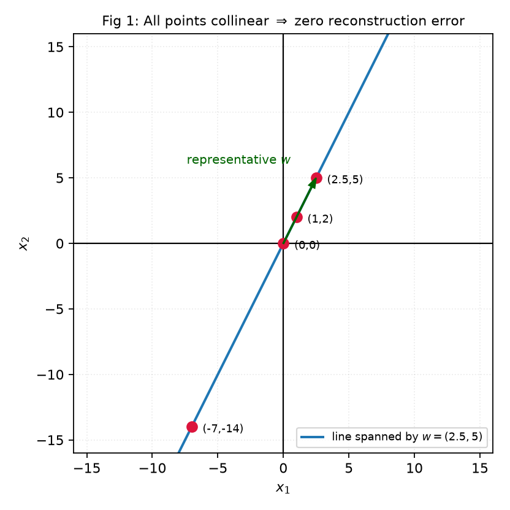

Yahan arbitrary representative use hua hai; dataset centered nahi hai. Standard PCA mein pehle mean subtract karenge. Reconstruction ke saath mean ka role Section 4 mein aayega.

## 2. Projection: Point line par nahi ho toh?

### 2.1 Scalar, vector aur error ko separate rakho

**Definition:** Orthogonal projection kisi line/subspace par point ka nearest point hai. Torch ki shadow jaisa socho, but shadow **perpendicularly** drop hoti hai.

For any nonzero $w$:

$$\boxed{c^*=\frac{x^Tw}{w^Tw}},\qquad
\boxed{\hat x=c^*w},\qquad e=x-\hat x.$$

PCA directions ko unit length choose karte hain: $\|w\|=1$. Tab:

$$\boxed{c=x^Tw},\qquad\boxed{\hat x=(x^Tw)w},\qquad\boxed{e=x-(x^Tw)w}.$$

| Quantity | Type | Meaning |
|---|---|---|
| $c=x^Tw$ | Scalar | Signed coordinate along unit direction |
| $(x^Tw)w$ | $d$-dimensional vector | Reconstructed point on line |
| $|x^Tw|$ | Nonnegative scalar | Projection vector ki length |
| $e$ | $d$-dimensional vector | Lost component |
| $\|e\|^2$ | Nonnegative scalar | Squared reconstruction error |

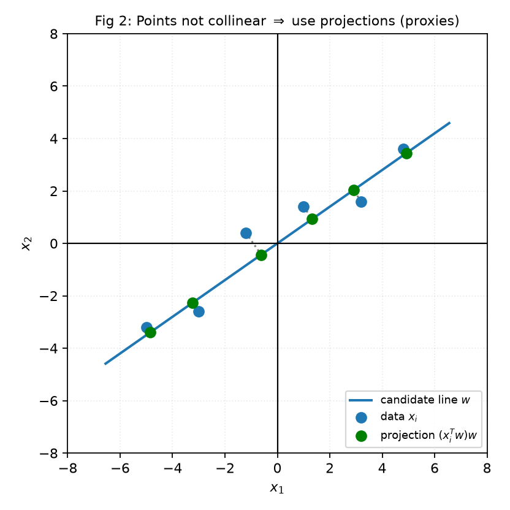

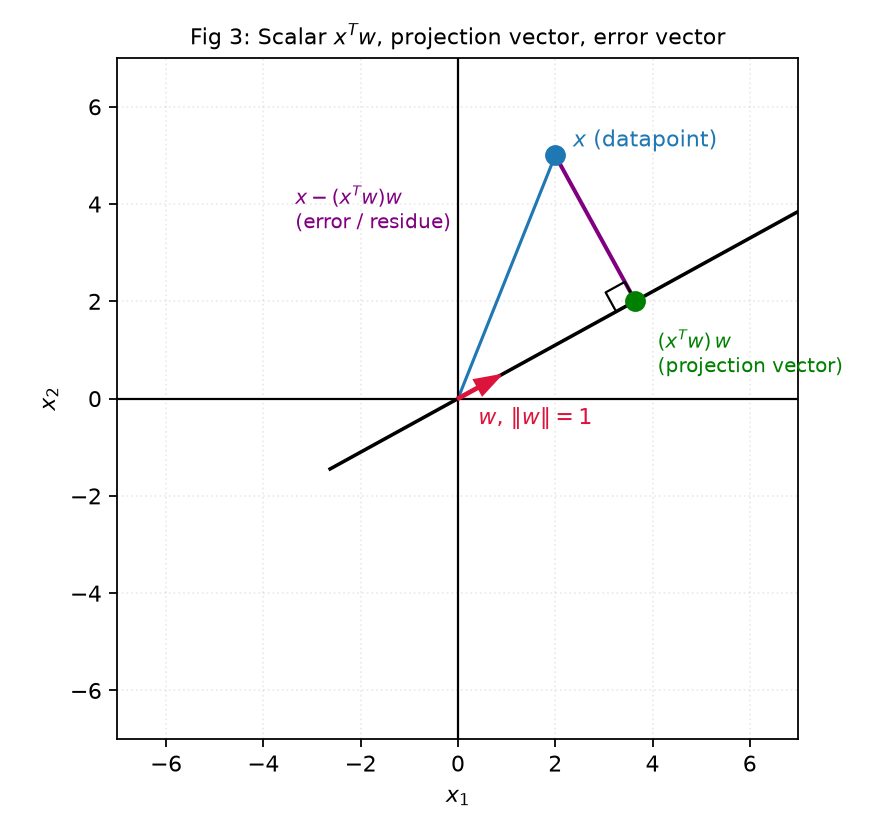

### 2.2 Properties with intuition

Projection ka residual perpendicular hai: $e^Tw=0$. Isliye right triangle banta hai:

$$\boxed{\|x\|^2=(x^Tw)^2+\|e\|^2}\quad(\|w\|=1).$$

**Sign flip:** $w\to-w$ karne par coefficient ka sign reverse hota hai, reconstruction same: $(-x^Tw)(-w)=(x^Tw)w$. Ek PC direction ke dono signs valid hain.

**Counterexample to “unit formula always works”:** $x=(3,4),w=(2,0)$ par $x^Tw=6$, but correct coefficient $6/4=1.5$ hai. Galat formula $cw=(12,0)$ dega; actual projection $(3,0)$ hai.

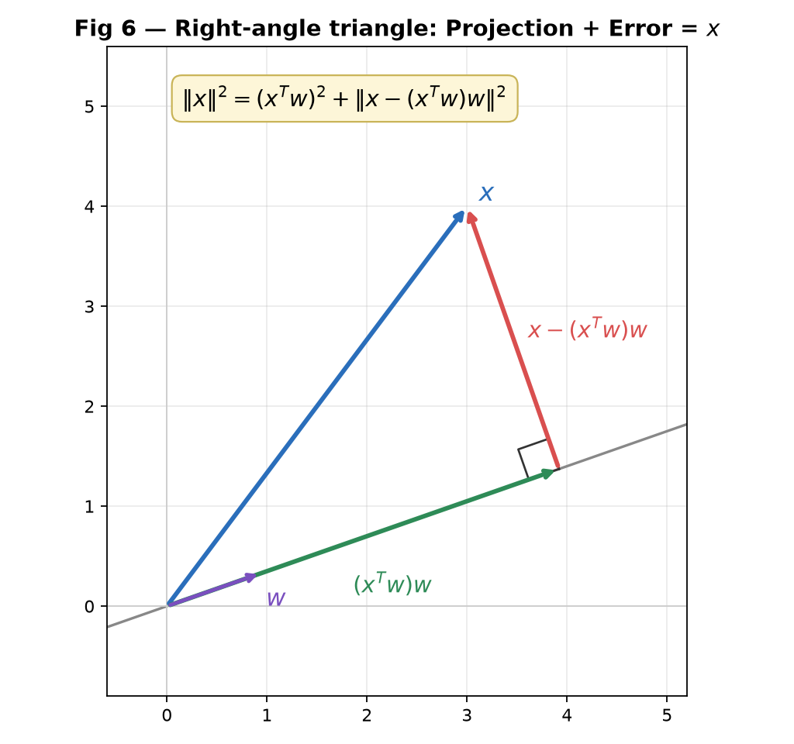

### M2 — Projection calculation and non-unit variation

Handwritten notes, p. 7.

**Question:** Let $x=(3,4)$ and $w=(1,0)$. Find the scalar projection, projection vector, residual vector, and squared reconstruction error. Verify orthogonality.

**Step 1:** $\|w\|=1$, so $c=3(1)+4(0)=\boxed3$.

**Step 2:** $\hat x=cw=3(1,0)=\boxed{(3,0)}$.

**Step 3:** $e=(3,4)-(3,0)=\boxed{(0,4)}$.

**Step 4:** $e^Tw=0(1)+4(0)=0$; perpendicular condition satisfied.

**Step 5:** $\|e\|^2=0^2+4^2=\boxed{16}$. Cross-check: $\|x\|^2-c^2=25-9=16$.

**Question:** If the representative is instead $w=(2,0)$, find the minimizing coefficient and the projection.

**Solution:** Same line hai, but representative ki scale different. $c=(x^Tw)/(w^Tw)=6/4=1.5$, hence $cw=(3,0)$ and error still 16.

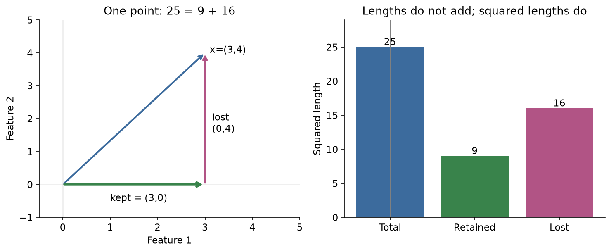

For fixed nonzero $w$, $f(c)=\|x-cw\|^2$ upward-opening quadratic hai. Minimum perpendicular projection par aata hai; har question mein calculus repeat karne ki need nahi.

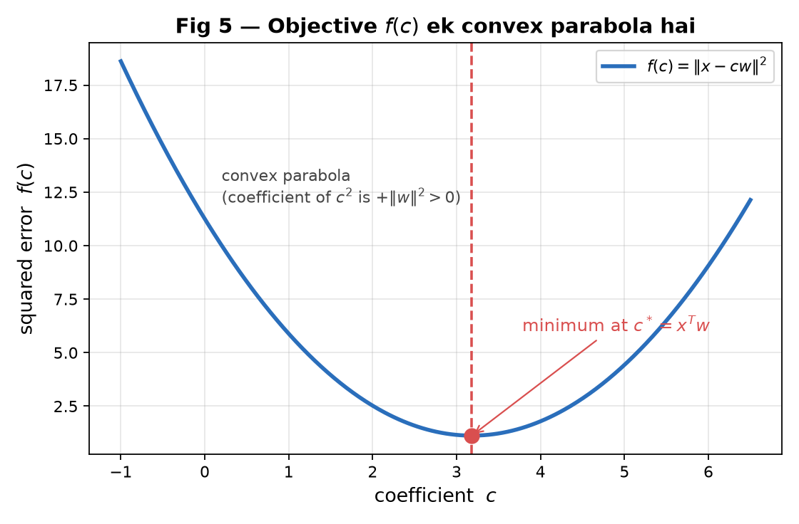

## 3. Best direction: Minimum error means maximum retained variance

### 3.1 Ek point ki nearest projection se dataset ki best line tak

Abhi $w$ given tha. PCA mein **best $w$ choose** karna hai. Centered points $x_i$ ke liye:

$$\min_{\|w\|=1}\frac1n\sum_i\|x_i-(x_i^Tw)w\|^2
\quad\Longleftrightarrow\quad
\max_{\|w\|=1}\frac1n\sum_i(x_i^Tw)^2.$$

Reason: Pythagoras mein total $\frac1n\sum_i\|x_i\|^2$ fixed hai. Retained part badhega toh lost part ghatega.

**Graph intuition:** Good line data ke main spread ke along hoti hai. Us par projections spread out hote hain aur perpendicular errors small. Perpendicular bad direction mein projections crowded ho jaate hain.

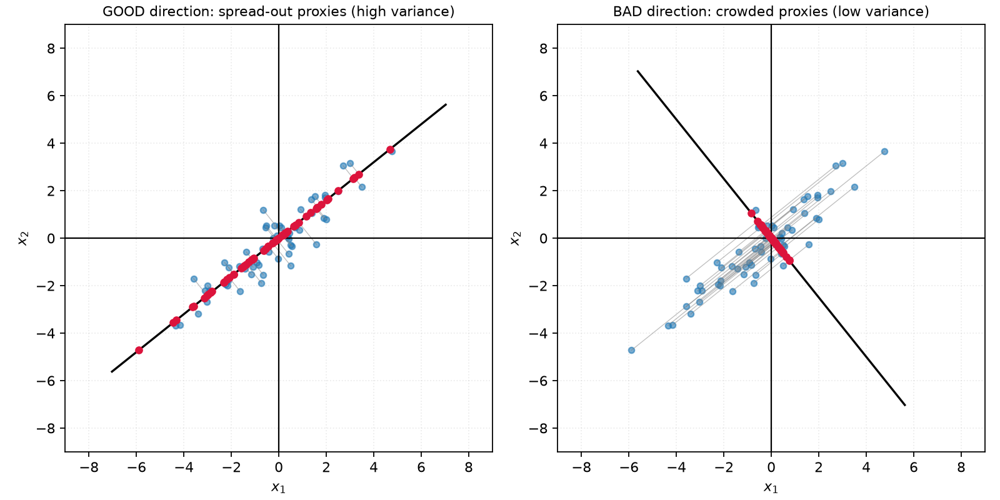

“Most spread” ka matlab **variance** hai, sirf largest endpoint gap nahi. Same range wale coordinate sets bhi different variances rakh sakte hain.

### M3 — Graph se first PC identify karna

AI notes · Q5.

**Question:** Six data points in $\mathbb R^2$ and four candidate lines through the origin—blue, green, red and orange—are shown below. Which line represents the first principal component direction?

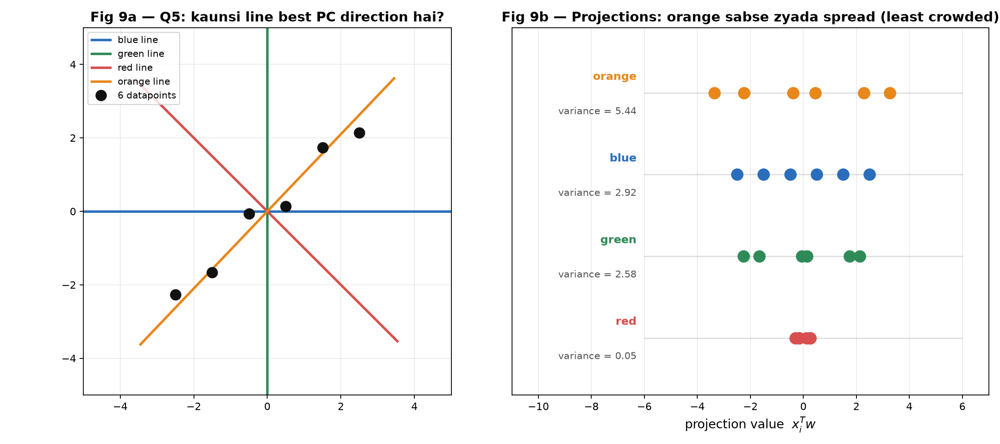

**Step 1:** Har candidate line par perpendicular projections dekho.

**Step 2:** Orange direction data ke long trend ko follow karti hai. Red direction almost perpendicular hai, isliye projections crowded hain.

**Step 3:** Displayed AI illustration mein projection variances orange $\approx5.44$, blue $\approx2.92$, green $\approx2.58$, red $\approx0.05$ hain. Largest orange:

$$\boxed{\text{Orange line}}.$$

Graph AI notes ki illustration hai; displayed decimals us illustration ke hain. Exam mein actual given points/projections follow karo. Non-centered points hon toh variance calculate karne se pehle projected mean subtract karna hoga.

### M4 — Projection lengths se variance

AI notes · Q7; handwritten p. 9.

**Question:** The lengths of the projections of six points from a centered dataset onto the first principal component are $\{8,7,3,5,2,4\}$. What is the variance along that component?

**Step 1:** Lengths $|x_i^Tw_1|$ hain. Squaring ke baad signs irrelevant hain.

**Step 2:** Squares sum karo: $64+49+9+25+4+16=167$.

**Step 3:** Centered-data, $1/n$ convention use karke intended calculation:

$$\boxed{\operatorname{Var}(w_1)=167/6\approx27.83}.$$

**Data caveat:** Exact listed lengths ka sum 29 hai, odd. Unhe plus/minus signs dekar zero sum nahi ban sakta; thus exactly centered six-point data ke saath printed lengths inconsistent hain. Above answer supplied exercise ka intended square-average hai. Lengths ka ordinary mean subtract karke variance nikalna bhi correct replacement nahi, because signed coordinates missing hain.

### M5 — Collinear data: PC, variance and zero error

AI notes · Q9; handwritten p. 8 same dataset par point projection karta hai.

**Question:** Let $D=\{(-2,-6),(-1,-3),(1,3),(2,6)\}$. Find (i) the first principal component, (ii) the variance along it, and (iii) the variance along the second principal component.

**Step 1:** Coordinate sums zero, so mean $(0,0)$.

**Step 2:** Data $y=3x$ par hai. Direction $(1,3)$ normalize karo:

$$\boxed{w_1=(1,3)/\sqrt{10}}.$$

**Step 3:** Coordinates $x_i^Tw_1$ are $-2\sqrt{10},-\sqrt{10},\sqrt{10},2\sqrt{10}$.

$$\operatorname{Var}(w_1)=\frac{40+10+10+40}{4}=\boxed{25}.$$

**Step 4:** Perpendicular unit direction $w_2=(-3,1)/\sqrt{10}$ par har dot product 0. So second variance $\boxed0$.

**Point check:** $(2,6)$ ka coefficient $2\sqrt{10}$; reconstruction $2\sqrt{10}\,(1,3)/\sqrt{10}=(2,6)$. One PC se exact reconstruction; opposite PC sign bhi valid.

## 4. Centering and covariance: Best direction calculate kaise karein?

### 4.1 Mean subtract kyun karte hain?

**Definition:** Centering means feature-wise mean subtract karna:

$$\mu=\frac1n\sum_i x_i,\qquad\tilde x_i=x_i-\mu,\qquad\sum_i\tilde x_i=0.$$

PCA data ke **mean ke around variation** capture karti hai. City ke houses door location par hon toh origin se distance important nahi; houses ka aapas mein spread important hai.

Raw coordinates mein reconstruction:

$$\boxed{\hat x_i=\mu+W_kW_k^T(x_i-\mu)}.$$

Thus raw-space fitted line generally mean se guzarti hai, origin se zaroori nahi. Centered coordinate system mein origin se guzarti hai.

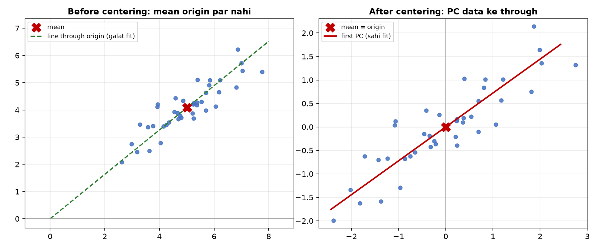

**Centering versus standardization:** Mean subtract karna spread scale nahi badalta. Standardization additionally standard deviation se divide karti hai. Rupees versus years jaise unequal units PCA direction dominate kar sakte hain. Standardization choice problem context par depend karti hai; covariance PCA aur standardized-data PCA same result dena guaranteed nahi.

### 4.2 Matrix convention and covariance entries

In notes mein **points columns** hain:

$$X_c=[\tilde x_1\ \cdots\ \tilde x_n]\in\mathbb R^{d\times n},\qquad
\boxed{C=\frac1nX_cX_c^T=\frac1n\sum_i\tilde x_i\tilde x_i^T}.$$

$C$ shape $d\times d$; diagonal entries feature variances, off-diagonal entries feature covariances:

$$C_{jk}=\frac1n\sum_i\tilde x_{ij}\tilde x_{ik}.$$

For unit $w$, $\boxed{\operatorname{Var}(w)=w^TCw}$.

$1/(n-1)$ sample covariance use ho toh eigenvalues/variances $n/(n-1)$ factor se change hote hain; eigenvectors aur explained-variance ratios same. Question ka denominator follow karo. Yahan default $1/n$ hai.

### M6 — Centered points se covariance

Handwritten p. 11.

**Question:** Find the covariance matrix of the dataset $\{(2,1),(1,2),(-2,-1),(-1,-2)\}$ using the $1/n$ convention.

**Step 1:** Mean $(0,0)$, so points already centered.

**Step 2:** Required products:

| Point | $x_1^2$ | $x_2^2$ | $x_1x_2$ |
|---|---:|---:|---:|
| $(2,1)$ | 4 | 1 | 2 |
| $(1,2)$ | 1 | 4 | 2 |
| $(-2,-1)$ | 4 | 1 | 2 |
| $(-1,-2)$ | 1 | 4 | 2 |
| Sum | 10 | 10 | 8 |

**Step 3:** Each entry ko $n=4$ se divide:

$$\boxed{C=\begin{bmatrix}2.5&2\\2&2.5\end{bmatrix}}.$$

Cross-check: symmetric hai, trace 5; positive covariance means dono features together move karte hain.

### 4.3 Covariance properties and principal directions

$C$ symmetric positive semidefinite hai: real, nonnegative eigenvalues. Orthonormal eigenvectors choose kar sakte hain. Descending order:

$$\lambda_1\geq\lambda_2\geq\cdots\geq\lambda_d\geq0,\qquad Cw_j=\lambda_jw_j.$$

$$\boxed{\text{PC}_1=w_1\text{ for largest }\lambda_1},\qquad
\boxed{\operatorname{Var}(w_j)=\lambda_j}.$$

Total variance $\boxed{\operatorname{tr}(C)=\sum_j\lambda_j}$. Smallest eigenvalue direction least variance retain karti hai, not first PC.

**Non-uniqueness:** Sign always arbitrary. Repeated eigenvalues ho toh associated eigenspace mein multiple orthonormal choices possible. “Every eigenvector pair automatically orthogonal” repeated eigenvalues ke liye false; PCA orthonormal basis **choose** karti hai.

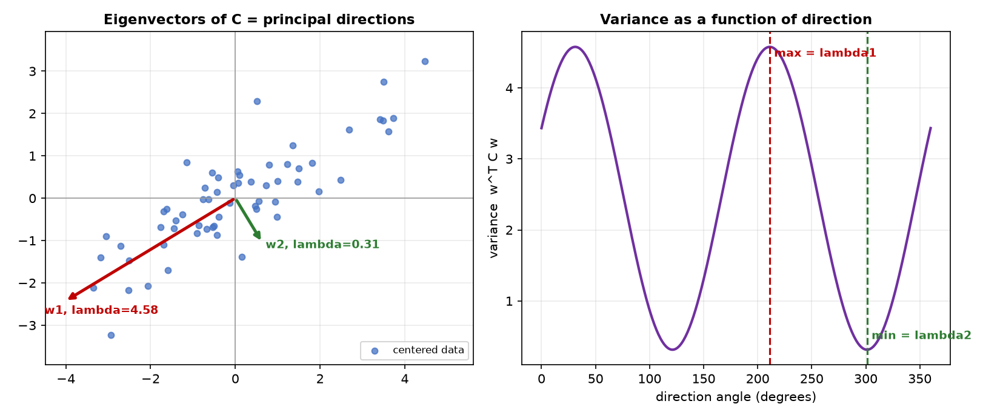

### M7 — Cube covariance and equal-variance directions

Handwritten pp. 11–12.

**Question:** Eight data points are the corners $(\pm1,\pm1,\pm1)$ of a cube of side length 2 centered at the origin. Find the covariance matrix, the sum of all its entries, and the variance along any unit vector $v$.

**Step 1:** Every feature mein four $+1$, four $-1$, so mean zero.

**Step 2:** Diagonal entries: each squared coordinate 1, average 1.

**Step 3:** Off-diagonal products four $+1$, four $-1$, so average zero.

$$\boxed{C=I_3},\qquad\boxed{\text{sum of all entries}=3}.$$

**Step 4:** $v^TCv=v^Tv=1$, hence every unit direction has variance $\boxed1$.

No unique best PC1: any unit vector can be first, then orthonormal completion choose karo. All eigenvalues 1. General matrix mein **sum of all entries** total variance nahi; total variance **trace** hai. Cube mein off-diagonal zero hone se dono coincide hue.

### M8 — Given covariance, candidate PCs and transformed covariance

AI notes · Q1; handwritten pp. 13–14.

**Question:** A centered dataset has covariance $C=\begin{bmatrix}1&2\\2&4\end{bmatrix}$. Two candidate unit vectors are $u=(-0.894,0.447)^T$ and $v=(0.447,0.894)^T$. (i) Which is the first PC? (ii) How much variance does it capture? (iii) What is the covariance after transforming to the principal-component basis?

**Step 1:** Decimals rounded hain. Exact directions $u=(-2,1)/\sqrt5$, $v=(1,2)/\sqrt5$ use karo.

**Step 2:**

$$Cu=\frac1{\sqrt5}\begin{bmatrix}-2+2\\-4+4\end{bmatrix}=0,$$

$$Cv=\frac1{\sqrt5}\begin{bmatrix}1+4\\2+8\end{bmatrix}=5v.$$

**Step 3:** $v$ ki variance 5, $u$ ki 0. Therefore $\boxed{\mathrm{PC}_1=v}$, captured variance $\boxed5$; fraction $5/(5+0)=100\%$.

**Step 4:** Basis columns $W=[v\ u]$ ordered by decreasing eigenvalue:

$$\boxed{C_z=W^TCW=\begin{bmatrix}5&0\\0&0\end{bmatrix}}.$$

Sirf PC1 retain ho toh reduced covariance $[5]$ is $1\times1$. Full-basis rotation ka covariance $2\times2$. Question “transform” versus “reduce” distinguish karo.

### M9 — Raw points se complete 2D PCA

AI notes · Q10; handwritten pp. 20–21 and 31 par same dataset. Ek hi solution yahan.

**Question:** For $x_1=(2,2),x_2=(1,2),x_3=(2,1)$, find the mean, covariance matrix, eigenvalues, principal directions, and percentage of variance explained by the first PC.

**Step 1 — Mean:**

$$\boxed{\mu=(5/3,5/3)}.$$

**Step 2 — Center:**

$$\tilde x_1=(1/3,1/3),\quad\tilde x_2=(-2/3,1/3),\quad\tilde x_3=(1/3,-2/3).$$

Their sum zero: useful quick check.

**Step 3 — Covariance entries:**

$$C_{11}=\frac13\frac{1+4+1}{9}=\frac29,\quad C_{22}=\frac29,$$

$$C_{12}=\frac13\frac{1-2-2}{9}=-\frac19.$$

$$\boxed{C=\frac19\begin{bmatrix}2&-1\\-1&2\end{bmatrix}}.$$

**Step 4 — Eigenpairs:** For $\begin{bmatrix}a&b\\b&a\end{bmatrix}$, directions $(1,1)$ and $(1,-1)$ have eigenvalues $a+b,a-b$. Here:

$$\boxed{\lambda_1=1/3,\ w_1=(1,-1)/\sqrt2},\qquad
\boxed{\lambda_2=1/9,\ w_2=(1,1)/\sqrt2}.$$

**Step 5 — Fraction:** Total $1/3+1/9=4/9$. PC1 fraction $(1/3)/(4/9)=\boxed{75\%}$; PC2 25%.

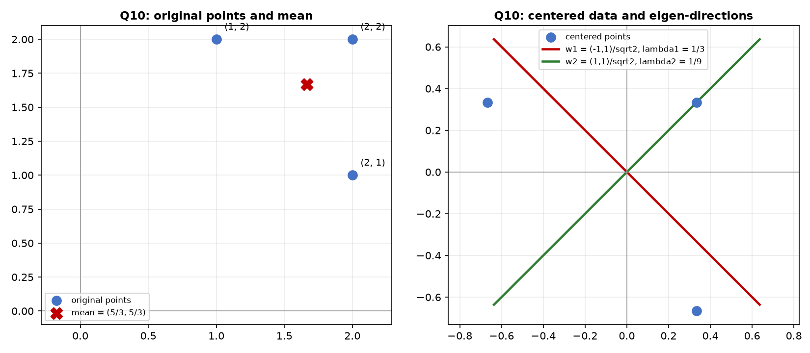

Raw first-PC line mean se guzarti hai: $x_1+x_2=10/3$. Eigenvector direction $(1,-1)$ ko raw origin se line bana dena wrong hoga.

## 5. Residuals, multiple PCs and coordinates

### 5.1 Round-wise PCA

**Definition:** First PC capture karne ke baad bacha vector residual hai:

$$r_i^{(1)}=\tilde x_i-(\tilde x_i^Tw_1)w_1.$$

Residuals $w_1$ ke perpendicular hain. Unki highest-variance direction next PC hai. PCA repeatedly same variation choose nahi karti; har next PC previous PCs se orthogonal hoti hai.

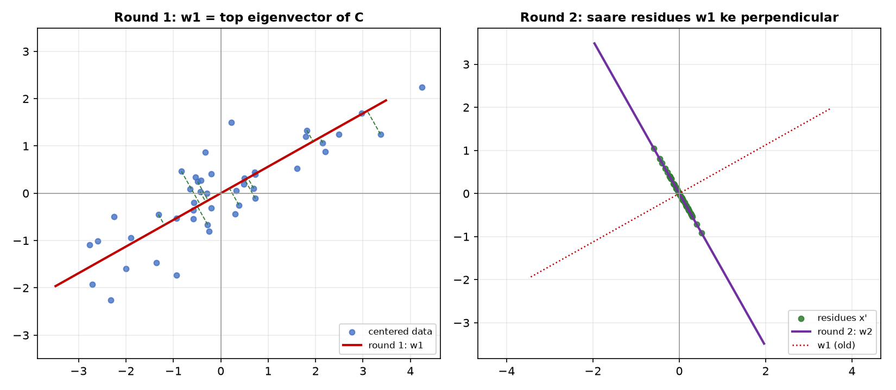

For $W_k=[w_1\ \cdots\ w_k]$, $W_k^TW_k=I_k$:

$$\boxed{z_i=W_k^T\tilde x_i\in\mathbb R^k},\qquad
\boxed{\hat x_i=\mu+W_kz_i},\qquad
\boxed{r_i=\tilde x_i-W_kW_k^T\tilde x_i}.$$

Coordinates $z_i$ compressed data hain, eigenvectors $W_k$ shared decoder/basis hain. $W_kW_k^T$ projection matrix hai, symmetric aur idempotent; generally identity tabhi jab full ambient basis retain ho.

### M10 — Missing projection length from residual error

AI notes · Q8; handwritten p. 15.

**Question:** Six centered points in $\mathbb R^2$ have second-PC projection magnitudes $\{1,2,1,3,2,k\}$. Their average squared reconstruction error after retaining only the first PC is $28/6$. Find $k>0$.

**Step 1:** 2D mein discarded direction sirf $w_2$ hai. Thus each error squared equals second-coordinate squared.

**Step 2:**

$$\frac{1^2+2^2+1^2+3^2+2^2+k^2}{6}=\frac{28}{6}.$$

**Step 3:** $19+k^2=28$, so $k^2=9$. Given positive condition:

$$\boxed{k=3}.$$

Magnitude wording important: six strictly positive **signed** PC coordinates centered dataset ke liye zero mean nahi ho sakte. Lengths ki squares use ho rahi hain. Higher-dimensional data mein discarded PC3, PC4, etc. ka error bhi include hoga; yeh shortcut specifically 2D ka hai.

### M11 — PCA coordinates in a supplied orthonormal basis

Handwritten p. 15.

**Question:** A centered three-dimensional dataset has principal directions $w_1=(1,1,0)/\sqrt2$, $w_2=(-1,1,0)/\sqrt2$, $w_3=(0,0,1)$. Find the PCA coordinates of $x=(1,2,3)$. Reconstruct $x$ using the first two components and calculate its squared error.

**Step 1:** Dot products:

$$z_1=(1+2)/\sqrt2=3/\sqrt2,\quad
z_2=(-1+2)/\sqrt2=1/\sqrt2,\quad z_3=3.$$

**Step 2:** Top-two reconstruction:

$$\hat x=\frac3{\sqrt2}\frac{(1,1,0)}{\sqrt2}
+\frac1{\sqrt2}\frac{(-1,1,0)}{\sqrt2}=(1,2,0).$$

**Step 3:** Residual $(0,0,3)$, squared error $\boxed9=z_3^2$. All three components retain karte toh reconstruction exactly $(1,2,3)$.

Reconstruction/error subpart same handwritten coordinate example ka extension hai; new dataset solve karne ki need nahi.

## 6. Eigenvalues: Retained variance, lost error and choosing k

### 6.1 One formula family

For centered covariance with $1/n$ denominator:

$$\boxed{V_{\rm retained}(k)=\sum_{j=1}^k\lambda_j},\qquad
\boxed{E_k=\frac1n\sum_i\|r_i\|^2=\sum_{j=k+1}^d\lambda_j}.$$

$$\boxed{\mathrm{EVR}(k)=\frac{\sum_{j\leq k}\lambda_j}{\sum_{j\leq d}\lambda_j}},\qquad
\mathrm{EVR}(k)+\frac{E_k}{\operatorname{tr}(C)}=1.$$

**Total** squared reconstruction error $=nE_k$, while $E_k$ per-point average hai. Per-feature-per-point MSE requested ho toh additionally $d$ se divide. Same name “error” dekhkar normalization assume mat karo.

Target $q$ preserve karne ke liye smallest $k$ with cumulative ratio $\geq q$ choose karo. Equality qualifies for “at least”; “more than” ke liye strict inequality.

All eigenvalues zero hon toh total variance zero; percentage $0/0$ undefined hai, even though mean-only reconstruction exact hai.

### M12 — Error from discarded eigenvalues

Handwritten pp. 22–23.

**Question:** A centered dataset has covariance eigenvalues $10,5,2,1$. Find the average squared reconstruction error when the first two PCs are retained. Also find the errors for one, three and four PCs.

**Step 1:** Decreasing order already given. Top two retained $10,5$, discarded $2,1$.

**Step 2:** $\boxed{E_2=2+1=3}$.

**Step 3:** Same rule ke changed subparts:

| Retained $k$ | Kept variance | Average error |
|---:|---:|---:|
| 1 | 10 | $5+2+1=8$ |
| 2 | 15 | $2+1=3$ |
| 3 | 17 | $1$ |
| 4 | 18 | $0$ |

More PCs se optimal reconstruction error increase nahi hota. Total sum har row mein 18 hai: retained + lost.

### M13 — Variance percentage and minimum PC count

AI notes · Q11; handwritten pp. 18 and 25, same spectrum.

**Question:** The covariance eigenvalues are $7,5,1$. What percentage of the variance is explained by the first PC? How many PCs are needed to preserve at least 95% variance?

**Step 1:** Total $7+5+1=13$.

**Step 2:** First ratio $7/13=\boxed{53.85\%}$ approximately.

**Step 3:** Cumulative top-two ratio $12/13\approx92.31\%<95\%$. All three give 100%.

$$\boxed{k=3}.$$

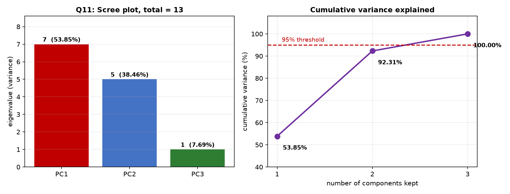

95% target ka matlab “95% of the number of PCs” nahi; **95% of total eigenvalue sum** hai.

### M14 — Geometric spectrum se unknown parameter

AI notes · Q3; handwritten p. 19.

**Question:** A covariance matrix has eigenvalues $\lambda^5,\lambda^4,\lambda^3,\lambda^2,\lambda,1$, where $\lambda>1$. The first three components explain approximately 88.88% of the total variance. Find $\lambda$.

**Step 1:** $\lambda>1$ se listed order decreasing hai; top three first three powers hain.

**Step 2:** Intended recurring percentage $88.888\ldots\%=8/9$ use karo:

$$\frac{\lambda^5+\lambda^4+\lambda^3}{\lambda^5+\lambda^4+\lambda^3+\lambda^2+\lambda+1}=\frac89.$$

**Step 3:** Numerator $\lambda^3(\lambda^2+\lambda+1)$; denominator $(\lambda^3+1)(\lambda^2+\lambda+1)$. Common positive factor cancel:

$$\frac{\lambda^3}{\lambda^3+1}=\frac89
\Rightarrow9\lambda^3=8\lambda^3+8
\Rightarrow\boxed{\lambda=2}.$$

**Step 4:** Spectrum $32,16,8,4,2,1$. Top-three sum 56, total 63; $56/63=8/9$.

Literal finite 88.88% use karoge toh value approximately 2, exactly 2 nahi; supplied exercise ka intended rounded answer 2 hai.

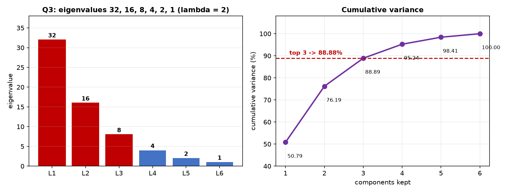

## 7. Rank, linear dependencies and zero-variance directions

### 7.1 Ambient dimension versus effective linear dimension

**Definition:** Ambient dimension $d$ stored features ki count hai. Centered data rank $r$ independent linear directions ki count hai.

$$\boxed{\operatorname{rank}(C)=\operatorname{rank}(X_c)=r\leq\min(d,n-1)}.$$

Exactly $r$ positive covariance eigenvalues aur $d-r$ zero eigenvalues. Top $r$ PCs centered dataset reconstruct exactly karte hain. “Data lies in an $r$-dimensional subspace” alone implies rank **at most $r$**; exactly $r$ kehne ke liye data us space ko span kare.

**Counterexample:** Points on a single line also lie in a plane. “Lie in a plane” se rank exactly 2 conclude nahi kar sakte.

PCA rank linear/affine dimension hai; curved one-dimensional circle ka centered covariance rank 2 ho sakta hai. Intrinsic nonlinear dimension ko automatically covariance rank mat samjho.

### M15 — Span of two vectors: Zero-error shortcut

AI notes · Q4; handwritten p. 23 contains the same rank principle.

**Question:** One hundred points in $\mathbb R^4$ satisfy

$$x_i=a_i(3,1,0,2)^T+b_i(1,0,3,0)^T,\qquad
\sum_{i=1}^{100}a_i=\sum_{i=1}^{100}b_i=0.$$

What is the reconstruction error when the top two PCs are used?

**Step 1:** Coefficient sums zero imply mean zero.

**Step 2:** Every point span of two fixed vectors mein hai, so rank at most 2. Vectors independent hain, but sample coefficient patterns rank aur reduce kar sakte hain.

**Step 3:** Therefore $\lambda_3=\lambda_4=0$.

$$\boxed{E_2=\lambda_3+\lambda_4=0}.$$

Actual PCs given spanning vectors ke normalized versions hona zaroori nahi; supplied two vectors orthogonal bhi nahi. Error answer ke liye full eigendecomposition unnecessary hai.

### M16 — Dimensions, zero eigenvalues and reconstruction

AI notes · Q12.

**Question:** A centered dataset contains 2000 points in $\mathbb R^{30}$, all lying in a four-dimensional subspace. Which statements are true?

1. The feature covariance matrix is $2000\times2000$.
2. The feature covariance matrix is $30\times30$.
3. At least 26 covariance eigenvalues are zero.
4. Retaining four PCs gives zero reconstruction error.

**Step 1:** $X_c$ shape $30\times2000$; $C=X_cX_c^T/2000$ shape $30\times30$. Statement 1 false, 2 true.

**Step 2:** Rank at most 4, so at least $30-4=26$ zero eigenvalues. Statement 3 true.

**Step 3:** All positive eigenvalue directions top four mein covered hain; discarded eigenvalues zero. Statement 4 true.

$$\boxed{2,3,4\text{ are true}}.$$

Handwritten p. 26 ka $\mathbb R^{50}$ / six-dimensional example same pattern: at least 44 zeros, six PCs sufficient. Exactly 44 zeros only if centered rank exactly 6.

### M17 — Feature dependencies se rank

Handwritten p. 27.

**Question:** A data matrix has six feature columns. The first three columns $c_1,c_2,c_3$ are linearly independent, and $c_4=2c_1-c_2$, $c_5=c_2+c_3$, $c_6=4c_1-3c_3$. After how many principal components does the reconstruction error become zero?

**Step 1:** Last three columns first three ke combinations hain; they add no independent directions.

**Step 2:** Given matrix rank 3. **If columns are already centered**, covariance rank exactly 3; top three PCs sufficient and necessary for zero error.

$$\boxed{k=3\text{ for centered independent columns}}.$$

**Centering condition:** Raw columns independent hon toh centering rank reduce kar sakti hai. Example constant column $\mathbf1$ centered hoke zero ho jaati hai. Raw-only wording mein three PCs certainly sufficient, but minimum less than three bhi ho sakta hai. Handwritten answer 3 centered-rank interpretation use karta hai.

Is question mein feature columns means rows-as-observations notation hai; rank conclusion transpose se change nahi hota.

### M18 — Hyperplane normal as a zero-variance direction

Handwritten p. 16.

**Question:** All centered data points in $\mathbb R^4$ satisfy $2x_1+x_2-x_3+2x_4=0$. Which of the following can be unit directions perpendicular to the data hyperplane?

A. $(2,1,-1,2)/\sqrt{10}$

B. $(-2,-1,1,-2)/\sqrt{10}$

C. $(1,0,2,1)/\sqrt6$

D. $(2,0,1,2)/3$

**Step 1:** Equation ke coefficients se normal $a=(2,1,-1,2)$.

**Step 2:** $\|a\|=\sqrt{4+1+1+4}=\sqrt{10}$. Hence unit normals $\pm a/\sqrt{10}$.

**Step 3:** A,B valid; C scalar multiple nahi. D unit hai ($\|D\|^2=9/9=1$), but normal ka scalar multiple nahi. Sirf unit length enough nahi.

$$\boxed{A,B}.$$

**PCA connection:** Every point ka normal-direction projection zero; $Ca=0$. At least one zero eigenvalue. Agar data whole hyperplane span kare toh exactly one zero eigenvalue aur this normal last PC hai. Smaller span ho toh additional zero directions possible hain.

### M19 — Repeated features, constants and leading PC

Handwritten p. 17.

**Question:** Ten features satisfy $x_1=x_2=x_3$, with variance 100. Features $x_4,\ldots,x_8$ each have variance 10 and are mutually uncorrelated and uncorrelated with the first three. Features $x_9=x_{10}=0$. Which statement is correct?

A. Exactly three eigenvalues are zero, and PC1 is $(1,0,\ldots,0)$.

B. Exactly four eigenvalues are zero, and PC1 is $(1,1,1,0,\ldots,0)/\sqrt3$.

C. Exactly four eigenvalues are zero, and PC1 is $(1,0,\ldots,0)$.

**Step 1:** First-three covariance block $100\mathbf1\mathbf1^T$: eigenvalues $300,0,0$.

**Step 2:** Next-five independent covariance directions each variance 10: five eigenvalues 10.

**Step 3:** Last-two constant features contribute two more zeros.

Spectrum $300,10,10,10,10,10,0,0,0,0$. Hence rank 6 and $\boxed4$ zero eigenvalues.

**Step 4:** Largest-variance direction combines identical features:

$$\boxed{w_1=(1,1,1,0,0,0,0,0,0,0)/\sqrt3}.$$

**Answer: B.** Choosing $(1,0,\ldots,0)$ captures variance 100; combined normalized direction captures 300. Correlated features ki variance combine ho sakti hai.

## 8. Storage: Fewer coordinates always fewer numbers nahi

### 8.1 What must be stored?

**Real life:** Compressed coordinates bina decoder/basis ke useful nahi; receiver ko coordinates se original features reconstruct karne ka rule bhi chahiye.

For $n$ points, $d$ features, retained $k$ PCs:

$$\boxed{\text{Direct}=dn},\qquad
\boxed{\text{PCA}=dk+kn},\qquad
\boxed{\text{PCA with stored mean}=dk+kn+d}.$$

Basis $W_k$ shared once; har point ke liye repeat nahi. Eigenvalues reconstruction ke liye required nahi, unless task separately asks to store them.

Ignoring mean overhead, saving when $k(d+n)<dn$, i.e. $\boxed{k<dn/(d+n)}$. Thus $k<d$ alone total storage saving guarantee nahi.

### M20 — 90% variance and storage

AI notes · Q6; handwritten p. 29.

**Question:** There are 100 points in $\mathbb R^{10}$. Ordered covariance eigenvalues satisfy $\sum_{j=1}^{10}\lambda_j=200$, $\sum_{j=1}^{4}\lambda_j=140$, and $\sum_{j=1}^{6}\lambda_j=180$. How many numbers must be stored to retain at least 90% variance using the minimum number of PCs? Ignore mean-vector storage.

**Step 1:** Required sum $0.9\times200=180$.

**Step 2:** Six PCs reach 180. Four reach only 140. Five bhi insufficient: tail $\lambda_7+\cdots+\lambda_{10}=20>0$, so ordering implies $\lambda_6\geq\lambda_7>0$. Therefore sum through five $=180-\lambda_6<180$.

$$\boxed{k_{\min}=6}.$$

**Step 3:** Basis $10\times6=60$ scalars; coordinates $6\times100=600$.

$$\boxed{\text{Storage}=660\text{ numbers}}.$$

Direct 1000, saving $34\%$. Mean also stored ho toh 670 and saving 33%.

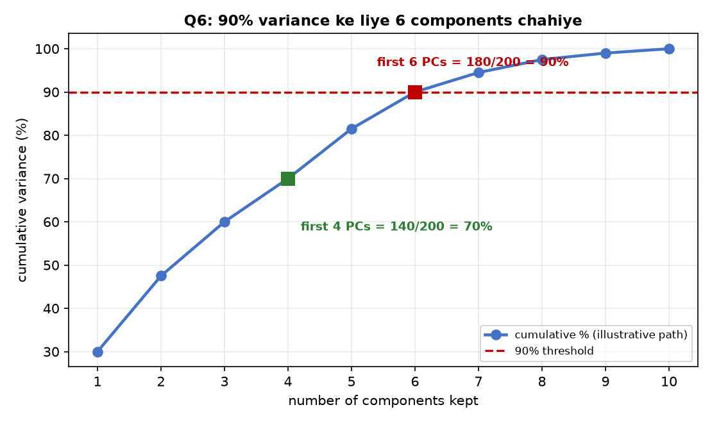

Curve ke intermediate values illustrative hain; question only stated sums deta hai. Minimum six ka conclusion ordered nonnegative spectrum se above establish hua.

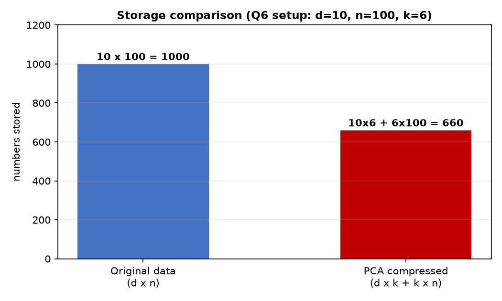

## 9. Dual PCA: Feature space versus sample space

### 9.1 X X-transpose aur X-transpose X ka difference

**Definition:** Dual PCA small sample-space matrix se nonzero principal directions recover karti hai. Useful jab $d\gg n$.

| Matrix | Shape, points-as-columns convention | Eigenvectors live in |
|---|---|---|
| $X_cX_c^T$ | $d\times d$ | Feature space $\mathbb R^d$ |
| $G=X_c^TX_c$ | $n\times n$ | Sample coefficient space $\mathbb R^n$ |
| $C=X_cX_c^T/n$ | $d\times d$ | Feature space |

First two matrices ke **nonzero eigenvalues same** hain; zero counts and eigenvector dimensions different. Covariance eigenvalues extra $1/n$ scaling leti hain.

For unit $v$ satisfying $Gv=\gamma v$, $\gamma>0$:

$$\boxed{w=\frac{X_cv}{\sqrt\gamma}},\qquad
\boxed{\lambda_C=\gamma/n}.$$

If normalized Gram matrix $G/n$ ka eigenvalue $\lambda$ diya ho, denominator $\sqrt{n\lambda}$ hoga. Zero eigenvalue ko denominator mein mat use karo.

**Size example:** $d=10{,}000,n=100$ ho toh feature matrix $10{,}000\times10{,}000$, Gram matrix $100\times100$. Gram eigenvector itself PC nahi; $X_cv$ se feature-space direction banti hai.

### M21 — Gram eigenvalues se variance

Handwritten p. 33.

**Question:** The nonzero eigenvalues of the centered Gram matrix $X_c^TX_c$ are $10,5,3,2,1$. Express the covariance eigenvalues in terms of the number of data points $n$, and find the variance fraction explained by PC1.

**Step 1:** Gram aur $X_cX_c^T$ ke nonzero eigenvalues same.

**Step 2:** Covariance mein divide by $n$:

$$\boxed{10/n,5/n,3/n,2/n,1/n}.$$

**Step 3:** Fraction mein normalization cancel:

$$\boxed{\mathrm{EVR}(1)=\frac{10/n}{21/n}=10/21\approx47.62\%}.$$

Absolute variance $10/n$, fraction $10/21$: dono quantities mix mat karo.

### M22 — Principal direction as weighted sum of data

Handwritten p. 33.

**Question:** For a positive eigenvalue $\gamma=10$ of $X_c^TX_c$, a corresponding unit eigenvector has second coordinate $v_2=3/\sqrt{54}$. If the principal direction is written as $w=\sum_i\alpha_i\tilde x_i$, find $\alpha_2$.

**Step 1:** $w=X_cv/\sqrt\gamma=\sum_i(v_i/\sqrt\gamma)\tilde x_i$.

**Step 2:** So $\alpha_2=v_2/\sqrt\gamma$:

$$\boxed{\alpha_2=\frac3{\sqrt{54}\sqrt{10}}=\frac3{\sqrt{540}}\approx0.1291}.$$

Full eigenvector ki baaki entries is calculation ke liye required nahi. Eigenvalue covariance ka hota toh denominator $\sqrt{n\lambda}$ hota.

## 10. Conceptual master check

### M23 — True/false with reasons

AI notes · Q2.

**Question:** Which statements about PCA are true?

1. The principal components are the eigenvectors of the covariance matrix.
2. The eigenvalues of the covariance matrix represent the variance captured along the corresponding eigenvectors.
3. The principal components are mutually orthogonal.
4. The first principal component corresponds to the smallest positive eigenvalue of the covariance matrix.

**1 — True:** PC **directions/loadings** covariance eigenvectors hain. Compressed scores $W^TX_c$ ko bhi some books “components” bolte hain; yahan direction meaning hai.

**2 — True for unit eigenvectors:** $w_j^TCw_j=\lambda_jw_j^Tw_j=\lambda_j$.

**3 — True:** PCA orthonormal eigenbasis choose karti hai. Repeated eigenvalues ho toh basis unique nahi, but orthonormal choice possible hai.

**4 — False:** First PC largest eigenvalue ki direction hai. M8 mein smallest eigenvalue zero tha, zero spread; first PC variance 5 thi.

$$\boxed{1,2,3\text{ true; }4\text{ false}}.$$

### 10.1 Properties jo mixed questions mein kaam aati hain

- **Uncorrelated scores, not generally independent:** $\operatorname{Cov}(z)=\operatorname{diag}(\lambda_j)$. Independence stronger condition hai; zero covariance alone enough nahi.
- **Full PCA rotation versus truncation:** Full orthogonal basis distances preserve karti hai; top-$k$ projection distances reduce kar sakti hai, always preserve nahi.
- **Translation:** Proper centering ke baad sab points ko same vector se shift karne par covariance/PC directions unchanged; mean shifts.
- **Uniform scaling:** All features ko common $a$ se scale karo toh covariance $a^2C$; eigenvalues $a^2\lambda_j$, fractions same. One feature alone rescale karne se directions change ho sakti hain.
- **Zero eigenvalue:** Training centered data mein us direction ka no spread. New arbitrary unseen point bhi us subspace par hoga, yeh automatically guaranteed nahi.
- **Variance versus usefulness:** PCA largest variation retain karti hai, labels/classification usefulness optimize nahi karti. High variance feature noise bhi ho sakta hai.

## 11. Complete master problem: Saare steps ek sequence mein

### M24 — From raw data to dual PCA

Handwritten pp. 34–37.

**Question:** Consider the dataset

$$x_1=(2,1,1),\quad x_2=(0,-1,1),\quad
x_3=(-2,-1,-1),\quad x_4=(0,1,-1).$$

Using the $1/n$ covariance convention, find:

1. The mean and covariance matrix.
2. All eigenvalues and an orthonormal set of principal directions.
3. The rank and the number of zero covariance eigenvalues.
4. The explained variance and minimum PC count for at least 95% retention.
5. The two-dimensional PCA coordinates of all four points.
6. The reconstructions and residuals using only PC1, and the average and total squared reconstruction errors.
7. The storage required with two PCs, compared with direct storage.
8. The centered Gram matrix and its eigenvalues.

### 11.1 Mean and covariance

**Step 1:** Pairwise cancellation: $x_3=-x_1$, $x_4=-x_2$.

$$\boxed{\mu=(0,0,0)}.$$

**Step 2:** Points-as-columns matrix:

$$X_c=\begin{bmatrix}2&0&-2&0\\1&-1&-1&1\\1&1&-1&-1\end{bmatrix}.$$

**Step 3:** Coordinate product sums:

| Entry | Product sum | Divide by 4 |
|---|---:|---:|
| $C_{11}$ | $4+0+4+0=8$ | 2 |
| $C_{22}$ | $1+1+1+1=4$ | 1 |
| $C_{33}$ | $1+1+1+1=4$ | 1 |
| $C_{12}$ | $2+0+2+0=4$ | 1 |
| $C_{13}$ | $2+0+2+0=4$ | 1 |
| $C_{23}$ | $1-1+1-1=0$ | 0 |

$$\boxed{C=\begin{bmatrix}2&1&1\\1&1&0\\1&0&1\end{bmatrix}},\qquad\operatorname{tr}(C)=4.$$

### 11.2 Eigenpairs: Use structure, then verify

**Step 1 — First direction:**

$$C(2,1,1)^T=(6,3,3)^T=3(2,1,1)^T.$$

Norm $\sqrt6$, so $\boxed{\lambda_1=3,\ w_1=(2,1,1)/\sqrt6}$.

**Step 2 — Second:**

$$C(0,1,-1)^T=(0,1,-1)^T.$$

Thus $\boxed{\lambda_2=1,\ w_2=(0,1,-1)/\sqrt2}$.

**Step 3 — Third:** Each point obeys $x_{i1}=x_{i2}+x_{i3}$. Normal $(-1,1,1)$ has zero projections and $C(-1,1,1)^T=0$:

$$\boxed{\lambda_3=0,\ w_3=(-1,1,1)/\sqrt3}.$$

**Check:** Pairwise dot products zero; all norms 1; sum of eigenvalues $3+1+0=4$ equals trace.

### 11.3 Rank, explained variance and k

Two positive eigenvalues: $\boxed{r=2}$, one zero eigenvalue. Points lie in a plane through origin even though ambient dimension 3.

$$\mathrm{EVR}(1)=3/4=75\%,\qquad\mathrm{EVR}(2)=4/4=100\%.$$

For at least 95%, $\boxed{k=2}$. Average error after two PCs $\lambda_3=0$.

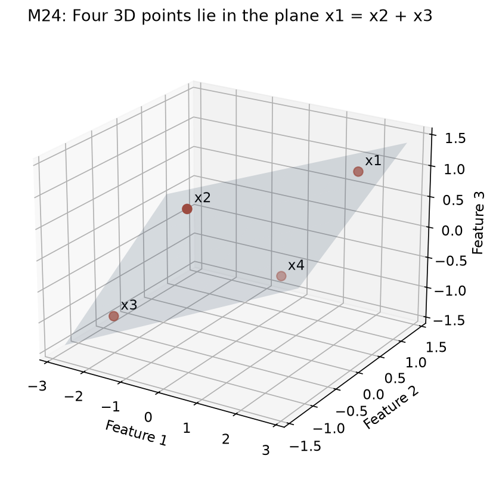

### 11.4 PCA coordinates

For each point, $z_i=(x_i^Tw_1,x_i^Tw_2)$.

**First point:** $x_1^Tw_1=(4+1+1)/\sqrt6=\sqrt6$; $x_1^Tw_2=(1-1)/\sqrt2=0$.

**Second point:** $x_2^Tw_1=(-1+1)/\sqrt6=0$; $x_2^Tw_2=(-1-1)/\sqrt2=-\sqrt2$.

Other points negatives hain, so coordinates bhi negative:

| Point | PC1 score | PC2 score |
|---|---:|---:|
| $x_1$ | $\sqrt6$ | 0 |
| $x_2$ | 0 | $-\sqrt2$ |
| $x_3$ | $-\sqrt6$ | 0 |
| $x_4$ | 0 | $\sqrt2$ |

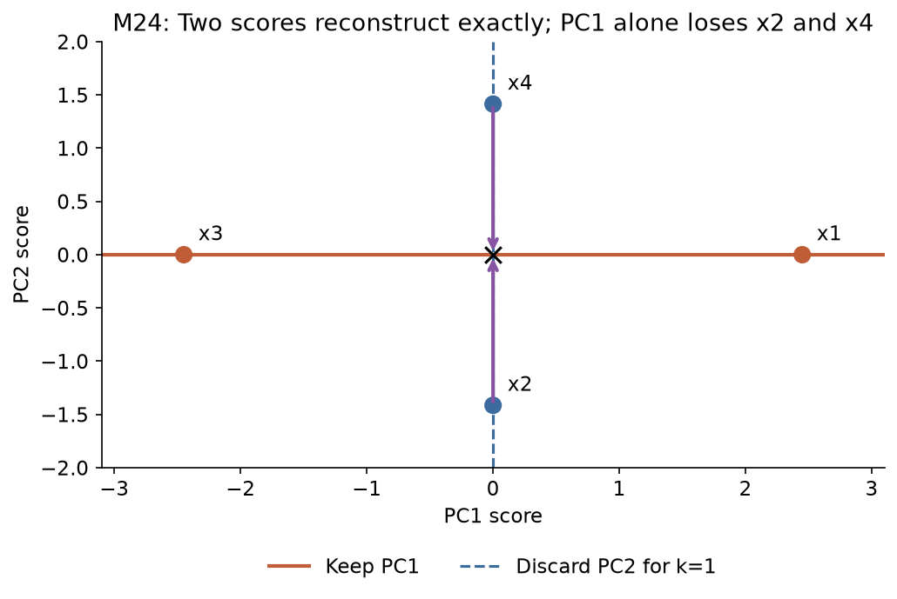

This plot mein first axis ka average squared score $(6+0+6+0)/4=3$, second ka $(0+2+0+2)/4=1$. Eigenvalue-as-variance directly visible hai.

### 11.5 Top-one reconstruction, residual and error

$$\hat x_i=(x_i^Tw_1)w_1.$$

| Point | Reconstruction | Residual | Squared error |
|---|---|---|---:|
| $(2,1,1)$ | $(2,1,1)$ | $(0,0,0)$ | 0 |
| $(0,-1,1)$ | $(0,0,0)$ | $(0,-1,1)$ | 2 |
| $(-2,-1,-1)$ | $(-2,-1,-1)$ | $(0,0,0)$ | 0 |
| $(0,1,-1)$ | $(0,0,0)$ | $(0,1,-1)$ | 2 |

$$\boxed{\text{Average error}=(0+2+0+2)/4=1},\qquad\boxed{\text{Total error}=4}.$$

Eigenvalue cross-check: discarded sum $\lambda_2+\lambda_3=1+0=1$. Two PCs retain karne par har point exactly reconstruct hoga.

### 11.6 Storage: A useful counterexample

$d=3,n=4,k=2$.

$$\text{Direct}=3\times4=12,\qquad
\text{PCA}=3\times2+2\times4=\boxed{14}.$$

**14 > 12:** Coordinates 3D se 2D hue, but basis overhead ki wajah se total scalar storage badh gayi. Small dataset mein dimensionality reduction always storage compression nahi.

Here mean zero known hai. Generic explicit mean vector bhi store karte toh 17 numbers.

### 11.7 Dual matrix and spectrum

**Step 1:** Dot products se Gram matrix:

$$\boxed{G=X_c^TX_c=
\begin{bmatrix}
6&0&-6&0\\
0&2&0&-2\\
-6&0&6&0\\
0&-2&0&2
\end{bmatrix}}.$$

**Step 2:** $X_cX_c^T=4C$ ki eigenvalues $12,4,0$. Gram $4\times4$ hai, rank 2; same nonzero eigenvalues, two zeros:

$$\boxed{\operatorname{eig}(G)=12,4,0,0}.$$

**Step 3 — Direction recovery check:** $v_1=(1,0,-1,0)/\sqrt2$ is unit Gram eigenvector for 12.

$$X_cv_1=(x_1-x_3)/\sqrt2=\sqrt2(2,1,1),$$

$$\frac{X_cv_1}{\sqrt{12}}=\frac{(2,1,1)}{\sqrt6}=w_1.$$

Isi dataset se projection, covariance, rank, EVR, error, storage aur dual normalization sab connect ho gaye.

## 12. Master-question sequence and quick revision

| Solve in order | Skill covered |
|---|---|
| M1 → M2 | Exact representation, unit/non-unit projection, residual |
| M3 → M5 | Graph intuition, projection-length variance, collinear data |
| M6 → M9 | Covariance construction, symmetry, eigenpairs, full centered PCA |
| M10 → M11 | Lost coordinates, residual error, multi-PC coordinates |
| M12 → M14 | Discarded eigenvalues, variance thresholds, unknown spectrum parameter |
| M15 → M19 | Subspaces, rank bounds, feature dependencies, normals, repeated features |
| M20 | Minimum retained count and full storage accounting |
| M21 → M22 | Gram eigenvalue scaling and weighted-data representation |
| M23 → M24 | Concept checks, then complete end-to-end calculation |

### 12.1 Compact formula sheet

| Task | Formula |
|---|---|
| Center | $\tilde x=x-\mu$ |
| General line coefficient | $c=x^Tw/(w^Tw)$ |
| Unit projection | $\hat x=(x^Tw)w$ |
| Feature covariance | $C=X_cX_c^T/n$ |
| Direction variance | $w^TCw$, unit $w$ |
| PC directions | Orthonormal eigenvectors, descending eigenvalues |
| Compressed coordinates | $z=W_k^T(x-\mu)$ |
| Raw reconstruction | $\hat x=\mu+W_kz$ |
| Average squared error | $\sum_{j>k}\lambda_j$ |
| Retained fraction | $\sum_{j\leq k}\lambda_j/\operatorname{tr}(C)$ |
| Zero covariance eigenvalues | $d-\operatorname{rank}(X_c)$ |
| Storage | $dk+kn$, plus $d$ if mean stored |
| Gram to covariance eigenvalue | $\lambda_C=\gamma_G/n$ |
| Gram to PC direction | $w=X_cv/\sqrt{\gamma_G}$ |

Before solving: **centered hai? points rows ya columns? unit vector hai? covariance ya Gram eigenvalues? average ya total error? mean/basis storage included?** In six checks se most calculation traps avoid ho jaate hain.
