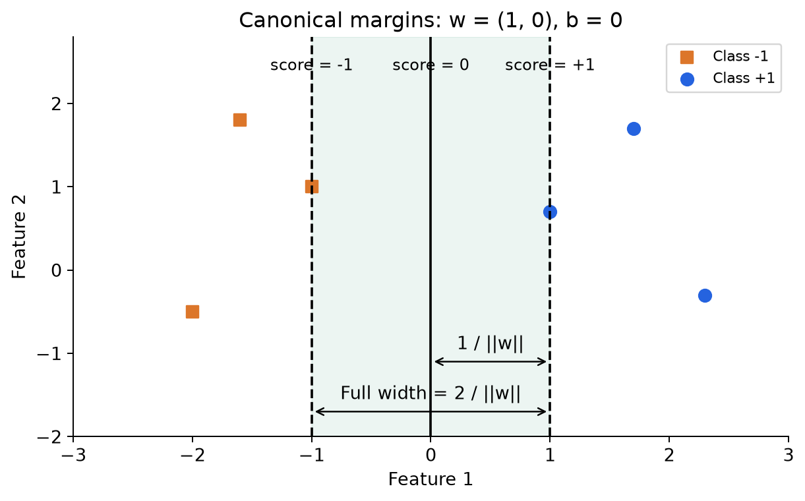
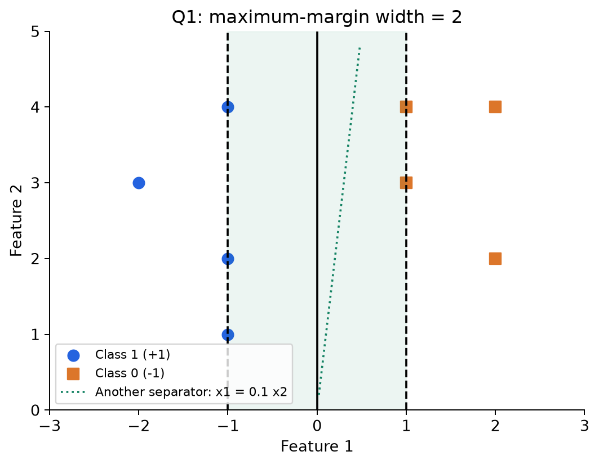
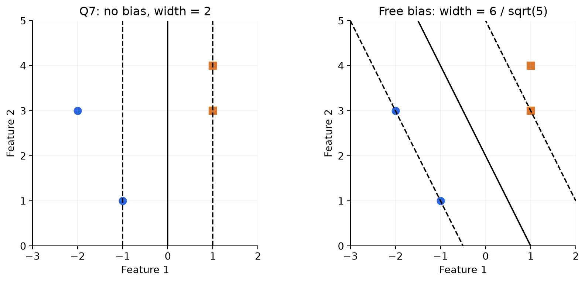
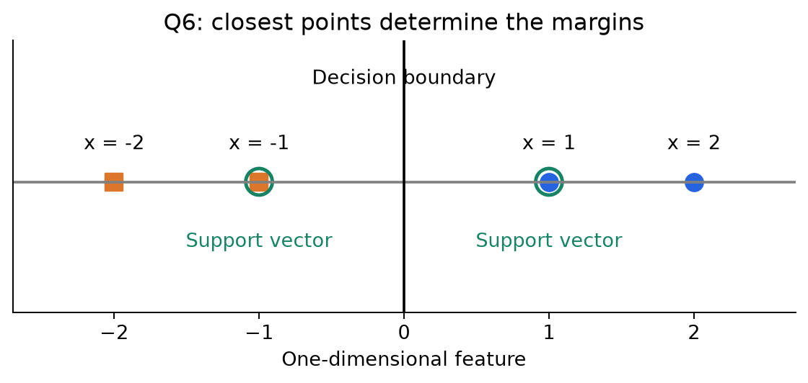
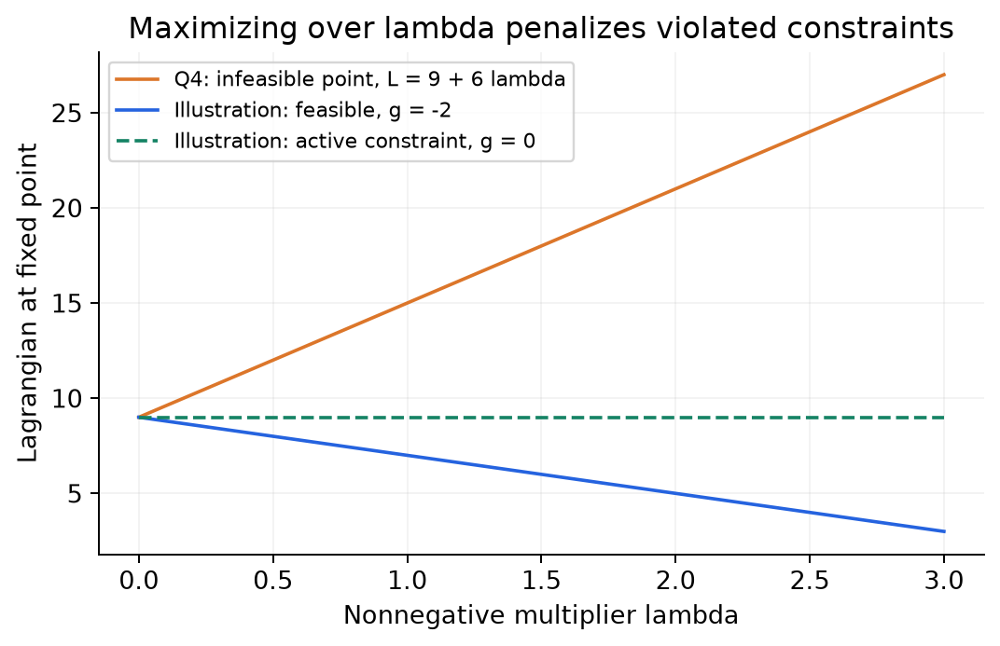
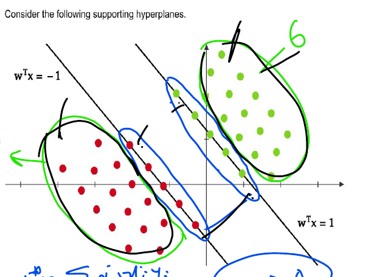
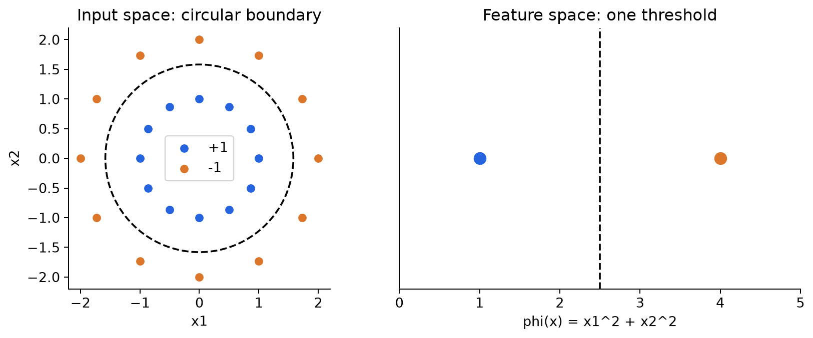
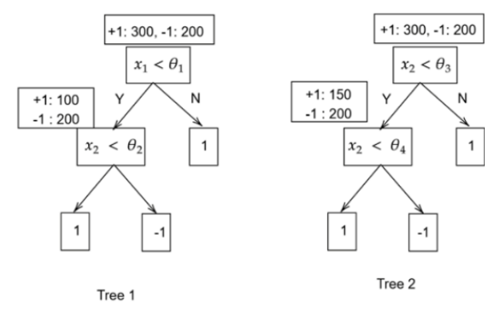
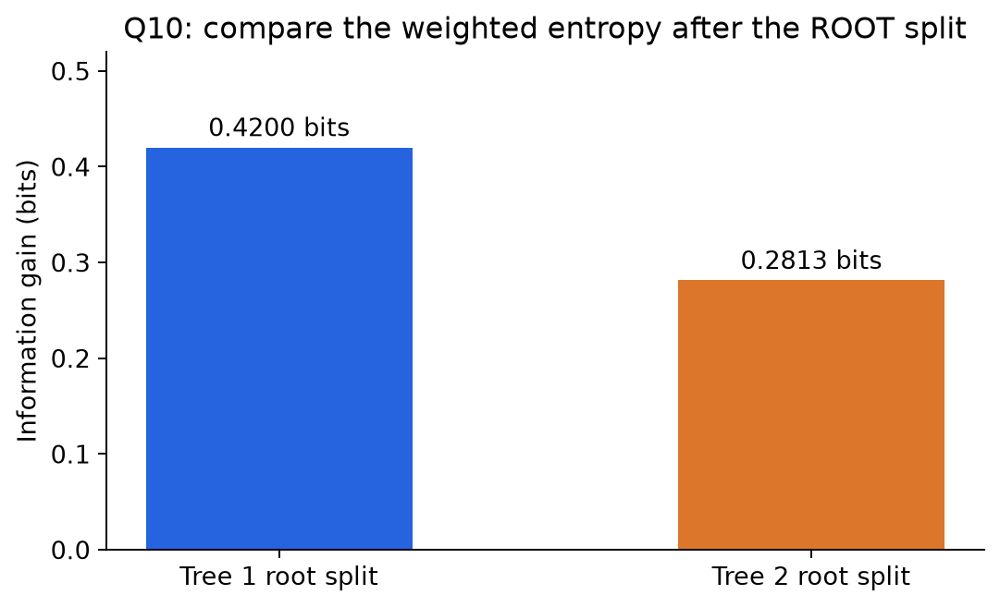

# MLT Week 10: Support Vector Machine Notes

**Flow:** Perceptron se margin ka connection → functional/geometric margin → hard-margin optimization → support vectors → Lagrangian → dual aur KKT → prediction → leave-one-out error → kernels → information-gain question.

## Topic index

| Topic | Subtopics | Questions |
|---|---|---|
| 1. Margin and geometry | Functional margin, geometric margin, width, point distance | Q2, Q8 |
| 2. Hard-margin SVM | Canonical constraints, primal objective, bias, separators | Q1, Q7 |
| 3. Support vectors | Closest points, supporting hyperplanes | Q6 |
| 4. Constrained optimization | Lagrangian, feasibility, min-max, duality | Q4 |
| 5. Dual and KKT | Multipliers, weight reconstruction, complementary slackness, deletion | Q9, Q3, Q5 |
| 6. Leave-one-out validation | Error definition, support-vector bound | Q11 |
| 7. Kernel SVM | Feature maps, Gram matrix, kernel prediction | Practice example |
| 8. Decision-tree information gain | Entropy, weighted split quality | Q10 |
| Additional dual/KKT varieties | Claim audit, diagram count, coefficient signs and consistency | Q12–Q14; changed-data variant |
| 9. Revision | Formula sheet, mistakes, solving checklist | — |

---

## 1. Margin: Sirf correct classification se aage

### 1.1 Perceptron se SVM ka connection

Week 9 mein perceptron ko **koi bhi separating boundary** mil jaaye toh kaam ho jaata tha. Ek dataset ke multiple correct separators ho sakte hain, lekin sab closest points se equally far nahi hote.

**Short definition:** SVM ek aisi separating boundary choose karta hai jiska closest training points se minimum distance maximum ho.

**Real life:** Do traffic streams ke beech divider rakhna hai. Divider dono streams ko separate toh kare, par closest vehicles se jitna possible ho utni clearance bhi rakhe. Yeh clearance margin ka intuition hai.

Perceptron bound:

$$M\le\frac{R^2}{\gamma^2}.$$

Same radius $R$ par larger geometric margin $\gamma$ gives a smaller mistake bound. Margin-based learning bounds bhi large margin ko motivate karte hain, but **larger training margin automatically har test dataset par higher accuracy guarantee nahi karta**. Feature scaling, noise aur train/test distribution matter karte hain.

### 1.2 Score, label aur boundary

$$f(x)=w^Tx+b.$$

- Decision boundary: $f(x)=0$.
- Positive side: $f(x)>0$.
- Negative side: $f(x)<0$.
- $w$ boundary ke perpendicular hota hai.

SVM optimization usually $y_i\in\{-1,+1\}$ use karta hai. Paper mein class labels $0,1$ hon toh class 1 ko $+1$, class 0 ko $-1$ encode karo before using $y_if(x_i)\ge1$.

**Convention:** Week 10 slides ka main formulation **no bias**, $f(x)=w^Tx$, hai. General SVM mein $b$ ho sakta hai. Dono ke formulas niche distinguish kiye hain; explicit $w^Tx$ question mein extra bias assume nahi karenge.

### 1.3 Functional margin

**Definition:** True label se signed raw score:

$$\boxed{\hat\gamma_i=y_i(w^Tx_i+b)},\qquad \hat\gamma=\min_i\hat\gamma_i.$$

- Positive functional margin → correct side.
- Zero → boundary.
- Negative → wrong side.

**Example:** $y=-1$ and score $-3$ → margin $(-1)(-3)=3$, correctly classified.

**Property:** Functional margin distance nahi hai; weight scaling se badal jaati hai.

**Counterexample:** $w=(1,0)$, $b=0$, $x=(2,0)$, $y=+1$ gives margin 2. Same boundary ko $w'=(10,0)$ se represent karo, margin 20. Boundary move nahi hui, only numerical score scale changed.

### 1.4 Geometric margin

**Definition:** Correct-side signed perpendicular distance from point to boundary.

$$\boxed{\gamma_i=\frac{y_i(w^Tx_i+b)}{\|w\|}},\qquad\gamma=\min_i\gamma_i.$$

Need $w\ne0$. If point misclassified, signed geometric margin negative hoti hai.

**Same example:** Weights $(1,0)$ give $2/1=2$; weights $(10,0)$ give $20/10=2$. Geometric distance scale-invariant hai.

**Positive scaling property:** $(w,b)\to(cw,cb)$ with $c>0$ preserves boundary, labels and geometric margin. Negative scaling reverses class sides.

### 1.5 Canonical scaling: Functional margin ko 1 set karna

Strictly separable finite data ke liye minimum functional margin positive hai. Weights/bias ko common positive factor se rescale karke minimum functional margin 1 kar sakte hain.

Canonical constraints:

$$\boxed{y_i(w^Tx_i+b)\ge1\quad\forall i}.$$

Corresponding supporting hyperplanes:

$$w^Tx+b=+1,\qquad w^Tx+b=-1.$$

Decision boundary middle mein $w^Tx+b=0$ hai.

**Important:** Functional margin 1 set karna means $\|w\|=1$ set karna **nahi**. Yeh two different normalizations hain. Canonical optimal SVM mein geometric margin $1/\|w\|$ milti hai.

### 1.6 One-sided margin vs full width

$$\boxed{\text{One-sided geometric margin}=\frac1{\|w\|}}.$$

$$\boxed{\text{Full width between supporting hyperplanes}=\frac2{\|w\|}}.$$

**Graph:** Centre line se ek dashed line tak $1/\|w\|$. Dono dashed lines ke beech $2/\|w\|$.

General parallel hyperplanes $w^Tx+b=a$ and $w^Tx+b=c$ ka distance:

$$\boxed{\frac{|a-c|}{\|w\|}}.$$

**Trap:** Norm denominator $\|w\|$, squared norm $\|w\|^2$ nahi. In 2D, $\|w\|=\sqrt{w_1^2+w_2^2}$.

### 1.7 Q2 — Width from weight vector

**Source:** 2024 Sep 01 ET, Q2.

**Question:**

> A hard-margin SVM is trained on a linearly separable dataset with a positive margin. The features are in $\mathbb R^2$. The optimal weight vector is $[3\ 4]^T$. Find the distance between the two supporting hyperplanes.

**Step 1 — Identify requested distance:** Supporting hyperplanes ke beech full width, so $2/\|w\|$.

**Step 2 — Norm:**

$$\|w\|=\sqrt{3^2+4^2}=\sqrt{25}=5.$$

**Step 3 — Width:**

$$\frac25=\boxed{0.4}.$$

**Check:** One-sided margin 0.2 hoti, but woh asked quantity nahi hai.

### 1.8 Point-to-hyperplane distance

For any point $x$, actual unsigned distance:

$$\boxed{d(x,H)=\frac{|w^Tx+b|}{\|w\|}}.$$

True label ki zaroorat nahi. Signed side chahiye toh absolute value drop kar sakte hain, but physical distance negative nahi hoti.

**Difference:** $2/\|w\|$ is between canonical supporting hyperplanes; point distance ke liye point ka score numerator mein aata hai.

### 1.9 Q8 — Distance in three dimensions

**Source:** 2025 Dec 18 ET, Q8.

**Question:**

> Consider an SVM classifier with separating hyperplane defined by $w^Tx=0$, where the weight vector is $w=[2\ -3\ 1]^T$. Compute the perpendicular distance from the point $x=[1\ 2\ -1]^T$ to the hyperplane. Enter your answer correct to three decimal places.

**Step 1 — Score:**

$$w^Tx=2(1)+(-3)(2)+1(-1)=2-6-1=-5.$$

**Step 2 — Norm:**

$$\|w\|=\sqrt{2^2+(-3)^2+1^2}=\sqrt{14}.$$

**Step 3 — Absolute value and divide:**

$$d=\frac{|-5|}{\sqrt{14}}\approx1.336306.$$

**Answer: $\boxed{1.336}$.** Negative score means negative side; distance itself positive hai.

---

## 2. Hard-margin SVM ka optimization problem

### 2.1 “Hard margin” ka meaning

**Definition:** Every training point ko correct side par required margin ke saath rakhna; training violations allowed nahi.

Canonical class-wise conditions:

$$y_i=+1:\ w^Tx_i+b\ge1,$$

$$y_i=-1:\ w^Tx_i+b\le-1.$$

Dono combine karke $y_i(w^Tx_i+b)\ge1$.

**Real life:** Training examples ke liye strict separation rule chahiye. Agar classes overlap kar rahi hain, hard-margin constraints feasible nahi hongi.

**Counterexample:** Same input $x$ par labels $+1$ and $-1$. Required $f(x)\ge1$ and $f(x)\le-1$ simultaneously impossible.

### 2.2 Primal objective

Width maximize karna means $2/\|w\|$ maximize. Same feasible constraints ke under equivalent objective:

$$\boxed{\min_{w,b}\frac12\|w\|^2\quad\text{subject to }y_i(w^Tx_i+b)\ge1\ \forall i}.$$

Course no-bias version:

$$\boxed{\min_w\frac12\|w\|^2\quad\text{subject to }y_iw^Tx_i\ge1\ \forall i}.$$

**Why squared norm?** Same minimizing weight norm, but quadratic objective smooth aur convenient hai. $1/2$ derivative ko simple banata hai; optimum change nahi karta.

**Critical point:** Constraints hata do toh $w=0$ norm minimize karta hai, par classifier useless hai. “Small weights” useful tab hai jab separation constraints satisfy hon.

### 2.3 Properties jo exam mein matter karti hain

- Objective convex quadratic; constraints affine/linear inequalities.
- Feasible hard-margin problem has a global optimum; arbitrary local-minimum trap nahi.
- Strict convexity in $w$ makes optimal $w$ unique for a fixed formulation. Dual multipliers need not be unique.
- Perceptron can stop at a different valid separator, because it does not explicitly maximize margin.
- Outliers/noisy labels hard-margin fit ko distort ya infeasible kar sakte hain.
- Scaling one feature changes Euclidean geometry, so SVM generally feature-scale sensitive hai.

**Scaling counterexample:** Income rupees mein aur age years mein raw use karo toh coordinate scales different hain. Feature standardization geometry ko change karegi; unlike uniform rescaling of all coordinates, relative scales affect chosen separator.

### 2.4 Q1 — Separable dataset and width

**Source:** 2024 Apr 28 ET, Q1.

**Question:**

> (MSQ) Given a two-dimensional data set where points from class 1 are:
>
> $$\{(-2,3),(-1,1),(-1,2),(-1,4)\}$$
>
> And points from class 0 are:
>
> $$\{(1,3),(1,4),(2,4),(2,2)\}$$
>
> Which of the following statements are true?
>
> (a) The given data points from classes 1 and 0 can be linearly separated using a Hard-margin SVM.
>
> (b) A perceptron model and a hard margin SVM can give different decision boundary for this dataset.
>
> (c) A Soft-margin SVM would be a more robust choice than a Hard-margin SVM for this dataset as the dataset is not linearly separable.
>
> (d) The width of the separation between the two supporting hyperplanes is 4. (Hint: Calculate width using formulae $2/\|w\|$.)

**Step 1 — Labels encode karo:** Class 1 → $+1$, class 0 → $-1$.

**Step 2 — Inspect first coordinate:** All positive-class points $x_1<0$, all negative-class points $x_1>0$. Boundary $x_1=0$ separates → (a) true.

**Step 3 — Canonical weights:** Choose $w=(-1,0)$, $b=0$. Scores $-x_1$; closest class points at $x_1=-1$ give +1, at $x_1=1$ give -1. All constraints satisfied.

**Step 4 — Why this is maximum width:** Dataset contains opposite-label points $(-1,4)$ and $(1,4)$, only distance 2 apart. Separating parallel supporting planes cannot have a width greater than this cross-class distance. Vertical support lines at $x_1=-1,+1$ achieve width 2, so this is optimal.

$$\|w\|=1,\qquad\text{width}=2/1=\boxed{2}.$$

Thus (d) false, not 4.

**Step 5 — Perceptron difference:** Another valid separator is $-x_1+0.1x_2=0$. Check closest negative-side scores: at $(1,4)$ score $-0.6<0$; all class 1 scores positive. This line also separates but is not the maximum-margin line. Perceptron may return such a different separator → (b) true.

**Step 6:** (c) claims dataset not separable; that premise is false. Soft margin can be useful in general, but this option's stated reason is wrong.

**Answer: (a), (b).**

### 2.5 Q7 — Similar options, changed dataset

**Source:** 2025 Aug 31 ET, Q7. Same question type as Q1, but fewer/different points; dataset ko identical assume nahi karna.

**Question:**

> (MSQ) Given a two-dimensional dataset where points from class 1 are: $\{(-2,3),(-1,1)\}$ and points from class 0 are: $\{(1,3),(1,4)\}$. Which of the following statements are true?
>
> (a) The given data points from classes 1 and 0 can be linearly separated using a hard-margin SVM.
>
> (b) A perceptron model and a hard-margin SVM can give different decision boundary for this dataset.
>
> (c) A soft-margin SVM would be a more robust choice than a hard-margin SVM for this dataset as the dataset is not linearly separable.
>
> (d) The width of the separation between the two supporting hyperplanes is 4.

**Step 1:** Again $x_1=0$ separates left class 1 from right class 0 → (a) true, (c) false.

**Step 2:** Multiple valid separators possible; perceptron does not enforce maximum margin → (b) true.

**Step 3 — Course no-bias formulation:** $w=(-1,0)$ satisfies all canonical constraints. To check it is optimal here, write $w=(a,c)$ and use the constraints from $(-1,1),+1$ and $(1,3),-1$:

$$-a+c\ge1,\qquad -a-3c\ge1.$$

Multiply first by $3/4$ and second by $1/4$, then add:

$$-a\ge1\quad\Rightarrow\quad\|w\|\ge|a|\ge1.$$

Our $(-1,0)$ achieves norm 1, hence optimal. Width $2$, so (d) false.

**Answer: (a), (b).**

**Bias distinction:** If a freely learned intercept is allowed, this changed dataset has a wider **tilted** optimum:

$$w=(-2/3,-1/3),\qquad b=2/3,\qquad\text{width}=\frac6{\sqrt5}\approx2.683.$$

Its scores at the four listed points are $1,1,-1,-4/3$. The positive segment's closest point to negative point $(1,3)$ is $(-1.4,1.8)$; their distance $6/\sqrt5$ equals the achieved width. So this is the free-bias optimum. It is still **not 4**, and the selected options remain unchanged.

**Question se property:** Data reduce karne ke baad same maximum-margin geometry assume mat karo. Bias allowed hai ya nahi, yeh bhi optimization ka part hai.

---

## 3. Support vectors: Boundary ko support kaun karta hai?

### 3.1 Geometric intuition

**Definition:** SVM solution ko determine karne mein active role rakhne wale training points support vectors kehlaate hain. Dual view mein operational criterion $\alpha_i^*>0$ hai.

Hard-margin SVM mein such points satisfy:

$$\boxed{y_i(w^{*T}x_i+b^*)=1}.$$

Matlab supporting hyperplanes par hote hain, decision boundary par nahi.

**Real life:** Ek rigid board ko jo nearest contact points support karte hain, woh placement constrain karte hain. Bahut door wale points usually board ki exact placement decide nahi karte.

**Important subtlety:** Har on-margin point ka chosen optimal dual multiplier necessarily positive nahi. Degenerate/redundant constraints par on-margin point ke liye $\alpha_i=0$ possible hai. Iska concrete example section 5 mein hai.

### 3.2 Q6 — Support vectors in one dimension

**Source:** 2025 Aug 31 ET, Q6.

**Question:**

> Consider a dataset $D=\{(x_i,y_i):(-1,-1),(-2,-1),(2,+1),(1,+1)\}$, where $x_i\in\mathbb R$ denotes the features and $y_i\in\{+1,-1\}$ denotes the class label. Suppose we fit a hard-margin linear SVM for this dataset, then which of the following points are likely to be support vectors?
>
> (a) $(-1,-1)$ and $(2,+1)$
>
> (b) $(-1,-1)$ and $(1,+1)$
>
> (c) $(-2,-1)$ and $(2,+1)$
>
> (d) $(-2,-1)$ and $(1,+1)$

**Step 1 — Separate feature from label:** Pair $(-1,-1)$ means input $x=-1$, label $y=-1$. It is not a two-dimensional point.

**Step 2:** Negative class inputs -2,-1; positive class inputs 1,2. Nearest opposite-class inputs are -1 and +1.

**Step 3:** Boundary midpoint $x=0$; canonical $w=1$, $b=0$.

| Input | Label | $y(wx)$ | Position |
|---|---:|---:|---|
| -1 | -1 | 1 | On supporting hyperplane |
| -2 | -1 | 2 | Beyond margin |
| 2 | +1 | 2 | Beyond margin |
| 1 | +1 | 1 | On supporting hyperplane |

**Step 4:** Closest two points support the solution → **(b)**.

**Property:** Outermost points -2 and +2 are not support vectors just because their magnitudes are large. Closest points to the chosen boundary matter.

---

## 4. Constraints se Lagrangian tak

### 4.1 Constrained optimization ka idea

**Definition:** Objective minimize karo, but specified restrictions satisfy karte hue.

$$\min_w f(w)\quad\text{subject to }g_i(w)\le0.$$

**Real life:** Cheapest travel plan choose karna, but time/budget restrictions ke andar. Constraint violate karne wala cheap plan acceptable nahi.

For SVM:

$$f(w)=\frac12\|w\|^2,\qquad g_i(w,b)=1-y_i(w^Tx_i+b).$$

**Sign rule:** Constraint $y_if(x_i)\ge1$ ko standard $g_i\le0$ form mein convert karke $1-y_if(x_i)\le0$ likho.

### 4.2 Lagrangian

$$\boxed{L(w,\alpha)=f(w)+\sum_i\alpha_i g_i(w)},\qquad\alpha_i\ge0.$$

Multipliers $\alpha_i$ constraints ke saath associated hain. Ab **fixed $w$** par $\alpha$ maximize karne ka effect dekho:

| Constraint status at fixed $w$ | Effect of maximizing over nonnegative multiplier |
|---|---|
| All $g_i(w)\le0$ | Maximum/supremum value $f(w)$; choose all multipliers 0 |
| Some $g_i(w)>0$ | That multiplier $\to\infty$ gives $+\infty$ |

**Intuition:** Feasible point par extra penalty avoid kar sakte hain. Infeasible point ko maximization infinitely expensive bana deta hai.

**Boundary case:** $g_i=0$ → that multiplier contributes 0 at fixed $w$, regardless of its nonnegative value.

### 4.3 Q4 — Maximize Lagrangian at an infeasible point

**Source:** 2024 Dec 22 ET, Q4.

**Question:**

> Consider the following optimization problem involving the variable $x\in\mathbb R^2$:
>
> $$\min_x x_1^2+2x_2\quad\text{subject to }x_1-x_2\ge3.$$
>
> What is the output of the following expression for $x'=[1\ 4]^T$? Here, $L(x',\lambda)$ is the Lagrangian function for this optimization problem evaluated at $x'$.
>
> $$\max_{\lambda\ge0}L(x',\lambda)$$
>
> (a) $(x'_1)^2+2(x'_2)$
>
> (b) $\infty$
>
> (c) $-\infty$
>
> (d) 0
>
> (e) None of these

**Step 1 — Standard constraint form:**

$$x_1-x_2\ge3\iff g(x)=3-x_1+x_2\le0.$$

**Step 2 — Lagrangian:**

$$L(x,\lambda)=x_1^2+2x_2+\lambda(3-x_1+x_2),\quad\lambda\ge0.$$

**Step 3 — Substitute $x'=(1,4)$:**

$$f(x')=1^2+2(4)=9,\qquad g(x')=3-1+4=6>0.$$

Thus:

$$L(x',\lambda)=9+6\lambda.$$

**Step 4:** $\lambda\to\infty$ makes $L\to+\infty$.

**Answer: (b), $\boxed{+\infty}$.** More precisely this is unbounded above; a finite maximizing multiplier does not exist.

**Trap:** Question fixed point $x'$ par multiplier maximization poochhta hai. Full primal optimum find karne ki zaroorat nahi. Constraint ka sign ulta likhoge toh answer wrong ho jaayega.

### 4.4 Primal, dual aur min-max

Constrained primal ko write kar sakte hain:

$$\min_w\sup_{\alpha\ge0}L(w,\alpha).$$

Dual function:

$$q(\alpha)=\inf_w L(w,\alpha),\qquad\text{dual: }\max_{\alpha\ge0}q(\alpha).$$

**Weak duality:** Dual value primal value se greater nahi hoti.

**Strong duality:** Suitable conditions mein optimal values equal ho sakti hain. Convexity ke saath regularity condition, e.g. Slater's strict feasibility, sufficient hai; **sirf “convex” kehkar har problem mein min/max swap justify nahi karna**.

Strictly separable hard-margin SVM mein separator ko scale up karke all inequalities strict bana sakte hain, so standard strong-duality conditions hold. Isliye dual se optimum recover karna valid hai.

---

## 5. Dual problem aur KKT: Support vectors ko mathematically samjho

### 5.1 SVM Lagrangian and weight reconstruction

No-bias hard-margin formulation:

$$\boxed{L(w,\alpha)=\frac12\|w\|^2+\sum_{i=1}^{N}\alpha_i(1-y_iw^Tx_i)},\qquad\alpha_i\ge0.$$

Stationarity with respect to $w$ gives the useful result:

$$\boxed{w^*=\sum_{i=1}^{N}\alpha_i^*y_ix_i}.$$

**Intuition:** Final weight training vectors ki weighted combination hai. Labels direction decide karte hain; multipliers contribution strength.

**Do not drop $y_i$:** Negative-class vector contributes $-\alpha_i x_i$, not $+\alpha_i x_i$.

**Perceptron connection:** Perceptron zero start/unit updates se $w=\sum_i m_iy_ix_i$ with integer update counts $m_i$. SVM coefficients optimization se aate hain, generally real-valued; integer hona required nahi.

### 5.2 Matrix notation and dimensions

Samples columns mein arrange karo:

$$X=[x_1\ x_2\ \cdots\ x_N]\in\mathbb R^{d\times N},$$

$$Y=\operatorname{diag}(y_1,\ldots,y_N)\in\mathbb R^{N\times N},\qquad\alpha\in\mathbb R^N.$$

Then:

$$\boxed{w=XY\alpha}\quad\text{with shape }d\times1.$$

Gram matrix $G=X^TX$, size $N\times N$, entries $G_{ij}=x_i^Tx_j$.

**Shape trap:** Agar samples rows mein stored hon, same literal $XY\alpha$ expression use nahi hogi; transpose convention first check karo.

### 5.3 Dual objective

No-bias version:

$$\boxed{\max_{\alpha\ge0}\left[\sum_i\alpha_i-\frac12\sum_i\sum_j\alpha_i\alpha_jy_iy_jx_i^Tx_j\right]}.$$

Matrix form:

$$\boxed{\max_{\alpha\ge0}\ \mathbf1^T\alpha-\frac12\alpha^TYX^TXY\alpha}.$$

**Comparison:** Primal has $d$ weight coordinates, dual has $N$ coefficients. Dual is not automatically faster; relative sizes and solver matter. Its major advantage is dependence only on pairwise inner products, which allows kernels.

**With free bias:** Stationarity in $b$ adds equality constraint:

$$\boxed{\sum_i\alpha_iy_i=0}.$$

So **no-bias dual:** only $\alpha_i\ge0$. **Free-bias dual:** nonnegativity plus label-weighted sum zero. In both cases $w=\sum_i\alpha_i y_i x_i$.

### 5.4 KKT conditions: What to check at an optimum

For hard-margin SVM with bias, the relevant conditions are:

| Condition | Formula | Meaning |
|---|---|---|
| Primal feasibility | $y_i(w^Tx_i+b)\ge1$ | Every training constraint satisfied |
| Dual feasibility | $\alpha_i\ge0$ | Multipliers nonnegative |
| Weight stationarity | $w=\sum_i\alpha_i y_i x_i$ | Weights and multipliers agree |
| Bias stationarity, if free $b$ | $\sum_i\alpha_i y_i=0$ | Extra free-bias condition |
| Complementary slackness | $\alpha_i[1-y_i(w^Tx_i+b)]=0$ | Inactive constraint gets zero multiplier |

**Short definition:** Complementary slackness says multiplier aur constraint residual ka product zero hona chahiye.

**Real-life intuition:** Restriction jo optimum par actually tight nahi hai, usko nonzero supporting role ki zaroorat nahi. Tight restriction active role play kar sakti hai, but redundant tight restrictions can still have zero multiplier.

### 5.5 Correct implications, and their converses

Write $m_i=y_if(x_i)$.

| Known fact | Valid conclusion |
|---|---|
| $m_i>1$ | $\alpha_i=0$ |
| $\alpha_i>0$ | $m_i=1$ |
| $m_i=1$ | $\alpha_i\ge0$; can be zero or positive |
| $\alpha_i=0$ | Point can be on margin or beyond it |
| $\alpha_i\ge0$ | Only dual feasibility; does not identify a support vector |

**Counterexample to “nonnegative means support”:** Inputs $-1,+1,+2$ with labels $-1,+1,+1$. Optimal $w=1,b=0$. Point $+2$ has margin 2 and multiplier 0. Its multiplier is nonnegative, but it does not support the optimum.

**Counterexample to “on margin always positive multiplier”:** Repeat positive input $+1$ twice, add negative input $-1$. At $w=1,b=0$, all three are on supporting hyperplanes. A valid optimal multiplier assignment in that order is $(1/2,0,1/2)$. Second positive duplicate is on-margin but has zero coefficient.

Some texts call all on-margin points geometric support vectors. Here **positive-dual-coefficient criterion** follows the supplied slides' dual viewpoint; equality-on-margin alone does not guarantee positive coefficient.

### 5.5A Q12 — Support vectors, primal variables and sparse representation

**Source:** Week 10 — Solve with us, Q1.

**Question:**

Select the correct statements about the Support Vector Machine algorithm.

(A) All support vectors lie on the supporting hyperplanes.

(B) Every point on the supporting hyperplanes is a support vector.

(C) w is a dual variable in the optimization problem

$$\min_w\left(\max_{\alpha\ge0}\frac{\|w\|^2}{2}+\sum_{i=1}^n\alpha_i[1-(w^Tx_i)y_i]\right).$$

(D) The search space has dimension d for the primal problem.

(E) Large-margin classifiers are capable of generalizing better to unseen data.

(F) The weight vector can be seen as a sparse linear combination of the data points.

(G) Support vectors are the closest data points to the boundary.

**Solution:** Use the question's **hard-margin, no-bias** formulation and the positive-multiplier definition of support vectors.

**Step 1 — Geometry, (A), (B), (G):** Complementary slackness gives

$$\alpha_i>0\Rightarrow y_iw^Tx_i=1.$$

Hence positive-multiplier points lie on supporting planes and attain the minimum boundary distance $1/\|w\|$: **A and G true**. Reverse implication is not guaranteed: a redundant on-margin point can have $\alpha_i=0$, so **B false**. Section 5.5's duplicated-point counterexample already demonstrates this; no need to repeat its full calculation.

**Step 2 — Variable roles, (C), (D):** w is the **primal** variable, with d coordinates. The n multipliers are dual variables. Thus **C false, D true** for this no-bias model. Free bias adds one primal scalar; soft-margin slacks would add n more variables.

**Step 3 — Generalization, (E):** Larger margin can support better generalization under suitable data/complexity assumptions. The phrase “capable of” is reasonable, so **E is intended true**. It does not guarantee higher accuracy on every unseen dataset; noisy labels and feature scaling still matter.

**Step 4 — Representation, (F):**

$$w=\sum_i\alpha_i y_i x_i=\sum_{i:\alpha_i>0}\alpha_i y_i x_i.$$

Only positive-multiplier points contribute. This is the usual **support-based sparse representation**, so **F is intended true**. Sparsity is across training examples, not necessarily zero coordinates in w. Also all samples can be support vectors; “most coefficients must be zero” is not guaranteed.

$$\boxed{\text{Intended answers: A, D, E, F, G}}.$$

**Scope:** Soft-margin support vectors can lie inside the margin or even be misclassified, so A/G are not universal statements for all SVM variants. A text defining every on-margin point as a geometric support vector uses a different convention for B; this question follows the dual-coefficient criterion.

### 5.5B Q13 — Can a diagram reveal the exact nonzero-multiplier count?

**Source:** Week 10 — Solve with us, Q3.

**Question:**

Consider the following supporting hyperplanes. We know that

$$w=\sum_{i=1}^n\alpha_i x_i y_i.$$

For how many data points in the figure is $\alpha_i\ne0$?

(i) 5

(ii) 10

(iii) 0

(iv) Cannot conclude

**Solution:**

**Step 1 — Read the geometry:** The supplied figure/solution identifies ten points on the two supporting hyperplanes, five on each side. Other points are strictly beyond the margin.

**Step 2 — Beyond-margin points:** Their signed margin exceeds 1. Complementary slackness forces their multipliers to be zero.

**Step 3 — On-margin points:** For each such point,

$$\alpha_i(1-y_iw^Tx_i)=\alpha_i\cdot0=0.$$

This equality permits both $\alpha_i=0$ and $\alpha_i>0$. Merely counting contacts does not tell which constraints carry positive multipliers in the chosen dual solution.

**Step 4 — Answer:**

$$\boxed{\text{(iv) Cannot conclude the exact count}}.$$

**What can be concluded?** Nonzero multipliers can only belong to these ten candidates, and not all can be zero because then w would be zero and could not separate the classes. Thus $1\le\#\{i:\alpha_i>0\}\le10$ is a coarse no-bias bound, not an exact answer. With a free bias, $\sum_i\alpha_i y_i=0$ additionally requires positive contributions from both classes.

**Connection:** Unique primal weight does not imply unique dual multipliers. Redundant margin constraints can allow different coefficient assignments reconstructing the same boundary.

### 5.6 Q9 — Multipliers to prediction

**Source:** 2026 May 06 ET, Q9.

**Question:**

> Consider a hard-margin SVM trained on a linearly separable dataset. The optimal Lagrange multipliers are $\alpha=[2\ 0\ 3\ 0]^T$. The training dataset $(\{(x_i,y_i)\}_{i=1}^{4}\subset\mathbb R^2)$ is given by
>
> $$D=\{((1,2),+1),((2,2),+1),((2,-1),-1),((1,-2),-1)\}.$$
>
> Given the test point $x_{\mathrm{test}}=(1,1)$, determine the predicted label $\hat y\in\{+1,-1\}$. Enter the answer as either 1 or -1.
>
> Hint: The prediction for a test point $x_{\mathrm{test}}$ is given by $\hat y=\operatorname{sign}((w^*)^Tx_{\mathrm{test}})$.

**Step 1 — Use given rule:** No bias in hint, so reconstruct $w=\sum_i\alpha_iy_ix_i$.

**Step 2 — Contribution table:**

| $i$ | $\alpha_i$ | $y_i$ | $x_i$ | $\alpha_i y_i x_i$ |
|---|---:|---:|---|---|
| 1 | 2 | +1 | $(1,2)$ | $(2,4)$ |
| 2 | 0 | +1 | $(2,2)$ | $(0,0)$ |
| 3 | 3 | -1 | $(2,-1)$ | $(-6,3)$ |
| 4 | 0 | -1 | $(1,-2)$ | $(0,0)$ |

**Step 3:**

$$w=(2,4)+(-6,3)=\boxed{(-4,7)}.$$

**Step 4 — Test score:**

$$w^T(1,1)=-4+7=3>0.$$

**Answer using supplied coefficients and hint: $\boxed{1}$.**

**Consistency note:** These numbers cannot actually be optimal canonical hard-margin multipliers for the listed data. Training signed margins with $w=(-4,7)$ are $10,6,15,18$. In particular $\alpha_1,\alpha_3>0$ but their margins are not 1, violating complementary slackness. The intended weight-reconstruction calculation still gives answer 1; do not learn a false KKT rule from the word “optimal” in this question.

### 5.6A Q14 — Count support coefficients and predict with label signs

**Source:** Week 10 — Solve with us, Q2. Weight-reconstruction method is the same as Q9; this adds an explicit support count and a sign-error check.

**Question:**

For the dataset

$$X=\begin{bmatrix}1&0&3&3&-1&0&-3&-3\\0&-1&2&0&0&1&-2&0\end{bmatrix},$$

$$y=[1,1,1,1,-1,-1,-1,-1]^T,$$

suppose the solution to the dual problem is

$$\alpha^*=[0.42,0.57,0,0,0,0.81,0.19,0]^T.$$

(i) How many support vectors are there?

(ii) Find the label of the test point $(3,-1)^T$.

**Solution:**

**Step 1 — Count positive coefficients:** Indices 1,2,6,7 have $\alpha_i>0$. Under the given coefficient convention, **4 support vectors**.

**Step 2 — Keep label factors:** Samples are columns of X. Only four contributions are nonzero:

| i | $\alpha_i$ | $y_i$ | $x_i$ | $\alpha_i y_i x_i$ |
|---:|---:|---:|---|---|
| 1 | 0.42 | +1 | $(1,0)$ | $(0.42,0)$ |
| 2 | 0.57 | +1 | $(0,-1)$ | $(0,-0.57)$ |
| 6 | 0.81 | −1 | $(0,1)$ | $(0,-0.81)$ |
| 7 | 0.19 | −1 | $(-3,-2)$ | $(0.57,0.38)$ |

**Step 3 — Add:**

$$w=(0.42+0.57,\,-0.57-0.81+0.38)=\boxed{(0.99,-1)}.$$

**Step 4 — Score using the supplied no-bias convention:**

$$w^T(3,-1)=0.99(3)+(-1)(-1)=3.97>0.$$

$$\boxed{\text{(i) }4,\qquad\text{(ii) }+1}.$$

**Source correction:** The typed solution omits some label signs and obtains $(-0.15,-0.14)$; that is not $\sum_i\alpha_i y_ix_i$. Correct weight is $(0.99,-1)$, consistent with the handwritten correction and positive label. Keep intermediate values until the final step.

**Precision check:** Taken literally, the displayed rounded coefficients are not an exact canonical optimum: at $x_1=(1,0)$ signed margin is 0.99, and at $x_7=(-3,-2),y=-1$ it is 0.97, both below 1. They may be rounded approximations, but exact KKT feasibility cannot be claimed from these decimals. The requested reconstruction and prediction above use the given values.

### 5.6B Changed dataset — Same reconstruction via $XY\alpha$

**Source:** Week 10 — Solve with us, Q4. Same numerical method as Q9/Q14; use this compact changed-data calculation rather than repeating the theory.

**Question:**

Predict the label for $(3,2)$ assuming

$$\alpha=[0,3,1,0,2,0,5,0]^T,$$

$$X=\begin{bmatrix}-1&0.25&-1&1&0.4&0.5&0&0.5\\0&0.5&1&0&0.2&1&-1&-3\end{bmatrix},$$

$$y=[-1,1,-1,1,1,1,-1,-1]^T.$$

**Step 1 — Signed coefficients:** For $Y=\operatorname{diag}(y)$,

$$Y\alpha=(0,3,-1,0,2,0,-5,0)^T.$$

**Step 2 — Nonzero contributions:**

$$w=3(0.25,0.5)-( -1,1)+2(0.4,0.2)-5(0,-1).$$

$$w=(0.75,1.5)+(1,-1)+(0.8,0.4)+(0,5)=\boxed{(2.55,5.9)}.$$

**Step 3 — Score:**

$$w^T(3,2)=2.55(3)+5.9(2)=7.65+11.8=19.45>0.$$

$$\boxed{\hat y=+1}.$$

**Property:** $X(Y\alpha)$ first multiplies each coefficient by its label; $X\alpha$ alone is wrong. These are supplied prediction coefficients, not a verified hard-margin optimum: training point $(-1,1)$ with label −1 has signed margin $-3.35<0$ under this w. A requested test prediction can still be computed, but it does not certify optimality or correct classification of every training sample.

### 5.7 Hard margin vs soft margin: Q3 ke liye needed concept

**Hard margin:** All $y_if(x_i)\ge1$ required, no violations.

**Soft margin:** Slack $\xi_i\ge0$ allow karo:

$$\min_{w,b,\xi}\frac12\|w\|^2+C\sum_i\xi_i,$$

$$y_i(w^Tx_i+b)\ge1-\xi_i.$$

**Meaning of $C$:** Violation penalty ka strength. Small $C$ violations ko relatively cheap banata hai; large $C$ unhe strongly penalize karta hai.

Even separable data par small $C$ ka soft-margin optimum hard-margin optimum se different ho sakta hai. “Separable” alone means soft/hard equal for every $C$, yeh false hai.

**Counterexample:** Inputs $-1,+1$, labels $-1,+1$, no bias. Hard-margin optimum $w=1$, objective norm term 0.5. At $C=0.1$, soft candidate $w=0.2$, both slacks 0.8, objective $0.02+0.1(1.6)=0.18<0.5$. Thus hard-margin solution is not the soft optimum at this $C$.

### 5.8 Q3 — Integer coefficients and the multiplier-sign trap

**Source:** 2024 Sep 01 ET, Q3. Related comprehension Week 9 Q7 mein bhi tha; yahan part (ii) mein printed inequality **$\ge0$** hai, so usko carefully read karo.

**Question:**

> Consider a linearly separable dataset with a positive margin. The symbol $\alpha_i^*$ in the context of SVMs has its usual meaning. Are the following statements true or false?
>
> i. The weight vector output by the perceptron algorithm on this dataset can be expressed as a linear combination of the data-points where the coefficients of the linear combination are integers.
>
> ii. In the case of a hard-margin SVM, if $\alpha_i^*\ge0$, the point $x_i$ is a support vector.
>
> iii. If a soft-margin SVM is trained on this dataset, the optimal weight vector it returns will be the same as the one returned by a hard-margin SVM, irrespective of the value of the hyperparameter $C$.

**Part (i):** Standard perceptron starts at zero with learning rate 1. Repeated additions $y_ix_i$ give $w=\sum_i m_iy_ix_i$, where $m_i$ counts updates. Coefficients integers → **True**. Different learning rate/arbitrary initialization par this exact integer statement need not hold.

**Part (ii), Step 1:** $\alpha_i\ge0$ holds for **all** dual-feasible training coefficients, including non-support vectors with $\alpha_i=0$.

**Step 2:** Section 5.5 ka input $+2$ counterexample: $\alpha=0\ge0$, margin 2, not a support vector.

**Mathematically correct answer as printed: False.**

**Key mismatch:** Supplied key says True. Correct sufficient condition is **$\alpha_i^*>0$**, and Week 9 Q7(ii) uses that strict inequality. If intended symbol was $>0$, answer becomes True. Do not replace $>0$ by $\ge0$ in the rule.

**Part (iii):** Section 5.7 ke small-$C$ example se hard/soft optima differ → **False**.

**Answers as written: True, False, False.** Expected key's True for part (ii) only works after correcting the inequality to $>0$.

### 5.9 Q5 — Remove non-support vectors

**Source:** 2024 Dec 22 ET, Q5.

**Question:**

> If we remove all the non-support vectors from the dataset, what will be the impact on the model using SVM algorithm?
>
> (a) Model will overfit.
>
> (b) The model will not be changed.
>
> (c) Model will underfit.
>
> (d) Accuracy of the model will increase.

**Step 1:** Non-support points have $\alpha_i^*=0$ under the dual criterion.

**Step 2:** Weight formula only needs nonzero contributions:

$$w^*=\sum_{i:\alpha_i^*>0}\alpha_i^*y_ix_i.$$

Removing zero terms does not change trained weight or prediction.

**Step 3 — If retraining is meant:** Retain all positive-multiplier points, same features/scaling and hard-margin optimization setup. The retained multipliers still certify the same optimum, so removing non-support constraints does not improve the optimal objective beyond it.

**Answer: (b).** No basis to claim accuracy increases just because data points were removed.

**Qualification:** This assumes same model setup and preprocessing. Re-fitting a scaler after deletion changes the geometry, which is a different operation. Removing actual support vectors can change the optimum, but need not always do so in redundant/degenerate cases.

---

## 6. Leave-one-out cross-validation: Support count se error bound

### 6.1 LOOCV ka meaning

**Definition:** Har sample ko once test point banao; remaining $N-1$ samples par model retrain karo.

**Real life:** Har student ki exam outcome prediction test karo using a model trained without that student's example. Self-inclusion se artificially easy evaluation avoid hoti hai.

$$e_n=\mathbf1(\hat y_n\ne y_n),\qquad\boxed{E_{\mathrm{CV}}=\frac1N\sum_{n=1}^{N}e_n}.$$

**Training error ≠ LOOCV error:** Full hard-margin model training data correctly classify karta hai, but held-out sample removed model ke liye error possible hai.

### 6.2 Why support-vector count gives an upper bound

Usual separable hard-margin setting, fixed preprocessing and consistent optimization:

- Hold out a non-support point → optimum remains same, as in Q5.
- Full model us point ko correctly classify karta tha; unchanged model still correct.
- So LOOCV mistakes **only among held-out support-vector cases** possible hain.

If support-vector count $K$ hai:

$$\boxed{\#\text{LOOCV errors}\le K\quad\Rightarrow\quad E_{\mathrm{CV}}\le\frac KN}.$$

**Not equality:** Support point remove karne par model change ho sakta hai, but removed point necessarily misclassified nahi hota. Thus actual errors less than $K$ ho sakte hain.

### 6.3 Q11 — Select the LOOCV relationship

**Source:** 2026 Sep 13 ET, Q11.

**Question:**

> Consider a scenario where we use leave-one-out cross-validation (LOOCV) with a Support Vector Machine (SVM) for binary classification. Given a dataset $D=\{(x_1,y_1),\ldots,(x_N,y_N)\}$, the cross-validation error for a sample $(x_n,y_n)$ is $e_n=1$ if $\hat y_n\ne y_n$ and 0 otherwise, where $\hat y_n$ is the prediction for $x_n$ produced by the SVM trained on $D\setminus\{(x_n,y_n)\}$. The overall cross-validation error is
>
> $$E_{\mathrm{CV}}=\frac1N\sum_{n=1}^{N}e_n.$$
>
> Let $K$ be the number of support vectors obtained by training on the full dataset $D$. Which statement is true regarding the relationship between $E_{\mathrm{CV}}$ and $K$?
>
> (a) $E_{\mathrm{CV}}\le K/N$
>
> (b) $E_{\mathrm{CV}}\ge K/N$
>
> (c) $E_{\mathrm{CV}}=K/N$
>
> (d) $E_{\mathrm{CV}}$ is independent of $K$

**Step 1:** There are $N-K$ non-support points; holding these out does not cause an error under the standard assumptions above.

**Step 2:** Remaining $K$ support-point folds can each contribute at most one error.

**Step 3:** Total errors at most $K$; divide by $N$:

$$E_{\mathrm{CV}}\le\frac KN.$$

**Answer: (a).**

**Quick numerical interpretation:** $N=100,K=12$ ho toh bound 0.12. Actual LOOCV error could be 0.03; it need not equal 0.12.

**Scope of the result:** Yeh standard exact-SVM stability argument hai, Week 10 ke hard-margin context mein. Arbitrary preprocessing changes, approximate training or changed hyperparameters across folds ko same unchanged-solution claim se justify nahi karna.

---

## 7. Kernel SVM: Input-space curve, feature-space hyperplane

### 7.1 Why kernels?

**Definition:** Kernel transformed features ka inner product compute karta hai:

$$\boxed{K(x,z)=\phi(x)^T\phi(z)}.$$

**Real life:** Classes straight line se separate nahi, but radius/interaction features se separate ho sakti hain. Kernel aise richer features ka inner-product effect give karta hai without necessarily constructing the full feature vector.

**Connection:** Week 2 kernel methods aur Week 9 span representation same idea use karte hain. SVM dual already only inner products par depend karta hai.

### 7.2 Replace Gram matrix, not the whole reasoning

Linear case:

$$G_{ij}=x_i^Tx_j.$$

Kernel case:

$$K_{ij}=K(x_i,x_j)=\phi(x_i)^T\phi(x_j).$$

No-bias kernel dual:

$$\boxed{\max_{\alpha\ge0}\ \mathbf1^T\alpha-\frac12\alpha^TYKY\alpha}.$$

Free bias ho toh extra constraint $\sum_i\alpha_i y_i=0$ remains.

Feature-space weight:

$$w_\phi=\sum_i\alpha_i y_i\phi(x_i).$$

Test score:

$$\boxed{f(x)=\sum_i\alpha_i y_iK(x_i,x)+b}.$$

Predict using score sign and stated tie rule. **Label factors $y_i$ prediction sum mein zaroor hain.** Slide table's kernel-prediction shorthand without labels should not be used with unsigned nonnegative $\alpha_i$; labels can be omitted only if absorbed into separately defined signed coefficients.

### 7.3 Common kernel properties

| Kernel | Formula | Intuition |
|---|---|---|
| Linear | $x^Tz$ | Same linear SVM |
| Polynomial | $(x^Tz+c)^p$ with valid parameters | Feature interactions/powers |
| Gaussian RBF | $\exp(-\beta\|x-z\|^2)$, $\beta>0$ | Nearby inputs have larger similarity |

A valid real kernel gives symmetric positive-semidefinite Gram matrices. Arbitrary similarity function ko kernel bolkar use karne se convex SVM guarantees automatically retain nahi hoti.

**Property:** Feature space mein hyperplane linear hota hai; input space boundary nonlinear ho sakti hai. Kernel use karne se every dataset perfectly separable ho jaayega, yeh guarantee nahi.

### 7.4 Practice — Radius feature se circular boundary

**Question:** “Class +1 points lie on the circle $x_1^2+x_2^2=1$, and class -1 points lie on the circle $x_1^2+x_2^2=4$. Use the feature $\phi(x)=x_1^2+x_2^2$ to construct a separating classifier.”

**Step 1:** Mapped positive feature value 1, negative feature value 4. Ab 1D separation problem hai.

**Step 2:** Midpoint threshold $(1+4)/2=2.5$.

**Step 3:** Positive class smaller radius par hai, so score $f(x)=2.5-\phi(x)$ works: +1 circle score 1.5, -1 circle score -1.5.

**Step 4 — Canonical rescale:** Divide by 1.5:

$$f_{\mathrm{can}}(x)=\frac53-\frac23(x_1^2+x_2^2).$$

Now training scores exactly +1 and -1. Input-space boundary:

$$\boxed{x_1^2+x_2^2=2.5}.$$

**Feature-map kernel:** For this specific scalar feature, $K(x,z)=(x_1^2+x_2^2)(z_1^2+z_2^2)$ is a valid kernel. Example uses an intercept; no-bias restriction in this scalar feature space would not separate two positive feature values with opposite labels.

---

## 8. Decision-tree information gain

### 8.1 Is question ke liye short concept recap

Week 10 paper mein one decision-tree question bhi hai. Isko solve karne ke liye entropy and weighted child impurity chahiye.

**Entropy definition:** Node mein class-label uncertainty/mixture ka measure.

For positive proportion $p$ and negative proportion $1-p$:

$$\boxed{H(p)=-p\log_2p-(1-p)\log_2(1-p)}.$$

Convention $0\log_2 0=0$.

- Pure node, $p=0$ or 1 → entropy 0.
- Balanced binary node, $p=1/2$ → entropy 1 bit.
- More homogeneous children generally useful split dete hain.

**Real life:** Students ko aise groups mein divide karna jahan pass/fail outcomes less mixed hon. Sirf “group split hua” enough nahi; resulting uncertainty kitni kam hui?

### 8.2 Information gain

$$\boxed{IG=H(\text{parent})-\left[\frac{N_L}{N}H(L)+\frac{N_R}{N}H(R)\right]}.$$

**Weights mandatory:** Har child ka contribution uske sample fraction se weight hota hai.

**Counterexample:** Left child 90 samples with entropy 1; right child 10 samples pure. Post-split entropy $0.9(1)+0.1(0)=0.9$, not unweighted average 0.5.

**Property:** Same parent ho toh lower weighted child entropy means higher gain. Different parent distributions ho toh parent entropy bhi compare karni padegi.

### 8.3 Q10 — Compare two root splits

**Source:** 2026 May 06 ET, Q10.

**Question:**

> Consider the two decision trees shown in the figure.

> Which of the following statements is correct?
>
> (a) Tree 1 has higher information gain than Tree 2
>
> (b) Tree 2 has higher information gain than Tree 1
>
> (c) Both trees have equal information gain
>
> (d) Cannot be determined without further splits

**Step 1 — Read parent counts:** Both roots have positive 300, negative 200; total 500.

$$p_{\mathrm{parent}}=300/500=0.6,$$

$$H(\mathrm{parent})=-0.6\log_2(0.6)-0.4\log_2(0.4)\approx0.970951.$$

**Step 2 — Tree 1 root children:** Left child counts given: positive 100, negative 200, total 300. Right child counts from subtraction: positive $300-100=200$, negative $200-200=0$, total 200. Hence right child pure.

$$H(L_1)=H(100/300)=H(1/3)\approx0.918296,\qquad H(R_1)=0.$$

Weighted post-split entropy:

$$E_1=\frac{300}{500}(0.918296)+\frac{200}{500}(0)=0.550978.$$

$$IG_1=0.970951-0.550978\approx\boxed{0.419973\text{ bits}}.$$

**Step 3 — Tree 2 root children:** Left positive 150, negative 200, total 350. Right positive 150, negative 0, total 150.

$$H(L_2)=H(150/350)=H(3/7)\approx0.985228,\qquad H(R_2)=0.$$

$$E_2=\frac{350}{500}(0.985228)+\frac{150}{500}(0)=0.689660.$$

$$IG_2=0.970951-0.689660\approx\boxed{0.281291\text{ bits}}.$$

**Step 4 — Compare:** $0.419973>0.281291$, so **(a)** for the root split.

**Intuition:** Tree 1 root immediately sends more samples into a pure child and leaves less weighted uncertainty in its mixed child.

**Wording qualification:** Information gain is a property of a **split**. Supplied answer treats this as root-split comparison. If comparing total entropy reduction over fully grown trees with all terminal leaves genuinely pure, both could achieve the same total parent entropy reduction. Leaf labels alone do not specify leaf impurity, so don't silently treat “gain of the whole tree” as the computed root gain.

---

## 9. Revision

### 9.1 Formula sheet

| Task | Formula / condition |
|---|---|
| Decision score | $f(x)=w^Tx+b$ |
| Functional margin of sample | $y_if(x_i)$ |
| Signed geometric margin | $y_if(x_i)/\|w\|$ |
| Unsigned point distance | $\lvert f(x)\rvert/\|w\|$ |
| Canonical hard-margin constraint | $y_if(x_i)\ge1$ |
| One-sided margin | $1/\|w\|$ |
| Full supporting-plane width | $2/\|w\|$ |
| Primal objective | Minimize $\frac12\|w\|^2$ subject to separation constraints |
| Constraint in standard form | $g_i=1-y_if(x_i)\le0$ |
| Lagrangian | $\frac12\|w\|^2+\sum_i\alpha_i[1-y_if(x_i)]$ |
| Weight from multipliers | $w=\sum_i\alpha_i y_i x_i=XY\alpha$ |
| Dual objective | Maximize $\mathbf1^T\alpha-\frac12\alpha^TYGY\alpha$ |
| No-bias dual constraints | $\alpha_i\ge0$ |
| Additional free-bias constraint | $\sum_i\alpha_i y_i=0$ |
| Complementary slackness | $\alpha_i[1-y_if(x_i)]=0$ |
| Positive multiplier | $\alpha_i>0\Rightarrow y_if(x_i)=1$ |
| Strictly beyond margin | $y_if(x_i)>1\Rightarrow\alpha_i=0$ |
| Kernel Gram matrix | $K_{ij}=K(x_i,x_j)$ |
| Kernel prediction score | $\sum_i\alpha_i y_iK(x_i,x)+b$ |
| LOOCV support-count bound | $E_{\mathrm{CV}}\le K/N$ under standard assumptions |
| Binary entropy | $-p\log_2p-(1-p)\log_2(1-p)$ |
| Information gain | Parent entropy minus sample-weighted child entropy |

### 9.2 Common mistakes

| Mistake | Correction |
|---|---|
| Functional margin ko distance samajhna | Divide signed score by $\|w\|$ |
| Margin and width same bolna | One side $1/\|w\|$; full gap $2/\|w\|$ |
| Width denominator $\|w\|^2$ | Correct denominator $\|w\|$ |
| Canonical functional margin 1 means unit weight | Weight norm need not be 1 |
| SVM constraints mein class 0 directly multiply karna | Recode class 0 to -1 |
| $w^Tx$ question mein free bias assume karna | Follow stated model; bias changes optimum and dual constraints |
| Drop labels in multiplier sum | Use $\alpha_i y_i x_i$, not just $\alpha_i x_i$ |
| $\alpha_i\ge0$ means support vector | Need strict $>0$ for sufficient dual criterion |
| $\alpha_i=0$ means definitely not on margin | Redundant on-margin point can have zero multiplier |
| Every on-margin point positive multiplier | False in degenerate cases |
| Hard-margin support vector lies on decision boundary | It lies on $f(x)=\pm1$ supporting hyperplanes |
| Arbitrarily swap min and max | Need strong-duality conditions |
| Convex means every feasible candidate optimal | Constraints and optimum/KKT still need checking |
| Given “optimal” coefficients always trust blindly | Reconstruct and check feasibility/complementarity if needed |
| Remove support point necessarily causes LOO error | It may cause error; bound is inequality |
| Root-split entropy use unweighted average | Weight by child sample counts |
| Similar question means identical geometry | Recheck points, bias and labels |

### 9.3 Last-minute solving checklist

1. **Model:** Hard/soft margin? Linear/kernel? Bias allowed?
2. **Labels:** Convert to $\pm1$ before using SVM constraints.
3. **Asked distance:** Point-to-plane, one-sided margin, ya full width?
4. **Multipliers:** Include label signs; use strict/non-strict inequalities carefully.
5. **Optimization:** Put constraints in $g\le0$ form; check feasibility before maximizing multipliers.
6. **Prediction:** Reconstruct $w$ or use kernel sum, then score sign.
7. **Rounding:** Keep intermediate precision; round final answer only.
