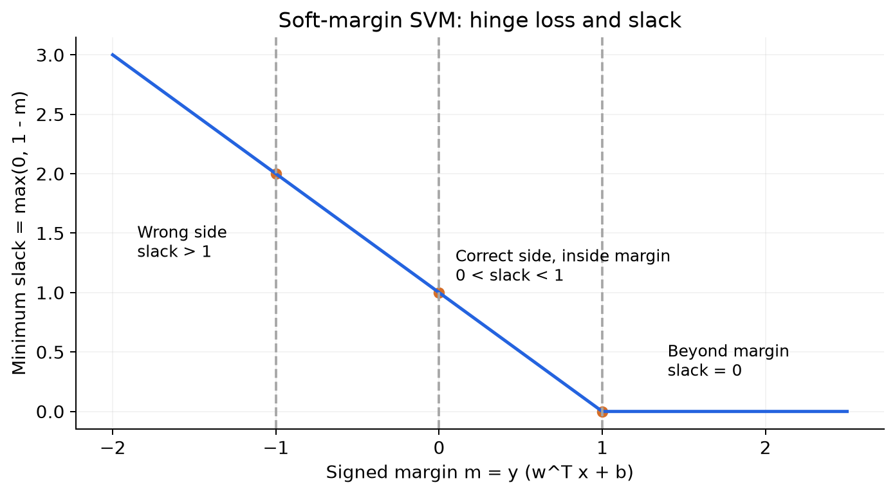
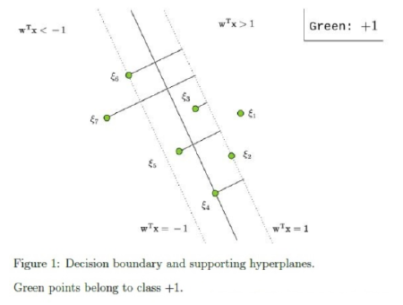
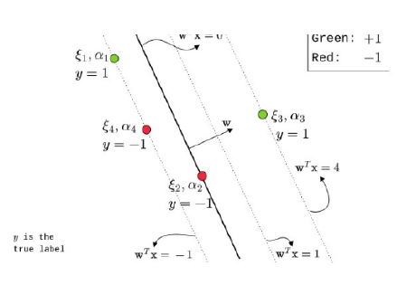
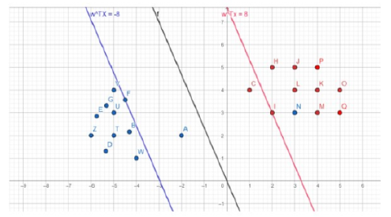
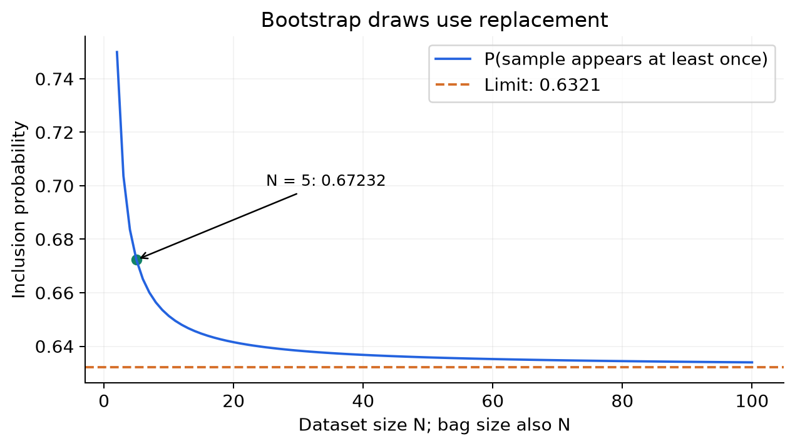
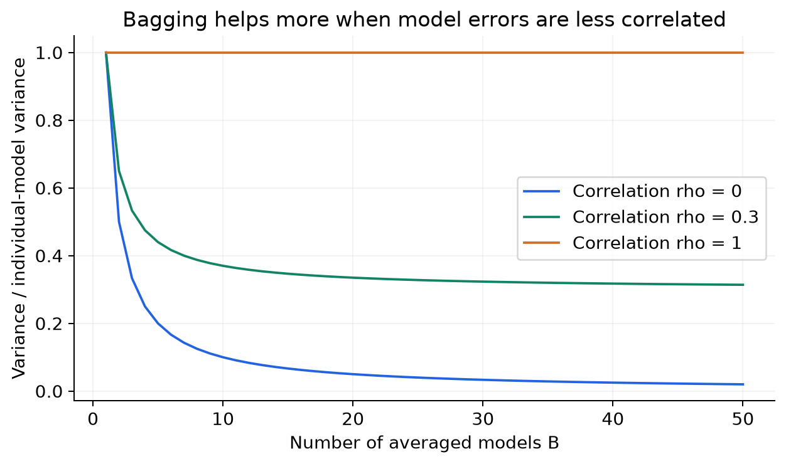
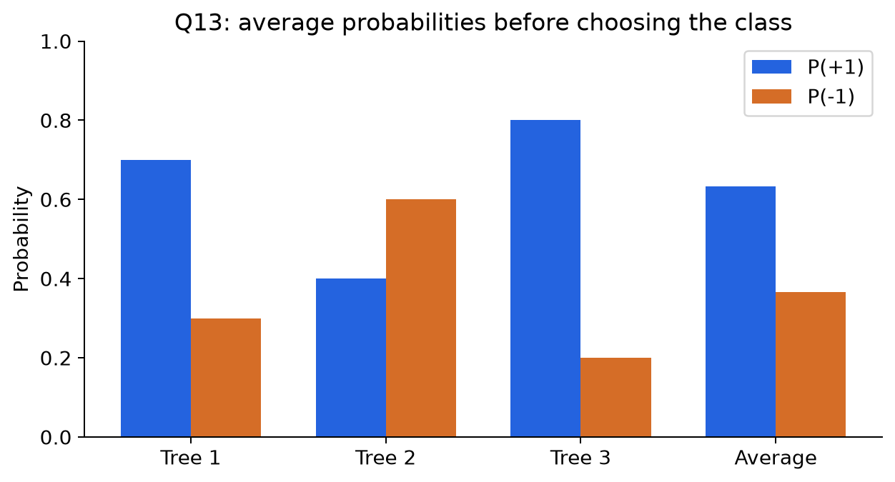
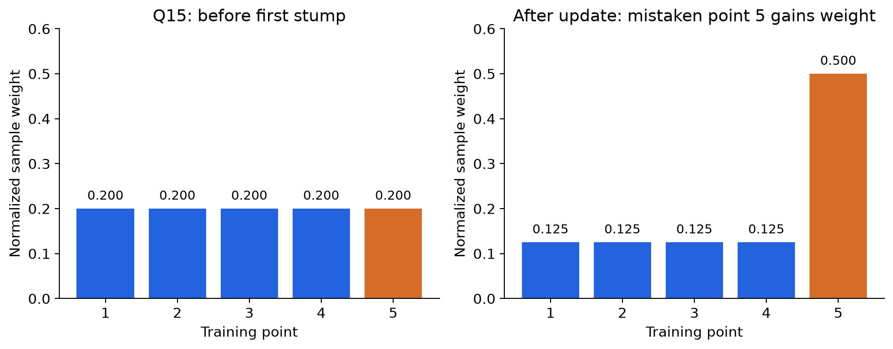
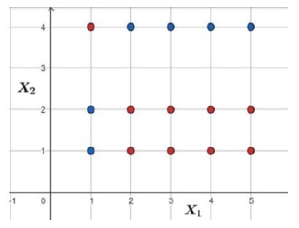
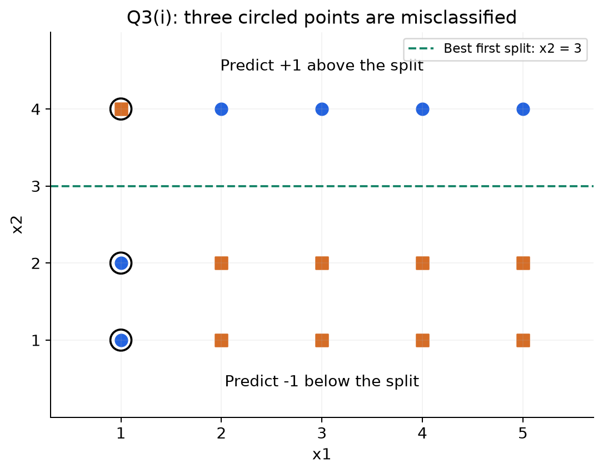

# MLT Week 11: Soft-Margin SVM and Ensemble Methods Notes

**Flow:** Hard margin ki limitation → slack and soft margin → KKT and support vectors → bias/variance → bagging → random forest → boosting → AdaBoost numerical updates.

## Topic index

| Topic | Subtopics | Questions |
|---|---|---|
| 1. Soft-margin SVM | Slack, hinge loss, penalty C, graph reading | Q8 |
| 2. Dual and support vectors | Box constraints, KKT, correct/wrong margins | Q17, Q5, Q1, Q9, Q2, Q12, Q18 |
| 3. Ensemble foundations | Weak/strong learners, stumps, bias/variance | Q10 |
| 4. Bagging | Bootstrap, aggregation, correlation, variance | Q19 |
| 5. Random forest | Feature subsampling, probability averaging | Q13, Q14 |
| 6. Boosting and comparison | Sequential learning, bias reduction | Q4, Q7, Q16 |
| 7. AdaBoost | Weighted error, learner weights, normalized sample updates | Q6, Q11, Q15, Q3 |
| 8. Revision | Formula sheet, common mistakes, solving checklist | — |

---

## 1. Soft-margin SVM: Perfect separation possible na ho toh?

### 1.1 Week 10 se connection

Hard-margin SVM ka rule tha:

$$y_i(w^Tx_i+b)\ge1\quad\forall i.$$

**Problem:** Ek noisy label/outlier bhi strict constraints ko infeasible bana sakta hai, ya separator ko unnecessarily distort kar sakta hai.

**Short definition:** Soft-margin SVM margin violations allow karta hai, but unke liye penalty charge karta hai.

**Real life:** Attendance rule mein har student ki perfect attendance demand karne ke badle limited absences allow karo, but absence ki cost ho. Flexibility milti hai; completely ignoring the rule nahi.

Use labels $y_i\in\{-1,+1\}$ and score:

$$f_i=w^Tx_i+b,\qquad m_i=y_if_i.$$

$m_i$ **signed functional margin** hai: positive means correct side, negative means wrong side.

### 1.2 Slack variable: “Minimum bribe”

**Definition:** $\xi_i\ge0$ tells how much sample $i$ falls short of required signed margin 1.

$$m_i+\xi_i\ge1,\qquad\xi_i\ge0.$$

Minimum feasible slack:

$$\boxed{\xi_i^{\min}=\max(0,1-m_i)=\max(0,1-y_if_i)}.$$

For $C>0$, optimum mein slack exactly minimum feasible value hoti hai, because extra slack unnecessarily increases objective.

**Important:** Bribe actual geometric distance nahi; it is **score shortfall**. Required movement distance toward the correct margin, if needed, is $\xi_i/\|w\|$. Training point physically move nahi hota; slack only violation quantify karti hai.

### 1.3 Position-to-slack table

| Signed margin $m_i$ | Slack | Interpretation |
|---|---|---|
| $m_i>1$ | 0 | Correct side, beyond required margin |
| $m_i=1$ | 0 | Correct supporting hyperplane |
| $0<m_i<1$ | $1-m_i\in(0,1)$ | Correctly classified, but inside margin |
| $m_i=0$ | 1 | Decision boundary; label depends on tie convention |
| $-1<m_i<0$ | $1-m_i\in(1,2)$ | Misclassified, between decision boundary and wrong support plane |
| $m_i=-1$ | 2 | Wrong supporting hyperplane |
| $m_i<-1$ | $1-m_i>2$ | Misclassified beyond the wrong support plane |

**Counterexample to “positive slack means wrong label”:** $y=+1$, score $0.6$ → correct positive label, but slack $1-0.6=0.4>0$.

**Counterexample to “on a supporting plane means zero slack”:** Positive point on $f=-1$ has $m=-1$, so slack 2. Only its **correct** supporting plane gives zero slack.

### 1.4 Primal objective and C

$$\boxed{\min_{w,b,\xi}\frac12\|w\|^2+C\sum_{i=1}^{N}\xi_i}$$

subject to:

$$y_i(w^Tx_i+b)\ge1-\xi_i,\qquad\xi_i\ge0.$$

Course no-bias version sets $b=0$; question explicitly includes $b$ toh retain it.

- Norm term encourages a wide canonical margin.
- Slack penalty discourages violations.
- $C$ balances these goals, normally $C>0$.
- For fixed $w,b$, choose sufficiently large slack and constraints become feasible.

**Constraint count:** $N$ margin inequalities + $N$ slack-nonnegativity inequalities = **$2N$ scalar primal constraints**.

### 1.5 Hinge-loss form

Minimum slack substitute karne par:

$$\boxed{\min_{w,b}\frac12\|w\|^2+C\sum_i\max(0,1-y_if_i)}.$$

**Hinge loss:** $\max(0,1-m)$; correct but insufficiently confident points can still incur loss.

**Comparison with Week 9:** Zero-one loss only wrong labels count karta hai. Logistic loss smooth confidence penalty deta hai. Hinge loss required margin meet hote hi exactly zero ho jaata hai.

### 1.6 What happens when C changes?

| Choice | Typical effect |
|---|---|
| Smaller positive $C$ | Violations cheaper; smaller weight norm/wider nominal margin favoured |
| Larger $C$ | Margin violations more expensive |
| $C=0$, no bias | Norm minimum at $w=0$; dual coefficients all 0 |
| $C\to\infty$ on separable data | Hard-margin solution recovered under usual setup |
| $C\to\infty$ on nonseparable data | Hard-margin infeasibility does not disappear |

**Caution:** Larger $C$ does not guarantee better test accuracy. Lower $C$ does not generally mean fewer training misclassifications; it tolerates violations more readily. Total hinge loss and number of wrong labels are different quantities.

**Why negative C is invalid here:** Slack has no upper bound. If $C<0$, sending a feasible slack to infinity drives objective to $-\infty$; the optimization is unbounded below.

**At C = 0:** Slack no longer penalized, so it is not uniquely forced to its minimum. $\max(0,1-m)$ still gives the minimum feasible slack, but other larger values can also be optimal. Also $w=0$ does not define a meaningful separating hyperplane; do not interpret $2/\|w\|$ as a useful trained margin there.

### 1.7 Q8 — Read slack values from a graph

**Source:** 2024 Dec 22 ET, Q8.

**Question:**

> Consider a soft-margin SVM that has been trained on a dataset in $\mathbb R^2$. A subset of the data points and the decision boundary (solid line) is shown below:
> For each point, consider $\xi_i$ to represent the slack variable or the “minimum bribe” required to move the point onto the correct supporting hyperplane. Answer the given sub-questions based on the figure:

> (i) What is the value of $\xi_4$?
>
> (ii) What is the value of $\xi_1$?
>
> (iii) What is the value of $\xi_2$?
>
> (iv) What is the value of $\xi_6$?
>
> (v) Which of the following is correct? (MSQ)
>
> (a) $\xi_7>2$
>
> (b) $1<\xi_5<2$
>
> (c) $\xi_7<0$
>
> (d) $1<\xi_7<2$

**Step 1:** Figure mein all points have $y=+1$, so signed margin equals score $m=w^Tx$.

**Step 2:** Use $\xi=\max(0,1-w^Tx)$ for each location:

| Point | Position from figure | Score/margin | Slack |
|---|---|---|---|
| 4 | Decision boundary | 0 | $1-0=\boxed{1}$ |
| 1 | Beyond correct support plane | $>1$ | $\boxed{0}$ |
| 2 | Correct support plane | 1 | $\boxed{0}$ |
| 6 | Wrong support plane | -1 | $1-(-1)=\boxed{2}$ |
| 5 | Between negative support plane and decision boundary | $-1<m<0$ | $1<\xi_5<2$ |
| 7 | Beyond negative support plane | $m<-1$ | $\xi_7>2$ |

**Step 3:** Part (v): (a), (b) true; (c) violates nonnegativity; (d) wrong region.

**Answers:** (i) 1; (ii) 0; (iii) 0; (iv) 2; (v) **(a), (b)**.

**Extra connection:** Point 3 lies between decision boundary and positive support plane, so $0<\xi_3<1$. It is correct-side but still pays positive slack.

---

## 2. Dual, KKT and soft-margin support vectors

### 2.1 Lagrangian: Two constraints per point

Standard forms:

$$1-y_if_i-\xi_i\le0,\qquad-\xi_i\le0.$$

Assign $\alpha_i\ge0$ to first, $\beta_i\ge0$ to second:

$$L=\frac12\|w\|^2+C\sum_i\xi_i+\sum_i\alpha_i(1-y_if_i-\xi_i)-\sum_i\beta_i\xi_i.$$

Useful stationarity results:

$$\boxed{w=\sum_i\alpha_i y_i x_i},\qquad\boxed{\alpha_i+\beta_i=C}.$$

Since both multipliers nonnegative:

$$\boxed{0\le\alpha_i\le C},\qquad\beta_i=C-\alpha_i.$$

**Week 10 connection:** Hard margin had $\alpha_i\ge0$ only. Soft margin adds an upper cap $C$.

### 2.2 Dual objective

Let $X$ have samples as columns, $Y=\operatorname{diag}(y_i)$, $G=X^TX$.

$$\boxed{\max_{0\le\alpha_i\le C}\mathbf1^T\alpha-\frac12\alpha^TYGY\alpha}.$$

Free bias $b$ train ho toh extra constraint $\sum_i\alpha_i y_i=0$. No-bias formulation mein yeh equality nahi hoti. Kernel SVM mein $G$ ko kernel Gram matrix $K$ se replace karte hain.

### 2.3 Complementary slackness

$$\boxed{\alpha_i(1-m_i-\xi_i)=0},\qquad\boxed{\beta_i\xi_i=0}.$$

Yeh two equations, $\alpha_i+\beta_i=C$, aur minimum-slack formula se saare region rules milte hain. Assume optimum and **$C>0$** in the following table.

| Margin position | Slack | Multiplier conclusion |
|---|---|---|
| $m_i>1$ | 0 | $\alpha_i=0$, $\beta_i=C$ |
| $m_i=1$ | 0 | $\alpha_i\in[0,C]$; exact value not determined |
| $m_i<1$ | $1-m_i>0$ | $\beta_i=0$, $\alpha_i=C$ |

**Dual-to-primal view:**

| Given multiplier | Necessary conclusion |
|---|---|
| $\alpha_i=0$ | $\xi_i=0$, $m_i\ge1$ |
| $0<\alpha_i<C$ | $\xi_i=0$, $m_i=1$ |
| $\alpha_i=C$ | $m_i\le1$, $\xi_i\ge0$; may be correct or wrong |

**Support-vector definition:** Positive dual coefficient $\alpha_i>0$. Soft-margin support vectors can lie on the correct supporting plane, inside margin, or on the wrong side. They are not restricted to the two supporting planes as in the usual hard-margin picture.

**Counterexample:** Correctly classified point with $m=0.5$ has $\xi=0.5$ and $\alpha=C$. Thus “$\alpha=C$ means misclassified” is false.

**On-margin subtlety:** $m=1$ can have $\alpha=0$ in degenerate/redundant cases; graph position alone does not always establish strict positivity.

### 2.4 Q17 — Interior dual coefficient

**Source:** 2026 Sep 13 ET, Q17.

**Question:**

> (MCQ) For an optimal soft-margin SVM solution (no bias term), a training point satisfies $0<\alpha_i^*<C$. Here $\xi_i$ denotes the slack variable for this point, and $\beta_i$ is the Lagrange multiplier on the constraint $\xi_i\ge0$. Which statement is necessarily true?
>
> (a) The point is misclassified by $w^*$.
>
> (b) $\xi_i^*>0$.
>
> (c) $y_i(w^{*T}x_i)=1$ and $\xi_i^*=0$.
>
> (d) $\beta_i^*=0$.

**Step 1:** $\alpha_i<C$ gives $\beta_i=C-\alpha_i>0$.

**Step 2:** $\beta_i\xi_i=0$ with positive $\beta_i$ forces $\xi_i=0$.

**Step 3:** $\alpha_i>0$ forces $1-m_i-\xi_i=0$. Substitute slack 0 → $m_i=1$.

**Answer: (c).** (d) is opposite of step 1; point is on its correct support plane, not misclassified.

### 2.5 Q5 — Slacks and multipliers with C = 3

**Source:** 2024 Sep 01 ET, Q5.

**Question:**

> Consider a soft-margin SVM with $C=3$ that has been trained on a dataset with features in $\mathbb R^2$. The decision boundary and the supporting hyperplanes are displayed below. Four points from the training dataset are also displayed. Green data-points belong to class 1 and red data-points belong to class -1. Symbols $\xi$ and $\alpha$ have their usual meanings. Assume that $w,\xi_i,\alpha_i$ represent the optimal values.

> Based on the above data, answer the given subquestions.
>
> (i) What is $\xi_1$?
>
> (ii) What is $\xi_2$?
>
> (iii) What is $\xi_3$?
>
> (iv) What is $\alpha_1$? If it cannot be determined exactly, enter -1.
>
> (v) What is $\alpha_3$? If it cannot be determined exactly, enter -1.
>
> (vi) What is $\alpha_4$? If it cannot be determined exactly, enter -1.

**Step 1 — Read scores and labels, then multiply:**

| Point | True label | Score from graph | Signed margin $m=yf$ |
|---|---:|---:|---:|
| 1 | +1 | -1 | -1 |
| 2 | -1 | 0 | 0 |
| 3 | +1 | 4 | 4 |
| 4 | -1 | -1 | 1 |

**Step 2 — Slacks:**

$$\xi_1=\max(0,1-(-1))=\boxed2,$$

$$\xi_2=\max(0,1-0)=\boxed1,$$

$$\xi_3=\max(0,1-4)=\boxed0.$$

**Step 3 — Multipliers:** Point 1 has positive slack → $\alpha_1=C=\boxed3$. Point 3 strictly beyond correct margin → $\alpha_3=\boxed0$.

**Step 4:** Point 4 on correct support plane, so $0\le\alpha_4\le3$, but exact value not determined. Enter $\boxed{-1}$ as instructed.

**Answers:** 2, 1, 0, 3, 0, -1. Final -1 is an **answer code**, not an allowed dual multiplier.

### 2.6 Q1 — Which points affect the SVM weight?

**Source:** 2024 Apr 28 ET, Q1.

**Question:**

> (MSQ) Consider the following dataset on which the soft margin SVM is applied.

> Which of the following statements is/are true about this dataset?
>
> (a) Points $\{F,A,C,I\}$ are the only support vectors.
>
> (b) Points $\{A,N\}$ are a subset of support vectors.
>
> (c) Points $\{F,A,N\}$ are a subset of support vectors.
>
> (d) Points except $\{F,A,C,I,N\}$ do not play any role in determining optimal weightvector.
>
> (e) Points except $\{F,A,C,I\}$ do not play any role in determining optimal weightvector.

**Step 1 — Read class sides:** Blue group mostly left, red group mostly right. N is a blue point on the red side; it is not harmless just because it is far from the boundary.

**Step 2 — Partition the points:**

| Points | Position | Role |
|---|---|---|
| A | Blue, inside margin on correct side | Positive slack → $\alpha=C$ |
| C | Red, inside margin on correct side | Positive slack → $\alpha=C$ |
| N | Blue, wrong side | Positive slack → $\alpha=C$ |
| F, I | On respective supporting lines | Treated as support points in intended diagram |
| Remaining points | Strictly beyond their correct margins | $\alpha=0$ |

**Step 3 — Evaluate options:**

- (a) false: it omits N, a misclassified support vector.
- (b) true: A and N have positive slack.
- (c) true under intended nondegenerate support-line interpretation for F.
- (d) true: remaining points have zero coefficients, so no contribution to $w=\sum_i\alpha_i y_i x_i$.
- (e) false: it excludes N from points that affect $w$.

**Expected answer: (b), (c), (d).**

**Graph qualification:** Supporting lines in the image are labelled scores $\pm8$; they are drawn in a noncanonical score scale. Normalize that score by 8 before applying canonical $\pm1$ slack numbers. Only region membership is needed here. Also an on-margin point can have zero coefficient in a degenerate solution, so F's strict support status is an intended assumption, not something its position alone proves.

### 2.7 Q9 — “Always true” and the correct supporting plane

**Source:** 2025 Apr 13 ET (QIM4), Q9.

**Question:**

> (MSQ) Let $w^*,\xi^*$ be the optimal primal solutions, and $\alpha^*,\beta^*$ be the optimal dual solutions of the soft-margin SVM problem. Select the options which are always true.
>
> (a) If $\alpha_i^*=C$, the $i$th point is incorrectly classified by $w^*$.
>
> (b) If $\alpha_i^*=0$, the $i$th point is correctly classified by $w^*$.
>
> (c) If the $i$th data point lies on one of the supporting hyperplanes, then $\alpha_i^*=0$.
>
> (d) If the $i$th data point lies on one of the supporting hyperplanes, it does not pay any bribes.
>
> (e) If the $i$th data point lies between the supporting hyperplanes, it always pays a positive bribe.

**Assume $C>0$**, as in the standard KKT region rules.

**Step 1:** (a) false. Example $m=0.5$ → correct side, slack 0.5, $\alpha=C$.

**Step 2:** (b) true. $\alpha=0$ → $\beta=C>0$ → slack 0 → $m\ge1$, hence correct.

**Step 3:** (c) false. On correct support plane, multiplier may be positive. On wrong support plane, slack 2 gives $\alpha=C$.

**Step 4:** (d) as literally written is **false**: positive point on $f=-1$ pays slack 2. It becomes true if “one of the supporting hyperplanes” means **its correct supporting hyperplane**.

**Step 5:** Strictly between support planes means $-1<f<1$. For either label, $-1<m<1$, so $1-m>0$ → (e) true.

**Strict answers as written: (b), (e). Supplied key: (b), (d), (e).** The key assumes the missing word **correct** in option (d). Remember the actual rule from the counterexample.

### 2.8 Q2 — Soft-margin formulation and constraint count

**Source:** 2024 Apr 28 ET, Q2.

**Question:**

> (MSQ) Consider a soft-margin Support Vector Machine (SVM) for a binary classification problem with a dataset in a two-dimensional space. The optimization problem for the soft-margin SVM is formulated as:
>
> $$\text{Minimize}\quad\frac12\|w\|^2+C\sum_{i=1}^{N}\xi_i$$
>
> subject to the constraints:
>
> $$y_i(w\cdot x_i+b)\ge1-\xi_i\quad\text{and}\quad\xi_i\ge0\text{ for all }i$$
>
> where $C$ is a positive constant. Let $w^*,\xi^*$ be the optimal solutions, and $\alpha^*,\beta^*$ be the optimal dual solutions of the soft-margin SVM problem.
> Which of the following statements about the soft-margin SVM is correct?
>
> (a) If $i$th data point lies on one of the supporting hyperplanes, then $\alpha_i^*=0$.
>
> (b) If $i$th data point lies on the correct supporting hyperplane, it does not pay any bribes.
>
> (c) A smaller value of $C$ allows for a larger margin, potentially leading to less misclassifications on the training data.
>
> (d) For a dataset with $n$ data-points, there are $2n$ constraints for soft-margin SVM.
>
> (e) As $C$ approaches $\infty$ the soft-margin SVM is equal to the hard-margin SVM.
>
> (f) $C$ can be negative, as long as the bribe ($\xi$) each data point pays is non-negative.

**Step 1:** (a) false by section 2.3; on-margin does not imply zero multiplier.

**Step 2:** (b) true: correct support plane gives $m=1$, slack 0.

**Step 3:** (c) does not express the standard trade-off correctly. Lower $C$ tolerates more violations; fewer training misclassifications are not a consequence of the wider-margin preference. Misclassification count itself need not vary monotonically, so treat this as an unsupported claimed effect, not a theorem.

**Step 4:** (d) true for the **displayed formulation**: $n$ margin constraints plus $n$ nonnegative-slack constraints = $2n$.

**Step 5:** (e) needs separability. Without it, hard-margin problem is infeasible, so not universally true.

**Step 6:** (f) false: negative $C$ makes objective unbounded below by increasing slack.

**Supported answers: (b), (d). Supplied key lists only (b), omitting the explicitly present slack constraints in (d).** Don't memorize that there are only $n$ inequalities in this primal formulation.

### 2.9 Q12 — Support-vector counts at extreme C

**Source:** 2025 Aug 31 ET (QDF4), Q12.

**Question:**

> (MSQ) Consider a 1D dataset which consists of 2 positive data points (points with label 1) $\{1,2\}$ and 3 negative data points (points with label -1) $\{-3,-2,-1\}$. Suppose that we want to learn a soft-margin linear SVM for this data set. Consider the formulation of the soft-margin SVM:
>
> $$\min_{w,\epsilon}\frac12\|w\|^2+C\sum_{i=1}^{n}\epsilon_i,\quad C\ge0$$
>
> subject to $(w^Tx_i)y_i+\epsilon_i\ge1,\ \forall i$, and $\epsilon_i\ge0,\ \forall i$.
> Select the correct options from the following:
>
> (a) Number of support vectors for $C=0$ is 0.
>
> (b) Number of support vectors for $C=0$ is 2.
>
> (c) Number of support vectors for $C=\infty$ is 5.
>
> (d) Number of support vectors for $C=\infty$ is 2.

**Step 1 — C = 0:** Box constraint $0\le\alpha_i\le0$ forces every coefficient 0. Thus no positive-coefficient support vectors → count **0**. Weight $w=0$; slack unpenalized.

**Step 2 — C tends to infinity:** Data is separable. Hard-margin limit applies, with $w=1$ and boundary $x=0$.

**Step 3 — Signed margins:** Inputs $1,2,-3,-2,-1$ have signed margins $1,2,3,2,1$. Closest points are $x=1$ and $x=-1$; support-vector count **2** in the usual free-bias or nondegenerate interpretation.

**Answer expected: (a), (d).**

**No-bias degeneracy detail:** The displayed model has no bias. Its two active margin constraints at $x=1$ and $x=-1$ are algebraically identical ($w\ge1$), so the optimal dual contribution can be split between them or assigned to only one. Hence **2 geometric margin points**, but positive-dual-coefficient count may be 1 or 2 depending on the chosen optimum. The key uses the usual geometric count for this limit. With a free bias, dual balance requires both positive coefficients here.

### 2.10 Q18 — Missing coordinate, but weight is recoverable

**Source:** 2026 Sep 13 ET, Q18.

**Question:**

> (SA) Note: coordinates of $x_1$ vector are intentionally not provided.
> Consider a soft-margin SVM for binary classification in $\mathbb R^3$ with no bias term and regularisation parameter $C=10$. The training set has three points:
>
> $$x_1,\ (y_1=+1),\quad x_2=(0.2,0.3,0.4),\ (y_2=+1),\quad x_3=(0.15,0.28,0.35),\ (y_3=-1).$$
>
> At the optimal solution $w^*$ the margin positions are
>
> $$y_1(w^{*T}x_1)=1.5,\quad y_2(w^{*T}x_2)=0.36,\quad y_3(w^{*T}x_3)=-0.306.$$
>
> Compute the perpendicular distance between the two margin hyperplanes $w^Tx=+1$ and $w^Tx=-1$. (Round to 2 decimal places.)

**Step 1 — Region to multiplier:** $m_1=1.5>1$ → $\alpha_1=0$. Both $m_2=0.36<1$ and $m_3=-0.306<1$ → $\alpha_2=\alpha_3=C=10$.

**Step 2 — Reconstruct weight:**

$$w=0x_1+10(+1)x_2+10(-1)x_3=10(x_2-x_3).$$

$$x_2-x_3=(0.05,0.02,0.05),\qquad\boxed{w=(0.5,0.2,0.5)}.$$

Missing $x_1$ doesn't matter because its coefficient is zero.

**Step 3 — Check supplied margins:** $w^Tx_2=0.1+0.06+0.2=0.36$. For point 3, $w^Tx_3=0.075+0.056+0.175=0.306$, times label -1 gives -0.306. Consistent.

**Step 4 — Norm and width:**

$$\|w\|=\sqrt{0.5^2+0.2^2+0.5^2}=\sqrt{0.54}\approx0.734847.$$

$$\text{Width}=\frac2{\sqrt{0.54}}\approx2.721655\to\boxed{2.72}.$$

**Question se shortcut:** Coordinates missing hon toh pehle check karo corresponding multiplier zero hai ya nahi. Unknown irrelevant contribution ko reconstruct karne ki zaroorat nahi.

---

## 3. Ensemble foundations: Multiple models ko combine karna

### 3.1 Ensemble kya hai?

**Definition:** Multiple base models ki predictions combine karke final prediction banana.

**Real life:** Ek difficult question par ek person ki opinion ke badle multiple people ki opinions combine karna. Benefit tab zyada hota hai jab sab exactly same mistake na karte hon.

Base classifiers $h_1,\ldots,h_B$ ho sakte hain. Combination simple average, majority vote, probability average ya weighted vote ho sakta hai.

**Important:** More models automatically better nahi. Agar sab identical prediction dete hain, averaging same answer hi degi.

### 3.2 Weak learner, strong learner and decision stump

**Weak learner:** Relevant training distribution par random-guessing baseline se slightly better perform karne wala learner. Binary balanced/random-coin baseline ke context mein weighted error $\epsilon<0.5$ chahiye.

**Example:** Error 0.48 means accuracy 0.52; small edge over a fair random classifier.

**Strong learner:** Combined procedure much lower error achieve kar sakta hai under suitable assumptions. “Strong” ka matlab every future point par guaranteed correct/high confidence nahi.

**Decision stump:** Depth-1 decision tree: one feature par one split, then two prediction leaves.

Example:

$$h(x)=\begin{cases}+1,&x_1<3,\\-1,&x_1\ge3.\end{cases}$$

Simple stump often high-bias model hota hai; deep tree usually lower training bias but higher variance. **Weakness architecture alone se decide nahi hoti:** Easy dataset par stump perfect classifier bhi ho sakta hai.

### 3.3 Q10 — Weak learner definition

**Source:** 2025 Apr 13 ET (QIM4), Q10.

**Question:**

> (MCQ) Weak learners used in the ensemble method typically perform slightly better than random guessing.
>
> (a) TRUE
>
> (b) FALSE

**Step 1:** Weak learner ka required advantage small ho sakta hai, but chance se better hona chahiye on the relevant distribution.

**Step 2:** Binary AdaBoost example: $\epsilon=0.48<0.5$ valid weak advantage.

**Answer: (a), TRUE.** Imbalanced datasets mein “50% accuracy is useful” automatically assume mat karo; yahan standard binary weak-learning definition ka context hai.

### 3.4 Bias and variance: Dono ka meaning alag hai

**Bias:** Training datasets ke across model ki average prediction aur actual underlying function ke beech systematic difference.

**Variance:** Training data change hone par fitted prediction kitni change hoti hai.

**Real-life connection:** Archer ke shots consistently target se left jaate hain → bias. Shots different directions mein widely spread hain → variance.

| Situation | Typical behaviour |
|---|---|
| High bias | Model too simple; train and test performance both poor |
| High variance | Training fit strong, but model sensitive to sampling/noise |
| Underfitting | Important pattern capture nahi hua |
| Overfitting | Noise/sample-specific patterns bhi fit ho gaye |

**Counterexample:** Deep tree training labels memorize kar sakta hai, yet small training change se different splits bana sakta hai. Low training error does not imply low variance.

### 3.5 Correct bias–variance decomposition

For squared-error regression at a fixed input, under the usual zero-mean noise model:

$$\boxed{\mathbb E[(Y-\hat f(X))^2]=\operatorname{Bias}^2+\operatorname{Variance}+\text{irreducible noise}}.$$

**Do not memorize “Error = Bias + Variance” literally.** Standard squared-error identity uses **bias squared** and also includes noise. Classification zero-one loss does not have this same simple additive formula.

**Trade-off is a tendency, not a universal law:** Increasing model complexity often reduces bias and raises variance, but every pair of models need not follow an exact inverse relation. Good modelling/ensembles can improve both in some situations.

---

## 4. Bagging: Different bags, independent models, combined prediction

### 4.1 Bootstrap sampling

**Definition:** Dataset se samples **with replacement** draw karke a new training bag banana.

For dataset size $N$, standard bag size also $N$. Repeat this independently for $B$ bags.

**Example:** Dataset $\{A,B,C,D,E\}$ se one possible bag $\{A,C,A,E,C\}$. Bag mein 5 draws hain, but only 3 distinct observations. Some points repeat, some absent.

**Real life:** Same pool se repeatedly names draw kar rahe ho, aur each draw ke baad name pool mein wapas daal dete ho.

**Bagging procedure:**

1. Create $B$ bootstrap bags.
2. Train one base learner on each bag.
3. Combine their predictions.

Models independently train ho sakte hain, so training can run in parallel.

### 4.2 Bootstrap mein kitne unique points?

A particular sample ke one draw mein not selected hone ka probability $1-1/N$.

Across $N$ independent replacement draws:

$$\boxed{P(\text{not included})=\left(1-\frac1N\right)^N}.$$

$$\boxed{P(\text{included at least once})=1-\left(1-\frac1N\right)^N}.$$

Large $N$ par:

$$P(\text{included})\approx1-e^{-1}\approx0.6321,$$

$$P(\text{not included})\approx e^{-1}\approx0.3679.$$

Expected unique count $=N[1-(1-1/N)^N]$, approximately $0.632N$.

**Interpretation:** Bag still has $N$ draws. Roughly 63.2% **distinct dataset observations** appear on average; it is not a claim that each bag has exactly 63.2% unique entries.

**Practice:** $N=5$ ho toh absent probability $(4/5)^5=0.32768$, included probability 0.67232, expected unique count $5(0.67232)=3.3616$. Finite-size answer exactly 0.632 nahi.

**Out-of-bag (OOB):** A tree's bootstrap bag mein absent observations us tree ke evaluation ke liye use ho sakte hain. Each observation ke OOB predictions only un trees se lo jinhone us observation ko train bag mein nahi liya.

### 4.3 Aggregation rules

**Regression average:**

$$\boxed{\hat f(x)=\frac1B\sum_{b=1}^{B}h_b(x)}.$$

**Binary hard-label majority vote, $h_b\in\{-1,+1\}$:**

$$\boxed{\hat y=\operatorname{sign}\left(\sum_b h_b(x)\right)}.$$

Even number of trees par tie possible hai; tie convention specify karni padegi. Multiclass mein most votes wala label choose karo.

**Probability averaging:** Class probabilities average karo, then largest average choose karo. This is a different rule from hard-label vote.

**Counterexample:** Three models' positive probabilities are 0.51, 0.51, 0.01. Hard majority gives positive (2 of 3), but average probability $1.03/3\approx0.343$ gives negative. Question ka aggregation rule follow karo.

### 4.4 Variance reduction and correlation

**Definition:** Different unstable models ki averaging unke individual fluctuations ko partially cancel kar sakti hai.

For $B$ scalar predictions with equal variance $\sigma^2$ and common pairwise correlation $\rho$:

$$\boxed{\operatorname{Var}(\bar h)=\sigma^2\left[\rho+\frac{1-\rho}{B}\right]}.$$

Yeh formula averaged real-valued predictions ka hai; classification majority-vote error ka direct formula nahi.

- $\rho=0$ → variance $\sigma^2/B$.
- $\rho=1$ → variance $\sigma^2$; no benefit from copies.
- Large $B$ → correlation floor $\rho\sigma^2$ remains.

**Example:** $\sigma^2=1$, $B=10$, $\rho=0.3$ → variance $0.3+0.7/10=0.37$. Independent case would give 0.1; correlated errors reduce the benefit.

**Best typical candidates:** High-variance, low-bias learners, such as deep unpruned trees. Bagging mainly reduces variance; it is not primarily a systematic bias-removal method.

### 4.5 Q19 — Bagging properties

**Source:** 2026 Sep 13 ET, Q19.

**Question:**

> (MSQ) Which of the following statements about bagging are correct?
>
> (a) Bagging reduces the variance of the ensemble’s prediction.
>
> (b) Bagging substantially reduces the bias of the base learner.
>
> (c) Bagging tends to help most when the base learners are diverse (weakly correlated with one another).
>
> (d) Bagging tends to help most with high-variance, low-bias base learners such as deep, unpruned decision trees.
>
> (e) Averaging all base learner reduces variance, if every base learner produces identical predictions.

**Step 1:** Main effect variance reduction → (a) correct in intended bagging setting.

**Step 2:** Substantial bias reduction is not its main/general guarantee → (b) incorrect.

**Step 3:** Weakly correlated predictions cancel more variation → (c) correct.

**Step 4:** Unstable deep trees are good candidates → (d) correct.

**Step 5 — Counterexample for (e):** If every $h_b(x)=h(x)$, their average is exactly $h(x)$. Variance unchanged, also seen by $\rho=1$ in formula → (e) false.

**Answer: (a), (c), (d).** Read (a) as the usual benefit, not a strict reduction guarantee even for identical learners.

---

## 5. Random forest: Bagging ke saath feature randomness

### 5.1 Basic idea

**Definition:** Random forest multiple decision trees combine karta hai, typically bootstrap bags aur random feature subsets use karke.

At **each split**, all $p$ features evaluate karne ke badle randomly selected $m$ features mein best split search karo.

**Real life:** Har expert ko same dominant clue dene par sab same judgement kar sakte hain. Different clues consider karne ka chance dene se predictions less correlated ho sakti hain.

**Important:** Feature subset generally each node/split par newly chosen hota hai; one fixed subset for the entire tree assume mat karo unless question says so.

Common classification heuristic $m\approx\sqrt p$ hai, but universal required value nahi; tune according to data/task.

### 5.2 Why feature randomness helps

A very strong feature har tree ke root par choose hoti rahe, toh bootstrap bags different hote hue bhi trees similar ho sakte hain. Subsampling features reduces that repeated dominance.

**Trade-off:**

- Smaller $m$ generally less correlated trees.
- Too small $m$ informative features miss karwa sakta hai, weakening individual trees.
- Larger $m$ can strengthen each split but increase correlation.
- More randomness always better, yeh guarantee nahi.

Random forest trees can train independently in parallel. Feature randomness makes trees **less correlated**, not necessarily statistically independent or exactly uncorrelated.

### 5.3 Q13 — Average class probabilities

**Source:** 2025 Aug 31 ET (QDF4), Q13.

**Question:**

> (SA) A random forest model consists of three decision trees. For a given test point, each tree outputs the following class probabilities for class +1 and class -1:
>
> Tree 1: $P(+1)=0.7$, $P(-1)=0.3$
>
> Tree 2: $P(+1)=0.4$, $P(-1)=0.6$
>
> Tree 3: $P(+1)=0.8$, $P(-1)=0.2$
>
> The random forest predicts the final label by averaging the class probabilities across the trees and selecting the class with the higher average probability. What is the final predicted label for the test point? (Give the answer as 1 for class +1 or -1 for class -1.)

**Step 1 — Positive-class average:**

$$\bar P(+1)=\frac{0.7+0.4+0.8}{3}=\frac{1.9}{3}\approx0.633333.$$

**Step 2 — Negative-class average:**

$$\bar P(-1)=\frac{0.3+0.6+0.2}{3}=\frac{1.1}{3}\approx0.366667.$$

**Step 3:** Positive average higher → predicted class $+1$. Enter $\boxed1$.

**Check:** Averages sum to 1. Hard vote happens to give same answer here, but use specified probability averaging.

### 5.4 Q14 — Change the number of candidate features

**Source:** 2025 Dec 18 ET, Q14.

**Question:**

> (MSQ) In a random forest classifier with $p$ total features, each split is chosen by evaluating a randomly selected subset of $m$ features. Consider how changing $m$ affects the behavior of the forest. Which of the following statements are correct?
>
> (a) Increasing $m$ reduces the correlation between any two trees in the forest.
>
> (b) Decreasing $m$ reduces the correlation between any two trees in the forest.
>
> (c) If $m$ is too small, individual trees may underfit the data.
>
> (d) Increasing $m$ always decreases the variance of the random forest model.
>
> (e) Decreasing $m$ makes trees more similar to each other.

**Step 1:** Smaller feature subsets increase randomization and generally reduce shared split choices → (b) intended true; (a), (e) opposite of usual effect.

**Step 2:** If informative features frequently unavailable, each tree can become weak → (c) true.

**Step 3:** Larger $m$ also changes correlation; “always decreases variance” is too strong → (d) false.

**Answer: (b), (c).** Correlation reduction in (b) is a statistical tendency; the phrase “any two trees” is not a deterministic guarantee for every dataset/random seed.

---

## 6. Boosting: Next learner ko previous mistakes par focus karna

### 6.1 Definition and connection

**Definition:** Boosting weak learners ko sequentially train karta hai, with later learners focusing on errors/difficult observations from earlier rounds.

**Real life:** First revision test mein galti wale topics identify karo; next practice un topics par extra attention de. Final answer sirf last test se nahi, multiple learners ke weighted combination se banta hai.

Typical AdaBoost base learner decision stump hai. Boosting often reduces bias by combining simple rules into a richer decision function.

**Qualification:** Bagging = variance reduction, boosting = bias reduction useful exam summary hai; real boosting can also affect variance and can overfit noisy labels. Neither method guarantees error reduction on every dataset.

### 6.2 Bagging vs boosting

| Feature | Bagging | Boosting, e.g. AdaBoost |
|---|---|---|
| Training relation | Independent base fits | Sequential rounds |
| Training data emphasis | Bootstrap variation | Updated sample importance |
| Typical base learner | Deep, high-variance tree | Shallow stump/weak learner |
| Combination | Often equal vote/average | Learner-weighted vote |
| Main textbook benefit | Reduce variance | Reduce bias |
| Parallel base training | Yes | Rounds depend on previous round |

**Random forest:** Bagging-style trees plus per-split feature randomness. It does not use AdaBoost's sequential error-weight updates.

### 6.3 Q4 — Match methods and characteristics

**Source:** 2024 Sep 01 ET, Q4.

**Question:**

> (MCQ) Match the characteristics given below with the appropriate ensemble technique.
>
> 1. Decision stumps
> 2. Deep decision trees
> 3. Parallel execution
> 4. Sequential execution
>
> (a) Bagging → (2), (3); Boosting → (1), (4)
>
> (b) Bagging → (1), (4); Boosting → (2), (3)
>
> (c) Bagging → (1), (3); Boosting → (2), (4)
>
> (d) Bagging → (2), (4); Boosting → (1), (3)

**Step 1:** Bagging deep unstable trees ka variance reduce karta hai; bags independently train hote hain → (2), (3).

**Step 2:** Boosting stumps ki simple rules sequentially combine karta hai → (1), (4).

**Answer: (a).** Base-learner choices are typical, not restrictions that forbid other learner types.

### 6.4 Q7 — Bias, tree depth and bagging

**Source:** 2024 Dec 22 ET, Q7.

**Question:**

> (MSQ) Which of the following options are correct? Select all that apply.
>
> (a) Underfitted models generally have less bias and high variance.
>
> (b) A decision tree with the maximum possible length may lead to overfitting.
>
> (c) Weak learners are those whose performance is slightly better than the random classifier.
>
> (d) All the estimators in bagging can be trained parallelly.

**Step 1:** Underfitting typically high bias, not low bias → (a) false.

**Step 2:** Very deep tree can memorize noise → (b) true. “May” is appropriate; depth does not force overfitting on every dataset.

**Step 3:** Weak learner slightly better than chance → (c) true; same concept as Q10.

**Step 4:** Independent bag fits → (d) true.

**Answer: (b), (c), (d).**

### 6.5 Q16 — Main effects

**Source:** 2026 May 06 ET, Q16.

**Question:**

> (MCQ) Which of the following statements is correct?
>
> (a) Bagging reduces variance, Boosting reduces bias
>
> (b) Bagging reduces bias, Boosting reduces variance
>
> (c) Both reduce only variance
>
> (d) Both reduce only bias

**Step 1:** Bagging averages unstable predictions → mainly variance reduction.

**Step 2:** Boosting adds weak rules to address systematic mistakes → often bias reduction.

**Answer: (a).** Options with “only” overstate the distinction. This is the same conceptual mapping used in Q4; no new numerical calculation needed.

---

## 7. AdaBoost: Har round ka exact calculation

### 7.1 Two different kinds of weights

**Definition:** AdaBoost sample weights update karta hai aur har fitted weak learner ko final vote weight assign karta hai.

| Symbol | Meaning |
|---|---|
| $D_t(i)$ | Round $t$ ke start par sample $i$ ki importance; sum over samples = 1 |
| $h_t(x)$ | Current weak classifier, outputs $-1$ or $+1$ |
| $\epsilon_t$ | Current sample distribution par weighted error |
| $a_t$ | Current classifier ka final-vote weight |
| $T$ | Number of boosting rounds |

Notes mein boosting coefficient ko **$a_t$** likhenge, jo commonly $\alpha_t$ bhi likha jaata hai. Yeh SVM ke per-sample dual multiplier $\alpha_i$ se different quantity hai.

### 7.2 Full algorithm, one round at a time

**Step 1 — Initialize:**

$$D_1(i)=\frac1N.$$

Source may start numbering at $D_0$; round ki meaning same hai. Har round ka starting distribution clearly identify karo.

**Step 2 — Train weak learner:** Current distribution par weighted misclassification error minimize karo:

$$\boxed{\epsilon_t=\sum_{i:h_t(x_i)\ne y_i}D_t(i)}.$$

**Step 3 — Classifier vote weight:** For $0<\epsilon_t<1/2$:

$$\boxed{a_t=\frac12\ln\frac{1-\epsilon_t}{\epsilon_t}}.$$

Lower error → larger positive vote weight.

**Step 4 — Unnormalized sample update:**

$$\tilde D_{t+1}(i)=D_t(i)e^{-a_ty_ih_t(x_i)}.$$

Since labels/predictions are $\pm1$:

- Wrong: $y_ih_t(x_i)=-1$ → multiply by $e^{a_t}$.
- Correct: $y_ih_t(x_i)=+1$ → multiply by $e^{-a_t}$.

**Step 5 — Normalize:**

$$Z_t=\sum_i\tilde D_{t+1}(i),\qquad\boxed{D_{t+1}(i)=\frac{\tilde D_{t+1}(i)}{Z_t}}.$$

**Step 6 — Final model after T rounds:**

$$\boxed{H_T(x)=\operatorname{sign}\left(\sum_{t=1}^{T}a_th_t(x)\right)}.$$

Score exactly zero par tie rule chahiye. Last stump alone generally final ensemble nahi hai.

### 7.3 Important properties and shortcuts

For the usual coefficient above:

$$Z_t=2\sqrt{\epsilon_t(1-\epsilon_t)}.$$

Equivalent **normalized** updates:

$$\boxed{D_{t+1}(i)=\begin{cases}\dfrac{D_t(i)}{2\epsilon_t},&\text{wrong},\\[6pt]\dfrac{D_t(i)}{2(1-\epsilon_t)},&\text{correct}.\end{cases}}$$

For $0<\epsilon_t<0.5$, incorrect samples increase weight; correct samples decrease weight. After this update, total weight of the just-misclassified group is 1/2 and total of the just-correct group is 1/2.

**Equal-weight rule:** If two samples had equal old weights and same correct/wrong status, updated weights equal. Same true label alone is not sufficient.

**Counterexample:** Both points label +1, but stump predicts one correctly and the other incorrectly. Their equal starting weights become unequal.

**Weighted error is not always wrong-count/N:** Later rounds have nonuniform $D_t$. One wrong example of weight 0.4 contributes error 0.4 even if dataset has 100 points.

### 7.4 Edge cases

- $\epsilon=0$: perfect current weak learner; coefficient formula tends to infinity. Practical procedure can stop or use numerical safeguards, not literally divide by zero.
- $\epsilon=0.5$: coefficient 0; no useful weighted vote or redistribution.
- $\epsilon>0.5$: coefficient negative. Standard binary weak-learning setup seeks error below 0.5; flipping all predictions gives error $1-\epsilon$ if such a reversed classifier is permitted.
- Mislabelled/noisy outliers can receive repeatedly increasing attention; boosting is not automatically robust to label noise.

### 7.5 Q6 — Which samples lose weight?

**Source:** 2024 Dec 22 ET, Q6.

**Question:**

> (MCQ) In each round of AdaBoost, the weight for a particular training observation is decreased from round $t$ to round $t+1$ if the observation was:
>
> (a) classified incorrectly by the weak learner trained in the round.
>
> (b) classified correctly by the weak learner trained in the round.
>
> (c) classified incorrectly by a majority of the weak learners trained up to the round.
>
> (d) classified correctly by a majority of the weak learners trained up to the round.

**Step 1:** Update formula uses **current** $h_t(x_i)$, not majority of earlier learners.

**Step 2:** Correct sample multiplier before normalization is $e^{-a_t}$; normalized factor is $1/[2(1-\epsilon_t)]<1$ for $\epsilon_t<0.5$.

**Answer: (b).** The usual positive-edge AdaBoost condition is being assumed.

### 7.6 Q11 — Choose a classifier and calculate its vote weight

**Source:** 2025 Apr 13 ET (QIM4), Q11.

**Question:**

> Consider a single iteration of the AdaBoost algorithm run on five sample points $\{x_1,x_2,x_3,x_4,x_5\}$ with labels 1 or -1, starting with uniform weights. Two classifiers $h_1$ and $h_2$ predict the labels as shown in the below table:

| Data point | True label | Predicted label ($h_1$) | Predicted label ($h_2$) |
|---|---:|---:|---:|
| $x_1$ | 1 | -1 | 1 |
| $x_2$ | -1 | 1 | 1 |
| $x_3$ | -1 | -1 | 1 |
| $x_4$ | 1 | 1 | -1 |
| $x_5$ | -1 | -1 | 1 |

> (i) (MCQ) Which classifier has the lower training error?
>
> (a) $h_1$
>
> (b) $h_2$
>
> (ii) (MCQ) The classifier with the lower training error rate is used in the next round of the AdaBoost algorithm. Determine the classifier $h^*$ obtained at the end of this round.
>
> (a) $h^*(x)=\operatorname{sign}(0.202*h_2)$
>
> (b) $h^*(x)=\operatorname{sign}(0.202*h_1)$
>
> (c) $h^*(x)=\operatorname{sign}(-0.69*h_1)$
>
> (d) $h^*(x)=\operatorname{sign}(-0.69*h_2)$

**Step 1 — Starting weights:** Each sample $1/5$.

**Step 2 — Count mistakes:** $h_1$ wrong on $x_1,x_2$, correct on rest → $\epsilon_1=2/5=0.4$. $h_2$ correct only on $x_1$, wrong on four → error $4/5=0.8$.

**Part (i): (a), $h_1$.** Comparison is between the two given candidates as stated.

**Step 3 — Vote weight of selected learner:**

$$a=\frac12\ln\frac{1-0.4}{0.4}=\frac12\ln1.5\approx0.202733.$$

**Step 4 — One-round ensemble:**

$$h^*(x)=\operatorname{sign}(0.202733\,h_1(x)).$$

**Part (ii): (b)**, whose coefficient 0.202 is a coarse approximation. Since it is positive, one-round ensemble predictions equal $h_1$.

**Step 5 — Weight update connection:** Wrong points $x_1,x_2$ each get $(1/5)/(2\cdot0.4)=1/4$. Correct points $x_3,x_4,x_5$ each get $(1/5)/(2\cdot0.6)=1/6$. Check $2(1/4)+3(1/6)=1$.

**Trap:** $h_2$ ka negative coefficient calculate karke choose karna given lower-error-candidate instruction ko change karega. Allowing the flipped classifier $-h_2$ would enlarge the candidate set; that is not this question.

### 7.7 Q15 — One error receives half the next-round weight

**Source:** 2025 Dec 18 ET, Q15.

**Question:**

> Consider the following one-dimensional dataset with binary labels $y\in\{+1,-1\}$.

| Points | $x$ | $y$ |
|---|---:|---:|
| 1 | 1 | +1 |
| 2 | 2 | +1 |
| 3 | 3 | -1 |
| 4 | 4 | -1 |
| 5 | 5 | +1 |

> AdaBoost uses decision stumps as weak learners. Assume the initial distribution of the dataset assigns equal weights to all data points, i.e., $D_0(i)=1/5$, for $i=1,2,3,4,5$.
> At iteration $t=1$, AdaBoost chooses the decision stump
>
> $$h_1(x)=\begin{cases}+1,&x<3,\\-1,&x\ge3.\end{cases}$$
>
> Based on the above data, answer the given subquestions.
>
> (i) (MCQ) Which point will be misclassified by the first decision stump?
>
> (a) Points 4
>
> (b) Points 5
>
> (c) Points 3
>
> (d) Points 1
>
> (ii) (MSQ) After AdaBoost updates the sample weights for iteration $t=2$, which pair of points will have the smallest (and equal) weights while training the second stump $h_2$?
>
> (a) Points 1 and 2
>
> (b) Points 3 and 4
>
> (c) Points 3 and 5
>
> (d) Points 1 and 5

**Step 1 — Evaluate strict threshold correctly:**

| Point | True label | $h_1(x)$ | Status |
|---|---:|---:|---|
| 1 | +1 | +1 | Correct |
| 2 | +1 | +1 | Correct |
| 3 | -1 | -1 | Correct; $x=3$ uses $x\ge3$ branch |
| 4 | -1 | -1 | Correct |
| 5 | +1 | -1 | Wrong |

**Part (i): (b), point 5.**

**Step 2 — Error and learner weight:**

$$\epsilon=1/5=0.2,\qquad a=\frac12\ln\frac{0.8}{0.2}=\frac12\ln4=\ln2.$$

So $e^a=2$, $e^{-a}=1/2$.

**Step 3 — Before normalization:** Correct points each $(1/5)(1/2)=0.1$; wrong point $(1/5)(2)=0.4$.

**Step 4 — Normalizer:** $Z=4(0.1)+0.4=0.8$.

**Step 5 — Divide by Z:** Correct points 1–4 each $0.1/0.8=\boxed{0.125}$; point 5 gets $0.4/0.8=\boxed{0.5}$.

**Part (ii): (a), (b).** Both pairs contain only correctly classified points. Pairs containing point 5 don't have equal smallest weights.

**Connection:** Same update pattern as Q11, but error 0.2 instead of 0.4. One wrong point alone receives the full wrong-group total weight 1/2.

### 7.8 Q3 — Two-dimensional stump and missing table weight

**Source:** 2024 Apr 28 ET, Q3.

**Question:**

> Consider the following two-dimensional dataset with two classes: +1 for blue points and -1 for red points. An AdaBoost algorithm was run on this dataset using decision stumps as weak learners.

> When training the new weak learner $h_t(x)$ (decision stump at $t$th iteration), we choose the split that minimizes the weighted miss-classification error with respect to current weights $D_t$ i.e. choose $h_t$ that minimizes $\sum_{i=1}^{n}D_t(i)\mathbf1(h_t(x_i)\ne y_i)$. Based on the above data, answer the below given question.
>
> (i) Consider the following two-dimensional dataset with two classes: +1 for blue points and -1 for red points. An AdaBoost algorithm was run on this dataset using decision stumps as weak learners. To train the second decision stump, which pair of points will be assigned equal weights to create the training data-set?
>
> (a) $[2,2]^T$, $[1,2]^T$
>
> (b) $[2,2]^T$, $[1,4]^T$
>
> (c) $[1,1]^T$, $[1,4]^T$
>
> (d) $[3,1]^T$, $[3,4]^T$
>
> (ii) Consider a single iteration of the AdaBoost algorithm that was run on three sample points, starting with uniform weights on the sample points. The labels are either +1 or -1. In the table below, some values have been omitted.

| Data point | True label | Predicted label | Initial weight | Updated weight |
|---|---:|---:|---:|---:|
| $x_1$ | ? | 1 | $1/3$ | $1/2$ |
| $x_2$ | -1 | -1 | $1/3$ | ? |
| $x_3$ | -1 | ? | $1/3$ | $1/4$ |

> Based on the above data, what will be the updated weight for point $x_2$? Enter your answer correct to two decimal places.

**Part (i), Step 1 — Read all points:** There are 15 points. At $x_2=4$, column 1 red, columns 2–5 blue. At $x_2=1$ and 2, column 1 blue, columns 2–5 red.

Initial first-round weights taken uniform, the standard AdaBoost initialization. Each point has weight $1/15$.

**Step 2 — Find first stump:** A stump has one axis-aligned split. Best horizontal split is any threshold between 2 and 4, e.g. $x_2=3$:

$$h_1(x)=\begin{cases}+1,&x_2>3,\\-1,&x_2\le3.\end{cases}$$

It makes three mistakes: blue $(1,1)$, blue $(1,2)$, red $(1,4)$.

**Why is this best?** Evaluate each possible split interval and take the better orientation:

| Split | Minimum number of errors with that threshold |
|---|---:|
| $x_1=1.5$ | 5 |
| $x_1=2.5$ | 6 |
| $x_1=3.5$ | 7 |
| $x_1=4.5$ | 7 |
| $x_2=1.5$ | 6 |
| $x_2=3$ | **3** |

Constant prediction cannot beat this: majority negative gives 6 errors. Thus first chosen split has error $3/15=0.2$.

**Step 3 — New weights:** $a=\ln2$ as in Q15. Unnormalized wrong weights $2/15$, correct weights $1/30$. Normalizer:

$$Z=3(2/15)+12(1/30)=0.8.$$

Thus each wrong point gets $\boxed{1/6}$, each correct point gets $\boxed{1/24}$.

**Step 4 — Evaluate pairs:**

| Option | First point weight | Second point weight | Equal? |
|---|---:|---:|---|
| (a) $(2,2),(1,2)$ | $1/24$ | $1/6$ | No |
| (b) $(2,2),(1,4)$ | $1/24$ | $1/6$ | No |
| (c) $(1,1),(1,4)$ | $1/6$ | $1/6$ | Yes, both wrong |
| (d) $(3,1),(3,4)$ | $1/24$ | $1/24$ | Yes, both correct |

**Answer from the displayed graph and standard uniform initialization: (c), (d).** Supplied key says (a), which conflicts with the shown labels and minimum-error stump. If nonuniform initial weights were intended, they would need to be provided; they cannot be inferred from this figure.

**Part (ii), Step 1 — Different three-sample example:** Updated normalized weights must sum to 1:

$$D'(x_2)=1-\frac12-\frac14=\frac14.$$

**Step 2 — Algorithm consistency:** $x_2$ is correctly classified. Given weights indicate one wrong point ($x_1$) and two correct points. Starting uniform, error $1/3$, coefficient $\frac12\ln2$. Normalized wrong weight is $(1/3)/(2/3)=1/2$; each correct weight is $(1/3)/(4/3)=1/4$.

**Answer: $\boxed{0.25}$.** This part is consistent with the supplied key. Do not carry the 15-point graph's weights into this separate three-sample table.

### 7.9 Training-error bound: What it actually guarantees

For standard binary AdaBoost with $0<\epsilon_t<1/2$, define edge:

$$\gamma_t=\frac12-\epsilon_t.$$

A standard training-error upper bound after $T$ rounds is:

$$\boxed{\widehat R(H_T)\le\prod_{t=1}^{T}2\sqrt{\epsilon_t(1-\epsilon_t)}\le\exp\left(-2\sum_{t=1}^{T}\gamma_t^2\right)}.$$

**Interpretation:** Learners consistently better than random give positive edges; the upper bound shrinks as useful rounds accumulate.

If every $\gamma_t\ge\gamma>0$:

$$\widehat R(H_T)\le e^{-2T\gamma^2}.$$

**Example:** Every learner weighted error at most 0.4 means $\gamma\ge0.1$. At 100 rounds, bound $e^{-2(100)(0.1)^2}=e^{-2}\approx0.1353$.

**Two limits:** This is a training-error bound, not a test-accuracy guarantee. A decreasing upper bound also does not prove the actual zero-one training error decreases on every individual round. The round index sum is over $t=1,\ldots,T$, not over the number of training samples.

---

## 8. Revision

### 8.1 Formula sheet

| Task | Formula / rule |
|---|---|
| Signed margin | $m_i=y_i(w^Tx_i+b)$ |
| Minimum slack / hinge loss | $\max(0,1-m_i)$ |
| Soft-margin objective | $\frac12\|w\|^2+C\sum_i\xi_i$ |
| Constraints | $m_i+\xi_i\ge1$, $\xi_i\ge0$ |
| Number of primal scalar inequalities | $2N$ |
| Soft-margin dual coefficient range | $0\le\alpha_i\le C$ |
| Multiplier relation | $\alpha_i+\beta_i=C$ |
| Weight reconstruction | $w=\sum_i\alpha_i y_i x_i$ |
| Free-bias dual equality | $\sum_i\alpha_i y_i=0$ |
| Complementarity | $\alpha_i(1-m_i-\xi_i)=0$, $\beta_i\xi_i=0$ |
| $m_i>1$ | $\xi_i=0$, $\alpha_i=0$ |
| $m_i=1$ | $\xi_i=0$, $\alpha_i\in[0,C]$ |
| $m_i<1$ | $\xi_i>0$, $\alpha_i=C$ for $C>0$ |
| Full canonical width | $2/\|w\|$ for $w\ne0$ |
| Bootstrap omission probability | $(1-1/N)^N\approx0.3679$ |
| Bootstrap inclusion probability | $1-(1-1/N)^N\approx0.6321$ |
| Averaged-prediction variance | $\sigma^2[\rho+(1-\rho)/B]$ under equal-variance/equal-correlation assumptions |
| Random-forest probability | Average each class probability, then argmax |
| AdaBoost weighted error | $\epsilon_t=\sum_{i:h_t(x_i)\ne y_i}D_t(i)$ |
| Learner vote weight | $a_t=\frac12\ln[(1-\epsilon_t)/\epsilon_t]$ |
| Unnormalized sample update | $D_t(i)e^{-a_ty_ih_t(x_i)}$ |
| Normalization | Divide by sum of all updated weights |
| Wrong sample normalized update | $D_t(i)/(2\epsilon_t)$ |
| Correct sample normalized update | $D_t(i)/[2(1-\epsilon_t)]$ |
| Final AdaBoost prediction | $\operatorname{sign}(\sum_ta_th_t(x))$ |
| Edge | $\gamma_t=1/2-\epsilon_t$ |
| AdaBoost training-error bound | $\exp(-2\sum_t\gamma_t^2)$ |

### 8.2 Common mistakes

| Mistake | Correction |
|---|---|
| Slack is always physical distance | It is signed-score shortfall; geometric shortfall divides by $\|w\|$ |
| Any supporting plane gives slack zero | Only the correct supporting plane |
| Positive slack means misclassified | Correct points with $0<m<1$ also pay slack |
| $\alpha=C$ means wrong label | It means at/on/inside required margin; may still be correct |
| $\alpha=0$ rules applied at C = 0 unchanged | Usual region deductions assume $C>0$ |
| Infinite C always gives hard margin | Need separability/feasible hard-margin problem |
| All on-margin points have positive coefficients | Degenerate cases can have zero coefficients |
| Bag is a subset without repetition | Bootstrap uses replacement; duplicates allowed |
| Exactly 63% unique in every bag | Approximate expected fraction for large N |
| Averaging identical learners helps | Their average is the same learner |
| Bias equals every kind of prediction error | Bias, variance and noise are different terms |
| Random forest trees independent/uncorrelated automatically | Randomness reduces correlation; does not ensure zero correlation |
| Feature subset chosen only once per tree | Standard random forest resamples candidates at each split |
| Majority vote and probability averaging interchangeable | They can disagree; follow given rule |
| Bagging and boosting train the same way | Independent bags vs sequential error emphasis |
| Error = wrong count/N in every AdaBoost round | Only with uniform sample weights |
| Updated sample weights need no normalization | They must sum to 1 |
| Same true label gives equal updated weights | Same old weight and same correctness status needed |
| Current update uses majority of past learners | Uses current weak learner's correctness |
| Boosting coefficient and SVM alpha same object | Learner vote weight vs per-sample dual multiplier |
| Error bound decreases, so every realized error must decrease | Upper bound and actual error are different |

### 8.3 Last-minute solving checklist

1. **SVM:** Read true label and score; calculate signed margin first.
2. **Slack:** Use $\max(0,1-m)$, not distance guessed from pixels.
3. **Multipliers:** Region → $\alpha$ and $\beta$; check C and bias assumptions.
4. **Ensemble:** Identify bagging, random forest or boosting before applying rules.
5. **Aggregation:** Hard vote, probability average, or learner-weighted vote?
6. **AdaBoost:** Starting weights → weighted errors → select learner → coefficient → unnormalized update → normalize.
7. **Check:** Weights sum 1; equal-weight claims compare correctness groups; round only at the end.
