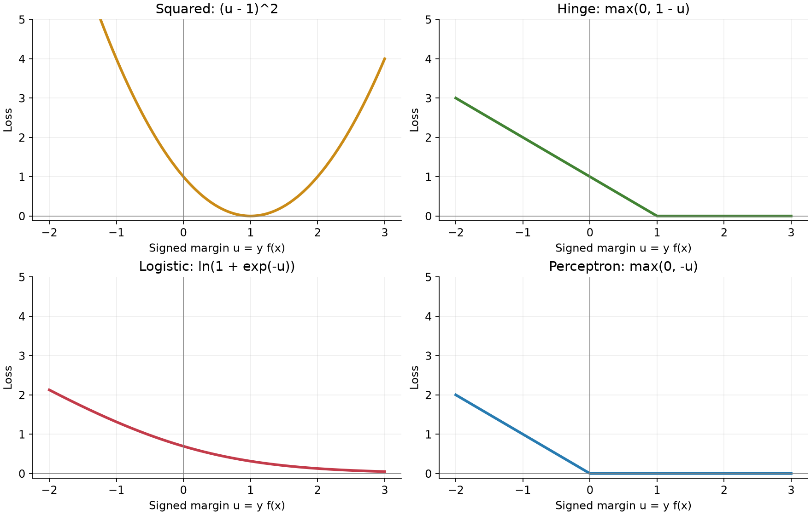
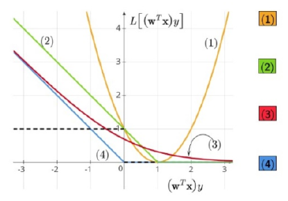
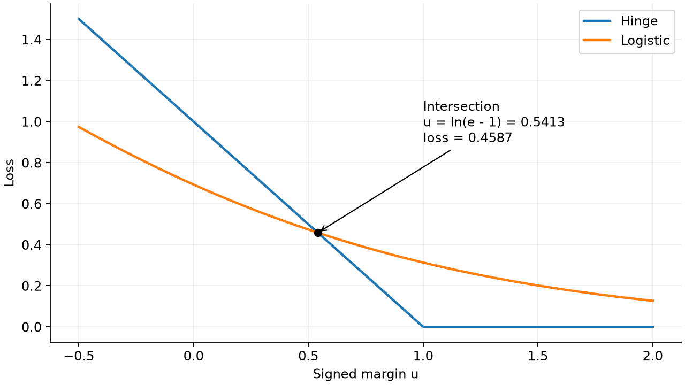
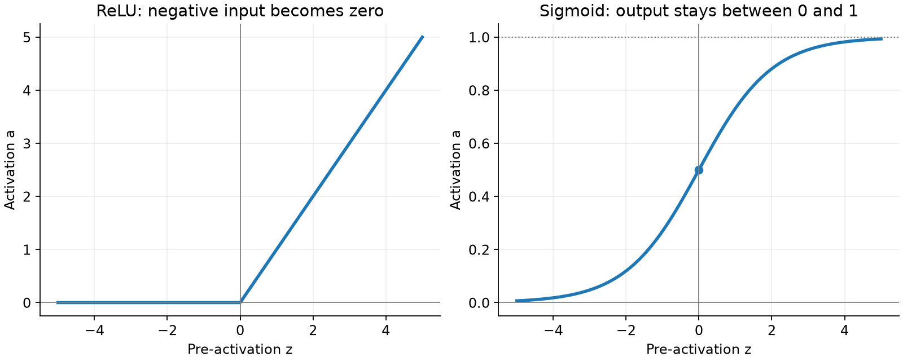
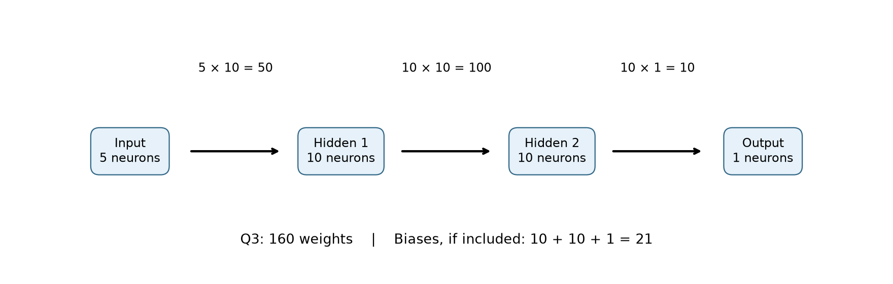
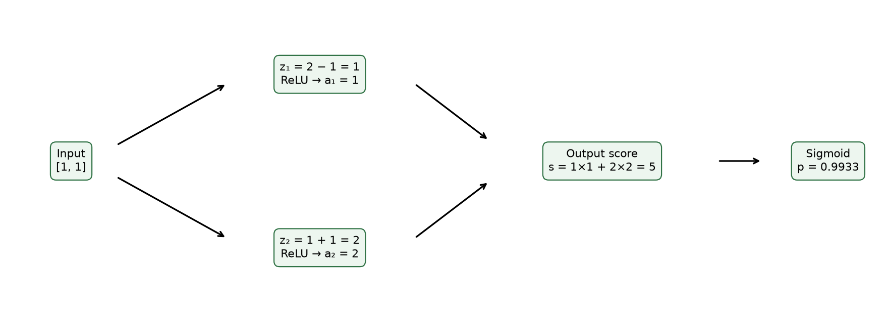
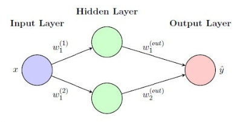
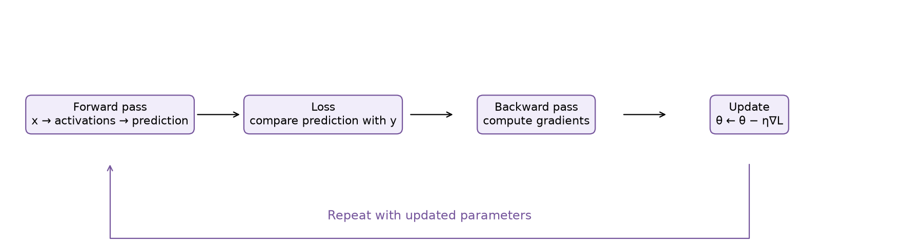

# MLT Week 12: Loss Functions and Artificial Neural Networks Notes

**Flow:** Prediction ki galti measure karna → classification losses → neuron ka calculation → activations aur architecture → parameter counting → forward pass → loss → backward pass aur learning.

## Topic index

| Topic | Subtopics | Questions |
|---|---|---|
| 1. Classification loss | 0–1 loss, signed margin, convex surrogate | — |
| 2. Four convex losses | Squared, hinge, logistic, perceptron, graph identification and intersection | Q2 |
| 3. Artificial neuron | Weighted sum, bias, ReLU, sigmoid, nonlinearity | Q1 |
| 4. Network architecture | Layers, output choice, weights and biases | Q3, Q7, Q8 |
| 5. Forward pass | Regression, binary probabilities, squared loss | Q4, Q5, Q6 |
| 6. Learning | Backpropagation, gradients, parameter update | Worked continuation of Q6 |
| 7. Revision | Formulas, common mistakes, solving checklist | — |

---

## 1. Classification loss: Model ki galti ko number kaise dein?

### 1.1 Loss function ka meaning

**Short definition:** Loss ek numerical penalty hai jo batati hai ki model ki prediction target se kitni disagree karti hai.

**Real-life connection:** Test mein marks deduct karne ka rule socho. Sirf answer wrong hai ya kitna wrong hai—different marking schemes different penalties denge. ML mein loss function wahi marking scheme hai.

Single example ki loss $L_i$ aur poore dataset ki average loss alag hain:

$$\text{Average training loss}=\frac1n\sum_{i=1}^n L_i.$$

**Connection:** Week 9 mein perceptron/logistic regression aur Weeks 10–11 mein SVM dekha. Ab un models ke training penalties ko ek common quantity ke through compare karenge.

### 1.2 Score, predicted label aur signed margin

Binary labels abhi $y\in\{-1,+1\}$ hain. Linear model ka score:

$$f(x)=w^Tx+b.$$

Question mein bias nahi hai toh $f(x)=w^Tx$ use karo. Prediction convention:

$$h(x)=\begin{cases}+1,&f(x)\ge0,\\-1,&f(x)<0.\end{cases}$$

Loss graphs ke horizontal axis par usually **signed margin** hota hai:

$$\boxed{u=yf(x)}.$$

| Situation | Example | Signed margin | Meaning |
|---|---|---|---|
| Positive class, positive score | $y=+1,f=2$ | $u=2$ | Correct side |
| Negative class, negative score | $y=-1,f=-2$ | $u=2$ | Correct side |
| Positive class, negative score | $y=+1,f=-2$ | $u=-2$ | Wrong side |
| Negative class, positive score | $y=-1,f=2$ | $u=-2$ | Wrong side |

**Rule:** $u>0$ means correct side; $u<0$ means wrong side. $u=0$ boundary hai, jahan prediction tie convention par depend karegi.

Ye functional margin hai, geometric distance nahi. SVM wali geometric signed distance $u/\lVert w\rVert$ hoti hai when $w\ne0$.

### 1.3 0–1 loss: Bas correct ya wrong

$$\boxed{L_{01}(h(x),y)=\mathbf1[h(x)\ne y]}.$$

Correct answer par 0, wrong answer par 1. Dataset mein 10 predictions mein 3 wrong hain toh average 0–1 loss $3/10=0.3$, aur accuracy $0.7$.

**Property:** Wrong prediction kitni badly wrong hai, 0–1 loss usse differentiate nahi karti.

**Counterexample:** $y=+1$ ke liye $f=-0.01$ aur $f=-100$ dono ki loss 1 hai. Training ko ye signal nahi milta ki score ko improve karne ke liye kitna move karna chahiye.

Nonzero score ke liye $L_{01}=\mathbf1[u<0]$. **Boundary par care:** Agar $f=0$ par prediction $+1$ hai aur true label $-1$, actual loss 1 hai, although $u=0$. Exact definition $\mathbf1[h(x)\ne y]$ always safe hai.

### 1.4 Convex surrogates kyun?

**Short definition:** Surrogate loss, difficult 0–1 objective ke badle use ki jaane wali optimization-friendly penalty hai.

0–1 loss step jaisi hai: many regions mein flat aur boundary par jump. General linear classification mein exact empirical 0–1 minimization computationally hard ho sakta hai; standard gradient descent ko useful smooth direction nahi milti.

Convex loss mein graph ke do points ko join karne wali line graph ke neeche nahi jaati. Linear score ke parameters mein convex losses optimize karna easier hota hai. **Convex ka matlab smooth zaroori nahi:** Hinge/perceptron mein corners hain; wahan subgradients use hote hain.

**Important limit:** Convex loss ko nonlinear neural network par lagane se poora training objective automatically convex nahi ban jaata. Prediction khud multiple layers ke parameters par nonlinearly depend karti hai.

---

## 2. Four convex losses: Same margin, different penalties

### 2.1 Squared loss: Score ko target ke paas lao

$$L=(f(x)-y)^2.$$

For $y\in\{-1,+1\}$, $y^2=1$, so margin form is:

$$\boxed{L_{\mathrm{sq}}(u)=(u-1)^2}.$$

**Meaning:** Sirf correct sign nahi; target margin $u=1$ chahiye.

**Real life:** Temperature predict karte waqt exact numerical error matter karta hai. Classification mein sign enough ho sakta hai, but squared loss phir bhi exact target score match karna chahti hai.

- Graph upward-opening parabola hai, minimum $(1,0)$ par.
- Smooth aur convex hai.
- $u=0$ par loss 1; $u=-1$ par 4.
- $u>1$ badhane par penalty dobara increase hoti hai.

**Counterexample:** $y=+1$, score $f=5$ perfectly correct class predict karta hai, but squared loss $(5-1)^2=16$. Isliye large correct margin ko reward karne wali loss nahi hai.

### 2.2 Hinge loss: Correct side ke saath safety margin

$$\boxed{L_{\mathrm{hinge}}(u)=\max(0,1-u)}.$$

$$L_{\mathrm{hinge}}(u)=\begin{cases}1-u,&u<1,\\0,&u\ge1.\end{cases}$$

**Real life:** Car sirf boundary ke correct side ho, enough nahi; safety distance bhi chahiye. Hinge required margin 1 tak penalty lagati hai.

- SVM se related loss.
- Correct side par $0<u<1$ ho toh bhi positive loss.
- $u\ge1$ par zero loss; uske aage extra margin se loss reduce nahi hoti.
- Corner $u=1$ par; convex but wahan ordinary derivative unique nahi.

**Counterexample:** $u=0.4$ means correct prediction, but hinge loss $1-0.4=0.6$. “Correct classification implies zero hinge loss” false hai.

**Week 11 connection:** Soft-margin SVM ki minimum slack exactly $\xi_i=\max(0,1-u_i)$ thi. Regularization term $\frac12\lVert w\rVert^2$ ke saath hinge penalties optimize ki jaati hain.

### 2.3 Logistic loss: Confident wrong answers ko penalize karo

$$\boxed{L_{\mathrm{log}}(u)=\ln(1+e^{-u})}.$$

**Real life:** Spam classifier confidently genuine email ko spam bole toh larger penalty; correct class ko high probability de toh smaller penalty.

- Smooth, convex aur strictly decreasing in $u$.
- At $u=0$, loss $\ln2\approx0.6931$.
- Finite $u$ par strictly positive; $u\to+\infty$ par zero ke paas jaati hai.
- Very negative margin par large loss aati hai.

**Counterexample:** $u=2$ par hinge loss 0, but logistic loss $\ln(1+e^{-2})\approx0.1269$. Logistic finite margin par exactly zero nahi hoti.

**0/1 labels se connection:** Binary classification output $p=\sigma(f)$ aur $t\in\{0,1\}$ ke liye:

$$\boxed{L_{\mathrm{BCE}}=-t\ln p-(1-t)\ln(1-p)}.$$

Corresponding signed label $y=2t-1$ lo toh ye same logistic loss $\ln(1+e^{-yf})$ hai. **BCE mein $-1$ label directly substitute nahi karna.**

Example: True class 1 ke liye $p=0.9$ par loss $-\ln0.9\approx0.1054$; $p=0.1$ par $-\ln0.1\approx2.3026$.

### 2.4 Perceptron loss: Wrong side ki penalty

$$\boxed{L_{\mathrm{perc}}(u)=\max(0,-u)}.$$

$$L_{\mathrm{perc}}(u)=\begin{cases}-u,&u<0,\\0,&u\ge0.\end{cases}$$

**Meaning:** Wrong side par penalty; positive safety margin 1 demand nahi karti.

- Corner origin $(0,0)$ par.
- $u\ge0$ par zero; $u=-2$ par loss 2.
- Hinge ka zero region $u\ge1$, perceptron ka $u\ge0$.

**Update connection:** Misclassified example ke liye $L=-yw^Tx$, gradient $-yx$. SGD update:

$$w_{\mathrm{new}}=w-\eta(-yx)=w+\eta yx.$$

$\eta=1$ gives familiar perceptron rule. Bias included ho toh $b\leftarrow b+\eta y$ bhi hota hai. At $u=0$, loss nondifferentiable hai; boundary update chosen convention/subgradient par depend karega.

**Important counterexample:** $w=0,b=0$ se sabhi margins zero, so perceptron loss zero on all examples! Lekin negative labels ko $+1$ tie prediction misclassify karegi. Isliye zero perceptron loss ko strict separation ka certificate mat samjho; boundary handling matter karti hai.

### 2.5 Graphs aur quick comparison

Left side negative margin = wrong side. Right side positive margin = correct side. Squared loss ka right side par rise hona especially notice karo.

| $u$ | Squared $(u-1)^2$ | Hinge | Logistic | Perceptron |
|---|---:|---:|---:|---:|
| $-1$ | 4 | 2 | 1.3133 | 1 |
| $0$ | 1 | 1 | 0.6931 | 0 |
| $0.5$ | 0.25 | 0.5 | 0.4741 | 0 |
| $1$ | 0 | 0 | 0.3133 | 0 |
| $2$ | 1 | 0 | 0.1269 | 0 |

**Graph recognition:** Parabola → squared; kink at 1 → hinge; smooth decreasing curve → logistic; kink at 0 → perceptron.

### Q2 — Identify loss curves and their intersection

**Source:** 2024 Sep 01 ET, Q2.

**Question:**

Comprehension: The convex surrogates for the 0-1 loss are displayed below:

Based on the above data, answer the given subquestions.

(i) (SA) Enter the number corresponding to the logistic loss.

(ii) (SA) Enter the number corresponding to the (SVM) hinge loss.

(iii) (SA) Enter the number corresponding to the perceptron loss.

(iv) (SA) Enter the number corresponding to the squared loss.

(v) (MCQ) Which of the following statements is true? $\ln=\log_e$.

(a) The logistic loss and the (SVM) hinge loss intersect when $(w^Tx)y=\ln(e-1)$.

(b) The logistic loss and the (SVM) hinge loss do not intersect.

(c) The logistic loss and the (SVM) hinge loss intersect when $(w^Tx)y=\ln(1-\frac1e)$.

(d) The logistic loss and the (SVM) hinge loss intersect when $(w^Tx)y=\frac1e$.

**Solution — (i) to (iv): Shape se identify karo**

1. Curve **(1)** parabola hai with minimum at $u=1$. So squared loss.
2. Curve **(2)** linearly decrease karti hai aur $u=1$ ke baad zero. So hinge loss.
3. Curve **(3)** smooth hai aur zero ko gradually approach karti hai. So logistic loss.
4. Curve **(4)** $u=0$ tak decreasing line, phir zero. So perceptron loss.

$$\boxed{\text{(i) }3,\quad\text{(ii) }2,\quad\text{(iii) }4,\quad\text{(iv) }1}.$$

**Solution — (v): Intersection ke liye correct hinge branch lo**

**Step 1: $u\ge1$ region check.** Hinge zero hai, logistic finite $u$ par positive. Is region mein intersection possible nahi.

**Step 2: $u<1$ region mein losses equal rakho.**

$$\ln(1+e^{-u})=1-u.$$

**Step 3: Exponential lo.**

$$1+e^{-u}=e^{1-u}.$$

**Step 4: Dono sides ko $e^u$ se multiply karo.**

$$e^u+1=e.$$

$$e^u=e-1\quad\Rightarrow\quad u=\ln(e-1).$$

**Step 5: Branch verify karo.**

$$u\approx0.541325<1,\qquad L=1-u\approx0.458675.$$

Value chosen branch mein valid hai; exponential strictly increasing hai, so is branch mein solution unique hai.

$$\boxed{\text{Correct option: (a)}}.$$

**Question se property:** Hinge aur logistic ki fixed ordering everywhere nahi hai. At $u=0$, hinge $1>\ln2$; at $u=1$, hinge $0<\ln(1+e^{-1})$. Curves beech mein cross karti hain.

---

## 3. Artificial neuron: Weighted sum ke baad activation

### 3.1 Linear model se neural network tak

**Short definition:** Artificial neural network connected neurons ka model hai jo inputs ko successive layers mein transform karke output deta hai.

**Real life:** House-price prediction mein area, locality aur age ko combine karke intermediate features ban sakte hain; next layer un combinations ko use karke price predict karti hai. Hidden neurons learned combinations banate hain, unka meaning manually fix karna zaroori nahi.

Single neuron ka calculation:

$$\boxed{z=w_1x_1+w_2x_2+\cdots+w_dx_d+b,\qquad a=g(z)}.$$

- $z$: **pre-activation**, activation se pehle weighted sum.
- $a$: **activation/output**, next layer ko diya jaata hai.
- $w_i$: feature ka influence.
- $b$: input-independent shift.
- $g$: activation function.

**Most important distinction:** $z$ aur $a$ same tabhi honge jab activation us input par identity behave kare. Sigmoid neuron mein $z=2$ ka output 2 nahi, $\sigma(2)\approx0.8808$ hai.

### 3.2 Bias: Threshold ko shift karna

**Short definition:** Bias neuron ke weighted sum mein add hone wala learnable constant hai.

**Real life:** Alarm ki baseline sensitivity adjust karne jaisa. Same input par different bias neuron ko active/inactive bana sakta hai.

All inputs zero ho toh $z=b$. ReLU output $\max(0,b)$:

- $b=2$ → output 2, even with zero inputs.
- $b=-2$ → output 0 at zero inputs.

**Counterexample:** Negative bias ka matlab neuron hamesha inactive nahi. $w^Tx=5,b=-2$ gives $z=3$, so ReLU output 3.

Bias har incoming edge ka separate parameter nahi; standard dense layer mein **har output neuron ka ek bias** hota hai.

### 3.3 ReLU activation

$$\boxed{\operatorname{ReLU}(z)=\max(0,z)=\begin{cases}0,&z<0,\\z,&z\ge0.\end{cases}}$$

**Meaning:** Negative weighted sum block karo, positive weighted sum unchanged pass karo.

Examples:

$$\operatorname{ReLU}(-3)=0,\quad\operatorname{ReLU}(0)=0,\quad\operatorname{ReLU}(2.5)=2.5.$$

Properties:

- Output range $[0,\infty)$; output 1 se bada ho sakta hai.
- Positive region mein identity, negative region mein flat.
- Derivative positive side par 1, negative side par 0; at zero ordinary derivative undefined, implementation usually 0 chooses.
- Negative pre-activation par gradient gate block hota hai. Agar neuron training inputs par consistently negative rahe, learning ruk sakti hai (“dead ReLU”). Ek sample par zero output hona permanent death nahi.

**Counterexample:** ReLU probability nahi hai: input 4 gives output 4, jo probability range se bahar hai.

### 3.4 Sigmoid activation

$$\boxed{\sigma(z)=\frac1{1+e^{-z}}}.$$

**Meaning:** Real-valued score ko 0 aur 1 ke beech compress karti hai.

$$\sigma(0)=0.5,\quad\sigma(2)\approx0.8808,\quad\sigma(-2)\approx0.1192.$$

Properties:

- Finite real input ke liye $0<\sigma(z)<1$.
- Increasing function; $\sigma(-z)=1-\sigma(z)$.
- Derivative $\sigma'(z)=\sigma(z)(1-\sigma(z))$, maximum $1/4$ at zero.
- Very large positive/negative input par curve flat hoti hai; derivative small, so hidden-layer gradients shrink kar sakte hain.

**Counterexample:** Activation 1.5 sigmoid se nahi aa sakti. Also exact mathematical sigmoid finite input par exactly 0 or 1 nahi deti; rounded display alag baat hai.

### 3.5 Hidden layers mein nonlinearity kyun?

Multiple layers sirf linear/affine operations karein toh unka combined effect bhi affine hota hai:

$$W_2(W_1x+b_1)+b_2=(W_2W_1)x+(W_2b_1+b_2).$$

Isliye sirf linear layers stack karne se nonlinear boundaries represent karne ki ability nahi aati. ReLU/sigmoid jaise activations different input regions ko differently transform karte hain.

**Counterexample:** Two linear layers laga dene se XOR jaisi non-linearly separable pattern ka linear-separator limitation automatically solve nahi hota. Suitable nonlinear hidden layer ki zaroorat hoti hai.

### Q1 — Output of a sigmoid hidden neuron

**Source:** 2024 Apr 28 ET, Q1.

**Question:**

(SA) Consider a simple neural network with one hidden layer. The network has the following architecture: Input layer with 3 neurons. Hidden layer with 2 neurons, using the sigmoid activation function. Output layer with 1 neuron, using the linear activation function. The weights and biases for the network are as follows:

- Hidden Layer:
  - Neuron 1: Weights: [0.5, −0.2, 0.8], Bias: 0.1
  - Neuron 2: Weights: [0.4, 0, 0.2], Bias: −0.4
- Output Layer:
  - Neuron 1: Weights: [0.2, 0.4], Bias: −0.3

Assume that the input values are [0.6, 0.3, 0.8]. Calculate output of Neuron 1 in hidden layer.

**Solution:**

**Step 1: Requested neuron identify karo.** Hidden layer ka neuron 1 chahiye. Uske weights $[0.5,-0.2,0.8]$, bias $0.1$ aur activation sigmoid hai.

**Step 2: Har feature ka weighted contribution nikalo.**

| Input | Weight | Product |
|---|---:|---:|
| $0.6$ | $0.5$ | $0.30$ |
| $0.3$ | $-0.2$ | $-0.06$ |
| $0.8$ | $0.8$ | $0.64$ |

**Step 3: Products add karke bias add karo.**

$$z_1=0.30-0.06+0.64+0.10=0.98.$$

**Step 4: Sigmoid apply karo.**

$$a_1=\sigma(0.98)=\frac1{1+e^{-0.98}}\approx\frac1{1+0.37531}\approx0.727108.$$

$$\boxed{a_1\approx0.7271}.$$

**Check:** Positive pre-activation hai, so sigmoid output $0.5$ se bada aur 1 se chhota hona chahiye. Answer paper ke $0.70$–$0.80$ range mein hai.

**Trap:** $0.98$ pre-activation hai, requested output nahi. Second hidden neuron aur final output ke weights is particular answer ke liye needed nahi hain.

---

## 4. Network architecture, output choice and parameter counting

### 4.1 Layers ka role

- **Input layer:** Raw feature values hold karti hai; 5 input features means 5 input neurons.
- **Hidden layers:** Previous activations ko weights/biases se combine karke new activations banati hain.
- **Output layer:** Task ka final predicted quantity deti hai.

**Fully connected/dense:** Previous layer ka every neuron next layer ke every neuron se connected hai. **Feed-forward:** Computation input se output ki taraf jaati hai, cyclic feedback edges nahi.

Input values data hain, learnable parameters nahi. Standard dense network mein weights and biases learnable hain; hidden activations har input ke saath change hoti hain, separately stored trainable parameters nahi.

### 4.2 Matrix form: Rows ko neurons se match karo

Layer $\ell$ mein $d_\ell$ neurons aur previous layer mein $d_{\ell-1}$ neurons hon:

$$\boxed{z^{[\ell]}=W^{[\ell]}a^{[\ell-1]}+b^{[\ell]},\qquad a^{[\ell]}=g_\ell(z^{[\ell]})}.$$

$$a^{[0]}=x,\qquad W^{[\ell]}\in\mathbb R^{d_\ell\times d_{\ell-1}},\qquad b^{[\ell]}\in\mathbb R^{d_\ell}.$$

**Row convention:** Each row contains incoming weights for one destination neuron. Shape check: $(d_\ell\times d_{\ell-1})(d_{\ell-1}\times1)$ gives $(d_\ell\times1)$.

**Notation care:** In Q4/Q5, $w_i^{(j)}$ ka superscript $j$ **neuron number** hai, layer number nahi. Surrounding definition read karo; notation ko blindly interpret mat karo.

### 4.3 Task decides output activation and loss

| Task in these notes | Output neurons | Output activation | Prediction | Typical loss |
|---|---:|---|---|---|
| Scalar regression | 1 | Identity $g(z)=z$ | Real number $\hat y$ | $(\hat y-y)^2$ |
| Binary classification | 1 | Sigmoid | $p=P(y=1\mid x)$ | Binary cross-entropy |

**Real life:** House price ek numerical value hai; spam detection class probability hai. Dono ki output requirements same nahi hain.

Binary model:

$$P(y=1\mid x)=p,\qquad P(y=0\mid x)=1-p.$$

Usual threshold $p\ge0.5$ par predicted label 1. **Probability aur label different:** $p=0.8$ probability hai; thresholded answer 1 label hai.

**Counterexample:** Regression output par unnecessarily sigmoid lagane se predictions $(0,1)$ mein restrict ho jayengi. Target 4 ho toh model output 4 de hi nahi paayega.

Regression ka one-output rule yahan **scalar target** ke liye hai; vector-valued regression mein multiple output neurons possible hain. Hidden ReLU ka matlab output layer bhi ReLU use kare, aisa rule nahi.

### 4.4 Total learnable parameters

Layer sizes $d_0,d_1,\ldots,d_L$ ke liye:

$$\boxed{N_{\mathrm{weights}}=\sum_{\ell=1}^L d_{\ell-1}d_\ell}.$$

Each non-input neuron ka one bias ho toh:

$$\boxed{N_{\mathrm{biases}}=\sum_{\ell=1}^L d_\ell,\qquad N_{\mathrm{total}}=\sum_{\ell=1}^L(d_{\ell-1}+1)d_\ell}.$$

**Why multiply?** 3 inputs se each of 4 hidden neurons ko 3 weights chahiye: $3+3+3+3=3\times4=12$.

**Concept example: $3\to4\to2$.**

1. Input-to-hidden weights: $3\times4=12$.
2. Hidden-to-output weights: $4\times2=8$.
3. Total weights: $12+8=20$.
4. Biases: $4+2=6$.
5. Total learnable parameters: $20+6=26$.

**Counterexample:** Neurons count $3+4+2=9$ is not parameter count 26. Connections aur biases count karne hain, nodes nahi.

**“Ignore biases”** likha ho toh sirf products sum karo. Activation ReLU vs sigmoid choose karne se standard dense layer ke weight count par effect nahi padta.

### Q3 — Binary network: Parameters and activation choices

**Source:** 2024 Sep 01 ET, Q3.

**Question:**

Comprehension: Consider the following architecture of a neural network for a binary classification problem:

| Layer type | Number of neurons |
|---|---:|
| Input | 5 |
| Hidden layer-1 | 10 |
| Hidden layer-2 | 10 |
| Output | 1 |

Based on the above data, answer the given subquestions.

(i) (SA) How many learnable parameters does this network have? Ignore the biases in the computation.

(ii) (MCQ) What is the most appropriate choice of activation function for the output layer if the binary cross-entropy loss is used?

(a) Sigmoid

(b) Linear

(c) ReLU

(iii) (MCQ) For a particular data-point, the activations after the first hidden layer in the forward pass is given to be

$$[0.2,0.1,1.5,0.3,0.1,0,0.8,1.2,1,0]^T.$$

What is the activation function used in the first hidden layer?

(a) ReLU

(b) Sigmoid

**Solution — (i): Adjacent layers ke connections count karo**

Architecture $5\to10\to10\to1$ hai.

| Connection | Calculation | Weights |
|---|---|---:|
| Input → hidden 1 | $5\times10$ | 50 |
| Hidden 1 → hidden 2 | $10\times10$ | 100 |
| Hidden 2 → output | $10\times1$ | 10 |

$$\boxed{N=50+100+10=160}.$$

Biases explicitly ignore hain. Agar included hote, $10+10+1=21$ aur add hote, giving 181; **is question ka answer 160 hi hai**.

**Solution — (ii): Output probability chahiye**

1. BCE predicted class probability use karti hai.
2. Sigmoid finite score ko $(0,1)$ mein map karti hai.
3. Linear negative/greater-than-one output de sakti hai; ReLU bhi 1 se bada output de sakti hai.

$$\boxed{\text{(a) Sigmoid}}.$$

**Solution — (iii): Impossible range eliminate karo**

1. Given activations mein $1.5$ aur $1.2$ hain.
2. Sigmoid output 1 se bada ho hi nahi sakta.
3. All values nonnegative hain, jo ReLU range se compatible hain. ReLU zeros bhi produce kar sakti hai.

$$\boxed{\text{(a) ReLU}}.$$

**Property from this question:** Given choices mein range se activation identify kar sakte ho. Sirf nonnegative values dekhkar universally ReLU conclude nahi karna; example $[0.2,0.8]$ ReLU aur sigmoid dono se possible hai. Yahan values greater than 1 decisive hain.

### Q7 — Parameter count with three hidden layers

**Source:** 2026 May 06 ET, Q7.

**Question:**

(SA) Consider a regression problem in which we use a neural network with the following architecture:

- Input layer has 5 neurons
- Three hidden layers, each with 10 neurons
- Output layer with one neuron

Find the total number of parameters in the network. Ignore the biases.

**Solution:**

**Step 1: Architecture expand karo.**

$$5\to10\to10\to10\to1.$$

**Step 2: Har adjacent pair count karo.**

$$N=(5\times10)+(10\times10)+(10\times10)+(10\times1).$$

**Step 3: Sum.**

$$\boxed{N=50+100+100+10=260}.$$

**Q3 se connection:** Same counting method; extra $10\to10$ transition adds 100 weights. Ye changed architecture hai, same numerical question nahi. Three hidden layers ke beech **two** hidden-to-hidden transitions hain.

### Q8 — Three output neurons: Can parameters be counted?

**Source:** 2026 Sep 13 ET, Q8.

**Question:**

(SA) You build a fully-connected feed-forward neural network for a classification task. The input is a 5-dimensional vector; the network has two hidden layers of 10 neurons each, followed by an output layer of 3 neurons. Every layer is densely (fully) connected to the next. Ignoring all bias terms, compute the total number of weight parameters in the network. (Enter −1 if it cannot be determined.)

**Solution:**

**Step 1: Architecture likho.**

$$5\to10\to10\to3.$$

**Step 2: Products lo.**

$$N=(5\times10)+(10\times10)+(10\times3).$$

**Step 3: Add.**

$$\boxed{N=50+100+30=180}.$$

**Why not $-1$?** Layer sizes aur full connectivity given hain. Weight count ke liye actual weight values, training data ya activation functions ki need nahi.

**Related appearance:** Q3 mein final layer $10\to1$ thi; yahan $10\to3$ hai. Final weights 10 se 30 hue, total $160+20=180$. Q7 mein depth changed thi; yahan output width changed hai.

---

## 5. Forward pass: Input se prediction, phir loss

### 5.1 Calculation ka fixed order

**Short definition:** Fixed weights/biases ke saath input ko layer-by-layer process karke prediction nikalna forward pass hai.

**Real life:** Assembly line mein each station previous station ka output process karti hai. Next layer ko raw inputs dobara nahi; previous layer ki activations milti hain.

1. Input vector read karo.
2. Hidden layer ka weighted sum plus bias nikalo.
3. Hidden activation apply karo.
4. In activations se next layer ka weighted sum nikalo.
5. Output activation apply karo.
6. Target given ho toh appropriate loss calculate karo.

**Weights is pass mein change nahi hote.** Update backward pass ke gradients ke baad hota hai.

### 5.2 Regression forward pass

One hidden layer and scalar output ke liye:

$$a=\operatorname{ReLU}(Wx+b),\qquad \boxed{\hat y=v^Ta+c}.$$

Output identity hai, so output pre-activation itself prediction hai. Target $y$ ho toh:

$$\boxed{L=(\hat y-y)^2}.$$

Question $L=\frac12(\hat y-y)^2$ bole tabhi factor $1/2$ use karo; otherwise apni taraf se add mat karo.

### Q4 — Two ReLU neurons and a regression output

**Source:** 2025 Apr 13 ET, Q4.

**Question:**

(SA) Consider a single-layer neural network comprising two neurons in the hidden layer. The parameters are given as below:

$$w_1^{(1)}=\frac12,\quad w_2^{(1)}=\frac12;$$

$$w_1^{(2)}=1,\quad w_2^{(2)}=-1;$$

$$w^{\mathrm{out}}=[2\quad -2]^T,$$

where $w_i^{(j)}$ represents the weight associated with the $j$th neuron for the $i$th input feature. Suppose we are solving the regression problem, then determine the output of the neural network using ReLU as the activation function for the input $x=[1\quad3]^T$.

**Solution:**

Question ka hidden layer two neurons wala hai; regression output identity use karega. Bias terms given nahi hain, so calculation mein zero bias lete hain.

**Step 1: Hidden neuron 1.**

$$z_1=\frac12(1)+\frac12(3)=0.5+1.5=2.$$

$$a_1=\operatorname{ReLU}(2)=2.$$

**Step 2: Hidden neuron 2.**

$$z_2=1(1)+(-1)(3)=1-3=-2.$$

$$a_2=\operatorname{ReLU}(-2)=0.$$

**Step 3: Output weights hidden activations se multiply karo.**

$$\hat y=2a_1-2a_2=2(2)-2(0).$$

$$\boxed{\hat y=4}.$$

**Trap:** $z_2=-2$ ko directly output mein use karne se answer $2(2)-2(-2)=8$ aayega, jo wrong hai. Next layer ko $a_2=0$ milta hai.

**Property:** Negative weight allowed hai; ReLU negative **pre-activation** clip karti hai, individual weights ya input products ko separately clip nahi karti.

### 5.3 Binary classification forward pass

Hidden computation same ho sakti hai, but output stage changes:

$$a=\operatorname{ReLU}(Wx+b),\qquad s=v^Ta+c,$$

$$\boxed{p=\sigma(s),\quad P(1\mid x)=p,\quad P(0\mid x)=1-p}.$$

**Connection:** Q4 mein output weighted sum final regression prediction tha. Ab wahi weighted sum **score** hai; probability ke liye sigmoid additionally apply karna hai.

### Q5 — ReLU hidden layer followed by sigmoid probabilities

**Source:** 2025 Aug 31 ET, Q5.

**Question:**

(MCQ) Suppose we are solving a binary classification task using a neural network with the following architecture:

- Input: $x=[1\quad1]^T$
- Hidden layer: 2 neurons (ReLU activation)
- Output layer: 1 neuron (sigmoid activation)

The weight parameters of the network are given as:

$$W^{(1)}=\begin{bmatrix}w_1^{(1)}&w_2^{(1)}\\w_1^{(2)}&w_2^{(2)}\end{bmatrix}=\begin{bmatrix}2&-1\\1&1\end{bmatrix},\qquad W^{(\mathrm{out})}=[w_1^{(\mathrm{out})}\quad w_2^{(\mathrm{out})}]^T=[1\quad2]^T,$$

where $w_i^{(j)}$ represents the weight associated with the $j$th neuron for the $i$th input feature. What are the predicted probabilities?

(a) $P(\text{class 1})=0.119,\quad P(\text{class 0})=0.881$

(b) $P(\text{class 1})=0.269,\quad P(\text{class 0})=0.731$

(c) $P(\text{class 1})=0.731,\quad P(\text{class 0})=0.269$

(d) $P(\text{class 1})=0.993,\quad P(\text{class 0})=0.007$

**Solution:**

No bias values given hain, so zero bias calculation use karo.

**Step 1: Hidden pre-activations.**

$$\begin{bmatrix}z_1\\z_2\end{bmatrix}=\begin{bmatrix}2&-1\\1&1\end{bmatrix}\begin{bmatrix}1\\1\end{bmatrix}=\begin{bmatrix}2-1\\1+1\end{bmatrix}=\begin{bmatrix}1\\2\end{bmatrix}.$$

**Step 2: ReLU elementwise apply karo.** Dono positive hain:

$$a_1=1,\qquad a_2=2.$$

**Step 3: Output score.**

$$s=(W^{(\mathrm{out})})^Ta=1(1)+2(2)=5.$$

**Step 4: Sigmoid se class-1 probability.**

$$P(1\mid x)=\sigma(5)=\frac1{1+e^{-5}}\approx0.993307.$$

**Step 5: Complement se class-0 probability.**

$$P(0\mid x)=1-0.993307\approx0.006693.$$

$$\boxed{\text{Option (d): }P(1)\approx0.993,\quad P(0)\approx0.007}.$$

**Checks:** Probabilities sum to 1; positive score 5 gives class-1 probability above 0.5. Hidden activations ko normalize karke probabilities banana correct method nahi—output weights aur sigmoid dono use hote hain.

### Q6 — Scalar input, ReLU gating and squared loss

**Source:** 2025 Dec 18 ET, Q6.

**Question:**

Comprehension: Consider the following neural network, which takes a single real-valued input $x$, passes it through two hidden ReLU units, and produces a scalar regression output. ReLU and the sigmoid activation is given by:

$$\operatorname{ReLU}(x)=\max(0,x),\qquad\sigma(x)=\frac1{1+e^{-x}}.$$

The network structure is shown below:

Assume the following weights:

$$w_1^{(1)}=0.2,\quad w_1^{(2)}=-0.4,\quad w_1^{(\mathrm{out})}=1.0,\quad w_2^{(\mathrm{out})}=-0.5.$$

Based on the above data, answer the given subquestions.

(i) (SA) For input $x=0.5$, compute the regression output $\hat y$. Enter the answer correct to one decimal place.

(ii) (SA) Suppose the target value for this input is $y=1.2$. Compute the squared loss $L=(\hat y-y)^2$. Enter the answer correct to two decimal places.

**Solution — (i): Regression output**

**Step 1: Hidden weighted sums.** Biases are not specified.

$$z_1=0.2(0.5)=0.1,\qquad z_2=-0.4(0.5)=-0.2.$$

**Step 2: ReLU activations.**

$$a_1=\max(0,0.1)=0.1,\qquad a_2=\max(0,-0.2)=0.$$

**Step 3: Output weighted sum with identity activation.**

$$\hat y=1.0(0.1)+(-0.5)(0)=0.1.$$

$$\boxed{\hat y=0.1\text{ to one decimal place}}.$$

**Why no sigmoid?** Question sigmoid ka formula provide karta hai, but task regression hai. Provided every formula use karna compulsory nahi; output type dekho.

**Solution — (ii): Target se error, phir square**

$$\hat y-y=0.1-1.2=-1.1.$$

$$L=(-1.1)^2=1.21.$$

$$\boxed{L=1.21\text{ to two decimal places}}.$$

**Q4 se connection:** Dono mein one ReLU unit active aur one inactive hai. Q6 adds target-dependent loss calculation; repeated ReLU rule same hai, numerical inputs different hain.

**Property:** Negative residual possible hai, negative squared loss nahi. Prediction ko square karna $0.1^2=0.01$ loss nahi; pehle target subtract karna hai.

---

## 6. Backward pass: Network actually seekhta kaise hai?

### 6.1 Forward, loss, backward, update

**Short definition:** Backpropagation chain rule use karke loss ka gradient har learnable weight/bias ke respect mein calculate karta hai, output se earlier layers ki direction mein.

**Real life:** Final product mein error mile toh assembly line mein peeche trace karo ki each stage ke change se final error kitna change hoga. Gradient isi sensitivity ko quantify karta hai.

1. **Forward:** Current parameters se prediction nikalo.
2. **Loss:** Prediction ko true target se compare karo.
3. **Backward:** Cached forward values use karke gradients compute karo.
4. **Update:** Gradients ke opposite direction mein parameters change karo.
5. Updated parameters ke saath repeat.

**Difference:** Backpropagation gradient calculation hai; gradient descent un gradients se parameters update karne ka rule hai. Dono related hain, identical operation nahi.

### 6.2 Gradient-descent rule

All weights and biases ko collectively $\theta$ likhein:

$$\boxed{\theta_{\mathrm{new}}=\theta_{\mathrm{old}}-\eta\nabla_\theta L(\theta_{\mathrm{old}})},\qquad\eta>0.$$

- Positive gradient → parameter decrease hota hai.
- Negative gradient → parameter increase hota hai.
- Zero gradient → is update se parameter unchanged.
- Learning rate $\eta$ step size control karti hai.

**Counterexample to “bigger step always better”:** $L(w)=w^2$, $w=1$, gradient 2. With $\eta=0.1$, new $w=0.8$, loss $0.64$. With $\eta=2$, new $w=-3$, loss 9. Large step loss increase kar sakta hai.

### 6.3 Useful local gradients

For one example, no averaging factor:

| Operation | Gradient/local derivative |
|---|---|
| $L=(\hat y-y)^2$ | $\partial L/\partial\hat y=2(\hat y-y)$ |
| $z=wa+b$ | $\partial z/\partial w=a$, $\partial z/\partial a=w$, $\partial z/\partial b=1$ |
| $a=\operatorname{ReLU}(z)$ | $g'(z)=1$ for $z>0$, $0$ for $z<0$ |
| $a=\sigma(z)$ | $g'(z)=a(1-a)$ |
| Sigmoid output with BCE, target $t\in\{0,1\}$ | $\partial L/\partial z=p-t$ |

**Chain rule intuition:** Along a path, local effects multiply. Multiple paths parameter se output tak jaate hon toh contributions add hoti hain.

Layer-wise computation ka compact form:

$$\delta^{[\ell]}=\frac{\partial L}{\partial z^{[\ell]}},$$

$$\frac{\partial L}{\partial W^{[\ell]}}=\delta^{[\ell]}(a^{[\ell-1]})^T,\qquad\frac{\partial L}{\partial b^{[\ell]}}=\delta^{[\ell]},$$

$$\delta^{[\ell]}=\left((W^{[\ell+1]})^T\delta^{[\ell+1]}\right)\odot g_\ell'(z^{[\ell]}).$$

$\odot$ means elementwise multiply. Last equation ka meaning: next layer ki sensitivity weights ke through peeche bhejo, then current activation ke local derivative se multiply karo. Batch **mean** loss ho toh sample gradients average hote hain.

### 6.4 Worked learning example: Q6 ke same forward values se ek update

Ye backward pass samajhne ke liye **practice continuation** hai; Q6 ka exam answer already $\hat y=0.1,L=1.21$ hai. Forward calculation repeat nahi karenge.

Notation simple rakhein:

$$u_1=0.2,\ u_2=-0.4\quad\text{(input-to-hidden weights)},$$

$$v_1=1,\ v_2=-0.5\quad\text{(hidden-to-output weights)}.$$

Yahan $u_1,u_2$ weights hain, Section 2 wala signed margin $u$ nahi. Network:

$$a_j=\operatorname{ReLU}(u_jx),\qquad\hat y=v_1a_1+v_2a_2.$$

Cached values: $x=0.5,y=1.2,z_1=0.1,z_2=-0.2,a_1=0.1,a_2=0$.

**Step 1: Loss ki output sensitivity.**

$$\frac{\partial L}{\partial\hat y}=2(0.1-1.2)=-2.2.$$

Negative derivative means prediction thodi increase ho toh loss reduce hogi, jo intuitive hai because target 1.2 prediction 0.1 se larger hai.

**Step 2: Output weights ke gradients.**

$$\frac{\partial L}{\partial v_1}=\frac{\partial L}{\partial\hat y}\,a_1=(-2.2)(0.1)=-0.22.$$

$$\frac{\partial L}{\partial v_2}=(-2.2)(0)=0.$$

Second hidden activation zero hai, so its outgoing weight ka current sample gradient zero.

**Step 3: First input-to-hidden weight ka gradient.**

Path: $u_1\to z_1\to a_1\to\hat y\to L$.

$$\frac{\partial L}{\partial u_1}=\frac{\partial L}{\partial\hat y}\cdot v_1\cdot\operatorname{ReLU}'(z_1)\cdot x.$$

Since $z_1=0.1>0$, ReLU derivative 1:

$$\frac{\partial L}{\partial u_1}=(-2.2)(1)(1)(0.5)=-1.1.$$

**Step 4: Second hidden branch ka gradient.**

Since $z_2=-0.2<0$, ReLU derivative 0:

$$\frac{\partial L}{\partial u_2}=(-2.2)(-0.5)(0)(0.5)=0.$$

**Step 5: Learning rate $\eta=0.1$ choose karke all weights update karo.**

| Parameter | Old value | Gradient | New value = old − 0.1 × gradient |
|---|---:|---:|---:|
| $u_1$ | 0.2 | −1.1 | 0.31 |
| $u_2$ | −0.4 | 0 | −0.4 |
| $v_1$ | 1 | −0.22 | 1.022 |
| $v_2$ | −0.5 | 0 | −0.5 |

**Important:** Saare gradients same old parameter values se nikle hain. $v_1$ ko pehle update karke new value se $u_1$ ka gradient calculate karna is simultaneous gradient-descent step ko change kar dega.

**Step 6: New prediction se check.**

$$a_1^{\mathrm{new}}=\operatorname{ReLU}(0.31\times0.5)=0.155,\qquad a_2^{\mathrm{new}}=0.$$

$$\hat y_{\mathrm{new}}=1.022(0.155)=0.15841.$$

$$L_{\mathrm{new}}=(0.15841-1.2)^2\approx1.08491.$$

Loss $1.21\to1.08491$ decrease hui. Prediction target ki taraf move hui. Ye particular step ka check hai, arbitrary learning rate par guarantee nahi.

### 6.5 Training se judi important properties

- **Loss vs activation:** Activation neuron ka output transform karti hai; loss prediction ko target se compare karti hai. Sigmoid activation aur logistic loss different functions hain.
- **Depth vs optimization:** More layers representational flexibility de sakti hain, but training automatically easier ya answer automatically better nahi hota.
- **Convex loss vs nonconvex network:** Squared loss as a function of prediction convex hai; multi-layer weights ke joint function mein objective generally nonconvex ho sakta hai.
- **Zero ReLU output:** Is sample par incoming gradient block ho sakta hai; different sample neuron ko activate kar sakta hai.
- **Training vs prediction:** Inference ke liye forward pass enough; target/loss/backward needed nahi. Training mein target se loss aur gradients calculate hote hain.

---

## 7. Quick revision

### 7.1 Formula sheet

| Quantity | Formula |
|---|---|
| Signed margin, $y\in\{-1,+1\}$ | $u=y(w^Tx+b)$ |
| Exact 0–1 loss | $\mathbf1[h(x)\ne y]$ |
| Squared classification loss | $(u-1)^2$ |
| Hinge loss | $\max(0,1-u)$ |
| Logistic loss | $\ln(1+e^{-u})$ |
| Perceptron loss | $\max(0,-u)$ |
| Hinge/logistic intersection | $u=\ln(e-1)\approx0.541325$ |
| Neuron computation | $z=w^Tx+b$, $a=g(z)$ |
| ReLU | $\max(0,z)$ |
| Sigmoid | $1/(1+e^{-z})$ |
| Dense layer weights | $d_{\mathrm{in}}d_{\mathrm{out}}$ |
| Dense layer biases | $d_{\mathrm{out}}$ |
| Total weights | $\sum_{\ell=1}^L d_{\ell-1}d_\ell$ |
| Scalar regression output | $\hat y=v^Ta+c$ |
| Binary output | $p=\sigma(v^Ta+c)$, $P(0)=1-p$ |
| Squared regression loss | $(\hat y-y)^2$ |
| BCE, $t\in\{0,1\}$ | $-t\ln p-(1-t)\ln(1-p)$ |
| Gradient update | $\theta\leftarrow\theta-\eta\nabla_\theta L$ |

### 7.2 Common mistakes and corrections

| Mistake | Correct reasoning |
|---|---|
| Every correct prediction has zero surrogate loss | Hinge penalizes $0<u<1$; logistic finite margins par positive; squared large correct margins ko bhi penalizes |
| Perceptron and hinge curves have same kink | Perceptron at 0; hinge at 1 |
| Logistic loss is sigmoid | Sigmoid is activation/probability map; logistic loss is $\ln(1+e^{-u})$ |
| Hidden weighted sum itself is always neuron output | Activation apply karna baaki ho sakta hai |
| ReLU clamps each weighted input before summing | Pehle complete weighted sum plus bias, phir ReLU |
| ReLU outputs are between 0 and 1 | Range $[0,\infty)$ hai |
| Hidden ReLU means regression output must use ReLU | Output task-specific hai; these scalar regression questions use identity |
| Add input neurons to bias count | Standard input layer mein learnable biases count nahi hote |
| Count all neurons instead of all weights | Adjacent layer sizes multiply karke sum karo |
| Three hidden layers give three hidden-to-hidden links | Three hidden layers have two hidden-to-hidden transitions |
| Binary output score itself is class probability | Sigmoid apply karo, then complement for class 0 |
| Square prediction to calculate loss | Prediction minus target ka square lo |
| Update one weight and use it for remaining gradients | Same old forward state se all gradients compute karo, then update |

### 7.3 Question solve karne ka checklist

1. **Loss graph:** Axis signed margin hai ya raw score? Kink, minimum aur zero region check karo.
2. **Labels:** Margin formulas mein $\pm1$; BCE formula mein 0/1.
3. **Parameter count:** Architecture arrows mein expand karo, adjacent products sum karo; bias instruction read karo.
4. **Forward pass:** Each neuron ke weights group karo; $z\to a$ distinction maintain karo.
5. **Output:** Regression identity; binary probability sigmoid; question-specific choice follow karo.
6. **Loss:** Target subtract/compare karo; square/BCE aur any averaging factor check karo.
7. **Backward:** Old activations cache karo, chain rule follow karo, correct gradient sign se update karo.
8. **Final answer:** Required decimal places par round karo; intermediate calculations mein precision rakho.
