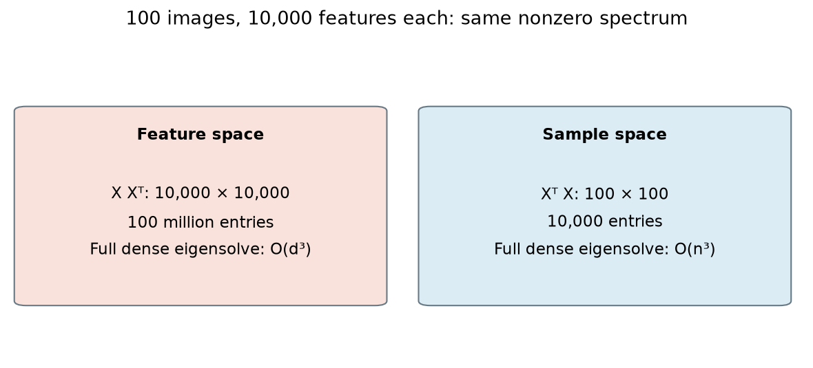
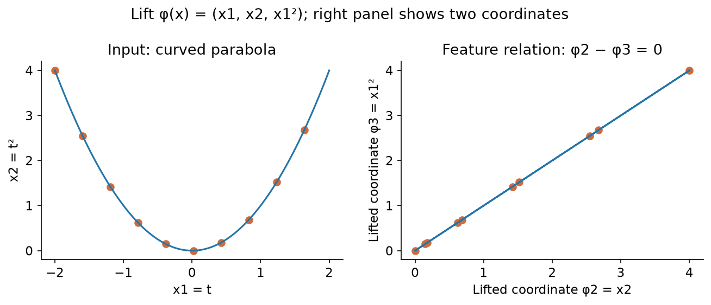
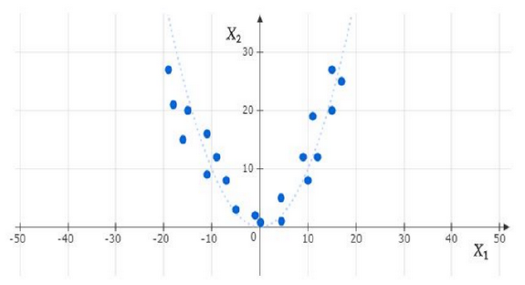
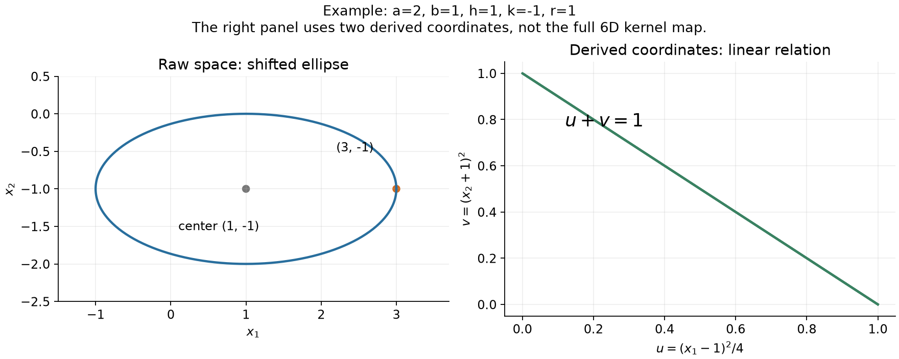
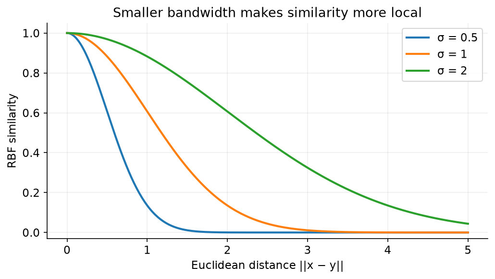
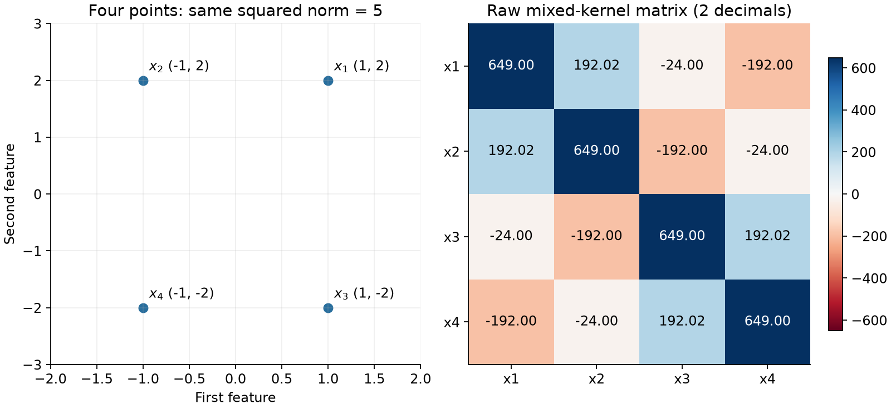
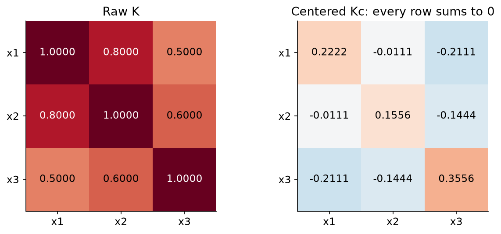
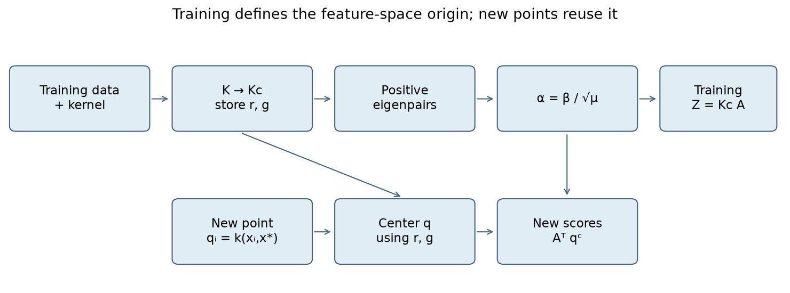
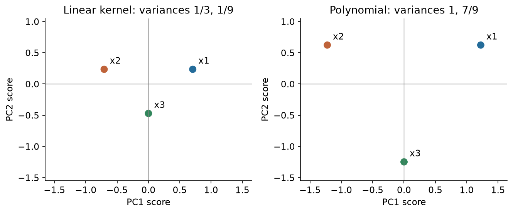
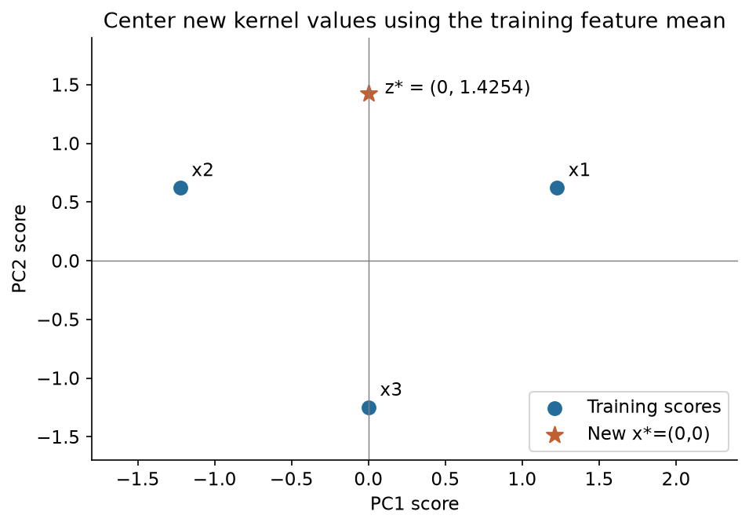

# MLT Week 2: Kernel PCA Notes

**Flow:** Week 1 ki PCA → large feature dimension ka computational issue → Gram matrix → eigenvector normalization → nonlinear feature maps → valid kernels → feature-space centering → Kernel PCA scores → complete master problem.

## 1. PCA ko sample space mein solve karna

### 1.1 Why a second matrix?

**Definition:** Gram matrix har pair of data points ka dot product store karti hai. PCA ka same nonzero spectrum smaller matrix se obtain kiya ja sakta hai.

**Real life:** 100 images hain, each image mein 10,000 pixel features. Feature-feature matrix huge hogi; image-image similarity matrix only $100\times100$ hogi.

Throughout these notes, **data points columns** hain. Ordinary PCA mein data centered assume karo; raw points hon toh pehle mean subtract karo:

$$X=[x_1\ \cdots\ x_n]\in\mathbb R^{d\times n},\qquad
C=\frac1nXX^T,\qquad G=X^TX.$$

| Matrix | Size | Entry / role |
|---|---|---|
| $XX^T$ | $d\times d$ | Unnormalized feature scatter |
| $C=XX^T/n$ | $d\times d$ | Feature covariance |
| $G=X^TX$ | $n\times n$ | $G_{ij}=x_i^Tx_j$, sample Gram matrix |

Dense full eigendecomposition roughly $O(d^3)$ versus $O(n^3)$ costs. Thus $d\gg n$ mein Gram route useful. Matrix formation bhi cost leti hai: $XX^T$ roughly $O(nd^2)$, $X^TX$ roughly $O(dn^2)$. Yeh full dense calculation ka comparison hai; truncated solvers ka cost different ho sakta hai.

### 1.2 Gram matrix ki properties

$G$ symmetric aur positive semidefinite (PSD) hai:

$$G^T=G,\qquad a^TGa=\|Xa\|^2\geq0.$$

Diagonal $G_{ii}=\|x_i\|^2\geq0$. **Off-diagonal negative allowed:** points 1 and $-1$ ka Gram matrix $\begin{bmatrix}1&-1\\-1&1\end{bmatrix}$ valid hai.

Symmetry + nonnegative diagonal alone enough nahi: $\begin{bmatrix}1&2\\2&1\end{bmatrix}$ ki eigenvalues $3,-1$, so not PSD. Every symmetric PSD matrix some Euclidean vectors ki Gram matrix ban sakti hai; fixed dimension $d$ specified ho toh rank additionally $\leq d$ honi chahiye.

### Q1 — Which matrices can be Gram matrices?

**Question:** Which of the following displayed matrices can represent $X^TX$?

$$B=\begin{bmatrix}-2&-1&0\\-1&-3&-1\\0&-1&-1\end{bmatrix},\qquad
C=\begin{bmatrix}1&-2&1\\2&5&-2\\1&-2&2\end{bmatrix}.$$

**Step 1 — B:** Diagonal negative. For $a=(1,0,0)^T$, $a^TBa=-2<0$. Hence B cannot be Gram.

**Step 2 — C:** $C_{12}=-2$ but $C_{21}=2$, so not symmetric. Reject C.

**Answer:** Neither displayed matrix is valid. Supplied PDF reports options A,D as correct, but does not reproduce their matrices; A,D ko independently verify karne ka data available nahi. Shown rejection method complete hai.

## 2. Same eigenvalues, different eigenvectors

### 2.1 Shared nonzero spectrum

**Definition:** $XX^T$ and $X^TX$ ke nonzero eigenvalues, including multiplicities, same hote hain. Eigenvectors generally same nahi: one lives in $\mathbb R^d$, other in $\mathbb R^n$.

$$\boxed{\operatorname{tr}(XX^T)=\operatorname{tr}(X^TX)=\sum_{i,j}X_{ij}^2}.$$

Agar Gram eigenvalues $\mu_j$ hain, covariance eigenvalues:

$$\boxed{\lambda_j=\mu_j/n}.$$

Useful connection: $G\beta=\mu\beta$ implies $(XX^T)(X\beta)=\mu(X\beta)$. For $\mu>0$, $X\beta\ne0$, so it supplies feature-space direction. Zero eigenvalues ka count matrix sizes ke saath change ho sakta hai.

**Example:** Rank-2 matrix $X\in\mathbb R^{10\times3}$ ho toh $XX^T$ mein 8 zero eigenvalues, $G$ mein 1. “All eigenvalues identical lists” false; **nonzero lists** identical hain.

### Q2 — Sample count, covariance trace and PC2 variance

**Question:** Mean-zero data have a $3\times3$ matrix $P$ with $P_{ij}=x_i^Tx_j$. Find (i) the number of data points, (ii) the covariance trace in terms of eigenvalues $l_1,l_2,l_3$ of $P$, and (iii) the variance along PC2 if the listed eigenvalues are $15,30,24$.

**Step 1:** Gram size $n\times n$, so $\boxed{n=3}$.

**Step 2:** Covariance eigenvalues divide by 3. Thus $\boxed{\operatorname{tr}(C)=(l_1+l_2+l_3)/3}$.

**Step 3:** PC order magnitude se decide hota hai. Sort $30\geq24\geq15$; divided values $10,8,5$.

$$\boxed{\text{Formal PC2 variance}=24/3=8},\qquad\boxed{\text{Formal trace}=23}.$$

**Given-data issue:** Three centered points ke Gram matrix mein $P\mathbf1=0$, so at least one eigenvalue zero honi chahiye. All three listed positive values centered premise se inconsistent hain. Sorting/scaling calculation ka answer 8 hai; such a centered dataset as stated cannot exist. PDF ka 10 wala intermediate claim second listed value ko PC2 maan leta hai, which is incorrect ordering.

### 2.2 Normalize the actual PC, not just its coefficient list

Unit Gram eigenvector $\beta_j$ and positive Gram eigenvalue $\mu_j$:

$$G\beta_j=\mu_j\beta_j,\quad\|\beta_j\|=1,$$

$$\boxed{\alpha_j=\frac{\beta_j}{\sqrt{\mu_j}}},\qquad
\boxed{w_j=X\alpha_j=\frac{X\beta_j}{\sqrt{\mu_j}}}.$$

$\|X\beta_j\|^2=\beta_j^TG\beta_j=\mu_j$; denominator actual $w_j$ ko unit banata hai.

Important norms:

$$\boxed{\alpha_j^T\alpha_j=1/\mu_j},\qquad
\boxed{\alpha_j^TG\alpha_j=1},\qquad\boxed{\|w_j\|=1}.$$

PDF mein $\alpha^T\alpha=1$ written hai; general correct condition **kernel-weighted norm** $\alpha^TG\alpha=1$ hai.

If covariance eigenvalue $\lambda_j$ given ho, $\mu_j=n\lambda_j$, so denominator $\sqrt{n\lambda_j}$. Symbols se nahi, matrix ki definition se scale decide karo.

**Same question:** `Week 2.pdf`, Q5 (pp. 14–15), isi Q2 ke three subparts repeat karta hai. Trace option **(b)** hai; supplied new PDF bhi PC2 variance **8** deta hai. Upar ka centered-rank caveat phir bhi apply hota hai.

### Q3 — Coefficient normalization with inconsistent printed data

**Question:** For $d>n$, a principal direction is written as $w=\sum_i\alpha_i x_i$. The eigenvalue of $X^TX$ is 10, and the corresponding vector, described as a unit eigenvector, is $(2,3,4,6)^T/\sqrt{54}$. Find $\alpha_2$.

**Step 1 — Unit check:** Squared norm $(4+9+16+36)/54=65/54\ne1$. Given vector is not unit; PDF also reuses $\alpha$ for both the eigenvector and reconstruction coefficients.

**Step 2 — Preserve the listed direction:** If $(2,3,4,6)$ is the intended eigenvector direction, normalize it to $\beta=(2,3,4,6)/\sqrt{65}$.

**Step 3 — Convert to feature-space coefficients:**

$$\alpha=\beta/\sqrt{10},\qquad
\boxed{\alpha_2=3/\sqrt{650}\approx0.1177}.$$

**Alternative typo interpretation:** If last coordinate was intended as 5, norm squared becomes 54 and answer is $3/\sqrt{540}\approx0.1291$, matching the source's recorded 0.12–0.13 range. That is conditional, not an assumed correction. Merely reading $3/\sqrt{54}\approx0.4082$ skips the required eigenvalue normalization.

### Q4 — Find errors in the dual-PCA algorithm

**Question:** For $n$ data points in $\mathbb R^d$, with $d\gg n$, an algorithm performs:

1. Place the points in the columns of $X$.
2. Compute $K=XX^T$.
3. Find its nonzero eigenvalues $\lambda_i$ and unit eigenvectors $e_i$.
4. Output principal directions $Xe_i/\sqrt{\lambda_i}$.

Identify the errors and give the corrected procedure.

**Step 1:** Columns convention correct: $X\in\mathbb R^{d\times n}$. Raw data ho toh center first.

**Step 2:** Given output formula Gram eigenvectors expect karti hai. Replace step 2 by $G=X^TX$, shape $n\times n$.

**Step 3:** Gram eigendecomposition se $e_i\in\mathbb R^n$ milta hai, so $Xe_i$ dimensionally valid. Then divide by $\sqrt{\lambda_i}$, where $\lambda_i$ here **Gram** eigenvalue hai.

**Correct flow:** Center → points as columns → $X^TX$ → positive eigenpairs → $Xe_i/\sqrt{\lambda_i}$.

$XX^T$ ordinary PCA ke liye inherently wrong nahi. But is stated dual algorithm mein expensive bhi hai aur step 4 ke dimensions se incompatible bhi: its eigenvector has length $d$, while $X$ needs a length-$n$ multiplier.

#### Q4 ka extra error — Eigenvalue versus square-root eigenvalue

`Week 2.pdf`, Q7 (p. 19), mein same algorithm hai, lekin last line mein ek additional error hai.

**Question:** “The $i^{th}$ principal component is given by $Xe_i/l_i$.” Find the error.

**Step 1 — Correct matrix first:** Upar Q4 ke according centered $X$ se $K=X^TX$ banao; $Ke_i=l_i e_i$, $l_i>0$, aur $\|e_i\|=1$ use karo.

**Step 2 — Actual length check:**

$$\|Xe_i\|^2=e_i^TX^TXe_i=l_i,\qquad\|Xe_i\|=\sqrt{l_i}.$$

**Step 3 — Unit direction:**

$$\boxed{w_i=\frac{Xe_i}{\sqrt{l_i}}}.$$

$l_i$ se divide karne par length $1/\sqrt{l_i}$ hogi, generally 1 nahi. Example: $l_i=4$ ho toh $Xe_i$ ki length 2; divide by 4 gives length $1/2$, divide by 2 gives length 1.

**Three errors to catch together:** missing centering; $XX^T$ instead of smaller $X^TX$ for this dual algorithm; $l_i$ instead of $\sqrt{l_i}$.

### Q5 — Projection using a unit Gram eigenvector

January 2025 question pattern in the supplied notes.

**Question:** Let $X\in\mathbb R^{d\times n}$ contain centered points, with $d>n$. Let $\lambda>0$ be the $k$-th largest eigenvalue of $X^TX$ and let $a_k$ be its unit eigenvector. Find the scalar projection of $x_i$ onto PC $k$.

**Step 1:** Actual unit PC is $w_k=Xa_k/\sqrt\lambda$.

**Step 2:** Dot product gives coordinate:

$$\boxed{z_{ik}=x_i^Tw_k=\frac{x_i^TXa_k}{\sqrt\lambda}}.$$

Scalar coordinate aur projection **vector** different hain; vector $z_{ik}w_k$ hoga. If $\alpha_k=a_k/\sqrt\lambda$ already defined ho, answer $x_i^TX\alpha_k$; double normalization mat karo.

## 3. Kernel trick: Nonlinear data ko linear feature-space problem banana

### 3.1 Feature map and implicit dot product

**Definition:** Feature map $\phi(x)$ input se new coordinates banati hai. Kernel directly their dot product calculate karta hai:

$$\boxed{k(x,y)=\langle\phi(x),\phi(y)\rangle}.$$

**Real life:** Housing price raw area ke saath nonlinear relation rakh sakti hai; area squared aur interaction features useful ho sakte hain. Kernel method aise feature interactions ke dot products directly compute karta hai.

Ordinary PCA raw space mein straight subspace seekhti hai. Kernel PCA transformed feature space mein ordinary PCA karti hai; resulting input-to-score mapping nonlinear ho sakti hai.

**Example intuition:** Raw points $(t,t^2)$ parabola par hain. Features $(x_1,x_2,x_1^2)$ mein relation $\phi_2=\phi_3$ linear hai. Transformation relation linear bana sakti hai, but data always one-dimensional **linear** subspace mein collapse honge, aisi guarantee nahi.

Without trick: construct $\phi(x),\phi(y)$ → dot product. With trick: evaluate $k(x,y)$ directly. “Kernel matrix” $K_{ij}=k(x_i,x_j)$ still $n\times n$, chahe feature-space dimension $D$ finite ho ya infinite.

### Q6 — Scalar feature map and coefficient square root

**Question:** For scalar inputs, find a feature map for $k(x,y)=10x^2y^2$.

**Step 1:** Desired same-input feature term $x^2$ hai. Coefficient 10 ko both factors mein split karo.

**Step 2:** Choose $\boxed{\phi(x)=\sqrt{10}\,x^2}$.

**Step 3:** Product $(\sqrt{10}x^2)(\sqrt{10}y^2)=10x^2y^2$. Choosing $10x^2$ would produce coefficient 100, wrong.

General rule: for $c\geq0$, $k(x,y)=cf(x)f(y)$ admits $\phi(x)=\sqrt c\,f(x)$.

### Q7 — Normalized kernel and its feature map

**Question:** Let $k(x,y)=\phi(x)^T\phi(y)$ be valid, and define

$$k_1(x,y)=\frac{100k(x,y)}{\sqrt{k(x,x)}\sqrt{k(y,y)}}.$$

Find a feature map for $k_1$.

**Step 1:** $k(x,x)=\|\phi(x)\|^2$, so denominator is $\|\phi(x)\|\|\phi(y)\|$.

**Step 2:** Normalize each feature vector and distribute $100=10\times10$:

$$\boxed{\phi_1(x)=10\frac{\phi(x)}{\|\phi(x)\|}}.$$

**Step 3:** Dot product exactly given $k_1$ reproduce karta hai. Diagonal $k_1(x,x)=100$.

**Condition:** $k(x,x)>0$ required. Zero feature vector par division undefined; without an explicit convention formula apply nahi hoti. General multiplier $c\geq0$ ho toh map $\sqrt c\,\phi(x)/\|\phi(x)\|$.

## 4. Polynomial kernels: Feature count and actual map

### 4.1 Brackets placement matters

For $x\in\mathbb R^d$, integer degree $p\geq1$:

| Kernel | Features included | Standard monomial dimension |
|---|---|---|
| $(x^Ty+1)^p$ | Degrees 0 through $p$ | $\binom{d+p}{p}$ |
| $(x^Ty)^p$ | Exactly degree $p$ | $\binom{d+p-1}{p}$ |

These are ambient feature-map dimensions, not data rank. Samples can occupy a smaller subspace. Number of points $n$ dimension formula mein nahi aata.

Higher degree more feature interactions represent karta hai, so nonlinear flexibility can increase. Higher degree automatically better fit/generalization guarantee nahi. $d=100,p=3$ already $\binom{103}{3}=176851$ standard features: implicit kernel evaluation ka benefit clear hai.

### Q8 — Feature dimension: All distinct source cases

**Question:** Find the feature-space dimensions for the inhomogeneous polynomial kernel $k(x,y)=(x^Ty+1)^p$ in these cases: (a) $d=4,p=3$; (b) $d=3,p=2$; (c) two-dimensional data with a quadratic relationship, using degree 2; (d) 1000 points in $\mathbb R^{20}$ with degree 3. Does increasing the degree increase the possible nonlinear interactions?

**Step 1:** Same formula $D=\binom{d+p}{p}$ use karo; sample count ignore for this calculation.

| Case | Substitution | Answer |
|---|---|---:|
| (a) | $\binom73=7\cdot6\cdot5/(3\cdot2\cdot1)$ | 35 |
| (b) | $\binom52$ | 10 |
| (c) | $\binom42$ | 6 |
| (d) | $\binom{23}{3}=23\cdot22\cdot21/6$ | 1771 |

**Step 2:** Case (c) features can be $1,x_1,x_2,x_1^2,x_1x_2,x_2^2$, with suitable kernel coefficient weights. Relation $x_2=x_1^2$ creates a dependency on this dataset; ambient count remains 6.

**Step 3:** Yes, higher degree allows higher-order interactions. In case (d), $n=1000,d=20,D=1771$ are three different quantities. Another source revision case $d=2,p=3$ gives $\binom53=10$.

**Same feature-count types:** `Week 2.pdf`, Q11 (p. 23), mein **200 examples, 3 features, degree 2** hai: Q8(b) ka same $\binom52=10$. Q9 (p. 23) Q8(c) ka graph-based version hai; naya numerical solve repeat nahi karna.

**Graph ko kaise read karein:** Points approximately U-shaped quadratic trend par hain. Degree 2 ka inhomogeneous kernel six monomial coordinates deta hai. Figure se exact $x_2=x_1^2$ equation ya exact zero reconstruction error infer nahi karna—scale aur scatter bhi matter karte hain. Ambient dimension **6** hai; points ka actual rank alag quantity hai.

### 4.2 Expand → match → square-root coefficients

Feature maps need not be unique. Coordinate reordering or an orthogonal transformation gives the same dot products. Valid map check ka best method: $\phi(x)^T\phi(y)$ expand karke compare karo.

### Q9 — Three similar-looking kernels, three maps

**Question:** For $x=(a,b)^T$ and $y=(c,d)^T$, construct feature maps for:

1. $k_A(x,y)=(x^Ty+1)^2$.
2. $k_B(x,y)=(x^Ty)^2+1$.
3. $k_C(x,y)=1+ac+bd+a^2c^2+b^2d^2+abcd$.

**Part A, Step 1:** Expand $(ac+bd+1)^2$:

$$a^2c^2+b^2d^2+1+2abcd+2ac+2bd.$$

**Step 2:** Match same-coordinate products:

$$\boxed{\phi_A(x)=(a^2,\sqrt2ab,b^2,\sqrt2a,\sqrt2b,1)^T}.$$

$\sqrt2ab\cdot\sqrt2cd=2abcd$; similarly linear terms. Six features.

**Part B:** Expansion $a^2c^2+2abcd+b^2d^2+1$. Linear terms absent:

$$\boxed{\phi_B(x)=(a^2,\sqrt2ab,b^2,1)^T}.$$

Four features, not six. Source's MCQ records this map as option A.

**Part C:** Every term coefficient 1:

$$\boxed{\phi_C(x)=(1,a,b,a^2,b^2,ab)^T}.$$

No $\sqrt2$ needed. Six entries, but kernel differs from A: same feature count does not mean same inner product.

**Numerical check:** $x=(1,2),y=(3,4)$ has dot product 11. Thus $k_A=144$, $k_B=122$, while $k_C=1+3+8+9+64+24=109$. Distinct answers catch bracket/coefficient mistakes.

### Q9A — Homogeneous quadratic kernel: Constant feature bhi remove hota hai

**Connection:** Q9 mein $(x^Ty+1)^2$ aur $(x^Ty)^2+1$ dekhe. Ab third bracket pattern $(x^Ty)^2$ ko compare karo: ismein linear aur constant terms dono absent hain.

**Question:** Consider the following kernel

$$k:\mathbb R^2\times\mathbb R^2\to\mathbb R,\qquad k(x,y)=(x^Ty)^2,$$

where $x=(x_1,x_2)$ and $y=(y_1,y_2)$. Which of the following transformation $\phi$ may corresponds to $k$?

(i) $\phi([x_1,x_2]^T)=[x_1,x_1x_2,x_2]^T$

(ii) $\phi([x_1,x_2]^T)=[x_1^2,x_1+x_2,x_2^2]^T$

(iii) $\phi([x_1,x_2]^T)=[x_1,\sqrt2x_1^2x_2^2,x_2]^T$

(iv) $\phi([x_1,x_2]^T)=[x_1^2,\sqrt2x_1x_2,x_2^2]^T$

`Week 2.pdf`, Q2, pp. 6–7; options source order mein hain.

**Step 1 — Dot product expand karo:**

$$x^Ty=x_1y_1+x_2y_2.$$

$$k(x,y)=x_1^2y_1^2+2x_1x_2y_1y_2+x_2^2y_2^2.$$

**Step 2 — Har product ki feature identify karo:**

- $x_1^2y_1^2$ ke liye coordinate $x_1^2$.
- $2x_1x_2y_1y_2$ ke liye coordinate $\sqrt2x_1x_2$.
- $x_2^2y_2^2$ ke liye coordinate $x_2^2$.

**Step 3 — Verify:**

$$\phi(x)^T\phi(y)=x_1^2y_1^2+(\sqrt2x_1x_2)(\sqrt2y_1y_2)+x_2^2y_2^2=k(x,y).$$

$$\boxed{\text{Option (iv)},\quad D=\binom{2+2-1}{2}=3}.$$

**Step 4 — Wrong options ka short check:**

- (i) $x=y=(2,0)$ par map norm squared 4, required kernel value 16.
- (ii) $x=y=(1,0)$ par map norm squared 2, required 1.
- (iii) $x=y=(2,0)$ par map norm squared 4, required 16.

**Property:** Same degree 2 hone se same feature count nahi hota: $(x^Ty)^2$ has **3**, $(x^Ty)^2+1$ has **4**, and $(x^Ty+1)^2$ has **6** standard features in $\mathbb R^2$.

`Week 2.pdf`, Q10 (p. 23), exactly Q9 Part C ka six-term kernel hai; uska map aur calculation wahin covered hai.

### Q10 — Hyperbola becomes a linear constraint

**Question:** All points satisfy $x_1^2/a^2-x_2^2/b^2=1$, where $a,b\ne0$. For

$$\phi(x)=(x_1^2,\sqrt2x_1x_2,\sqrt2x_1,x_2^2,\sqrt2x_2,1)^T,$$

find a vector orthogonal to every mapped point.

**Step 1:** Relation zero form mein: $x_1^2/a^2-x_2^2/b^2-1=0$.

**Step 2:** Given map ke **exact coordinate order** mein coefficients place karo:

$$\boxed{u=(1/a^2,0,0,-1/b^2,0,-1)^T}.$$

**Step 3:** $u^T\phi(x)=x_1^2/a^2-x_2^2/b^2-1=0$. Hence all mapped points normal $u$ ke perpendicular subspace mein hain.

Unit direction requested ho toh $u/\sqrt{a^{-4}+b^{-4}+1}$ use karo. Nonzero scalar multiple bhi orthogonal vector hai. Nonlinear raw relation ka linear feature-space constraint mil gaya.

### 4.3 Reverse connection: Feature-space normal se raw-space curve

**Definition:** $u^T\phi(x)=0$ feature space ka linear constraint hai. $\phi(x)$ substitute karne par original coordinates mein nonlinear equation mil sakti hai.

**Real-life connection:** Raw measurements curved pattern follow karein, toh squared/interaction features mein woh same relation ek linear equation ban sakta hai. Ab Q10 ka direction reverse karenge: curve se normal nahi, normal se curve nikaalenge.

**Property:** Coordinate order fixed rakhna. $\phi(x)$ reorder karoge toh $u$ bhi same order mein reorder karna padega. “Nullspace of vector $u$” ka precise meaning yahan $\ker(u^T)$ hai.

### Q10A — Shifted ellipse from a feature-space constraint

**Question:** Every element in a dataset $D$ is a vector of $\mathbb R^3$. $k:D\times D\to\mathbb R$ is defined as follows:

$$k(x,x')=(x^Tx'+1)^2.$$

Every data point in a dataset is an element of $\mathbb R^2$. Every column vector is a data point. Using $\phi:\mathbb R^2\to\mathbb R^6$, we map every data point to $\mathbb R^6$.

The following observation is made:

$$\phi(x)^T\phi(y)=k(x,y),$$

where $k(x,y)=(x^Ty+1)^2$ for every $x$ and $y$ in the data set.

Every data point in the mapped space is in the nullspace of vector $u$, where

$$u=\left(\frac1{a^2},\frac{-\sqrt2h}{a^2},\frac1{b^2},\frac{-\sqrt2k}{b^2},0,\frac{h^2}{a^2}+\frac{y^2}{k^2}-r^2\right)^T,\quad a,b,k,h\in\mathbb R.$$

(i) What could possibly be $\phi(x)$, if $x=(x_1,x_2)$?

(ii) What could possibly be the relationship between the features of every data point in $\mathbb R^2$?

`Week 2.pdf`, Q6, pp. 16–18. Upar printed question preserve kiya hai; PDF ke handwritten corrections mein first $\mathbb R^3$ ko $\mathbb R^2$ aur last coordinate ke $y^2/k^2$ ko $k^2/b^2$ kiya gaya hai. Neeche **isi corrected interpretation** ko solve kar rahe hain. Printed $y$ otherwise unspecified hai; silently usse $k$ assume nahi karna. Require $a,b\ne0$, and take real $r$.

**Step 1 — Map ko $u$ ke order se match karo:**

$$\boxed{\phi(x)=(x_1^2,\sqrt2x_1,x_2^2,\sqrt2x_2,\sqrt2x_1x_2,1)^T}.$$

Yeh Q9 Part A ka reordered map hai. Its dot product:

$$x_1^2y_1^2+2x_1y_1+x_2^2y_2^2+2x_2y_2+2x_1x_2y_1y_2+1=(x^Ty+1)^2.$$

**Step 2 — Corrected normal likho:**

$$u_c=\left(\frac1{a^2},\frac{-\sqrt2h}{a^2},\frac1{b^2},\frac{-\sqrt2k}{b^2},0,\frac{h^2}{a^2}+\frac{k^2}{b^2}-r^2\right)^T.$$

**Step 3 — $u_c^T\phi(x)=0$ term by term:**

$$\frac{x_1^2}{a^2}-\frac{2hx_1}{a^2}+\frac{x_2^2}{b^2}-\frac{2kx_2}{b^2}+\frac{h^2}{a^2}+\frac{k^2}{b^2}-r^2=0.$$

Cross term absent hai because $u_c$ ka fifth coordinate zero hai. $\sqrt2\times\sqrt2=2$ linear coefficients mein use hua.

**Step 4 — Complete squares:**

$$\frac{x_1^2-2hx_1+h^2}{a^2}+\frac{x_2^2-2kx_2+k^2}{b^2}=r^2.$$

$$\boxed{\frac{(x_1-h)^2}{a^2}+\frac{(x_2-k)^2}{b^2}=r^2}.$$

**Step 5 — Geometry read karo:**

- $r\ne0$: ellipse centered at $(h,k)$.
- Horizontal semi-axis $|ar|$; vertical semi-axis $|br|$.
- $r=1$: familiar form with right-hand side 1.
- $r=0$: equation sirf single point $(h,k)$ deti hai; nondegenerate ellipse nahi.

PDF ki printed solution mein $x_2$ ki jagah $y_1$, aur general $r^2$ ki jagah 1 aa gaya hai. Right-hand side 1 sirf $r^2=1$ par valid hai; handwritten correction bhi $r^2$ retain karti hai.

**Step 6 — Concrete check:** Figure ke liye $a=2,b=1,h=1,k=-1,r=1$ choose kiya. Point $(3,-1)$ par

$$\frac{(3-1)^2}{4}+(-1+1)^2=1.$$

Corrected normal aur map ka dot product bhi zero milta hai. Is tarah equation aur feature-space constraint independently match kar sakte hain.

**Printed expression ko literally use karne par:** Last coordinate ko fixed constant $c$ likho. Same steps se

$$\frac{(x_1-h)^2}{a^2}+\frac{(x_2-k)^2}{b^2}=\frac{h^2}{a^2}+\frac{k^2}{b^2}-c.$$

Thus fixed $c=h^2/a^2+y^2/k^2-r^2$ ho toh RHS $r^2+k^2/b^2-y^2/k^2$ hai, automatically $r^2$ nahi. Agar $y$ varying input hai, $u$ fixed normal hi nahi rahega.

**Same question:** `Week 2.pdf`, Q8 (pp. 20–22), Q10 ka hyperbola-to-normal direction repeat karta hai; usko dobara solve nahi kiya.

## 5. Valid kernels: Symmetry plus PSD

### 5.1 What must hold for every dataset?

**Definition:** Real kernel valid hai if every finite input set ki Gram matrix symmetric PSD ho. Course mein is criterion ko Mercer condition kaha jaata hai.

$$k(x,y)=k(y,x),\qquad\sum_{i,j}c_ic_jk(x_i,x_j)\geq0\quad\text{for all real }c_i.$$

Ek sample matrix PSD milna universal validity prove nahi karta; ek non-PSD counterexample invalidity prove kar deta hai. Explicit feature map dena validity establish karne ka direct method hai.

**Useful rules:** If $k_1,k_2$ valid, then $ak_1+bk_2$ valid for $a,b\geq0$; product $k_1(x,y)k_2(x,y)$ valid; $f(x)f(y)k_1(x,y)$ valid. Constant $c\geq0$ kernel valid. Thus $(k_1+k_2)^2$ is valid as a **pointwise** square, not an ambiguous matrix operation.

Subtraction **not guaranteed**. Counterexample: $k_1=1,k_2=2$ both valid constant kernels, but $k_1-k_2=-1$ has negative diagonal. Some subtractions can be valid, e.g. $k_1-k_1=0$.

### Q11 — Different factors on x and y

**Question:** If $k$ is a valid kernel, is $k'(x,y)=\sin(x)\cos(y)k(x,y)$ necessarily valid?

**Step 1:** Swap inputs: multiplier becomes $\sin(y)\cos(x)$, generally different.

**Step 2 — Explicit counterexample:** Choose valid $k(x,y)=1$, $x=0,y=\pi/2$. Then $k'(x,y)=0$, but $k'(y,x)=1$.

$$\boxed{\text{Not necessarily valid}}.$$

Special zero kernel could make it valid; general construction guarantee fail hoti hai. By contrast $\sin(x)\sin(y)k(x,y)$ uses same factor on both sides and is valid.

### Q12 — Feature-sum kernels

September 2024 pattern.

**Question:** For $x=(x_1,x_2)^T$, $y=(y_1,y_2)^T$, determine which are valid:

$$k_1=x_1y_1+x_2y_2+(x_1+x_2)(y_1+y_2),$$

$$k_2=x_1y_1+x_2y_2+x_1^2+y_2^2+3.$$

**Step 1:** For $k_1$, choose $\phi(x)=(x_1,x_2,x_1+x_2)$. Its dot product exactly $k_1$, so valid.

**Step 2:** For $k_2$, take $x=(1,0),y=(0,0)$: $k_2(x,y)=4$, $k_2(y,x)=3$. Not symmetric.

$$\boxed{k_1\text{ valid},\quad k_2\text{ invalid}}.$$

### Q13 — Product feature and constant feature

May 2024 pattern.

**Question:** Are both $k_1(x,y)=x_1y_1+x_2y_2+x_1x_2y_1y_2$ and $k_2(x,y)=k_1(x,y)+1$ valid kernels?

**Step 1:** $\phi_1(x)=(x_1,x_2,x_1x_2)$ gives $k_1$.

**Step 2:** Append constant feature: $\phi_2(x)=(x_1,x_2,x_1x_2,1)$ gives $k_2$.

$$\boxed{\text{Both valid}}.$$

Adding 1 is adding a nonnegative constant kernel; it does not break PSD.

### Q14 — RBF, polynomial, distance and exponential distance

October 2025 pattern.

**Question:** Which are valid kernels, for $\sigma>0$, $c\geq0$ and integer $p\geq1$?

A. $e^{-\|x-y\|^2/(2\sigma^2)}$

B. $(x^Ty+c)^p$

C. $\|x-y\|$

D. $e^{-\|x-y\|/\sigma}$

**A:** Gaussian/RBF kernel, valid.

**B:** Polynomial kernel with nonnegative constant and integer degree, valid.

**C:** Invalid as a PSD kernel. Two distinct points distance $r>0$ give matrix $\begin{bmatrix}0&r\\r&0\end{bmatrix}$. For $z=(1,-1)$, quadratic form $-2r<0$.

**D:** Exponential Euclidean-distance kernel, valid. Squared and unsquared distances here produce different kernels, but both A,D are valid.

$$\boxed{A,B,D}.$$

Distance being symmetric is not enough to make it a valid dot-product kernel.

### Q15 — Asymmetric polynomial expression

**Question:** For scalar inputs, is $k(x,y)=xy+x^2y+y^2x^3+1$ a valid kernel?

**Step 1:** Swap: $k(y,x)=xy+y^2x+x^2y^3+1$.

**Step 2:** Concrete check $x=1,y=2$: $k(1,2)=2+2+4+1=9$, $k(2,1)=2+4+8+1=15$.

$$\boxed{\text{Invalid: symmetry fails}}.$$

No eigendecomposition needed after finding this counterexample.

**Same symmetry-test type:** `Week 2.pdf`, Q3 (pp. 8–9), mein expression $k(s,t)=st+s^2t^2+s^3t+1$ hai. Q15 ka swap-input method directly apply hota hai: $k(1,2)=9$ aur $k(2,1)=15$, so **No**. Formula different hai, lekin solution technique same—alag full worked question ki zarurat nahi.

### Q16 — Kernel validity plus matrix properties

**Question:** Which statements are true?

A. $k(x,y)=(x^Ty)^3$ is a valid kernel.

B. $k(x,y)=e^{-\|x-y\|^2}$ is a valid kernel.

C. $\operatorname{tr}(XX^T)=\operatorname{tr}(X^TX)$.

D. $XX^T$ and $X^TX$ have the same eigenvectors.

**Step 1:** A homogeneous degree-three polynomial kernel: valid, even though entries can be negative. B is RBF with $\sigma=1/\sqrt2$: valid.

**Step 2:** C true: both traces sum all squared data entries.

**Step 3:** D false in general: vector dimensions differ; only nonzero eigenvalues guaranteed shared.

$$\boxed{A,B,C}.$$

## 6. Gaussian/RBF and mixed kernels

### 6.1 Distance-to-similarity intuition

$$\boxed{k(x,y)=\exp\left[-\frac{\|x-y\|^2}{2\sigma^2}\right]},\qquad\sigma>0.$$

Close points: similarity near 1. Far points: near 0. For finite inputs, $0<k\leq1$, and raw RBF diagonal $k(x,x)=1$.

Small $\sigma$: narrow neighbourhood, similarity drops quickly. Large $\sigma$: even distant points look similar. For distinct fixed samples, $\sigma\to0$ makes raw $K\to I$; $\sigma\to\infty$ makes $K\to\mathbf1\mathbf1^T$. After centering the latter tends to zero, so variance disappears. Duplicate points keep similarity 1 even as $\sigma\to0$.

RBF has an infinite-dimensional feature-space representation on the continuous Euclidean domain; a finite dataset still yields a finite $n\times n$ kernel matrix and finite-rank scores. Polynomial has finite standard feature dimension.

### Q17 — Direct RBF value

**Question:** Using the Gaussian kernel with $\sigma=1$, calculate $k((0,1),(1,0))$.

**Step 1:** Difference $(-1,1)$.

**Step 2:** Squared distance $1+1=2$.

**Step 3:** $k=e^{-2/(2\cdot1^2)}=e^{-1}=\boxed{0.3679\approx0.37}$.

Square, sum, divide by $2\sigma^2$, then exponentiate. Do not put plain distance $\sqrt2$ into squared-distance formula.

### Q18 — Mixed kernel entries

**Question:** Let $k=k_{mathrm{RBF}}+3k_{mathrm{poly}}$, where $k_{mathrm{poly}}(x,y)=(x^Ty+1)^3$. If $x_1^Tx_1=5$, find $k(x_1,x_1)$. Explain how to calculate other entries and whether an off-diagonal entry can be negative.

**Step 1:** Self RBF value 1.

**Step 2:** Polynomial part $(5+1)^3=216$, weighted contribution $648$.

$$\boxed{k(x_1,x_1)=1+648=649}.$$

**Step 3:** For any pair, independently calculate squared distance and dot product:

$$K_{ij}=e^{-\|x_i-x_j\|^2/(2\sigma^2)}+3(x_i^Tx_j+1)^3.$$

Negative off-diagonal possible: if $x_i^Tx_j=-3$, polynomial contribution $3(-2)^3=-24$, plus positive RBF contribution. For a distant pair, total can be close to $-24$ without violating PSD.

PDF quotes $k(x_2,x_4)\approx-24$ but does not give the needed pair coordinates/bandwidth there; that particular entry cannot be independently recomputed. Weighted sum kernel is valid because both components valid and weights nonnegative.

### Q18A — Full four-point mixed-kernel matrix

**Connection:** Q18 mein diagonal aur individual entries ka method covered hai. Naye PDF ne complete coordinates aur exact Gaussian exponent de diya hai; ab missing full matrix determine ho sakti hai.

**Question:** Suppose $k_1(x,y)=\exp(-\|x-y\|^2)$ is a Gaussian (RBF) kernel and $k_2(x,y)=(x^Ty+1)^3$ is a polynomial kernel of degree 3. If a new kernel function $k$ is defined as

$$k(x,y)=k_1(x,y)+3k_2(x,y),$$

then find the kernel matrix $K$ for the following dataset:

$$\left\{\begin{bmatrix}1\\2\end{bmatrix},\begin{bmatrix}-1\\2\end{bmatrix},\begin{bmatrix}1\\-2\end{bmatrix},\begin{bmatrix}-1\\-2\end{bmatrix}\right\}.$$

`Week 2.pdf`, Q4, pp. 10–12.

**Step 1 — Label and read the exponent:**

$$x_1=(1,2)^T,\quad x_2=(-1,2)^T,\quad x_3=(1,-2)^T,\quad x_4=(-1,-2)^T.$$

Given Gaussian is $e^{-\|x-y\|^2}$, so extra $1/2$ mat insert karo. Standard $e^{-\|x-y\|^2/(2\sigma^2)}$ notation mein $\sigma=1/\sqrt2$.

**Step 2 — All diagonals:** Har point ki squared norm 5; Q18 ki same diagonal calculation gives $K_{ii}=649$.

**Step 3 — Horizontal pair $(1,2)$:**

$$x_1^Tx_2=1(-1)+2(2)=3,\qquad\|x_1-x_2\|^2=2^2+0^2=4.$$

$$K_{12}=e^{-4}+3(3+1)^3=\boxed{192+e^{-4}\approx192.01831564}.$$

Pair $(3,4)$ ki geometry same, so $K_{34}=K_{12}$.

**Step 4 — Vertical pair $(1,3)$:**

$$x_1^Tx_3=1(1)+2(-2)=-3,\qquad\|x_1-x_3\|^2=0^2+4^2=16.$$

$$K_{13}=e^{-16}+3(-3+1)^3=\boxed{-24+e^{-16}\approx-23.99999989}.$$

Similarly $K_{24}=K_{13}$. This supplies the previously missing data behind Q18's $k(x_2,x_4)\approx-24$.

**Step 5 — Opposite-corner pair $(1,4)$:**

$$x_1^Tx_4=1(-1)+2(-2)=-5,\qquad\|x_1-x_4\|^2=2^2+4^2=20.$$

$$K_{14}=e^{-20}+3(-5+1)^3=\boxed{-192+e^{-20}\approx-191.999999998}.$$

Similarly $K_{23}=K_{14}$.

**Step 6 — Fill using symmetry:** Define $A=192+e^{-4}$, $B=-24+e^{-16}$, $C=-192+e^{-20}$.

$$\boxed{K=\begin{bmatrix}
649&A&B&C\\
A&649&C&B\\
B&C&649&A\\
C&B&A&649
\end{bmatrix}}.$$

Two-decimal representation:

$$\boxed{K\approx\begin{bmatrix}
649.00&192.02&-24.00&-192.00\\
192.02&649.00&-192.00&-24.00\\
-24.00&-192.00&649.00&192.02\\
-192.00&-24.00&192.02&649.00
\end{bmatrix}}.$$

PDF prints **192.01**; correct rounding of $192+e^{-4}$ to two decimals is **192.02**. Keep exponentials until the final step.

**Checks and properties:**

- $K=K^T$ and all diagonal entries equal 649.
- Negative off-diagonals valid hain; PSD ka matlab entry-wise positive nahi.
- Kernel valid hai because it is a nonnegative weighted sum of two valid kernels.
- Yeh **raw** kernel matrix hai. Raw points ka mean zero hone ke bawajood nonlinear feature mean generally zero nahi—next section mein isi difference ko center karenge.

## 7. Kernel centering: Mean feature vector subtract karna

### 7.1 Raw centering is not feature-space centering

**Counterexample:** Raw scalar data $\{-1,1\}$ have mean zero. Map $\phi(x)=x^2$ gives $\{1,1\}$, mean 1. So centered raw input does not imply centered nonlinear features.

Let $\Phi=[\phi(x_1)\ \cdots\ \phi(x_n)]$, mean $m=\frac1n\sum_i\phi(x_i)$. Centered features $\tilde\phi_i=\phi(x_i)-m$.

Kernel PCA uses their Gram matrix, without explicitly constructing $m$:

$$\boxed{K_c=HKH},\qquad\boxed{H=I-\frac1n\mathbf1\mathbf1^T}.$$

#### PDF Q1 ka hint — Mean subtraction se centering formula

`Week 2.pdf`, Q1 (pp. 2–5), exactly Q20 ka matrix poochhta hai. Uska hint feature-space centering se formula obtain karne ko kehta hai; numerical solve Q20 mein ek hi baar rahega.

**Question:** “First try to find how to center $\phi(X)$ using above hint and apply that idea to $K=\phi(X)^T\phi(X)$.” The hint gives the mean vector as $X\mathbf1/n$.

**Step 1 — Mean ki repeated columns:** Put $\Phi=\phi(X)$ and $J=\mathbf1\mathbf1^T/n$. Then $\Phi J$ ki every column feature mean $m=\Phi\mathbf1/n$ hai.

**Step 2 — Subtract from every feature vector:**

$$\Phi_c=\Phi-\Phi J=\Phi(I-J)=\Phi H.$$

**Step 3 — Centered inner products lo:** $J^T=J$, hence $H^T=H$.

$$K_c=\Phi_c^T\Phi_c=H\Phi^T\Phi H=HKH.$$

**Step 4 — Expand only the required identity:**

$$\boxed{K_c=(I-J)K(I-J)=K-KJ-JK+JKJ}.$$

$KJ$ row means repeat karta hai, $JK$ column means, aur $JKJ$ grand mean. Isi identity ka entry-wise version next subsection mein hai.

### 7.2 Entry-wise calculation

For symmetric $K$, row means $r_i=\frac1n\sum_jK_{ij}$ and grand mean $g=\frac1{n^2}\sum_{i,j}K_{ij}$:

$$\boxed{(K_c)_{ij}=K_{ij}-r_i-r_j+g}.$$

Subtract row and column averages, add grand average once because it was removed twice. Different row means ko same number assume mat karo.

Properties: $K_c$ symmetric PSD, $K_c\mathbf1=0$, row/column sums zero, rank $\leq n-1$. Negative entries allowed. Raw RBF diagonal 1 hoti hai; **centered** RBF diagonal generally 1 nahi hoti.

### Q19 — Two-point polynomial centering

**Question:** Let $X=\begin{bmatrix}1&0\\0&1\\0&0\end{bmatrix}$ contain two points as columns, and use $k(x,y)=(1+x^Ty)^2$. Find the centered kernel matrix.

**Step 1:** $x_1=(1,0,0)$, $x_2=(0,1,0)$; self dot products 1, cross dot 0.

$$K=\begin{bmatrix}4&1\\1&4\end{bmatrix}.$$

**Step 2:** Both row means $5/2$, grand mean $10/4=5/2$.

**Step 3:** Diagonal $4-2.5-2.5+2.5=1.5$; off-diagonal $1-2.5-2.5+2.5=-1.5$.

$$\boxed{K_c=\begin{bmatrix}1.5&-1.5\\-1.5&1.5\end{bmatrix}}.$$

**Check:** Row sums zero, eigenvalues $3,0$ nonnegative. Source calculation drops the all-zero third coordinate; kernel values remain the same, but original matrix has $d=3,n=2$.

### Q20 — Three-point centering with unequal means

**Question:** Center the kernel matrix

$$K=\begin{bmatrix}1&0.8&0.5\\0.8&1&0.6\\0.5&0.6&1\end{bmatrix}.$$

**Step 1:** Row means $r=(23/30,4/5,7/10)$.

**Step 2:** All entries total $6.8$, grand mean $g=6.8/9=34/45$.

**Step 3:** Calculate entries without rounding too soon:

$$K^c_{11}=1-23/30-23/30+34/45=2/9,$$

$$K^c_{12}=4/5-23/30-4/5+34/45=-1/90,$$

$$K^c_{22}=1-4/5-4/5+34/45=7/45.$$

**Step 4:** Complete by symmetry:

$$\boxed{K_c=\frac1{90}\begin{bmatrix}20&-1&-19\\-1&14&-13\\-19&-13&32\end{bmatrix}}$$

$$\approx\begin{bmatrix}0.222222&-0.011111&-0.211111\\-0.011111&0.155556&-0.144444\\-0.211111&-0.144444&0.355556\end{bmatrix}.$$

**Check:** Numerator row sums $20-1-19=0$, $-1+14-13=0$, $-19-13+32=0$. PDF's entries $0.2,-0.1889,0.4$ in the lower block are arithmetic errors; corrected values above follow the same stated $K$.

## 8. Kernel PCA eigenvalues, normalization and scores

### 8.1 One consistent notation

For positive eigenpairs of the **centered** Gram matrix:

$$K_c\beta_j=\mu_j\beta_j,\qquad\|\beta_j\|=1,\qquad\mu_1\geq\mu_2\geq\cdots>0.$$

Feature covariance $C_\phi=\Phi_c\Phi_c^T/n$ has eigenvalues $\boxed{\lambda_j=\mu_j/n}$.

$$\boxed{\alpha_j=\beta_j/\sqrt{\mu_j}},\qquad
w_j=\Phi_c\alpha_j,\qquad\boxed{\alpha_j^TK_c\alpha_j=1}.$$

Training scores:

$$\boxed{z_j=K_c\alpha_j=\sqrt{\mu_j}\,\beta_j},\qquad
\boxed{z_{ij}=\sum_\ell(\alpha_j)_\ell (K_c)_{\ell i}}.$$

Use **centered** kernel values for centered scores. Raw $K\alpha$ generally has a constant offset. Even if $\sum_i\alpha_i=0$, raw and centered projections need not coincide.

**Variance check:** $\frac1n\sum_i z_{ij}^2=\mu_j/n=\lambda_j$. Explained fractions can directly use $\mu_j/\sum_\ell\mu_\ell$: common $1/n$ cancels.

### Q21 — Kernel eigenvalue versus covariance eigenvalue

**Question:** Kernel PCA is performed on 100 data points. The largest eigenvalue of the centered kernel matrix is 10. Find the largest feature-space covariance eigenvalue using the $1/n$ convention.

**Step 1:** Identify: given 10 belongs to $K_c$, not $K_c/n$.

**Step 2:** $\boxed{\lambda_{\max}=10/100=0.1}$.

Same scaling ka source variation: $n=100$ aur kernel eigenvalues $30,20,10$ ho toh PC variances $0.3,0.2,0.1$.

This exact example recurs in the supplied PDF's eigenvalue section, algorithm and numerical discussion. One calculation covers all occurrences. If eigenvalue already belonged to normalized $K_c/n$, do not divide again.

### Q22 — Can the number of kernel PCs exceed d?

**Question:** There are 1000 data points in $\mathbb R^{20}$. Can Kernel PCA produce 50 nonzero components? Can it produce 1001? What is the upper bound after centering?

**Step 1:** Raw linear PCA has at most $\min(d,n-1)=20$ nonzero PCs.

**Step 2:** Feature-space dimension $D$ can exceed 20. Kernel PCA can have 50 nonzero PCs if feature data rank is at least 50; e.g. degree-three polynomial ambient dimension 1771 permits that rank.

**Step 3:** Centering gives $K_c\mathbf1=0$, so nonzero component count:

$$\boxed{k\leq\operatorname{rank}(K_c)\leq\min(D,n-1)}.$$

Here upper bound 999 (or lower if feature rank smaller). **50 possible, 1001 impossible.** Source's $k\leq n$ is a loose bound; the sharper centered bound is $n-1$.

For the final three-point master example, $n-1=2$, so $k>2$ nonzero PCs impossible even though feature space is 6D.

**Same question:** `Week 2.pdf`, Q12 (p. 24), asks whether the first $k$ kernel PCs can exceed raw dimension $d$ for 1000 points. Q22 answers **Yes, if transformed rank permits it**. Naye PDF ke solution ka initial “No” standard PCA ke liye hai; Kernel PCA ke final answer ko “No” mat read karna. Centering ke baad sharper sample limit $999$ hai.

### 8.2 Complete training pipeline

1. Choose kernel and parameters; form $K_{ij}=k(x_i,x_j)$.
2. Store training row means and grand mean; compute $K_c=HKH$.
3. Obtain descending positive eigenpairs $(\mu_j,\beta_j)$.
4. Choose $k$ by required components/variance; set $\alpha_j=\beta_j/\sqrt{\mu_j}$.
5. Obtain scores $Z=K_c[\alpha_1\ \cdots\ \alpha_k]$ of shape $n\times k$.

Zero eigenvalues cannot be normalized by this formula. Tiny numerical negatives near zero may be roundoff; substantial negative eigenvalues signal a kernel/calculation problem. Full kernel storage $O(n^2)$ and dense eigendecomposition $O(n^3)$ can be expensive for large $n$; kernel trick avoids huge $D$, not all computation.

### Q23 — Fully worked two-point eigensystem

**Question:** Given centered $K_c=\begin{bmatrix}1&-1\\-1&1\end{bmatrix}$, find its eigenvalues, a unit first eigenvector, normalized coefficients, feature covariance eigenvalue and training scores.

**Step 1:** Characteristic equation $(1-\mu)^2-1=\mu(\mu-2)=0$, so eigenvalues $2,0$.

**Step 2:** For 2, eigenvector direction $(1,-1)$; unit $\beta=(1,-1)/\sqrt2$.

**Step 3:** $\alpha=\beta/\sqrt2=(1/2,-1/2)$.

**Step 4:** $n=2$, so feature covariance eigenvalue $\lambda=2/2=1$.

**Step 5:**

$$z_1=1(1/2)+(-1)(-1/2)=1,$$

$$z_2=(-1)(1/2)+1(-1/2)=-1.$$

$$\boxed{z=(1,-1)^T}.$$

Check mean zero and variance $(1+1)/2=1$. Here $\|\alpha\|^2=1/2$, not 1; $\alpha^TK_c\alpha=1$.

## 9. New-point projection and the linear-kernel check

### 9.1 Center a new point using the training mean

**Definition:** New point must be measured relative to the same feature-space origin used during training. Training set mein new point add karke mean/eigenvectors recompute karna prediction nahi, refitting hoga.

Let $q_i=k(x_i,x_*)$, training row means $r_i$, training grand mean $g$, and $\bar q=\frac1n\sum_iq_i$. Centered cross-kernel vector:

$$\boxed{q_i^c=q_i-r_i-\bar q+g},\qquad
\boxed{z_{*j}=\alpha_j^Tq^c}.$$

Using training centering is necessary even if $x_*$ raw input is centered. For positive-eigenvalue components, $\mathbf1^T\alpha_j=0$, so score can simplify to $\alpha_j^T(q-r)$; keeping full formula is safer in hand calculations.

### Q24 — Weighted kernel values: What is actually determined?

**Question:** Given coefficients $\alpha=(0.2,0.5,0.3)^T$ and kernel values between three training points and a target point $q=(2,4,1)^T$, compute the weighted projection expression.

**Step 1:** Multiply corresponding entries: $0.2\cdot2=0.4$, $0.5\cdot4=2$, $0.3\cdot1=0.3$.

**Step 2:** Sum:

$$\boxed{\alpha^Tq=0.4+2+0.3=2.7}.$$

**Scope:** This is the supplied example's kernel weighted-sum arithmetic. If $q$ is raw, centered PCA score additionally needs training centering statistics. Also $\mathbf1^T\alpha=1$, whereas a standard positive-eigenvalue $K_c$ coefficient vector must sum to zero. Thus these givens do not establish a properly normalized nonzero centered-KPCA component; do not use 2.7 as an unconditional centered score.

### Q25 — Three-point linear kernel: Full consistency check

**Question:** For $x_1=(1,0)^T$, $x_2=(0,1)^T$, $x_3=(1,1)^T$, use $k(x,y)=x^Ty$. Compute the raw and centered Gram matrices, eigenvalues, normalized coefficients and training scores. Verify agreement with ordinary centered PCA.

**Step 1 — Raw Gram:**

$$K=\begin{bmatrix}1&0&1\\0&1&1\\1&1&2\end{bmatrix}.$$

**Step 2 — Means:** $r=(2/3,2/3,4/3)$; total of all entries is **8**, so $g=8/9$.

**Step 3 — Center:**

$$\boxed{K_c=\frac19\begin{bmatrix}5&-4&-1\\-4&5&-1\\-1&-1&2\end{bmatrix}}.$$

Example: $K^c_{11}=1-2/3-2/3+8/9=5/9$. Each row sums zero. Source uses total 6 and an indefinite “centered” matrix; those numerical entries are incorrect.

**Step 4 — Eigenpairs:**

$$\mu_1=1,\quad\beta_1=(1,-1,0)/\sqrt2,$$

$$\mu_2=1/3,\quad\beta_2=(1,1,-2)/\sqrt6,\qquad\mu_3=0.$$

Check by matrix multiplication; remaining constant direction $(1,1,1)$ has eigenvalue zero.

**Step 5 — Normalize:** $\alpha_1=\beta_1$, $\alpha_2=\beta_2/\sqrt{1/3}=(1,1,-2)/\sqrt2$.

**Step 6 — Scores:** $z_j=\sqrt{\mu_j}\beta_j$:

| Point | PC1 score | PC2 score |
|---|---|---|
| $x_1$ | $1/\sqrt2$ | $1/\sqrt{18}$ |
| $x_2$ | $-1/\sqrt2$ | $1/\sqrt{18}$ |
| $x_3$ | 0 | $-2/\sqrt{18}$ |

**Step 7 — Ordinary PCA check:** Raw mean $(2/3,2/3)$; covariance $C=\frac19\begin{bmatrix}2&-1\\-1&2\end{bmatrix}$ has eigenvalues $1/3,1/9$, exactly $\mu_1/3,\mu_2/3$. Feature directions $w_1=(1,-1)/\sqrt2$, $w_2=(-1,-1)/\sqrt2$ produce the same scores. PC2 sign can be reversed consistently.

Linear kernel PCA equals ordinary centered PCA. Is dataset ko next question mein nonlinear kernel ke saath compare karenge.

## 10. One complete nonlinear master question

### Q26 — Polynomial Kernel PCA from start to new-point scores

**Question:** Let $x_1=(1,0)^T$, $x_2=(0,1)^T$, $x_3=(1,1)^T$, with kernel $k(x,y)=(x^Ty+1)^2$. Find:

1. A feature map and its dimension; explain kernel validity.
2. The raw and centered kernel matrices.
3. The nonzero eigenpairs and normalized coefficient vectors.
4. The feature covariance eigenvalues, explained variance and training scores.
5. The maximum useful component count, and the scores of a new point $x_*=(0,0)^T$.

The final new-point subpart extends the PDF's master problem using the same trained model.

### 10.1 Feature map and validity

**Step 1:** From Q9:

$$\phi(x)=(x_1^2,\sqrt2x_1x_2,x_2^2,\sqrt2x_1,\sqrt2x_2,1)^T.$$

$D=\binom42=6$, raw dimension 2. Map dot product exactly $(x^Ty+1)^2$, so kernel valid.

**Step 2:** Explicit map useful for understanding, but subsequent calculations only need kernel values. $D=6$ does not imply three samples can produce six independent centered PCs.

### 10.2 Raw kernel and centering

Pairwise raw dot products same as Q25. Add 1, then square each entry:

$$\boxed{K=\begin{bmatrix}4&1&4\\1&4&4\\4&4&9\end{bmatrix}}.$$

Row sums $9,9,17$, so $r=(3,3,17/3)$; grand mean $g=35/9$.

$$K^c_{11}=4-3-3+35/9=17/9,$$

$$K^c_{12}=1-3-3+35/9=-10/9,$$

$$K^c_{13}=4-3-17/3+35/9=-7/9.$$

Thus:

$$\boxed{K_c=\frac19\begin{bmatrix}17&-10&-7\\-10&17&-7\\-7&-7&14\end{bmatrix}}.$$

Row sums zero; centered feature geometry now ready for PCA.

### 10.3 Eigenpairs and normalization

**Step 1:** First two points symmetric hain. Try antisymmetric vector $(1,-1,0)$:

$$K_c(1,-1,0)^T=(3,-3,0)^T.$$

Hence $\boxed{\mu_1=3,\quad\beta_1=(1,-1,0)/\sqrt2}$.

**Step 2:** Remaining centered symmetric direction $(1,1,-2)$:

$$K_c(1,1,-2)^T=(7/3,7/3,-14/3)^T.$$

Hence $\boxed{\mu_2=7/3,\quad\beta_2=(1,1,-2)/\sqrt6}$. Constant direction has eigenvalue 0.

**Step 3:** Divide by square roots of **Gram** eigenvalues:

$$\boxed{\alpha_1=(1,-1,0)/\sqrt6},\qquad
\boxed{\alpha_2=(1,1,-2)/\sqrt{14}}.$$

Both coefficients sum to zero and satisfy $\alpha_j^TK_c\alpha_j=1$.

### 10.4 Covariance variances and training coordinates

$n=3$, so $\boxed{\lambda_1=1,\quad\lambda_2=7/9}$. Total variance $16/9$.

$$\boxed{\mathrm{EVR}_1=\frac{3}{3+7/3}=\frac9{16}=56.25\%},\qquad
\boxed{\mathrm{EVR}_2=43.75\%}.$$

Two PCs preserve 100% feature-space training variance. For 95%, choose 2. If keeping only first PC, mean squared **feature-space** reconstruction error is $7/9$, total $3(7/9)=7/3$.

Training scores $z_j=\sqrt{\mu_j}\beta_j$:

| Point | PC1 | PC2 |
|---|---|---|
| $x_1$ | $\sqrt{3/2}$ | $\sqrt{14}/6$ |
| $x_2$ | $-\sqrt{3/2}$ | $\sqrt{14}/6$ |
| $x_3$ | 0 | $-\sqrt{14}/3$ |

Approximate rows $(1.2247,0.6236)$, $(-1.2247,0.6236)$, $(0,-1.2472)$.

**Raw-versus-centered trap:** PDF writes generic first-point expression $4a+b+4c$ using raw $K$. Correct centered score is $(17a-10b-7c)/9$.

For actual $\alpha_1$, both happen to coincide because its antisymmetry cancels the offset. That coincidence fails for $\alpha_2$: raw scores $(1,1,-10)/\sqrt{14}$ have nonzero mean, while centered scores $(7,7,-14)/(3\sqrt{14})$ match the table. Always use $K_c\alpha$.

### 10.5 Component count and meaning of reconstruction

Here centered rank 2, so exactly two nonzero kernel PCs. Cannot take a third nonzero PC, despite $D=6$. In other datasets with more samples, kernel PC count may exceed raw $d$.

Reconstruction in transformed feature space is $m+\sum_jz_jw_j$. Recovering a raw $x$ from that feature vector is the **pre-image problem**: solution may be non-unique or may not exist exactly. Kernel PCA does not automatically provide ordinary PCA's simple raw-space inverse.

### 10.6 Project new point without refitting

$x_*=(0,0)$ has raw dot product zero with all training points, so $q=(1,1,1)^T$ and $\bar q=1$.

Use stored training $r,g$:

$$q^c=q-r-\bar q\mathbf1+g\mathbf1
=\boxed{(8/9,8/9,-16/9)^T}.$$

First score:

$$z_{*1}=\frac1{\sqrt6}(8/9-8/9)=\boxed0.$$

Second score:

$$z_{*2}=\frac1{\sqrt{14}}\left(8/9+8/9+32/9\right)
=\boxed{\frac{16}{3\sqrt{14}}\approx1.4254}.$$

Raw $\alpha_j^Tq$ would give zero for both because coefficients sum to zero; it would miss the second component's training-mean offset. This is why new-point centering matters.

## 11. Revision: Follow the dependency order

| Sequence | Distinct skills |
|---|---|
| Q1–Q5 | Gram validity, eigenvalue scaling, normalization, algorithm errors, scalar projection |
| Q6–Q10 | Feature maps, normalized kernel, feature counts, polynomial expansion, nonlinear constraint |
| Q11–Q16 | All source validity patterns, symmetry counterexamples, PSD and matrix properties |
| Q17–Q18 | RBF arithmetic, bandwidth intuition, mixed kernels |
| Q19–Q20 | Two-point and unequal-mean three-point centering |
| Q21–Q23 | Covariance scaling, rank bound, complete small eigensystem |
| Q24–Q25 | Projection assumptions and linear-kernel consistency |
| Q26 | Complete nonlinear pipeline plus properly centered new-point prediction |
| Q4 extra error | Gram eigenvalue versus square-root normalization |
| Q9A → Q10A | Homogeneous quadratic map → feature-space normal se shifted ellipse |
| Q18A | Four-point mixed-kernel matrix with all distinct pair calculations |
| Section 7.1 hint | Feature mean subtraction se kernel-centering identity |

### 11.1 Formula sheet

| Task | Formula / rule |
|---|---|
| Ordinary centered Gram | $G=X^TX$ |
| Covariance | $C=XX^T/n$ |
| Shared spectrum | $XX^T,X^TX$: same nonzero eigenvalues |
| Feature-map dot product | $k(x,y)=\langle\phi(x),\phi(y)\rangle$ |
| Inhomogeneous polynomial dimension | $\binom{d+p}{p}$ for $(x^Ty+1)^p$ |
| Kernel centering | $K_c=HKH$, $H=I-\mathbf1\mathbf1^T/n$ |
| Entry centering | $K^c_{ij}=K_{ij}-r_i-r_j+g$ |
| Covariance eigenvalue | $\lambda_j=\mu_j/n$ |
| Normalized coefficients | $\alpha_j=\beta_j/\sqrt{\mu_j}$, unit $\beta_j$, $\mu_j>0$ |
| Actual PC norm | $\alpha_j^TK_c\alpha_j=1$ |
| Training scores | $z_j=K_c\alpha_j=\sqrt{\mu_j}\beta_j$ |
| New-point centering | $q^c=q-r-\bar q\mathbf1+g\mathbf1$ |
| New-point score | $z_{*j}=\alpha_j^Tq^c$ |
| Nonzero component bound | $k\leq\min(D,n-1)$ |
| RBF | $e^{-\|x-y\|^2/(2\sigma^2)}$ |

Before final answer: **matrix shape, raw/centered status, Gram/covariance eigenvalue, unit/scaled coefficients, and scalar/vector projection** check karo. Centered matrix row sums zero, eigenvalues nonnegative, and training scores mean zero hone chahiye. Ye checks source ke repeated traps ko ek jagah resolve karte hain.
