# MLT Week 3: K-Means Clustering Notes

**Flow:** Similar points ko group karna → centroid aur WCSS → Lloyd's assign–update cycle → convergence → cluster geometry → K-Means++ initialization → distance variants → silhouette.

## 1. Clustering, centroid aur objective

### 1.1 Clustering kya karti hai?

**Definition:** Bina target labels ke similar data points ko groups mein divide karna clustering hai; yeh unsupervised learning hai.

**Real life:** Customers ko spending aur visit frequency ke basis par group karo. Pehle se “regular customer” label nahi diya; groups features se discover honge.

K-Means compact, roughly spherical groups aur comparable scales par naturally useful hai. Curved moons/rings ya strongly unequal densities ko natural groups ki tarah recover karna difficult ho sakta hai, because assignment nearest-centroid boundaries use karti hai.

K-Means mein $K$ groups pehle choose karte hain. Har point exactly ek cluster mein jaata hai: **hard assignment**. Centroid us cluster ka representative average hai. Goal: points apne centroid ke paas hon.

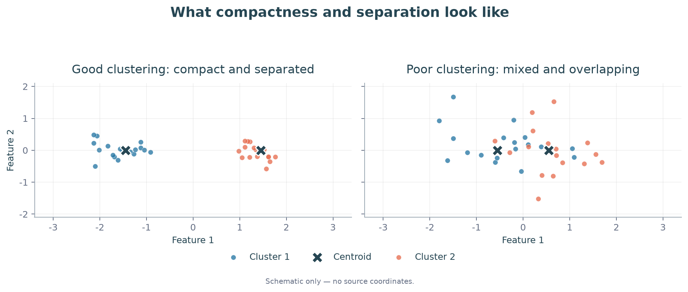

### 1.2 Notation aur centroid

| Symbol | Meaning |
|---|---|
| $x_i\in\mathbb R^d$ | Point $i$ ke $d$ features |
| $n,K$ | Total points, chosen number of clusters |
| $z_i\in\{1,\ldots,K\}$ | Point $i$ ka cluster label |
| $C_k=\{x_i:z_i=k\}$ | Cluster $k$ ke points |
| $\mu_k$ | Cluster $k$ ka centroid |

$$\boxed{\mu_k=\frac1{|C_k|}\sum_{x_i\in C_k}x_i
=\frac{\sum_i x_i\mathbf1(z_i=k)}{\sum_i\mathbf1(z_i=k)}}.$$

Indicator $\mathbf1(z_i=k)$ matching point ke liye 1, baaki ke liye 0. 2D mein x aur y ka average separately lo. Centroid data point hona zaroori nahi: $\{0,2\}$ ka mean 1 hai.

Assignment vector ka order dataset ke order se match karta hai. Labels swap karne se grouping nahi badalti: $(1,1,2,2)$ aur $(2,2,1,1)$ same partition describe karte hain.

Har point ke $K$ possible labels hon toh $K^n$ assignment vectors hain. Yeh **labelled assignments allowing empty clusters** ka count hai; exactly $K$ non-empty, unlabelled groups ka count nahi.

---

### Q26 — Direct centroid update

**Question:**

The centroid update in K-Means is:

$$
\mu_k= \frac{\sum_i x_i\mathbf1(z_i=k)} {\sum_i\mathbf1(z_i=k)}
$$

After the first iteration, suppose:

$$
C_1=\{(2,2),(3,3),(4,4)\}
$$

Which is the updated centroid $\mu_1$?

**Solution:**

Oct 2023 Quiz 1.

**Step 1:** Cluster mein 3 points hain. Coordinate sums: $2+3+4=9$ dono axes par.

**Step 2:** Har sum ko 3 se divide karo:

$$\boxed{\mu_1=(9/3,9/3)=(3,3)}.$$

Yahi coordinate-wise averaging har update question mein use hogi.

---

### 1.3 WCSS: Cluster compactness ka measure

**Definition:** Within-cluster sum of squares (WCSS) har point se uske assigned centroid tak squared distance ka total hai.

$$\boxed{J(z,\mu)=\sum_{i=1}^n\|x_i-\mu_{z_i}\|_2^2
=\sum_{k=1}^K\sum_{x_i\in C_k}\|x_i-\mu_k\|_2^2}.$$

Small WCSS means points apne centers ke paas hain. $J\geq0$; zero tab jab har point apne assigned center se coincide kare. Convergence ka matlab $J=0$ nahi hai.

Euclidean distance $\sqrt{(x-a)^2+(y-b)^2}$ aur squared distance $(x-a)^2+(y-b)^2$ se **nearest center same** aata hai, because square root increasing hai. Lekin WCSS mein squares hi sum honge. Distances 2 aur 3 hon toh WCSS $4+9=13$, na ki 5.

**Properties aur counterexamples:**

- Fixed assignments ke liye arithmetic mean squared error minimize karta hai. $\{0,2\}$ par center 1 ka error 2; center 0 ka error 4.
- Outliers mean ko pull karte hain: $\{0,1,2\}$ ka mean 1; 100 add karne par 25.75. Squared penalty extreme distances ko aur weight deti hai.
- Feature scale matters: income rupees mein aur age years mein ho toh income distance dominate kar sakti hai. Meaningful scaling choose karo; scaling ke baad clusters change ho sakte hain.
- Same positive factor $c$ se **sab coordinates aur centers** scale karo toh assignments same, WCSS $c^2J$. Ek feature alone rescale karna different baat hai.

## 2. Lloyd's algorithm: Assign → update → repeat

### 2.1 Ek iteration mein kya badalta hai?

**Real life:** Pehle customer ko nearest branch do; phir har branch ko uske customers ke average location par move karo. Updated branches se assignment dubara check karo.

1. $K$ choose karo aur centers initialize karo.
2. **Assignment:** centers fixed rakhkar $z_i\leftarrow\arg\min_k\|x_i-\mu_k\|^2$.
3. **Update:** assignments fixed rakhkar cluster-wise means nikalo.
4. Assignments stable hone tak repeat karo.

Initial **assignments** given hon toh pehle unse centers calculate karo. Initial **centers** given hon toh pehle nearest-center assignment.

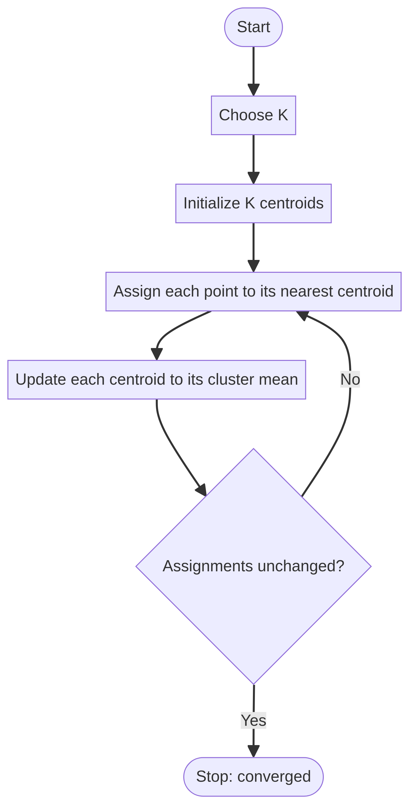

Tie par stated rule follow karo; otherwise fixed deterministic convention state karo. Empty cluster ka mean undefined hai; uske liye explicit handling chahiye, zero se divide mat karo.

Dec 2024 End Term Q14 ka step-order isi cycle se: **choose K → random centers → assign → recompute → reassign**, supplied operation numbers **5,3,1,4,2**.

---

### Q1 — Complete iteration and convergence

**Question:**

The dataset contains the following points:

$$
\begin{aligned} &(-2,2),(-2,-2),(0,0),(2,2),(2,-2),\\ &(8,2),(8,-2),(9,1),(9,-1) \end{aligned}
$$

Given $K=2$ and initial centroids:

$$
\mu_1^{(0)}=(0,0),\qquad \mu_2^{(0)}=(6,0)
$$

Find the cluster means after convergence.

**Solution:**

Jan 2024 Quiz 1.

**Step 1 — Nearest center:** $d_1^2=x^2+y^2$, $d_2^2=(x-6)^2+y^2$.

| Point | $d_1^2$ | $d_2^2$ | Cluster |
|---|---:|---:|---|
| $(-2,2)$ | 8 | 68 | 1 |
| $(-2,-2)$ | 8 | 68 | 1 |
| $(0,0)$ | 0 | 36 | 1 |
| $(2,2)$ | 8 | 20 | 1 |
| $(2,-2)$ | 8 | 20 | 1 |
| $(8,2)$ | 68 | 8 | 2 |
| $(8,-2)$ | 68 | 8 | 2 |
| $(9,1)$ | 82 | 10 | 2 |
| $(9,-1)$ | 82 | 10 | 2 |

**Step 2 — Means:** First five points ka coordinate sum $(0,0)$ hai, so $\mu_1=(0,0)$. Last four ka sum $(34,0)$, so $\mu_2=(8.5,0)$.

**Step 3 — Stability:** Updated centers ke beech midpoint x-coordinate $4.25$ hai. Left group ke sab x-coordinates $\leq2$, right group ke $\geq8$ hain. Koi point boundary cross nahi karta.

$$\boxed{\mu_1=(0,0),\quad\mu_2=(8.5,0)}.$$

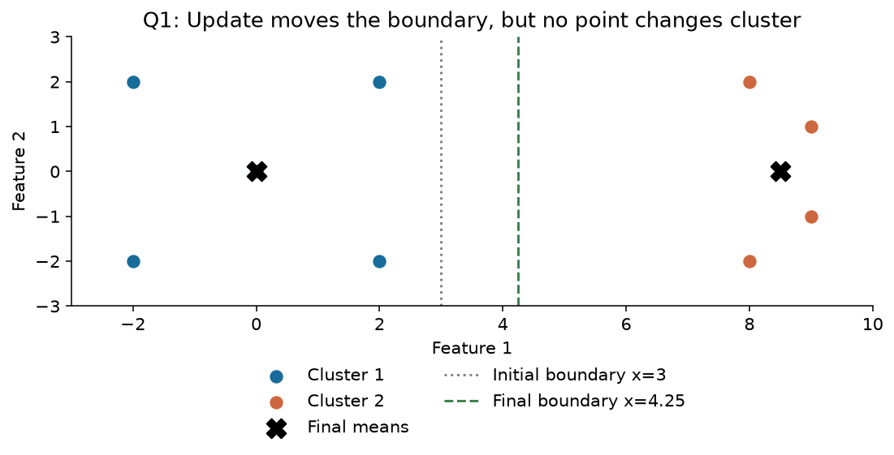

Same assign–average–check pattern: May 2024 Quiz 1 Q3, Jul 2023 Quiz 1 Q25, Dec 2023 End Term Q44. $K=3$ mein bas three distances compare honge; method same hai.

---

### Q1(ii) — New point add hone par

**Question:**

A new point $(7,0)$ is added. Find the sum of the x-coordinates of the two final cluster means.

Accepted answer range in the notes: 8.18–8.22.

**Solution:**

**Step 1:** Existing final centers se $(7,0)$ ki squared distances 49 aur 2.25 hain. Point cluster 2 mein jaayega.

**Step 2:** Purane cluster 2 ka count 4, sum $(34,0)$ tha. New sum $(41,0)$, count 5:

$$\mu_2'=\frac{(34,0)+(7,0)}5=(8.2,0).$$

**Step 3:** New boundary $x=4.1$ hai; saare assignments stable hain. First mean $(0,0)$ hi hai.

$$\boxed{\text{Required sum}=0+8.2=8.20}.$$

Useful formula: old cluster size $m$ ho toh $\mu'=(m\mu+x_{\rm new})/(m+1)$, **provided baaki membership unchanged rahe**. Adding point ke baad recheck zaroor karo. Related changed-data question: Oct 2025 Quiz 1 Q32; uski full figure supplied notes/PDF mein missing hai.

---

### Q17 — First update; Q45 — Final objective

**Question:**

Given:

$$
x_1=1,\quad x_2=4,\quad x_3=7,\quad x_4=8
$$

with:

$$
K=2
$$

Initial centroids:

$$
\mu_1^{(0)}=1,\qquad\mu_2^{(0)}=4
$$

Find the centroids after the first iteration of Lloyd's algorithm.

**Solution:**

Q17 ke term labels existing notes mein Dec 2025 / Sep 2026 hain.

**Step 1:** Centers 1 aur 4 ka midpoint 2.5. So $C_1=\{1\}$, $C_2=\{4,7,8\}$.

**Step 2:** Means:

$$\boxed{\mu_1=1,\quad\mu_2=(4+7+8)/3=19/3\approx6.33}.$$

**Step 3:** New midpoint $11/3\approx3.67$. 4,7,8 ab bhi cluster 2 mein hain, so stable. Har problem mein first update final nahi hota; yahan recheck ne confirm kiya.

**Question:** Using the same dataset and initial centroids, calculate the final objective.

Dec 2025 End Term · Q45.

**Solution:** Final means se squared deviations add karo:

$$J=0+(-7/3)^2+(2/3)^2+(5/3)^2
=\frac{49+4+25}{9}=\boxed{26/3\approx8.67}.$$

Same dataset ka solution repeat nahi kiya; changed subpart mein sirf required WCSS nikala.

---

### Q20 — Missing cluster membership

**Question:**

Given:

$$
\begin{aligned} x_1&=(0,2), &x_2&=(2,0),\\ x_3&=(0,0), &x_4&=(0,-2),\\ x_5&=(-2,0),&x_6&=(0,1),\\ x_7&=(0,-1) \end{aligned}
$$

The assignment vector is:

$$
z=(3,1,?,2,1,3,2)
$$

Which cluster should be assigned to $x_3$?

Options: 1, 2, or 3.

**Solution:**

Oct 2022 Quiz 1.

**Step 1:** Known memberships se $C_1=\{(2,0),(-2,0)\}$, $C_2=\{(0,-2),(0,-1)\}$, $C_3=\{(0,2),(0,1)\}$.

**Step 2:** Inke means $(0,0),(0,-1.5),(0,1.5)$ hain.

**Step 3:** Missing point $x_3=(0,0)$ se squared distances $0,2.25,2.25$. Minimum first cluster par:

$$\boxed{z_3=1}.$$

Yeh known groups se centers banakar missing point assign karne ki interpretation hai. Sirf arbitrary assignment vector ke blank se label mathematically force nahi hota; nearest-center criterion use ho raha hai.

Reassignment ke same pattern wale questions: Apr 2025 End Term Q15, Oct 2023 Quiz 1 Q27. Har baar **updated** means se distance compare karo.

---

### Q35 — Initial assignments given hon toh

**Question:**

For the points:

$$
x_1=(0,0),\quad x_2=(3,0)
$$

$$
x_3=(4,1),\quad x_4=(1,1)
$$

Find the final assignment vectors for:

1. $z^{(0)}=(1,1,2,2)$
2. $z^{(0)}=(1,2,2,1)$

**Solution:**

Mar 2026 Quiz 1.

**Case 1, Step 1:** $(1,1,2,2)$ se means $(1.5,0)$ aur $(2.5,1)$ aate hain.

**Step 2:** In means se distances:

| Point | To center 1, squared | To center 2, squared | New label |
|---|---:|---:|---:|
| $(0,0)$ | 2.25 | 7.25 | 1 |
| $(3,0)$ | 2.25 | 1.25 | 2 |
| $(4,1)$ | 7.25 | 2.25 | 2 |
| $(1,1)$ | 1.25 | 2.25 | 1 |

**Step 3:** New means $(0.5,0.5)$ aur $(3.5,0.5)$ hain. Boundary $x=2$; labels $(1,2,2,1)$ stable hain.

**Case 2:** Initial vector already $(1,2,2,1)$ hai. Means directly wahi milte hain aur labels change nahi hote.

$$\boxed{\text{Dono cases: }z^{(\infty)}=(1,2,2,1)}.$$

Different initialization same result de **sakti** hai, always de yeh guarantee nahi. Related assignment-initialization question: Oct 2022 Quiz 1 Q19.

---

### Q46 — Two iterations, exact WCSS, and a shared dataset

**Question:** Consider the following 2D dataset: $[(1,1),(2,1),(4,3),(5,4),(6,6),(8,7)]$. Let us select two initial cluster centroids at $(2,1)$ and $(6,6)$. Based on the above information answer the following questions:

(i) After two iteration of k-means, let $C=C_1+C_2$, where $C_1$ and $C_2$ denotes the updated centroids. What is the value of $|\sum_{i=1}^2 C_i|$?

(ii) What is the value of objective function after two iteration?

(iii) If we choose k-means++, with $k=3$, then with what probability the third cluster centroids will be chosen if the first two are $(2,1)$ and $(6,6)$ based on k-means++ initialization?

`Week 3.pdf`, Q2, pp. 4–14. Part (i) mein source notation overloaded hai: source solution $C$ ke **coordinate sum ka absolute value** leta hai. Isi intended scalar quantity ko calculate karenge. Part (iii) ko initialization section ke Q46(iii) mein isi dataset se solve karenge.

**Step 1 — Initial squared distances:**

| Point | To $(2,1)$ | To $(6,6)$ | Cluster |
|---|---:|---:|---:|
| $(1,1)$ | 1 | 50 | 1 |
| $(2,1)$ | 0 | 41 | 1 |
| $(4,3)$ | 8 | 13 | 1 |
| $(5,4)$ | 18 | 5 | 2 |
| $(6,6)$ | 41 | 0 | 2 |
| $(8,7)$ | 72 | 5 | 2 |

**Step 2 — First update:**

$$\mu_1=\left(\frac{1+2+4}{3},\frac{1+1+3}{3}\right)=\left(\frac73,\frac53\right),$$

$$\mu_2=\left(\frac{5+6+8}{3},\frac{4+6+7}{3}\right)=\left(\frac{19}3,\frac{17}3\right).$$

**Step 3 — Second assignment, without early rounding:**

| Point | To $\mu_1$, squared | To $\mu_2$, squared | Cluster |
|---|---:|---:|---:|
| $(1,1)$ | $20/9$ | $452/9$ | 1 |
| $(2,1)$ | $5/9$ | $365/9$ | 1 |
| $(4,3)$ | $41/9$ | $113/9$ | 1 |
| $(5,4)$ | $113/9$ | $41/9$ | 2 |
| $(6,6)$ | $290/9$ | $2/9$ | 2 |
| $(8,7)$ | $545/9$ | $41/9$ | 2 |

Assignments unchanged, so second update same centroids deta hai.

**Step 4 — Part (i):**

$$C=\mu_1+\mu_2=\left(\frac{26}3,\frac{22}3\right),\qquad\boxed{|C_x+C_y|=16}.$$

Agar question Euclidean norm poochhta, answer $\sqrt{26^2+22^2}/3$ hota; coordinate sum ko vector norm mat samjho.

**Step 5 — Part (ii):** Assigned-center column se costs lo:

$$J=\frac{20+5+41+41+2+41}{9}=\boxed{\frac{50}3\approx16.6667}.$$

PDF ka 16.68 rounded intermediate distances ka sum hai; exact answer $50/3$ hai. Source mein ek line $(8,8)$ likhti hai, lekin given point **$(8,7)$** hai. Second-iteration table mein kuch cross-distances bhi incorrect hain; upar exact values hain.

**Useful property:** Equal-size clusters (here 3 each) mein $\mu_1+\mu_2=2\bar x$. Unequal sizes par simple average of means generally wrong; use $\bar x=\sum_j |C_j|\mu_j/n$.

---

### 2.2 Iteration counting ka trap

Jul 2023 Quiz 1 Q23 mein points $(1,1),(2,1),(4,3),(5,4)$ aur initial centers $(0,0),(4,4)$ hain. Initial squared-distance pairs $(2,18),(5,13),(25,1),(41,1)$ se groups first two / last two bante hain. Means $(1.5,1),(4.5,3.5)$.

Recheck pairs $(0.25,18.5),(0.25,12.5),(10.25,0.5),(18.25,0.5)$ same groups dete hain. Thus **one effective update**, but source **2 iterations** count karta hai because second stability check bhi count hua. Numerical result aur counting convention ko separate samjho.

## 3. Objective stages, convergence aur choosing K

### 3.1 Old/new center ka superscript kyun important hai?

**Definition:** Lloyd's algorithm alternating minimization hai: ek time par assignments ya centers optimize hote hain, dono ek saath nahi.

$$J_A=J(z^{(t)},\mu^{(t)}),\quad
J_B=J(z^{(t+1)},\mu^{(t)}),\quad
J_C=J(z^{(t+1)},\mu^{(t+1)}).$$

$$\boxed{J_C\leq J_B\leq J_A}.$$

Assignment mein nearest center choose karne se cost nahi badhti; update mein mean best squared-error center hai. Already stable ho toh equality possible: **strict decrease always** false hai.

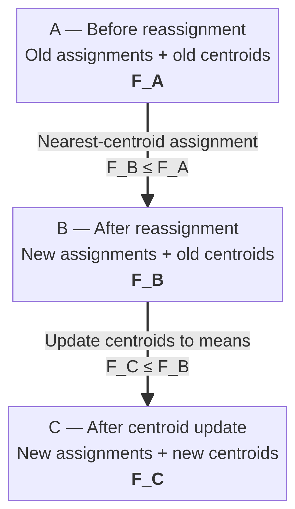

---

### Q36 — Assignment ke baad, update se pehle

**Question:**

For:

$$
x_1=0,\quad x_2=2,\quad x_3=6,\quad x_4=8
$$

the current centroids are:

$$
\mu_1^{(t)}=0,\qquad \mu_2^{(t)}=10
$$

After the assignment step, compute:

$$
\sum_{i=1}^{4} \left\|x_i-\mu_{z_i^{(t+1)}}^{(t)}\right\|^2
$$

**Solution:**

Jul 2026 Quiz 1.

**Step 1:** Old centers 0,10 ka midpoint 5. New groups $\{0,2\}$ aur $\{6,8\}$.

**Step 2:** Asked expression mein $\mu^{(t)}$ hai: centers 0,10 hi use karo.

$$\boxed{J_B=0^2+2^2+(6-10)^2+(8-10)^2=24}.$$

**Stage comparison:** Update karte toh means 1,7 aur $J_C=1+1+1+1=4$. Dono answers different stages ke hain; is question ka answer 24 hai.

---

### Q6 — Three objectives ki inequality

**Question:**

Three objective expressions are given:

Expression (1) — Before reassignment

$$
(1)=\sum_i\|x_i-\mu_{z_i^{(t)}}^{(t)}\|^2
$$

Expression (2) — After reassignment with old centroids

$$
(2)=\sum_i\|x_i-\mu_{z_i^{(t+1)}}^{(t)}\|^2
$$

Expression (3) — After reassignment and update

$$
(3)=\sum_i\|x_i-\mu_{z_i^{(t+1)}}^{(t+1)}\|^2
$$

Find the correct inequality relating these three quantities.

**Solution:**

Jan 2025 Quiz 1.

**Step 1:** Assignment minimize karta hai, so $(2)\leq(1)$.

**Step 2:** New groups ke means use karne se $(3)\leq(2)$.

**Step 3:** Combine:

$$\boxed{(3)\leq(2)\leq(1)}.$$

Strict $<$ tabhi jab dono steps actually improve karein. Already optimal groups/means counterexample hain: teeno expressions equal ho sakte hain.

---

### 3.2 Convergence kya guarantee karti hai?

Finite data, consistent deterministic tie handling aur suitable empty-cluster handling ke standard setting mein Lloyd iterations terminate at a stable configuration. Objective lower-bounded by zero hai aur non-increasing hai; finite-assignment structure termination argument ko complete karta hai. **Sirf decreasing bounded sequence se finite termination prove nahi hota**: $1,1/2,1/3,\ldots$ counterexample hai.

Stable configuration ko usually local optimum kehte hain; precise idea: current assign/update steps aur improve nahi karte. **Global optimum guaranteed nahi.** Multiple restarts karo aur same dataset, scaling, $K$ par lowest final WCSS choose karo.

Poor initialization worse result ya slower convergence laa sakti hai; “always more iterations” guaranteed nahi. May 2025 Quiz 1 Q11 isi distinction ke saath initialization aur $K$ sensitivity test karta hai. Feb 2024 Quiz 1 Q29 bhi local minima/practical initialization par hai.

Jul 2026 Quiz 1 Q37 ka “cannot revisit a partition” statement pre-termination convergence argument ke context mein hai. Converged state ko dobara check karoge toh same partition naturally repeat hogi.

---

### Q10 — Objective plateau

**Question:**

The following table shows objective values across iterations.

| Iteration | Objective $F$ |
| --------- | ----------------- |
| 1         | 800               |
| 2         | 500               |
| 3         | 400               |
| 4         | 400               |
| 5         | 400               |

At which iteration has the objective reached its final stable value?

**Solution:**

May 2025 Quiz 1.

**Step 1:** Values $800\to500\to400\to400\to400$ dekho.

**Step 2:** Final plateau 400 pehli baar iteration 3 mein milta hai; iteration 4 next equal value se confirm karta hai.

$$\boxed{\text{Stable objective starts at iteration 3}}.$$

Question objective ki stability poochhta hai. Assignment-level convergence ke liye labels bhi inspect karna relevant hai.

---

### Q30 — Convergence and outliers

**Question:**

A. Lloyd's algorithm always converges.

B. It may fail to converge for one initialization while converging for another.

C. It is sensitive to outliers.

D. Its solution is always globally optimal.

**Solution:**

Oct 2025 Quiz 1.

**A:** Standard assumptions ke under true.

**B:** Unhi assumptions mein false; initialization convergence path/result badal sakti hai, convergence guarantee ko aise remove nahi karti.

**C:** True; mean aur squared error outliers se sensitive hain.

**D:** False; global optimum guaranteed nahi.

$$\boxed{A,C}.$$

---

### 3.3 K badhane se WCSS

**Real life:** Ek city ko 1 service center do versus har customer ko individual center. More centers se distance kam karna easy hai, lekin groups ka practical meaning bhi chahiye.

Globally minimized WCSS obeys $J^*_{K+1}\leq J^*_K$. Extra cluster se existing group split kar sakte hain; best achievable error badhne ki need nahi. Arbitrary different Lloyd runs ke final errors compare karte waqt local minima ka effect aa sakta hai.

$K=n$ par har point ka own center ho sakta hai, WCSS 0. Isliye **sirf minimum training WCSS se best K choose mat karo**. Elbow plot mein reduction slow hone ka region useful heuristic hai; silhouette separation bhi check karti hai.

---

### Q38 — Minimum possible WCSS

**Question:**

A dataset contains 1000 points. Which value of $K$ is most likely to yield the minimum K-Means objective?

A. $K=1$

B. $K=10$

C. $K=100$

D. $K=1000$

**Solution:**

Jul 2026 Quiz 1.

**Step 1:** 1000 points aur 1000 centers allow hain.

**Step 2:** Har point par ek center rakho. Har distance zero, total $J=0$.

**Step 3:** WCSS negative nahi ho sakta, so yeh global minimum hai.

$$\boxed{D:\ K=1000}.$$

Yeh objective-minimum ka answer hai; meaningful grouping ke liye 1000 clusters zaroori nahi.

---

### Q47 — WCSS trend aur strict inequality ka trap

**Question:** Suppose you have 300 data points. After performing K-means clustering, for $k=3,5,10,50$, you calculate the sum of squared distances between points and their respective cluster centroids as follows:

| Number of clusters | SSD |
|---|---|
| 3 | $a$ |
| 5 | $b$ |
| 10 | $c$ |
| 50 | $d$ |

What type of relation among $a,b,c$ and $d$ holds true in a general scenario?

(i) $a<b<c<d$

(ii) $a=b=c=d$

(iii) $b<d$

(iv) $a>d$

(v) $a<b$

(vi) None of the above

`Week 3.pdf`, Q1, pp. 2–3; options column-wise listed hain.

**Step 1:** Section 3.3 ka rule optimal costs ke liye $a\ge b\ge c\ge d$ hai. Typical improving fit mein **(iv) $a>d$** intended choice hai.

**Step 2 — Strict guarantee nahi:** 300 identical points hon toh all costs zero; $a>d$ false. Independent local runs ka ordering bhi guaranteed nahi. Thus agar “holds true” ka meaning **every dataset/run par guaranteed** hai, **(vi)** correct interpretation hai. PDF explanation typical decreasing trend batati hai, strict theorem nahi.

Same property ke liye separate long proof nahi chahiye; $K$ badhana aur Lloyd iterations badhana alag comparisons hain.

### 3.4 Loss plus complexity penalty se K choose karna

**Definition:** Penalized score fit error ke saath extra clusters ka cost add karta hai:

$$\boxed{F(K)=J(K)+P(K),\qquad K_{\rm chosen}\in\arg\min_K F(K)}.$$

**Real life:** Har customer ke liye separate service branch distance error kam karegi, lekin har branch ka cost bhi hai. Penalty isi complexity cost ko represent karti hai.

- Typical loss decreases as $K$ increases; increasing penalty extra clusters discourage karti hai.
- $P(K)=\lambda K$ ek possible choice hai, universal formula nahi.
- Penalty specify kiye bina unique best $K$ claim nahi kar sakte.
- Minimum **sum** dekho; loss aur penalty ka intersection necessarily optimum nahi.

### Q48 — Identify loss, penalty and best K from the graph

**Question:** After running k-means clustering on a dataset, we get the following plots. The blue plots are the sum of the red and black plots.

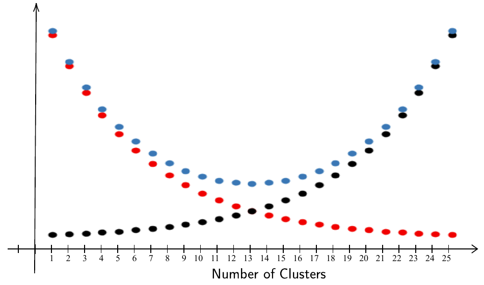

Based on the general behaviour of the k-means algorithm, answer the following questions:

(i) Which coloured plot could possibly represent the loss function for different choices of $k$?

(ii) Which coloured plot could possibly represent the penalty function for different choices of $k$?

(iii) What could be a good choice of $k$ from the given scatter plots?

`Week 3.pdf`, Q7, pp. 33–34.

**Step 1:** Red decreases with $K$: loss $J(K)$.

**Step 2:** Black increases with $K$: penalty $P(K)$.

**Step 3:** Blue is $F(K)=J(K)+P(K)$. Graph ka lowest blue point $K=13$ par hai.

$$\boxed{\text{Loss: red; penalty: black; selected }K=13}.$$

**Property:** Fixed candidate $K$ par one-cluster improvement worthwhile tab hai jab loss reduction penalty increase se greater ho: $J(K)-J(K+1)>P(K+1)-P(K)$. Yeh local comparison hai; global choice ke liye sab candidate totals compare karo.

---

## 4. Cluster geometry: Boundary aur convexity

### 4.1 Nearest-center boundary

**Definition:** Do centers se equal distance wale points decision boundary par hain. 2D Euclidean K-Means mein straight line; higher dimensions mein hyperplane.

$$\boxed{2x^T(\mu_2-\mu_1)=\|\mu_2\|^2-\|\mu_1\|^2}.$$

Boundary centers ko join karne wale segment ki perpendicular bisector hai. Example: centers $(1,2),(5,2)$ ka midpoint $(3,2)$, boundary $x_1=3$.

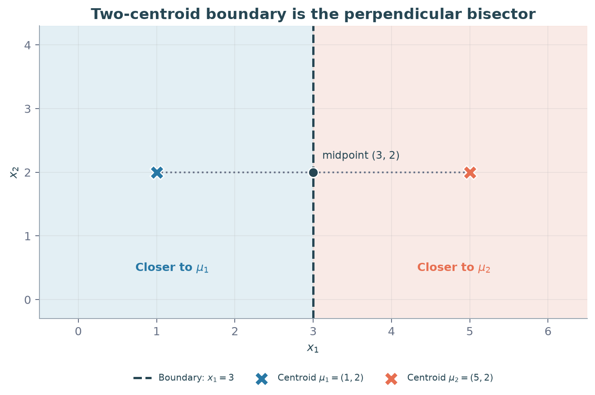

Sep 2024 End Term Q13 mein recorded boundary $2x_1+x_2=0$ hai. Yeh valid **linear form** hai, lekin exact centers/figure available nahi; sirf linear hone se isi specific equation ko correct option prove nahi kar sakte.

### Q49 — PCA scores par K-Means, phir updated boundary

**Question:** You are working with a dataset containing 1000 data points, each with 50 features. Directly applying K-means to the full 50-dimensional dataset is computationally expensive. To address this, you decide to use Principal Component Analysis (PCA) to reduce the dimensionality of the dataset before applying K-means.

After performing PCA, you retain only the first 2 principal components (PC1 and PC2), which together explain 90% of the variance in the dataset. Let the first four transformed data-points are:

$$X_{\rm PCA}=\begin{bmatrix}1&2&0&2\\2&1&2&3\end{bmatrix}.$$

Run the k-means with $k=2$ using the following centroids on the above given four data-points:

$$C_1=(1,2),\qquad C_2=(2.5,3).$$

What is the equation of Voronoi regions boundary?

`Week 3.pdf`, Q3, pp. 15–20. Columns are the four points; remaining 996 points are not supplied or used in this requested run.

**Step 1 — Assign to given centers:**

| Point | To $(1,2)$, squared | To $(2.5,3)$, squared | Group |
|---|---:|---:|---:|
| $(1,2)$ | 0 | $13/4$ | 1 |
| $(2,1)$ | 2 | $17/4$ | 1 |
| $(0,2)$ | 1 | $29/4$ | 1 |
| $(2,3)$ | 2 | $1/4$ | 2 |

PDF gives $7.25=29/4$ for third point; use exact values throughout.

**Step 2 — Updated means:**

$$\mu_1=(1,5/3),\qquad\mu_2=(2,3).$$

Updated squared-distance pairs are $(1/9,2)$, $(13/9,4)$, $(10/9,5)$, $(25/9,0)$ respectively. Same groups, so means stable.

**Step 3 — Equidistance equation:** For a test score $(u,v)$,

$$2(u,v)^T(\mu_2-\mu_1)=\|\mu_2\|^2-\|\mu_1\|^2.$$

$$2u+\frac83v=13-\frac{34}{9}=\frac{83}{9}.$$

$$\boxed{18u+24v=83},\qquad\boxed{v=-\frac34u+\frac{83}{24}}.$$

**Step 4 — Region sides:** Substituting $\mu_1$ gives 58, below 83; substituting $\mu_2$ gives 108, above 83. Thus cluster 1 side $18u+24v<83$, cluster 2 side $>83$; equality needs tie handling.

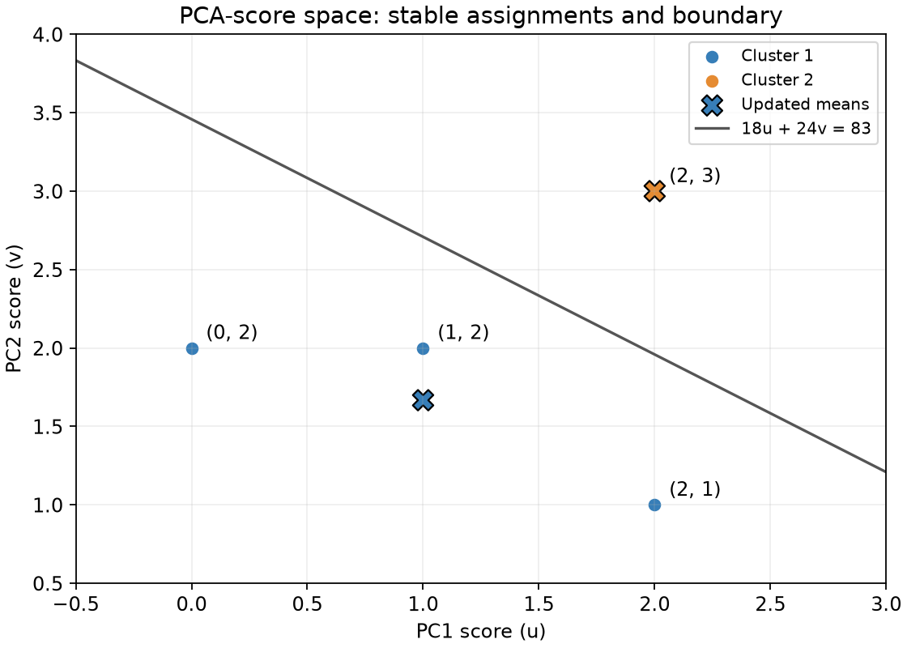

**Stage check:** Boundary of the **initial** centers would be $3u+2v=41/4$. Question solution runs the update first, so answer uses updated means.

**PCA-to-clustering properties:**

- One Lloyd assignment pass costs roughly $O(nKd)$; retained dimension 2 replaces 50 in the clustering pass. PCA itself also has a cost.
- 90% retained variance is not 90% clustering accuracy and does not guarantee the same clusters. Low-variance discarded directions can contain separating information.
- Full orthonormal rotation preserves Euclidean distances; truncating to two PCs generally changes them.
- Boundary above lives in PC-score coordinates. Raw-space boundary needs the fitted loadings $W$ and training mean $m$: scores $W^T(x-m)$ can be substituted into it. Those quantities are not provided.

---

### 4.2 Voronoi cell aur convex hull

**Definition:** Ek center ke nearest points ka region uska Voronoi cell hai. Cell half-spaces ka intersection hai, so convex.

Convex ka simple meaning: region ke do points ko straight segment se join karo; poora segment region ke andar rehta hai. Finite observed points khud filled region nahi hain; guarantee nearest-center **region** ke baare mein hai.

$$A,B\in V_k\Rightarrow\lambda A+(1-\lambda)B\in V_k,\quad0\leq\lambda\leq1.$$

Boundary ties par consistent center-priority rule use karo; arbitrary point-dependent tie labels convexity guarantee ko disrupt kar sakte hain.

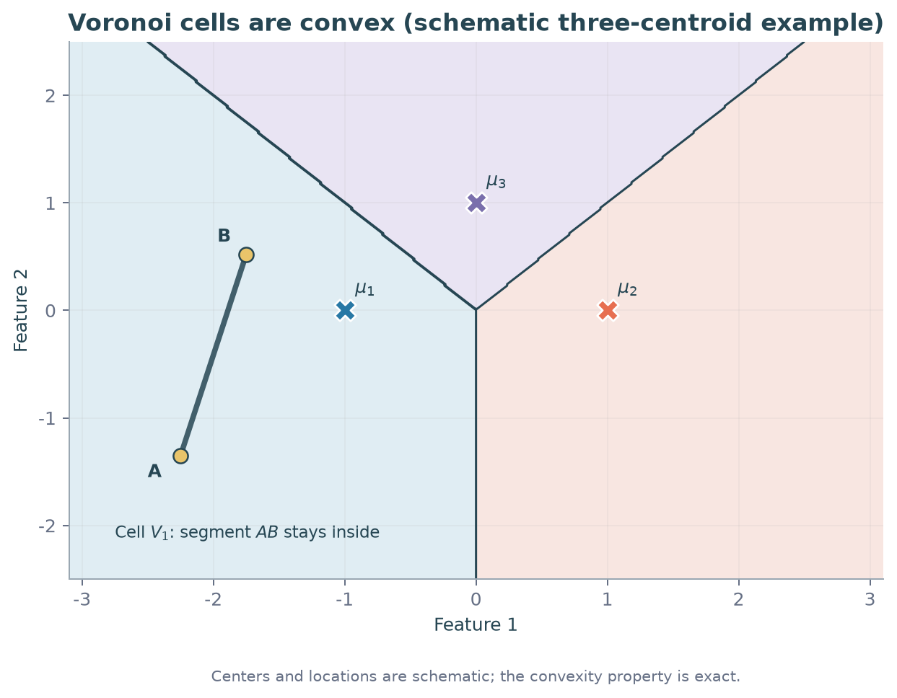

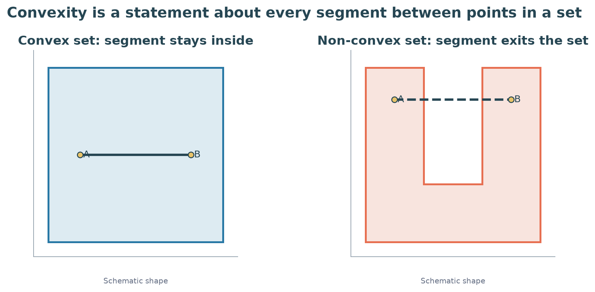

**Counterexample:** Ring-shaped region ka opposite ends join karne wala segment empty middle se guzarta hai, so region non-convex. Standard Euclidean nearest-center cell aisa ring nahi ho sakta. $K=2$ mein do distinct centers ke regions ko ek straight line separate karti hai.

Oct 2022 Quiz 1 Q24 impossible-shape question isi property par based hai. Supplied MD aur PDF mein option figures absent hain; recorded A,B,D ko option-wise verify nahi kiya ja sakta.

---

### Q50 — Three complete Voronoi regions from half-spaces

**Question:** We have 12 data points in $\mathbb R^2$. There are three clusters. Each color in the image below represents a cluster.

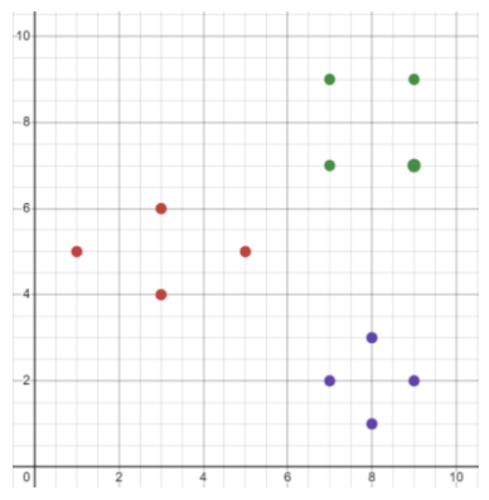

(i) Find the center of every cluster.

(ii) Have a look at the following sets and find all the Voronoi regions using the sets above.

| Set | Condition on $(x,y)\in\mathbb R^2$ |
|---|---|
| $S_1$ | $3x+5y<34$ |
| $S_2$ | $3x+5y>34$ |
| $S_3$ | $5x-3y>17$ |
| $S_4$ | $5x-3y<17$ |
| $S_5$ | $x<8$ |
| $S_6$ | $x>8$ |
| $S_7$ | $y>5$ |
| $S_8$ | $y<5$ |
| $S_9$ | $5y-3x>16$ |
| $S_{10}$ | $5y-3x<16$ |
| $S_{11}$ | $5x+3y>47$ |
| $S_{12}$ | $5x+3y<47$ |

`Week 3.pdf`, Q5, pp. 24–30.

**Step 1 — Read points and calculate means:**

- Green: $(7,9),(9,7),(7,7),(9,9)$; mean $G=(32/4,32/4)=(8,8)$.
- Red: $(3,4),(3,6),(1,5),(5,5)$; mean $R=(12/4,20/4)=(3,5)$.
- Violet: $(7,2),(9,2),(8,3),(8,1)$; mean $V=(32/4,8/4)=(8,2)$.

**Step 2 — Green versus violet:** Centers vertical hain; midpoint $(8,5)$ se horizontal bisector $y=5$. Green side $y>5$, violet side $y<5$.

**Step 3 — Red versus violet:** Equidistance formula gives

$$2(x,y)^T(V-R)=\|V\|^2-\|R\|^2=68-34,$$

$$10x-6y=34\Rightarrow\boxed{5x-3y=17}.$$

At violet center value 34, hence violet side $>17$; at red center value 0, hence red side $<17$.

**Step 4 — Red versus green:**

$$2(x,y)^T(G-R)=128-34\Rightarrow10x+6y=94,$$

$$\boxed{5x+3y=47}.$$

At green center value 64, hence green side $>47$; at red center value 30, hence red side $<47$.

**Step 5 — Beat both competitors, so intersect:**

$$\boxed{V_{\rm violet}^{\circ}=S_3\cap S_8},\qquad
\boxed{V_{\rm green}^{\circ}=S_7\cap S_{11}},\qquad
\boxed{V_{\rm red}^{\circ}=S_4\cap S_{12}}.$$

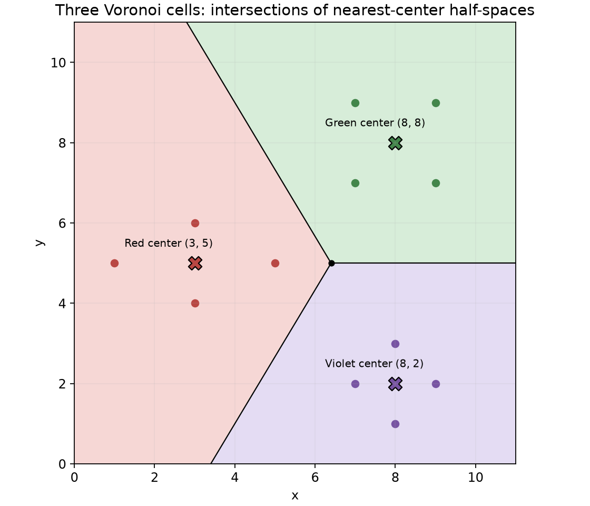

**Properties and traps:**

- $S_1,S_2,S_5,S_6,S_9,S_{10}$ describe sides of lines **joining centers**, not their perpendicular bisectors. They are distractors.
- A point must beat **every** competing center: use intersection, not union.
- Given sets use strict inequalities, so answers describe cell interiors. Include equality for closed Voronoi cells; hard labels on ties need an explicit rule.
- Bisectors meet at $(32/5,5)$. Only appropriate rays form actual cell boundaries: the other portion of a pairwise bisector can be closer to the third center.

---

### Q43 — Square ke corners se guaranteed membership

**Question:**

The following points belong to the same K-Means cluster:

$$
(1,1),\quad(-1,-1),\quad(1,-1),\quad(-1,1)
$$

Which of the following points must also lie in that cluster?

A. $(0,0)$

B. $(2,2)$

C. $(-0.5,0.5)$

D. $(0.75,0.9)$

**Solution:**

Sep 2023 End Term.

**Step 1:** Four corners ka convex hull square $-1\leq x\leq1$, $-1\leq y\leq1$ hai.

**Step 2:** Har option check karo:

| Option | Position | Guaranteed? |
|---|---|---|
| A $(0,0)$ | Square ke andar | Yes |
| B $(2,2)$ | Square ke bahar | No |
| C $(-0.5,0.5)$ | Square ke andar | Yes |
| D $(0.75,0.9)$ | Square ke andar | Yes |

$$\boxed{A,C,D}.$$

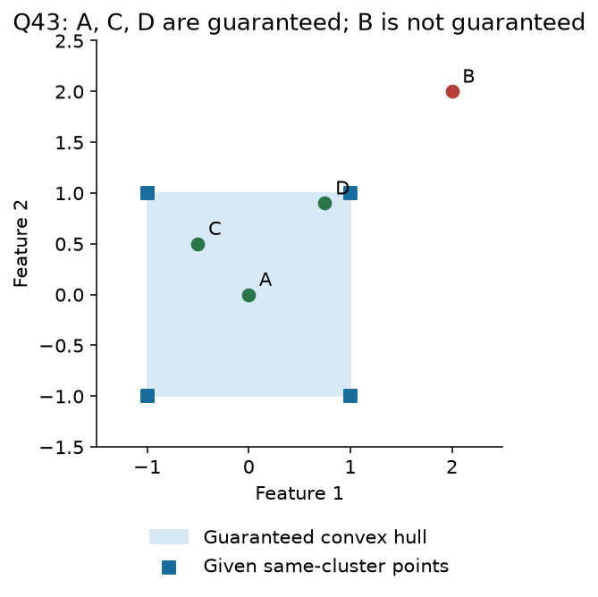

**B not guaranteed** ka matlab B definitely kisi aur cluster mein hai nahi. Actual cell square se bada bhi ho sakta hai.

Same convexity pattern: Jan 2025 Quiz 1 Q7 mein $(0,1),(1,1)$ ke between $(0.2,1)$ guaranteed; Sep 2026 End Term Q18 mein $(2,2),(2,-2)$ ka midpoint $(2,0)$ guaranteed. Alag full solution ki need nahi; segment rule same hai.

---

### Q51 — Coincident centroids: A tie-handling exception

**Question:** There are 8 data points, $d_1,\ldots,d_8$. Let $k=2$. After running the Lloyd's k-means algorithm, is it possible to have the following:

(i) Data points in cluster 1: $\{d_1,d_3,d_6,d_8\}$.

(ii) Data points in cluster 2: $\{d_2,d_4,d_5,d_7\}$.

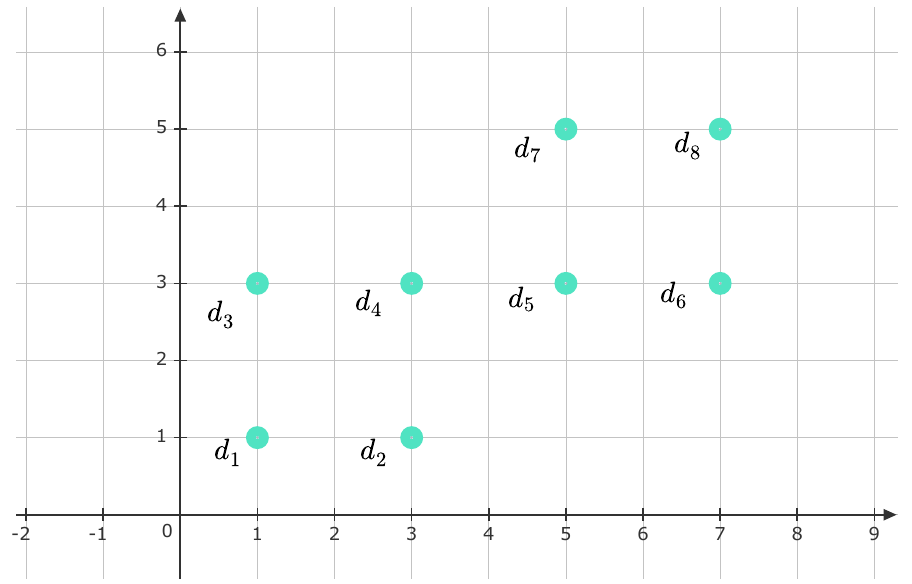

`Week 3.pdf`, Q6, pp. 31–32. Figure coordinates:

$$d_1=(1,1),\ d_2=(3,1),\ d_3=(1,3),\ d_4=(3,3),$$
$$d_5=(5,3),\ d_6=(7,3),\ d_7=(5,5),\ d_8=(7,5).$$

**Step 1 — Calculate both means:**

$$\mu_1=\frac{(1,1)+(1,3)+(7,3)+(7,5)}4=(4,3),$$

$$\mu_2=\frac{(3,1)+(3,3)+(5,3)+(5,5)}4=(4,3).$$

**Step 2 — Every assignment is tied:** Since centers coincide, every point is equally distant from both. Equal centers do **not** automatically mean “no reassignment.”

**Step 3 — State the tie rule:** Initialize with the listed groups and retain a point's previous label on a tie. All labels remain unchanged; means stay $(4,3)$. Thus $\boxed{\text{Yes, possible under retain-previous-label ties}}$.

If all ties go to the lowest-index center, all points go to cluster 1 instead; cluster 2 becomes empty and needs handling. Result is not guaranteed for every implementation.

**Step 4 — Stability does not imply best clustering:** Current cost is

$$J=13+5+9+1+1+9+5+13=56.$$

Alternative left four / right four groups have means $(2,2),(6,4)$, with each of eight squared distances equal to 2, so cost 16. Hence this stable tied result is worse than an available partition.

**Geometry property:** Distinct centers have a proper separating bisector. Identical centers tie everywhere; their closed nearest-center cells both equal the whole space. History-based tie labels can interleave, so the usual disjoint convex-region picture cannot be applied blindly to those labels.

Source answer's second label list accidentally repeats $d_6,d_8$; question's groups and its computed second mean use $d_2,d_4,d_5,d_7$ as above.

---

### Q12 — Perfect negative correlation

**Question:**

A two-feature dataset has perfect negative correlation:

$$
\operatorname{corr}(X_1,X_2)=-1
$$

K-Means clustering is applied with:

$$
K=3
$$

What can be said about the positions of the cluster centers minimizing WCSS?

**Solution:**

Apr 2024 End Term.

**Step 1:** Nonzero feature variances ke saath correlation $-1$ ka matlab data line $x_2=a+bx_1$, $b<0$ par hain.

**Step 2:** Kisi non-empty group ka average bhi relation satisfy karega: $\bar x_2=a+b\bar x_1$.

**Step 3:** Har centroid group mean hai, so:

$$\boxed{\text{All three centers lie on the same negatively sloped line}}.$$

Slope necessarily $-1$ nahi; correlation $-1$ perfect decreasing linear relation batata hai, units slope change kar sakte hain.

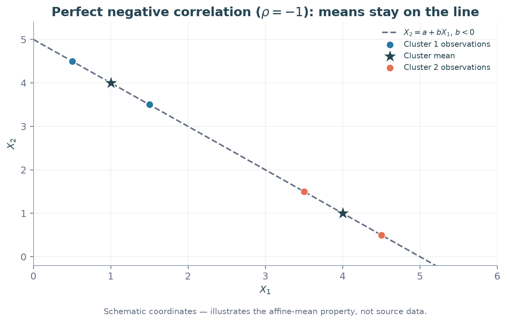

---

## 5. K-Means++: Better starting centers

### 5.1 Random start se distance-weighted sampling tak

**Definition:** K-Means++ Lloyd's algorithm ke starting centers choose karne ka method hai. Baad ka assign–update loop same rehta hai.

**Real life:** First service center randomly choose ho gaya. Ab already covered area ke paas ek aur center kholne se better, door ke regions ko higher chance do.

1. First center uniformly data points se: probability $1/n$.
2. Har point ke liye nearest selected center ki distance:
   $$D_i^2=\min_{c\in S}\|x_i-c\|_2^2.$$
3. Next center sample karo:
   $$\boxed{p_i=D_i^2/\sum_jD_j^2}.$$
4. $K$ centers hone tak scores **recompute** karke repeat karo.

Selected center ka score zero; denominator positive ho toh probability zero. Sab scores zero ho jaayein toh formula $0/0$ hai: all distinct locations covered; explicit fallback/termination chahiye.

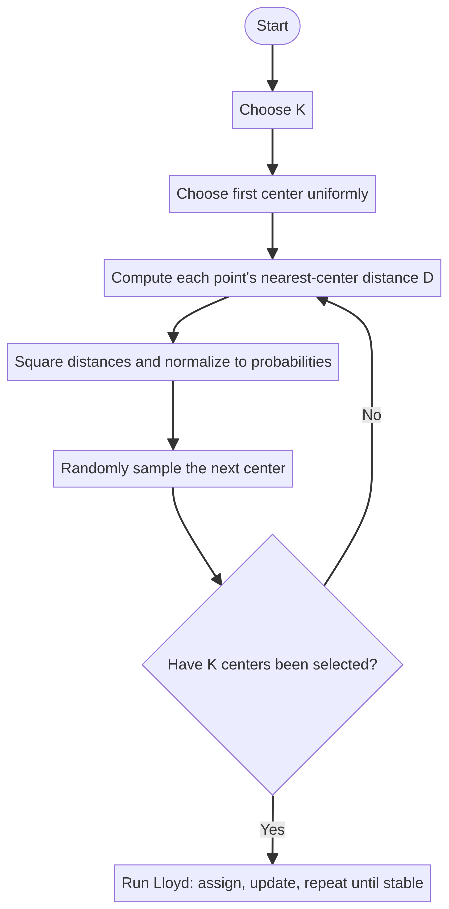

**Properties:** Farther point ka higher probability, guaranteed selection nahi. Centers spread karne mein help milti hai (May 2025 Quiz 1 Q9); global optimum, fixed iteration count aur automatically chosen $K$ guaranteed nahi. Uniform first choice aur weighted later choices ko mix mat karo.

---

### Q2 — Second center probability

**Question:**

In K-Means++, $x_7$ has already been selected as the first centroid.

The Euclidean distances from the remaining points to the selected centroid are:

| Point     | Euclidean distance |
| --------- | ------------------ |
| $x_1$ | $1$            |
| $x_2$ | $2$            |
| $x_3$ | $\sqrt2$       |
| $x_4$ | $\sqrt3$       |
| $x_5$ | $\sqrt5$       |
| $x_6$ | $1$            |

Find the probability that $x_2$ is selected as the second centroid.

**Solution:**

May 2024 Quiz 1.

**Step 1:** Given distances square karo: scores $1,4,2,3,5,1$.

**Step 2:** Total $S=1+4+2+3+5+1=16$.

**Step 3:** $x_2$ ka score 4, so:

$$\boxed{P(x_2\mid\text{first}=x_7)=4/16=0.25}.$$

First center already selected hai, isliye extra $1/7$ multiply nahi karna.

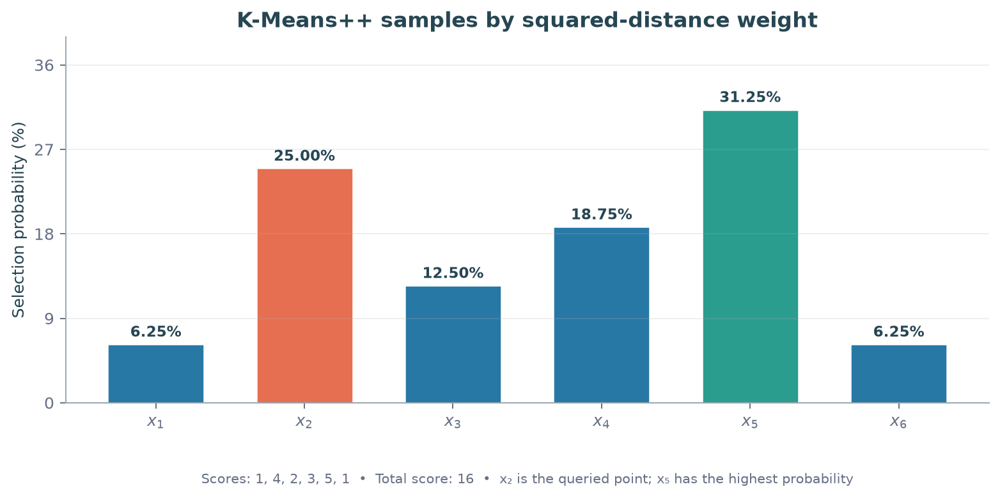

---

### Q5 — Second center ke baad scores update

**Question:**

Consider seven two-dimensional points:

$$
\begin{aligned} X=\{&(0,1),(1,0),(1,2),(2,1),\\ &(2,3),(2,4),(3,2)\} \end{aligned}
$$

The first centroid is:

$$
\mu_1=(2,1)
$$

The question asks:

1. If the second center is selected as the point with the highest squared-distance score, which point is selected?
2. After choosing that center, which remaining point has the lowest probability of being selected as the third centroid?

Important: Part (1) explicitly requests the highest-scoring point, rather than a random sample.

**Solution:**

Existing notes mein term labels Sep 2024 / Jan 2025 Quiz 1 hain.

**Step 1:** First center $(2,1)$ se squared distances:

| Point | Score |
|---|---:|
| $(0,1)$ | 4 |
| $(1,0)$ | 2 |
| $(1,2)$ | 2 |
| $(2,1)$ | 0 |
| $(2,3)$ | 4 |
| $(2,4)$ | 9 |
| $(3,2)$ | 2 |

Part (1) explicitly highest-scoring point poochhta hai: $\boxed{(2,4)}$. Standard random sampling mein yeh sirf most likely hota, guaranteed nahi.

**Step 2:** Selected centers $(2,1),(2,4)$ ke liye nearest-distance scores nikalo:

| Remaining point | To first, squared | To second, squared | Minimum |
|---|---:|---:|---:|
| $(0,1)$ | 4 | 13 | 4 |
| $(1,0)$ | 2 | 17 | 2 |
| $(1,2)$ | 2 | 5 | 2 |
| $(2,3)$ | 4 | 1 | 1 |
| $(3,2)$ | 2 | 5 | 2 |

**Step 3:** New total $4+2+2+1+2=11$. Remaining points mein least score 1:

$$\boxed{\text{Least likely: }(2,3),\quad p=1/11\approx0.0909}.$$

Mar 2026 Quiz 1 Q34 bhi third-center minimum-distance rule test karta hai. Uske missing remaining points ke bina recorded probability 0.5 verify nahi hoti; method yahan complete data par solve ho gaya.

---

### Q46(iii) — Same six points, third-center sampling

Use Q46 ka original dataset and **given initial centers** $(2,1),(6,6)$, not its updated Lloyd means. Yeh already-stated question ka remaining subpart hai.

**Step 1 — Nearest selected-center squared scores:** Q46 ki initial table se row-wise minimum:

$$D_i^2=(1,0,8,5,0,5).$$

**Step 2 — Normalize:** Total $1+0+8+5+0+5=19$.

| Candidate | Probability |
|---|---:|
| $(1,1)$ | $1/19$ |
| $(2,1)$ | 0 |
| $(4,3)$ | $8/19$ |
| $(5,4)$ | $5/19$ |
| $(6,6)$ | 0 |
| $(8,7)$ | $5/19$ |

**Step 3 — Interpret:** Most likely candidate $\boxed{(4,3)}$, probability $\boxed{8/19\approx0.4211}$. All probabilities sum to 1. Question target point specify nahi karta, isliye full distribution diya hai; PDF most likely point ka answer deta hai.

PDF ka “take maximum” sentence deterministic selection suggest karta hai. Standard K-Means++ **samples**; most likely point select hona guaranteed nahi. Pehle se selected two centers ki probability dobara multiply nahi karni.

---

### Q31 — Probabilities aur assignment ties

**Question:**

Given:

$$
X=\{(0,0),(0,2),(2,0),(2,2)\}
$$

K-Means++ uses:

$$
K=2
$$

The first center is:

$$
\mu_1=(0,0)
$$

Which statements are correct?

A. Points $(0,2),(2,0),(2,2)$ have equal probability of becoming the second center.

B. The probability of selecting $(2,2)$ is twice the probability of selecting $(0,2)$.

C. If $(2,2)$ is selected, the algorithm always converges in one iteration.

D. The tie-breaking rule affects the final centers.

**Solution:**

Oct 2025 Quiz 1.

**Step 1:** $(0,0)$ se other corners ke squared scores $4,4,8$; total 16. Probabilities $1/4,1/4,1/2$. So A false, B true.

**Step 2:** Second center $(2,2)$ choose ho toh $(0,2)$ aur $(2,0)$ dono centers se squared distance 4 par hain: assignment tie.

**Step 3:** Dono tied points cluster 1 ko do toh updated means $(2/3,2/3),(2,2)$. Apne first center se first three points ki costs $8/9,20/9,20/9$, second se $8,4,4$; fourth point second center par hai. Groups stable.

Tie ko split karo toh vertical ya horizontal groups mil sakte hain: means $(0,1),(2,1)$ ya $(1,0),(1,2)$; ye bhi stable. So D true: tie rule final centers affect kar sakta hai.

**C ka convention:** First assignment/update se stable means mil jaate hain, next check confirm karta hai. Source isi sense mein C true maanta hai. Thus recorded answer **B,C,D**; “one iteration” ko check-counting convention ke saath interpret karo.

---

### Q8 — Distance versus squared-distance weights

**Question:**

Five points:

$$
X=\{(2,5),(2,4),(0,3),(1,1),(1,0)\}
$$

The first center is:

$$
\mu_1=(1,1)
$$

Determine which remaining point has the least chance of becoming the next center, and its probability using the distance-based rule specified in the question.

**Solution:**

Existing notes mein Jan 2025 / May 2025 labels conflict karte hain.

**Step 1:** $(1,1)$ se candidates ki squared distances:

| Point | Squared distance | Distance |
|---|---:|---|
| $(2,5)$ | 17 | $\sqrt{17}$ |
| $(2,4)$ | 10 | $\sqrt{10}$ |
| $(0,3)$ | 5 | $\sqrt5$ |
| $(1,0)$ | 1 | 1 |

**Step 2:** Dono rules mein least positive score $(1,0)$ ka hai.

**Step 3:** Explicit unsquared-distance sampling ho toh

$$p=\frac1{\sqrt{17}+\sqrt{10}+\sqrt5+1}\approx\boxed{0.0950}.$$

**Standard K-Means++** ho toh

$$p=\frac1{17+10+5+1}=\boxed{1/33\approx0.0303}.$$

Available notes unsquared rule se approximately 0.10 report karte hain. Question ki exact weight definition follow karo; dono answers interchangeable nahi hain.

---

### Q16 — Farthest point choose karna optimal hai?

**Question:**

For:

$$
K=2
$$

consider the following initialization:

1. Choose the first center uniformly at random.
2. Choose the second center as the point farthest from the first.

Does this always produce the optimal K-Means objective?

The available notes list these choices:

A. Always optimal.

B. May be optimal or worse.

C. Does not converge.

D. Always unique.

**Solution:**

Existing notes mein Aug 2025 / Dec 2025 End Term labels hain.

**Step 1:** Method starting centers choose karta hai; saare possible final partitions compare nahi karta.

**Step 2:** Any resulting WCSS global minimum se below nahi ho sakti:

$$J_{\rm result}\geq J^*.$$

**Step 3:** Equality possible hai, worse local solution bhi possible. So $\boxed{B:\ \text{May be optimal or worse}}$.

Farthest-point deterministic choice aur distance-weighted random K-Means++ same algorithm nahi.

---

### 5.2 Ordered aur unordered center probabilities

Conditional probability mein first center already known hai. Joint ordered probability mein first selection ka chance bhi multiply karo:

$$\boxed{P(a\text{ first},b\text{ second})=\frac1n
\frac{\|x_b-x_a\|^2}{\sum_j\|x_j-x_a\|^2}}.$$

Unordered pair $\{a,b\}$ ke liye $P(a,b)+P(b,a)$; second direction ka denominator change ho sakta hai, blindly double mat karo.

**Example:** Points $\{0,1,3\}$, ordered pair $(0,3)$: first probability $1/3$, conditional second $9/(1+9)$, joint $3/10$. Reverse $(3,0)$: $(1/3)\cdot9/(9+4)=3/13$. Unordered pair probability $3/10+3/13=69/130$.

Oct 2022 Quiz 1 Q22 isi ordered-pair skill par hai. Uske six-point coordinates/figure MD aur PDF mein missing hain; listed 0.033,0.017,0.067 ko reconstruct nahi kiya ja sakta. Formula ke complete numerical example se method samjho.

### 5.3 Expected approximation guarantee: Average guarantee, exact optimum nahi

**Definition:** Expected cost means initialization randomness par average objective. Ek individual run ka objective expectation ke equal hona required nahi.

Standard squared-Euclidean K-Means++ ke liye classical bound:

$$\boxed{\mathbb E[J_{\rm seed}]\le8(\ln K+2)J_K^*}.$$

$J_K^*$ same dataset aur same $K$ ka globally minimum cost hai. Subsequent Lloyd steps cost increase nahi karte, so $\mathbb E[J_{\rm final}]\le\mathbb E[J_{\rm seed}]$ and same upper bound applies. [Arthur–Vassilvitskii theorem](https://theory.stanford.edu/~sergei/papers/kMeansPP-soda.pdf).

**Properties:**

- Guarantee **expectation** par hai, every random run par nahi.
- Factor $K$ par logarithmically depend karta hai. Fixed $K$ ke liye constant multiplier hai; all $K$ ke liye one universal constant ka claim nahi.
- Guarantee global optimum exactly attain karna nahi kehti.
- Poor initialization slow convergence laa sakti hai; bound fixed iteration count promise nahi karta.

### Q52 — Deterministic initialization versus expected-cost bound

**Question:** Which of the following is/are true?

(i) The initialization of cluster centers is done in a deterministic way in k-means++ algorithm.

(ii) A constant multiple of the objective function's value for the best possible k-clusters gives an upper bound for the expected value of the objective function after the convergence of k-means++ algorithm.

`Week 3.pdf`, Q8, pp. 35–36.

**Step 1:** First center uniform random; later centers $D^2$-weighted random samples. Statement (i) false. Fixing a random seed makes a run reproducible, not the underlying method deterministic.

**Step 2:** For fixed $K$, the stated expected upper bound follows from the property above and non-increasing Lloyd updates. Statement (ii) true in that sense.

$$\boxed{\text{Only statement (ii), with the fixed-}K\text{ interpretation}}.$$

Question theorem identify karna poochhta hai, proof nahi; full approximation-proof ki need nahi.

**Related repeat — PDF Q4 (pp. 21–23):** Different starts can give different clusters; nearest-center assignment; poor initialization can slow convergence: **true**. Non-convergence under standard assumptions and guaranteed global optimum: **false**. “K-Means++ initializes randomly, just like standard K-Means” ambiguous hai: **both randomized** hain, but same uniform seeding scheme nahi. PDF last interpretation mein false marks karta hai; K-Means++ ko deterministic mat samjho.

---

## 6. Distance variants: Question ka metric follow karo

### 6.1 Euclidean versus Manhattan

**Definition:** Euclidean straight-line distance; Manhattan axis-wise absolute movement ka total. City blocks mein horizontal + vertical travel Manhattan intuition hai.

$$d_2(x,y)=\sqrt{\sum_j(x_j-y_j)^2},\qquad
\boxed{d_1(x,y)=\sum_j|x_j-y_j|}.$$

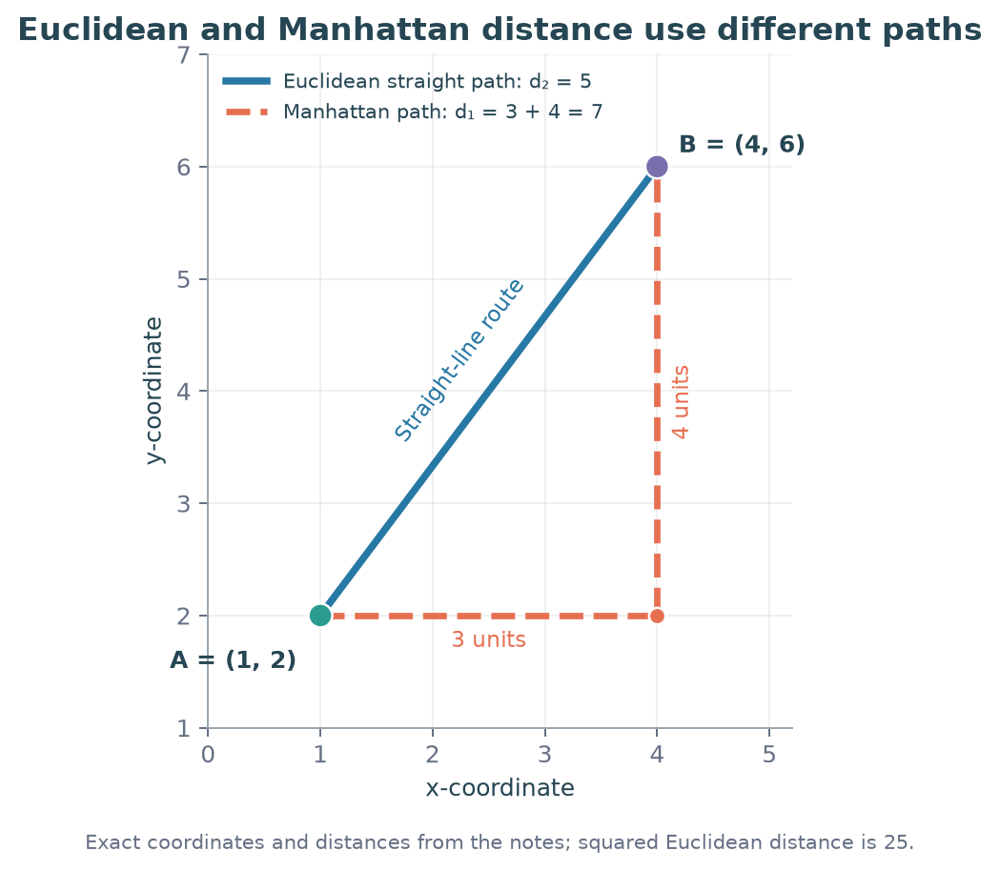

Squared-Euclidean objective ka optimizer mean hai. **Unsquared Manhattan objective** ke liye coordinate-wise median minimizes cost. Example $\{0,0,9\}$: median 0 ka absolute cost 9; mean 3 ka cost 12. Isliye metric/objective badalne par mean-update guarantee automatically transfer mat karo.

---

### Q28 — Same question mein different metrics

**Question:**

Consider six data points:

$$
X=\{(2,2),(3,3),(4,4),(10,10),(12,12),(13,13)\}
$$

The first center selected is:

$$
\mu_1=(2,2)
$$

Answer:

1. Which point has the highest probability of becoming the second center when Manhattan distance is used?
2. If $(3,3),(10,10),(12,12)$ are the centers, which center is closest to a new point $(-5,10)$ using Euclidean distance?

**Solution:**

Oct 2023 Quiz 1.

**Part (i), Step 1:** $(2,2)$ se Manhattan distances in dataset order: $0,2,4,16,20,22$.

**Step 2:** Maximum score 22 at $(13,13)$, so highest probability isi point ki. Distances ya their squares, dono monotone rules mein highest same point hoga; exact probability rule ke bina numeric probability mat invent karo.

**Part (ii), Step 1:** New point $(-5,10)$ se **Euclidean squared** distances:

$$\begin{aligned}
(3,3):&\ (-8)^2+7^2=113,\\
(10,10):&\ (-15)^2+0^2=225,\\
(12,12):&\ (-17)^2+(-2)^2=293.
\end{aligned}$$

**Step 2:** $113<225<293$, so nearest center $\boxed{(3,3)}$.

Final: **(i) $(13,13)$; (ii) $(3,3)$**. Part (i) ka metric part (ii) mein carry forward mat karo.

---

### Q40 — Manhattan assignment

**Question:**

Given:

$$
X=\{(1,1),(1,2),(5,4),(2.4,3),(2.6,3)\}
$$

Use:

$$
K=2
$$

with Manhattan distance and current centroids:

$$
\mu_1=(1,1),\qquad\mu_2=(5,4)
$$

To which cluster does point $(2.4,3)$ belong after the assignment step?

**Solution:**

Aug 2022 End Term.

**Step 1:** First center se distance

$$|2.4-1|+|3-1|=1.4+2=3.4.$$

**Step 2:** Second center se

$$|2.4-5|+|3-4|=2.6+1=3.6.$$

**Step 3:** $3.4<3.6$, hence $\boxed{C_1}$.

Existing notes mein key $C_2$ recorded hai, lekin printed coordinates/metric se $C_1$ milta hai. Calculation ko follow karo.

---

## 7. Silhouette: Compact hone ke saath separated bhi?

### 7.1 Definition aur formula

**Real life:** Apne group ke customers tumhare similar hain, lekin neighbouring group aur bhi similar hai? Silhouette isi within-group versus other-group comparison ko measure karti hai.

For point $i$:

$$a(i)=\frac1{|C_{z_i}|-1}\sum_{j\in C_{z_i},\ j\ne i}d(x_i,x_j),$$

$$b(i)=\min_{k\ne z_i}\left[\frac1{|C_k|}\sum_{j\in C_k}d(x_i,x_j)\right],$$

$$\boxed{s(i)=\frac{b(i)-a(i)}{\max(a(i),b(i))}},\qquad
\boxed{S=\frac1n\sum_i s(i)}.$$

$a(i)$ mein self-point exclude hota hai. $b(i)$ **minimum cluster-average distance** hai; nearest individual point ya nearest centroid distance nahi.

| Value | Meaning |
|---|---|
| Near $+1$ | Own group tight, alternatives far |
| Near 0 | Own aur alternative group ke distances similar |
| Negative | Point average mein kisi other group ke closer |

Singleton cluster ke point ka silhouette conventionally 0; $a=b=0$ ho toh bhi zero convention use hota hai. Usual dataset-level silhouette ke liye $2\leq K\leq n-1$ distinct non-empty clusters chahiye.

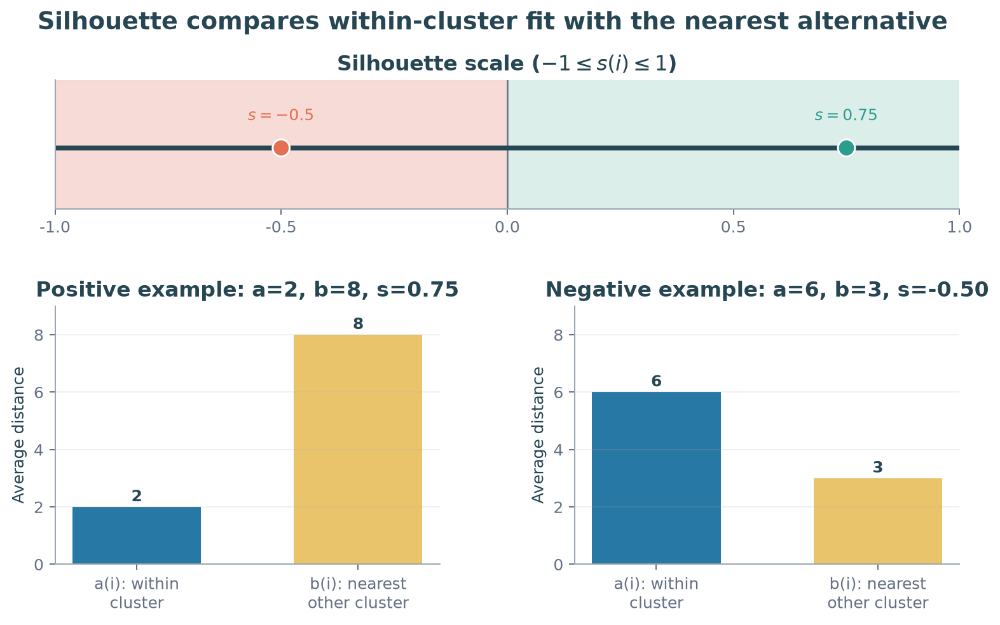

### 7.2 Formula ka short calculation

**Question:** A point has average within-cluster distance 2. Its average distances to the other two clusters are 8 and 10. Find its silhouette score.

**Step 1:** $a=2$. Other-cluster averages mein minimum $b=\min(8,10)=8$.

**Step 2:** $s=(8-2)/8=\boxed{0.75}$. Positive and high: point well matched hai.

**Counterexample:** $a=6,b=3$ ho toh $s=(3-6)/6=\boxed{-0.5}$. Negative score ka matlab exactly $-1$ nahi.

---

### Q39 — Silhouette interpretation

**Question:**

For an unlabeled two-feature dataset, centroids $C_1$ and $C_2$ are obtained after K-Means iterations.

Which statement about the silhouette score $S$ is correct?

A. $S$ is positive and close to 0.

B. $S$ is positive and close to 1.

C. $S=-1$ exactly.

D. $S$ is negative but need not be exactly $-1$.

**Solution:**

Aug 2022 End Term.

**Step 1:** Negative silhouette tab aati hai jab relevant points ke liye own-group average $a$ alternative $b$ se bada ho. Dataset score individual values ka average hai.

**Step 2:** $a=6,b=3$ example se $-0.5$ milta hai: negative hone ke liye exactly $-1$ zaroori nahi.

**Step 3:** Existing notes answer D record karte hain, but figure/cluster data supplied PDF mein bhi missing hain. **Given text alone se A/B/D decide nahi kar sakte**; negative score establish karne ke liye distances chahiye. D ka interpretation valid hai, dataset-specific choice unverified hai.

---

### 7.3 WCSS aur silhouette ka difference

WCSS center se squared error measure karta hai: lower better, nonnegative. Silhouette own versus other clusters ke pairwise distances compare karti hai: higher generally better, negative bhi possible.

Low WCSS alone strong separation prove nahi karta; two compact groups bahut paas bhi ho sakte hain. $K$ select karte waqt scale, meaningful groups, elbow aur silhouette ko saath dekho.

## 8. Quick revision

| Task | Formula / check |
|---|---|
| Assign | Nearest center, $\arg\min_k\|x_i-\mu_k\|^2$ |
| Update | Coordinate-wise mean |
| Objective | Sum of squared distances to the specified centers |
| One Lloyd cycle | $J_C\leq J_B\leq J_A$ |
| New point update | $(m\mu+x)/(m+1)$, then recheck memberships |
| Geometry | Perpendicular bisectors; convex Voronoi cells |
| K-Means++ | First uniform; then nearest-selected-center $D^2$ weights |
| Ordered selection | First probability × conditional next probability |
| Manhattan | Sum of absolute coordinate differences |
| Silhouette | $(b-a)/\max(a,b)$; $b$ uses cluster-average distances |
| Penalized K selection | Minimize $J(K)+P(K)$, not just WCSS |
| Three-center region | Intersect half-spaces against every competing center |
| Coincident centers | All points tie; state tie and empty-cluster rules |
| K-Means++ expected cost | Classical bound $8(\ln K+2)J_K^*$, not per-run optimality |

Question solve karne se pehle four things circle karo: **given centers ya assignments, distance metric, asked iteration/stage, tie convention**. Final means nikalne ke baad assignment stability check karo. Initialization, final partition aur optimality teen separate ideas hain.
