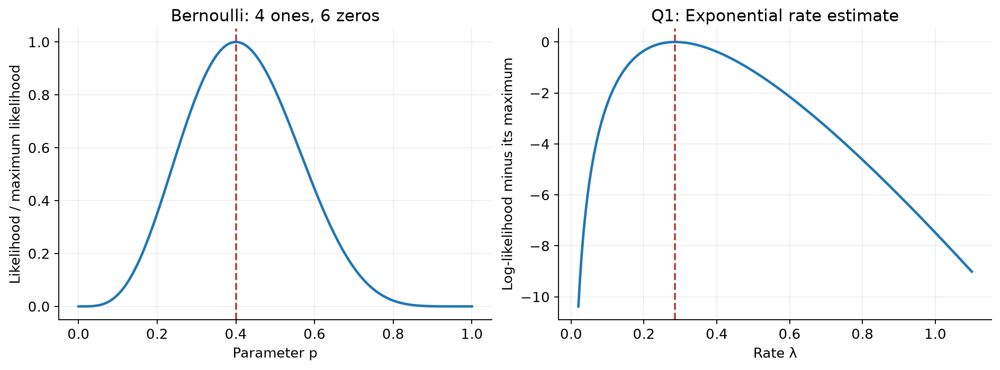
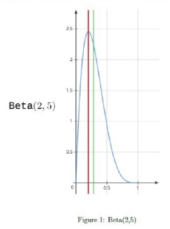
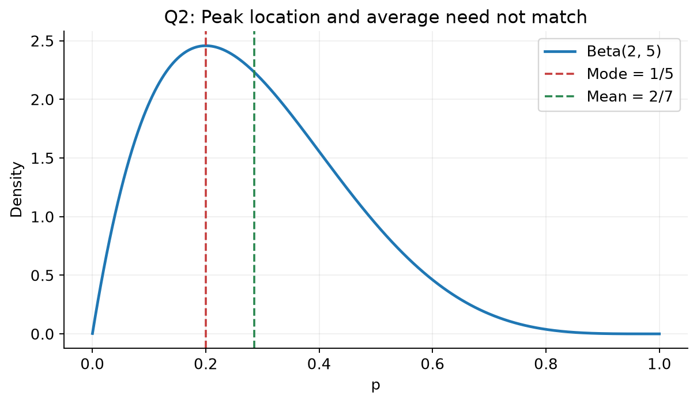
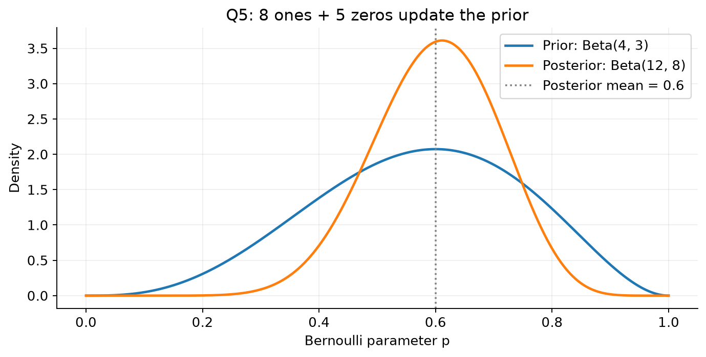
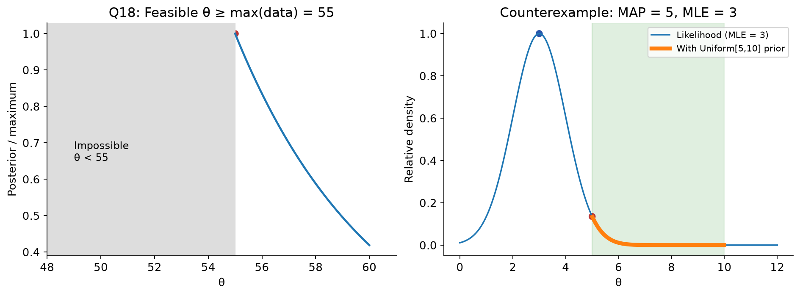
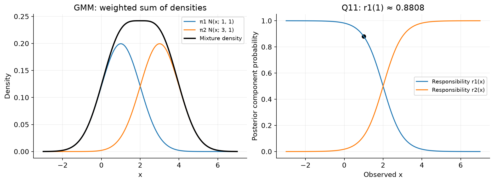
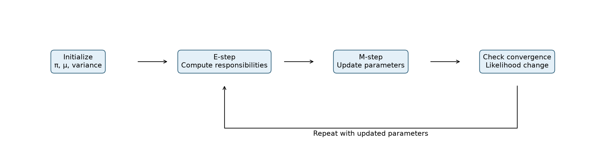
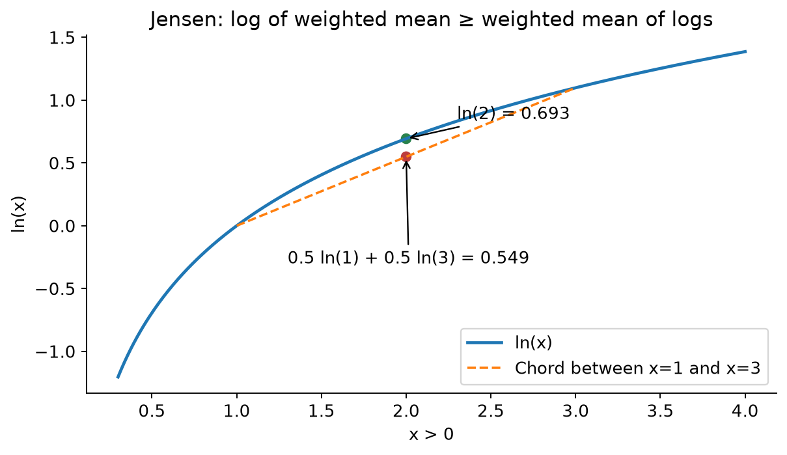

# MLT Week 4: Estimation, GMM and EM Algorithm Notes

**Flow:** Data ke peeche probability model → likelihood aur MLE → prior se posterior → posterior mean aur MAP → hidden mixture components → responsibilities → EM updates.

## Topic index

| Topic | Subtopics | Questions |
|---|---|---|
| 1. Estimation foundations | IID, likelihood, log-likelihood, parameter constraints | — |
| 2. Bernoulli MLE | Counts, stopping experiment, known groups | Q3/Q9, Q17, Q10, Q16 |
| 3. Other MLE problems | Exponential, Poisson, Pareto, discrete parameter | Q1, Q6, Q15, Q7 |
| 4. Bayesian estimation | Prior, posterior, Beta mean/mode | Q2 |
| 5. Beta–Bernoulli updating | Posterior distribution, mean, shrinkage | Q5, Q12, Q19, Q22 |
| 6. MAP and support | Uniform prior, boundary estimates | Q18, Q20, Q21 |
| 7. Gaussian mixture model | Generative process, density, parameter count | — |
| 8. E-step | Responsibilities, conditional probabilities | Q4, Q11 |
| 9. M-step and EM | Weighted updates, Jensen bound, convergence, K-means | Q8, Q13, Q14 |
| 10. Revision | Formulas, mistakes, solving checklist | — |

---

## 1. Estimation: Data dekhkar unknown parameter find karna

### 1.1 Probabilistic model ka meaning

**Short definition:** Estimation mein observed data ko kisi probability distribution se generated maan kar uske unknown parameters estimate karte hain.

**Real life:** Coin ki heads probability unknown hai. Toss outcomes observe karke p estimate karna hai. Machine lifetime, customer arrivals aur train delay ke liye different distributions suitable ho sakti hain.

$$\text{Observed data }D=\{x_1,\ldots,x_n\},\qquad\text{unknown parameter }\theta.$$

Parameter aur observation different cheezein hain: coin example mein observed $x_i$ either 0 or 1, but unknown p lies between 0 and 1.

### 1.2 IID assumption

**Independent:** Joint distribution factorizes; one observation ka outcome baaki outcomes ko inform nahi karta under the assumed model.

**Identically distributed:** Sab samples same distribution and same parameter follow karte hain.

Together:

$$p(x_1,\ldots,x_n\mid\theta)=\prod_{i=1}^n p(x_i\mid\theta).$$

**Counterexample:** Repeated coin tosses with changing bias same p wale IID model ko violate karte hain. Independence alone same distribution imply nahi karti; same marginal distribution alone independence imply nahi karti.

### 1.3 Likelihood versus probability

**Short definition:** Observed data fixed rakhkar likelihood parameter ki function hai: kaunsa parameter data ko more plausible banata hai?

$$\boxed{L(\theta;D)=\prod_{i=1}^n f(x_i;\theta)}.$$

- Discrete observations: $f$ PMF hai.
- Continuous observations: $f$ density/PDF hai; exact point ki probability nahi.
- Likelihood ko parameter space par integrate karke 1 aana zaroori nahi.

**Counterexample:** Density 2 hona valid hai, probability 2 hona invalid. Similarly likelihood itself parameter ka normalized posterior distribution nahi hai.

### 1.4 Log-likelihood and maximization

$$\boxed{\ell(\theta)=\ln L(\theta)=\sum_{i=1}^n\ln f(x_i;\theta)}.$$

Log strictly increasing hai, so likelihood aur log-likelihood ka maximizer same:

$$\boxed{\hat\theta_{\mathrm{MLE}}=\arg\max_{\theta\in\Theta}L(\theta)=\arg\max_{\theta\in\Theta}\ell(\theta)}.$$

**Why log?** Products sums ban jaate hain; derivatives easier aur very small products ka numerical underflow avoid kar sakte hain.

**Important rules:**

1. $\ln\prod_i a_i=\sum_i\ln a_i$.
2. $\ln(a+b)\ne\ln a+\ln b$. GMM mein ye distinction crucial hoga.
3. Parameter-independent terms maximizer find karte waqt drop kar sakte ho; **full log-likelihood asked ho toh include karo**.
4. Derivative zero solve karne ke baad allowed parameter range/support check karo. Boundary optimum bhi possible hai.
5. MLE sirf observed-data likelihood optimize karta hai; prior use nahi karta.

---

## 2. Bernoulli MLE: Ones ka fraction

### 2.1 Bernoulli model and estimate

$$X_i\sim\operatorname{Bernoulli}(p),\quad P(X_i=1)=p,\quad P(X_i=0)=1-p.$$

PMF:

$$f(x_i;p)=p^{x_i}(1-p)^{1-x_i},\qquad x_i\in\{0,1\}.$$

Let $s=\sum_i x_i$ be number of ones and $f=n-s$ number of zeros. Then:

$$L(p)=p^s(1-p)^f,\qquad\ell(p)=s\ln p+f\ln(1-p).$$

$$\boxed{\hat p_{\mathrm{MLE}}=\frac{s}{s+f}=\frac{s}{n}}.$$

**Real life:** 10 tosses mein 8 heads → fitted heads probability 0.8. Iska matlab next toss certainly head nahi; estimated chance 0.8 hai.

**Boundary property:** All zeros → $\hat p=0$; all ones → $\hat p=1$, when parameter space includes endpoints. Tiny sample par extreme MLE aa sakti hai; Bayesian prior later ise moderate karega.

### Q3 and Q9 — Type-B count from Bernoulli MLE

**Source:** Jan 2024 Quiz 1, Q3; exact same question appears in Sep 2024 Quiz 1, Q9.

**Question:**

Consider a dataset with 100 total data points. Each data point is classified as either type A or type B. We model this using a Bernoulli distribution, where p is the probability of a data point being type A. If the maximum likelihood estimate (MLE) of p based on the dataset is 0.4, how many data points of type B are there in this dataset?

**Solution:**

1. Success/type A probability estimate is $\hat p=n_A/n$.
2. $n_A=0.4\times100=40$.
3. Remaining type-B count:

$$\boxed{n_B=100-40=60}.$$

Same wording aur same numbers Q9 mein repeat hain, isliye separate solution repeat nahi kiya.

### Q17 — Find zeros when number of ones is known

**Source:** 2024 Sep 01 ET, Q17.

**Question:**

Consider a dataset for an unsupervised learning problem in which each data-point is either 1 or 0. This dataset is modeled using a Bernoulli distribution with parameter p. The MLE for p is 0.25. If the number of ones in the dataset is 10, find the number of zeros.

**Solution:**

**Step 1:** $\hat p=s/n$ gives $0.25=10/n$.

**Step 2:** Total count $n=10/0.25=40$.

**Step 3:** Zeros $=n-s=40-10$.

$$\boxed{30}.$$

**Connection:** Q3/Q9 total count dete hain; yahan success count se pehle total recover karna hai.

### Q10 — Four failures, followed by tossing until first success

**Source:** Jan 2025 Quiz 1, Q10.

**Question:**

Suppose you toss a coin four times and observe no heads. You then give the coin to your friend, who tosses it until the first head occurs. Your friend tosses the coin a total of five times. Let p denote the probability that the coin comes up heads. Find the maximum likelihood estimate of p.

**Solution:**

**Step 1: Sequence reconstruct karo.** Your four tosses: TTTT. Friend's five tosses until first head: TTTTH. Total 8 tails and 1 head across 9 tosses.

**Step 2: Likelihood.** First experiment probability $(1-p)^4$. Friend's stopping observation probability $(1-p)^4p$.

$$L(p)=(1-p)^4(1-p)^4p=p(1-p)^8.$$

**Step 3:** Same Bernoulli likelihood counts give:

$$\boxed{\hat p=\frac1{1+8}=\frac19\approx0.1111}.$$

**Trap:** Answer $1/5$ tab aata agar sirf friend's data use karte. First four failures bhi observed data hain. Friend's last toss head hai, so friend has four tails, not five.

### 2.2 Known group labels: Separate MLEs

Agar group membership observed hai aur group j ka own $p_j$ hai, har group mein successes/total count karo. Joint likelihood factors into group-specific likelihoods; each parameter independently maximize hota hai.

**Connection ahead:** GMM mein component labels hidden honge. Known labels ke simple counts ko wahan soft responsibilities replace karengi.

### Q16 — Estimate two Bernoulli parameters with known groups

**Source:** 2024 Apr 28 ET, Q16.

**Question:**

Consider a dataset of n observations $\{x_1,x_2,\ldots,x_n\}$, where each $x_i$ follows a Bernoulli distribution with parameter p, i.e., $x_i\sim\operatorname{Bernoulli}(p)$ for $i=1,2,\ldots,n$. However, you have reason to believe that the parameter p might differ for two distinct groups within the dataset. You suspect that there are two groups in the dataset, each with its own parameter ($p_1$ and $p_2$). Now, develop an algorithm to estimate the parameters $p_1$ and $p_2$ using maximum likelihood estimation. Then, apply your algorithm to a dataset with the following observations and corresponding group labels: {0, 1, 1, 0, 1} and {1, 0, 1, 0, 1} for group 1 and group 2 respectively. Calculate the maximum likelihood estimates of $p_1$ and rounded to two decimal places.

**Solution:**

The final sentence in the question is incomplete after “and”; calculate both parameters requested earlier.

**Step 1: Algorithm.** For each nonempty group j:

1. Count observations $n_j$.
2. Count ones $s_j$; zeros $f_j=n_j-s_j$.
3. Return $\hat p_j=s_j/n_j$.

**Step 2: Why separate estimates?**

$$L(p_1,p_2)=p_1^{s_1}(1-p_1)^{f_1}p_2^{s_2}(1-p_2)^{f_2}.$$

$$\ell=s_1\ln p_1+f_1\ln(1-p_1)+s_2\ln p_2+f_2\ln(1-p_2).$$

For an interior estimate:

$$\frac{\partial\ell}{\partial p_j}=\frac{s_j}{p_j}-\frac{f_j}{1-p_j}=0\Rightarrow s_j(1-p_j)=f_jp_j\Rightarrow p_j=\frac{s_j}{n_j}.$$

**Step 3: Substitute counts.** Both groups contain 3 ones and 2 zeros.

$$\boxed{\hat p_1=3/5=0.60,\qquad\hat p_2=3/5=0.60}.$$

No EM needed because membership supplied hai. Agar single binary observation per person ho aur group hidden ho, arbitrary two-Bernoulli mixture se $p_1,p_2$ separately identify karna generally possible nahi: marginal success probability sirf weighted average hai.

---

## 3. Other MLE problems: Distribution changes, method same

### 3.1 Exponential distribution: Waiting times and rate

**Short definition:** Exponential distribution nonnegative waiting/lifetime values model karti hai with rate $\lambda>0$:

$$f(x;\lambda)=\lambda e^{-\lambda x},\quad x\ge0.$$

$$E[X]=\frac1\lambda,\qquad\boxed{\hat\lambda_{\mathrm{MLE}}=\frac n{\sum_i x_i}=\frac1{\bar x}}.$$

**Real life:** Failures ka higher rate → shorter average lifetime. Rate ko mean lifetime mat samjho: units inverse time hain.

Formula positive sample sum ke liye hai. All observations zero hon toh likelihood $\lambda^n$ unbounded as $\lambda\to\infty$; finite MLE nahi.

### Q1 — Exponential log-likelihood and MLE

**Source:** Jan 2024 Quiz 1, Q1.

**Question:**

Comprehension: Assume that you have a dataset of six points $\{x_1,x_2,x_3,x_4,x_5,x_6\}$, all of which are non-negative. You hypothesise that the data points are iid random variables with the following density:

$$f(x;\lambda)=\begin{cases}\lambda e^{-\lambda x},&x\ge0,\\0,&x<0.\end{cases}$$

Based on the above data, answer the given subquestions.

(i) What is the log-likelihood of this dataset under this distribution? ln represents the natural logarithm or $\log_e$.

(a) $\prod_{i=1}^{6}\lambda e^{-\lambda x_i}$

(b) $\sum_{i=1}^{6}\lambda e^{-\lambda x_i}$

(c) $\prod_{i=1}^{6}[\ln(\lambda)-\lambda x_i]$

(d) $\sum_{i=1}^{6}[\ln(\lambda)-\lambda x_i]$

(ii) You are given the actual values of these observations:

$$x_1=1,\ x_2=2,\ x_3=3,\ x_4=4,\ x_5=5,\ x_6=6.$$

What is the maximum likelihood estimate for $\lambda$? Enter your answer correct to three decimal places.

**Solution — (i): Product first, then logarithm**

$$L(\lambda)=\prod_{i=1}^6\lambda e^{-\lambda x_i}=\lambda^6e^{-\lambda\sum_i x_i}.$$

$$\ell(\lambda)=6\ln\lambda-\lambda\sum_i x_i=\sum_{i=1}^6[\ln\lambda-\lambda x_i].$$

$$\boxed{\text{Option (d)}}.$$

Option (a) likelihood hai, log-likelihood nahi; log terms ka product option (c) incorrect hai.

**Solution — (ii): Maximize over positive rate**

$$\sum_i x_i=1+2+3+4+5+6=21.$$

$$\ell(\lambda)=6\ln\lambda-21\lambda,\qquad\ell'(\lambda)=\frac6\lambda-21.$$

Set derivative zero:

$$\hat\lambda=\frac6{21}=\frac27=0.285714\ldots$$

Second derivative $-6/\lambda^2<0$, so stationary point is maximum.

$$\boxed{\hat\lambda=0.286}.$$

Left graph success fraction 0.4 par peak dikhata hai; right graph Q1 ki exponential estimate par log-likelihood peak.

### 3.2 Poisson distribution: Counts per interval

**Short definition:** Poisson nonnegative integer counts model karta hai:

$$P(X=x)=\frac{e^{-\lambda}\lambda^x}{x!},\qquad x=0,1,2,\ldots$$

$$E[X]=\lambda,\qquad\boxed{\hat\lambda_{\mathrm{MLE}}=\bar x}.$$

**Real life:** One hour mein number of calls. Same symbol $\lambda$ exponential rate mein bhi hai, but MLE formulas interchangeable nahi: Poisson → sample mean; exponential rate → reciprocal sample mean.

### Q6 — Poisson log-likelihood and frequency-table estimate

**Source:** May 2024 Quiz 1, Q6.

**Question:**

Comprehension: Consider a dataset of n data-points all of which are non-negative integers. These data-points are sampled from a Poisson distribution, whose probability mass function is given below:

$$f(x;\lambda)=\frac{e^{-\lambda}\lambda^x}{x!},\qquad\lambda>0.$$

Here $\lambda$ is a parameter. Based on the above data, answer the given subquestions.

(i) Find the log-likelihood of the dataset under this distribution.

(a) $\sum_{i=1}^{n}[-\lambda+x_i\log\lambda-\log(x_i!)]$

(b) $\prod_{i=1}^{n}\frac{e^{-\lambda}\lambda^{x_i}}{x_i!}$

(c) $\sum_{i=1}^{n}[-\lambda+\lambda\log x_i-\log(x_i!)]$

(d) $\prod_{i=1}^{n}[-\lambda+x_i\log\lambda-\log(x_i!)]$

(ii) Consider a dataset that has 25 data-points. The data-point $x_i$ and its frequency is given in the following table:

| $x_i$ | Frequency |
|---:|---:|
| 0 | 1 |
| 1 | 4 |
| 2 | 6 |
| 3 | 9 |
| 4 | 5 |

In case the table is not clear: the value 0 appears once in the dataset, the value 1 appears four times in the dataset, and so on. Find the maximum likelihood estimate for the parameter $\lambda$ of the Poisson distribution given this dataset.

**Solution — (i):**

$$\ln f(x_i;\lambda)=-\lambda+x_i\ln\lambda-\ln(x_i!).$$

Independent observations ke logs add honge:

$$\boxed{\ell(\lambda)=\sum_i[-\lambda+x_i\ln\lambda-\ln(x_i!)]\quad\text{(a)}}.$$

Factorial term $\lambda$ par depend nahi karta, but complete log-likelihood mein present hai. $0!=1$, so zero observation valid hai.

**Solution — (ii):**

**Step 1:** Collect $\lambda$ terms:

$$\ell=-n\lambda+\left(\sum_i x_i\right)\ln\lambda-\sum_i\ln(x_i!).$$

**Step 2:** Derivative zero:

$$-n+\frac{\sum_i x_i}{\lambda}=0\Rightarrow\hat\lambda=\frac{\sum_i x_i}{n}.$$

**Step 3:** Frequency-weighted total:

$$n=1+4+6+9+5=25,$$

$$\sum_i x_i=0(1)+1(4)+2(6)+3(9)+4(5)=0+4+12+27+20=63.$$

**Step 4:**

$$\boxed{\hat\lambda=63/25=2.52}.$$

Five distinct table rows nahi, 25 observations hain. Simple mean of $0,1,2,3,4$ wrong hai. If every count were zero and allowed range were strictly $\lambda>0$, best value would be approached at $0^+$ rather than attained; this dataset has an interior maximum.

### 3.3 Pareto distribution: Heavy-tailed values

**Short definition:** Pareto distribution mein large values ki tail comparatively slowly decrease karti hai. Given scale 1 and shape $\theta$:

$$f(x\mid\theta)=\theta x^{-\theta-1},\quad x\ge1.$$

**Real life:** Large insurance claims/wealth-like heavy-tail modeling. Larger shape generally faster tail decay.

Support and shape constraint question se read karo. Neeche question explicitly $\theta>1$ impose karta hai.

### Q15 — Pareto MLE

**Source:** May 2025 Quiz 1, Q15.

**Question:**

Let $X_1,X_2,\ldots,X_n$ be an i.i.d. sample drawn from a Pareto distribution with the following probability density function:

$$f(x\mid\theta)=\theta x^{-\theta-1},\qquad x\ge1,\quad\theta>1.$$

You are given the following sample of 5 observations:

$$X=\{2.5,1.8,3.2,2.0,2.7\}.$$

What is the maximum likelihood estimator of $\theta$ for the above sample? Enter the answer correct to three decimal places.

**Solution:**

**Step 1: Likelihood and log.**

$$L(\theta)=\theta^n\prod_i x_i^{-\theta-1},\qquad\ell(\theta)=n\ln\theta-(\theta+1)\sum_i\ln x_i.$$

**Step 2: Differentiate.**

$$\ell'(\theta)=\frac n\theta-\sum_i\ln x_i=0\Rightarrow\hat\theta=\frac n{\sum_i\ln x_i}.$$

**Step 3: Natural logs add karo.**

| Value | Natural log, approximately |
|---:|---:|
| 2.5 | 0.916291 |
| 1.8 | 0.587787 |
| 3.2 | 1.163151 |
| 2.0 | 0.693147 |
| 2.7 | 0.993252 |

$$\sum_i\ln x_i\approx4.353628.$$

$$\hat\theta\approx5/4.353628=1.14846766.$$

**Step 4:** $1.14846766>1$, allowed domain ke andar; $\ell''=-n/\theta^2<0$, so maximum.

$$\boxed{\hat\theta=1.148}.$$

**Property:** $\sum\ln x_i$ use hota hai, $\ln(\sum x_i)$ nahi. Agar unconstrained stationary point $\le1$ aaye, given open constraint $\theta>1$ ko ignore nahi kar sakte; boundary supremum may replace attained MLE.

### 3.4 Discrete parameter: Derivative ki zaroorat nahi

Parameter sirf kuch allowed values le sakta ho toh har candidate likelihood compare karo. “Always differentiate” MLE rule nahi hai.

### Q7 — Choose between two possible densities

**Source:** Sep 2024 Quiz 1, Q7.

**Question:**

Let $X_1,X_2,\ldots,X_n$ be n i.i.d. samples with parameter $\theta$, which follows one of the following PDFs:

For $\theta=-1$, we have

$$f(x\mid\theta)=\begin{cases}5x^4,&0<x<1,\\0,&\text{otherwise}.\end{cases}$$

For $\theta=1$, we have

$$f(x\mid\theta)=\begin{cases}1,&0<x<1,\\0,&\text{otherwise}.\end{cases}$$

Suppose we wish to find the maximum likelihood estimate of $\theta$, then which among the following are true? (MSQ)

(a) If $\prod_{i=1}^n5x_i^4<1$, then $\hat\theta_{\mathrm{MLE}}=1$.

(b) If $\prod_{i=1}^n5x_i^4>1$, then $\hat\theta_{\mathrm{MLE}}=1$.

(c) If $\prod_{i=1}^n5x_i^4<1$, then $\hat\theta_{\mathrm{MLE}}=-1$.

(d) If $\prod_{i=1}^n5x_i^4>1$, then $\hat\theta_{\mathrm{MLE}}=-1$.

**Solution:**

Assume observed samples lie in common support $(0,1)$.

1. $L(-1)=\prod_i5x_i^4=5^n\prod_i x_i^4$.
2. $L(1)=\prod_i1=1$.
3. Product less than 1 → candidate $\theta=1$ has greater likelihood.
4. Product greater than 1 → candidate $\theta=-1$ has greater likelihood.

$$\boxed{\text{(a), (d)}}.$$

Equality par both are maximizers; unique MLE nahi. Likelihood ratio compare karna sufficient hai—posterior probabilities assume karne ki need nahi.

---

## 4. Bayesian estimation: Prior belief ko data se update karo

### 4.1 Prior, likelihood, posterior and evidence

**Short definition:** Bayesian estimation unknown parameter par distribution rakhti hai, phir data aane par update karti hai.

**Real life:** Factory ka historical defect rate low raha hai. New small batch ka data noisy ho sakta hai; prior history aur new observations dono combine kar sakte hain.

$$\boxed{p(\theta\mid D)=\frac{p(D\mid\theta)p(\theta)}{p(D)}}.$$

- **Prior $p(\theta)$:** Data before parameter beliefs.
- **Likelihood $p(D\mid\theta)$:** Candidate parameter under observed data ki fit.
- **Posterior $p(\theta\mid D)$:** Updated parameter distribution.
- **Evidence $p(D)=\int p(D\mid\theta)p(\theta)\,d\theta$:** Normalizing constant; discrete parameter ke liye sum.

For comparing parameter values:

$$p(\theta\mid D)\propto L(\theta)p(\theta).$$

Evidence $\theta$ se independent hai, so MAP optimization mein drop kar sakte hain. Normalized probability/density calculate karni ho toh normalization needed hai.

### 4.2 Beta distribution for a Bernoulli probability

Since p lies in $[0,1]$, Beta prior natural choice hai:

$$p\sim\operatorname{Beta}(\alpha,\beta),\qquad\alpha>0,\ \beta>0,$$

$$\boxed{f(p)=\frac{p^{\alpha-1}(1-p)^{\beta-1}}{B(\alpha,\beta)},\quad0<p<1}.$$

Ordinary proper Beta distribution ke parameters strictly positive hain. $\alpha=0$ or $\beta=0$ usual normalized Beta PDF define nahi karte, despite some question notes loosely writing $\ge0$.

$$\boxed{E[p]=\frac\alpha{\alpha+\beta}},\qquad\boxed{\operatorname{mode}(p)=\frac{\alpha-1}{\alpha+\beta-2}\quad\text{if }\alpha,\beta>1}.$$

**Mean vs mode:** Mean distribution ka average/balance point; mode density peak ki location. Skewed distribution mein different ho sakte hain.

- Beta(1,1) uniform hai; mean 0.5 but unique mode nahi.
- $\alpha,\beta>1$ → interior peak.
- Shape parameter $\le1$ ho toh boundary modes/unbounded boundary density possible; interior-mode formula blindly use mat karo.
- Variance $\alpha\beta/[(\alpha+\beta)^2(\alpha+\beta+1)]$; fixed mean par larger total concentration more concentrated prior banati hai.

**Conjugacy:** Beta prior + Bernoulli likelihood gives Beta posterior. “Conjugate” means **posterior prior ki same family mein hai**, not that likelihood itself Beta hai.

### Q2 — Beta mean and mode on a graph

**Source:** Jan 2024 Quiz 1, Q2.

**Question:**

For the given Beta distribution, choose the correct option. (MSQ)

(a) Red line denotes the mean for the given Beta distribution, i.e. mean $=2/7$.

(b) Green line denotes the mean for the given Beta distribution, i.e. mean $=2/7$.

(c) Red line denotes the mode for the given Beta distribution, i.e. mode $=1/5$.

(d) Green line denotes the mode for the given Beta distribution, i.e. mode $=1/5$.

**Solution:**

**Step 1:** Graph labels distribution Beta(2,5), so $\alpha=2,\beta=5$.

**Step 2: Mean.**

$$E[p]=\frac2{2+5}=\frac27\approx0.285714.$$

**Step 3: Mode.** Both parameters exceed 1:

$$p_{\mathrm{mode}}=\frac{2-1}{2+5-2}=\frac15=0.2.$$

**Step 4:** Red line left at 0.2 passes through peak; green line right near 0.286 is mean.

$$\boxed{\text{(b), (c)}}.$$

Right tail mean ko peak se right pull karti hai. Mean ko visually tallest point assume karna wrong hai.

---

## 5. Beta–Bernoulli posterior and point estimates

### 5.1 Update rule

Prior Beta($\alpha,\beta$), data mein s ones and f zeros:

$$\boxed{p\mid D\sim\operatorname{Beta}(\alpha+s,\beta+f)}.$$

Short connection: Prior exponent $\alpha-1$ mein success likelihood exponent s add hota hai; resulting Beta parameter $\alpha+s$ hota hai. Failures similarly $\beta+f$.

**No minus-one mistake:** Posterior parameters are $\alpha+s,\beta+f$, not $\alpha+s-1,\beta+f-1$. Minus ones appear in density exponents and interior mode formula.

### 5.2 Three estimates ko distinguish karo

| Estimate | Formula | Uses |
|---|---|---|
| MLE | $s/n$ | Data only |
| Posterior mean | $(\alpha+s)/(\alpha+\beta+n)$ | Average under posterior |
| MAP, interior Beta mode | $(\alpha+s-1)/(\alpha+\beta+n-2)$ | Posterior peak; requires both updated shapes >1 |

Posterior mean minimizes posterior expected squared-error loss; MAP identifies density peak. Dono same statistic nahi.

Posterior mean ka useful interpretation:

$$\boxed{E[p\mid D]=\frac{\alpha+\beta}{\alpha+\beta+n}\frac\alpha{\alpha+\beta}+\frac n{\alpha+\beta+n}\frac sn}.$$

Prior mean aur sample fraction ka weighted average hai. Fixed prior ke saath n large ho toh data influence grows.

**Counterexample:** Beta(1,1) prior, one success and no failures → MLE 1, posterior Beta(2,1), mean $2/3$. Uniform prior ke saath **posterior mean** MLE ke equal hona necessary nahi.

### Q5 — Beta prior with eight ones and five zeros

**Source:** May 2024 Quiz 1, Q5.

**Question:**

Comprehension: In the context of Bayesian estimation, consider a Beta prior for the parameter p of a Bernoulli distribution:

$$p\sim\operatorname{Beta}(4,3).$$

The dataset has 8 ones and 5 zeros. Based on the above data, answer the given subquestions.

(i) What is the posterior?

(a) Beta(12, 8)

(b) Beta(11, 7)

(c) Br(0.5)

(d) Beta(8, 5)

(ii) If we use the expected value of the posterior as a point-estimate for the parameter of the Bernoulli distribution, what is $\hat p$?

**Solution:**

**(i):** Prior parameters $(4,3)$; observed counts $(8,5)$.

$$\alpha'=4+8=12,\qquad\beta'=3+5=8.$$

$$\boxed{p\mid D\sim\operatorname{Beta}(12,8)\quad\text{(a)}}.$$

**(ii):** Expected value means posterior mean:

$$\boxed{\hat p=\frac{12}{12+8}=\frac{12}{20}=0.6}.$$

**Compare:** MLE $8/13\approx0.6154$; posterior MAP $11/18\approx0.6111$. Neither is asked in part (ii).

### Q12 — Defective items with a uniform Beta prior

**Source:** Jan 2025 Quiz 1, Q12.

**Question:**

Comprehension: Suppose that 100 items are sampled from a manufacturing process and 10 are found to be defective. Let p denote the proportion of defective items. Assume that the prior distribution for p is Beta(1, 1).
Based on the above data, answer the given subquestions.

(i) Select the correct options from the following:

(a) Posterior distribution for p is Beta(91, 11).

(b) Posterior distribution for p is Beta(11, 91).

(c) Posterior distribution for p is Bernoulli(0.1).

(d) Posterior distribution for p is Bernoulli(0.9).

(ii) Find the posterior mean. Enter the answer correct to two decimal places.

**Solution:**

1. p means **defective** probability, so success count s=10 and failure count f=90.
2. Updated shapes: $\alpha'=1+10=11$, $\beta'=1+90=91$.
3. Posterior:

$$\boxed{\operatorname{Beta}(11,91)\quad\text{(b)}}.$$

4. Mean:

$$E[p\mid D]=\frac{11}{102}\approx0.107843\quad\Rightarrow\quad\boxed{0.11}.$$

**Trap:** Beta distribution is over unknown probability p. Bernoulli is the observation model for one defective/nondefective outcome; it is not the posterior distribution of p.

### Q19 — Strong data with Beta(10,40) prior

**Source:** 2025 Apr 13 ET, Q19.

**Question:**

A coin is flipped 1000 times, and it lands on heads 150 times. You use a Beta(10, 40) prior to estimate the true probability of heads. Given these observations, calculate the posterior mean of the probability of heads. Enter the answer correct to three decimal places.

Note:

- Pdf of Beta distribution is $f(\theta;\alpha,\beta)=\theta^{\alpha-1}(1-\theta)^{\beta-1}/B(\alpha,\beta)$, $0\le\theta\le1$, $\alpha,\beta\ge0$, where $B(\alpha,\beta)$ is the Beta function.
- The mean of the Beta distribution is: $E[\theta]=\alpha/(\alpha+\beta)$.

**Solution:**

**Step 1:** Heads s=150, tails f=$1000-150=850$.

**Step 2:** Posterior Beta($10+150,40+850$)=Beta(160,890).

**Step 3:**

$$E[p\mid D]=\frac{160}{160+890}=\frac{160}{1050}=0.15238095.$$

$$\boxed{0.152}.$$

Prior mean $10/50=0.2$ and MLE $150/1000=0.15$; posterior mean lies between them, close to MLE because n=1000 dominates prior concentration 50.

### Q22 — Same prior, different data size and heads fraction

**Source:** 2026 May 06 ET, Q22.

**Question:**

A coin is flipped 100 times, and it lands on heads 60 times. You use a Beta(10, 40) prior to estimate the true probability of heads. Given these observations, calculate the posterior mean of the probability of heads. Enter the answer correct to three decimal places.

Note:

- Pdf of Beta distribution is $f(\theta;\alpha,\beta)=\theta^{\alpha-1}(1-\theta)^{\beta-1}/B(\alpha,\beta)$, $0\le\theta\le1$, $\alpha,\beta\ge0$, where $B(\alpha,\beta)$ is the Beta function.
- The mean of the Beta distribution is: $E[\theta]=\alpha/(\alpha+\beta)$.

**Solution:** Q19 ka update method same hai, but counts change hain.

1. Heads 60; tails $100-60=40$.
2. Posterior Beta($10+60,40+40$)=Beta(70,80).
3. Mean:

$$\boxed{E[p\mid D]=\frac{70}{150}=0.466666\ldots\approx0.467}.$$

**Connection:** Prior mean 0.2, data fraction 0.6. Prior weight $50/150=1/3$, data weight $100/150=2/3$, so posterior mean $(1/3)(0.2)+(2/3)(0.6)=0.466667$. Same prior ka influence smaller dataset par more visible hai.

---

## 6. MAP: Posterior ka highest point

### 6.1 Definition and uniform-prior rule

$$\boxed{\hat\theta_{\mathrm{MAP}}=\arg\max_\theta p(\theta\mid D)=\arg\max_\theta L(\theta)p(\theta)}.$$

Positive factors ke log form mein:

$$\hat\theta_{\mathrm{MAP}}=\arg\max_\theta[\ell(\theta)+\ln p(\theta)].$$

**Real life:** Data ke favourite parameter ko choose karo, but prior ki preference/restrictions bhi account karo.

Uniform prior on $[a,b]$ means constant density **inside that interval**, zero outside. Therefore:

$$\boxed{\hat\theta_{\mathrm{MAP}}=\arg\max_{\theta\in[a,b]}L(\theta)}.$$

Unrestricted MLE inside prior support ho toh same maximum can be used. MLE outside ho toh equality generally fail karti hai. Open intervals mein excluded endpoint par supremum hone se attained MAP absent bhi ho sakta hai; relevant numerical questions below interior/allowed boundary use karte hain.

### 6.2 Uniform data model: Support itself carries information

If $X\sim\operatorname{Uniform}[0,\theta]$:

$$f(x\mid\theta)=\frac1\theta\mathbf1[0\le x\le\theta].$$

For nonnegative observations, let $m=\max_i x_i$. Then:

$$L(\theta)=\theta^{-n}\mathbf1[\theta\ge m].$$

**Meaning:** Largest observed value se chhota upper bound impossible hai. Feasible range mein $\theta^{-n}$ decreases as $\theta$ increases, so smallest allowed feasible value preferred hai.

### Q18 — Train-delay MAP with a bounded uniform prior

**Source:** 2024 Dec 22 ET, Q18.

**Question:**

A train running between two stations A and B will be late on any day by a random amount X, where $X\sim\operatorname{Uniform}[0,\theta]$. Suppose the train is late by random amounts (in minutes)

$$10,55,17,20,49,51,15,4,32,35$$

independently on 10 days. Consider a Uniform[0, 60] prior for the parameter $\theta$. Find the maximum aposteriori (MAP) estimate of $\theta$.

Recall that $\hat\theta_{\mathrm{MAP}}=\arg\max_\theta f(\theta\mid\{X_1,\ldots,X_n\})$, where f is the posterior distribution.

**Solution:**

**Step 1:** Largest observation m=55. Data require $\theta\ge55$.

**Step 2:** Prior allows $0\le\theta\le60$. Combine both constraints → $55\le\theta\le60$.

**Step 3:** In this interval, posterior proportional to:

$$L(\theta)p(\theta)=\theta^{-10}\times\frac1{60}.$$

**Step 4:** $\theta^{-10}$ strictly decreases for positive $\theta$, so maximum at smallest feasible value 55.

$$\boxed{\hat\theta_{\mathrm{MAP}}=55\text{ minutes}}.$$

**Trap:** Neither sample average nor prior average 30 is asked. $\theta<55$ cannot generate observed 55 under the model.

Left plot Q18 dikhata hai. Right plot shows why a uniform prior on a restricted interval need not preserve an unrestricted MLE.

### Q20 — Exponential rate MAP with Uniform(0,2) prior

**Source:** 2025 Aug 31 ET, Q20.

**Question:**

A machine’s lifetime (in hours) is modeled as a random variable $X\sim\operatorname{Exponential}(\lambda)$. Suppose the observed lifetimes (in hours) of the machine over 8 trials are:

$$5.2,0.8,3.4,2.5,1.1,4.0,6.3,2.9.$$

Assume that the parameter $\lambda$ has a prior distribution given by $\lambda\sim\operatorname{Uniform}(0,2)$. Find the maximum a posteriori (MAP) estimate of $\lambda$. Enter the answer correct to two decimal places.

Recall that:

$$\hat\lambda_{\mathrm{MAP}}=\arg\max_\lambda f(\lambda\mid\{X_1,\ldots,X_n\}),$$

where f is the posterior distribution.

**Solution:**

**Step 1:** Sum lifetimes:

$$S=5.2+0.8+3.4+2.5+1.1+4.0+6.3+2.9=26.2.$$

**Step 2:** For $0<\lambda<2$, prior constant, so:

$$p(\lambda\mid D)\propto\lambda^8e^{-26.2\lambda}.$$

**Step 3:** Q1 ka exponential likelihood result use karo:

$$\lambda^*=\frac nS=\frac8{26.2}=0.3053435.$$

Equivalently log-posterior derivative $8/\lambda-26.2=0$ same result deta hai.

**Step 4:** $0<0.3053435<2$, so candidate prior support mein hai and valid maximum.

$$\boxed{\hat\lambda_{\mathrm{MAP}}=0.31\text{ per hour}}.$$

Same algebra as Q1, but yahan additional prior-range check essential hai.

### Q21 — Does a uniform prior always make MAP equal MLE?

**Source:** 2025 Dec 18 ET, Q21.

**Question:**

Suppose we have a Uniform(1, 10) prior for the parameter $\theta$. Then, the value of the maximum likelihood estimate (MLE) is equal to the value of the maximum a posteriori (MAP) estimate.

(a) True

(b) False

**Solution:**

**Step 1:** Within prior support, posterior is proportional to likelihood because prior constant hai.

**Step 2:** If MLE is already within that support, or MLE optimization itself same support par defined hai, MAP and MLE coincide.

$$\boxed{\text{Paper's intended answer: (a) True, under this support assumption}}.$$

**Why condition necessary?** Prior zero outside interval hai. For example, observe $x=20$ from $N(\theta,1)$ with unrestricted real-valued mean. MLE is 20, but Uniform[1,10] prior posterior only inside [1,10] allow karta hai; its maximum is at 10. For a strictly open interval (1,10), posterior increases toward 10 and has a supremum but no attained mode there. Either way unrestricted MLE 20 is not MAP.

So statement **as an unconditional claim is false**. Formula ya MCQ key memorize karne ke saath support assumption bhi yaad rakho. Uniform prior equality concerns MAP, not posterior mean.

---

## 7. Gaussian mixture model: Ek population, multiple hidden groups

### 7.1 Single Gaussian ki limitation

**Short definition:** GMM data density ko multiple Gaussian component densities ke weighted sum se represent karta hai.

**Real life:** Heights of a population with multiple subgroups ek broad bell curve se poorly fit ho sakte hain. Multiple Gaussian components subgroup-specific centers/spreads capture kar sakte hain.

A component is a probabilistic generating group; automatically ground-truth class nahi. One component can overlap with another, so a point's membership uncertain ho sakti hai.

### 7.2 Generative story and latent variable

For each observation i:

1. Component label $z_i\in\{1,\ldots,K\}$ draw karo with probability $P(z_i=k)=\pi_k$.
2. Chosen component se observation generate karo:

$$X_i\mid(z_i=k)\sim\mathcal N(\mu_k,\sigma_k^2).$$

We observe $x_i$, but not $z_i$; $z_i$ **latent/hidden** variable hai.

Mixture weights satisfy:

$$\boxed{\pi_k\ge0,\qquad\sum_{k=1}^K\pi_k=1}.$$

**Connection to Q16:** Wahan groups supplied the; yahan model ko component membership probabilities infer karni padengi.

### 7.3 Gaussian component and mixture density

One-dimensional Gaussian:

$$\phi(x;\mu,\sigma^2)=\frac1{\sqrt{2\pi\sigma^2}}\exp\left[-\frac{(x-\mu)^2}{2\sigma^2}\right],\qquad\sigma^2>0.$$

Here Gaussian normalization mein $\pi$ mathematical constant hai; $\pi_k$ mixture weight alag quantity hai.

Marginal density:

$$\boxed{p(x\mid\theta)=\sum_{k=1}^K\pi_k\phi(x;\mu_k,\sigma_k^2)}.$$

**Why sum?** Point could come from component 1 **or** component 2 etc.; hidden alternatives marginalize karte hain. Different observations independent hon toh their mixture densities multiply hoti hain.

$$L(\theta)=\prod_{i=1}^n\left[\sum_{k=1}^K\pi_k\phi(x_i;\mu_k,\sigma_k^2)\right],$$

$$\boxed{\ell(\theta)=\sum_{i=1}^n\ln\left[\sum_{k=1}^K\pi_k\phi(x_i;\mu_k,\sigma_k^2)\right]}.$$

**Trap:** $\sum_i\sum_k\ln(\pi_k\phi_k(x_i))$ observed-data log-likelihood nahi. Log ke andar sum ko distribute nahi kar sakte. Isi coupling ki wajah se all parameters ka simple simultaneous closed-form MLE generally nahi milta; EM iterative solution deta hai.

### 7.4 Parameter count

One-dimensional K-component GMM with separate means and variances:

- K means.
- K variances.
- K weights but one sum-to-one constraint → K−1 independent weights.

$$\boxed{\text{Independent parameter count}=K+K+(K-1)=3K-1}.$$

Example K=2 → 5 independent parameters. Count **K hidden assignments per point** ko continuous model parameter list mein add mat karo.

For d-dimensional full-covariance components, each component has d mean coordinates and $d(d+1)/2$ independent covariance entries:

$$K d+K\frac{d(d+1)}2+(K-1).$$

Shared/diagonal/fixed covariance assumptions change count; $3K-1$ univariate unrestricted-component formula hai.

### 7.5 Mixture properties

- Weighted densities sum to a normalized density because weights sum to 1.
- Component labels can be permuted without changing mixture density: label switching.
- K components necessarily K visible peaks imply nahi karte; overlapping components one broad peak de sakte hain.
- Arbitrary unconstrained GMM likelihood can become unbounded if a component variance collapses onto an observation. Positive variance floors/regularization are common ways to avoid collapse; global finite optimum ko blindly assume mat karo.

Left: component contributions add into mixture density. Right: after observing x, component probabilities change with x, even though prior weights both 0.5 hain.

---

## 8. E-step: Har point ke liye soft membership

### 8.1 Responsibility definition and formula

**Short definition:** Responsibility $r_{ik}$ probability hai ki observed point $x_i$ component k se aaya, given current model parameters.

Paper $\lambda_{ik}$ notation use karta hai; here $r_{ik}=\lambda_{ik}$. Ye exponential/Poisson rate $\lambda$ se different quantity hai.

$$\boxed{r_{ik}=P(z_i=k\mid x_i,\theta^{\mathrm{old}})=\frac{\pi_k^{\mathrm{old}}\phi(x_i;\mu_k^{\mathrm{old}},(\sigma_k^2)^{\mathrm{old}})}{\sum_{j=1}^K\pi_j^{\mathrm{old}}\phi(x_i;\mu_j^{\mathrm{old}},(\sigma_j^2)^{\mathrm{old}})}}.$$

**Real life:** A customer ki spending pattern dekhkar 80% chance budget group, 20% premium group. Hard assignment “definitely budget” nahi kiya; uncertainty retain ki.

E-step mein current parameters fixed hain. Each point/component ka score $s_{ik}=\pi_k\phi_k(x_i)$ nikalo, phir same point ke across-component scores normalize karo.

### 8.2 Properties: Row sum versus column sum

$$\boxed{0\le r_{ik}\le1,\qquad\sum_{k=1}^K r_{ik}=1\quad\text{for every fixed }i}.$$

But column sum:

$$N_k=\sum_{i=1}^n r_{ik}$$

component k ka **effective sample count** hai; it can exceed 1 and need not be integer.

**Counterexample:** 10 points each give component 1 responsibility 0.7 → $N_1=7$, perfectly valid. Individual responsibility 2.5 is invalid.

**Prior vs posterior:** $\pi_k=P(z_i=k)$ before seeing point; $r_{ik}=P(z_i=k\mid x_i)$ after observing point. Same numbers hona necessary nahi.

### Q4 — Missing responsibility by normalization

**Source:** May 2024 Quiz 1, Q4.

**Question:**

The EM algorithm is run on a dataset of 100 points modeled using a GMM with three components. Let $\lambda_{ik}$ be the values obtained in the E-step in the final iteration. Here, i is the index of the data-point and k is the index of a component. Also, let $\pi_1=0.3,\pi_2=0.5,\pi_3=0.2$ be the estimates of the mixture probabilities. $x_p$ represent one of the data-points, for some constant p. If $\lambda_{p1}+\lambda_{p3}=0.2$, what is the probability that the second component generated $x_p$ given that we have seen the data-point?

**Solution:**

1. Requested probability is posterior component probability $\lambda_{p2}$, not prior $\pi_2$.
2. For this fixed point, $\lambda_{p1}+\lambda_{p2}+\lambda_{p3}=1$.
3. Substitute given combined responsibility:

$$\boxed{\lambda_{p2}=1-0.2=0.8}.$$

**Trap:** Answer 0.5 would use mixture prior instead of conditional probability. Dataset size 100 is not needed for this row-normalization question.

### Q11 — E-step calculation with two Gaussians

**Source:** Jan 2025 Quiz 1, Q11.

**Question:**

Suppose we fit a Gaussian Mixture Model with K = 2 for the following dataset:

$$D=\{x_1=1,x_2=3,x_3=2,x_4=5\}.$$

At the beginning of the t-th time step of the EM algorithm, we have $\theta^{(t)}$ as follows:

$$\pi_1=0.5,\quad\pi_2=0.5,$$

$$\mu_1=1,\quad\mu_2=3,$$

$$\sigma_1^2=1,\quad\sigma_2^2=1.$$

What is the probability that $x_1$ belongs to the first component? Enter the answer correct to two decimal places.

**Solution:**

**Step 1:** Use observed $x_1=1$ and current parameters:

$$r_{11}=\frac{0.5\phi(1;1,1)}{0.5\phi(1;1,1)+0.5\phi(1;3,1)}.$$

**Step 2:** Gaussian squared deviations:

$$(1-1)^2=0,\qquad(1-3)^2=4.$$

$$\phi(1;1,1)=\frac1{\sqrt{2\pi}},\qquad\phi(1;3,1)=\frac1{\sqrt{2\pi}}e^{-4/2}=\frac1{\sqrt{2\pi}}e^{-2}.$$

**Step 3:** Equal priors and equal normalization factors cancel:

$$r_{11}=\frac1{1+e^{-2}}=\frac1{1+0.135335}\approx0.880797.$$

$$\boxed{r_{11}=0.88}.$$

Other responsibility $r_{12}=1-r_{11}\approx0.119203$, so row sum 1. The unnormalized score $0.5\phi(1;1,1)\approx0.199471$ is **not** the posterior probability.

**Property:** x lies exactly at component-1 mean, but membership probability is not 1 because component 2 also has positive density there. Other three dataset values not needed for this E-step row once parameters given hain.

---

## 9. M-step and full EM: Soft assignments se parameters update

### 9.1 Effective count and weighted formulas

**Short definition:** M-step fixed responsibilities ko fractional memberships maan kar model parameters update karta hai.

$$\boxed{N_k=\sum_i r_{ik}}.$$

For $N_k>0$:

$$\boxed{\pi_k^{\mathrm{new}}=\frac{N_k}{n}},$$

$$\boxed{\mu_k^{\mathrm{new}}=\frac{\sum_i r_{ik}x_i}{N_k}},$$

$$\boxed{(\sigma_k^2)^{\mathrm{new}}=\frac{\sum_i r_{ik}(x_i-\mu_k^{\mathrm{new}})^2}{N_k}}.$$

**Real life:** Each customer partially counts toward multiple groups. Customer with responsibility 0.9 influences group mean more than one with responsibility 0.1.

**Important details:**

- Mean denominator $N_k$, not total n.
- Variance calculation uses **new weighted mean** and same fixed E-step responsibilities.
- This maximum-likelihood variance uses $N_k$, not $N_k-1$.
- Updated weights sum to 1 because $\sum_kN_k=n$.
- $N_k=0$ makes mean/variance formulas undefined; component needs handling such as reinitialization, not division by zero.

Multivariate analogue:

$$\mu_k^{\mathrm{new}}=\frac1{N_k}\sum_i r_{ik}x_i,\qquad\Sigma_k^{\mathrm{new}}=\frac1{N_k}\sum_i r_{ik}(x_i-\mu_k^{\mathrm{new}})(x_i-\mu_k^{\mathrm{new}})^T.$$

**Tiny calculation:** Points 0,2 with component weights 0.75,0.25 give $N_k=1$, mean 0.5, variance $0.75(0-0.5)^2+0.25(2-0.5)^2=0.75$. If dataset contains these two points, mixture weight update is $1/2$.

### Q8 — Weighted mean update, with an invalid supplied responsibility

**Source:** Sep 2024 Quiz 1, Q8.

**Question:**

Consider a GMM for 5 points:

$$x_1=1,\quad x_2=1.2,\quad x_3=2,\quad x_4=1.5,\quad x_5=0.5.$$

At some time-step in the EM algorithm, following are the values of $\lambda_{ik}$ for the k-th mixture after the E-step:

$$\lambda_{1k}=0.3,\quad\lambda_{2k}=0.1,\quad\lambda_{3k}=2.5,\quad\lambda_{4k}=0.6,\quad\lambda_{5k}=0.8.$$

What is the estimate of $\mu_k$ after the M-step? Enter your answer correct to two decimal places.

**Solution:**

**First check:** Individual responsibility $\lambda_{3k}=2.5>1$ is impossible for a valid E-step probability. The supplied numbers are internally inconsistent as GMM responsibilities. Keep them unchanged to show the weighted calculation intended by the paper; don't silently replace 2.5 with 0.25.

**Step 1: Sum supplied weights.**

$$N_k=0.3+0.1+2.5+0.6+0.8=4.3.$$

**Step 2: Weighted numerator.**

| Point | Given weight | Product |
|---:|---:|---:|
| 1 | 0.3 | 0.30 |
| 1.2 | 0.1 | 0.12 |
| 2 | 2.5 | 5.00 |
| 1.5 | 0.6 | 0.90 |
| 0.5 | 0.8 | 0.40 |

$$\sum_i\lambda_{ik}x_i=0.30+0.12+5.00+0.90+0.40=6.72.$$

**Step 3:**

$$\boxed{\mu_k^{\mathrm{new}}=6.72/4.3=1.5627907\approx1.56}.$$

This matches the paper's expected range. It is a valid weighted average of the supplied positive weights, but not evidence that those numbers form valid responsibilities. A corrected E-step result would require corrected source data.

### 9.2 What EM actually alternates

Start with valid initial weights, means and positive variances. Then repeat:

1. **E-step:** Current parameters fixed → posterior distribution of latent labels/responsibilities compute karo.
2. **M-step:** Responsibilities fixed → expected complete-data log-likelihood maximize over parameters.
3. Evaluate likelihood/improvement or parameter-change criterion; stop at chosen tolerance/iteration limit.

Expected complete-data objective for GMM:

$$Q(\theta\mid\theta^{\mathrm{old}})=\sum_i\sum_k r_{ik}\left[\ln\pi_k+\ln\phi(x_i;\mu_k,\sigma_k^2)\right].$$

E-step “E” expectation ka hai; hidden assignments ko necessarily hard label mein replace nahi karta. M-step ordinary observed-data likelihood ka direct one-shot maximizer generally nahi; it maximizes Q, enabling observed-data likelihood improvement.

### Q13 — Meaning of E and M steps

**Source:** May 2025 Quiz 1, Q13.

**Question:**

You are presented with a dataset that has latent variables that influences your data. You are asked to use Expectation-Maximization algorithm to best capture the data. How would you define the steps in the EM (Expectation and Maximization) algorithm?

(a) E-step: Estimate the latent variables in the dataset, M-step: Maximize the likelihood over the model parameters.

(b) E-step: Estimate the number of latent variables in the dataset, M-step: Maximize the likelihood over the model parameters.

(c) E-step: Estimate the likelihood over the model parameters, M-step: Maximize the number of latent variables in the dataset.

(d) E-step: Estimate the likelihood over the model parameters, M-step: Maximize the number of parameters in the model.

**Solution:**

1. E-step hidden variables ke posterior/expectations calculate karta hai, unki **number** maximize/estimate karna its standard role nahi.
2. M-step model-parameter values update karta hai, parameter count maximize nahi.
3. Thus available choices mein correct intended summary (a) hai.

$$\boxed{\text{(a)}}.$$

Precise version: E-step posterior responsibilities; M-step expected complete-data log-likelihood Q maximize. K in a standard GMM EM run fixed hota hai; choosing K separate model-selection problem hai.

### 9.3 Jensen inequality: Log-sum problem ka useful lower bound

**Short definition:** Concave log ke liye log of weighted average, weighted average of logs se at least as large hota hai.

For $a_k>0$, $q_k\ge0$, $\sum_kq_k=1$:

$$\boxed{\ln\left(\sum_kq_ka_k\right)\ge\sum_kq_k\ln a_k}.$$

**Example:** Equal weights on 1 and 3:

$$\ln2\approx0.6931\ge\tfrac12\ln1+\tfrac12\ln3\approx0.5493.$$

**Direction care:** Above direction is for **concave** log. For a convex function the usual Jensen inequality direction reverses. Function type check karo.

GMM ke liye per-point positive weights $q_{ik}$ with row sum 1 introduce karne par useful bound:

$$\ell(\theta)\ge F(q,\theta)=\sum_{i,k}q_{ik}\ln\frac{\pi_k\phi_k(x_i)}{q_{ik}}.$$

Zero weights ke terms limiting convention se handle hote hain. Current posterior responsibilities choose karne se bound current parameters par tight hota hai. E-step bound ko current model se match karta hai; M-step bound ko improve karta hai. Ye EM ka conceptual reason hai—full inequality/EM derivation exam ne ask nahi ki, so formula aur meaning enough hain.

### 9.4 Convergence: Improvement is not global optimality

For exact valid E/M updates with well-defined objectives:

$$\boxed{\ell(\theta^{t+1})\ge\ell(\theta^t)}.$$

This is **non-decreasing**, not necessarily strictly increasing. Convergence to best possible global solution guaranteed nahi; stationary/local solutions and degenerate cases possible hain.

- Initialization affects final fit and speed.
- Multiple initializations may help compare solutions.
- Standard EM does not choose K automatically.
- Gaussian variance collapse can invalidate naive “likelihood always reaches a finite best value” intuition.

### 9.5 EM versus Lloyd's K-means

**Connection to earlier clustering:** Lloyd alternates nearest-center hard assignment and cluster-mean update. GMM EM alternates posterior soft assignment and weighted parameter updates.

| Aspect | Lloyd's K-means | GMM EM |
|---|---|---|
| Assignment | One cluster per point | Probability/responsibility per component |
| Main objective | Minimize within-cluster squared distances | Increase mixture log-likelihood |
| Updated quantities | Centers | Weights, means, covariances/variances |
| Shape flexibility | Euclidean nearest-center regions | Covariance-dependent density shapes |
| Initialization | Matters | Matters |
| Global optimum guaranteed? | No | No |

With equal weights and spherical equal variances, larger Gaussian density corresponds to nearer mean. Small common variance can make soft responsibilities approach hard assignments; standard unconstrained GMM EM is not identical to K-means.

### Q14 — EM and Lloyd convergence statements

**Source:** May 2025 Quiz 1, Q14.

**Question:**

Which of the following statements is/are true? (MSQ)

(a) EM algorithm converges to a global optimum.

(b) Lloyd’s algorithm converges to a local optimum.

(c) Poor initialization does not affect the clusters produced by EM algorithm.

(d) Poor initialization leads to a slower convergence of Lloyd’s algorithm.

(e) Lloyd’s algorithm is sensitive to the number of clusters (k).

**Solution:**

- **(a) False:** EM monotonic improvement doesn't ensure global optimum.
- **(b) True in the usual course sense:** Lloyd decreases its objective and reaches a stable assignment/centroid solution under standard tie handling. This is often called a local optimum; not necessarily the globally best clustering.
- **(c) False:** Different initialization can lead to different component fits/clusters.
- **(d) Intended true as a tendency:** Poor initialization can increase the iterations needed. It is not a universal guarantee—bad initialization can also converge quickly to a poor solution.
- **(e) True:** K changes model capacity, assignments and objective attainable value.

$$\boxed{\text{Paper's intended answer: (b), (d), (e)}}.$$

**Counterexample to a strict reading of (d):** If initialized at a poor stable Lloyd solution, it may stop immediately. Fast convergence alone good clustering ka certificate nahi.

---

## 10. Quick revision

### 10.1 Formula sheet

| Quantity | Formula / condition |
|---|---|
| IID likelihood | $L(\theta)=\prod_i f(x_i;\theta)$ |
| Log-likelihood | $\ell(\theta)=\sum_i\ln f(x_i;\theta)$ |
| Bernoulli MLE | $s/n$ |
| Exponential rate MLE | $n/\sum_i x_i$, for positive sum |
| Poisson MLE | $\sum_i x_i/n$, with allowed boundary considered |
| Pareto shape candidate, scale 1 | $n/\sum_i\ln x_i$; check shape constraint |
| Bayesian posterior | Prior × likelihood / evidence |
| Beta prior → posterior | Beta($\alpha,\beta$) → Beta($\alpha+s,\beta+f$) |
| Posterior mean | $(\alpha+s)/(\alpha+\beta+n)$ |
| Beta posterior interior MAP | $(\alpha+s-1)/(\alpha+\beta+n-2)$, updated shapes >1 |
| Uniform-prior MAP | Maximize likelihood within prior support |
| Uniform[0,θ] data likelihood | $\theta^{-n}\mathbf1[\theta\ge\max x_i]$ |
| GMM density | $\sum_k\pi_k\phi_k(x)$ |
| Univariate GMM free parameters | $3K-1$ |
| Responsibility | $r_{ik}=\pi_k\phi_k(x_i)/\sum_j\pi_j\phi_j(x_i)$ |
| Responsibility normalization | $\sum_k r_{ik}=1$ for each point i |
| Effective component count | $N_k=\sum_i r_{ik}$ |
| Mixture-weight update | $\pi_k=N_k/n$ |
| Mean update | $\mu_k=\sum_i r_{ik}x_i/N_k$ |
| Variance update | $\sigma_k^2=\sum_i r_{ik}(x_i-\mu_k^{\mathrm{new}})^2/N_k$ |

### 10.2 Common mistakes

| Mistake | Correct idea |
|---|---|
| Likelihood equals posterior | Posterior needs prior and normalization |
| Log-likelihood is product of log terms | Sum of log terms |
| Log of a sum is sum of logs | False; GMM log-sum coupling matters |
| Every MLE comes from derivative zero | Discrete candidate comparison and boundary optima also occur |
| Exponential rate estimate is sample mean | Rate estimate is reciprocal mean |
| Frequency-table rows are the sample size | Sum frequencies |
| Beta posterior parameters subtract one | Add successes/failures; minus one belongs to density exponent/mode |
| Posterior mean equals MAP | Mean and mode can differ |
| Uniform prior always preserves unrestricted MLE | Check prior support first |
| Continuous PDF value is a probability | Density values can exceed 1 |
| Mixture prior $\pi_k$ equals responsibility | Responsibility conditions on observed point |
| Individual responsibility can exceed 1 | Invalid; effective component count can exceed 1 |
| Responsibilities sum to 1 down each component column | Across components for each observation row |
| Weighted mean denominator is n | Denominator is $N_k$ |
| EM automatically chooses K | Standard EM keeps K fixed |
| EM monotonicity means global convergence | Local/stationary behavior and degeneracy remain possible |

### 10.3 Solving checklist

1. Model identify karo: Bernoulli, exponential, Poisson, Pareto, uniform or mixture?
2. Observation support aur parameter constraints write karo.
3. Counts/sums sufficient information collect karo: s, f, $\sum x_i$, $\sum\ln x_i$, max observation, as appropriate.
4. Likelihood product and log-likelihood sum distinguish karo; requested full expression preserve karo.
5. MLE, MAP, posterior mean or full posterior—exactly what is asked identify karo.
6. Prior ho toh support intersection aur parameter updates check karo.
7. GMM E-step mein all component scores normalize; M-step mein same responsibilities se weighted updates.
8. Answers round at end; intermediate precision retain karo, probability bounds and row sums verify karo.
