# MLT Week 5: Linear and Kernel Regression Notes

Is week ka central sawaal hai: **kuch input–output examples dekhkar ek aisa rule kaise seekhein jo naye input ka numerical output predict kare?** Pehle hum decide karenge ki rule kya express kar sakta hai. Phir us rule ko data se fit karenge, us fit ki geometry samjhenge, iterative training seekhenge, aur unseen data par test karenge. Probability squared error ka reason degi; kernels usi regression ko nonlinear relationships tak le jayenge.

Yeh notes isi order mein padho. Question numbers original references hain, difficulty order nahi; isliye Q36 ka Q7 se pehle aana intentional hai. **Teaching examples** understanding ke liye hain; IITM questions apne original wording, options, numbers aur sources ke saath diye gaye hain. Jahan existing question/key mein ambiguity hai, solution mathematical conclusion aur assumption alag batata hai.

## Learning route

| Lesson | Kis sawaal ka answer milega? | Questions, learning order mein |
|---|---|---|
| 1. Prediction aur error | Model kya choose karta hai, aur achha fit kise kahenge? | Q25 |
| 2. Least-squares fitting | Constant se slope aur multiple weights tak best fit kaise niklega? | Q36 → Q7 → Q2 → Q35 → Q12 → Q21 |
| 3. Geometry | Fit, residual, rank aur uniqueness ek hi picture se kaise samjhein? | Q37 → Q33 → Q31 → Q6 → Q38 → Q32 → Q5 → Q39 → Q23 → Q24 → Q40 |
| 4. Optimization | Best weight directly solve karne ke bajay updates se kaise milegi? | Q10 → Q18 → Q15 → Q9 → Q41 → Q30 → Q42 → Q1 |
| 5. Validation | Training mein achha fit naye point par kitna useful hai? | Q13 → Q3 → Q14 |
| 6. Probability | Gaussian, Laplace aur log-mean assumptions kaunsa objective deti hain? | Q22 → Q28 → Q29 → Q26 → Q20 → Q34 |
| 7. Kernel regression | Nonlinear features ko explicitly banaye bina regression kaise karein? | Q16 → Q27 → Q4 → Q17 → Q19 → Q8 → Q11 → Q43 |
| 8. Synthesis aur Week 6 | Fit ki flexibility, instability aur generalization ko kaise connect karein? | Recall, formula map, regularisation bridge |

## Before starting: Previous weeks se kya chahiye?

Weeks 1–2 mein vector, dot product, projection aur kernel inner products aaye the. Un ideas ko yahan targets predict karne ke liye use karenge. Week 4 ka likelihood idea Lesson 6 mein return karega. K-means/EM ki tarah training ek objective optimize karegi, lekin yahan each training input ke saath target supplied hai. In prerequisites ko yaad na ho toh neeche ki working meanings enough hain; relevant derivation aage dobara banegi.

| Notation | Meaning aur actual operation |
|---|---|
| $n$, $d$ | Number of observations; features in one observation |
| $x_i\in\mathbb R^d$, $y_i\in\mathbb R$ | Observation $i$ ka input vector; observed numerical target |
| $x_{ij}$ | Observation $i$ ki feature $j$; $i$ samples count karta hai, $j$ features |
| $w\in\mathbb R^d$, $w_j$ | Learned coefficients; feature $j$ ka coefficient |
| $w^Tx_i=\sum_{j=1}^d w_jx_{ij}$ | Matching entries multiply karke add; one scalar prediction |
| $\hat y_i$ | Model ka predicted target; hat estimated/predicted quantity indicate karta hai |
| $\|v\|_2^2=\sum_jv_j^2$ | Squared length; $\|v\|_2$ ke liye sum ka square root lo |
| $A^T$ | Transpose: rows aur columns interchange |
| $\operatorname{span}\{v_1,\ldots,v_k\}$ | All vectors $a_1v_1+\cdots+a_kv_k$, allowing any real coefficients |
| $u^Tv=0$ | Vectors perpendicular/orthogonal; unka dot product zero |
| $\arg\min_w L(w)$ | Weight(s) giving smallest loss; minimum loss value khud nahi |

Derivative $dL/dw$ scalar weight ko slightly change karne par loss ka local change batati hai. Multiple weights mein har coordinate ki derivative collect karke **gradient** $\nabla L$ banta hai. Derivatives calculate karte waqt training inputs aur targets fixed rehte hain. Inverse, rank aur pseudoinverse ki need Lesson 2–3 mein samjhenge; unhe pehle se memorize karna required nahi.

---

## 1. Prediction se learning problem tak

### 1.1 Input known hai; rule unknown hai

Imagine house area input hai aur price target. Training mein past houses ke area **aur** price dono known hain. New house par area milega; price predict karna hoga. Isliye model ko ek function $h$ learn karna hai:

$$D=\{(x_i,y_i)\}_{i=1}^n,\qquad \hat y_i=h(x_i),\qquad \hat y_*=h(x_*).$$

Star $*$ new/test input indicate karta hai. $y_i$ supplied answer hai; $\hat y_i$ hamara answer. Regression real-valued target predict karti hai. Classification mein output class hoti hai, jaise spam/not-spam; Week 5 numerical regression par hai.

Sabse simple rule har house ko same price de sakta hai. Better rule area badhne par prediction change karega. Yeh **model choice** hai; chosen rule ke numbers data se determine karna **fitting** hai. Model choice aur fitting ko mix karoge toh intercept wale question mein wrong slope formula lag sakta hai.

### 1.2 Model ki restrictions answer ko kaise change karti hain?

One feature ke liye teen rules compare karo:

| Rule | Learn kya hota hai? | Rule kya force karta hai? |
|---|---|---|
| $h(x)=b$ | One constant $b$ | Every input gets same prediction |
| $h(x)=wx$ | One slope $w$ | At $x=0$, prediction always 0 |
| $h(x)=b+wx$ | Intercept $b$ and slope $w$ | Line can shift vertically as well as tilt |

**Teaching example:** Observations $(0,1),(1,3)$ ko $h(x)=1+2x$ exactly fit karta hai. Constant rule both different targets fit nahi kar sakta. Through-origin rule $wx$ first point par always 0 dega; weight change karna bhi us restriction ko remove nahi karta. More optimization cannot fix a model that cannot express the relationship.

Multiple features mein $h(x)=w^Tx=w_1x_1+\cdots+w_dx_d$. Intercept include karna ho toh input mein constant 1 append/prepend karo: $\widetilde x=(1,x_1,\ldots,x_d)^T$, coefficients $(b,w_1,\ldots,w_d)^T$. Ab same dot product works. Constant feature apne aap add mat karo; question ka stated model follow karo.

“Linear” learned coefficients mein linearity hai. $a+bx+cx^2$ raw $x$ mein curved hai, lekin fixed features $(1,x,x^2)$ ka linear combination hai. Lesson 7 isi observation ko develop karega.

### 1.3 Error ko ek number mein summarize kyun karein?

Different weights different mistakes karti hain. Humein ek objective chahiye jo candidate fits compare kare. Define prediction-minus-target error $e_i=\hat y_i-y_i$. Geometry mein actual-minus-predicted **residual** $r_i=y_i-\hat y_i=-e_i$ use karenge; signs opposite, squares same.

**Teaching example:** Targets $(2,4,5)$ aur predictions $(3,3,5)$ give errors $(1,-1,0)$. Signed sum 0 hai, phir bhi first two answers wrong hain. Squaring cancellation rokta hai:

$$\operatorname{SSE}=\sum_{i=1}^n(\hat y_i-y_i)^2=1^2+(-1)^2+0^2=2,$$
$$\operatorname{MSE}=\frac1n\operatorname{SSE}=\frac23.$$

SSE total squared error hai; MSE per-sample average. Residual 2 ka contribution 4, residual 4 ka 16: square larger mistakes ko disproportionately expensive banata hai. Probability chapter explain karega ki Gaussian noise bhi isi objective tak kyun le jaati hai.

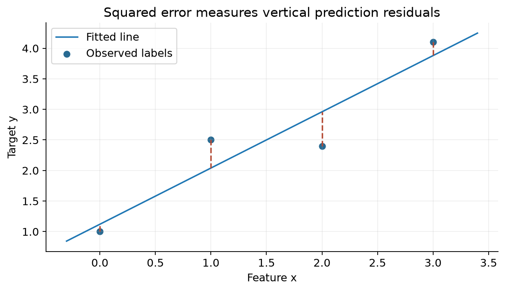

Picture mein each vertical segment same input par actual aur predicted target ka difference hai. Input ko line tak horizontally shift nahi kar rahe. PCA se distance ka yeh difference Lesson 3 mein important hoga.

Squared terms nonnegative hain, so SSE ka smallest possible value 0 hai. **SSE zero tabhi jab every training prediction correct ho.** Ab first question isi basic condition ko model restrictions se jodta hai.

### Q25 — Guaranteed zero training error

**Source:** 2026 Apr 06 Quiz 2, Q25.

**Question:**

Consider a training dataset $(x_i,y_i)_{i=1}^n$ where all input points $x_i\in\mathbb R^d$ are distinct. Which of the following models is guaranteed to achieve a training error of zero?

(a) $h(x_i)=\frac1n\sum_{j=1}^n y_j\quad\forall i\in\{1,\ldots,n\}$

(b) $h(x_i)=0\quad\forall i\in\{1,\ldots,n\}$

(c) $h(x_i)=w^Tx_i+b\quad\forall i\in\{1,\ldots,n\}$, given $n>d+1$

(d) $h(x_i)=y_i\quad\forall i\in\{1,\ldots,n\}$

**Model ko condition se test karo.** Humein aisa model chahiye jo *har supplied training set* par $h(x_i)=y_i$ guarantee kare.

- (a) Mean predictor ek number sabko deta hai. Targets different hon toh every target match nahi hoga.
- (b) Zero predictor tabhi perfect hai jab every target 0 ho.
- (c) Affine rule ke at most $d+1$ independent coefficients hain. $n>d+1$ arbitrary labels ko fit karne ki guarantee nahi; special labels fit ho sakte hain.
- (d) Rule explicitly training input $x_i$ par uska target $y_i$ return karta hai. Hence every term $(h(x_i)-y_i)^2=0$.

$$\boxed{\text{(d)}}.$$

Distinct inputs ka role: same input par conflicting targets hote toh a single-valued lookup function dono return nahi kar sakti. Yahan distinctness us conflict ko remove karti hai.

**Is question se kya seekha?** Memorization training error solve karti hai. Unseen $x_*$ ka answer option (d) specify nahi karta. Generalization ek separate question hai; Lesson 5 mein held-out points se check karenge.

### 1.4 Next problem: Restricted model ka best compromise

Q25 ka lookup rule har training target yaad rakh sakta hai. Linear regression deliberately ek shared rule choose karti hai, taaki new input par bhi prediction defined ho. Shared weights ki wajah se all observations ko independently satisfy nahi kar sakte. Ab task hai: **allowed predictions mein least squared error wali prediction choose karna.** Pehle one constant, phir one slope, phir multiple weights fit karenge.

---

## 2. Least squares: Constant se multiple weights tak

### 2.1 One unknown constant: Average formula kahan se aati hai?

Prerequisite sirf squared error aur derivative hai. Model $h(x)=b$ input ignore karta hai. Targets $1,3$ ke liye candidate $b=1$ ki SSE $0^2+2^2=4$; $b=2$ ki $1^2+1^2=2$; $b=3$ ki 4. Middle value better compromise hai. General result derive karo:

$$L(b)=\sum_i(b-y_i)^2,\qquad L'(b)=2\sum_i(b-y_i)=2nb-2\sum_i y_i.$$

At the minimum slope zero, so $nb=\sum_i y_i$, giving

$$\boxed{b^*=\bar y=\frac1n\sum_i y_i}.$$

Second derivative $L''(b)=2n>0$ confirms upward curvature. Equivalent explanation: prediction mean ke upar ho toh residual imbalance pushes it down, aur mean ke neeche ho toh up. This is why the mean appears; input values are absent because model has no input coefficient.

Q36 mein exactly yahi model hai. $x$ column visible hone se slope fit karna required nahi ho jaata.

### Q36 — Fit only an intercept

**Source:** Week 5 — Solve With Instructors, Q10.

**Question:**

Consider fitting a linear regression model (as stated below) for the following data:

| $x$ | $y$ |
|---:|---:|
| −1 | 1 |
| 0 | −1 |
| 2 | 1 |

Fit $y_i=\beta_0$. Find $\beta_0$.

**Read the model before the table:** $y_i=\beta_0$ mein only constant unknown hai. Isliye targets average karenge:

$$L(\beta_0)=(\beta_0-1)^2+(\beta_0+1)^2+(\beta_0-1)^2.$$
$$L'(\beta_0)=2[(\beta_0-1)+(\beta_0+1)+(\beta_0-1)]=2(3\beta_0-1).$$

Set derivative zero: $3\beta_0=1$, hence

$$\boxed{\beta_0=\frac13}.$$

Predictions $(1/3,1/3,1/3)$; actual-minus-predicted residuals $(2/3,-4/3,2/3)$. Their sum is 0 but their squares add to $4/9+16/9+4/9=8/3$. A best fit need not be a perfect fit.

**Carry forward:** Constant feature 1 means derivative balances an *unweighted* residual sum. Next model has feature $x_i$, so derivative will balance an *input-weighted* residual sum instead.

### 2.2 One slope: Why the ratio of two sums?

Now model is $h(x)=wx$; every input gets a different multiple of the same $w$. **Teaching example:** $(1,1),(2,3)$ demand slopes 1 and $3/2$ for individual exact fits. One slope cannot do both, so minimize

$$L(w)=(w-1)^2+(2w-3)^2=5w^2-14w+10.$$

Derivative $10w-14=0$ gives $w=7/5=1.4$. Predictions $(1.4,2.8)$ give SSE $0.4^2+(-0.2)^2=0.2$. Why not simply average the two individual slopes, obtaining 1.25? Because changing $w$ by the same amount changes the prediction at $x=2$ twice as much as at $x=1$. Squared error must account for that sensitivity.

Derive the general rule by the chain rule:

$$\frac{d}{dw}(wx_i-y_i)^2=2(wx_i-y_i)x_i.$$

Factor 2 comes from squaring; $x_i$ comes from differentiating the inside $wx_i-y_i$. Sum over observations and set to zero:

$$0=2\sum_i x_i(wx_i-y_i)
=2\left(w\sum_i x_i^2-\sum_i x_iy_i\right),$$
$$\boxed{w^*=\frac{\sum_i x_i y_i}{\sum_i x_i^2}}\quad\text{when }\sum_i x_i^2>0.$$

Numerator measures signed input–target alignment; denominator measures how strongly inputs respond to a slope change. In the example, numerator $1(1)+2(3)=7$, denominator $1+4=5$. If every $x_i=0$, denominator 0 and predictions fixed at 0: data cannot identify any slope. Do not divide by zero or invent a unique weight.

Q7 changes the small example by including negative inputs. Negative $x_i$ can make $x_iy_i$ positive or negative; $x_i^2$ always stays nonnegative.

### Q7 — Scalar optimal slope

**Source:** 2024 Aug 04 Quiz 2, Q7.

**Question:**

Consider the following training dataset for a linear regression problem with one feature:

| $x_i$ | $y_i$ |
|---:|---:|
| 1 | 1.2 |
| −1 | 0.1 |
| 2 | 2.1 |
| −2 | −1 |

Find the value of $w^*$, the optimal weight.

**Applicable model:** Use the no-intercept model $\hat y=wx$ as in this question's regression setup. The numerator and denominator come from its zero-derivative condition.

| Observation | $x_iy_i$ | $x_i^2$ |
|---|---:|---:|
| $(1,1.2)$ | $1(1.2)=1.2$ | 1 |
| $(-1,0.1)$ | $(-1)(0.1)=-0.1$ | 1 |
| $(2,2.1)$ | $2(2.1)=4.2$ | 4 |
| $(-2,-1)$ | $(-2)(-1)=2$ | 4 |
| Sum | $7.3$ | $10$ |

$$\boxed{w^*=7.3/10=0.73}.$$

Check the optimality condition without claiming perfect predictions: $w^*\sum x_i^2-\sum x_iy_i=0.73(10)-7.3=0$. This is a **weighted** residual balance. Q36 had constant inputs 1; substituting $x_i=1$ into this same formula recovers the target mean.

### 2.3 Multiple weights: Matrix notation compresses the same calculation

One feature gives one derivative. With $d$ features, prediction is $\hat y_i=\sum_jw_jx_{ij}$ and coordinate $w_j$ changes that prediction at rate $x_{ij}$. Therefore

$$\frac{\partial L}{\partial w_j}=2\sum_{i=1}^n x_{ij}(w^Tx_i-y_i).$$

We need all $d$ derivatives zero simultaneously. Matrix notation packages these equations; it does not introduce a different fitting principle.

These notes usually store samples as **columns**:

$$X=[x_1\ \cdots\ x_n]\in\mathbb R^{d\times n},\quad
w\in\mathbb R^{d\times1},\quad y\in\mathbb R^{n\times1}.$$

$X^T$ has one observation in each row. Multiplying that row by $w$ gives its prediction, so all predictions stack as $X^Tw$. Now $e=X^Tw-y$ has $n$ entries. Multiplying $Xe$ sums feature-weighted errors into $d$ entries—exactly the coordinate derivatives without their factor 2:

$$\nabla L(w)=2X(X^Tw-y),\qquad
\nabla L(w)=0\Longleftrightarrow \boxed{XX^Tw=Xy}.$$

These are the **normal equations**. “Normal” refers to the perpendicular-residual geometry coming next; Gaussian/normal noise is a separate explanation later.

**Which entries are we calculating?** Entry $(j,k)$ of $XX^T$ is $\sum_i x_{ij}x_{ik}$; entry $j$ of $Xy$ is $\sum_i x_{ij}y_i$. One-feature case reduces to the two sums used in Q7. If samples are stored as rows instead, the same reasoning gives $X^TXw=X^Ty$. Follow what the stated prediction expression multiplies, not a memorized arrangement of transposes.

### 2.4 First two-feature question: Can we reach zero loss?

Q2 supplies answer choices for a two-weight rule. Before calculating an inverse, try whether a candidate can satisfy all observations. Zero SSE is a certificate of global optimality, since a sum of squares cannot go below zero. Solving just two equations proposes a candidate; checking the remaining observations establishes that the candidate actually solves the full problem.

### Q2 — Fit a two-feature linear relationship and training MSE

**Source:** May 2025 Quiz 1, Q2.

**Question:**

Comprehension: Consider the following dataset with feature vector x and label y:

| x | y |
|---|---:|
| $[4,1]^T$ | 2 |
| $[2,8]^T$ | −14 |
| $[1,4]^T$ | −7 |
| $[3,2]^T$ | −1 |

Based on the above data, answer the given subquestions.

(i) Fit the linear regression model $y=wx$, $w=[w_1\ w_2]^T$ using the squared error.

(a) $y=x_1+2x_2$

(b) $y=x_1-2x_2$

(c) $y=x_1-x_2$

(d) $y=x_1+x_2$

(ii) Find the mean squared error for the training dataset.

**(i) Find a candidate.** Interpret the supplied $y=wx$ notation as the scalar dot product $\hat y=w^Tx$. First two observations require

$$4w_1+w_2=2,\qquad 2w_1+8w_2=-14.$$

First gives $w_2=2-4w_1$. Substitute into second:

$$2w_1+8(2-4w_1)=-14
\Rightarrow -30w_1=-30
\Rightarrow w_1=1,\quad w_2=-2.$$

**Verify on every observation:**

| Input | Prediction $x_1-2x_2$ | Target | Squared error |
|---|---:|---:|---:|
| $(4,1)$ | $4-2=2$ | 2 | 0 |
| $(2,8)$ | $2-16=-14$ | −14 | 0 |
| $(1,4)$ | $1-8=-7$ | −7 | 0 |
| $(3,2)$ | $3-4=-1$ | −1 | 0 |

All residuals zero, hence **(i) (b)**. **(ii)** $\operatorname{MSE}=\operatorname{SSE}/4=\boxed{0}$.

**Connect to the general method:** Here

$$X=\begin{bmatrix}4&2&1&3\\1&8&4&2\end{bmatrix},\quad
XX^T=\begin{bmatrix}30&30\\30&85\end{bmatrix},\quad Xy=\begin{bmatrix}-30\\-140\end{bmatrix}.$$

For example, $(XX^T)_{12}=4(1)+2(8)+1(4)+3(2)=30$. Normal equations are $30w_1+30w_2=-30$ and $30w_1+85w_2=-140$. Subtracting yields $55w_2=-110$, then $w_2=-2,w_1=1$, the same answer. Direct interpolation worked because the remaining points were consistent; that will change in Q35.

### 2.5 Inconsistent observations: Solving the normal equations

Suppose the first two observations force $w_1=w_2=1$ but a third requires $w_1+w_2=0$. No exact solution exists. Least squares does **not** discard the third observation; it adjusts both weights to compromise across all three.

If $A=XX^T$ is invertible, multiplying $Aw=Xy$ by $A^{-1}$ gives $w^*=A^{-1}Xy$. Invertibility means independent parameter directions can be distinguished by the observed inputs. Algebraically, for any vector $v$,

$$v^TAv=v^TXX^Tv=\|X^Tv\|^2\ge0.$$

When this is positive for every nonzero $v$, the loss curves upward in every parameter direction and its minimizer is unique. This happens when $X$ has **full row rank** $d$, meaning its $d$ feature rows are linearly independent. If some nonzero $v$ gives $X^Tv=0$, moving weights along $v$ changes no training prediction; inverse fails and multiple weights can tie. The normal equations still make sense. A canonical smallest-length solution uses the Moore–Penrose **pseudoinverse**:

$$w_{\min}=(XX^T)^\dagger Xy.$$

For now, understand its job: choose one minimum-norm least-squares solution when an ordinary inverse is unavailable. Lesson 3 explains why predictions can still be unique.

Q35 has an invertible $A$ but inconsistent targets. That distinction—unique weights versus zero error—is the point of the next calculation.

### Q35 — Normal equations when an exact fit is impossible

**Source:** Week 5 — Solve With Instructors, Q1.

**Question:**

Suppose you are given three training instances $(x_1,y_1)$, $(x_2,y_2)$ and $(x_3,y_3)$ as follows:

$$(x_1,y_1)=([1,0]^T,1),\quad (x_2,y_2)=([0,1]^T,1),\quad (x_3,y_3)=([1,1]^T,0).$$

Each $x_i$ is a data point and $y_i$ its corresponding label. Predict the output using $\hat y=X^Tw$, where $w=[w_1,w_2]^T$. Find the $w$ that minimizes $\|y-\hat y\|^2$, where $y=[1,1,0]^T$.

Hint: For $A=\begin{bmatrix}a&b\\c&d\end{bmatrix}$, use $A^{-1}=\frac1{\det A}\begin{bmatrix}d&-b\\-c&a\end{bmatrix}$.

**1. Translate each input into a prediction.** With columns as observations,

$$X=\begin{bmatrix}1&0&1\\0&1&1\end{bmatrix},\qquad
X^Tw=\begin{bmatrix}w_1\\w_2\\w_1+w_2\end{bmatrix}.$$

Targets demand $w_1=1,w_2=1,w_1+w_2=0$, which is impossible. Therefore use least squares across **all** observations:

$$L(w)=(w_1-1)^2+(w_2-1)^2+(w_1+w_2)^2.$$

**2. Form the normal equations.** Matrix products collect the coefficients of the two derivative equations:

$$XX^T=\begin{bmatrix}
1^2+0^2+1^2&1(0)+0(1)+1(1)\\
0(1)+1(0)+1(1)&0^2+1^2+1^2
\end{bmatrix}=\begin{bmatrix}2&1\\1&2\end{bmatrix},$$
$$Xy=\begin{bmatrix}1(1)+0(1)+1(0)\\0(1)+1(1)+1(0)\end{bmatrix}
=\begin{bmatrix}1\\1\end{bmatrix}.$$

Thus $2w_1+w_2=1$, $w_1+2w_2=1$. Subtract: $w_1=w_2$; substitute: $3w_1=1$. Hence

$$\boxed{w^*=(1/3,1/3)^T}.$$

**3. Connect the supplied inverse hint.** Determinant $2(2)-1(1)=3\ne0$, so

$$(XX^T)^{-1}=\frac13\begin{bmatrix}2&-1\\-1&2\end{bmatrix},\qquad
w^*=\frac13\begin{bmatrix}2-1\\-1+2\end{bmatrix}.$$

Both solving equations and multiplying by the inverse give the same weights. In computation, solving the system avoids needing to explicitly form an inverse.

**4. Predictions, residuals, and loss.**

$$\hat y=(1/3,1/3,2/3)^T,\quad
r=y-\hat y=(2/3,2/3,-2/3)^T.$$
$$\operatorname{SSE}=4/9+4/9+4/9=\boxed{4/3},\qquad
\operatorname{MSE}=(4/3)/3=\boxed{4/9}.$$

**5. Check that this really is best.** $Xr=(2/3-2/3,2/3-2/3)^T=0$, the normal-equation condition. Squared loss has nonnegative curvature, so this stationary point is global; invertibility makes it unique.

**Q2 versus Q35:** Same method and same number of weights. Q2's labels were representable, so every residual vanished. Q35's labels conflict with the model, so only the feature-weighted residual sums vanish. “Set gradient to zero” never meant “set every error to zero.”

### 2.6 Change the units: Which weights should change?

Before another fit, use meaning. If every target doubles, a prediction rule twice as large should fit the doubled targets equally well relative to their scale. If every input doubles while targets stay fixed, weights can halve to preserve predictions. These are different transformations of the **data**.

For unique/minimum-norm least squares, writing $A=XX^T$ makes this explicit:

- $y\to cy$: $A$ stays fixed, $Xy\to cXy$, so $w^*\to cw^*$.
- $X\to cX$, $c\ne0$: $A\to c^2A$, $Xy\to cXy$, so $w^*\to w^*/c$.

If an unscaled intercept feature 1 is present, scaling only the raw inputs rescales slopes, not the intercept. Q12 scales the feature vectors stated in its no-separate-intercept model.

### Q12 — Doubling labels or inputs

**Source:** 2024 Dec 01 Quiz 2, Q12.

**Question:**

Consider a linear regression model with loss

$$L(w)=\sum_{i=1}^n(w^Tx_i-y_i)^2,$$

where $x_i$'s are the d-dimensional training data points and $y_i$'s are their corresponding labels. For the optimal weight vector $w^*$, which among the following is correct? (MSQ)

(a) If we double all the values of $y_i$, $w^*$ will also get doubled.

(b) If we double all the values of $y_i$, $w^*$ will get halved.

(c) If we double all the values of $x_i$, $w^*$ will get halved.

(d) If we double all the values of $x_i$, $w^*$ will also get doubled.

**Labels double:** Solve the new normal equation with $2y$:

$$w_{new}=(XX^T)^{-1}X(2y)=2w^*.$$

Predictions double too. Therefore (a) true, (b) false.

**Inputs double:** Both sides' matrix factors change:

$$w_{new}=((2X)(2X)^T)^{-1}(2X)y
=(4XX^T)^{-1}2Xy=\tfrac12w^*.$$

Check a prediction: $(w^*/2)^T(2x_i)=w^{*T}x_i$, unchanged as needed. Therefore (c) true, (d) false.

$$\boxed{\text{(a), (c)}}.$$

If weights are nonunique, the transformed vector is an optimum; a completely arbitrary selection of null-space components need not follow a forced scaling rule. The unique or minimum-norm convention makes the stated weight mapping definite.

### 2.7 Change the dataset: Can we prove an old fit stays optimal?

Q12 changed units. Q21 changes observations. Recalculating an inverse would hide the useful idea: **if an old optimum already minimizes every newly added nonnegative penalty, it remains optimal.** Duplicating all data scales the old loss uniformly; duplicating selected points would change their relative importance instead.

### Q21 — Duplicate observations and add points exactly on the fitted model

**Source:** 2025 Aug 03 Quiz 2, Q21.

**Question:**

Consider a dataset $D=\{(x_1,y_1),\ldots,(x_n,y_n)\}$. Let $w^*\in\mathbb R^d$ be the solution of the optimization problem $\min_{w\in\mathbb R^d}\lVert X^Tw-y\rVert_2^2$, where $X\in\mathbb R^{d\times n}$ and $y\in\mathbb R^n$. Construct a new dataset $D_{new}$ by duplicating all points in D and adding 10 new points that lie exactly on the line $y=x^Tw^*$. Then, the solution $w^*_{new}$ of the corresponding optimization problem is also $w^*$.

(a) TRUE

(b) FALSE

Let $L(w)$ be the old SSE. Duplicating every old observation makes its contribution $2L(w)$. Added points satisfy $\widetilde y_j=\widetilde x_j^Tw^*$, so

$$L_{new}(w)=2L(w)+\sum_{j=1}^{10}(\widetilde x_j^Tw-\widetilde x_j^Tw^*)^2.$$

For any $w$, first term is at least $2L(w^*)$ and every added square is at least 0. At the old $w^*$, both lower bounds are attained simultaneously:

$$L_{new}(w)\ge2L(w^*)=L_{new}(w^*).$$

$$\boxed{\text{(a) TRUE: the old }w^*\text{ remains a minimizer}.}$$

This conclusion does not require an exact fit to the original data. It requires zero error on the *new* points at the old optimum. If several minimizers exist, a solver may select a different tied vector; “remains a minimizer” is the precise claim. Selected duplication or off-model additions can change the optimum.

### 2.8 What the fitting chapter established

A constant, a scalar slope, and a multi-feature predictor all minimize the same kind of squared error over different allowed prediction sets. Mean fitting balances residuals; slope fitting balances input-weighted residuals; matrix fitting balances them against every feature. Exact fit is an extra property of the data, not a promise of the fitting method.

One important question remains: **why do these residual balances characterize the closest attainable prediction?** Geometry will turn the derivative equations into a picture and explain the rank/uniqueness caveats rather than treating them as exceptions to memorize.

---

## 3. Geometry: What can the model represent?

### 3.1 First locate the vectors: Inputs and labels live in different spaces

Prerequisites: a linear combination is a weighted sum; a span is the set of all such sums; orthogonality means dot product zero. The difficulty here is identifying **which vectors** we are combining.

Return to Q35:

$$X=\begin{bmatrix}1&0&1\\0&1&1\end{bmatrix},\qquad
X^Tw=w_1\begin{bmatrix}1\\0\\1\end{bmatrix}
+w_2\begin{bmatrix}0\\1\\1\end{bmatrix}.$$

Columns of $X$ are three input points, each in $\mathbb R^2$. Rows, viewed as column vectors, are two **features across all observations**, each in $\mathbb R^3$. Name those feature vectors $f_1,f_2$. Because one weight multiplies each feature, every possible prediction vector belongs to $S=\operatorname{span}\{f_1,f_2\}$. The target $y$ also has three entries, so comparing $y$ with this prediction span makes sense.

| Object | Space when $X$ is $d\times n$ | Why it matters |
|---|---|---|
| Each data column $x_i$, weight $w$ | $\mathbb R^d$ | Their dot product gives one prediction |
| Each feature row $f_j$, labels $y$, predictions $\hat y$ | $\mathbb R^n$ | Feature combinations give all predictions at once |
| Data span $\operatorname{col}(X)$ | Subspace of $\mathbb R^d$ | Controls which weight directions training can identify |
| Feature span $\operatorname{row}(X)=\operatorname{col}(X^T)$ | Subspace of $\mathbb R^n$ | Controls which label vectors can be fitted |

Same matrix, two useful spaces. Projection of an $n$-entry target must happen in its $n$-dimensional observation space; a $d$-entry weight cannot be identified with that projected vector.

### 3.2 Least squares is the closest attainable prediction

Since $\hat y=X^Tw$ ranges over $S$, fitting minimizes $\|y-\hat y\|^2$ over $\hat y\in S$. That is exactly the definition of orthogonal projection onto a subspace:

$$\boxed{\hat y=P_Sy,\qquad S=\operatorname{row}(X)}.$$

$P_Sy$ means the closest vector in $S$ to $y$; it is not an extra fitting formula to memorize. To understand why the leftover must be perpendicular, suppose residual $r=y-\hat y$ still had a component along an available feature. Moving $\hat y$ a little in that direction would reduce the error. At the optimum no such improvement remains, so each $f_j^Tr=0$, or $Xr=0$.

**Exact proof that this condition is sufficient:** Any other attainable prediction is $\hat y+s$ for some $s\in S$. If $r\perp S$,

$$\|y-(\hat y+s)\|^2=\|r-s\|^2
=\|r\|^2-2r^Ts+\|s\|^2
=\|r\|^2+\|s\|^2\ge\|r\|^2.$$

Every nonzero change in prediction increases loss. Thus the optimal prediction vector is unique, even if several weight vectors produce it. This is the geometric reason behind the normal equations.

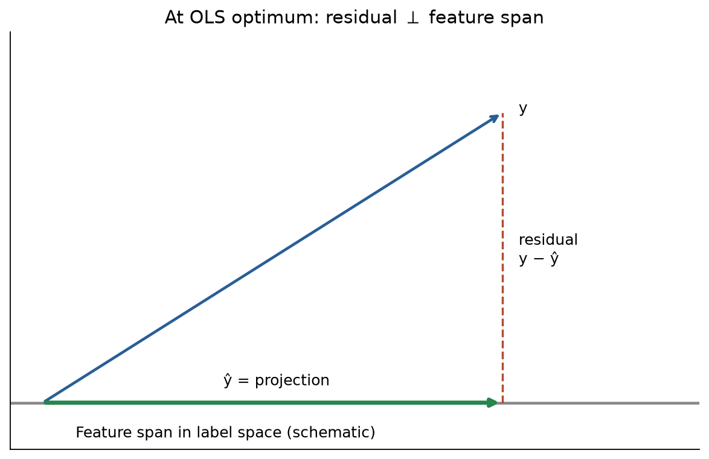

**Teaching example continued:** For $(1,1),(2,3)$, one feature vector is $f=(1,2)^T$. Attainable predictions $(w,2w)^T$ form a line in **two-sample label space**, even though each input is scalar. Best $w=1.4$ gives $\hat y=(1.4,2.8)^T$ and $r=(-0.4,0.2)^T$. Dot product $f^Tr=-0.4+0.4=0$ confirms projection.

Q37 gives the projection itself. Its first step is therefore recovering weights from already fitted labels, not projecting the labels a second time.

### Q37 — Recover weights from projected labels

**Source:** Week 5 — Solve With Instructors, Q5.

**Question:**

Consider the following data points: $\{(1,2),(3,1),(-1,4)\}$. The projection of the label vector onto the span of the feature vectors of the data points is $(2,11,-8)$. Predict the label for $(7,3)$ using linear regression.

**1. Interpret what is given.** The vector $(2,11,-8)^T$ is $\hat y$, not the unknown original $y$. It already lies in the feature span. Form

$$X^T=\begin{bmatrix}1&2\\3&1\\-1&4\end{bmatrix},\qquad X^Tw=\begin{bmatrix}2\\11\\-8\end{bmatrix}.$$

This gives $w_1+2w_2=2$, $3w_1+w_2=11$, $-w_1+4w_2=-8$.

**2. Recover weights.** First equation gives $w_1=2-2w_2$. Substitute into the second:

$$3(2-2w_2)+w_2=11\Rightarrow -5w_2=5
\Rightarrow w_2=-1,\quad w_1=4.$$

Third equation checks $-4+4(-1)=-8$. All projected entries are consistent.

**3. Predict the new input:**

$$\boxed{\hat y(7,3)=4(7)+(-1)(3)=25}.$$

Q2 recovered weights from actual labels that happened to be exactly representable. Here we recover weights from *projected* labels, which are representable by construction. The original residual is unavailable but unnecessary for the requested prediction.

### 3.3 Perpendicular to features also means perpendicular to the fitted vector

Every fitted vector is a feature combination. If $r$ is perpendicular to every feature, it is perpendicular to that combination:

$$\hat y^Tr=(X^Tw^*)^Tr=w^{*T}Xr=0.$$

Consequently $y=\hat y+r$ is a perpendicular decomposition and

$$\|y\|^2=\|\hat y\|^2+\|r\|^2,\qquad y^Tr=\|r\|^2.$$

For the tiny example, $\|y\|^2=1+9=10$; $\|\hat y\|^2=1.96+7.84=9.8$ and $\|r\|^2=0.2$. Their sum is 10. **Labels themselves are generally not perpendicular to the residual.** Q33 tests exactly this distinction, while reversing the storage convention.

### Q33 — Fitted vector is orthogonal to the residual

**Source:** 2026 Sep 13 ET, Q33.

**Question:**

Let $w^*$ be the solution to the ordinary least-squares linear regression problem

$$\min_w\lVert y-Xw\rVert^2.$$

Which of the following is always satisfied at $w^*$? Note that here X is your feature matrix and y is the label vector.

(a) $(Xw^*)^T(y-Xw^*)=0$

(b) $(Xw^*)^T(Xw^*)=0$

(c) $y^T(y-Xw^*)=0$

(d) $y-Xw^*=0$

**Read the expression first:** This question uses predictions $Xw$, so samples are rows. Its normal-equation condition is $X^T(y-Xw^*)=0$.

Multiply by $(w^*)^T$:

$$(w^*)^TX^T(y-Xw^*)=(Xw^*)^T(y-Xw^*)=0.$$

This is fitted-vector/residual orthogonality, hence **(a)**.

- (b) says $\|Xw^*\|^2=0$, requiring all fitted values zero. That is a special case.
- (c) says $y^Tr=0$, whereas $y=\hat y+r$ gives $y^Tr=\|r\|^2$.
- (d) requires perfect fitting, also a special case.

$$\boxed{\text{(a)}}.$$

Changing matrix orientation changes where transposes appear; it does not change the geometric statement. To transfer this solution to another question, name prediction and residual first, then check their dot product.

### 3.4 Zero residual: When does the projection equal the target?

Projection loses nothing exactly when the target is already in the allowed span:

$$\boxed{\operatorname{SSE}_{min}=0\iff y\in\operatorname{row}(X)\iff \exists w:X^Tw=y}.$$

“Exists” asks whether the linear equations are consistent. If rank$(X)=n$, the feature span is all of $\mathbb R^n$ and every target vector fits. If $n>d$, that span cannot fill $\mathbb R^n$, but particular labels can still lie in it. Q2 was such a case. By contrast, unique weights require rank$(X)=d$. **Rank $n$ for arbitrary-label interpolation and rank $d$ for unique coefficients answer different questions.**

Q31 uses the same feature matrix as Q35, allowing a direct comparison: keep the model fixed and change the labels.

### Q31 — Check whether labels belong to feature span

**Source:** 2026 Aug 14 Quiz 2, Q31.

**Question:**

A dataset has n = 3 data points and d = 2 features. The two feature vectors are

$$f_1=[1,0,1]^T,\qquad f_2=[0,1,1]^T.$$

For which label vector y is the linear model $f(x)=w^Tx$ guaranteed to achieve exactly zero training error?

(a) $y=[1,2,3]^T$

(b) $y=[1,2,4]^T$

(c) $y=[2,1,4]^T$

(d) $y=[0,0,1]^T$

The model can produce only

$$\hat y=w_1f_1+w_2f_2=(w_1,w_2,w_1+w_2)^T.$$

To equal $y$, first two entries fix $w_1=y_1,w_2=y_2$. Third must therefore satisfy $y_3=y_1+y_2$.

| Option | Required sum | Given third entry | Fits? |
|---|---|---:|---|
| (a) | $1+2=3$ | 3 | Yes, $w=(1,2)^T$ |
| (b) | $1+2=3$ | 4 | No |
| (c) | $2+1=3$ | 4 | No |
| (d) | $0+0=0$ | 1 | No |

$$\boxed{\text{(a)}}.$$

Q35 had $y=(1,1,0)^T$, violating the same condition $0=1+1$. Its nonzero minimum error was forced by this geometry, not by a failure to optimize. You can recognize impossibility before doing any inverse calculation.

**Next variation—does the displayed solver even exist?** Q31 asked whether labels fit. Q6 adds the assumption that an ordinary inverse is used. A dataset can have zero attainable error while that particular formula is undefined. Keep “can fit” and “can invert” as separate checks.

### Q6 — Zero error and invertibility assumptions

**Source:** 2024 Apr 28 ET, Q6.

**Question:**

Let X be a data matrix of the shape (d, n) and y be the associated label vector of shape (n, 1). Assume that a linear regression model with loss as the sum of squared error is trained on the data {X, y}. In which of the following cases, the loss on the training data will necessarily be zero? Assume that the solution of the model is obtained by the normal equation that is $w^*=(XX^T)^{-1}Xy$. (MSQ)

(a) If y lies in the space spanned of row vectors of X.

(b) If y lies in the space spanned of row vectors of $X^T$.

(c) If all the data points satisfy the equality $x_1+x_2+\cdots+x_d=0$, where $x_i$ is the ith feature and y = 0 for all the data points.

(d) If all the data points satisfy the equality $x_1^3+x_2^3+\cdots+x_d^3=0$, where $x_i$ is the ith feature and y = 0 for all the data points.

**(a):** Exactly the criterion just derived: $y$ in the row/feature span gives zero residual. Correct.

**(b):** Rows of $X^T$ are input vectors in $\mathbb R^d$; $y$ lies in $\mathbb R^n$. This uses the wrong span and is generally dimensionally incompatible.

**(c):** Every input has coordinate sum zero. Let $\mathbf1_d$ be the nonzero $d$-entry vector of ones. Then $X^T\mathbf1_d=0$, hence $XX^T\mathbf1_d=0$. Thus $XX^T$ is singular and the assumed inverse cannot exist. Nevertheless, since $y=0$, choosing $w=0$ gives zero loss. The problem is the solver assumption, not existence of a perfect fit.

**(d):** The cubic condition is nonlinear and need not force a linear dependence. For example, in $d=3$, columns $(1,-1,0)^T,(1,0,-1)^T,(1,1,-\sqrt[3]2)^T$ satisfy it, and their determinant is $2-\sqrt[3]2\ne0$. Whenever the stated inverse exists, $y=0$ gives $w^*=0$, again zero loss.

**Existing answer-key caveat:** The notes report the paper's key as **(a) only**. Mathematically, **(a) and (d)** give zero loss in cases compatible with the inverse assumption. Without that inverse restriction, **(c)** also permits zero loss. Do not turn a singular-matrix issue into the false rule that zero labels cannot be fitted.

### 3.5 A different geometric picture: Joint input–target coordinates

So far we plotted the *whole label vector* in $\mathbb R^n$. Another picture plots each paired observation $(x_i,y_i)$ in $\mathbb R^{d+1}$. For exact fit,

$$y_i=w^Tx_i\Longleftrightarrow (w,-1)^T(x_i,y_i)=0.$$

A set defined by one linear equation with a nonzero normal vector is a hyperplane. Here the normal $(w,-1)$ is always nonzero. One input plus one target gives a line in 2D; two inputs plus one target give a plane in 3D. This does not require the inputs alone to lie in a lower-dimensional hyperplane. Q38 checks that we count the target coordinate too.

### Q38 — What follows from zero squared error?

**Source:** Week 5 — Solve With Instructors, Q6.

**Question:**

We have data points $D=\{(x_1,y_1),\ldots,(x_n,y_n)\}$, where $x_i\in\mathbb R^d$ and $y_i\in\mathbb R$. We get a $w$ after linear regression such that $\sum_i(y_i-f(x_i))^2=0$, where $f(x_i)=w^Tx_i$. Which options are true?

(A) $w$ is a result of overfitting.

(B) Every datapoint in $D$ is on some hyperplane in $\mathbb R^d$.

(C) Every datapoint in $D$ is on some hyperplane in $\mathbb R^{d+1}$.

(D) Let $Y=(y_1,\ldots,y_n)^T$ and $Y_p$ be the projection of $Y$ onto the span of the feature vectors of $x_1,\ldots,x_n$. Then $\|Y-Y_p\|>0$.

Since every squared residual is nonnegative, their sum being zero means every $y_i=w^Tx_i$.

- **(C) is true:** All joint points satisfy $(w,-1)^T(x_i,y_i)=0$, a hyperplane in $\mathbb R^{d+1}$.
- **(B) is not guaranteed:** Take $d=1$, inputs 0 and 1, targets 0 and 1, $w=1$. Perfect fit, but the two distinct inputs do not lie on one hyperplane of $\mathbb R^1$ (a single point).
- **(D) is false:** Exact fit means $Y_p=Y$, so $\|Y-Y_p\|=0$.
- **(A) is not guaranteed:** True noiseless linear data can fit perfectly; overfitting concerns behavior beyond the training set. Zero training error alone does not decide it.

$$\boxed{\text{(C) only}}.$$

Q31 recognized representable **labels**; Q38 describes the resulting **paired observations**. They express the same equations in different spaces. Q25 already warned that zero training error alone says little about generalization.

### 3.6 Opposite extreme: None of the target lies along an available feature

A target may have both representable and unrepresentable components. We have just studied the all-representable extreme, residual 0. Now suppose $y\perp S$. Its projection is then 0; adding any nonzero vector from $S$ moves farther from $y$.

**Teaching example:** One feature across two samples $f=(1,1)^T$, targets $y=(1,-1)^T$. Dot product 0. Constant prediction $(b,b)^T$ has loss $(1-b)^2+(-1-b)^2=2+2b^2$, minimized by $b=0$, loss 2. Normal equations have a solution even though no target component can be represented. Q32 generalizes this argument.

### Q32 — Labels orthogonal to every feature

**Source:** 2026 Aug 14 Quiz 2, Q32.

**Question:**

Suppose the label vector $y\ne0$ is orthogonal to every feature vector, i.e.

$$f_j^Ty=0\quad\text{for all }j=1,\ldots,d.$$

$w^*$ is the optimal weight obtained after minimizing the objective function of linear regression. Which statement is correct?

(a) $X^Tw^*=y$ and the training error is 0.

(b) $X^Tw^*=0$ and the squared training error equals $\lVert y\rVert_2^2$.

(c) $X^Tw^*=0$ and the squared training error equals 0.

(d) The normal equations have no solution.

Feature orthogonality means $Xy=0$. For any attainable prediction $\hat y=X^Tw$,

$$y^T\hat y=y^TX^Tw=(Xy)^Tw=0.$$

Expand the loss:

$$\|y-\hat y\|^2=\|y\|^2-2y^T\hat y+\|\hat y\|^2
=\|y\|^2+\|\hat y\|^2.$$

It is smallest when $\hat y=0$, attainable with $w=0$. Since $y\ne0$, minimum squared error $\|y\|^2$ is positive.

$$\boxed{\text{(b)}}.$$

The normal equations are $XX^Tw=0$, solved by $w=0$; inconsistent targets do not make these equations unsolvable. Q31 had projection equal to $y$; here projection is zero. Both are endpoints of the same projection rule.

### 3.7 Switch to weight space: Which directions are invisible to training?

Now look at data columns $x_i\in\mathbb R^d$. If some weight component $v$ is perpendicular to every data point, then $x_i^Tv=0$ for all $i$, or $X^Tv=0$. Adding it to weights changes no training prediction.

Decompose any $w=w_\parallel+w_\perp$ relative to the data span: parallel component lies in $\operatorname{col}(X)$, perpendicular component satisfies $X^Tw_\perp=0$. Therefore

$$X^Tw=X^Tw_\parallel,\qquad
\|w\|^2=\|w_\parallel\|^2+\|w_\perp\|^2.$$

Removing the perpendicular part preserves loss and reduces weight length. Thus a minimum-norm optimum lies in the data span and can be written $w_{\min}=X\alpha$. Here $\alpha$ has one coefficient per training input. **This representation will become kernel regression in Lesson 7.**

Q5 first considers an entire optimal weight lying in the invisible direction. Do not confuse it with Q32, which placed the labels perpendicular to the feature span.

### Q5 — Optimal weight orthogonal to the data span

**Source:** 2024 Mar 24 Quiz 2, Q5.

**Question:**

Let X be the data matrix of shape (d, n) and y be the corresponding label vector. A linear regression model of the form $\hat y_i=w^Tx_i$ is fit using the squared error on the same dataset. If the solution $w^*$ to the optimization problem is orthogonal to the subspace spanned of the data point (columns of matrix X), what will be the squared error?

(a) 0

(b) 1

(c) $\lVert y\rVert^2$

(d) Insufficient information to answer

Given $w^*\perp\operatorname{col}(X)$, every $x_i^Tw^*=0$. Hence all predictions are zero and

$$L(w^*)=\sum_i(0-y_i)^2=\boxed{\|y\|_2^2\quad\text{(c)}}.$$

The conclusion follows directly from the stated orthogonality. It does not say the target itself is zero. Because the question also says this weight is optimal, the fitted projection must be zero—consistent with the situation in Q32.

**Compare the premises:** Q5 gives $X^Tw^*=0$ through a condition on weights in $\mathbb R^d$; Q32 gives $Xy=0$ through a condition on labels in $\mathbb R^n$. Same final predictions, different vectors and spaces.

**Nonunique weights, useful prediction:** With one training input $(1,0)$ and target 1, all weights $(1,c)$ fit. Only $c=0$ is the minimum-norm choice. A query $(2,0)$ is predicted as 2 by every fitted weight; query $(0,1)$ is predicted as $c$ and remains undetermined without a selection rule. Q39 generalizes this example to all inputs on one direction.

### Q39 — All inputs lie along one direction

**Source:** Week 5 — Solve With Instructors, Q3.

**Question:**

Consider the data points $\{(c_1u,y_1),\ldots,(c_nu,y_n)\}$ for a regression problem. Here $c_i$ is a real number and $u\in\mathbb R^d$, $u\ne0$. Fit a linear regression model and find the predicted value for $x_{test}=5u$. Assume some $c_i\ne0$. Given $\sum_i c_i y_i=20$ and $\sum_i c_i^2=100$.

**1. Identify what the data can learn.** Since $x_i=c_i u$,

$$w^Tx_i=c_i(w^Tu).$$

Only the scalar $a=w^Tu$ matters. Loss is $\sum_i(c_i a-y_i)^2$, the no-intercept one-slope problem from Q7, with $c_i$ playing the role of scalar input.

**2. Fit this identifiable scalar:**

$$0=2a\sum_i c_i^2-2\sum_i c_i y_i,qquad
\hat a=20/100=0.2.$$

**3. Predict along the observed direction:**

$$\boxed{\hat y(5u)=5(w^Tu)=5(0.2)=1}.$$

**4. Understand the weights.** The minimum-norm choice is

$$w_{\min}=\frac{0.2}{\|u\|^2}u,$$

because its dot product with $u$ is 0.2. Add any $v$ with $v^Tu=0$ and training predictions remain identical. If $d>1$, weights can be nonunique even though prediction at $5u$ is unique. For $u=(1,0)$, weights $(0.2,0)$ and $(0.2,7)$ both predict 1 at $(5,0)$, but give 0 and 7 at $(0,1)$.

**Connection:** Q7's scalar formula still solves the problem after identifying the single effective feature direction. Counting raw input coordinates alone can overstate how much the data determine.

**Now combine the two spaces.** Q23 places statements about the fitted label vector and the fitted weight next to each other. Use the dimensions from Lesson 3.1 and the distinction “any optimum” versus “minimum-norm optimum” from Q39.

### Q23 — Projection and span statements

**Source:** 2025 Aug 03 Quiz 2, Q23.

**Question:**

Let $w^*\in\mathbb R^d$ be the solution of the optimization problem $\min_{w\in\mathbb R^d}\lVert X^Tw-y\rVert_2^2$, where $X\in\mathbb R^{d\times n}$ and $y\in\mathbb R^n$. Then, which of the following statements is/are true? (MSQ)

(a) $X^Tw^*$ is the projection of the labels onto the subspace spanned by the features.

(b) $X^Tw^*$ is the projection of the labels onto the subspace spanned by the data points.

(c) $w^*$ lies in the span of data points.

(d) $w^*$ lies in the span of features.

- **(a) True for every least-squares optimum:** $X^Tw^*=P_{\operatorname{row}(X)}y$, a projection in $\mathbb R^n$.
- **(b) Wrong space:** Data columns span a subspace of $\mathbb R^d$; label projection belongs to $\mathbb R^n$.
- **(c) True for the minimum-norm solution:** Removing a perpendicular component leaves loss unchanged and reduces norm. Also true when full row rank makes the data span all of $\mathbb R^d$. Without these qualifications, an arbitrary optimal weight can include an invisible perpendicular part, as in Q39.
- **(d) Wrong space:** Feature vectors have $n$ entries, while weights have $d$ entries.

$$\boxed{\text{Paper's intended answer: (a), (c)}}.$$

Strictly, with no minimum-norm/full-rank selection assumption, **only (a) is guaranteed for every minimizer**. Prediction is uniquely determined on training inputs; the coefficient representation may not be.

### 3.8 The intercept gives one extra orthogonality equation

Adding a fitted intercept adds the all-ones feature vector $\mathbf1_n$ to the prediction span. Residual must be perpendicular to it:

$$\mathbf1_n^Tr=0\Rightarrow\sum_i(y_i-\hat y_i)=0
\Rightarrow\overline{\hat y}=\bar y.$$

This is Q36's mean-balancing principle inside a larger model. It does **not** require all residuals zero, or equal numbers of positive/negative residuals. It requires their signed sum zero. A no-intercept model need not obey it: the tiny slope example had residual sum $-0.4+0.2=-0.2$ at its optimum.

Q24 turns this equation into a statement about whether every point can be overpredicted.

### Q24 — Can an optimal intercept model overpredict every sample?

**Source:** 2026 Apr 06 Quiz 2, Q24.

**Question:**

Consider a linear regression model applied to a dataset in which each data-point is described by two features. The first feature is always 1. The ith data-point’s feature-label pair is represented as $((1,x_i),y_i)$. Let $(w_0^*,w_1^*)\in\mathbb R^2$ be the optimal weight vector that minimizes the sum of squared errors. Consider two scenarios:

$S_1:w_0^*+w_1^*x_i>y_i$, for each data-point $((1,x_i),y_i)$.

$S_2:w_0^*+w_1^*x_i<y_i$, for each data-point $((1,x_i),y_i)$.

Which of the following is true?

(a) $S_1$ is possible, but $S_2$ is impossible.

(b) $S_1$ is impossible, but $S_2$ is possible.

(c) One of $S_1$ or $S_2$ is possible.

(d) Both $S_1$ and $S_2$ are impossible.

The first feature is always 1, so $w_0$ is an unconstrained fitted intercept. Differentiate the ordinary unweighted SSE with respect to it:

$$0=\frac{\partial L}{\partial w_0}
=2\sum_i(w_0^*+w_1^*x_i-y_i).$$

Under $S_1$, every summand is strictly positive, so the sum cannot be zero. Under $S_2$, every summand is strictly negative, again impossible.

$$\boxed{\text{(d): both impossible}}.$$

Geometric/optimization meaning: if every prediction is too high, shifting the whole line slightly down improves every residual; such a line cannot be optimal. Q36 used the same derivative to find a number; Q24 uses it to rule out entire scenarios.

### 3.9 Regression versus PCA: Two projections, different objectives

Prerequisite from Week 1: PCA learns a direction for reconstructing the inputs with minimum squared perpendicular distance. Here regression predicts a designated target from a fixed input. The word “projection” appears in both, but the objects and permitted movements differ.

In an $(x,y)$ scatter plot, regression keeps $x_i$ fixed and measures vertical difference $|y_i-wx_i-b|$. PCA can move the reconstructed point in both coordinates to reach the line perpendicularly. For a nonvertical line, normal vector $(-w,1)$ has length $\sqrt{1+w^2}$, so dividing the absolute line-equation value by this length gives

$$d_{\perp,i}=\frac{|y_i-wx_i-b|}{\sqrt{1+w^2}},\qquad
\operatorname{SSPD}=\frac{\operatorname{SSVD}}{1+w^2}.$$

The denominator changes as the slope changes, so minimizing SSVD does not generally minimize SSPD. Regression's orthogonal projection from Lesson 3.2 was of the **whole label vector onto the fixed feature span**, not of each scatter point onto the fitted line. Keeping those pictures separate resolves the apparent contradiction.

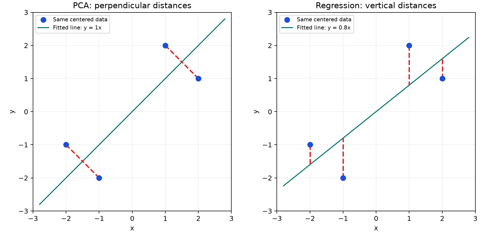

Centered data have $\bar x=\bar y=0$. The optimal regression intercept is then 0 (derived again in Lesson 5), and the PCA line passes through the mean. Both lines pass through the origin, but need not have the same slope. PCA also permits a vertical line, which finite-slope $y=wx+b$ cannot represent.

### Q40 — PCA and regression objectives

**Source:** Week 5 — Solve With Instructors, Q8.

**Question:**

We have $n$ data points $x_1,\ldots,x_n\in\mathbb R$ and corresponding labels $y_1,\ldots,y_n\in\mathbb R$. Form $D=\{(x_1,y_1),\ldots,(x_n,y_n)\}$. PCA on $D$ gives $l_1$, the line along the first principal component. Linear regression gives $l_2$ of the form $y=wx$. Assume $\sum_i(x_i,y_i)=(0,0)$. Choose the correct options.

SSPD means sum squared perpendicular distance; SSVD means sum squared vertical distance.

(A) The SSPD from $D$ to $l_1$ is the minimum possible SSPD to any line in $\mathbb R^2$.

(B) The SSPD from $D$ to $l_2$ is the minimum possible SSPD to any line in $\mathbb R^2$.

(C) The SSVD from $D$ to $l_1$ is the minimum possible SSVD to any line in $\mathbb R^2$.

(D) The SSVD from $D$ to $l_2$ is the minimum possible SSVD to any line in $\mathbb R^2$.

**Choose by the objective being minimized.** PCA's retained PC1 line minimizes squared perpendicular reconstruction error: (A). Regression minimizes squared vertical target errors: (D). Neither method generally optimizes the other distance.

The centered-data assumption makes the best affine-regression intercept $b=\bar y-w\bar x=0$, so the required through-origin model does not exclude the best affine fit.

$$\boxed{\text{(A), (D)}}.$$

**Numerical reason (B)/(C) are not guaranteed:** Use centered points $(-2,-1),(-1,-2),(1,2),(2,1)$. Here $\sum x^2=10$, $\sum y^2=10$, $\sum xy=8$.

Regression slope is $8/10=0.8$. Its vertical residuals are $(0.6,-1.2,1.2,-0.6)$, whose squared sum is $0.36+1.44+1.44+0.36=3.6$. The scatter matrix $\begin{bmatrix}10&8\\8&10\end{bmatrix}$ has largest-eigenvalue direction $(1,1)$, so PCA slope is 1. Its vertical residuals $(1,-1,1,-1)$ give SSVD 4.

Thus regression wins vertically: $3.6<4$. PCA wins perpendicularly: $4/(1+1^2)=2<3.6/(1+0.8^2)\approx2.195$. Perfect nonvertical collinear data can make the lines coincide; “always different” would also be false. Vertical-distance comparisons here concern lines defining $y$ as a function of $x$.

### 3.10 Geometry takeaway: Three questions, three answers

“Can these labels fit?” asks whether $y$ lies in the feature span. “Are the weights unique?” asks whether any nonzero weight direction is invisible to training. “Can we predict this new input uniquely?” asks whether invisible directions affect that input. Q31, Q39 and Q23 now fit into one picture.

Normal equations identify the endpoint of training. Next we study how to approach that endpoint by repeated small changes. Convexity tells us there is no worse local minimum to get trapped in; it does not tell us that every update size is sensible.

---

## 4. Optimization: Best fit tak updates se pahunchna

### 4.1 Why gradient descent when normal equations exist?

Prerequisite: Lesson 2 gave the gradient and the optimum condition. Solving $XX^Tw=Xy$ directly is convenient for small problems. Large datasets or large feature dimensions can make forming and solving the system expensive. Gradient descent (GD) instead starts with a guess and repeatedly uses current errors to adjust weights.

This changes **how we search**, not the squared-error objective. A dense normal-equation approach needs roughly $O(nd^2)$ work to form $XX^T$ and $O(d^3)$ to solve the system; directly evaluating a full gradient needs roughly $O(nd)$ per update. Number of updates and numerical conditioning also matter. QR/SVD-based least-squares solvers may be more numerically stable than explicitly forming an inverse. No single method is automatically best for every $n,d$.

### 4.2 Why subtract the gradient?

For a small parameter change $\Delta w$, the first-order loss change is approximately

$$L(w+\Delta w)-L(w)\approx\nabla L(w)^T\Delta w.$$

If $\Delta w=-\eta\nabla L(w)$ with $\eta>0$, this becomes $-\eta\|\nabla L(w)\|^2$, negative whenever the gradient is nonzero. That motivates

$$\boxed{w^{(t+1)}=w^{(t)}-\eta\nabla L(w^{(t)})}.$$

$t$ counts updates; $\eta$ is learning rate/step multiplier. The argument is local: a huge step can cross the valley and increase loss.

**Teaching example revisited:** $L(w)=5w^2-14w+10$, optimum 1.4. Starting at 0, derivative is $10(0)-14=-14$. With $\eta=0.05$,

$$w^{(1)}=0-0.05(-14)=0.7.$$

Loss becomes $5(0.7)^2-14(0.7)+10=2.65$, down from 10. It improved but has not reached the optimum loss 0.2. “One update” and “fit to optimality” are different requests.

### 4.3 First differentiate the loss actually written

The inside error for one sample is $e=w^Tx-y$. Coordinate derivative $\partial e/\partial w_j=x_j$, so the chain rule gives $\partial(e^2)/\partial w_j=2ex_j$. Stack coordinates: $\nabla(e^2)=2ex$.

| Written objective | Gradient |
|---|---|
| $\sum_i e_i^2$ (SSE) | $2X(X^Tw-y)$ |
| $\tfrac12\sum_i e_i^2$ | $X(X^Tw-y)$ |
| $\tfrac1n\sum_i e_i^2$ (MSE) | $\tfrac2nX(X^Tw-y)$ |
| $\tfrac1{2n}\sum_i e_i^2$ | $\tfrac1nX(X^Tw-y)$ |

Positive constants do not change the best weight, but do change the gradient. In the previous example half-SSE gives derivative $-7$ at 0, so the same learning rate updates to 0.35 rather than 0.7. Q10 tests this factor explicitly, with a wording issue.

### Q10 — Single-sample gradient and the missing factor 2

**Source:** 2024 Sep 01 ET, Q10.

**Question:**

Consider a linear regression problem. Which of the following is the gradient of the SSE function with respect to $w\in\mathbb R^d$, the weight vector, for a single data-point $x\in\mathbb R^d$? y is the true label and $\hat y$ is the predicted label. Note that SSE is the sum of squared errors.

(a) $(\hat y-y)x$

(b) $(w^Tx)w$

(c) $\hat yx$

(d) $xy$

Write $e=w^Tx-y=\hat y-y$. Raw single-sample SSE is $e^2$:

$$\nabla_w(e^2)=2e\nabla_we=2(\hat y-y)x.$$

This exact expression is absent from the options. For **half-SSE**, $e^2/2$, the gradient becomes $(\hat y-y)x$, option (a).

$$\boxed{\text{Intended (a) uses half-SSE; literal SSE needs the missing factor 2.}}$$

The other options omit the target/error dependence or use the weight where the input belongs. The factor 2 does not change the downhill direction, but it changes a numerical step with a fixed learning rate. Q18 and Q15 explicitly provide unscaled-SSE gradients/objectives, so retain 2 in those calculations.

### 4.4 One scalar update: Follow the stated algorithm, then predict

Q7 asked for the optimal slope. Q18 gives an **initial** slope and asks for one update. The same sums $\sum x_i^2$ and $\sum x_iy_i$ appear, but now they evaluate the derivative at the old weight. Only after updating do we predict the new input.

### Q18 — Scalar gradient update and prediction

**Source:** 2025 Mar 16 Quiz 2, Q18.

**Question:**

Comprehension: Consider a linear regression model $y_i=w^Tx_i$ with an initial weight $w=[3]$.

| $x_1$ | y |
|---:|---:|
| 1 | 4 |
| 2 | 7 |
| 3 | 10 |
| 4 | 13 |

Based on the above data, answer the given subquestions.

(i) Using the squared loss function and a learning rate of $\eta=0.2$, compute the updated weight after one iteration of gradient descent for the given dataset:
Use $\nabla f(w)=2(XX^T)w-2Xy$.

(ii) If we stop the algorithm at the weight calculated in the previous question, what will be the predicted value for the data point, $x_1=5$?

**(i) Build the two sums:**

$$XX^T=1^2+2^2+3^2+4^2=30,$$
$$Xy=1(4)+2(7)+3(10)+4(13)=4+14+30+52=100.$$

The specified gradient at old $w=3$ is

$$g=2(30)(3)-2(100)=180-200=-20.$$

Thus

$$\boxed{w_{new}=3-0.2(-20)=7}.$$

**(ii) Use that iterate:** The model has no intercept, so $\boxed{\hat y(5)=7(5)=35}$.

**Why is this far from the targets' pattern?** The data follow $y=3x+1$, but the stated model $wx$ excludes an intercept. Its optimal slope is $100/30=10/3$, not 3 and not 7. At the start all four residuals are $-1$, SSE 4. At $w=7$, residuals are $3,7,11,15$, SSE $9+49+121+225=404$. The given learning rate overshoots; we must still report the requested update. Lesson 4.7 will derive the stable range $0<\eta<1/30$.

### 4.5 Two weights: Compute all errors before changing either coefficient

The scalar update has only one derivative. For multiple weights, compute the full prediction vector at $w^{(t)}$, form errors, and then obtain the full gradient. All coordinates of that gradient belong to the **same old vector**. Updating $w_1$ and using it to compute $w_2$'s derivative would implement a different algorithm.

Q15 is the matrix version of Q18; the arithmetic is larger but the sequence is identical.

### Q15 — One full-batch gradient step

**Source:** 2024 Dec 22 ET, Q15.

**Question:**

Perform one round of the gradient descent algorithm for the linear regression on the below data

$$X=\begin{bmatrix}1&-2&0\\2&5&1\end{bmatrix},\qquad y=\begin{bmatrix}1\\6\\1\end{bmatrix}$$

with the initial weight vector $w_0=[1,0.5]^T$ and learning rate $\eta=0.05$. Find the updated weight vector $w_1$ after one iteration of gradient descent.
Note: The objective function is given by $f(w)=\lVert X^Tw-y\rVert^2$.

(a) $w_1=[0.2,3.1]^T$

(b) $w_1=[0.2,0.5]^T$

(c) $w_1=[1,0.5]^T$

(d) $w_1=[-0.2,3.1]^T$

**1. Old predictions:**

$$X^Tw_0=\begin{bmatrix}1&2\\-2&5\\0&1\end{bmatrix}
\begin{bmatrix}1\\0.5\end{bmatrix}
=\begin{bmatrix}1+1\\-2+2.5\\0+0.5\end{bmatrix}
=\begin{bmatrix}2\\0.5\\0.5\end{bmatrix}.$$

**2. Prediction-minus-target errors:** $e=(2-1,0.5-6,0.5-1)^T=(1,-5.5,-0.5)^T$.

**3. Feature-weighted errors and gradient:**

$$Xe=\begin{bmatrix}1(1)+(-2)(-5.5)+0(-0.5)\\2(1)+5(-5.5)+1(-0.5)\end{bmatrix}
=\begin{bmatrix}12\\-26\end{bmatrix}.$$

Raw SSE needs factor 2, hence $g=(24,-52)^T$.

**4. Simultaneous update:**

$$w_1=\begin{bmatrix}1\\0.5\end{bmatrix}-0.05\begin{bmatrix}24\\-52\end{bmatrix}
=\boxed{\begin{bmatrix}-0.2\\3.1\end{bmatrix}\quad\text{(d)}}.$$

Check loss if you want to diagnose the step: new predictions $(6,15.9,3.1)$ give errors $(5,9.9,2.1)$, SSE $25+98.01+4.41=127.42$, versus old SSE $1+30.25+0.25=31.5$. As in Q18, correct arithmetic can produce a worse iterate when the prescribed step is too large.

### 4.6 Direction and step length are different pieces of information

Standard GD uses $-\eta g$: step length is $\eta\|g\|$. If a question supplies a **unit** downhill direction $u$ and writes $w_{new}=w+\eta u$, step length is instead exactly $\eta$. Q9 supplies unit arrows in parameter space. Its 10,000 training points are not needed once the direction is given; do not recompute an unavailable full gradient.

### Q9 — Negative-gradient direction and new norm

**Source:** 2024 Aug 04 Quiz 2, Q9.

**Question:**

Comprehension: Consider a linear regression problem that has two features with a training dataset of 10,000 points. The blue point in the image below is the weight vector, $w^{(t)}$, at some iteration of gradient descent. $w_1,w_2,w_3$ are unit vectors. Specifically, $w_1$ is a unit vector in the direction of the gradient at this point.

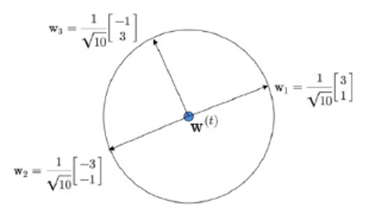

Based on the above data, answer the given subquestions.

(i) If the next iteration of gradient descent is expressed as $w^{(t+1)}=w^{(t)}+\eta w_k$ with $\eta>0$, what would be the value of k?

(ii) If $w^{(t)}=[0.4,0.1]^T$ and $\eta=1/\sqrt{10}$, find $\lVert w^{(t+1)}\rVert$, where we use the usual L2 norm.

**(i) Choose the arrow.** The figure gives

$$w_1=(3,1)^T/\sqrt{10},\quad w_2=(-3,-1)^T/\sqrt{10}=-w_1,\quad
w_3=(-1,3)^T/\sqrt{10}.$$

$w_1$ points along the gradient, uphill. Because the update has a **plus** sign, the added arrow must point downhill: $\boxed{k=2}$.

**(ii) Scale, add coordinates, then take the norm:**

$$\eta w_2=\frac1{\sqrt{10}}\frac{(-3,-1)^T}{\sqrt{10}}
=(-0.3,-0.1)^T,$$
$$w^{(t+1)}=(0.4,0.1)^T+(-0.3,-0.1)^T=(0.1,0)^T,$$
$$\boxed{\|w^{(t+1)}\|_2=\sqrt{0.1^2+0^2}=0.1}.$$

Norms do not add coordinatewise; calculate the resulting vector first. Q15 used the full gradient magnitude, whereas this problem supplies only a normalized direction and a separate step length.

### 4.7 Learning rate: Derive why overshooting happens

Complete the square for the scalar loss:

$$L(w)=a(w-w^*)^2+C,\qquad a=\sum_i x_i^2>0.$$

Here $C$ is the minimum loss, independent of $w$. Derivative $2a(w-w^*)$ gives

$$w^{(t+1)}-w^*=(1-2\eta a)(w^{(t)}-w^*).$$

Each update multiplies the current distance-to-optimum (with sign) by $1-2\eta a$. For that distance to shrink, require

$$|1-2\eta a|<1\Longleftrightarrow \boxed{0<\eta<1/a}.$$

A multiplier between 0 and 1 approaches from the same side; between −1 and 0 alternates sides while approaching; magnitude greater than 1 moves away unless already at the optimum. In Q18, $a=30,\eta=0.2$ gives multiplier $1-12=-11$, explaining the huge overshoot. A convex bowl does not prevent an overly large jump.

For multiple weights, diagonalizing $XX^T$ separates the same calculation along its eigenvector directions. If $a_j>0$ is an eigenvalue, that direction's weight error multiplies by $1-2\eta a_j$. To shrink all identifiable directions, it suffices that

$$0<\eta<1/a_{max},\qquad a_{max}=\lambda_{max}(XX^T).$$

A zero-eigenvalue direction is invisible to training, so its starting component remains unchanged. For half-SSE the factor 2 disappears and the bound becomes $0<\eta<2/a_{max}$.

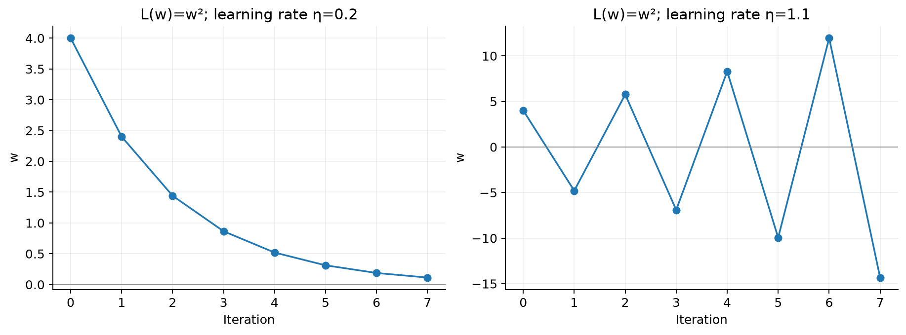

**Special step size:** If scalar $\eta=1/(2a)$, multiplier 0 reaches the minimum in one update. Q41 then asks a subtler implementation question: when does the algorithm *notice* it has stopped?

### Q41 — Reaching the minimum versus detecting a stopped update

**Source:** Week 5 — Solve With Instructors, Q7.

**Question:**

$f(x)=x^2-2x+1$. We are trying to find an $x$ at which the function's value is minimum. Use gradient descent initialized at $x_0=0$. After how many iterations does the algorithm stop? Use $\eta=0.5$.

Complete the square: $f(x)=(x-1)^2$, so optimum $x^*=1$ and $f'(x)=2x-2$.

First update:

$$x_1=0-0.5(2(0)-2)=1.$$

The minimum is reached after **one actual update**. The next update is

$$x_2=1-0.5(2(1)-2)=1.$$

Now two consecutive iterates are equal. If the implementation stops by comparing them *after* an update, it counts **2 rounds**, the answer reported in the existing PDF-based notes. If it checks the zero gradient before attempting another update, only **1 update** is needed. The stated question does not specify the stopping rule.

This is not uncertainty about the optimum: it is exactly 1. The ambiguity concerns iteration-count convention. Always distinguish “first reaches the solution” from “performs a step to confirm no change.”

### 4.8 Rescaling the objective: Same destination, different step

Q12 scaled the data, changing optimal coefficients. Q30 scales the whole loss by $1/n$ with data unchanged, preserving every comparison of candidate weights. It therefore preserves minimizers. But its gradient scales too, so equal learning rates do not imply equal trajectories. The comparison is valid at a common current weight; once iterates differ, their gradients are evaluated at different locations.

### Q30 — SSE versus MSE changes trajectory, not minimizers

**Source:** 2026 Aug 14 Quiz 2, Q30.

**Question:**

A student P minimizes the sum of squared errors (SSE) loss

$$L(w)=\frac12\sum_{i=1}^n(w^Tx_i-y_i)^2,$$

while another student Q minimizes the mean squared error (MSE) loss

$$L'(w)=\frac1{2n}\sum_{i=1}^n(w^Tx_i-y_i)^2.$$

Both students use gradient descent with the same learning rate $\eta$ and the same initial parameter vector $w_0$. Which one of the following statements is correct?

(a) They converge to different minimizers, because the losses differ.

(b) They converge to the same minimizer, but Q’s steps are n times smaller; Q would need learning rate $n\eta$ to reproduce P’s trajectory.

(c) They converge to the same minimizer, and their iterates coincide at every step.

(d) They converge to the same minimizer, but Q’s steps are n times larger.

Since $L'(w)=L(w)/n$, the minimizer set is unchanged. At the same $w$,

$$\nabla L'(w)=\frac1n\nabla L(w).$$

Thus P's change is $-\eta\nabla L(w)$, while Q's is $-(\eta/n)\nabla L(w)$. To reproduce P's first change, set $\eta_Q=n\eta_P$. Then both arrive at the same new weight; applying the same argument repeatedly gives identical trajectories.

$$\boxed{\text{(b), under learning rates that lead to convergence}}.$$

With equal learning rates their iterates generally differ; the update-length ratio need not remain exactly $1/n$ once the current weights differ. Also, arbitrary step sizes need not converge at all, as Q18 showed. Loss rescaling changes the effective step size, not the objective's best-fit set.

### 4.9 Full batch, mini-batch, and SGD: Why can one pass give different weights?

Full-batch GD uses all samples to compute one gradient at the same current weight. SGD uses one sampled observation per update; mini-batch GD uses a small subset. This reduces work per update, at the cost of a noisier or less complete direction.

For mean half-squared loss, one uniformly sampled point gives

$$g_i(w)=(w^Tx_i-y_i)x_i,\qquad
E[g_i(w)]=\frac1n\sum_i(w^Tx_i-y_i)x_i.$$

The expectation is exactly the full **mean** gradient. If the objective is a sum instead, multiply by $n$ to estimate that sum gradient without bias. In a numerical question, follow its sum/mean convention explicitly.

**Why sequential updates differ:** Write half-SSE batch gradients as $g_1(w)=A_1w-b_1$, $g_2(w)=A_2w-b_2$, where $A_B=X_BX_B^T$ and $b_B=X_By_B$. Full batch uses $w-\eta[g_1(w)+g_2(w)]$. Sequential batches first use $w'=w-\eta g_1(w)$, then $w''=w'-\eta g_2(w')$. The second gradient sees changed errors. Substitution gives

$$w''=w-\eta[g_1(w)+g_2(w)]+\eta^2A_2g_1(w).$$

The last term explains the difference and why batch order can matter. You need not memorize it; the practical rule is **recompute predictions after each update**. Q42 makes this visible numerically.

### Q42 — Full-batch update versus two sequential mini-batches

**Source:** Week 5 — Solve With Instructors, Q2.

**Question:**

For the dataset

$$X_{d\times n}=\begin{bmatrix}1&2&3&4\\2&1&4&3\end{bmatrix},\qquad y=\begin{bmatrix}2\\3\\1\\3\end{bmatrix},$$

initialize $w_0=[0,0]^T$ with learning rate $\eta=0.01$. Let $w_{gd}$ be the updated weight after one iteration of gradient descent and $w_{sgd}$ the updated weight after one full iteration of stochastic gradient descent, taking the first two and then the next two data points as samples. Compute $\|w_{gd}-w_{sgd}\|$. For all calculations, use $\frac12\|X^Tw-y\|^2$ as the loss function.

**Interpret the algorithm:** Two samples at a time means two mini-batch updates for one complete pass. The stated loss is half-**sum**, so no factor 2 and no division by batch size:

$$g_B(w)=X_B(X_B^Tw-y_B),\qquad w_{next}=w-0.01g_B(w).$$

**1. Full-batch step from zero.** Gradient is $-Xy$, with

$$Xy=\begin{bmatrix}1(2)+2(3)+3(1)+4(3)\\2(2)+1(3)+4(1)+3(3)\end{bmatrix}
=\begin{bmatrix}23\\20\end{bmatrix}.$$

Hence $w_{gd}=(0.23,0.20)^T$.

**2. First two samples from zero.**

$$X_1=\begin{bmatrix}1&2\\2&1\end{bmatrix},\quad y_1=(2,3)^T,
\quad X_1y_1=(8,7)^T.$$

Thus $w^{(1)}=0.01(8,7)^T=(0.08,0.07)^T$.

**3. Last two samples at the updated weight.** With $X_2=\begin{bmatrix}3&4\\4&3\end{bmatrix}$ and $y_2=(1,3)^T$:

$$X_2^Tw^{(1)}=(3(0.08)+4(0.07),\;4(0.08)+3(0.07))^T=(0.52,0.53)^T.$$

Errors are $(-0.48,-2.47)^T$. Then

$$g_2=\begin{bmatrix}3(-0.48)+4(-2.47)\\4(-0.48)+3(-2.47)\end{bmatrix}
=(-11.32,-9.33)^T,$$
$$w_{sgd}=(0.08,0.07)^T-0.01(-11.32,-9.33)^T=(0.1932,0.1633)^T.$$

**4. Compare the endpoints:**

$$w_{gd}-w_{sgd}=(0.0368,0.0367)^T,$$
$$\boxed{\|w_{gd}-w_{sgd}\|=\sqrt{0.0368^2+0.0367^2}\approx0.05197}.$$

**Existing PDF calculation correction:** The earlier notes identify 0.1632 in the PDF's second coordinate; correct arithmetic gives 0.1633. Averaging intermediate iterates is a different algorithm, not specified here. If explicitly requested, $(w^{(1)}+w^{(2)})/2=(0.1366,0.11665)^T$ would give distance approximately 0.12518. The reported PDF value 0.073 follows from neither calculation.

Q30 changed normalization; Q42 changes where gradients are evaluated. Both can change a trajectory while the underlying full-data least-squares objective stays the same.

### 4.10 What convergence claims are justified?

An **iteration** is one update; an **epoch** is one pass through the data. Full batch reads all $n$ examples per update; single-sample SGD reads one. Comparing iteration counts alone ignores that cost difference. Constant-step SGD can fluctuate around the optimum because individual sample gradients need not vanish where their sum vanishes. Suitable sampling, learning-rate schedules and assumptions can yield convergence; averaging iterates is another explicitly chosen technique.

The **Hessian** is the matrix of second partial derivatives, describing curvature in parameter space. Differentiating the SSE gradient $2XX^Tw-2Xy$ once more gives $H=2XX^T$. Its nonnegative curvature in every direction makes squared loss convex; strictly positive curvature in every nonzero direction additionally gives uniqueness.

Q1 now becomes a synthesis question about geometry, step size and computational cost, rather than a slogan that “GD converges, SGD does not.”

### Q1 — GD versus SGD convergence claims

**Source:** May 2025 Quiz 1, Q1.

**Question:**

For a linear regression problem, which among the following are true? Select all that apply. (MSQ)

(a) Gradient descent will converge to a global minimum.

(b) Gradient descent will converge to a local minimum (which is not a global minimum).

(c) Stochastic gradient descent is guaranteed to converge to a global minimum.

(d) Gradient descent will take lesser number of iterations to converge to a local minimum than stochastic gradient descent.

**(a)** Squared loss is convex, so if GD converges to a stationary point, that point is global. A suitable learning rate/setup is needed; Q18 refutes an unconditional guarantee for every step size.

**(b)** False. For this convex least-squares objective, a local minimum cannot be a worse, non-global minimum. The Hessian $2XX^T$ is positive semidefinite because $v^T(2XX^T)v=2\|X^Tv\|^2\ge0$.

**(c)** Unconditional guarantee is false. Fixed-step stochastic updates can keep fluctuating; convergence requires assumptions on sampling and step schedule.

**(d)** No universal ordering of iteration counts exists. Batch sizes, data, accuracy target, learning rates and stopping rules all matter. One expensive full-data update is not directly comparable to one cheap sample update.

**Existing paper-key note: (a), (d).** Its intended intuition is smoother full gradients versus noisier SGD. Mathematically, (a) needs convergence conditions and (d) is not a general theorem. These qualifications follow from the calculations above.

### 4.11 Optimization takeaway and its limit

To execute an update: write the actual loss, evaluate all relevant errors at the current weights, differentiate with the correct scaling, and subtract the step. To judge convergence: examine curvature and step size. To compare computation: count samples processed as well as updates.

Even a perfectly converged optimizer only minimizes **training** loss. Q25 showed that zero training error is easy with memorization. We now need a separate procedure that tests a learned rule on an answer it was not allowed to use.

---

## 5. Leave-one-out validation: Fit without the answer being tested

### 5.1 What is being estimated?

Prerequisites: you can fit a scalar/intercept model and compute squared prediction error. Validation changes which observations are available during fitting; it does not introduce a new regression loss.

Training error evaluates a model on the labels that selected its weights, so it can reward memorization. In leave-one-out cross-validation (LOOCV), hide one observation's label from fitting, train on the remaining $n-1$ observations, then predict the held-out input. Repeat with each observation held out once:

$$\boxed{\operatorname{CV}_{LOO}=\frac1n\sum_{i=1}^n(y_i-\hat f_{-i}(x_i))^2}.$$

$\hat f_{-i}$ denotes a separately fitted model excluding observation $i$. The subscript is not an arithmetic subtraction. Its prediction may differ from that of the model fitted on all $n$ points. A “fold” means one such train/held-out split.

**Teaching example:** Data $(1,2),(2,4)$, model $wx$. Hold out first point: training slope $4/2=2$, prediction at 1 is 2, error 0. Hold out second: slope $2/1=2$, prediction at 2 is 4, error 0. CV average 0. The held-out targets were used only to score predictions. This ideal case works because both points follow the same noiseless rule; real data need not behave so well.

### 5.2 Intercept fitting: Center the training fold, then use the scalar rule

Q13 and Q3 include an intercept, so derive the corresponding fit before using them. Start with

$$L(b,a)=\sum_{i\in T}(b+ax_i-y_i)^2,$$

where $T$ is the training-fold index set. Derivative with respect to $b$ sets residual sum zero:

$$0=\sum_{i\in T}(b+ax_i-y_i)
\Rightarrow b=\bar y_T-a\bar x_T.$$

Substitute this $b$ back into each residual:

$$b+ax_i-y_i=a(x_i-\bar x_T)-(y_i-\bar y_T).$$

It is now the through-origin scalar problem for **centered** inputs and targets. Apply Lesson 2's derivative:

$$\boxed{a=\frac{\sum_{i\in T}(x_i-\bar x_T)(y_i-\bar y_T)}{\sum_{i\in T}(x_i-\bar x_T)^2},\qquad
b=\bar y_T-a\bar x_T}.$$

All means and sums use training observations only. If denominator 0, all training inputs coincide, so slope/intercept cannot be separately identified by that fold. A no-intercept model uses uncentered $\sum xy/\sum x^2$ instead; centering it would silently change the model.

### 5.3 Basic fold: Two distinct inputs determine an affine line

With two distinct training inputs and two free parameters, the affine model can fit both exactly. Q13 starts here and asks for a property of the fitted **weights**, not a validation error. We will retain this exact dataset for comparison with Q14 later.

### Q13 — Norm of weights from an intercept-model fold

**Source:** 2024 Dec 01 Quiz 2, Q13.

**Question:**

Consider the following dataset:

$$D=\{(1,2),(2,2),(0,1)\}.$$

Assume that Leave one out cross validation is applied on this dataset and the model used is $y=w_0+w_1x$. Suppose $w=[w_0,w_1]^T$ be the weight obtained when (2, 2) is used in the validation set. Then calculate $\lVert w\rVert_2^2$.

Hold out $(2,2)$ completely from fitting. Training points are $(1,2)$ and $(0,1)$.

At $x=0$, equation $w_0+w_1(0)=1$ gives $w_0=1$. At $x=1$, $w_0+w_1=2$ gives $w_1=1$. Both training residuals zero, so this is a least-squares fit.

The requested quantity is squared coefficient length:

$$\boxed{\|w\|_2^2=w_0^2+w_1^2=1^2+1^2=2}.$$

Do not take a square root or omit the intercept coordinate. To separate quantities, this model would predict $1+1(2)=3$ at the held-out input, with held-out squared error $(2-3)^2=1$. That error was not the requested answer. Same fitted model, different requested quantity.

### 5.4 Next fold: More observations than free coefficients

Q3 keeps the affine model but has three training observations after holding one out. Two equations alone are no longer a general solution method: all three must influence the fit. Use fold means and centered sums. In this particular fold the three points happen to align, but the formula also works when they do not.

### Q3 — Hold out the third sample

**Source:** 2024 Mar 24 Quiz 2, Q3.

**Question:**

Comprehension: Consider a dataset with the following data points and the target variable:

| Sample No | x | y |
|---:|---:|---:|
| 1 | 3 | 8 |
| 2 | 0 | 3 |
| 3 | 5 | 12 |
| 4 | 6 | 13 |

The linear regression model is given by $y=w_0+w_1x$. Assume that the Leave-One-Out Cross-Validation technique is applied. Based on the above data, answer the given subquestions.

(i) Enter the value of $w_1$ obtained when the 3rd sample is used as the validation data point.

(ii) What will be the predicted value for the left-out data point?

(a) 12

(b) 13

(c) 12.3

(d) 11.3

(e) None of these

**1. Remove sample 3:** $(5,12)$ is held out. Training data are $(3,8),(0,3),(6,13)$.

**2. Compute training means:** $\bar x=(3+0+6)/3=3$, $\bar y=(8+3+13)/3=8$.

**3. Center and accumulate:**

| Training point | $x-\bar x$ | $y-\bar y$ | Product | Input square |
|---|---:|---:|---:|---:|
| $(3,8)$ | 0 | 0 | 0 | 0 |
| $(0,3)$ | −3 | −5 | 15 | 9 |
| $(6,13)$ | 3 | 5 | 15 | 9 |
| Sum | | | 30 | 18 |

Thus **(i)** $\boxed{w_1=30/18=5/3\approx1.667}$ and $w_0=8-(5/3)(3)=3$.

**4. Predict the held-out input:**

$$\hat y(5)=3+\frac53(5)=\frac{34}3\approx11.333.$$

Hence **(ii)** $\boxed{\text{(d), }11.3}$. The held-out target 12 played no part in fitting. If scoring this fold, squared error is $(12-34/3)^2=(2/3)^2=4/9$; this is one fold, not the full four-fold CV average.

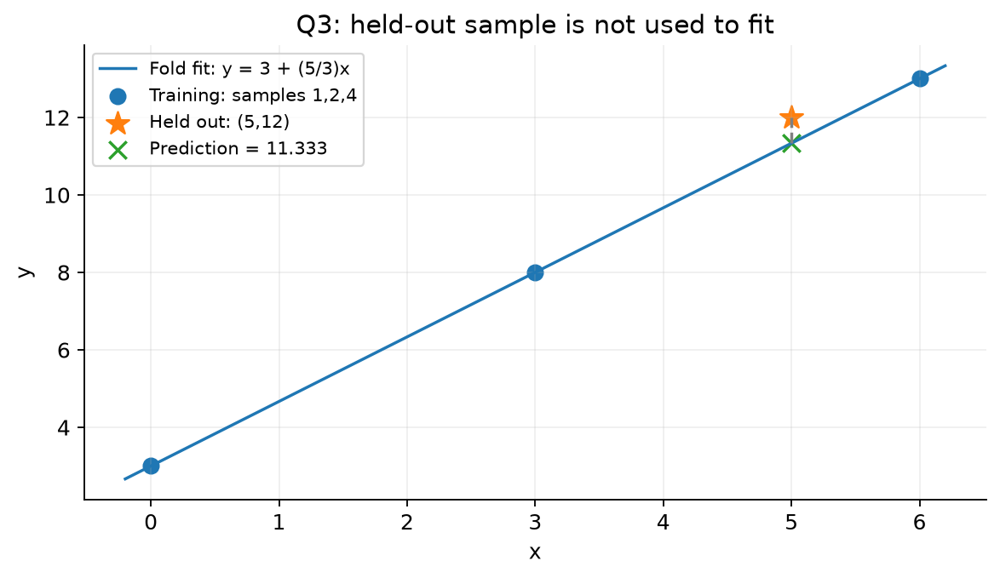

Q13 and Q3 use the same affine model. Q13 needed only two exact equations; Q3 used the general centered formula. Neither permits using held-out values to compute training means.

### 5.5 Same data, changed model: Why every fold must be fitted again

Return to Q13's three points. Q14 removes the intercept and asks for **all** folds' prediction errors. The earlier $1+x$ fit is therefore unusable even for the matching held-out point. Without an intercept, training point $(0,1)$ always has prediction 0: it contributes loss but no information about the slope, because its derivative contribution contains $x=0$.

### Q14 — Full LOOCV for a no-intercept model

**Source:** 2024 Dec 22 ET, Q14.

**Question:**

Given a training set $A_n=\{(x_1,y_1),\ldots,(x_n,y_n)\}$, let $A_n^{-i}$ denote the set obtained by removing the label of the i-th training example. Leave one out cross validation (LOOCV) is performed as follows: for each $(x_i,y_i)$ in the training set, we train the model on the remaining n − 1 points of $A_n^{-i}$ and test the prediction on $(x_i,y_i)$. The error is defined as

$$\operatorname{error}_L(A_n)=\frac1n\sum_{i=1}^n(y_i-\hat f_{-i}(x_i))^2,$$

where $\hat f_{-i}(x_i)$ denote the predicted value of $y_i$ using the model trained on $A_n^{-i}$. Now, for the dataset:

$$D=\{(1,2),(2,2),(0,1)\},$$

fit the model $\hat f=\beta x_i$ and find $\operatorname{error}_L(A_3)$.

For each excluded index $i$, fit a fresh slope:

$$0=2\sum_{j\ne i}x_j(\beta x_j-y_j)
\Rightarrow \beta_{-i}=\frac{\sum_{j\ne i}x_jy_j}{\sum_{j\ne i}x_j^2}.$$

**Fold 1:** Hold out $(1,2)$. Train on $(2,2),(0,1)$: $\beta=(4+0)/(4+0)=1$. Held-out prediction $1(1)=1$; squared error $(2-1)^2=1$.

**Fold 2:** Hold out $(2,2)$. Train on $(1,2),(0,1)$: $\beta=(2+0)/(1+0)=2$. Prediction $2(2)=4$; squared error $(2-4)^2=4$.

**Fold 3:** Hold out $(0,1)$. Train on $(1,2),(2,2)$: $\beta=(2+4)/(1+4)=6/5$. Prediction $(6/5)(0)=0$; squared error $(1-0)^2=1$.

Average one error from each held-out observation:

$$\boxed{\operatorname{error}_L(A_3)=\frac{1+4+1}{3}=2}.$$

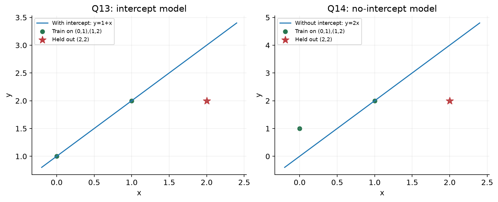

**Compare Fold 2 directly with Q13:** Same training points; affine model $1+x$ predicts 3, while through-origin model $2x$ predicts 4. Changing the model changes the permitted fit and hence the held-out prediction. Q13's squared weight norm also happened to equal 2; that numerical coincidence does not make it a CV error.

### 5.6 Validation takeaway and the next question

A validation calculation has two stages: fit using training labels, then score using the held-out label. Reusing the full-data fit or full-data means breaks that separation. LOOCV estimates predictive performance through repeated held-out fits; it does not guarantee performance on every future distribution. Week 6 will use validation to choose model complexity/regularisation and then refit the selected model on the available training data.

We have used squared loss throughout because it penalizes errors and gives tractable fitting. Next ask a deeper question: **what assumption about how targets are generated makes squared loss a statistically natural choice?**

---

## 6. Probabilistic regression: Noise assumptions se loss tak

### 6.1 Week 4 ka likelihood idea, now conditioned on inputs

Prerequisites: independent observations give a product of densities; taking logarithms turns products into sums; the logarithm is increasing, so it preserves which positive likelihood is largest. In Week 4, unknown parameters described a distribution. Here inputs $x_i$ are observed, and weights determine the **conditional mean** of the target:

$$y_i=w^Tx_i+\epsilon_i,\qquad E[\epsilon_i]=0.$$

$\epsilon_i$ represents variation not explained by the model. A fitted line is not claiming identical targets for every repeated input; it predicts the average under the model. To choose weights by likelihood, we need a distribution for that variation.

Assume independent, equal-variance Gaussian noise:

$$\epsilon_i\sim N(0,\sigma^2),\quad \sigma^2>0
\quad\Longrightarrow\quad y_i\mid x_i\sim N(w^Tx_i,\sigma^2).$$

$\sigma$ is noise standard deviation, in target units; $\sigma^2$ is variance, in squared target units. For one observation,

$$p(y_i\mid x_i,w)=\frac1{\sqrt{2\pi\sigma^2}}
\exp\left[-\frac{(y_i-w^Tx_i)^2}{2\sigma^2}\right].$$

A target closer to the predicted mean has smaller squared residual, a less negative exponent and higher density. These are densities, not probabilities of exact continuous values. Maximum likelihood chooses the weights making the observed targets jointly most plausible.

### 6.2 Derive squared error from the likelihood

Independence multiplies the $n$ densities. Let $\ell(w)$ denote log-likelihood:

$$\ell(w)=\log\prod_i p(y_i\mid x_i,w)
=\sum_i\log p(y_i\mid x_i,w).$$

Since $\log(e^a)=a$ and a product's log is a sum,

$$\ell(w)=-\frac n2\log(2\pi\sigma^2)
-\frac1{2\sigma^2}\sum_i(y_i-w^Tx_i)^2.$$

When optimizing $w$ with common positive variance fixed, first term is constant in $w$. Second is **negative** SSE times a positive factor. Therefore maximizing $\ell$ is equivalent to minimizing SSE:

$$\boxed{\hat w_{ML}\in\arg\min_w\|y-X^Tw\|^2}.$$

**Teaching example:** Two candidate fits have residuals $(1,1)$ and $(0,2)$. SSEs 2 and 4. For $\sigma^2=1$, their likelihood ratio (first divided by second) is $e^{-2/2}/e^{-4/2}=e$. Gaussian likelihood prefers the more balanced errors even though both candidates have total absolute error 2. The choice of distribution determines how errors are traded off.

Q22 asks for this entire derivation as a true/false statement.

### Q22 — Gaussian conditional likelihood versus SSE

**Source:** 2025 Aug 03 Quiz 2, Q22.

**Question:**

Consider the linear regression model $y=w^Tx+\epsilon$. Assuming $\epsilon\sim N(0,\sigma^2)$, maximizing the conditional log-likelihood of w is equivalent to minimizing the sum of squared errors $\lVert y-X^Tw\rVert_2^2$.

(a) TRUE

(b) FALSE

For independent equal-variance Gaussian errors,

$$\log p(y\mid X,w)=C-\frac{\|y-X^Tw\|^2}{2\sigma^2},$$

where $C=-\frac n2\log(2\pi\sigma^2)$ does not depend on $w$. The denominator is positive, so smaller SSE means larger log-likelihood.

$$\boxed{\text{(a) TRUE}}.$$

This is a likelihood **of the observed labels as a function of weights**; a density over weights would involve a prior/posterior. Known unequal variances $\sigma_i^2$ would instead produce $\sum_i r_i^2/\sigma_i^2$, a weighted least-squares objective. The equal-variance assumption is doing work.

### 6.3 Noise scale versus changed observations

Q28 asks what happens if the assumed common variance changes while the *actual dataset stays fixed*. The log-likelihood curve changes scale in its weight-dependent term, but its maximizing weight does not. This is the same positive-objective-rescaling idea as Q30, now used for an estimator rather than a GD trajectory.

Do not confuse this with drawing a new, noisier dataset. New labels change $Xy$, so the fitted weight can change. Week 6 will study variability across those repeated datasets.

### Q28 — Noise variance changes, observations fixed

**Source:** 2026 Aug 14 Quiz 2, Q28.

**Question:**

Under the probabilistic view of linear regression, assume $y_i\sim N(w^Tx_i,\sigma^2)$, where the observations are independent. Suppose the true noise variance is $4\sigma^2$ instead of $\sigma^2$, while the dataset and the observed labels remain unchanged. What happens to the maximum likelihood estimator $\hat w_{ML}=(XX^T)^{-1}Xy$?

(a) It is unchanged.

(b) It is scaled by 4.

(c) It is scaled by 1/4.

(d) It cannot be determined without knowing $\sigma^2$.

Replace variance $\sigma^2$ by $4\sigma^2$. The weight-dependent negative log-likelihood changes from $L(w)/(2\sigma^2)$ to $L(w)/(8\sigma^2)$.

Its stationary condition remains

$$\frac{\nabla L(w)}{8\sigma^2}=0
\Longleftrightarrow X(X^Tw-y)=0.$$

Observed $X,y$ are unchanged, so the same normal-equation solution applies:

$$\boxed{\text{(a): unchanged}}.$$

The likelihood values and modeled uncertainty change; the fixed-data unregularized MLE does not. If a coefficient prior were added, changing noise variance could change the balance between data fit and prior, a Week 6 regularisation issue.

### 6.4 Read the mean and the noise separately on a graph

In $y=\beta_0+\beta_1x+\epsilon$, three quantities answer different questions: $\beta_1$ controls change per input unit; $\beta_0$ shifts the line; $\sigma$ describes vertical scatter around the line. Intercept means prediction at $x=0$, even if the graph only displays large positive inputs. Noise scale concerns residual size, not the magnitude of $y$ itself.

**Teaching example:** A line through $(10,25)$ and $(20,45)$ has slope $(45-25)/(20-10)=2$, intercept $25-2(10)=5$. If measured targets are typically 1–2 units away from that line, noise scale is of that order, not 25 or 45. Q29 applies these separate readings to its supplied plot.

### Q29 — Temperature and thickness regression

**Source:** 2026 Aug 14 Quiz 2, Q29.

**Question:**

On a machine that folds plastic film, the operating temperature can be varied between 130°C and 185°C. To study the relationship between temperature and fold thickness, n = 12 observations of temperature and the corresponding fold thickness were collected. The scatter plot along with the fitted simple linear regression line is shown below:

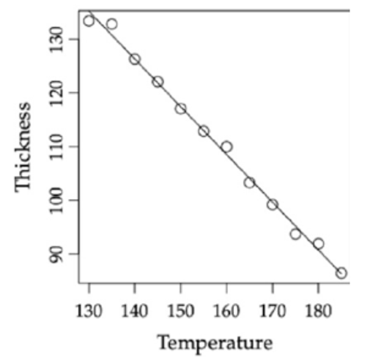

Determine, by inspecting the figure, which of the following sets of parameter estimates for the simple linear regression model is most appropriate.

Note: The regression model is $\operatorname{Thickness}(y)=\beta_0+\beta_1(\operatorname{Temperature})+\epsilon$, where $\epsilon\sim N(0,\sigma^2)$. Here, $\hat\beta_0$ is the estimated intercept, $\hat\beta_1$ is the estimated slope, and $\hat\sigma$ is the estimated standard deviation of the error term.

(a) $\hat\beta_0=0,\quad\hat\beta_1=-0.9,\quad\hat\sigma=360$

(b) $\hat\beta_0=0,\quad\hat\beta_1=0.9,\quad\hat\sigma=3.6$

(c) $\hat\beta_0=252,\quad\hat\beta_1=-0.9,\quad\hat\sigma=3.6$

(d) $\hat\beta_0=-252,\quad\hat\beta_1=-0.9,\quad\hat\sigma=360$

(e) $\hat\beta_0=252,\quad\hat\beta_1=-0.9,\quad\hat\sigma=360$

**1. Slope direction:** Thickness falls as temperature rises, so the slope is negative; eliminate (b).

**2. Slope size:** Approximate fitted-line locations $(130,135)$ and $(180,90)$ give

$$\hat\beta_1\approx\frac{90-135}{180-130}=-45/50=-0.9.$$

**3. Intercept:** Using the first location,

$$\hat\beta_0\approx135-(-0.9)(130)=135+117=252.$$

Thus a graph displayed far from $x=0$ can still imply a large positive intercept.

**4. Noise scale:** The points scatter a few target units around the line. Standard deviation 3.6 is plausible among the supplied choices; 360 would be far larger than the displayed residuals.

$$\boxed{\text{(c)}}.$$

These are approximate graphical comparisons. Individual observation values are not supplied for an exact residual-based estimate of $\sigma$; do not manufacture them from the picture. The question only asks which listed set is most appropriate.

### 6.5 Change the noise distribution: Why absolute residuals appear

Gaussian negative log-density grows as residual squared. If extreme response errors occur, this can make a few large residuals dominate the objective. A Laplace noise model has a different tail shape:

$$p(\epsilon)=\frac1{2b}\exp(-|\epsilon|/b),\qquad b>0.$$

Here $b$ is the Laplace scale, not the regression intercept (same letter, different role). Repeating the likelihood calculation gives

$$-\log p(y\mid X,\theta)=n\log(2b)+\frac1b\sum_i|y_i-x_i^T\theta|.$$

For fixed $b$, MLE minimizes **least absolute deviations (LAD)**. Residual magnitude changing from 10 to 100 increases a squared penalty from 100 to 10000 (100 times) but an absolute penalty from 10 to 100 (10 times).

**Connect back to the first fitting problem:** Constant-only targets $(0,0,9)$ have squared-loss optimum mean 3. Absolute loss $|b|+|b|+|9-b|$ equals $9+b$ on $0\le b\le9$, minimized there at 0; outside that interval it is also larger. Thus a median, here 0, minimizes absolute loss. Different noise assumptions can select different fits on identical data.

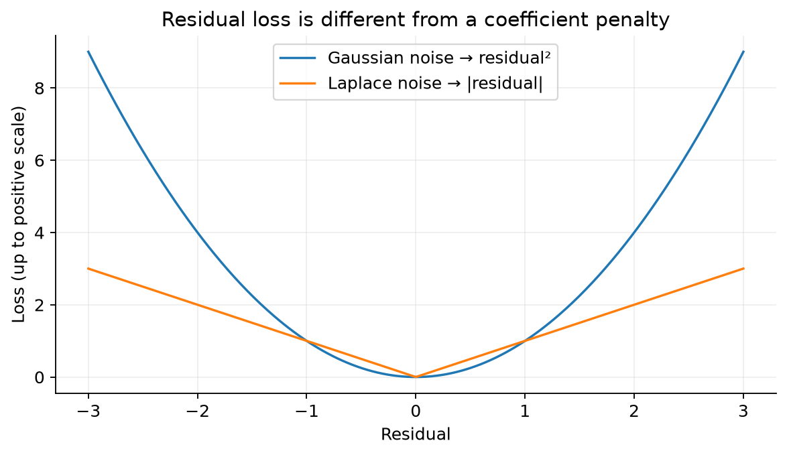

Distinguish **what is being penalized**. Laplace observation noise produces $\sum_i|y_i-x_i^T\theta|$, absolute errors. A Laplace prior on coefficients, combined with Gaussian noise, produces $\lambda\sum_j|\theta_j|$, the LASSO weight penalty. They are not the same objective. LAD is less sensitive to large response residuals in this sense; it is not automatically immune to extreme predictor/high-leverage outliers.

### Q26 — Outliers under Gaussian and Laplace noise

**Source:** 2026 Apr 06 Quiz 2, Q26.

**Question:**

A researcher is modeling a dataset using linear regression of the form $y=X\theta+\epsilon$. They are considering two different probabilistic assumptions for the independent and identically distributed (i.i.d.) noise term $\epsilon$:

- Assumption A: The noise follows a Gaussian distribution, $\epsilon\sim N(0,\sigma^2)$.
- Assumption B: The noise follows a Laplace distribution, $\epsilon\sim\operatorname{Laplace}(0,b)$.

The training dataset is known to contain several extreme outliers resulting from sensor malfunctions. Which of the following statements correctly describes the behavior of the Maximum Likelihood Estimation (MLE) for the parameter vector $\theta$? (MSQ)

(a) Under Assumption A, the MLE is equivalent to minimizing Mean Squared Error (MSE), which is highly sensitive to outliers because the penalty grows quadratically.

(b) Under Assumption B, the MLE is equivalent to L1 regularization, which is more robust to outliers because the penalty for large residuals grows linearly.

(c) Both Assumption A and Assumption B lead to the same optimal parameter vector $\hat\theta$ regardless of the presence of outliers.

(d) All the given options are correct.

**Translate each assumption before reading the claims:** Gaussian noise gives squared-residual minimization; Laplace noise gives absolute-residual minimization. Neither MLE introduces a coefficient prior.

- **(a) Correct.** SSE and MSE have the same minimizers, and the penalty grows quadratically with residual magnitude.
- **(b) Terminology error.** Linear growth of residual loss is correct, but “L1 regularization” refers to a weight penalty. Actual Laplace-noise MLE gives LAD/L1 **residual loss**.
- **(c) False.** For intercept-only targets $(0,0,100)$, squared loss chooses $100/3$, while absolute loss chooses median 0.
- **(d) False**, because (c) is false.

**Existing paper key: (a), (b). Strict wording: only (a) is fully correct.** Reading (b) as “L1 residual minimization” recovers its intended intuition. This distinction will matter when Week 6 introduces priors and LASSO.

### 6.6 A nonlinear-looking mean can hide a constant-fitting problem

Gaussian likelihood gives squared deviations from the **specified mean**, not automatically from $wx$. If the mean is $\log(wx)$, using the slope formula $\sum xy/\sum x^2$ would optimize the wrong model.

Prerequisites: for positive arguments, $\log(wx)=\log w+\log x$, while $\log(w/x)=\log w-\log x$. Logs here are natural logs. Set $a=\log w$. Since $w>0$, $a$ can be any real number, and $w=e^a$ reverses the substitution.

**Teaching example:** For mean $\log(wx)$, take inputs $x=(1,e)$ and observed targets $y=(2,4)$. Transformed targets $z_i=y_i-\log x_i$ are $(2,3)$. Now minimize $(2-a)^2+(3-a)^2$; Q36's mean rule gives $\hat a=2.5$, so $\hat w=e^{2.5}$. Fitted means $(2.5,3.5)$ balance residuals $(-0.5,0.5)$. No slope multiplying raw $x$ was fitted.

Q20 asks for the explicit estimate, and Q34 changes multiplication to division and asks only for its defining equation.

### Q20 — Gaussian mean log(wx)

**Source:** 2025 Aug 03 Quiz 2, Q20.

**Question:**

Consider n data points, with each feature $x_i\in\mathbb R^+$ and label $y_i\in\mathbb R$. Suppose $y_i\mid x_i\sim N(\log(wx_i),1)$, then find the ML estimate $\hat w_{MLE}$ of w, where w > 0.

(a) $\hat w_{MLE}=\exp\left(\frac1n\sum_{i=1}^n(y_i-\log x_i)\right)$

(b) $\hat w_{MLE}=\exp\left(\frac1n\sum_{i=1}^n(x_iy_i-x_i\log x_i)\right)$

(c) $\hat w_{MLE}=\frac1n\sum_{i=1}^n(y_i-\log x_i)$

(d) $\hat w_{MLE}=\exp\left(\frac1n\sum_{i=1}^n(x_iy_i-\log x_i)\right)$

**1. Write the objective from the stated Gaussian mean:**

$$J(w)=\sum_i[y_i-\log(wx_i)]^2.$$

**2. Reparameterize:** Let $a=\log w$ and $z_i=y_i-\log x_i$. Then $J=\sum_i(z_i-a)^2$.

**3. Fit the constant:**

$$\frac{dJ}{da}=2na-2\sum_i z_i=0
\Rightarrow\hat a=\frac1n\sum_i(y_i-\log x_i).$$

Second derivative $2n>0$ confirms the unique minimum in $a$. The one-to-one map $w=e^a$ preserves which parameter achieves it.

**4. Return to the requested parameter:**

$$\boxed{\hat w=\exp\left[\frac1n\sum_i(y_i-\log x_i)\right]\quad\text{(a)}}.$$

Option (c) stops at the estimate of $\log w$. The options containing extra $x_i$ factors treat $a$ like a slope, although the transformed model fits a constant. Q36's average has reappeared after an algebraic change of coordinates.

**What changes in the next question?** In Q20, subtracting $\log x_i$ from the target isolated $\log w$. In Q34's quotient, the mean already subtracts $\log x_i$, so we must **add** it to the target. The noise remains Gaussian; only the transformed target changes. Work this sign out from the mean instead of memorizing two formulas.

### Q34 — Gaussian mean log(w/x)

**Source:** 2026 Sep 13 ET, Q34.

**Question:**

Suppose we model data as $y_i\sim N(\log(w/x_i),1)$ with a single unknown parameter w > 0 and known variance 1 (each $x_i>0$). You perform maximum-likelihood estimation of w. The MLE of w must satisfy which of the following equations? Note that x is a feature and y is a label.

(a) $\sum_i y_i=\sum_i\log(w/x_i)$

(b) $\sum_i x_i y_i=\sum_i x_i\log(w/x_i)$

(c) $\sum_i y_i/x_i=\sum_i\log(w/x_i)$

(d) $\sum_i y_i=\sum_i w/x_i$

Let $a=\log w$. Since $\log(w/x_i)=a-\log x_i$,

$$J(a)=\sum_i[(y_i+\log x_i)-a]^2.$$

Its optimum satisfies

$$n\hat a=\sum_i(y_i+\log x_i).$$

Move the known log-input terms to the other side:

$$\sum_i y_i=n\log\hat w-\sum_i\log x_i
=\sum_i\log(\hat w/x_i).$$

$$\boxed{\text{(a)}}.$$

**Check directly in $w$:** $d\log(w/x_i)/dw=1/w$, so

$$J'(w)=-\frac2w\sum_i[y_i-\log(w/x_i)].$$

Because $w>0$, this derivative is zero exactly when option (a)'s sums agree. No extra $x_i$ or $1/x_i$ multiplier remains. Explicitly, $\hat w=\exp[\frac1n\sum_i(y_i+\log x_i)]$, compared with the minus sign in Q20.

### 6.7 Probability takeaway: Mean, noise, and prior have separate jobs

The mean function defines the prediction rule; observation noise defines how residuals are penalized; a coefficient prior would add a preference among weights. Q22/Q28 kept the mean and data fixed, Q26 changed the noise family, and Q20/Q34 changed the mean's algebra. Asking which part changed tells you which derivation to redo.

Our model can now use a linear mean, an intercept, or a transformed mean. Next we keep ordinary squared-error fitting but enrich the **input features**. This is another route to nonlinear prediction, connected to the kernel inner products from Week 2.

---

## 7. Kernel regression: More expressive features, same fitting idea

### 7.1 Why enrich the inputs?

Prerequisites: Lesson 2 fits linear combinations of features; Lesson 3 shows minimum-norm weights can lie in the data span; Week 2 introduced kernels as feature-space inner products. We will rebuild the connection here.

**Teaching example:** Inputs $-1,0,1$, targets $1,0,1$ form a U-shape. No affine line $b+wx$ can fit all three: the origin target forces $b=0$, the point $x=1$ forces $w=1$, and $x=-1$ would then predict $-1$ rather than 1. This is a representation problem, not an optimizer problem.

Add a feature $x^2$. Model $a+bx+cx^2$ with $(a,b,c)=(0,0,1)$ fits exactly. It is nonlinear in raw input $x$, but linear in the learned weights on features $(1,x,x^2)$. In general choose a fixed map $\phi:\mathbb R^d\to\mathbb R^D$ and predict

$$\hat y=w^T\phi(x).$$

$D$ is transformed-feature dimension; it may be much larger than raw dimension $d$. Polynomial features can include squares, powers and interactions. Increasing expressiveness can reduce training error, but may also increase sensitivity to noise. Validation from Lesson 5 remains necessary.

### 7.2 A kernel computes a transformed dot product directly

Explicitly storing all features can be expensive. If the fitting/prediction calculation only needs their inner products, define

$$\boxed{k(x,z)=\phi(x)^T\phi(z)}.$$

For scalar inputs, expand a degree-two polynomial kernel:

$$(1+xz)^2=1+2xz+x^2z^2
=\begin{bmatrix}1&\sqrt2x&x^2\end{bmatrix}
\begin{bmatrix}1\\\sqrt2z\\z^2\end{bmatrix}.$$

So $\phi(x)=(1,\sqrt2x,x^2)^T$ realizes this kernel. The $\sqrt2$ matters because multiplying the matching coordinates gives $2xz$. The unscaled map $(1,x,x^2)$ gives a different dot product, although both span quadratic functions of $x$.

More generally, the inhomogeneous polynomial kernel is $k(x,z)=(1+x^Tz)^p$, with nonnegative integer degree $p$. “Inhomogeneous” means it includes lower-order terms through the constant 1. A homogeneous kernel $(x^Tz)^p$ has no offset. These differ sharply at the origin, which Q4 will exploit.

For a real inner-product kernel, its Gram matrix is symmetric and positive semidefinite: if $K_{ij}=\phi(x_i)^T\phi(x_j)$, then for any coefficients $c$,

$$c^TKc=\left\|\sum_i c_i\phi(x_i)\right\|^2\ge0.$$

A vague “similarity score” is not automatically a valid kernel. Nor is a kernel a probability: polynomial values can exceed 1. Q16 asks what this construction actually enables.

### Q16 — Role of a polynomial kernel

**Source:** 2025 Mar 16 Quiz 2, Q16.

**Question:**

Polynomial kernel in kernel regression model is expressed as:

$$K(x,x')=(x^Tx'+1)^d.$$

What role does $K(x,x')$ play in kernel regression? (MSQ)

(a) It ensures that the regression model remains linear.

(b) It computes the similarity between data points in a transformed feature space.

(c) It allows the model to capture non-linear relationships by mapping data to a higher-dimensional space.

(d) It helps in reducing the variance of the model.

(e) It minimizes the loss function in regression problems.

The expansion above shows that the kernel computes an inner product between transformed features, so **(b)** is correct. Linear combinations of nonlinear features can be curved functions of the original inputs, so **(c)** is correct.

- (a) is misleading if “linear” refers to raw inputs. The model remains linear in its feature-space coefficients, but can be nonlinear in original $x$.
- (d) is not guaranteed. A richer feature space does not automatically reduce variance.
- (e) is false. The kernel supplies inner products; the training optimization minimizes the loss.

$$\boxed{\text{(b), (c)}}.$$

Here the question's exponent $d$ means **polynomial degree**. In most of our notation $d$ denotes raw input dimension. Read its local definition instead of equating those two roles.

### 7.3 Derive the prediction formula from the weight vector

Form $\Phi=[\phi(x_1)\ \cdots\ \phi(x_n)]\in\mathbb R^{D\times n}$. Lesson 3.7 applies in this transformed space: a minimum-norm optimum has no component perpendicular to all transformed training points. Therefore it can be represented as

$$w=\Phi\alpha=\sum_{i=1}^n\alpha_i\phi(x_i).$$

$w$ has one entry per transformed feature; $\alpha$ has one entry per **training observation**. They are different coordinate descriptions of a weight in the training span. Insert this expansion into the ordinary dot-product prediction:

$$\begin{aligned}
\hat y(x_*)&=w^T\phi(x_*)\\
&=\left(\sum_i\alpha_i\phi(x_i)\right)^T\phi(x_*)\\
&=\sum_i\alpha_i\phi(x_i)^T\phi(x_*)\\
&=\boxed{\sum_i\alpha_i k(x_i,x_*)}.
\end{aligned}$$

No new prediction principle was invented: distributing a dot product over a weighted sum produced the kernel formula. Define query vector $k_*=(k(x_1,x_*),\ldots,k(x_n,x_*))^T$. Then $\hat y(x_*)=\alpha^Tk_*$.

**Teaching example:** With $\phi(x)=(1,x)^T$, $k(x,z)=1+xz$, training inputs $0,1$, and coefficients $\alpha=(-1,2)^T$, the explicit weight is

$$w=-1(1,0)^T+2(1,1)^T=(1,2)^T.$$

Thus explicit prediction at $x_*=2$ is $1+2(2)=5$. Kernel values are $k(0,2)=1$, $k(1,2)=3$, so kernel prediction $-1(1)+2(3)=5$ too. Coefficients can be negative; they are not probabilities or weights of a normalized average.

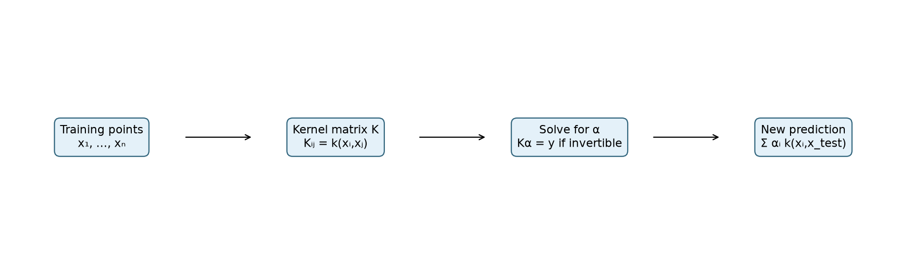

Q27 checks the algebra itself before we do larger numbers.

### Q27 — Prediction from kernel coefficients

**Source:** 2026 Apr 06 Quiz 2, Q27.

**Question:**

Let the linear regression model’s solution be written as $w^*=X\alpha$, where $\alpha=[\alpha_1,\ldots,\alpha_n]^T\in\mathbb R^n$. Let $k:\mathbb R^d\times\mathbb R^d\to\mathbb R$ be a valid kernel function. What will be the prediction for an unseen data point $x_{test}$?

(a) $\sum_{i=1}^n k(x_i,x_{test})$

(b) $\sum_{i=1}^n\alpha_i$

(c) $\sum_{i=1}^n\alpha_i k(x_i,x_{test})$

(d) $\sum_{i=1}^n\alpha_i^2 k(x_i,x_{test})$

For the ordinary linear kernel, expand the supplied representation:

$$w^{*T}x_{test}=(X\alpha)^Tx_{test}
=\sum_i\alpha_i x_i^Tx_{test}.$$

The corresponding feature-space model uses $w=\Phi\alpha$, replacing each inner product by $k(x_i,x_{test})$:

$$\boxed{\hat y(x_{test})=\sum_i\alpha_i k(x_i,x_{test})\quad\text{(c)}}.$$

Dropping the coefficients changes the model; dropping the kernel values removes dependence on the query; squaring the coefficients has no basis in the dot-product expansion.

**Scope of the substitution:** With a nonlinear kernel, this is a predictor in the corresponding transformed space. It is not generally the same raw-space function $w=X\alpha$ evaluated with arbitrary replacement similarities. The expansion explains the kernelized model, not equality of every kernelized predictor to the original linear one.

### 7.4 Basic prediction: A query can simplify every kernel value

When coefficients are supplied, the weights have already been described; the task is prediction, not retraining. For a query at the origin, every raw dot product $x_i^T0=0$. Under $(1+x_i^Tx_*)^p$, all kernel values become 1, regardless of degree or training coordinates. Q4 is therefore a sum of coefficients—but only after checking the offset convention.

### Q4 — Polynomial-kernel prediction at the origin

**Source:** 2024 Mar 24 Quiz 2, Q4.

**Question:**

Kernel regression with a polynomial kernel of degree three is applied on a data set {X, y}. Let the weight vector be given by

$$w=\phi(X)[2.3,-1.0,0.4,-0.7]^T.$$

Here $\phi(X)$ is the transformed data matrix whose ith column is $\phi(x_i)$. What will be the prediction for the data point $[0,0,0,0]^T$?

Using the inhomogeneous convention $k(x,z)=(1+x^Tz)^3$, query $x_*=0$ gives $k(x_i,0)=1$ for every $i$.

$$\hat y(0)=2.3(1)-1.0(1)+0.4(1)-0.7(1)
=1.3+0.4-0.7=\boxed{1}.$$

The prompt specifies degree but omits the offset. This answer uses the +1 convention in these notes; a homogeneous kernel $(x^Tz)^3$ would give 0 instead. The missing convention cannot be inferred from degree alone.

**Same variety also appears:** Week 5 — Solve With Instructors, Q4 uses degree 3, $\alpha=(1.3,0.6,-0.2,-0.7)^T$ and query $(0,0,0,0)^T$. For the slide solution's $k(x,z)=(1+x^Tz)^3$, every kernel value at zero is 1, so $\hat y=\sum\alpha_i=1$. Q4 above already explains this method, so full solution repeat nahi kiya. Homogeneous convention $(x^Tz)^3$ hota toh answer 0 hota.

### 7.5 General query: Dot product → kernel → contribution

The origin removed most arithmetic. For a general query, perform three operations per training point: raw dot product, kernel transformation, multiplication by its coefficient. Then add contributions. Keeping those columns separate prevents squaring a coefficient by mistake or forgetting the offset.

Q17 uses nonzero query $(2,2)$ and supplied coefficients. After evaluating them, we will also check the prompt's claim that those coefficients are optimal; these are different tasks.

### Q17 — Direct prediction with given coefficients

**Source:** 2025 Mar 16 Quiz 2, Q17.

**Question:**

Consider a kernel regression problem on the following dataset with two features:

$$\{(x_1,y_1),(x_2,y_2),(x_3,y_3)\},$$

where:

$$x_1=[1,2]^T,\ y_1=3,\qquad x_2=[2,3]^T,\ y_2=5,\qquad x_3=[3,4]^T,\ y_3=7.$$

The kernel function is given as:

$$K(x,x')=(1+x^Tx')^2$$

and the optimal coefficients $\alpha_i$ are given as:

$$\alpha=[0.5,1.0,1.5]^T.$$

Then, what will be the predicted value for the data point $[2,2]^T$?

For each input, use $\alpha_i(1+x_i^T(2,2))^2$:

| Training input | Dot product | Kernel value | Weighted contribution |
|---|---|---:|---:|
| $(1,2)$ | $1(2)+2(2)=6$ | $(1+6)^2=49$ | $0.5(49)=24.5$ |
| $(2,3)$ | $2(2)+3(2)=10$ | $(1+10)^2=121$ | $1(121)=121$ |
| $(3,4)$ | $3(2)+4(2)=14$ | $(1+14)^2=225$ | $1.5(225)=337.5$ |

$$\boxed{\hat y(2,2)=24.5+121+337.5=483}.$$

**Consistency check:** At the first *training* input $(1,2)$, the three kernel values are 36, 81, 144. The supplied coefficients predict $0.5(36)+1(81)+1.5(144)=315$, unlike target 3. They cannot be the ordinary unregularized least-squares fit here: even the explicit linear rule $x_1+x_2$ fits the listed targets exactly in this polynomial feature space.

Thus 483 is the prediction from the **given expansion**; the adjective “optimal” is inconsistent with the usual fitting setup. Replacing supplied coefficients by a new fit would answer a different numerical question. Q11 will explicitly ask us to train the coefficients.

**What changes next?** Q19 increases raw dimension from two to three and training count from three to five. There are still three operations per point. The all-ones query simplifies each dot product to a column sum; negative and zero coefficients now test whether we keep weights separate from similarity values.

### Q19 — Three-feature degree-two kernel prediction

**Source:** 2025 Apr 13 ET, Q19.

**Question:**

A kernel regression model with a polynomial kernel of degree 2 is trained on the following dataset with three features:

$$X=\begin{bmatrix}1&4&7&2&6\\2&5&8&1&5\\3&6&9&3&4\end{bmatrix}.$$

Let the optimal weight vector $w^*$ be given by:

$$w^*=\phi(X)[1,1.2,0,0.7,-0.5]^T,$$

where $\phi$ is the transformation mapping corresponding to the kernel $K(x,x')=(x^Tx'+1)^2$. Compute the predicted value $y_{pred}$ for a new data point $x'=[1,1,1]^T$. Enter the answer correct to one decimal place.

Each **column** of $X$ is a training input, matching the five coefficients. For $x_*=(1,1,1)^T$, sum each column's entries, add 1, square, and multiply by the matching coefficient:

| Input column | Dot product | Kernel value | Coefficient | Contribution |
|---|---:|---:|---:|---:|
| $(1,2,3)$ | $1+2+3=6$ | $7^2=49$ | 1 | 49 |
| $(4,5,6)$ | $4+5+6=15$ | $16^2=256$ | 1.2 | 307.2 |
| $(7,8,9)$ | $7+8+9=24$ | $25^2=625$ | 0 | 0 |
| $(2,1,3)$ | $2+1+3=6$ | $7^2=49$ | 0.7 | 34.3 |
| $(6,5,4)$ | $6+5+4=15$ | $16^2=256$ | −0.5 | −128 |

$$\boxed{y_{pred}=49+307.2+0+34.3-128=262.5}.$$

A large similarity contributes nothing if its coefficient is zero. A positive similarity can contribute negatively if its coefficient is negative. This is a linear combination in feature space, not an average constrained to stay between training labels.

### 7.6 Reverse the prediction equation: Recover only what the query reveals

Q4/Q17/Q19 provided all needed coefficients. Q8 leaves some unknown but supplies the output at a particular query. One scalar prediction gives one linear equation in coefficients. It usually cannot recover an entire vector; here some kernel values are zero, eliminating their unknown coefficients and leaving only one unknown in the equation.

### Q8 — Solve one unknown kernel coefficient

**Source:** 2024 Aug 04 Quiz 2, Q8.

**Question:**

Consider the following dataset for a kernel regression problem with a polynomial kernel of degree two along with the coefficient vector $\alpha$:

$$X=\begin{bmatrix}1&0&-1&0\\0&1&0&-1\end{bmatrix},\qquad y=\begin{bmatrix}1\\-1\\2\\-2\end{bmatrix},\qquad\alpha=\begin{bmatrix}\alpha_1\\-0.625\\\alpha_3\\\alpha_4\end{bmatrix}.$$

If the prediction for the data-point $[1,1]^T$ is 0, find the value of $\alpha_1$.

Using $k(x,z)=(1+x^Tz)^2$, read the four columns as $(1,0),(0,1),(-1,0),(0,-1)$. With query $(1,1)$:

| Input | Dot product | Kernel |
|---|---:|---:|
| $(1,0)$ | 1 | 4 |
| $(0,1)$ | 1 | 4 |
| $(-1,0)$ | −1 | 0 |
| $(0,-1)$ | −1 | 0 |

Therefore the stated prediction 0 requires

$$0=4\alpha_1+4(-0.625)+0\alpha_3+0\alpha_4.$$
$$4\alpha_1=2.5\Rightarrow\boxed{\alpha_1=0.625}.$$

The unknown $\alpha_3,\alpha_4$ are invisible to this query, so their values and the training labels are unnecessary for this equation. This uses the +1 polynomial convention; degree alone would not specify that offset. Compare Q4: there every query kernel value was 1; here selected values are 0. First inspect the query vector, then decide what information is actually needed.

### 7.7 Training coefficients: The Gram matrix collects training predictions

So far $\alpha$ was supplied or constrained. Now determine it from labels. Evaluate the prediction formula at every training input. For training input $x_j$,

$$\hat y_j=\sum_i\alpha_i k(x_i,x_j).$$

Define symmetric Gram matrix $K=\Phi^T\Phi$, with entry $K_{ji}=k(x_j,x_i)$. Stacking those equations gives

$$\hat y=K\alpha,\qquad L(\alpha)=\|K\alpha-y\|^2.$$

$K$ is $n\times n$ because it compares training points with training points, independent of transformed dimension $D$. If $K$ is invertible, we can solve $K\alpha=y$ exactly:

$$\boxed{\alpha=K^{-1}y}.$$

This produces zero training residual, so it is optimal for unregularized least squares. If $K$ is singular, a solution to exact interpolation may not exist; canonical least-squares coefficients are $K^\dagger y$ and predictions $KK^\dagger y$. Positive semidefinite does not mean invertible. The loss derivative $2K(K\alpha-y)=0$ remains meaningful without an inverse.

**Complete the earlier teaching example:** For inputs $0,1$, targets $1,3$, and $k(x,z)=1+xz$,

$$K=\begin{bmatrix}1&1\\1&2\end{bmatrix},\quad
\alpha_1+\alpha_2=1,\quad \alpha_1+2\alpha_2=3.$$

Subtract equations: $\alpha_2=2$, then $\alpha_1=-1$. These are exactly the coefficients used in Lesson 7.3, giving the line $1+2x$ and prediction 5 at 2. Training computes the coefficients; prediction uses a new query vector.

**Week 2 connection:** Kernel PCA used (typically centered) Gram eigenvectors to describe variation without labels. Kernel regression fits target values. Its coefficients need not have unit norm or sum 1. Do not import Kernel PCA eigenvector normalization/centering into an uncentered regression question that specifies a different calculation.

Q11 now combines the full workflow: construct $K$, solve coefficients, then build a separate test vector.

### Q11 — Build the kernel matrix, solve coefficients, predict

**Source:** 2024 Dec 01 Quiz 2, Q11.

**Question:**

Comprehension: Kernel regression with a polynomial kernel is applied on the following dataset with two features:

$$X=\begin{bmatrix}1&0&0\\0&1&0\end{bmatrix},\qquad y=[2,1,2]^T.$$

Weight vector can be written as $w=\phi(X)\alpha$, where $\phi$ is the transformation mapping corresponding to the kernel $k(x_i,x_j)=(1+x_i^Tx_j)^2$. The vector $\alpha$ is given by $(K)^{-1}y$, where K is the kernel matrix.

Based on the above data, answer the given subquestions.

(i) Compute K.

(a) $\begin{bmatrix}1&1&1\\1&4&1\\4&1&1\end{bmatrix}$

(b) $\begin{bmatrix}1&4&1\\1&1&1\\4&1&1\end{bmatrix}$

(c) $\begin{bmatrix}4&4&1\\1&1&1\\4&1&1\end{bmatrix}$

(d) $\begin{bmatrix}4&1&1\\1&4&1\\1&1&1\end{bmatrix}$

(ii) What will be the prediction for the data point $[1,-1]^T$? Enter the answer correct to two decimal places.

**(i) Build similarities between training columns.** Inputs are $x_1=(1,0),x_2=(0,1),x_3=(0,0)$. Their raw inner-product matrix is

$$X^TX=\begin{bmatrix}1&0&0\\0&1&0\\0&0&0\end{bmatrix}.$$

The kernel adds 1 to **every entry**, then squares **each entry**. This is not adding the identity matrix or taking a matrix square. Thus diagonal values are 4,4,1 and off-diagonal values are all 1:

$$\boxed{K=\begin{bmatrix}4&1&1\\1&4&1\\1&1&1\end{bmatrix}\quad\text{(d)}}.$$

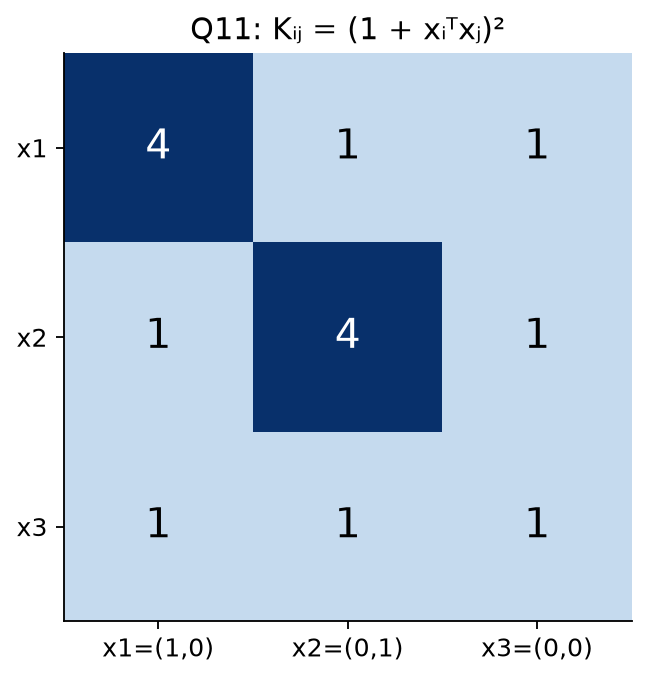

**(ii), training stage:** Solve $K\alpha=y$:

$$4\alpha_1+\alpha_2+\alpha_3=2,$$
$$\alpha_1+4\alpha_2+\alpha_3=1,$$
$$\alpha_1+\alpha_2+\alpha_3=2.$$

Subtract third from first: $3\alpha_1=0$, so $\alpha_1=0$. Subtract third from second: $3\alpha_2=-1$, so $\alpha_2=-1/3$. Third gives $\alpha_3=2+1/3=7/3$. The determinant is 9, so the assumed inverse exists.

**Prediction stage:** Query $z=(1,-1)$ has dot products $1,-1,0$ with the three inputs. Therefore

$$k_*=(4,0,1)^T,\qquad
\hat y(z)=0(4)+(-1/3)(0)+(7/3)(1)=7/3.$$

$$\boxed{\hat y(z)=2.33\text{ to two decimals}.}$$

**Check training before testing:** $K(0,-1/3,7/3)^T=(2,1,2)^T=y$. Q17's supplied coefficients failed this check; these satisfy it. The $3\times3$ training Gram matrix learned $\alpha$, while the three-entry query vector made one prediction.

### 7.8 RBF kernel: Change the similarity, retain the prediction rule

Polynomial kernels use transformed dot products based on $x^Tz$. The Gaussian/radial basis function (RBF) kernel instead expresses distance-based similarity:

$$\boxed{k(x,z)=\exp\left(-\frac{\|x-z\|^2}{2s^2}\right)},\qquad s>0.$$

Compute coordinate differences, square and sum, divide by $2s^2$, negate, and exponentiate. The bandwidth $s$ controls how far similarity extends. It is **not** the observation-noise standard deviation from Lesson 6, even though some questions denote both by $\sigma$ in their separate contexts.

At identical inputs distance is 0, so kernel value is 1. At finite nonzero distance its value lies strictly between 0 and 1. Equal distances give equal similarities. Smaller $s$ makes a fixed nonzero distance less similar; larger $s$ makes it more similar. With $s^2=1/2$, squared distances 0,1,2 give similarities $1,e^{-1},e^{-2}$.

The outer prediction stays $\sum_i\alpha_i k(x_i,x_*)$. Do not divide by the sum of similarities: that would define a different normalized averaging estimator. Positive RBF values do not force positive predictions when coefficients can be negative.

Q43 combines distance calculations, cancelling contributions, and a check of the supplied training claim.

### Q43 — Gaussian kernel prediction with cancelling contributions

**Source:** Week 5 — Solve With Instructors, Q9 (image-based question).

**Question:**

Gaussian kernel regression with parameter $\sigma^2=\frac12$ was applied to the following dataset with two features:

$$X=\begin{bmatrix}1&0&1&0\\0&1&1&0\end{bmatrix},\qquad y=\begin{bmatrix}2.1\\1\\2\\1.2\end{bmatrix}.$$

The weight vector can be written as $w=\phi(X)\alpha$, where $\phi$ is the transformation mapping corresponding to the kernel. The vector $\alpha=[2.1,-2.1,3,0]^T$ is given, stated to be obtained as $K^{-1}y$, where $K$ is the kernel matrix. What will be the prediction for $[1,1]^T$?

Here the kernel bandwidth parameter is $\sigma^2=1/2$, so $2\sigma^2=1$ and $k(x,z)=e^{-\|x-z\|^2}$.

For query $z=(1,1)$:

| Training input | Squared distance calculation | Kernel | Weighted contribution |
|---|---|---|---|
| $(1,0)$ | $(1-1)^2+(0-1)^2=1$ | $e^{-1}$ | $2.1e^{-1}$ |
| $(0,1)$ | $(0-1)^2+(1-1)^2=1$ | $e^{-1}$ | $-2.1e^{-1}$ |
| $(1,1)$ | $0^2+0^2=0$ | 1 | 3 |
| $(0,0)$ | $(-1)^2+(-1)^2=2$ | $e^{-2}$ | 0 |

Equal first two similarities and opposite coefficients cancel:

$$\boxed{\hat y(1,1)=2.1e^{-1}-2.1e^{-1}+3+0=3}.$$

**Check the simultaneous claims:** The query is the third training input, whose target is 2. If the supplied vector really equalled $K^{-1}y$, it would satisfy $K\alpha=y$ and predict 2 at that point. Instead its third training prediction is 3. The supplied coefficients and the claim that they solve this interpolation system are incompatible.

Using the **given coefficients** yields 3, matching the calculation reported in the existing notes. Actually fitting the stated invertible system would yield 2 at this training point. As in Q17, retain the numerical task's inputs while explaining the contradiction; do not silently “repair” the question by substituting invented coefficients.

### 7.9 Kernel takeaway: Separate representation, fitting, and prediction

Q16 chose richer features through a kernel. Q27 derived the weighted kernel sum. Q4/Q17/Q19 evaluated supplied models. Q8 recovered one coefficient from one query constraint. Q11 trained coefficients using all targets. Q43 changed the similarity function while retaining the same outer sum. These are stages of one method, not seven unrelated formulas.

Kernel regression's flexibility can permit exact training interpolation even when an ordinary linear fit cannot. Q25 and Lesson 5 tell us why that alone is not evidence of good generalization. Rank, conditioning, noise and validation still matter. This brings us directly to Week 6.

---

## 8. Connect the week, then prepare for Week 6

### 8.1 One chain of ideas to reconstruct without memorizing

Start with a prediction rule. It defines an allowed set of prediction vectors. Choose a loss to compare those vectors with observed labels. Least squares selects the closest vector; normal equations express its residual orthogonality. GD is one algorithm for approaching that optimum. Validation tests the resulting procedure on labels excluded from training. A noise model explains the loss, while a feature map expands the allowed predictions.

You can now connect questions across chapters:

| Shared principle | Earlier question | Later variation | What changes? |
|---|---|---|---|
| Constant fitting balances residuals | Q36 | Q24, Q20, Q34 | Intercept inside a bigger model, or constant after taking logs |
| A shared coefficient minimizes squared error | Q7 | Q39 | Scalar input becomes a single identifiable direction in a vector space |
| Fitted labels lie in the feature span | Q2, Q35 | Q31, Q37, Q38 | Actual exact fit, impossible fit, or already projected labels |
| Optimum and update are different requests | Q7 | Q18, Q15 | A prescribed starting weight and learning rate replace a full fit |
| Positive loss rescaling preserves minimizers | Q21's duplication | Q30, Q28 | Optimization trajectory or likelihood scale can still change |
| Model specification controls a fold | Q13 | Q3, Q14 | More training points, then removal of intercept and averaging all folds |
| Feature-space weight is a sum of training vectors | Q23, Q39 | Q27, Q11 | Replace raw inputs by transformed inputs, then solve via their Gram matrix |
| Zero training error does not settle generalization | Q25, Q38 | Q11, LOOCV | Richer models may interpolate; held-out behavior still needs assessment |

### 8.2 Formula map: Recover the formula from the task

| Task and assumption | Formula | Why it applies |
|---|---|---|
| Predict, columns-as-samples convention | $\hat y=X^Tw$ | Each row of $X^T$ forms one input–weight dot product |
| Fit one constant under squared loss | $b=\bar y$ | Zero derivative balances unweighted residuals |
| Fit one slope, no intercept, $\sum x_i^2>0$ | $w=\sum x_iy_i/\sum x_i^2$ | Zero derivative balances input-weighted residuals |
| Fit slope plus intercept | $a=\sum(x_i-\bar x)(y_i-\bar y)/\sum(x_i-\bar x)^2$, $b=\bar y-a\bar x$ | Intercept balance centers the problem; denominator must be nonzero |
| Fit multiple weights | $XX^Tw=Xy$ | All feature-weighted residual sums vanish |
| Full row rank | $w^*=(XX^T)^{-1}Xy$ | Invertible normal system has unique weights |
| Minimum-norm choice when rank deficient | $w_{\min}=(XX^T)^\dagger Xy$ | Invisible weight components removed |
| Test zero training error | $y\in\operatorname{row}(X)$ | Labels must be an attainable prediction vector |
| Check fitted residual | $Xr=0$, $\hat y^Tr=0$ | Closest-point residual is perpendicular to feature span |
| One raw-SSE GD update | $w_{new}=w-2\eta X(X^Tw-y)$ | Downhill change at the old weight |
| Average held-out squared error | $\frac1n\sum_i(y_i-\hat f_{-i}(x_i))^2$ | Each prediction comes from a fit excluding its scored observation |
| Equal-variance Gaussian MLE | Minimize $\sum_i r_i^2$ | Negative log-density is quadratic in residual |
| Laplace-noise MLE | Minimize $\sum_i\lvert r_i\rvert$ | Negative log-density is linear in residual magnitude |
| Mean $\log(wx_i)$, Gaussian noise | $\hat w=\exp[\operatorname{mean}(y_i-\log x_i)]$ | Fit the constant $\log w$ to transformed targets |
| Mean $\log(w/x_i)$, Gaussian noise | $\hat w=\exp[\operatorname{mean}(y_i+\log x_i)]$ | Same constant fit, changed sign of known offset |
| Train unregularized kernel model, invertible $K$ | $K_{ij}=k(x_i,x_j)$, $\alpha=K^{-1}y$ | All training kernel sums are set equal to targets |
| Predict from kernel coefficients | $\hat y(x_*)=\sum_i\alpha_i k(x_i,x_*)$ | Distribute a feature-space dot product over the weight expansion |

### 8.3 Exam traps: Identify what changed before reusing an answer

| Tempting shortcut | Check that prevents the error |
|---|---|
| Apply an inverse whenever you see regression | Is it defined? Normal equations do not require an inverse to exist. |
| Use two observations to fit all data | Check every remaining observation; otherwise use least squares across all of them. |
| Treat zero gradient as zero error | Zero gradient balances errors; Q35 has nonzero residuals at the unique optimum. |
| Mix data span and feature span | Count vector entries: $d$ for weights/inputs, $n$ for labels/features. |
| Infer every optimal weight is in the data span | Minimum-norm selection is needed when invisible directions exist. |
| Infer all residuals sum to zero | This requires an unconstrained fitted intercept for ordinary unweighted least squares. |
| Replace a requested update with an optimal fit | Initial weight, step size and loss normalization define the requested iterate. |
| Remove a factor 2 because the direction is unchanged | A numerical update uses magnitude too; Q10's wording has a real normalization issue. |
| Trust convexity to justify any learning rate | Q18 diverges for the stated step if repeated. |
| Reuse the whole-data fit in a validation fold | Remove the held-out observation before computing sums or means. |
| Call Laplace noise “LASSO” | Check whether absolute values apply to residuals or coefficients. |
| Predict from polynomial degree alone | Offset matters: $(1+x^Tz)^p$ and $(x^Tz)^p$ differ. |
| Normalize $\alpha$ or divide a kernel sum by similarities | Neither operation belongs to the specified feature-space linear predictor. |
| Assume supplied “optimal” coefficients fit the labels | Evaluate $K\alpha$ when the question also claims interpolation; Q17/Q43 are inconsistent. |

### 8.4 Conceptual self-check: Explain before calculating

Try answering each prompt before reading its explanation.

**1. Three observations and two coefficients: must training SSE be positive?** No. Arbitrary labels need not be representable, but particular labels can lie in the two-feature span. Q31(a) fits; Q35's labels do not.

**2. If weights are nonunique, are every new input's predictions nonunique?** No. Invisible weight changes are perpendicular to the training data span. A query inside that span has the same prediction under all minimizers; outside it, a selection rule may matter. Q39 demonstrates both.

**3. A loss is multiplied by 10. What happens to the fit and a GD step?** The minimizer set stays the same. At the same current weight, gradient and same-learning-rate step become 10 times as large. Divide learning rate by 10 to reproduce the original trajectory.

**4. Why is fitting $\log w$ in Q20 a mean, not a slope?** After subtracting the known $\log x_i$, every transformed observation has the same predicted mean $a=\log w$. Its feature is the constant 1, exactly as in Q36.

**5. Why can a polynomial-kernel prediction at zero be nonzero?** The inhomogeneous kernel includes a constant feature. All query kernel values at zero equal 1, so their weighted sum can be nonzero. Removing the offset changes the feature space.

**6. Can lower training error justify a more flexible model?** It shows better fit on supplied labels, but not better unseen prediction. Choose complexity using held-out evidence; this is the central reason Week 6 follows Week 5.

### 8.5 Week 6 bridge: A perfect training fit can be unstable

We have already seen exact rank deficiency: two identical features permit many weight vectors with the same predictions. Even *nearly* dependent features can be problematic when the solution is unique.

**Teaching example:** Two input points are $x_1=(1,1)^T$ and $x_2=(1,1.01)^T$. With targets $(1,1)$, exact fitting solves

$$w_1+w_2=1,\qquad w_1+1.01w_2=1,$$

giving $w=(1,0)^T$. Change only the second target to 1.1:

$$w_1+w_2=1,\qquad w_1+1.01w_2=1.1.$$

Subtract: $0.01w_2=0.1$, so $w_2=10$ and $w_1=-9$. Both fits have zero training error, yet a 0.1 target change moved the coefficients substantially. At query $(1,0)$ their predictions are 1 and −9. This demonstrates sensitivity, not knowledge of which prediction is correct; the query's true target was never given.

Ordinary least squares only asks for small residuals. It has no cost for large cancelling coefficients. Ridge regression in Week 6 adds one:

$$J_\lambda(w)=\|X^Tw-y\|^2+\lambda\|w\|^2,\qquad\lambda>0.$$

Differentiate the same way as before:

$$2X(X^Tw-y)+2\lambda w=0
\Longrightarrow\boxed{(XX^T+\lambda I)w=Xy}.$$

$I$ is the identity matrix: it leaves a vector unchanged. The added $\lambda I$ increases curvature in every penalized weight direction because

$$v^T(XX^T+\lambda I)v=\|X^Tv\|^2+\lambda\|v\|^2>0\quad(v\ne0).$$

Thus full-weight ridge gives a unique fit even with redundant features and discourages large coefficients. If the model has a separate unpenalized intercept, the penalty applies only to the selected slope coordinates; follow the stated objective. LASSO instead penalizes absolute coefficient values, linking back to the prior-versus-noise distinction in Q26. Kernel ridge similarly replaces the unregularized coefficient system by $\alpha=(K+\lambda I)^{-1}y$ for the standard feature-weight squared-norm penalty.

**Why validation returns:** Larger $\lambda$ changes the desired fit and can increase training error; whether it improves prediction requires held-out comparison. $\eta$ from Week 5 changes how an optimizer approaches an objective. $\lambda$ from Week 6 changes the objective itself. The next week will connect that choice to bias, variance, priors, and cross-validation.
