# MLT Week 5: Linear and Kernel Regression Notes

**Flow:** Supervised prediction → squared error → linear model aur normal equations → projection geometry → gradient descent → held-out validation → Gaussian likelihood → nonlinear features aur kernel regression.

## Topic index

| Topic | Subtopics | Questions |
|---|---|---|
| 1. Regression foundations | Features, targets, intercept, SSE/MSE, memorization | Q25 |
| 2. Least-squares fitting | Normal equation, scalar fit, scaling, added data | Q7, Q2, Q12, Q21 |
| 3. Geometry | Feature/data spans, zero error, residual orthogonality | Q31, Q6, Q5, Q32, Q23, Q33, Q24 |
| 4. Optimization | Gradient, GD, learning rate, SGD, loss normalization | Q10, Q15, Q18, Q9, Q30, Q1 |
| 5. LOOCV | Intercept fitting and held-out error | Q3, Q13, Q14 |
| 6. Probabilistic regression | Gaussian/Laplace noise, noise scale, log-mean models | Q22, Q28, Q29, Q26, Q20, Q34 |
| 7. Kernel regression | Feature maps, polynomial/RBF kernels, dual prediction | Q16, Q27, Q4, Q8, Q11, Q17, Q19 |
| Additional fitting varieties | Inexact normal-equation fit; intercept-only baseline | Q35, Q36 |
| Additional geometry varieties | Recover fitted weights; joint-space hyperplane; rank-one inputs; PCA comparison | Q37–Q40 |
| Additional optimization varieties | Stopping-rule count; sequential mini-batches | Q41, Q42 |
| Additional kernel variety | Gaussian similarities and coefficient consistency | Q43 |
| 8. Revision | Formula sheet, mistakes, checklist | — |

---

## 1. Supervised learning and regression

### 1.1 Features, labels and generalization

**Short definition:** Supervised learning mein model ko input ke saath correct output diya jaata hai; model examples se mapping learn karta hai.

$$D=\{(x_i,y_i)\}_{i=1}^n,\qquad x_i\in\mathbb R^d.$$

- n = number of observations.
- d = features per observation.
- $x_i$ = one observation's feature vector.
- $y_i$ = observed target/label.

**Regression:** Real-valued numerical output, e.g. temperature se thickness, area se house price. Model $h:\mathbb R^d\to\mathbb R$.

**Classification:** Finite categories, e.g. spam/not-spam. Binary means two classes; multiclass means more than two.

**Real-life connection:** Past house transactions train examples hain. Goal unhi transactions ko yaad karna nahi, naye house ki price predict karna hai. Unseen examples par useful performance **generalization** hai.

### 1.2 Linear model, slope and intercept

Without intercept:

$$\boxed{\hat y=w^Tx=\sum_{j=1}^dw_jx_j}.$$

One feature mein $\hat y=wx$ line origin se pass hoti hai. With intercept:

$$\boxed{\hat y=w_0+w_1x}.$$

$w_0$ baseline/intercept, $w_1$ slope. Intercept include karne ka matrix trick: augmented feature $\widetilde x=[1,x]^T$, weights $[w_0,w_1]^T$.

**Counterexample:** $(0,1)$ ko no-intercept model $wx$ exactly fit nahi kar sakta, because x=0 par prediction always 0. Intercept model can predict 1.

“Linear” means **linear in learned coefficients**. $a_0+a_1x+a_2x^2$ original x mein curved hai, but transformed features $(1,x,x^2)$ par linear regression hai.

### 1.3 Residuals and squared-error loss

Use error $e_i=\hat y_i-y_i$. Some geometry formulas residual $r_i=y_i-\hat y_i=-e_i$ use karengi; squared error dono sign conventions mein same hai.

$$\boxed{\operatorname{SSE}=\sum_i(\hat y_i-y_i)^2},\qquad\boxed{\operatorname{MSE}=\frac1n\operatorname{SSE}}.$$

**Why square?** Positive/negative errors cancel nahi hote; large errors more heavily penalized hote hain.

Example $y=(2,4,5)$, $\hat y=(3,3,5)$ → errors $(1,-1,0)$ → SSE 2, MSE $2/3$. Raw error sum 0 misleadingly perfect lagega.

Optimization often $\frac12\operatorname{SSE}$ or $\frac1{2n}\operatorname{SSE}$ use karta hai. Positive scaling minimizers same rakhti hai, but **gradient and fixed-learning-rate updates change**. Har question ka exact normalization read karo.

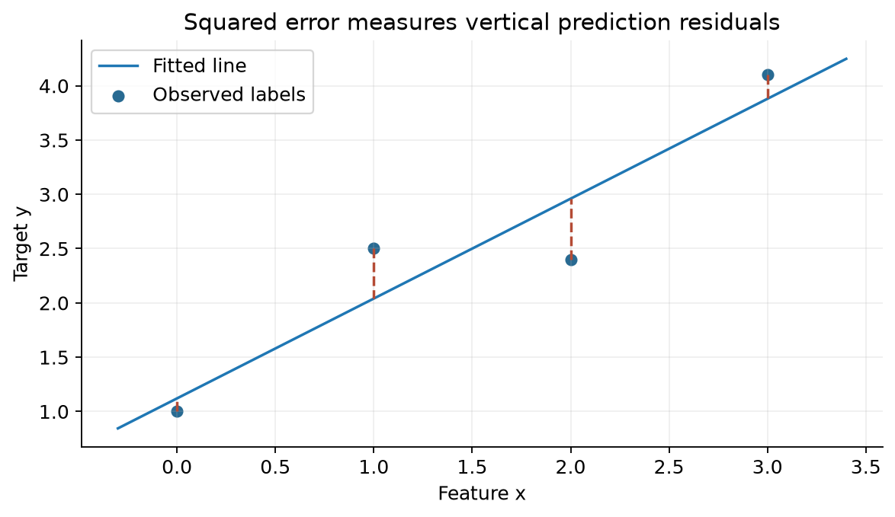

### Q25 — Guaranteed zero training error

**Source:** 2026 Apr 06 Quiz 2, Q25.

**Question:**

Consider a training dataset $(x_i,y_i)_{i=1}^n$ where all input points $x_i\in\mathbb R^d$ are distinct. Which of the following models is guaranteed to achieve a training error of zero?

(a) $h(x_i)=\frac1n\sum_{j=1}^n y_j\quad\forall i\in\{1,\ldots,n\}$

(b) $h(x_i)=0\quad\forall i\in\{1,\ldots,n\}$

(c) $h(x_i)=w^Tx_i+b\quad\forall i\in\{1,\ldots,n\}$, given $n>d+1$

(d) $h(x_i)=y_i\quad\forall i\in\{1,\ldots,n\}$

**Solution:**

1. Mean predictor exactly fits only when all targets equal that mean.
2. Zero predictor exactly fits only if all targets zero.
3. Affine model cannot fit arbitrary labels when there are more observations than its maximum independent degrees of freedom.
4. Option (d) explicitly returns each observed target, so every residual zero.

$$\boxed{\text{(d)}}.$$

Distinct inputs ensure a lookup mapping can assign each target without contradictory labels at identical inputs. Training memorization gives no guarantee for an unseen input.

---

## 2. Least squares: Weight vector kaise fit karein?

### 2.1 Matrix orientation and normal equations

Most questions use observations as **columns**:

$$X=[x_1\ \cdots\ x_n]\in\mathbb R^{d\times n},\quad w\in\mathbb R^d,\quad y\in\mathbb R^n.$$

$$\hat y=X^Tw,\qquad L(w)=\lVert X^Tw-y\rVert_2^2.$$

Gradient and normal equation:

$$\nabla L=2X(X^Tw-y),\qquad\boxed{XX^Tw=Xy}.$$

If X has full row rank d:

$$\boxed{w^*=(XX^T)^{-1}Xy}.$$

If rank deficient, inverse may not exist. Minimum-norm least-squares solution:

$$\boxed{w_{\min}=(XX^T)^\dagger Xy}.$$

Other minimizers can differ by $v\in\operatorname{null}(X^T)$, since $X^T(w_{\min}+v)=X^Tw_{\min}$. Prediction vector unique hai even when weights not unique.

**Convexity property:** Hessian $2XX^T$ positive semidefinite hai, so every local minimum global hai. **Unique** optimum requires positive definiteness/full row rank; convexity alone uniqueness imply nahi karti.

If question uses rows as samples, predictions $Xw$ and normal equation $X^TXw=X^Ty$. Shapes pehle check karo.

### Q35 — Normal equations when an exact fit is impossible

**Source:** Week 5 — Solve With Instructors, Q1.

**Question:**

Suppose you are given three training instances $(x_1,y_1)$, $(x_2,y_2)$ and $(x_3,y_3)$ as follows:

$$(x_1,y_1)=([1,0]^T,1),\quad (x_2,y_2)=([0,1]^T,1),\quad (x_3,y_3)=([1,1]^T,0).$$

Each $x_i$ is a data point and $y_i$ its corresponding label. Predict the output using $\hat y=X^Tw$, where $w=[w_1,w_2]^T$. Find the $w$ that minimizes $\|y-\hat y\|^2$, where $y=[1,1,0]^T$.

Hint: For $A=\begin{bmatrix}a&b\\c&d\end{bmatrix}$, use $A^{-1}=\frac1{\det A}\begin{bmatrix}d&-b\\-c&a\end{bmatrix}$.

**Solution:**

**Step 1 — Exact fit check:** Pehle do points exactly fit karne ke liye $w_1=w_2=1$ chahiye. Lekin third prediction 2 ho jaayegi, target 0 hai. Isliye sab equations ko exact equal maan kar solve nahi kar sakte; least squares compromise choose karega.

**Step 2 — Matrices:**

$$X=\begin{bmatrix}1&0&1\\0&1&1\end{bmatrix},\quad XX^T=\begin{bmatrix}2&1\\1&2\end{bmatrix},\quad Xy=\begin{bmatrix}1\\1\end{bmatrix}.$$

**Step 3 — Inverse and weights:** Determinant $4-1=3$.

$$w^*=\frac13\begin{bmatrix}2&-1\\-1&2\end{bmatrix}\begin{bmatrix}1\\1\end{bmatrix}=\boxed{\begin{bmatrix}1/3\\1/3\end{bmatrix}}.$$

**Step 4 — Verify residuals:**

$$\hat y=(1/3,1/3,2/3)^T,\quad r=y-\hat y=(2/3,2/3,-2/3)^T.$$

$$Xr=0,\qquad \operatorname{SSE}=4/9+4/9+4/9=4/3,\qquad \operatorname{MSE}=4/9.$$

**Property:** Unique least-squares weights ka matlab zero training error nahi hota. Yahan matrix invertible hai, optimum unique hai, phir bhi residual nonzero hai.

### 2.1A Constant-only regression: Baseline is the mean

**Definition:** $\hat y=\beta_0$ har input ko same prediction deta hai. Yeh intercept-only model hai; slope parameter hai hi nahi.

**Real-life connection:** House features use karne se pehle sab houses ke liye training prices ka average predict karna ek baseline hai.

For squared error:

$$\boxed{\beta_0^*=\bar y=\frac1n\sum_i y_i}.$$

- Input values optimum ko affect nahi karte, because model mein x term nahi hai.
- Residual sum zero hota hai; individual residuals zero hona zaroori nahi.
- Absolute-error loss hota toh a median optimal hota, mean zaroori nahi. Example targets $(0,0,9)$: mean 3, median 0. Loss specify karna important hai.

### Q36 — Fit only an intercept

**Source:** Week 5 — Solve With Instructors, Q10.

**Question:**

Consider fitting a linear regression model (as stated below) for the following data:

| $x$ | $y$ |
|---:|---:|
| −1 | 1 |
| 0 | −1 |
| 2 | 1 |

Fit $y_i=\beta_0$. Find $\beta_0$.

**Solution:**

**Step 1:** Model mein $\beta_1x$ nahi hai, so scalar-slope formula $\sum xy/\sum x^2$ use nahi hoga.

**Step 2:** Squared-error fitting mein constant training targets ka mean hoga.

$$\boxed{\beta_0=(1-1+1)/3=1/3}.$$

**Step 3 — Check:** Predictions $(1/3,1/3,1/3)$; residuals $(2/3,-4/3,2/3)$ ka sum 0. SSE $=4/9+16/9+4/9=8/3$.

### 2.2 One feature, no intercept

$$\boxed{w^*=\frac{\sum_i x_i y_i}{\sum_i x_i^2}},\qquad\sum_i x_i^2>0.$$

**Meaning:** Input-target alignment ko input squared magnitude se normalize karte hain. If all x=0, predictions zero for every w; weights not identifiable.

### Q7 — Scalar optimal slope

**Source:** 2024 Aug 04 Quiz 2, Q7.

**Question:**

Consider the following training dataset for a linear regression problem with one feature:

| $x_i$ | $y_i$ |
|---:|---:|
| 1 | 1.2 |
| −1 | 0.1 |
| 2 | 2.1 |
| −2 | −1 |

Find the value of $w^*$, the optimal weight.

**Solution:** Model is $\hat y=wx$, no intercept specified.

**Step 1:**

$$\sum x_i y_i=1(1.2)+(-1)(0.1)+2(2.1)+(-2)(-1)=1.2-0.1+4.2+2=7.3.$$

**Step 2:**

$$\sum x_i^2=1+1+4+4=10.$$

**Step 3:**

$$\boxed{w^*=7.3/10=0.73}.$$

### Q2 — Fit a two-feature linear relationship and training MSE

**Source:** May 2025 Quiz 1, Q2.

**Question:**

Comprehension: Consider the following dataset with feature vector x and label y:

| x | y |
|---|---:|
| $[4,1]^T$ | 2 |
| $[2,8]^T$ | −14 |
| $[1,4]^T$ | −7 |
| $[3,2]^T$ | −1 |

Based on the above data, answer the given subquestions.

(i) Fit the linear regression model $y=wx$, $w=[w_1\ w_2]^T$ using the squared error.

(a) $y=x_1+2x_2$

(b) $y=x_1-2x_2$

(c) $y=x_1-x_2$

(d) $y=x_1+x_2$

(ii) Find the mean squared error for the training dataset.

**Solution:** Interpret the stated dot-product model as $\hat y=w^Tx$.

**(i) Step 1:** First two observations give equations if exact fit is possible:

$$4w_1+w_2=2,\qquad2w_1+8w_2=-14.$$

From first, $w_2=2-4w_1$. Substitute:

$$2w_1+8(2-4w_1)=-14\Rightarrow-30w_1=-30\Rightarrow w_1=1,\ w_2=-2.$$

**Step 2:** Verify **all** points, not only the two used to solve:

| Input | Prediction $x_1-2x_2$ | Target | Squared error |
|---|---:|---:|---:|
| $(4,1)$ | 2 | 2 | 0 |
| $(2,8)$ | −14 | −14 | 0 |
| $(1,4)$ | −7 | −7 | 0 |
| $(3,2)$ | −1 | −1 | 0 |

Zero SSE is the global lower bound, so this is an optimal fit.

$$\boxed{\text{(i) (b)},\qquad\text{(ii) MSE}=0/4=0}.$$

### 2.3 Scaling properties

For unregularized least squares, with consistent choice of solution:

- Labels multiplied by c → weights can be multiplied by c.
- All feature vectors multiplied by nonzero c → weights can be divided by c to preserve predictions.

These statements are exact for the unique/minimum-norm solution. If separate unscaled intercept is present, scaling raw x halves slope but doesn't halve intercept; question must specify which features are scaled.

### Q12 — Doubling labels or inputs

**Source:** 2024 Dec 01 Quiz 2, Q12.

**Question:**

Consider a linear regression model with loss

$$L(w)=\sum_{i=1}^n(w^Tx_i-y_i)^2,$$

where $x_i$'s are the d-dimensional training data points and $y_i$'s are their corresponding labels. For the optimal weight vector $w^*$, which among the following is correct? (MSQ)

(a) If we double all the values of $y_i$, $w^*$ will also get doubled.

(b) If we double all the values of $y_i$, $w^*$ will get halved.

(c) If we double all the values of $x_i$, $w^*$ will get halved.

(d) If we double all the values of $x_i$, $w^*$ will also get doubled.

**Solution:**

**Labels double:** Normal-equation expression linear in y:

$$w_{new}=(XX^T)^{-1}X(2y)=2w^*.$$

**Inputs double:**

$$w_{new}=((2X)(2X)^T)^{-1}(2X)y=(4XX^T)^{-1}2Xy=\tfrac12w^*.$$

$$\boxed{\text{(a), (c)}}.$$

Same scaling holds for minimum-norm solutions if inverse replaced appropriately. Arbitrary null-space components in nonunique solutions need not follow a uniquely forced scaling.

### Q21 — Duplicate observations and add points exactly on the fitted model

**Source:** 2025 Aug 03 Quiz 2, Q21.

**Question:**

Consider a dataset $D=\{(x_1,y_1),\ldots,(x_n,y_n)\}$. Let $w^*\in\mathbb R^d$ be the solution of the optimization problem $\min_{w\in\mathbb R^d}\lVert X^Tw-y\rVert_2^2$, where $X\in\mathbb R^{d\times n}$ and $y\in\mathbb R^n$. Construct a new dataset $D_{new}$ by duplicating all points in D and adding 10 new points that lie exactly on the line $y=x^Tw^*$. Then, the solution $w^*_{new}$ of the corresponding optimization problem is also $w^*$.

(a) TRUE

(b) FALSE

**Solution:**

Let old SSE be $L(w)$. New points have labels $\widetilde y_j=\widetilde x_j^Tw^*$, so new objective:

$$L_{new}(w)=2L(w)+\sum_{j=1}^{10}(\widetilde x_j^Tw-\widetilde x_j^Tw^*)^2.$$

At $w=w^*$, added term zero. For any other w, old loss cannot be less than $L(w^*)$, and added squared terms nonnegative:

$$L_{new}(w)\ge2L(w^*)=L_{new}(w^*).$$

$$\boxed{\text{(a) TRUE: }w^*\text{ remains a minimizer}}.$$

If old/new solutions are not unique, “a minimizer remains” is the precise conclusion; a solver's selected vector may depend on its selection rule. Duplicating only some points, or adding off-line points, need not preserve fit.

---

## 3. Geometry: Predictions are a projection in label space

### 3.1 Two different spaces — don't mix them

For X of shape d × n:

| Object | Dimension | Span |
|---|---|---|
| Data point $x_i$ (column of X) | $\mathbb R^d$ | Data span $\operatorname{col}(X)$ |
| Feature vector $f_j$ (row of X, viewed as column) | $\mathbb R^n$ | Feature span $\operatorname{row}(X)=\operatorname{col}(X^T)$ |
| Weights w | $\mathbb R^d$ | Parameter space |
| Labels y and predictions $X^Tw$ | $\mathbb R^n$ | Label/observation space |

**Short definition:** Orthogonal projection is the closest point in a subspace to a given vector.

**Real life:** Shadow on a flat surface: the shadow lies on the surface; leftover perpendicular part cannot be represented by moving along that surface.

Prediction vector is a linear combination of feature vectors:

$$X^Tw=\sum_{j=1}^d w_j f_j.$$

Least squares chooses the closest such vector to y:

$$\boxed{\hat y=X^Tw^*=P_{\operatorname{row}(X)}y}.$$

Residual $r=y-\hat y$ is orthogonal to every feature:

$$\boxed{Xr=0},\qquad\boxed{\hat y^Tr=0}.$$

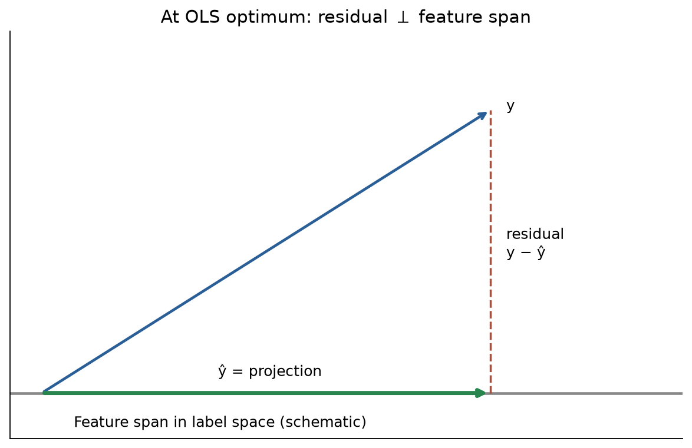

### Q37 — Recover weights from projected labels

**Source:** Week 5 — Solve With Instructors, Q5.

**Question:**

Consider the following data points: $\{(1,2),(3,1),(-1,4)\}$. The projection of the label vector onto the span of the feature vectors of the data points is $(2,11,-8)$. Predict the label for $(7,3)$ using linear regression.

**Solution:**

**Step 1 — Interpret the projection:** Given vector fitted labels $\hat y$ hai. Actual labels y nahi diye, lekin weights recover karne ke liye fitted labels sufficient hain.

$$X^Tw=\hat y\Rightarrow w_1+2w_2=2,\quad3w_1+w_2=11,\quad-w_1+4w_2=-8.$$

**Step 2 — Solve:** First equation se $w_1=2-2w_2$.

$$3(2-2w_2)+w_2=11\Rightarrow -5w_2=5\Rightarrow w_2=-1,\quad w_1=4.$$

**Step 3 — Check third equation:** $-4+4(-1)=-8$, so all three fitted values consistent hain.

**Step 4 — Predict:**

$$\boxed{\hat y(7,3)=4(7)-3=25}.$$

**Space check:** Feature vectors $(1,3,-1)^T$ aur $(2,1,4)^T$ label space $\mathbb R^3$ mein hain. Input points $\mathbb R^2$ mein hain. Given projection pehle wale span mein hai.

### 3.2 When is training error zero?

$$\boxed{\text{Zero SSE}\iff y\in\operatorname{row}(X)\iff\exists w:X^Tw=y}.$$

If features span all $\mathbb R^n$ (rank n), every label vector can be fitted. If n>d, generic arbitrary labels need not be representable, though particular labels may fit exactly.

### Q31 — Check whether labels belong to feature span

**Source:** 2026 Aug 14 Quiz 2, Q31.

**Question:**

A dataset has n = 3 data points and d = 2 features. The two feature vectors are

$$f_1=[1,0,1]^T,\qquad f_2=[0,1,1]^T.$$

For which label vector y is the linear model $f(x)=w^Tx$ guaranteed to achieve exactly zero training error?

(a) $y=[1,2,3]^T$

(b) $y=[1,2,4]^T$

(c) $y=[2,1,4]^T$

(d) $y=[0,0,1]^T$

**Solution:** Any attainable prediction is

$$w_1f_1+w_2f_2=[w_1,w_2,w_1+w_2]^T.$$

Thus condition $y_3=y_1+y_2$ must hold.

- (a): $3=1+2$, yes; weights $(1,2)$.
- (b): $4\ne1+2$.
- (c): $4\ne2+1$.
- (d): $1\ne0+0$.

$$\boxed{\text{(a)}}.$$

### Q6 — Zero error and invertibility assumptions

**Source:** 2024 Apr 28 ET, Q6.

**Question:**

Let X be a data matrix of the shape (d, n) and y be the associated label vector of shape (n, 1). Assume that a linear regression model with loss as the sum of squared error is trained on the data {X, y}. In which of the following cases, the loss on the training data will necessarily be zero? Assume that the solution of the model is obtained by the normal equation that is $w^*=(XX^T)^{-1}Xy$. (MSQ)

(a) If y lies in the space spanned of row vectors of X.

(b) If y lies in the space spanned of row vectors of $X^T$.

(c) If all the data points satisfy the equality $x_1+x_2+\cdots+x_d=0$, where $x_i$ is the ith feature and y = 0 for all the data points.

(d) If all the data points satisfy the equality $x_1^3+x_2^3+\cdots+x_d^3=0$, where $x_i$ is the ith feature and y = 0 for all the data points.

**Solution:**

**(a):** Correct zero-error criterion: y in feature/row span → exact fit.

**(b):** Rows of $X^T$ are data-point vectors in $\mathbb R^d$, whereas y lies in $\mathbb R^n$. This is the wrong space, and generally dimensionally incompatible.

**(c):** Linear relation across features gives a nonzero vector $\mathbf1$ with $X^T\mathbf1=0$, so $XX^T$ singular. The displayed inverse formula cannot be used. Least squares itself still has zero error at w=0 because all labels zero.

**(d):** Cubic relation does **not** generally imply a linear rank deficiency. If $XX^T$ is invertible as assumed, y=0 gives $w^*=0$ and SSE 0. For example, d=3 data columns $(1,-1,0),(1,0,-1),(1,1,-\sqrt[3]2)$ satisfy the cubic condition and are linearly independent.

**Answer-key issue:** Paper lists **(a) only**, but it overlooks that (d), whenever compatible with the inverse assumption, also gives zero loss. Mathematically, among cases with the stated inverse defined, **(a) and (d)** suffice. If using pseudoinverse/ordinary least squares without the inverse restriction, (c) also has zero error. Don't memorize that zero labels somehow prevent an exact zero prediction.

### 3.2A Zero error gives a hyperplane in the joint input-label space

**Definition:** $w^Tx-y=0$ joint coordinates $(x,y)\in\mathbb R^{d+1}$ mein hyperplane hai, normal vector $(w,-1)$ ke saath.

**Real-life connection:** Ek input aur target ho toh perfect fit points $(x_i,y_i)$ ek line par hain. Do inputs aur target ho toh points $(x_{i1},x_{i2},y_i)$ ek plane par hain.

### Q38 — What follows from zero squared error?

**Source:** Week 5 — Solve With Instructors, Q6.

**Question:**

We have data points $D=\{(x_1,y_1),\ldots,(x_n,y_n)\}$, where $x_i\in\mathbb R^d$ and $y_i\in\mathbb R$. We get a $w$ after linear regression such that $\sum_i(y_i-f(x_i))^2=0$, where $f(x_i)=w^Tx_i$. Which options are true?

(A) $w$ is a result of overfitting.

(B) Every datapoint in $D$ is on some hyperplane in $\mathbb R^d$.

(C) Every datapoint in $D$ is on some hyperplane in $\mathbb R^{d+1}$.

(D) Let $Y=(y_1,\ldots,y_n)^T$ and $Y_p$ be the projection of $Y$ onto the span of the feature vectors of $x_1,\ldots,x_n$. Then $\|Y-Y_p\|>0$.

**Solution:**

**Step 1:** Har squared term nonnegative hai. Sum zero means har $y_i=w^Tx_i$.

**Step 2 — (C):** Har joint point satisfies $(w,-1)^T(x_i,y_i)=0$. Nonzero normal vector hai, hence $\mathbb R^{d+1}$ mein hyperplane. **True.**

**Step 3 — (B):** Inputs alone ko lower-dimensional hyperplane mein hona zaroori nahi. Example $d=1$: inputs 0 and 1, targets 0 and 1, $w=1$. Perfect fit hai, lekin two distinct inputs $\mathbb R^1$ ke single-point hyperplane par nahi hain. **False.**

**Step 4 — (A):** Training SSE zero se unseen-data performance pata nahi chalti. True noiseless linear relation perfectly fit ho sakti hai; overfit model bhi training data perfectly fit kar sakta hai. **Not guaranteed.**

**Step 5 — (D):** Exact fit means $Y_p=Y$, so norm zero. **False.**

$$\boxed{\text{(C) only}}.$$

### Q5 — Optimal weight orthogonal to the data span

**Source:** 2024 Mar 24 Quiz 2, Q5.

**Question:**

Let X be the data matrix of shape (d, n) and y be the corresponding label vector. A linear regression model of the form $\hat y_i=w^Tx_i$ is fit using the squared error on the same dataset. If the solution $w^*$ to the optimization problem is orthogonal to the subspace spanned of the data point (columns of matrix X), what will be the squared error?

(a) 0

(b) 1

(c) $\lVert y\rVert^2$

(d) Insufficient information to answer

**Solution:**

1. Orthogonality to every data point means $x_i^Tw^*=0$ for all i.
2. Entire prediction vector $X^Tw^*=0$.
3. SSE $=\lVert0-y\rVert_2^2$.

$$\boxed{\lVert y\rVert_2^2\quad\text{(c)}}.$$

Weight lives in $\mathbb R^d$; zero predictions are in $\mathbb R^n$.

### Q32 — Labels orthogonal to every feature

**Source:** 2026 Aug 14 Quiz 2, Q32.

**Question:**

Suppose the label vector $y\ne0$ is orthogonal to every feature vector, i.e.

$$f_j^Ty=0\quad\text{for all }j=1,\ldots,d.$$

$w^*$ is the optimal weight obtained after minimizing the objective function of linear regression. Which statement is correct?

(a) $X^Tw^*=y$ and the training error is 0.

(b) $X^Tw^*=0$ and the squared training error equals $\lVert y\rVert_2^2$.

(c) $X^Tw^*=0$ and the squared training error equals 0.

(d) The normal equations have no solution.

**Solution:** y is perpendicular to the whole feature subspace, so its projection onto that subspace is zero. Hence fitted labels zero and SSE $\lVert y\rVert^2>0$.

$$\boxed{\text{(b)}}.$$

Normal equations still have solutions; w=0 works. Q5 gives an orthogonality condition on weights, while Q32 gives one on labels; both lead to zero predictions.

### 3.3 Minimum-norm weights can be written in the data span

Decompose $w=w_\parallel+w_\perp$, where $w_\parallel\in\operatorname{col}(X)$ and $X^Tw_\perp=0$. Perpendicular part doesn't affect training predictions, but increases norm when nonzero. Therefore minimum-norm optimum can be chosen as:

$$\boxed{w_{\min}=X\alpha}.$$

**Counterexample to “every optimum must lie in data span”:** One point $x=(1,0)^T$, label 1. Every $w=(1,c)^T$ fits perfectly. Only c=0 lies in the one-dimensional data span and has minimum norm.

### Q39 — All inputs lie along one direction

**Source:** Week 5 — Solve With Instructors, Q3.

**Question:**

Consider the data points $\{(c_1u,y_1),\ldots,(c_nu,y_n)\}$ for a regression problem. Here $c_i$ is a real number and $u\in\mathbb R^d$, $u\ne0$. Fit a linear regression model and find the predicted value for $x_{test}=5u$. Assume some $c_i\ne0$. Given $\sum_i c_i y_i=20$ and $\sum_i c_i^2=100$.

**Solution:**

**Step 1 — Reduce to one effective coefficient:** $w^T(c_i u)=c_i(w^Tu)$. Define $a=w^Tu$. Loss becomes $\sum_i(c_i a-y_i)^2$, ordinary scalar no-intercept regression.

**Step 2 — Fit a:**

$$a^*=\frac{\sum c_i y_i}{\sum c_i^2}=\frac{20}{100}=0.2.$$

**Step 3 — Predict along the same direction:**

$$\boxed{\hat y(5u)=5w^Tu=5(0.2)=1}.$$

**Step 4 — What weights fit this?** A minimum-norm choice is

$$w_{\min}=\frac{0.2}{\|u\|^2}u.$$

Any $w=w_{\min}+v$ with $v^Tu=0$ has the same training predictions. For $d>1$, weights need not be unique, but predictions at every $cu$ are unique.

**Counterexample outside the training span:** Let $u=(1,0)$. Both $(0.2,0)$ and $(0.2,7)$ give prediction 1 at $(5,0)$, but predict 0 and 7 at $(0,1)$. Data ne unseen perpendicular direction ka coefficient determine nahi kiya.

### Q23 — Projection and span statements

**Source:** 2025 Aug 03 Quiz 2, Q23.

**Question:**

Let $w^*\in\mathbb R^d$ be the solution of the optimization problem $\min_{w\in\mathbb R^d}\lVert X^Tw-y\rVert_2^2$, where $X\in\mathbb R^{d\times n}$ and $y\in\mathbb R^n$. Then, which of the following statements is/are true? (MSQ)

(a) $X^Tw^*$ is the projection of the labels onto the subspace spanned by the features.

(b) $X^Tw^*$ is the projection of the labels onto the subspace spanned by the data points.

(c) $w^*$ lies in the span of data points.

(d) $w^*$ lies in the span of features.

**Solution:**

- (a) True: Fitted label vector is projection onto feature span in $\mathbb R^n$.
- (b) Wrong space: Data points span a subspace of $\mathbb R^d$.
- (c) True for the canonical minimum-norm/pseudoinverse solution; also trivially true when X has full row rank and data span is all $\mathbb R^d$.
- (d) Again mixes parameter and label spaces.

$$\boxed{\text{Paper's intended answer: (a), (c)}}.$$

Without the minimum-norm/full-rank convention, (c) is not guaranteed for **every** minimizer; the counterexample just above explains the limitation. (a) remains true for all least-squares minimizers.

### Q33 — Fitted vector is orthogonal to the residual

**Source:** 2026 Sep 13 ET, Q33.

**Question:**

Let $w^*$ be the solution to the ordinary least-squares linear regression problem

$$\min_w\lVert y-Xw\rVert^2.$$

Which of the following is always satisfied at $w^*$? Note that here X is your feature matrix and y is the label vector.

(a) $(Xw^*)^T(y-Xw^*)=0$

(b) $(Xw^*)^T(Xw^*)=0$

(c) $y^T(y-Xw^*)=0$

(d) $y-Xw^*=0$

**Solution:** This question uses rows as observations, so normal equations are $X^T(y-Xw^*)=0$.

Multiply on left by $(w^*)^T$:

$$(w^*)^TX^T(y-Xw^*)=(Xw^*)^T(y-Xw^*)=0.$$

$$\boxed{\text{(a)}}.$$

(b) would require all fitted labels zero; (d) requires exact fit, neither is necessary. For (c), writing $y=\hat y+r$ gives $y^Tr=\lVert r\rVert^2$, not zero unless residual zero.

### 3.4 Intercept implies zero sum of residuals

If model includes an unconstrained intercept, the all-ones vector is a feature. Residual orthogonality then gives:

$$\boxed{\sum_i(y_i-\hat y_i)=0},\qquad\boxed{\overline{\hat y}=\bar y}.$$

This property needs an intercept fitted by ordinary unweighted least squares; no-intercept models need not satisfy it.

### Q24 — Can an optimal intercept model overpredict every sample?

**Source:** 2026 Apr 06 Quiz 2, Q24.

**Question:**

Consider a linear regression model applied to a dataset in which each data-point is described by two features. The first feature is always 1. The ith data-point’s feature-label pair is represented as $((1,x_i),y_i)$. Let $(w_0^*,w_1^*)\in\mathbb R^2$ be the optimal weight vector that minimizes the sum of squared errors. Consider two scenarios:

$S_1:w_0^*+w_1^*x_i>y_i$, for each data-point $((1,x_i),y_i)$.

$S_2:w_0^*+w_1^*x_i<y_i$, for each data-point $((1,x_i),y_i)$.

Which of the following is true?

(a) $S_1$ is possible, but $S_2$ is impossible.

(b) $S_1$ is impossible, but $S_2$ is possible.

(c) One of $S_1$ or $S_2$ is possible.

(d) Both $S_1$ and $S_2$ are impossible.

**Solution:**

At optimum, intercept derivative is zero:

$$\frac{\partial L}{\partial w_0}=2\sum_i(w_0+w_1x_i-y_i)=0.$$

If all predictions strictly exceed labels, every summand positive → sum cannot be zero. If all strictly below, every summand negative → same contradiction.

$$\boxed{\text{(d)}}.$$

Intuition: If all overpredicted, intercept thoda decrease karke every squared residual reduce kar sakte hain, so previous weights optimum nahi the.

---

### 3.5 PCA versus regression: Which distance is minimized?

**Definition:** PCA line squared **perpendicular** reconstruction distances minimize karti hai. Ordinary regression $y=wx+b$ squared **vertical** prediction errors minimize karta hai.

**Real-life connection:** PCA dono measurements ko jointly compress karta hai. Regression x observe karke y predict karta hai, so x fixed rakhkar y direction mein error measure hota hai.

For a nonvertical line $y=wx+b$:

$$d_{vertical,i}=|y_i-wx_i-b|,\qquad d_{perpendicular,i}=\frac{|y_i-wx_i-b|}{\sqrt{1+w^2}}.$$

$$\operatorname{SSPD}=\frac{\operatorname{SSVD}}{1+w^2}.$$

- Denominator slope ke saath change hota hai, isliye objectives generally same minimizer nahi dete.
- Centered data mein regression intercept 0 hota hai; PCA line mean/origin se pass karti hai.
- PCA vertical line bhi select kar sakta hai. Finite-slope regression $y=wx+b$ vertical line represent nahi karta.
- Perfect nonvertical collinear data mein dono same line de sakte hain. “Always different” bhi wrong hai.

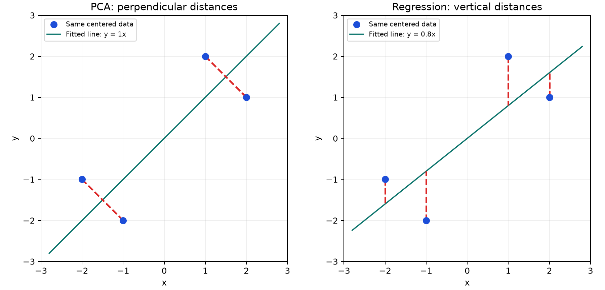

### Q40 — PCA and regression objectives

**Source:** Week 5 — Solve With Instructors, Q8.

**Question:**

We have $n$ data points $x_1,\ldots,x_n\in\mathbb R$ and corresponding labels $y_1,\ldots,y_n\in\mathbb R$. Form $D=\{(x_1,y_1),\ldots,(x_n,y_n)\}$. PCA on $D$ gives $l_1$, the line along the first principal component. Linear regression gives $l_2$ of the form $y=wx$. Assume $\sum_i(x_i,y_i)=(0,0)$. Choose the correct options.

SSPD means sum squared perpendicular distance; SSVD means sum squared vertical distance.

(A) The SSPD from $D$ to $l_1$ is the minimum possible SSPD to any line in $\mathbb R^2$.

(B) The SSPD from $D$ to $l_2$ is the minimum possible SSPD to any line in $\mathbb R^2$.

(C) The SSVD from $D$ to $l_1$ is the minimum possible SSVD to any line in $\mathbb R^2$.

(D) The SSVD from $D$ to $l_2$ is the minimum possible SSVD to any line in $\mathbb R^2$.

**Solution:**

**Step 1 — PCA objective:** PC1 retained line closest orthogonal reconstruction deti hai. Hence (A) true; (C) generally false.

**Step 2 — Regression objective:** $\sum_i(y_i-wx_i)^2$ vertical errors ka sum hai. Hence (D) true; (B) generally false. Vertical-distance comparisons mein lines jo y as a function of x define karti hain consider hote hain.

**Step 3 — Why no intercept is okay:** $b^*=\bar y-w\bar x=0$ because both means zero. Origin restriction optimal affine regression line ko exclude nahi karti.

$$\boxed{\text{(A), (D)}}.$$

**Numerical counterexample for (B)/(C):** Centered points $(-2,-1),(-1,-2),(1,2),(2,1)$ have $\sum x^2=\sum y^2=10$, $\sum xy=8$. Regression slope $8/10=0.8$; PCA slope 1. Regression SSVD $=3.6<4$ (PCA), whereas PCA SSPD $=2<3.6/1.64\approx2.195$ (regression). Same dataset, different best distances.

## 4. Gradient descent and stochastic gradient descent

### 4.1 Gradient: Loss kis direction mein fastest increase hoti hai?

**Short definition:** Gradient parameter space mein local steepest-increase direction deta hai. Loss reduce karne ke liye negative gradient direction mein move karte hain.

**Real life:** Hill se downhill jaana: slope uphill point karta hai, so opposite move karo. Bahut large step downhill valley cross karke higher point par pahucha sakta hai.

For SSE:

$$L(w)=\lVert X^Tw-y\rVert^2,\qquad\boxed{\nabla L(w)=2XX^Tw-2Xy=2X(X^Tw-y)}.$$

Update:

$$\boxed{w^{(t+1)}=w^{(t)}-\eta\nabla L(w^{(t)})},\qquad\eta>0.$$

Residual calculation all old weights se hoti hai; new coordinate ko use karke same step ke baaki gradients recompute nahi karte.

| Objective | Gradient |
|---|---|
| SSE | $2X(X^Tw-y)$ |
| Half-SSE | $X(X^Tw-y)$ |
| MSE = SSE/n | $(2/n)X(X^Tw-y)$ |
| Half-MSE | $(1/n)X(X^Tw-y)$ |

### Q10 — Single-sample gradient and the missing factor 2

**Source:** 2024 Sep 01 ET, Q10.

**Question:**

Consider a linear regression problem. Which of the following is the gradient of the SSE function with respect to $w\in\mathbb R^d$, the weight vector, for a single data-point $x\in\mathbb R^d$? y is the true label and $\hat y$ is the predicted label. Note that SSE is the sum of squared errors.

(a) $(\hat y-y)x$

(b) $(w^Tx)w$

(c) $\hat yx$

(d) $xy$

**Solution:**

1. Single-sample error $e=w^Tx-y$.
2. Raw squared loss $L=e^2$ gives $\nabla_wL=2e\nabla_we=2(w^Tx-y)x$.
3. Half-squared loss $L=e^2/2$ instead gives $(\hat y-y)x$.

$$\boxed{\text{Intended option (a), using half-SSE convention}}.$$

Literal unscaled SSE gradient has factor **2**, absent from every option. Direction is the same, but numerical GD step with fixed learning rate differs. Q15/Q18 explicitly use unscaled SSE, so retain factor 2 there.

### Q15 — One full-batch gradient step

**Source:** 2024 Dec 22 ET, Q15.

**Question:**

Perform one round of the gradient descent algorithm for the linear regression on the below data

$$X=\begin{bmatrix}1&-2&0\\2&5&1\end{bmatrix},\qquad y=\begin{bmatrix}1\\6\\1\end{bmatrix}$$

with the initial weight vector $w_0=[1,0.5]^T$ and learning rate $\eta=0.05$. Find the updated weight vector $w_1$ after one iteration of gradient descent.
Note: The objective function is given by $f(w)=\lVert X^Tw-y\rVert^2$.

(a) $w_1=[0.2,3.1]^T$

(b) $w_1=[0.2,0.5]^T$

(c) $w_1=[1,0.5]^T$

(d) $w_1=[-0.2,3.1]^T$

**Solution:**

**Step 1: Current predictions.**

$$X^Tw_0=\begin{bmatrix}1&2\\-2&5\\0&1\end{bmatrix}\begin{bmatrix}1\\0.5\end{bmatrix}=\begin{bmatrix}2\\0.5\\0.5\end{bmatrix}.$$

**Step 2: Prediction-minus-target errors.**

$$e=X^Tw_0-y=[1,-5.5,-0.5]^T.$$

**Step 3: Gradient.**

$$Xe=\begin{bmatrix}1(1)+(-2)(-5.5)+0(-0.5)\\2(1)+5(-5.5)+1(-0.5)\end{bmatrix}=\begin{bmatrix}12\\-26\end{bmatrix}.$$

$$\nabla f(w_0)=2Xe=[24,-52]^T.$$

**Step 4: Subtract learning-rate-scaled gradient.**

$$w_1=\begin{bmatrix}1\\0.5\end{bmatrix}-0.05\begin{bmatrix}24\\-52\end{bmatrix}=\boxed{\begin{bmatrix}-0.2\\3.1\end{bmatrix}\quad\text{(d)}}.$$

A requested update need not decrease loss if learning rate too large. Here SSE goes from 31.5 to 127.42: step calculation is correct, but this learning rate overshoots. Don't change the prescribed learning rate to force a decrease.

### Q18 — Scalar gradient update and prediction

**Source:** 2025 Mar 16 Quiz 2, Q18.

**Question:**

Comprehension: Consider a linear regression model $y_i=w^Tx_i$ with an initial weight $w=[3]$.

| $x_1$ | y |
|---:|---:|
| 1 | 4 |
| 2 | 7 |
| 3 | 10 |
| 4 | 13 |

Based on the above data, answer the given subquestions.

(i) Using the squared loss function and a learning rate of $\eta=0.2$, compute the updated weight after one iteration of gradient descent for the given dataset:
Use $\nabla f(w)=2(XX^T)w-2Xy$.

(ii) If we stop the algorithm at the weight calculated in the previous question, what will be the predicted value for the data point, $x_1=5$?

**Solution:**

**(i) Step 1:** $\sum x_i^2=1+4+9+16=30$.

**Step 2:** $\sum x_iy_i=4+14+30+52=100$.

**Step 3:** Gradient at w=3:

$$\nabla f(3)=2(30)(3)-2(100)=180-200=-20.$$

**Step 4:**

$$\boxed{w_{new}=3-0.2(-20)=7}.$$

**(ii):** No intercept in fitted model, so:

$$\boxed{\hat y(5)=7(5)=35}.$$

**Important:** This is one iterate, not optimal slope. Optimum is $100/30=10/3$. Given $\eta=0.2$ is too large for convergent full-batch SSE updates here (sufficient range $0<\eta<1/30$). Training SSE increases from 4 to 404; nevertheless requested one-step answer remains 7.

### Q9 — Negative-gradient direction and new norm

**Source:** 2024 Aug 04 Quiz 2, Q9.

**Question:**

Comprehension: Consider a linear regression problem that has two features with a training dataset of 10,000 points. The blue point in the image below is the weight vector, $w^{(t)}$, at some iteration of gradient descent. $w_1,w_2,w_3$ are unit vectors. Specifically, $w_1$ is a unit vector in the direction of the gradient at this point.

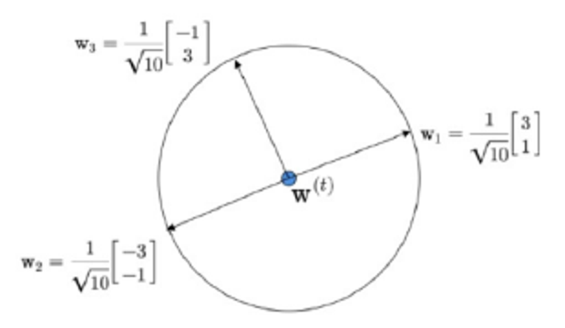

Based on the above data, answer the given subquestions.

(i) If the next iteration of gradient descent is expressed as $w^{(t+1)}=w^{(t)}+\eta w_k$ with $\eta>0$, what would be the value of k?

(ii) If $w^{(t)}=[0.4,0.1]^T$ and $\eta=1/\sqrt{10}$, find $\lVert w^{(t+1)}\rVert$, where we use the usual L2 norm.

**Solution:**

**(i):** Diagram gives $w_1=(3,1)^T/\sqrt{10}$, $w_2=(-3,-1)^T/\sqrt{10}=-w_1$, $w_3=(-1,3)^T/\sqrt{10}$.

Since written update uses **plus** $\eta w_k$, choose downhill direction $w_2$.

$$\boxed{k=2}.$$

**(ii):**

$$\eta w_2=\frac1{\sqrt{10}}\frac1{\sqrt{10}}[-3,-1]^T=[-0.3,-0.1]^T.$$

$$w^{(t+1)}=[0.4,0.1]^T+[-0.3,-0.1]^T=[0.1,0]^T.$$

$$\boxed{\lVert w^{(t+1)}\rVert_2=\sqrt{0.1^2+0^2}=0.1}.$$

Here step length is explicitly along a **unit** direction. Standard GD uses full gradient magnitude; don't insert an unspecified gradient norm into this question.

### 4.2 Learning-rate conditions and efficiency

For SSE Hessian $H=2XX^T$, let $a_{max}>0$ be largest eigenvalue of $XX^T$. A sufficient fixed-step condition for convergence along identifiable directions is:

$$\boxed{0<\eta<1/a_{max}}.$$

For half-SSE, bound becomes $0<\eta<2/a_{max}$. Large steps can oscillate or diverge even on a convex quadratic.

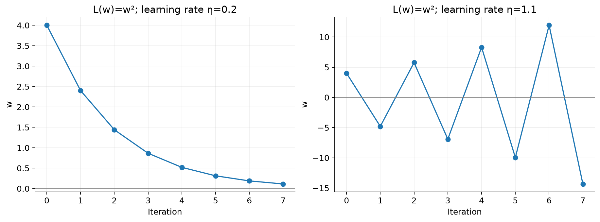

Normal-equation dense solve/inversion has roughly $O(d^3)$ solve cost after forming $XX^T$ (formation roughly $O(nd^2)$). Direct full-gradient evaluation $2X(X^Tw-y)$ costs roughly $O(nd)$ per iteration. Different data sizes favour different methods; normal equations are not always the most numerically stable solver compared with QR/SVD.

### Q41 — Reaching the minimum versus detecting a stopped update

**Source:** Week 5 — Solve With Instructors, Q7.

**Question:**

$f(x)=x^2-2x+1$. We are trying to find an $x$ at which the function's value is minimum. Use gradient descent initialized at $x_0=0$. After how many iterations does the algorithm stop? Use $\eta=0.5$.

**Solution:**

**Step 1:** $f'(x)=2x-2$ and $f(x)=(x-1)^2$, so minimum at 1.

**Step 2 — First update:**

$$x_1=x_0-0.5(2x_0-2)=0-0.5(-2)=1.$$

Minimum **one update** mein reach ho gaya.

**Step 3 — Next update:**

$$x_2=1-0.5(2-2)=1.$$

Now $x_2=x_1$. Agar algorithm update ke baad consecutive iterates compare karta hai, **2 rounds** count honge, jo PDF ka answer hai. Agar gradient zero check karke next update se pehle stop kare, only **1 actual update** required hai. Stopping rule question mein explicit nahi hai; minimum reach karna aur unchanged step detect karna distinguish karo.

### Q30 — SSE versus MSE changes trajectory, not minimizers

**Source:** 2026 Aug 14 Quiz 2, Q30.

**Question:**

A student P minimizes the sum of squared errors (SSE) loss

$$L(w)=\frac12\sum_{i=1}^n(w^Tx_i-y_i)^2,$$

while another student Q minimizes the mean squared error (MSE) loss

$$L'(w)=\frac1{2n}\sum_{i=1}^n(w^Tx_i-y_i)^2.$$

Both students use gradient descent with the same learning rate $\eta$ and the same initial parameter vector $w_0$. Which one of the following statements is correct?

(a) They converge to different minimizers, because the losses differ.

(b) They converge to the same minimizer, but Q’s steps are n times smaller; Q would need learning rate $n\eta$ to reproduce P’s trajectory.

(c) They converge to the same minimizer, and their iterates coincide at every step.

(d) They converge to the same minimizer, but Q’s steps are n times larger.

**Solution:**

1. $L'=L/n$ → same minimizer set.
2. At the **same w**, $\nabla L'=\nabla L/n$. Thus Q's update vector with same $\eta$ is 1/n as large.
3. Using $\eta_Q=n\eta_P$ gives $\eta_Q\nabla L'=\eta_P\nabla L$, so identical trajectories from same starting point.

$$\boxed{\text{(b), assuming learning rates lead to convergence}}.$$

At different iterates their update lengths need not remain in an exact 1/n ratio because gradients evaluated at different locations. Same minimizers don't guarantee arbitrary step sizes converge.

### 4.3 SGD and mini-batches

**Short definition:** Stochastic gradient descent uses one randomly sampled point's gradient per update; mini-batch gradient uses a small group. Full-batch GD uses all n observations.

For half-mean squared loss, uniform single-sample gradient $(w^Tx_i-y_i)x_i$ is an unbiased estimate of the full mean gradient. For an objective defined as a sum, appropriate scaling by n is needed if estimating the sum gradient exactly.

**Real life:** Full batch checks every record before each correction; SGD makes frequent cheap corrections from a few examples. Each correction noisier, but more updates may fit into same computation budget.

- Full GD usually smoother trajectory.
- SGD cheaper update, noisy direction; constant learning rate can keep fluctuating near optimum.
- Suitable diminishing learning rates and regularity assumptions can yield convergence; unconditional guarantee nahi.
- Averaging iterates can reduce stochastic fluctuation in appropriate settings.
- Iterations, epochs and wall-clock time different: n single-sample updates are roughly one pass/epoch.

### Q42 — Full-batch update versus two sequential mini-batches

**Source:** Week 5 — Solve With Instructors, Q2.

**Question:**

For the dataset

$$X_{d\times n}=\begin{bmatrix}1&2&3&4\\2&1&4&3\end{bmatrix},\qquad y=\begin{bmatrix}2\\3\\1\\3\end{bmatrix},$$

initialize $w_0=[0,0]^T$ with learning rate $\eta=0.01$. Let $w_{gd}$ be the updated weight after one iteration of gradient descent and $w_{sgd}$ the updated weight after one full iteration of stochastic gradient descent, taking the first two and then the next two data points as samples. Compute $\|w_{gd}-w_{sgd}\|$. For all calculations, use $\frac12\|X^Tw-y\|^2$ as the loss function.

**Solution:**

**Step 1 — Fix the convention:** Two points per update means mini-batch GD. One complete pass has two sequential updates. Given loss half-**sum** hai; batch gradient mein batch size se divide nahi karenge.

$$g_B(w)=X_B(X_B^Tw-y_B),\qquad w_{next}=w-0.01g_B(w).$$

**Step 2 — Full batch at zero:**

$$Xy=(23,20)^T,\qquad w_{gd}=0+0.01Xy=(0.23,0.20)^T.$$

**Step 3 — First mini-batch:**

$$X_1=\begin{bmatrix}1&2\\2&1\end{bmatrix},\quad y_1=(2,3)^T,\quad X_1y_1=(8,7)^T.$$

$$w^{(1)}=(0.08,0.07)^T.$$

**Step 4 — Second mini-batch uses the updated weight:**

$$X_2=\begin{bmatrix}3&4\\4&3\end{bmatrix},\quad y_2=(1,3)^T.$$

Predictions $X_2^Tw^{(1)}=(0.52,0.53)^T$, residuals $(-0.48,-2.47)^T$.

$$g_2=\begin{bmatrix}3&4\\4&3\end{bmatrix}\begin{bmatrix}-0.48\\-2.47\end{bmatrix}=\begin{bmatrix}-11.32\\-9.33\end{bmatrix}.$$

$$w_{sgd}=w^{(2)}=\begin{bmatrix}0.08\\0.07\end{bmatrix}+0.01\begin{bmatrix}11.32\\9.33\end{bmatrix}=\begin{bmatrix}0.1932\\0.1633\end{bmatrix}.$$

**Step 5 — Distance:**

$$\boxed{\|w_{gd}-w_{sgd}\|=\sqrt{0.0368^2+0.0367^2}\approx0.05197}.$$

**PDF calculation correction:** PDF second coordinate 0.1632 likhta hai; correct 0.1633 hai. Phir intermediate weights average karta hai, although question averaged-SGD specify nahi karta. Agar explicitly $\bar w=(w^{(1)}+w^{(2)})/2$ use karein, $\bar w=(0.1366,0.11665)^T$ aur distance approximately **0.12518** hoga. PDF ka **0.073** neither calculation se follow hota hai.

**Properties:**

- Epoch end weight normally last iterate hai; average ek separately specified algorithm hai.
- Second gradient ko $w_0$ par evaluate karna sequential update nahi hoga.
- Batch order generally final iterate affect karta hai, because gradients changing weights par evaluate hote hain.
- Batch-size normalization change karoge toh same learning rate par numerical answer change hoga.

### Q1 — GD versus SGD convergence claims

**Source:** May 2025 Quiz 1, Q1.

**Question:**

For a linear regression problem, which among the following are true? Select all that apply. (MSQ)

(a) Gradient descent will converge to a global minimum.

(b) Gradient descent will converge to a local minimum (which is not a global minimum).

(c) Stochastic gradient descent is guaranteed to converge to a global minimum.

(d) Gradient descent will take lesser number of iterations to converge to a local minimum than stochastic gradient descent.

**Solution:**

- (a) True **with a suitable learning-rate/convergence setup** because squared loss convex hai; Q18 demonstrates why arbitrary step size invalidates unconditional claim.
- (b) False: Convex least squares has no non-global local minima.
- (c) Not guaranteed without assumptions on sampling and learning-rate schedule; fixed-step SGD can fluctuate.
- (d) No universal iteration-count ordering. Full gradients can need fewer updates to a specified accuracy in some problems, but cost per update larger hai; comparisons depend on data, schedule and stopping rule.

**Paper key: (a), (d).** Intended intuition is smoother full gradients versus noisy SGD. Technically, (a) needs convergence conditions and (d) is not a general theorem. A “local minimum” reached here is also global, since the objective is convex.

---

## 5. Leave-one-out validation: Fit without the point being tested

### 5.1 Definition and intercept-fit formulas

**Short definition:** LOOCV holds out each point once, trains on remaining n−1 points, and measures prediction error on held-out point.

$$\boxed{\operatorname{CV}_{LOO}=\frac1n\sum_{i=1}^n(y_i-\hat f_{-i}(x_i))^2}.$$

**Real life:** Ek answered question hide karo; baaki examples se answer predict karo. Hidden target ko fitting mein use kiya toh fair validation nahi.

For simple regression with intercept, use **training-fold-only** means:

$$\boxed{w_1=\frac{\sum(x_i-\bar x)(y_i-\bar y)}{\sum(x_i-\bar x)^2},\qquad w_0=\bar y-w_1\bar x}.$$

Without intercept use $\sum xy/\sum x^2$ instead. Same data but different models → different folds/predictions.

### Q3 — Hold out the third sample

**Source:** 2024 Mar 24 Quiz 2, Q3.

**Question:**

Comprehension: Consider a dataset with the following data points and the target variable:

| Sample No | x | y |
|---:|---:|---:|
| 1 | 3 | 8 |
| 2 | 0 | 3 |
| 3 | 5 | 12 |
| 4 | 6 | 13 |

The linear regression model is given by $y=w_0+w_1x$. Assume that the Leave-One-Out Cross-Validation technique is applied. Based on the above data, answer the given subquestions.

(i) Enter the value of $w_1$ obtained when the 3rd sample is used as the validation data point.

(ii) What will be the predicted value for the left-out data point?

(a) 12

(b) 13

(c) 12.3

(d) 11.3

(e) None of these

**Solution:**

**Step 1:** Remove $(5,12)$. Train on $(3,8),(0,3),(6,13)$.

**Step 2:** Training means $\bar x=3$, $\bar y=8$.

**Step 3:**

$$\sum(x-\bar x)(y-\bar y)=0(0)+(-3)(-5)+3(5)=30,$$

$$\sum(x-\bar x)^2=0+9+9=18.$$

$$\boxed{w_1=30/18=5/3\approx1.667}.$$

**Step 4:** $w_0=8-(5/3)(3)=3$.

**Step 5:** Held-out prediction $3+(5/3)(5)=34/3\approx11.333$.

$$\boxed{\text{(ii) (d) }11.3}.$$

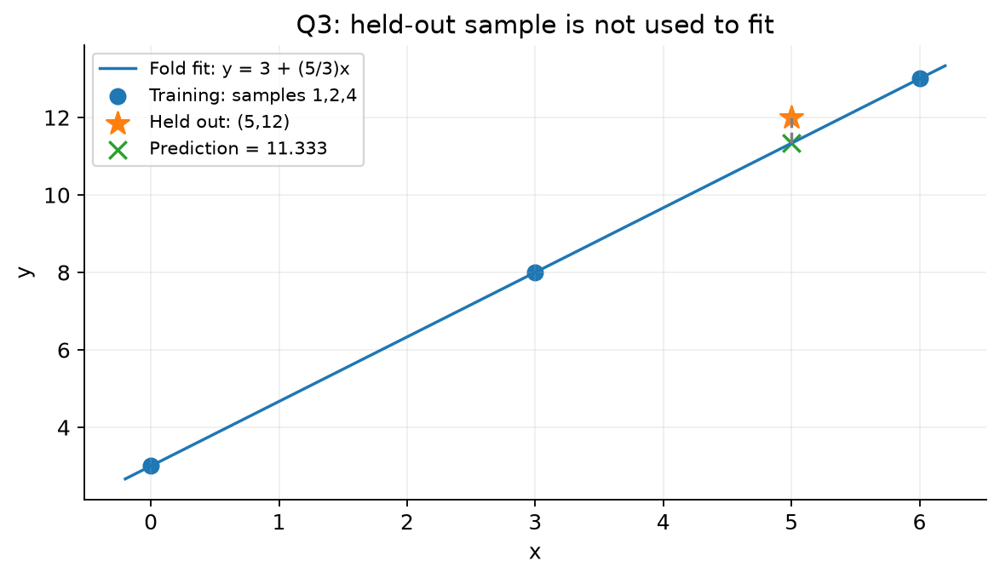

### Q13 — Norm of weights from an intercept-model fold

**Source:** 2024 Dec 01 Quiz 2, Q13.

**Question:**

Consider the following dataset:

$$D=\{(1,2),(2,2),(0,1)\}.$$

Assume that Leave one out cross validation is applied on this dataset and the model used is $y=w_0+w_1x$. Suppose $w=[w_0,w_1]^T$ be the weight obtained when (2, 2) is used in the validation set. Then calculate $\lVert w\rVert_2^2$.

**Solution:**

1. Hold out $(2,2)$; train on $(1,2),(0,1)$.
2. At x=0, fitted intercept $w_0=1$.
3. At x=1, $w_0+w_1=2$ → $w_1=1$.
4. Requested squared norm, not norm:

$$\boxed{\lVert w\rVert_2^2=1^2+1^2=2}.$$

### Q14 — Full LOOCV for a no-intercept model

**Source:** 2024 Dec 22 ET, Q14.

**Question:**

Given a training set $A_n=\{(x_1,y_1),\ldots,(x_n,y_n)\}$, let $A_n^{-i}$ denote the set obtained by removing the label of the i-th training example. Leave one out cross validation (LOOCV) is performed as follows: for each $(x_i,y_i)$ in the training set, we train the model on the remaining n − 1 points of $A_n^{-i}$ and test the prediction on $(x_i,y_i)$. The error is defined as

$$\operatorname{error}_L(A_n)=\frac1n\sum_{i=1}^n(y_i-\hat f_{-i}(x_i))^2,$$

where $\hat f_{-i}(x_i)$ denote the predicted value of $y_i$ using the model trained on $A_n^{-i}$. Now, for the dataset:

$$D=\{(1,2),(2,2),(0,1)\},$$

fit the model $\hat f=\beta x_i$ and find $\operatorname{error}_L(A_3)$.

**Solution:** Dataset same as Q13, but model now **without intercept**. Reusing Q13's line would be wrong.

For each fold $\beta=\sum_{train}xy/\sum_{train}x^2$.

| Held out | Training points | $\beta$ | Held-out prediction | Squared error |
|---|---|---|---:|---:|
| $(1,2)$ | $(2,2),(0,1)$ | $(4+0)/(4+0)=1$ | 1 | $(2-1)^2=1$ |
| $(2,2)$ | $(1,2),(0,1)$ | $(2+0)/(1+0)=2$ | 4 | $(2-4)^2=4$ |
| $(0,1)$ | $(1,2),(2,2)$ | $(2+4)/(1+4)=6/5$ | 0 | $(1-0)^2=1$ |

Average all three held-out squared errors:

$$\boxed{\operatorname{error}_L(A_3)=\frac{1+4+1}{3}=2}.$$

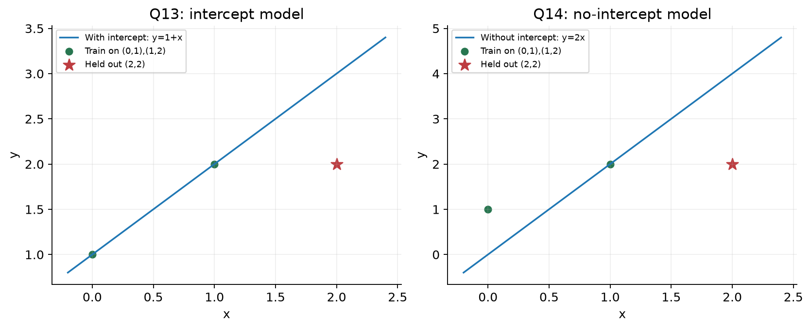

Related dataset appears in Q13, but requested model and quantity differ, so both calculations are necessary.

---

## 6. Probabilistic view: Squared loss kahan se aati hai?

### 6.1 Gaussian noise gives least squares

**Short definition:** Regression target ko predicted mean plus random noise maan sakte hain:

$$y_i=w^Tx_i+\epsilon_i,\qquad\epsilon_i\overset{iid}{\sim}N(0,\sigma^2).$$

**Real life:** Sensor readings true linear trend ke around measurement fluctuations show karte hain. Mean function trend hai, variance uncertainty ki scale.

For independent observations with fixed $\sigma^2>0$:

$$p(y\mid X,w)=\prod_i\frac1{\sqrt{2\pi\sigma^2}}\exp\left[-\frac{(y_i-w^Tx_i)^2}{2\sigma^2}\right].$$

$$\boxed{\ell(w)=-\frac n2\ln(2\pi\sigma^2)-\frac1{2\sigma^2}\sum_i(y_i-w^Tx_i)^2}.$$

First term independent of w; positive scale on SSE doesn't change minimizer. Hence Gaussian-noise MLE equals OLS.

### Q22 — Gaussian conditional likelihood versus SSE

**Source:** 2025 Aug 03 Quiz 2, Q22.

**Question:**

Consider the linear regression model $y=w^Tx+\epsilon$. Assuming $\epsilon\sim N(0,\sigma^2)$, maximizing the conditional log-likelihood of w is equivalent to minimizing the sum of squared errors $\lVert y-X^Tw\rVert_2^2$.

(a) TRUE

(b) FALSE

**Solution:** Log-likelihood is constant minus SSE divided by positive $2\sigma^2$. Maximizing it means minimizing SSE.

$$\boxed{\text{(a) TRUE}}.$$

Assumes independent equal-variance Gaussian noise. Unequal known variances lead to weighted least squares instead.

### Q28 — Noise variance changes, observations fixed

**Source:** 2026 Aug 14 Quiz 2, Q28.

**Question:**

Under the probabilistic view of linear regression, assume $y_i\sim N(w^Tx_i,\sigma^2)$, where the observations are independent. Suppose the true noise variance is $4\sigma^2$ instead of $\sigma^2$, while the dataset and the observed labels remain unchanged. What happens to the maximum likelihood estimator $\hat w_{ML}=(XX^T)^{-1}Xy$?

(a) It is unchanged.

(b) It is scaled by 4.

(c) It is scaled by 1/4.

(d) It cannot be determined without knowing $\sigma^2$.

**Solution:**

1. Negative log-likelihood's w-dependent term changes from SSE/$2\sigma^2$ to SSE/$8\sigma^2$.
2. Both minimize same SSE for unchanged X and y.
3. Normal-equation estimate has no noise-variance term.

$$\boxed{\text{(a) Unchanged}}.$$

Sampling uncertainty over newly generated datasets would increase, but the numerical estimate from this **fixed observed dataset** stays same. Gaussian-prior MAP/ridge may depend on noise variance; this question is unregularized MLE.

### 6.2 Read slope, intercept and residual scale from a plot

Slope is vertical change / horizontal change. Intercept $\beta_0=\hat y-\beta_1x$ is prediction at x=0, not necessarily visible if plot starts at x=130. Noise standard deviation measures vertical scatter around fitted line, not total target magnitude.

### Q29 — Temperature and thickness regression

**Source:** 2026 Aug 14 Quiz 2, Q29.

**Question:**

On a machine that folds plastic film, the operating temperature can be varied between 130°C and 185°C. To study the relationship between temperature and fold thickness, n = 12 observations of temperature and the corresponding fold thickness were collected. The scatter plot along with the fitted simple linear regression line is shown below:

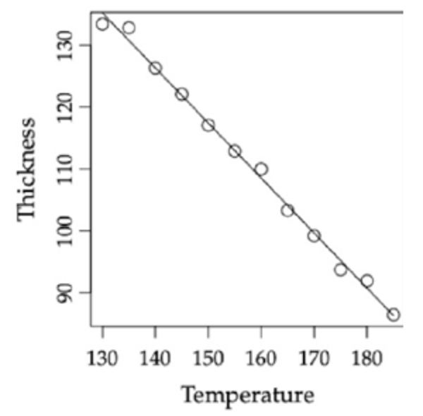

Determine, by inspecting the figure, which of the following sets of parameter estimates for the simple linear regression model is most appropriate.

Note: The regression model is $\operatorname{Thickness}(y)=\beta_0+\beta_1(\operatorname{Temperature})+\epsilon$, where $\epsilon\sim N(0,\sigma^2)$. Here, $\hat\beta_0$ is the estimated intercept, $\hat\beta_1$ is the estimated slope, and $\hat\sigma$ is the estimated standard deviation of the error term.

(a) $\hat\beta_0=0,\quad\hat\beta_1=-0.9,\quad\hat\sigma=360$

(b) $\hat\beta_0=0,\quad\hat\beta_1=0.9,\quad\hat\sigma=3.6$

(c) $\hat\beta_0=252,\quad\hat\beta_1=-0.9,\quad\hat\sigma=3.6$

(d) $\hat\beta_0=-252,\quad\hat\beta_1=-0.9,\quad\hat\sigma=360$

(e) $\hat\beta_0=252,\quad\hat\beta_1=-0.9,\quad\hat\sigma=360$

**Solution:**

**Step 1: Slope sign.** Temperature rises, thickness falls → negative slope, eliminating (b).

**Step 2: Approximate magnitude.** Near $(130,135)$ and $(180,90)$, slope roughly $(90-135)/(180-130)=-45/50=-0.9$.

**Step 3: Intercept.** $\beta_0\approx135-(-0.9)(130)=135+117=252$.

**Step 4: Noise scale.** Points lie close to line; scatter of a few units is plausible, 360 units clearly not. Figure alone doesn't yield an exact standard-deviation estimate, but separates the choices.

$$\boxed{\text{(c)}}.$$

### 6.3 Laplace noise means absolute residual loss, not LASSO

For iid $\epsilon_i\sim\operatorname{Laplace}(0,b)$:

$$p(\epsilon_i)=\frac1{2b}e^{-|\epsilon_i|/b}.$$

Negative log-likelihood, ignoring constants:

$$\boxed{\frac1b\sum_i|y_i-x_i^T\theta|}.$$

**Meaning:** Absolute residual grows linearly, whereas squared residual grows quadratically. Large response outliers often have less influence under least absolute deviations (LAD).

**Critical difference:**

- Laplace **noise** → absolute **residual** loss $\sum|y_i-x_i^T\theta|$.
- Laplace **prior on coefficients** with Gaussian noise → LASSO penalty $\lambda\sum|\theta_j|$ in MAP.

Residuals and coefficients different objects hain. LAD is not automatically immune to extreme predictor/high-leverage outliers.

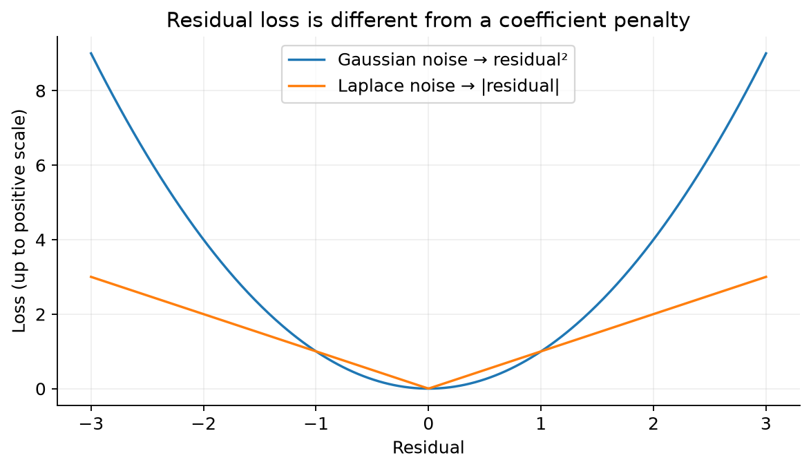

### Q26 — Outliers under Gaussian and Laplace noise

**Source:** 2026 Apr 06 Quiz 2, Q26.

**Question:**

A researcher is modeling a dataset using linear regression of the form $y=X\theta+\epsilon$. They are considering two different probabilistic assumptions for the independent and identically distributed (i.i.d.) noise term $\epsilon$:

- Assumption A: The noise follows a Gaussian distribution, $\epsilon\sim N(0,\sigma^2)$.
- Assumption B: The noise follows a Laplace distribution, $\epsilon\sim\operatorname{Laplace}(0,b)$.

The training dataset is known to contain several extreme outliers resulting from sensor malfunctions. Which of the following statements correctly describes the behavior of the Maximum Likelihood Estimation (MLE) for the parameter vector $\theta$? (MSQ)

(a) Under Assumption A, the MLE is equivalent to minimizing Mean Squared Error (MSE), which is highly sensitive to outliers because the penalty grows quadratically.

(b) Under Assumption B, the MLE is equivalent to L1 regularization, which is more robust to outliers because the penalty for large residuals grows linearly.

(c) Both Assumption A and Assumption B lead to the same optimal parameter vector $\hat\theta$ regardless of the presence of outliers.

(d) All the given options are correct.

**Solution:**

- (a) Correct: Gaussian MLE minimizes squared residuals.
- (b) Correct intuition about **linear growth of residual loss**, but wrong term “L1 regularization.” Actual MLE minimizes L1 residual loss/LAD, not coefficient regularization.
- (c) False: Squared and absolute residual objectives can prefer different estimates.
- (d) False.

**Paper key: (a), (b). Strictly worded, only (a) is fully correct.** Read (b) as “L1 residual minimization” to recover its intended meaning. No prior/weight penalty is specified here.

**Counterexample:** Intercept-only labels $(0,0,100)$: least squares picks mean $100/3$, LAD picks median 0. Same data, different optimal predictions.

### 6.4 A log-transformed mean: Reparameterize first

A mean involving $\log w$ can become a simple intercept problem after setting $a=\log w$. Since $w>0$, a ranges over all real numbers. Estimate a, then return $w=e^a$.

### Q20 — Gaussian mean log(wx)

**Source:** 2025 Aug 03 Quiz 2, Q20.

**Question:**

Consider n data points, with each feature $x_i\in\mathbb R^+$ and label $y_i\in\mathbb R$. Suppose $y_i\mid x_i\sim N(\log(wx_i),1)$, then find the ML estimate $\hat w_{MLE}$ of w, where w > 0.

(a) $\hat w_{MLE}=\exp\left(\frac1n\sum_{i=1}^n(y_i-\log x_i)\right)$

(b) $\hat w_{MLE}=\exp\left(\frac1n\sum_{i=1}^n(x_iy_i-x_i\log x_i)\right)$

(c) $\hat w_{MLE}=\frac1n\sum_{i=1}^n(y_i-\log x_i)$

(d) $\hat w_{MLE}=\exp\left(\frac1n\sum_{i=1}^n(x_iy_i-\log x_i)\right)$

**Solution:**

**Step 1:** Gaussian MLE minimizes $\sum_i[y_i-\log(wx_i)]^2$.

**Step 2:** $\log(wx_i)=\log w+\log x_i$. Let $a=\log w$, $z_i=y_i-\log x_i$. Objective becomes $\sum_i(z_i-a)^2$.

**Step 3:** Best constant a is mean of z:

$$\hat a=\frac1n\sum_i(y_i-\log x_i).$$

**Step 4:** Undo reparameterization:

$$\boxed{\hat w=\exp\left[\frac1n\sum_i(y_i-\log x_i)\right]\quad\text{(a)}}.$$

Option (c) is estimated **log w**, not w. No $x_i$ factors needed because a is an intercept for transformed observations, not a slope multiplying x.

### Q34 — Gaussian mean log(w/x)

**Source:** 2026 Sep 13 ET, Q34.

**Question:**

Suppose we model data as $y_i\sim N(\log(w/x_i),1)$ with a single unknown parameter w > 0 and known variance 1 (each $x_i>0$). You perform maximum-likelihood estimation of w. The MLE of w must satisfy which of the following equations? Note that x is a feature and y is a label.

(a) $\sum_i y_i=\sum_i\log(w/x_i)$

(b) $\sum_i x_i y_i=\sum_i x_i\log(w/x_i)$

(c) $\sum_i y_i/x_i=\sum_i\log(w/x_i)$

(d) $\sum_i y_i=\sum_i w/x_i$

**Solution:** Similar to Q20, but division changes the sign of $\log x_i$.

**Step 1:** $\log(w/x_i)=a-\log x_i$ with $a=\log w$.

**Step 2:** Objective $\sum_i[(y_i+\log x_i)-a]^2$ gives

$$n\hat a=\sum_i(y_i+\log x_i).$$

**Step 3:** Rearrange:

$$\sum_i y_i=n\log\hat w-\sum_i\log x_i=\sum_i\log(\hat w/x_i).$$

$$\boxed{\text{(a)}}.$$

Equivalent explicit estimate $\hat w=\exp[\frac1n\sum_i(y_i+\log x_i)]$. Multiplication in Q20 used minus log x; division here uses plus log x in the transformed target.

---

## 7. Kernel regression: Nonlinear relation, inner-product computation

### 7.1 Feature maps and kernels

**Short definition:** Feature map $\phi(x)$ input ko richer coordinates mein represent karta hai. Kernel $k(x,z)=\phi(x)^T\phi(z)$ transformed inner product directly calculate karta hai.

**Real life:** Area alone price ko linearly explain na kare, but area squared/interactions useful ho sakte hain. Explicitly all nonlinear features build karna expensive ho toh kernel similarities use kar sakte hain.

Polynomial kernel:

$$\boxed{k(x,z)=(1+x^Tz)^p}.$$

For one-dimensional degree two, $\phi(x)=[1,\sqrt2x,x^2]^T$ gives $\phi(x)^T\phi(z)=(1+xz)^2$. Feature scaling matters; $[1,x,x^2]$ would give a different dot product.

RBF/Gaussian kernel:

$$\boxed{k(x,z)=\exp\left[-\frac{\lVert x-z\rVert^2}{2s^2}\right]},\quad s>0.$$

Nearby points have high RBF similarity. A valid real kernel yields symmetric positive-semidefinite Gram matrices. Kernel values are not necessarily probabilities; polynomial values can exceed 1.

**Linear where?** Predictor remains linear in transformed features, but can be nonlinear in original x. Kernel alone does not optimize loss or guarantee lower variance/generalization.

### Q16 — Role of a polynomial kernel

**Source:** 2025 Mar 16 Quiz 2, Q16.

**Question:**

Polynomial kernel in kernel regression model is expressed as:

$$K(x,x')=(x^Tx'+1)^d.$$

What role does $K(x,x')$ play in kernel regression? (MSQ)

(a) It ensures that the regression model remains linear.

(b) It computes the similarity between data points in a transformed feature space.

(c) It allows the model to capture non-linear relationships by mapping data to a higher-dimensional space.

(d) It helps in reducing the variance of the model.

(e) It minimizes the loss function in regression problems.

**Solution:** (b) is transformed inner product; (c) describes nonlinear modeling ability. (a) is misleading if it means linear in original inputs. (d) no automatic variance reduction; (e) kernel is a similarity function, optimizer minimizes loss.

$$\boxed{\text{(b), (c)}}.$$

The exponent d here denotes polynomial degree as written in the question; don't automatically equate it to input dimension.

### 7.2 Dual coefficients and prediction formula

In transformed space, choose minimum-norm optimum in training-data span:

$$w=\Phi\alpha,\qquad\Phi=[\phi(x_1)\ \cdots\ \phi(x_n)].$$

Gram matrix:

$$\boxed{K=\Phi^T\Phi,\qquad K_{ij}=k(x_i,x_j)}.$$

Training predictions $K\alpha$; test prediction:

$$\boxed{\hat y(x_*)=\sum_{i=1}^n\alpha_i k(x_i,x_*)}.$$

If K invertible, unregularized interpolation coefficients $\alpha=K^{-1}y$. If singular, $K^\dagger y$ gives canonical least-squares coefficients and predictions $KK^\dagger y$. Invertibility cannot be assumed for every kernel/data set. Kernel ridge uses $(K+\lambda I)^{-1}y$ under standard penalty conventions, covered more in Week 6.

$\alpha_i$ can be negative or greater than 1; they are coefficients, not normalized probabilities.

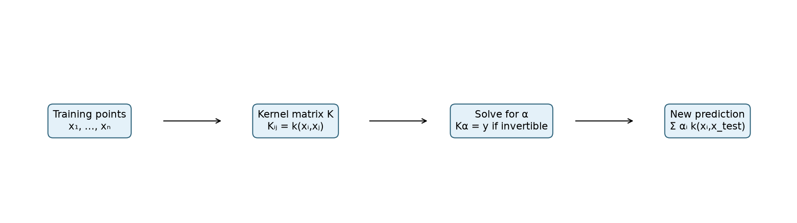

### Q27 — Prediction from kernel coefficients

**Source:** 2026 Apr 06 Quiz 2, Q27.

**Question:**

Let the linear regression model’s solution be written as $w^*=X\alpha$, where $\alpha=[\alpha_1,\ldots,\alpha_n]^T\in\mathbb R^n$. Let $k:\mathbb R^d\times\mathbb R^d\to\mathbb R$ be a valid kernel function. What will be the prediction for an unseen data point $x_{test}$?

(a) $\sum_{i=1}^n k(x_i,x_{test})$

(b) $\sum_{i=1}^n\alpha_i$

(c) $\sum_{i=1}^n\alpha_i k(x_i,x_{test})$

(d) $\sum_{i=1}^n\alpha_i^2 k(x_i,x_{test})$

**Solution:**

Linear prediction $w^Tx_*=(X\alpha)^Tx_*=\sum_i\alpha_i x_i^Tx_*$. Kernelized version replaces inner products by k, retaining coefficients unchanged.

$$\boxed{\text{(c)}}.$$

No squaring of $\alpha_i$ and no dropping weights. For a non-linear kernel, this is the corresponding feature-space model $w=\Phi\alpha$; it is not generally the same raw-space function $X\alpha$ under an arbitrary replacement.

### Q4 — Polynomial-kernel prediction at the origin

**Source:** 2024 Mar 24 Quiz 2, Q4.

**Question:**

Kernel regression with a polynomial kernel of degree three is applied on a data set {X, y}. Let the weight vector be given by

$$w=\phi(X)[2.3,-1.0,0.4,-0.7]^T.$$

Here $\phi(X)$ is the transformed data matrix whose ith column is $\phi(x_i)$. What will be the prediction for the data point $[0,0,0,0]^T$?

**Solution:** Use course's inhomogeneous kernel $k(x,z)=(1+x^Tz)^3$.

1. Every training point has dot product 0 with query origin.
2. Every kernel value $(1+0)^3=1$.
3. Prediction equals coefficient sum:

$$\boxed{\hat y=2.3-1.0+0.4-0.7=1}.$$

**Assumption matters:** A homogeneous polynomial kernel $(x^Tz)^3$ instead gives zero. The question says degree but omits offset; its answer assumes the standard +1 kernel used in these notes.

**Same variety also appears:** Week 5 — Solve With Instructors, Q4 uses degree 3, $\alpha=(1.3,0.6,-0.2,-0.7)^T$ and query $(0,0,0,0)^T$. For the slide solution's $k(x,z)=(1+x^Tz)^3$, every kernel value at zero is 1, so $\hat y=\sum\alpha_i=1$. Q4 above already explains this method, so full solution repeat nahi kiya. Homogeneous convention $(x^Tz)^3$ hota toh answer 0 hota.

### Q8 — Solve one unknown kernel coefficient

**Source:** 2024 Aug 04 Quiz 2, Q8.

**Question:**

Consider the following dataset for a kernel regression problem with a polynomial kernel of degree two along with the coefficient vector $\alpha$:

$$X=\begin{bmatrix}1&0&-1&0\\0&1&0&-1\end{bmatrix},\qquad y=\begin{bmatrix}1\\-1\\2\\-2\end{bmatrix},\qquad\alpha=\begin{bmatrix}\alpha_1\\-0.625\\\alpha_3\\\alpha_4\end{bmatrix}.$$

If the prediction for the data-point $[1,1]^T$ is 0, find the value of $\alpha_1$.

**Solution:** Use $k(x,z)=(1+x^Tz)^2$, consistent with paper's answer.

**Step 1:** X columns are $(1,0),(0,1),(-1,0),(0,-1)$.

**Step 2:** Query dot products respectively $1,1,-1,-1$.

**Step 3:** Kernel values $(1+1)^2,(1+1)^2,(1-1)^2,(1-1)^2$ → $4,4,0,0$.

**Step 4:** Prediction equation:

$$0=4\alpha_1+4(-0.625)+0\alpha_3+0\alpha_4.$$

$$4\alpha_1=2.5\Rightarrow\boxed{\alpha_1=0.625}.$$

Unknown $\alpha_3,\alpha_4$ irrelevant for this query because their kernel values zero. Labels need not be used to solve the supplied prediction constraint.

### Q11 — Build the kernel matrix, solve coefficients, predict

**Source:** 2024 Dec 01 Quiz 2, Q11.

**Question:**

Comprehension: Kernel regression with a polynomial kernel is applied on the following dataset with two features:

$$X=\begin{bmatrix}1&0&0\\0&1&0\end{bmatrix},\qquad y=[2,1,2]^T.$$

Weight vector can be written as $w=\phi(X)\alpha$, where $\phi$ is the transformation mapping corresponding to the kernel $k(x_i,x_j)=(1+x_i^Tx_j)^2$. The vector $\alpha$ is given by $(K)^{-1}y$, where K is the kernel matrix.

Based on the above data, answer the given subquestions.

(i) Compute K.

(a) $\begin{bmatrix}1&1&1\\1&4&1\\4&1&1\end{bmatrix}$

(b) $\begin{bmatrix}1&4&1\\1&1&1\\4&1&1\end{bmatrix}$

(c) $\begin{bmatrix}4&4&1\\1&1&1\\4&1&1\end{bmatrix}$

(d) $\begin{bmatrix}4&1&1\\1&4&1\\1&1&1\end{bmatrix}$

(ii) What will be the prediction for the data point $[1,-1]^T$? Enter the answer correct to two decimal places.

**Solution — (i): Pairwise kernel values**

Points are $x_1=(1,0),x_2=(0,1),x_3=(0,0)$.

- $x_1^Tx_1=x_2^Tx_2=1$ → diagonal entries $K_{11}=K_{22}=4$.
- $x_3^Tx_3=0$ → $K_{33}=1$.
- Every distinct pair dot product zero → all off-diagonals 1.

$$\boxed{K=\begin{bmatrix}4&1&1\\1&4&1\\1&1&1\end{bmatrix}\quad\text{(d)}}.$$

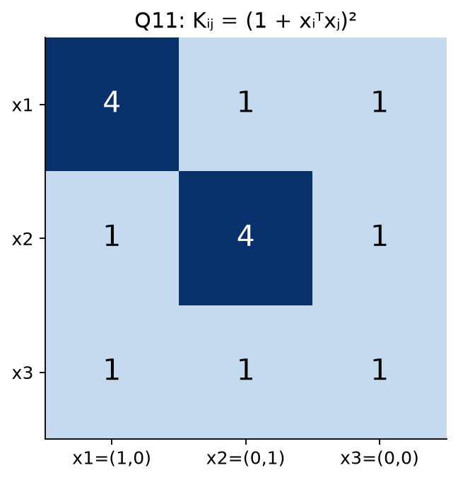

**Solution — (ii), Step 1: Solve $K\alpha=y$.**

$$4\alpha_1+\alpha_2+\alpha_3=2,$$

$$\alpha_1+4\alpha_2+\alpha_3=1,$$

$$\alpha_1+\alpha_2+\alpha_3=2.$$

Subtract third equation from first: $3\alpha_1=0$ → $\alpha_1=0$.

Subtract third from second: $3\alpha_2=-1$ → $\alpha_2=-1/3$.

Third then gives $\alpha_3=7/3$.

**Step 2: Test kernel vector.** For $z=(1,-1)$, dot products are $1,-1,0$, so kernel vector $[4,0,1]^T$.

**Step 3:**

$$\hat y=0(4)+(-1/3)(0)+(7/3)(1)=\frac73.$$

$$\boxed{\hat y=2.33}.$$

Check: K is symmetric and invertible (determinant 9); supplied inverse expression valid here.

### Q17 — Direct prediction with given coefficients

**Source:** 2025 Mar 16 Quiz 2, Q17.

**Question:**

Consider a kernel regression problem on the following dataset with two features:

$$\{(x_1,y_1),(x_2,y_2),(x_3,y_3)\},$$

where:

$$x_1=[1,2]^T,\ y_1=3,\qquad x_2=[2,3]^T,\ y_2=5,\qquad x_3=[3,4]^T,\ y_3=7.$$

The kernel function is given as:

$$K(x,x')=(1+x^Tx')^2$$

and the optimal coefficients $\alpha_i$ are given as:

$$\alpha=[0.5,1.0,1.5]^T.$$

Then, what will be the predicted value for the data point $[2,2]^T$?

**Solution:** Given coefficients use karo; prediction doesn't require refitting them.

| Training point | Dot product with (2,2) | Kernel value | $\alpha_i k_i$ |
|---|---:|---:|---:|
| $(1,2)$ | $2+4=6$ | $7^2=49$ | 24.5 |
| $(2,3)$ | $4+6=10$ | $11^2=121$ | 121 |
| $(3,4)$ | $6+8=14$ | $15^2=225$ | 337.5 |

$$\boxed{\hat y=24.5+121+337.5=483}.$$

**Consistency note:** These supplied coefficients are not the unregularized least-squares fit to the listed small labels: for example first training prediction would be $0.5(36)+1(81)+1.5(144)=315\ne3$. Treat the given $\alpha$ as instructed for this numerical prediction; “optimal” in the wording is inconsistent with the usual unregularized training setup.

### Q19 — Three-feature degree-two kernel prediction

**Source:** 2025 Apr 13 ET, Q19.

**Question:**

A kernel regression model with a polynomial kernel of degree 2 is trained on the following dataset with three features:

$$X=\begin{bmatrix}1&4&7&2&6\\2&5&8&1&5\\3&6&9&3&4\end{bmatrix}.$$

Let the optimal weight vector $w^*$ be given by:

$$w^*=\phi(X)[1,1.2,0,0.7,-0.5]^T,$$

where $\phi$ is the transformation mapping corresponding to the kernel $K(x,x')=(x^Tx'+1)^2$. Compute the predicted value $y_{pred}$ for a new data point $x'=[1,1,1]^T$. Enter the answer correct to one decimal place.

**Solution:**

**Step 1:** Query all ones hai, so each column dot product is its coordinate sum.

| Column / training point | Dot product | Kernel $(1+\text{dot})^2$ | Coefficient | Contribution |
|---|---:|---:|---:|---:|
| $(1,2,3)$ | 6 | 49 | 1 | 49 |
| $(4,5,6)$ | 15 | 256 | 1.2 | 307.2 |
| $(7,8,9)$ | 24 | 625 | 0 | 0 |
| $(2,1,3)$ | 6 | 49 | 0.7 | 34.3 |
| $(6,5,4)$ | 15 | 256 | −0.5 | −128 |

**Step 2:** Add weighted contributions:

$$\boxed{y_{pred}=49+307.2+0+34.3-128=262.5}.$$

Same prediction method as Q17; additional features don't change the formula. Negative coefficients subtract contributions; zero coefficient point contributes zero even if its kernel value is large.

---

### 7.3 Gaussian/RBF kernel: Distance becomes similarity

**Definition:** Gaussian kernel nearby inputs ko high similarity aur far inputs ko low similarity deta hai:

$$\boxed{k(x,z)=\exp\!\left(-\frac{\|x-z\|^2}{2\sigma^2}\right)},\qquad \sigma^2>0.$$

**Real-life connection:** Similar-sized, similarly located houses ek doosre ke prediction mein relevant ho sakte hain. RBF Euclidean distance ko smooth similarity mein convert karta hai.

- $k(x,x)=1$; finite inputs ke liye $0<k(x,z)\le1$.
- Equal distance means equal similarity, direction irrelevant.
- Smaller $\sigma$ fixed nonzero distance ko more strongly downweight karta hai. Larger $\sigma$ similarities ko 1 ke closer laata hai.
- Kernel values positive hone se predictions positive hona guaranteed nahi: $\alpha_i$ negative ho sakte hain.
- $\hat y(x)=\sum_i\alpha_i k(x_i,x)$ mein similarity sum se divide **nahi** karte. Yeh specified kernel least-squares model hai, normalized weighted-average estimator nahi.

### Q43 — Gaussian kernel prediction with cancelling contributions

**Source:** Week 5 — Solve With Instructors, Q9 (image-based question).

**Question:**

Gaussian kernel regression with parameter $\sigma^2=\frac12$ was applied to the following dataset with two features:

$$X=\begin{bmatrix}1&0&1&0\\0&1&1&0\end{bmatrix},\qquad y=\begin{bmatrix}2.1\\1\\2\\1.2\end{bmatrix}.$$

The weight vector can be written as $w=\phi(X)\alpha$, where $\phi$ is the transformation mapping corresponding to the kernel. The vector $\alpha=[2.1,-2.1,3,0]^T$ is given, stated to be obtained as $K^{-1}y$, where $K$ is the kernel matrix. What will be the prediction for $[1,1]^T$?

**Solution:**

**Step 1 — Kernel denominator:** $2\sigma^2=1$, so $k(x,z)=e^{-\|x-z\|^2}$.

**Step 2 — Compare the query with each column:**

| Training input | Squared distance from $(1,1)$ | Kernel value | Contribution $\alpha_i k_i$ |
|---|---:|---:|---:|
| $(1,0)$ | 1 | $e^{-1}$ | $2.1e^{-1}$ |
| $(0,1)$ | 1 | $e^{-1}$ | $-2.1e^{-1}$ |
| $(1,1)$ | 0 | 1 | 3 |
| $(0,0)$ | 2 | $e^{-2}$ | 0 |

**Step 3 — Add contributions:**

$$\boxed{\hat y(1,1)=2.1e^{-1}-2.1e^{-1}+3+0=3}.$$

Equal distances ki wajah se first two kernel values equal hain; opposite coefficients contributions cancel kar dete hain.

**Given-data inconsistency:** Question says $\alpha=K^{-1}y$, but this cannot hold for the supplied values: query third training input hai, whose target is 2, while given coefficients produce 3. In fact $(K\alpha)_3=3\ne y_3=2$. **Given coefficients use karne par answer 3** (PDF's calculation); truly solving the stated unregularized invertible system $K\alpha=y$ would predict **2** at that training point. Dono incompatible assumptions ko ek saath true mat maano.

## 8. Quick revision

### 8.1 Formula sheet

| Quantity | Formula / condition |
|---|---|
| Column-sample convention | $X\in\mathbb R^{d\times n}$, $\hat y=X^Tw$ |
| SSE / MSE | $\sum_i(\hat y_i-y_i)^2$ / SSE divided by n |
| SSE gradient | $2X(X^Tw-y)$ |
| Normal equation | $XX^Tw=Xy$ |
| Full-row-rank optimum | $(XX^T)^{-1}Xy$ |
| Minimum-norm optimum | $(XX^T)^\dagger Xy$ |
| Scalar slope, no intercept | $\sum xy/\sum x^2$ |
| Slope with intercept | $\sum(x-\bar x)(y-\bar y)/\sum(x-\bar x)^2$ |
| Intercept | $\bar y-w_1\bar x$ |
| Zero training SSE | $y\in\operatorname{row}(X)$ |
| Residual orthogonality | $X(y-X^Tw^*)=0$ |
| GD update | $w_{new}=w-\eta\nabla L(w)$ |
| LOOCV error | $\frac1n\sum_i(y_i-\hat f_{-i}(x_i))^2$ |
| Gaussian-noise MLE | Minimize squared residuals |
| Laplace-noise MLE | Minimize absolute residuals (LAD) |
| Mean log(wx), Gaussian variance 1 | $\hat w=\exp[\operatorname{mean}(y_i-\log x_i)]$ |
| Mean log(w/x), Gaussian variance 1 | $\hat w=\exp[\operatorname{mean}(y_i+\log x_i)]$ |
| Polynomial kernel | $(1+x^Tz)^p$ |
| RBF kernel | $\exp[-\lVert x-z\rVert^2/(2s^2)]$ |
| Gram matrix | $K_{ij}=k(x_i,x_j)$ |
| Invertible unregularized kernel fit | $\alpha=K^{-1}y$ |
| Kernel prediction | $\sum_i\alpha_i k(x_i,x_*)$ |

### 8.2 Common mistakes

| Mistake | Correct idea |
|---|---|
| All regression lines include intercept | Read model; $wx$ and $w_0+w_1x$ differ |
| Convex means unique optimum | Full row rank gives uniqueness; otherwise null-space freedom |
| Every least-squares problem has inverse formula | Pseudoinverse/linear-system methods handle singular designs |
| Data span and feature span are same space | Data span in $\mathbb R^d$; feature span in $\mathbb R^n$ |
| Labels must always be fitted exactly | Only labels inside feature span can have zero SSE |
| Every optimal weight lies in data span | Minimum-norm optimum can be chosen there; arbitrary minimizer may include null component |
| SSE gradient is always error × x | That is half-SSE; raw SSE needs factor 2 |
| A correct GD update always decreases loss | Excessive learning rate can overshoot; Q15/Q18 show this |
| Fewer iterations automatically means faster algorithm | Batch sizes/per-update costs differ |
| Reuse full-data means in LOOCV | Recompute using training fold only |
| Same dataset means same solution | Intercept/model/kernel differences matter |
| Noise variance scales fixed-data OLS weights | Common positive variance scale doesn't change MLE minimizer |
| Laplace noise gives LASSO | It gives absolute residual loss; Laplace coefficient prior yields L1 penalty in MAP |
| Polynomial degree alone specifies kernel | Offset/homogeneous convention matters, especially at origin |
| Kernel coefficients are probabilities | They can be negative and need not sum to 1 |
| Build kernel using rows when columns are samples | Kernel entry uses data-point columns in this convention |
| Sum similarities without coefficients | Prediction requires weighted sum $\sum\alpha_i k_i$ |

### 8.3 Solving checklist

1. Read model: intercept? feature dimensions? Gaussian mean linear or logarithmic?
2. Identify X orientation and requested quantity: slope, norm, squared norm, loss or prediction.
3. For fitting, use normal equations/scalar formulas; verify residuals on all samples.
4. For geometry, locate vectors in $\mathbb R^d$ versus $\mathbb R^n$ before using spans.
5. For GD, read exact loss scaling, compute old predictions/errors, then update once.
6. For LOOCV, remove held-out observation before fitting; average errors only when all folds requested.
7. For likelihood, drop only parameter-independent constants and check parameter domain.
8. For kernels, compute dot products → apply kernel → multiply coefficients → sum.
9. Use exact fractions/intermediate precision; round final requested answer.
