# MLT Week 6: Regularisation and Cross-Validation Notes

**Flow:** Linear regression ki uncertainty → bias–variance → Ridge shrinkage → LASSO sparsity → Gaussian/Laplace priors → cross-validation se hyperparameters → prediction threshold.

## Topic index

| Topic | Subtopics | Questions |
|---|---|---|
| 1. Regression estimator | Gaussian noise, MLE, parameter MSE, eigenvalues | — |
| 2. Bias and variance | Complexity, training/test error, underfit/overfit | Q1, Q3, Q16, Q9, Q11, Q24 |
| 3. Ridge regression | Objective, closed form, numerical calculations, limits | Q25, Q2, Q20, Q13, Q14 |
| 4. Geometry and LASSO | Constraints, contours, sparsity, subgradient | Q12, Q5, Q15 |
| 5. Bayesian regularisation | Gaussian and Laplace priors, MAP, estimator risk | Q17, Q21, Q23, Q7, Q19 |
| 6. Model selection | K-fold CV, validation tables, loss curves | Q4, Q18, Q22, Q6, Q10 |
| 7. Classification threshold | False negatives, recall trade-off | Q8 |
| Added numerical varieties | Finite ridge ratio; fixed-weight ridge/LASSO losses | Q26, Q27 |
| Added validation varieties | Actual LOOCV fit; MAE and polynomial-degree graph | Q28, Q29 |
| 8. Revision | Formulas, common mistakes, checklist | — |

---

## 1. Linear regression: Best training fit bhi unstable ho sakti hai

### 1.1 Model, noise and matrix convention

**Short definition:** Linear regression features ka weighted combination use karke numerical target predict karti hai.

**Real life:** House area se price predict karo. Same area ke two houses ke prices amenities/location ki wajah se differ kar sakte hain; unexplained part noise hai.

$$y_i=w_*^Tx_i+\epsilon_i,\qquad E[\epsilon_i]=0,\quad\operatorname{Var}(\epsilon_i)=\sigma^2.$$

Here $w_*$ true parameter hai, $\hat w$ data se estimated parameter. Independent Gaussian noise ho toh $\epsilon_i\sim N(0,\sigma^2)$.

Most matrix questions in this paper use **data points as columns**:

$$X=[x_1\ \cdots\ x_n]\in\mathbb R^{d\times n},\quad y\in\mathbb R^{n\times1},\quad w\in\mathbb R^{d\times1}.$$

$$\boxed{\hat y=X^Tw},\qquad\boxed{\operatorname{SSE}(w)=\lVert X^Tw-y\rVert_2^2}.$$

If a question instead writes $X\in\mathbb R^{n\times d}$, predictions are $Xw$ and the Gram matrix becomes $X^TX$. **Square X hone par shape alone transpose mistake reveal nahi karegi; stated convention read karo.**

### 1.2 Gaussian-noise MLE and least squares

With fixed positive noise variance:

$$p(y\mid X,w)\propto\exp\left[-\frac1{2\sigma^2}\lVert y-X^Tw\rVert_2^2\right].$$

Likelihood maximize karna equivalent to SSE minimize karna hai:

$$\hat w_{\mathrm{ML}}=\arg\min_w\lVert X^Tw-y\rVert_2^2.$$

If $A=XX^T$ invertible:

$$\boxed{\hat w_{\mathrm{ML}}=(XX^T)^{-1}Xy=A^{-1}Xy}.$$

Rank-deficient design mein least-squares solution unique nahi ho sakta; minimum-norm choice $\hat w=A^\dagger Xy$ hai, where $\dagger$ denotes Moore–Penrose pseudoinverse.

### 1.3 Prediction MSE versus parameter MSE

**Prediction MSE on a dataset:**

$$\operatorname{MSE}_{\mathrm{pred}}=\frac1n\sum_i(\hat y_i-y_i)^2=\frac{\operatorname{SSE}}n.$$

**Parameter estimation MSE:**

$$\boxed{R(\hat w)=E\left[\lVert\hat w-w_*\rVert_2^2\right]}.$$

First compares predictions with labels. Second compares estimated parameter with true parameter over repeated noisy training datasets. **Q7 and Q19 use the second meaning.** Ridge can have larger training SSE but smaller expected parameter MSE.

SSE and MSE give same ranking for a fixed dataset when no relative penalty changes. But $\operatorname{SSE}+\lambda\lVert w\rVert^2$ and $\operatorname{MSE}+\lambda\lVert w\rVert^2$ do not use the same effective penalty: multiplying the latter by n gives SSE + $n\lambda\lVert w\rVert^2$.

### 1.4 Why ordinary least squares can have high variance

For fixed full-row-rank X and independent noise covariance $\sigma^2I$:

$$E[\hat w_{\mathrm{ML}}]=w_*,\qquad\operatorname{Cov}(\hat w_{\mathrm{ML}})=\sigma^2(XX^T)^{-1}.$$

Therefore:

$$\boxed{R(\hat w_{\mathrm{ML}})=\sigma^2\operatorname{tr}((XX^T)^{-1})}.$$

**Trace:** Square matrix ke diagonal elements ka sum; also eigenvalues ka sum. Let positive eigenvalues of A be $a_1,\ldots,a_d$:

$$\boxed{R(\hat w_{\mathrm{ML}})=\sigma^2\sum_{j=1}^d\frac1{a_j}}.$$

**Meaning:** Small eigenvalue → poorly determined feature direction → large reciprocal → high estimator variance. Highly correlated/redundant features can cause this instability.

**Counterexample to “unbiased means accurate”:** Estimator average true value ho sakta hai but each dataset par wildly vary kare. Zero bias does not mean small MSE.

**Rank condition matters:** Pseudoinverse case mein unidentifiable directions contribute bias. With $P=A^\dagger A$,

$$R(A^\dagger Xy)=\sigma^2\operatorname{tr}(A^\dagger)+\lVert(I-P)w_*\rVert_2^2.$$

So rank-deficient setting mein sirf trace term ko full parameter MSE bolna generally incomplete hai.

---

## 2. Bias–variance: Flexibility ka trade-off

### 2.1 Short definitions and real-life connection

**Bias:** Average learned prediction systematic tareeke se true relationship se kitni different hai.

**Variance:** Training sample change hone par learned prediction kitni change hoti hai.

**Real life:** Curved house-price pattern par straight line fit karo toh systematic mismatch (bias). Very flexible curve har unusual house ko follow kare toh another sample par curve change (variance).

For squared prediction loss at a fixed x, standard decomposition:

$$\boxed{E[(Y-\hat f(x))^2]=\operatorname{Bias}(x)^2+\operatorname{Var}(\hat f(x))+\sigma^2}.$$

Parameter-estimator analogue:

$$\boxed{R(\hat w)=\lVert E[\hat w]-w_*\rVert_2^2+\operatorname{tr}(\operatorname{Cov}(\hat w))}.$$

No extra irreducible target-noise term appears in this parameter-error formula.

### 2.2 Underfitting, overfitting and complexity

| Situation | Typical training performance | Typical validation performance | Bias / variance |
|---|---|---|---|
| Underfitting | Poor | Poor | High bias, lower variance |
| Appropriate flexibility | Good | Good | Useful trade-off |
| Overfitting | Very good | Worse than training | Lower bias, high variance |

These are standard tendencies, not strict promises for every dataset/optimizer.

**Nested-model property:** Linear functions are included in quadratic functions by setting quadratic coefficient zero. If both exactly minimize the same unregularized training SSE, quadratic model's minimum SSE **cannot exceed** linear model's minimum SSE; equality is possible. Test error has no such guarantee.

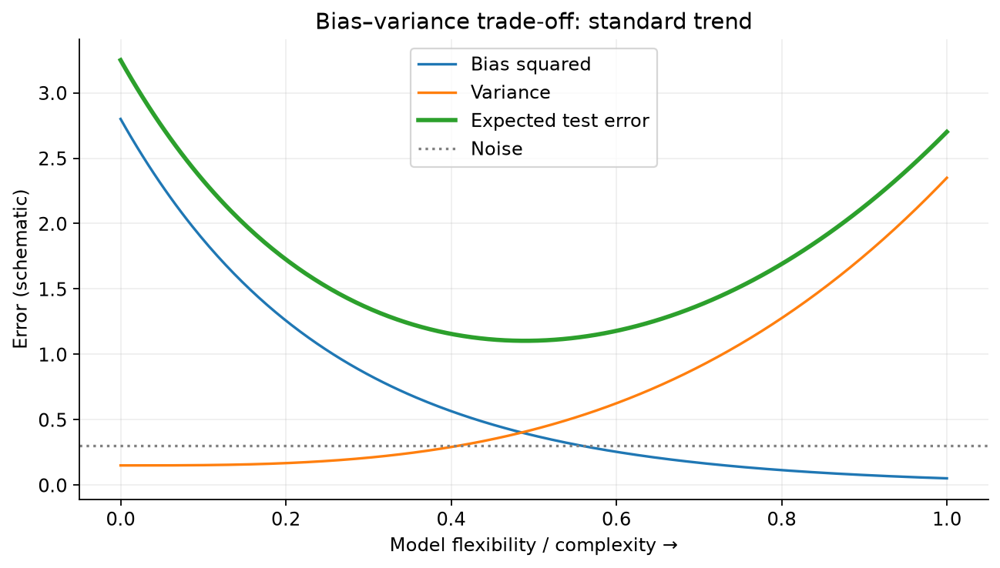

### Q1 — Linear versus quadratic house-price models

**Source:** 2024 Mar 24 Quiz 2, Q1.

**Question:**

Comprehension: Consider a regression problem where you are tasked with predicting the sale prices of houses based on their square footage. You decide to experiment with two different models:

$$\text{Model P: }\hat y_i=w_0+w_1x,$$

$$\text{Model Q: }\hat y_i=w_0+w_1x+w_2x^2.$$

The training dataset consists of information on 200 houses, and you use the models to make predictions on a test dataset of 50 houses. The Mean Squared Error (MSE) is chosen as the evaluation metric. Based on the above data, answer the given subquestions.

(i) Considering the specific context of predicting house prices based on square footage, which model is more likely to provide accurate predictions on the training dataset?

(a) Model P

(b) Model Q

(c) Both models are equally likely to provide accurate predictions

(d) It depends on the distribution of house prices in the dataset

(ii) Identify the factors that could influence the model’s performance on the training dataset in this housing price prediction scenario. Select all correct statements: (MSQ)

(a) Model P may struggle to capture non-linear relationships present in houseprice data.

(b) Model Q might be sensitive to outliers in the square footage variable.

(c) The choice between Model P and Model Q depends on the budget constraints of potential homebuyers.

(d) Model Q will always perform well on the test dataset.

**Solution:**

**(i) Step 1:** Q has every function P can express: choose $w_2=0$.

**Step 2:** Extra quadratic term allows curvature when useful. At exact unregularized training optimum, $\operatorname{MSE}_Q\le\operatorname{MSE}_P$.

$$\boxed{\text{(b) Model Q}}.$$

“More likely” ko “strictly smaller error always” mat samjho; exactly linear data par tie possible hai.

**(ii):** (a) true: straight-line model may miss curvature. (b) true: unusually large x gives even larger $x^2$, so outliers can strongly affect squared-error fitting. (c) is not the mathematical model-selection criterion here. (d) false: flexible training fit doesn't guarantee good unseen-data predictions.

$$\boxed{\text{(a), (b)}}.$$

### Q3 — Higher bias and lower variance

**Source:** 2024 Apr 28 ET, Q3.

**Question:**

Consider the following two models fitted on a one-dimensional dataset:

$$\text{Model 1: }\hat y=w_0+w_1x,$$

$$\text{Model 2: }\hat y=w_1x^2+w_2x+w_3.$$

If both models are trained on the same one-dimensional dataset and evaluated on the same test dataset, which model is more likely to have higher bias and lower variance?

(a) Model 1

(b) Model 2

(c) Both models are equally sensitive to outliers

(d) Insufficient data

**Solution:** Model 1 is less flexible; it cannot express curvature, but typically responds less to sample-specific fluctuations. Standard comparison gives higher bias and lower variance for Model 1.

$$\boxed{\text{(a) Model 1}}.$$

Q1 aur Q3 same complexity idea ask karte hain, but Q1 training fit and Q3 bias–variance compare karte hain.

### Q16 — Cubic truth, linear and degree-five fitted models

**Source:** 2025 Apr 13 ET, Q16.

**Question:**

A set of data points is generated by the following process:

$$y_i=w_0+w_1x_i+w_2x_i^2+w_3x_i^3+\epsilon,\qquad\text{where }\epsilon\text{ is a Gaussian noise}.$$

We use two models to fit the data:

Model 1: $\hat y=a_0+a_1x$

Model 2: $\hat y=a_0+a_1x+a_2x^2+a_3x^3+a_4x^4+a_5x^5$.

For a fixed number of training examples, select the correct options from the following: (MSQ)

(a) Model 1 will have a higher bias than Model 2.

(b) Model 2 will have a lower variance than Model 1.

(c) Model 1 is more likely to underfit.

(d) Model 1 is more likely to overfit.

**Solution:**

1. Genuinely nonlinear cubic truth cannot generally be represented by Model 1.
2. Model 2 includes cubic functions by choosing $a_4=a_5=0$, so lower approximation bias.
3. Extra flexibility typically increases, rather than decreases, variance at fixed sample size.
4. Linear model more likely underfits; degree-five model more vulnerable to fitting noise.

$$\boxed{\text{(a), (c)}}.$$

If true nonlinear coefficients vanish, strict bias difference may disappear; intended comparison assumes meaningful cubic structure.

### Q9 — Does complexity always increase test error?

**Source:** 2024 Dec 22 ET, Q9.

**Question:**

Is the following statement true or false? For a fixed size of the training and the test set, increasing the complexity of the model always leads to an increment in the test error.

(a) TRUE

(b) FALSE

**Solution:** False. Underfitted straight line ko suitable quadratic curve se replace karne par test error decrease ho sakta hai. Excessive flexibility later overfit kar sakti hai. Word **always** makes the statement wrong.

$$\boxed{\text{(b) FALSE}}.$$

### 2.3 Related concepts: Weak learners and bagging

**Weak learner:** Appropriate task/distribution setting mein chance baseline se better learner; balanced binary random guessing accuracy 0.5 ho toh weak advantage 0.5 se above ho sakta hai.

**Bagging:** Training data ke bootstrap samples par independent base learners train karke predictions aggregate karo. Conditional on sampled datasets, base models one another's errors ka wait nahi karte, so parallel training possible hai. Aggregation often variance reduce karti hai.

### Q11 — Underfitting, trees, weak learners and bagging

**Source:** 2024 Dec 22 ET, Q11.

**Question:**

Which of the following options are correct? Select all that apply. (MSQ)

(a) Underfitted models generally have less bias and high variance.

(b) A decision tree with the maximum possible length may lead to overfitting.

(c) Weak learners are those whose performance is slightly better than the random classifier.

(d) All the estimators in bagging can be trained parallelly.

**Solution:**

- (a) False: Underfitting usually high bias/lower variance.
- (b) True: Very deep trees may memorize sample-specific noise.
- (c) True in the intended weak-learner sense: better than chance baseline.
- (d) True: Bagging base learners trained independently; sequential dependence boosting ka characteristic hai.

$$\boxed{\text{(b), (c), (d)}}.$$

### Q24 — Operations that change bias and variance

**Source:** 2026 Sep 13 ET, Q24.

**Question:**

Consider the effect of each operation below on a model’s bias and variance. Which of the following statements are correct? (MSQ)

(a) Regularising the weights in a linear/logistic regression model increases bias and decreases variance.

(b) Increasing the maximum depth of a decision tree increases bias and decreases variance.

(c) Increasing the number of hidden units in a neural network decreases bias and increases variance.

(d) Removing all the non-support-vectors from the training set of an SVM leaves both bias and variance unchanged.

**Solution:**

- (a) Standard trend: stronger coefficient restrictions add bias and reduce sensitivity/variance.
- (b) False: More depth usually lowers bias and raises variance.
- (c) Standard capacity trend: more hidden units increase flexibility, typically lowering approximation bias and raising variance if other factors comparable.
- (d) Intended SVM property: Samples with zero dual coefficient do not contribute to the fitted separator. Under the same optimization convention and solution assumptions, removing such non-support vectors leaves that fitted decision function unchanged.

$$\boxed{\text{Paper's intended answer: (a), (c), (d)}}.$$

**Care with (d):** Bias/variance are repeated-dataset properties, not simply attributes read from one fitted boundary. Exact statement is about preserving the fitted SVM solution (with fixed penalty scaling and suitable uniqueness/tie handling). It is not a general distribution-level guarantee from arbitrary data deletion. Likewise (a)/(c) are standard trends, not universal strict inequalities for every optimizer/dataset.

---

## 3. Ridge regression: Large weights par penalty

### 3.1 Definition, objective and practical details

**Short definition:** Ridge ordinary squared-error loss mein squared L2 weight penalty add karta hai.

$$\boxed{J_\lambda(w)=\operatorname{SSE}(w)+\lambda\lVert w\rVert_2^2},\qquad\lambda\ge0.$$

$$\lVert w\rVert_2^2=\sum_{j=1}^d w_j^2.$$

**Real life:** Training houses ko perfectly fit karne ke liye huge positive/negative coefficients lene par extra cost. Model smaller weights prefer karega unless data-fit improvement cost justify kare.

- Large $\lambda$ → stronger shrinkage, lower flexibility.
- $\lambda=0$ → ordinary least squares.
- Ridge generally coefficients shrink karta hai; exact zeros force karna its usual feature-selection mechanism nahi.
- Features ke units penalty ko affect karte hain, so comparable scaling useful. Scaler training fold par fit karo, validation data par nahi.
- Intercept usually penalize nahi karte. Numerical questions here given weight vector ke all entries penalized assume karte hain unless stated otherwise.

**Counterexample to “ridge selects one redundant feature”:** Identical columns/features ke effect ko ridge often both coefficients mein share karta hai. It does not generally drop the less important feature outright.

### 3.2 Closed-form solution and invertibility

For column-sample convention:

$$\boxed{\hat w_R=(XX^T+\lambda I_d)^{-1}Xy}.$$

Numerical workflow: compute $A=XX^T$, $b=Xy$, add $\lambda$ to **diagonal only**, solve $(A+\lambda I)w=b$.

For $\lambda>0$, $A+\lambda I$ positive definite even if X rank deficient, so unique ridge weights exist when all weights penalized. If $a_j$ eigenvalues of A:

$$a_j(A+\lambda I)=a_j+\lambda.$$

Adding positive $\lambda$ stabilizes near-zero eigenvalue directions.

### 3.3 Shrinkage and parameter risk

Along an eigenvector with positive eigenvalue $a_j$, ridge coefficient is OLS coefficient multiplied by:

$$\boxed{\frac{a_j}{a_j+\lambda}\in(0,1)}.$$

This describes shrinkage in **eigenvector coordinates**, not a guarantee that each original-coordinate coefficient changes monotonically in magnitude.

Let $\widetilde w_j$ be true parameter coordinate along eigenvector j, full-rank design. Then:

$$\boxed{R(\hat w_R)=\sum_j\frac{\lambda^2\widetilde w_j^2+\sigma^2a_j}{(a_j+\lambda)^2}}.$$

First numerator term → squared bias; second → variance. Ridge variance is **not** simply $\sigma^2\operatorname{tr}((A+\lambda I)^{-1})$; covariance is $\sigma^2(A+\lambda I)^{-1}A(A+\lambda I)^{-1}$.

**Concrete example:** One parameter, $a=1,w_*=1,\sigma^2=1$. OLS risk 1. Ridge at $\lambda=1$ gives bias-square $1/4$, variance $1/4$, total risk $1/2$. Biased estimator can be better in MSE.

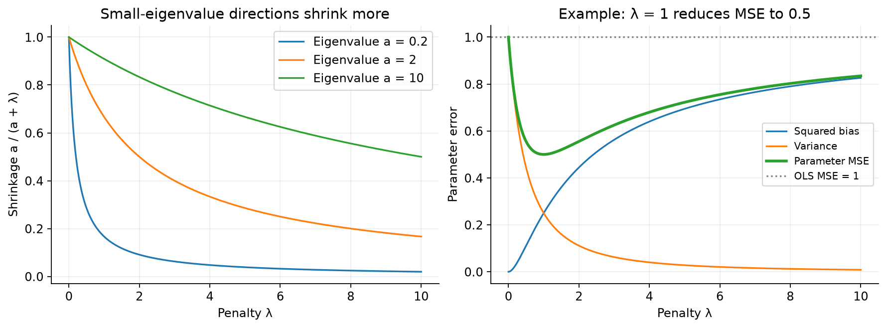

### Q25 — One-dimensional ridge calculation

**Source:** 2026 Sep 13 ET, Q25.

**Question:**

Consider one-dimensional ridge regression with no bias term. Given

$$\sum_i x_i^2=10\qquad\text{and}\qquad\sum_i x_i y_i=4,$$

with $\lambda=10$, compute the optimal $w_{\mathrm{ridge}}$. Note that $x_i$ is ith data point and $y_i$ is ith label. (Round to 2 decimal places.)

**Solution:**

1. Matrix formula scalar form:

$$w_R=\frac{\sum_i x_i y_i}{\sum_i x_i^2+\lambda}.$$

2. Substitute $4/(10+10)=4/20$.

$$\boxed{w_R=0.20}.$$

OLS would be $4/10=0.40$; ridge shrinks it by $10/(10+10)=1/2$.

### Q26 — Finite-penalty ridge-to-MLE ratio

**Source:** Week 6 — Solve With TAs, Q6. Scalar fitting method Q25 jaisa hai; yahan requested quantity finite-penalty **ratio** hai.

**Question:**

Consider the dataset $X=[-3,5,4]$ and $y=[-10,20,20]^T$. Assuming a ridge penalty $\lambda=50$, what is the value of $w_{ridge}/w_{MLE}$? Here $w_{ridge}$ and $w_{MLE}$ are the Ridge and MLE estimates of the weight, respectively.

**Solution:**

**Step 1 — Shared sums:** No intercept specified, so one scalar weight fit karna hai.

$$a=\sum x_i^2=9+25+16=50.$$

$$b=\sum x_i y_i=(-3)(-10)+5(20)+4(20)=210.$$

**Step 2 — Estimates:** Under the usual paired convention SSE $+\lambda w^2$ (equivalently half-SSE $+(\lambda/2)w^2$):

$$w_{MLE}=b/a=210/50=4.2,\qquad w_{ridge}=b/(a+\lambda)=210/100=2.1.$$

**Step 3 — Requested ratio:**

$$\boxed{\frac{w_{ridge}}{w_{MLE}}=\frac{2.1}{4.2}=0.5}.$$

**Shortcut/property:** If $a>0$ and $b\ne0$, the target-dependent numerator cancels:

$$\boxed{\frac{w_{ridge}}{w_{MLE}}=\frac{a}{a+\lambda}}.$$

- $\lambda=a$ means half of the OLS weight, regardless of nonzero b.
- For a desired fraction $0<r<1$, choose $\lambda=a(1/r-1)$.
- If $b=0$, both weights are zero and their ratio is undefined; do not cancel zero.
- This scalar ratio is not one universal multiplier for every coordinate of a general multifeature model; Section 3.3 gives the eigen-direction version.

### Q2 — Ridge coefficients for a 2 × 2 design

**Source:** 2024 Mar 24 Quiz 2, Q2.

**Question:**

Given a design matrix $X\in\mathbb R^{d\times n}$ and a target vector $Y\in\mathbb R^{n\times1}$, where d represents the number of features, n represents the number of data points, and the data is defined as:

$$X=\begin{bmatrix}1&2\\3&4\end{bmatrix},\qquad Y=\begin{bmatrix}3\\5\end{bmatrix}.$$

Calculate the coefficients $\beta$ for Ridge regression with $\lambda=1$.

(a) $\beta=[0.5,0.5]$

(b) $\beta=[1,0.5]$

(c) $\beta=[0.54,0.88]$

(d) $\beta=[0.67,0.33]$

(e) None of these

**Solution:**

**Step 1:** X is d × n, so use $(XX^T+I)^{-1}XY$.

$$XX^T=\begin{bmatrix}1^2+2^2&1(3)+2(4)\\3(1)+4(2)&3^2+4^2\end{bmatrix}=\begin{bmatrix}5&11\\11&25\end{bmatrix}.$$

**Step 2:** Add identity and calculate right-hand side:

$$XX^T+I=\begin{bmatrix}6&11\\11&26\end{bmatrix},\qquad XY=\begin{bmatrix}1(3)+2(5)\\3(3)+4(5)\end{bmatrix}=\begin{bmatrix}13\\29\end{bmatrix}.$$

**Step 3:** Determinant $6(26)-11^2=156-121=35$.

$$\beta=\frac1{35}\begin{bmatrix}26&-11\\-11&6\end{bmatrix}\begin{bmatrix}13\\29\end{bmatrix}=\frac1{35}\begin{bmatrix}338-319\\-143+174\end{bmatrix}=\begin{bmatrix}19/35\\31/35\end{bmatrix}.$$

$$\boxed{\beta\approx[0.542857,0.885714]^T}.$$

**Paper match:** (c) is the intended approximate option. Its second entry 0.88 is truncated; standard rounding to two decimals would give **[0.54, 0.89]**, not [0.54, 0.88]. Exact calculation above avoids ambiguity; key selects (c).

### Q20 — OLS and ridge at two penalty strengths

**Source:** 2025 Aug 31 ET, Q20.

**Question:**

Comprehension: Consider a linear regression problem with design matrix $X\in\mathbb R^{d\times n}$ and target vector $Y\in\mathbb R^{n\times1}$, where n is the number of data points and d is the number of features. Let $w\in\mathbb R^{d\times1}$ denote the vector of regression coefficients:

$$X=\begin{bmatrix}2&0\\1&1\end{bmatrix},\qquad Y=\begin{bmatrix}1\\3\end{bmatrix}.$$

Based on the above data, answer the given subquestions.

(i) Calculate $\hat w_{ML}$ and $\hat w_{Ridge}$ for the regularization parameter $\lambda=10$.

(a) $\hat w_{ML}=[-1,2]^T$, $\hat w_{Ridge}=[0.20,1.49]^T$

(b) $\hat w_{ML}=[-1,3]^T$, $\hat w_{Ridge}=[0.37,1.34]^T$

(c) $\hat w_{ML}=[-1,3]^T$, $\hat w_{Ridge}=[0.09,0.31]^T$

(d) $\hat w_{ML}=[-1,2]^T$, $\hat w_{Ridge}=[0.37,1.34]^T$

(ii) Repeat the ridge regression coefficients for $\lambda=0.1$. How do the estimate for w change as $\lambda$ decreases?

(a) The coefficients shrinks towards zero.

(b) The coefficients increases in magnitude.

(c) The coefficients remain unchanged.

**Solution — Shared calculations:**

$$A=XX^T=\begin{bmatrix}4&2\\2&2\end{bmatrix},\qquad b=XY=\begin{bmatrix}2\\4\end{bmatrix}.$$

**(i) Step 1: OLS.** Determinant $4(2)-2(2)=4$:

$$\hat w_{ML}=\frac14\begin{bmatrix}2&-2\\-2&4\end{bmatrix}\begin{bmatrix}2\\4\end{bmatrix}=\frac14\begin{bmatrix}-4\\12\end{bmatrix}=\boxed{\begin{bmatrix}-1\\3\end{bmatrix}}.$$

Check: $X^T\hat w=[2(-1)+3,3]^T=[1,3]^T=Y$.

**Step 2: Ridge with $\lambda=10$.**

$$A+10I=\begin{bmatrix}14&2\\2&12\end{bmatrix},\quad\det=168-4=164.$$

$$\hat w_R=\frac1{164}\begin{bmatrix}12&-2\\-2&14\end{bmatrix}\begin{bmatrix}2\\4\end{bmatrix}=\frac1{164}\begin{bmatrix}16\\52\end{bmatrix}=\boxed{\begin{bmatrix}0.097561\\0.317073\end{bmatrix}}.$$

**Intended option: (c).** Again printed values are truncated. Standard two-decimal rounding gives **[0.10, 0.32]**.

**(ii) Step 1: Replace penalty by 0.1.**

$$A+0.1I=\begin{bmatrix}4.1&2\\2&2.1\end{bmatrix},\quad\det=4.1(2.1)-4=4.61.$$

**Step 2: Multiply inverse by same b.**

$$\hat w_R=\frac1{4.61}\begin{bmatrix}2.1&-2\\-2&4.1\end{bmatrix}\begin{bmatrix}2\\4\end{bmatrix}=\frac1{4.61}\begin{bmatrix}4.2-8\\-4+16.4\end{bmatrix}=\boxed{\begin{bmatrix}-0.824295\\2.689805\end{bmatrix}}.$$

Both magnitudes larger than at $\lambda=10$ and closer to OLS. Thus **(b)** for this comparison.

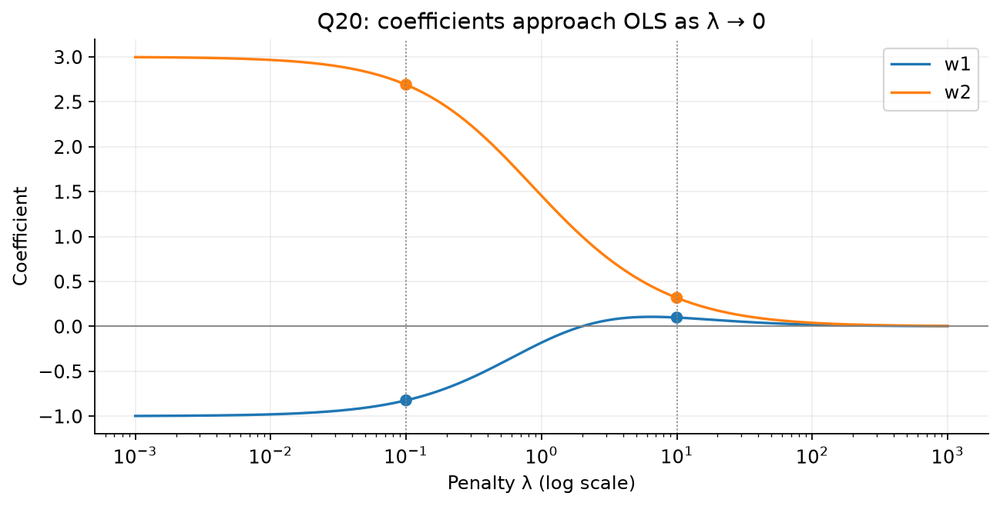

**Property from the example:** First coefficient changes sign; ridge doesn't simply multiply the whole vector by one scalar. For this dataset,

$$w_1(\lambda)=\frac{2\lambda-4}{\lambda^2+6\lambda+4},\qquad w_2(\lambda)=\frac{4\lambda+12}{\lambda^2+6\lambda+4}.$$

At $\lambda=2$, $w_1=0$ exactly, though generic ridge does not promote sparse solutions. Overall L2 norm is non-increasing with increasing penalty, but each original-coordinate absolute coefficient need not be monotonic.

### Q13 — Norm ratio at zero and infinite penalty

**Source:** 2025 Mar 16 Quiz 2, Q13.

**Question:**

Let $\hat w_R$ and $\hat w$ be the ridge coefficient estimate and the least squares estimate, respectively, of the linear regression problem. Which of the following holds true? (MSQ)

(a) For $\lambda=0$, $\lVert\hat w_R\rVert_2/\lVert\hat w\rVert_2=1$.

(b) For $\lambda=0$, $\lVert\hat w_R\rVert_2/\lVert\hat w\rVert_2=0$.

(c) For $\lambda=\infty$, $\lVert\hat w_R\rVert_2/\lVert\hat w\rVert_2=0$.

(d) For $\lambda=\infty$, $\lVert\hat w_R\rVert_2/\lVert\hat w\rVert_2=1$.

**Solution:**

1. At zero penalty, ridge reduces to the same OLS estimate → ratio 1.
2. As $\lambda\to\infty$, all penalized weights approach zero → ratio approaches 0.

$$\boxed{\text{(a), (c)}}.$$

Assume denominator $\lVert\hat w\rVert_2\ne0$ and consistent least-squares solution selection. If OLS vector zero, ratio is 0/0, undefined. “$\lambda=\infty$” means a limit. An unpenalized intercept need not approach zero.

### Q14 — Role of the ridge penalty

**Source:** 2025 Apr 13 ET, Q14.

**Question:**

What is the role of the regularization term in ridge regression?

(a) It ensures that the dataset is normally distributed.

(b) It penalizes large coefficients to reduce overfitting.

(c) It forces more coefficients to be exactly zero, performing feature selection.

(d) It increases the variance of the model.

**Solution:** L2 penalty discourages large coefficients and reduces instability. It doesn't change data distribution; exact sparsity more characteristic of LASSO; variance usually decreases.

$$\boxed{\text{(b)}}.$$

---

**Same concept also appears:** Week 6 — Solve With TAs, Q2 asks which statements hold for very high ridge regularization:

(A) Large coefficients are significantly penalized.

(B) It can lead to a model that is too simple and underfits.

(C) Large coefficients are not penalized.

(D) It can lead to a model that is too simple and overfits.

**Answer: (A), (B).** Q14 and Section 3.1 already explain the penalty mechanism. Very strong shrinkage can suppress useful signal and cause underfitting; “can” does not mean every dataset must underfit. For example, if the true penalized coefficients are zero, shrinking them toward zero need not introduce approximation bias.

## 4. Constraint geometry and LASSO: Shrinkage versus sparsity

### 4.1 Penalized and constrained forms

**Short definition:** Penalty formulation large weights ko cost deti hai; constrained formulation allowed weight size ka budget fix karti hai.

Ridge constrained form:

$$\boxed{\min_w\operatorname{SSE}(w)\quad\text{subject to }\lVert w\rVert_2\le\theta}.$$

**Real life:** Spending par extra tax versus fixed spending budget. Dono suitable matching settings mein same preferred choice de sakte hain.

For a given positive penalty $\lambda$, suitable radius $\theta$ choose karke penalized optimum constrained optimum bhi hota hai. **$\theta=1/\lambda$ universal formula nahi**; relationship data-dependent hai. Larger penalty generally smaller fitted norm deta hai.

Norm radius versus squared norm distinguish karo:

$$\lVert w\rVert_2\le\theta\iff\sum_jw_j^2\le\theta^2.$$

Feasible candidates mein **smallest SSE/MSE** choose karo, necessarily smallest norm nahi. Constraint satisfy hone ke baad objective error minimize karta hai.

### Q12 — Choose a feasible weight vector with minimum MSE

**Source:** 2025 Mar 16 Quiz 2, Q12.

**Question:**

Below is the constrained version of the ridge regression optimization problem:

$$\min_{w\in\mathbb R^d}\sum_{i=1}^n(w^Tx_i-y_i)^2\qquad\text{subject to }\lVert w\rVert_2\le\theta.$$

Following are the weight vectors to be considered, along with the mean squared error (MSE) produced by each:

$$w_1=[1,1,1,1]^T,\quad MSE=2,$$

$$w_2=[0,2,1,3]^T,\quad MSE=7,$$

$$w_3=[1,2,0,1]^T,\quad MSE=1,$$

$$w_4=[2,1,1,2]^T,\quad MSE=8.$$

If $\theta=10$, which of the following weight vectors will be selected as the final weight vector by ridge regression?

(a) $w_1$

(b) $w_2$

(c) $w_3$

(d) $w_4$

**Solution:**

**Step 1: Feasibility check.**

| Candidate | Squared norm | Norm | Feasible under norm ≤10? | MSE |
|---|---:|---:|---|---:|
| $w_1$ | 4 | 2 | Yes | 2 |
| $w_2$ | 14 | $\sqrt{14}\approx3.742$ | Yes | 7 |
| $w_3$ | 6 | $\sqrt6\approx2.449$ | Yes | 1 |
| $w_4$ | 10 | $\sqrt{10}\approx3.162$ | Yes | 8 |

**Step 2:** All feasible, so compare their errors. Fixed dataset par SSE and MSE same ranking dete hain.

**Step 3:** Minimum MSE is 1, achieved by $w_3$.

$$\boxed{\text{(c) }w_3}.$$

**Trap:** $w_1$ has smallest norm, but objective smallest norm nahi. Among the listed candidates, $w_3$ gives best feasible fit; no claim about unlisted vectors is needed.

### 4.2 SSE contours and L2/L1 balls

Full-rank least squares ke around SSE excess:

$$\operatorname{SSE}(w)-\operatorname{SSE}(\hat w_{ML})=(w-\hat w_{ML})^TXX^T(w-\hat w_{ML}).$$

In two dimensions these level sets generally ellipses hain. If $XX^T=I$, circles hain. Inner contour lower SSE, outer contour higher SSE.

- L2 constraint $w_1^2+w_2^2\le\theta^2$ → disk.
- L1 constraint $|w_1|+|w_2|\le\theta$ → diamond.

Minimum-error feasible point first SSE contour ka constraint region se contact hai. Diamond ke axis corners exact-zero coefficients ko encourage karte hain; circle has no such corners.

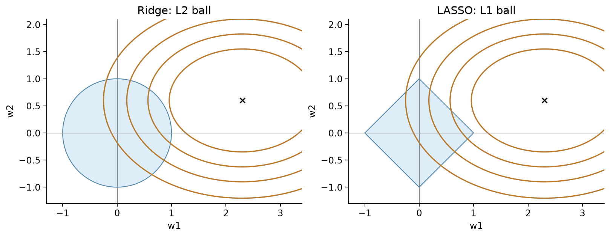

### 4.3 LASSO objective and feature selection

**Short definition:** LASSO absolute coefficient values ki sum penalize karta hai:

$$\boxed{J_L(w)=\operatorname{SSE}(w)+\lambda\lVert w\rVert_1},\qquad\lVert w\rVert_1=\sum_j|w_j|.$$

Equivalent constrained viewpoint: minimize SSE subject to $\lVert w\rVert_1\le\theta$.

**Real life:** Many house attributes available hain; a sparse model kuch useful coefficients retain karke baaki zero kar sakta hai. Zero coefficient means that feature has no contribution in that fitted linear predictor.

**Important:** Standard LASSO uses $\lVert w\rVert_1$, **not** $\lVert w\rVert_1^2$. LASSO can produce zeros; har dataset/positive $\lambda$ par at least one zero guarantee nahi.

### 4.3A Evaluating a loss is different from fitting weights

**Definition:** Loss evaluation means given w par predictions, residuals aur penalty calculate karna. Optimization means w change karke objective minimize karna. Fixed-weight question mein inverse nikalna unnecessary hai.

**Real-life connection:** Already chosen model ko score karna aur best model train karna alag tasks hain.

Always identify three things:

1. Data-fit term SSE, half-SSE, ya MSE hai?
2. Penalty $\lambda\|w\|_2^2$, $(\lambda/2)\|w\|_2^2$, ya $\lambda\|w\|_1$ hai?
3. Bias/intercept penalty mein included hai ya excluded?

### Q27 — Ridge and LASSO losses at the same given weight

**Source:** Week 6 — Solve With TAs, Q3.

**Question:**

Ajay has a dataset with a non-linear relationship between the features and the label. The dimension of the training samples is $4\times2$, excluding an additional all-ones feature for the bias term, which you should add. The label vector is $4\times1$ and the weight vector is $3\times1$. For all calculations, consider SSE to be $\frac12\|X^Tw-y\|^2$.

| Feature vector | Label |
|---|---:|
| $[1,1]^T$ | 1 |
| $[2,2]^T$ | 1 |
| $[3,2]^T$ | 2 |
| $[4,3]^T$ | 2 |

$$w=[0.1,0.2,0.3]^T.$$

(i) Compute the ridge loss for regularization parameter 0.2, correct to two decimal places.

(ii) Compute the LASSO loss for regularization parameter 0.2, correct to two decimal places.

**Solution:**

**Step 1 — State the supplied solution's convention:** Here use

$$J_R=\frac12\|X^Tw-y\|^2+\frac\lambda2\|w\|_2^2,\qquad J_L=\frac12\|X^Tw-y\|^2+\lambda\|w\|_1.$$

All three coefficients, including the bias, penalized hain in this question's supplied solution. Normally bias unpenalized ho sakta hai, but silently convention change nahi karni. Question ka “SSE” label actually half-SSE denote karta hai.

**Step 2 — Add intercept and check shape:** Input table has samples as rows. Notes ke column-sample convention mein augmented matrix:

$$X=\begin{bmatrix}1&1&1&1\\1&2&3&4\\1&2&2&3\end{bmatrix}\in\mathbb R^{3\times4}.$$

First coefficient $w_0=0.1$ is bias, so $\hat y_i=0.1+0.2x_{i1}+0.3x_{i2}$.

**Step 3 — Predictions and squared errors:**

| Input | Prediction | $\hat y-y$ | Squared error |
|---|---:|---:|---:|
| $(1,1)$ | $0.1+0.2+0.3=0.6$ | −0.4 | 0.16 |
| $(2,2)$ | $0.1+0.4+0.6=1.1$ | 0.1 | 0.01 |
| $(3,2)$ | $0.1+0.6+0.6=1.3$ | −0.7 | 0.49 |
| $(4,3)$ | $0.1+0.8+0.9=1.8$ | −0.2 | 0.04 |

$$\operatorname{SSE}=0.70,\qquad \tfrac12\operatorname{SSE}=0.35.$$

**Step 4 — Ridge penalty:**

$$\|w\|_2^2=0.1^2+0.2^2+0.3^2=0.14.$$

$$J_R=0.35+\frac{0.2}{2}(0.14)=0.364\Rightarrow\boxed{0.36}.$$

**Step 5 — LASSO penalty:**

$$\|w\|_1=|0.1|+|0.2|+|0.3|=0.6.$$

$$J_L=0.35+0.2(0.6)=\boxed{0.47}.$$

**Properties and traps:**

- Given nonlinear relationship ke basis par extra polynomial features invent nahi karne; specified features and weight hi evaluate karo.
- Bias excluded hota toh ridge $0.35+0.1(0.13)=0.363$ aur LASSO $0.35+0.2(0.5)=0.45$. Ridge rounded answer same reh sakta hai, although convention different hai.
- Half-SSE ke saath ridge penalty $\lambda\|w\|^2$ use karte toh $0.378\to0.38$. Same numeric lambda with a different relative normalization means a different objective.
- Here smaller numerical ridge objective se “ridge generalizes better” conclude nahi kar sakte. Different penalties ki raw objective values validation comparison ka substitute nahi hain.

### 4.4 Subgradient and why exact zeros occur

Absolute value derivative at zero unique nahi:

$$\partial|w|=\begin{cases}\{1\},&w>0,\\[-1,1],&w=0,\\\{-1\},&w<0.\end{cases}$$

**Short definition:** Subgradient nondifferentiable convex function ke liye supporting slope ka generalized idea hai. At zero multiple supporting slopes possible hain.

For one coordinate, zero coefficient possible when SSE slope can be balanced by penalty subgradient:

$$\left|\frac{\partial\operatorname{SSE}}{\partial w_j}\right|\le\lambda\quad\text{at }w_j=0.$$

Orthonormal design $XX^T=I$ mein $z=Xy$ and objective SSE + $\lambda\lVert w\rVert_1$ gives soft-thresholding:

$$\boxed{w_j=\operatorname{sign}(z_j)\max(|z_j|-\lambda/2,0)}.$$

If objective uses $\frac12\operatorname{SSE}+\lambda\lVert w\rVert_1$, threshold is $\lambda$, not $\lambda/2$. Scaling matters.

General correlated design mein ordinary ridge-like inverse formula available nahi; coordinate descent, proximal/subgradient methods use ho sakte hain. Special cases like orthonormal design do have closed forms.

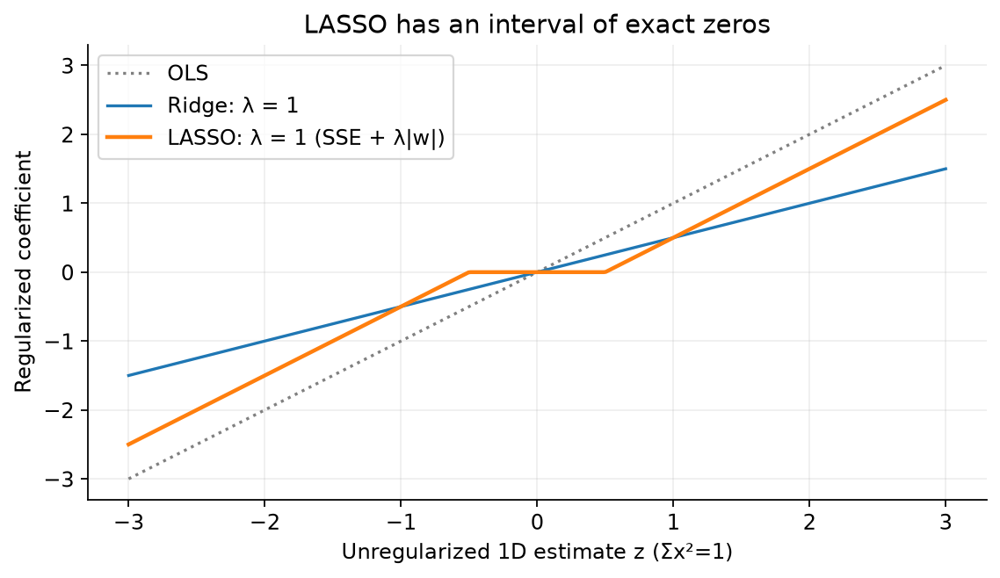

### Q5 — Read LASSO geometry, selected features and total loss

**Source:** 2024 Aug 04 Quiz 2, Q5.

**Question:**

Comprehension: Consider the following image of the parameter space in a regression problem with regularization. f is the sum of squared errors (SSE) and $\lambda$ is the regularization parameter. The weight vector is $w=[w_1\ w_2]^T$. The contours of f and the regularization term in the loss are displayed below:

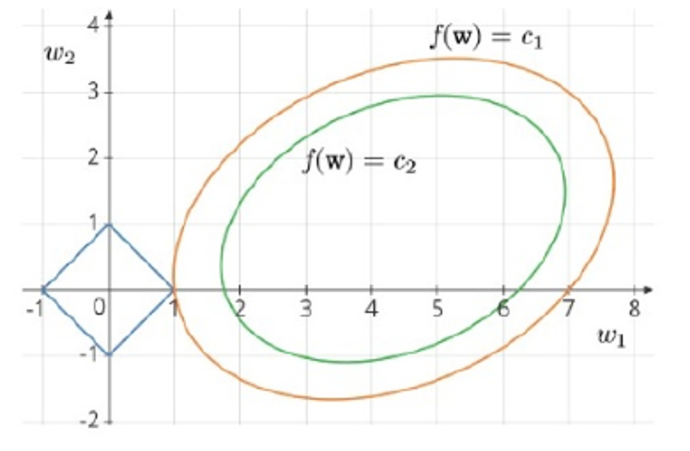

Based on the above data, answer the given subquestions.

(i) What kind of a regression problem is this?

(a) Ridge regression

(b) LASSO regression

(ii) What is the optimal value of $w_1$?

(iii) What is the optimal value of $w_2$?

(iv) Which of the following statements is true?

(a) Feature-1 can be discarded.

(b) Feature-2 can be discarded.

(c) Any one of the two features can be discarded.

(d) Both features are equally important and neither of them can be discarded.

(v) Which of the following statements are true? Exactly two options are correct. (MSQ)

(a) $c_1>c_2$

(b) $c_1<c_2$

(c) Total loss at optimal point is $c_1+\lambda$

(d) Total loss at optimal point is $c_2+\lambda$

**Solution:**

**(i):** Blue diamond represents $|w_1|+|w_2|\le1$, so L1 constraint → **LASSO, option (b)**.

**(ii), (iii):** Lowest shown SSE contour touching feasible diamond contacts at its right corner $(1,0)$:

$$\boxed{w_1=1,\qquad w_2=0}.$$

**(iv):** Predictor contribution of feature 2 is $w_2x_2=0$. Thus it can be dropped **from this fitted model**:

$$\boxed{\text{(b) Feature-2}}.$$

**(v) Step 1:** Outer contour has larger SSE than inner contour: $c_1>c_2$. Inner contour doesn't intersect feasible diamond.

**Step 2:** At contact point, $f(w)=c_1$ and $\lVert w\rVert_1=|1|+|0|=1$.

**Step 3:** Penalized objective at this point:

$$J(w)=f(w)+\lambda\lVert w\rVert_1=c_1+\lambda.$$

$$\boxed{\text{(a), (c)}}.$$

The contour construction assumes the corresponding constraint budget/penalty yielding the depicted optimum. Same corner need not be optimal for every arbitrary $\lambda$.

### Q15 — Match OLS, ridge and LASSO weight patterns

**Source:** 2025 Apr 13 ET, Q15.

**Question:**

Consider that the three weight vectors $w_1,w_2,w_3$ are learned for a four-dimensional dataset using a linear regression model or regularized linear regression model (Not in any particular order).

$$w_1=[-0.41,0.26,0.54,0.17]^T,$$

$$w_2=[-0.81,0.89,0.93,0.52]^T,$$

$$w_3=[0,0,0.08,0.2]^T.$$

Select the most appropriate match for these weight vectors.

(a) $w_1\to$ Linear regression, $w_2\to$ Ridge regression, $w_3\to$ Lasso regression

(b) $w_1\to$ Ridge regression, $w_2\to$ Linear regression, $w_3\to$ Lasso regression

(c) $w_1\to$ Lasso regression, $w_2\to$ Ridge regression, $w_3\to$ Linear regression

(d) $w_1\to$ Lasso regression, $w_2\to$ Linear regression, $w_3\to$ Ridge regression

**Solution:**

1. $w_3$ has two exact zeros → strongest clue for LASSO sparsity.
2. $w_1$ is smaller than $w_2$ in coefficient magnitudes and norm: $\lVert w_1\rVert\approx0.746$, $\lVert w_2\rVert\approx1.607$.
3. Match $w_2$ with unregularized OLS, $w_1$ with ridge shrinkage.

$$\boxed{\text{(b)}}.$$

This is the most appropriate pattern match, not a unique identification theorem from vectors alone: OLS/ridge can occasionally have zero coefficients too.

---

**Same variety also appears:** Week 6 — Solve With TAs, Q5 gives six-dimensional vectors:

$$w_1=(0.5,0,0.025,0,0,-0.14)^T,$$

$$w_2=(0.8,-0.23,0.45,0.2,0.31,-0.54)^T,$$

$$w_3=(0.24,-0.03,0.1,0.02,0.09,-0.14)^T.$$

Q15 ka same pattern-matching method applies: $w_1$ has three exact zeros → **LASSO**, $w_2$ has the largest norm → **OLS**, and the smaller dense $w_3$ → **ridge**. No duplicate full solution needed.

**PDF correction:** Handwritten labels follow this mapping, but typed solution swaps ridge/LASSO for $w_1,w_3$. Also LASSO/ridge are regularized models, despite the typed phrase “non-regularized model like LASSO or RIDGE”. A smaller norm alone does not identify “more regularized” across different penalty types/scales. These vectors give intended clues, not a proof of which fitting algorithm produced them.

## 5. Bayesian view: Prior becomes regularizer

### 5.1 Gaussian likelihood plus Gaussian prior

**Short definition:** MAP selects weights maximizing posterior density. Gaussian prior centered at zero favors smaller squared weight norm.

**Real life:** Before observing houses, extremely large positive/negative coefficients seem less plausible. A zero-centered prior expresses this preference, while data can still move weights away from zero.

Let noise variance be $\sigma_\epsilon^2$ and prior variance $\tau^2$:

$$y\mid X,w\sim N(X^Tw,\sigma_\epsilon^2I),\qquad w\sim N(0,\tau^2I).$$

Ignoring terms independent of w, negative log-posterior is:

$$\frac1{2\sigma_\epsilon^2}\lVert y-X^Tw\rVert_2^2+\frac1{2\tau^2}\lVert w\rVert_2^2.$$

Multiply by $2\sigma_\epsilon^2>0$ without changing minimizer:

$$\boxed{\hat w_{MAP}=\arg\min_w\left[\operatorname{SSE}(w)+\frac{\sigma_\epsilon^2}{\tau^2}\lVert w\rVert_2^2\right]}.$$

Thus $\boxed{\lambda=\sigma_\epsilon^2/\tau^2}$ for SSE + $\lambda\lVert w\rVert^2$ convention.

- Larger noise variance → trust noisy data less → stronger relative regularization.
- Larger prior variance → less restrictive prior → weaker regularization.
- Prior **precision** is inverse variance, not variance itself.

### Q17 — Noise/prior variance ratio

**Source:** 2025 Aug 03 Quiz 2, Q17.

**Question:**

In the Bayesian modeling for linear regression, we assume $y\mid x\sim\operatorname{Normal}(w^Tx,\sigma^2I)$ and $w\sim\operatorname{Normal}(0,\gamma^2I)$. Under this setup, the maximum aposteriori (MAP) estimator of the weights $\hat w_{MAP}$ is given by:

$$\hat w_{MAP}=\arg\min_w\{\lVert y-X^Tw\rVert^2+\lambda\lVert w\rVert^2\}.$$

Using the given information, find the expression for the regularization parameter $\lambda$.

(a) $\lambda=\sigma^2\gamma^2$

(b) $\lambda=\gamma^2/\sigma^2$

(c) $\lambda=\sigma^2/\gamma^2$

(d) $\lambda=1/(\sigma^2+\gamma^2)$

**Solution:**

1. Negative log-likelihood contributes $\operatorname{SSE}/(2\sigma^2)$.
2. Negative log-prior contributes $\lVert w\rVert^2/(2\gamma^2)$.
3. Multiply entire objective by $2\sigma^2$: SSE + $(\sigma^2/\gamma^2)\lVert w\rVert^2$.

$$\boxed{\lambda=\frac{\sigma^2}{\gamma^2}\quad\text{(c)}}.$$

Sanity check: Very broad prior $\gamma^2\to\infty$ should give $\lambda\to0$; this rules out multiplying variances.

### Q21 — Gaussian prior precision and objective choice

**Source:** 2025 Dec 18 ET, Q21.

**Question:**

In Bayesian linear regression, suppose the prior distribution over the weight vector is

$$w\sim N(0,\alpha^{-1}I).$$

Which of the following optimization problems is equivalent to finding the Maximum A Posteriori (MAP) estimate of w?

(a) $\lVert y-Xw\rVert$

(b) $\lVert y-Xw\rVert^2+\alpha\lVert w\rVert$

(c) $\lVert y-Xw\rVert^2+\alpha\lVert w\rVert^2$

(d) $\lVert y-Xw\rVert^2-\alpha\lVert w\rVert^2$

**Solution:**

1. Covariance $\alpha^{-1}I$ means precision $\alpha I$.
2. Gaussian log-prior penalty is $\alpha\lVert w\rVert^2/2$.
3. With unit noise variance, likelihood penalty is SSE/2. Multiply by 2 and minimize:

$$\boxed{\operatorname{SSE}+\alpha\lVert w\rVert^2\quad\text{(c)}}.$$

Here X uses row-sample convention as shown by $Xw$. Question omits noise variance; coefficient exactly $\alpha$ assumes unit noise variance. With noise variance $\sigma_\epsilon^2$, coefficient would be $\sigma_\epsilon^2\alpha$. Negative penalty in (d) rewards large weights, opposite of zero-centered Gaussian prior.

### Q23 — Match half-SSE and half-penalty coefficients

**Source:** 2026 Aug 14 Quiz 2, Q23.

**Question:**

Let the training data be $(x_i,y_i)_{i=1}^n$, where $x_i\in\mathbb R^d$ and $y_i\in\mathbb R$. Consider the ridge regression estimator defined, for a fixed $\lambda>0$, as

$$\hat w=\arg\min_{w\in\mathbb R^d}\left[\frac12\sum_{i=1}^n(w^Tx_i-y_i)^2+\frac\lambda2\lVert w\rVert^2\right].$$

To obtain the maximum a posteriori (MAP) estimator, the following probabilistic model is assumed:

- Prior: $w\sim N(0,\sigma^2I)$ where $w\in\mathbb R^d$, $0\in\mathbb R^d$ is the zero vector, $I\in\mathbb R^{d\times d}$ is the identity matrix, and $\sigma^2>0$ is the prior variance.
- Likelihood: Conditioned on w, the labels are mutually independent, with $y_i\mid x_i,w\sim N(w^Tx_i,1)$, $i=1,\ldots,n$.

Let $\hat w_{MAP}$ denote the maximum a posteriori estimate of w. For which value of $\lambda$ do the two optimization problems become identical? (Equivalently, for which value of $\lambda$ does $\hat w_{MAP}=\hat w_R$ hold for every dataset?)

(a) $\lambda=\sigma^2$

(b) $\lambda=1/(2\sigma^2)$

(c) $\lambda=1$

(d) $\lambda=1/\sigma^2$

**Solution:**

**Step 1:** Unit likelihood variance gives negative log-likelihood $\frac12\operatorname{SSE}$.

**Step 2:** Prior variance $\sigma^2$ gives negative log-prior $\frac1{2\sigma^2}\lVert w\rVert^2$.

**Step 3:** Compare coefficient with specified ridge objective:

$$\frac\lambda2=\frac1{2\sigma^2}\Rightarrow\boxed{\lambda=\frac1{\sigma^2}\quad\text{(d)}}.$$

Q17 uses $\sigma^2$ for noise; **this question uses it for prior variance**. Match meanings, not symbol names. No extra factor 2 survives because both objectives already include halves.

### 5.2 Laplace prior leads to LASSO

For independent coefficient priors $w_j\sim\operatorname{Laplace}(0,b)$:

$$p(w)\propto\exp\left[-\frac1b\sum_j|w_j|\right].$$

Negative log-prior is $\lVert w\rVert_1/b$. With Gaussian noise variance $\sigma_\epsilon^2$, multiplying negative log-posterior by $2\sigma_\epsilon^2$ gives:

$$\boxed{\operatorname{SSE}+\frac{2\sigma_\epsilon^2}{b}\lVert w\rVert_1}.$$

Gaussian prior → squared L2; independent Laplace prior → L1. Prior shape determines penalty shape.

### Q7 — Ridge estimator MSE and Laplace-prior MAP

**Source:** 2024 Dec 01 Quiz 2, Q7.

**Question:**

Comprehension: Consider the following linear regression model

$$y_i\mid x_i=w^Tx_i+\epsilon_i,$$

where the noise $\epsilon\sim\operatorname{Normal}(0,1)$. Based on the above data, answer the given subquestions.

(i) For some $\lambda>0$, where $\lambda\in\mathbb R$, MSE of $\hat w_{ML}$ is greater than MSE of $\hat w_{Ridge}$.

(a) TRUE

(b) FALSE

(ii) Consider the Bayesian formulation of the linear regression problem, where the prior for w is assumed to be

$$w\sim\operatorname{Laplace}(0,2/\lambda).$$

Then, which among the following is true?

Hint: If $X\sim\operatorname{Laplace}(\mu,b)$, then $f_X(x)=\frac1{2b}e^{-|x-\mu|/b}$.

(a) $\hat w_{MAP}=\arg\min_w\sum_{i=1}^n(w^Tx_i-y_i)^2+\lambda\lVert w\rVert_2^2$, where $\lVert w\rVert_2^2=\sum_{i=1}^d w_i^2$

(b) $\hat w_{MAP}=\arg\max_w\sum_{i=1}^n(w^Tx_i-y_i)^2+\lambda\lVert w\rVert_2^2$, where $\lVert w\rVert_2^2=\sum_{i=1}^d w_i^2$

(c) $\hat w_{MAP}=\arg\min_w\sum_{i=1}^n(w^Tx_i-y_i)^2+\lambda\lVert w\rVert_1$, where $\lVert w\rVert_1=\sum_{i=1}^d|w_i|$

(d) $\hat w_{MAP}=\arg\max_w\sum_{i=1}^n(w^Tx_i-y_i)^2+\lambda\lVert w\rVert_1$, where $\lVert w\rVert_1=\sum_{i=1}^d|w_i|$

**Solution — (i): Parameter MSE, not training SSE**

Standard fixed-design, full-rank noisy linear model mein suitable positive shrinkage variance reduce karke added bias compensate kar sakti hai. Section 3.3 example: OLS risk 1, ridge at $\lambda=1$ risk 0.5.

$$\boxed{\text{(a) TRUE}}.$$

For each fixed true parameter under these assumptions, sufficiently small positive penalty can improve expected parameter risk. This doesn't say every positive penalty helps, or that same penalty works optimally for every truth. Ordinary least squares already minimizes training SSE, so question ko training-SSE statement read karna wrong hoga.

**Solution — (ii): Build negative log-posterior**

**Step 1:** Unit Gaussian noise → likelihood factor $\exp[-\operatorname{SSE}/2]$.

**Step 2:** Independent Laplace coefficients with $b=2/\lambda$:

$$p(w)\propto\exp[-(\lambda/2)\lVert w\rVert_1].$$

**Step 3:** Product gives posterior proportional to

$$\exp\left[-\frac12\operatorname{SSE}-\frac\lambda2\lVert w\rVert_1\right].$$

**Step 4:** Maximizing posterior equals minimizing exponent's negative; multiply by 2:

$$\boxed{\hat w_{MAP}=\arg\min_w[\operatorname{SSE}+\lambda\lVert w\rVert_1]\quad\text{(c)}}.$$

This is LASSO. Prior needs independent-coordinate interpretation for the displayed vector L1 penalty.

### Q19 — Unbiasedness versus MSE

**Source:** 2025 Aug 03 Quiz 2, Q19.

**Question:**

Consider the linear regression model $y=w^Tx+\epsilon$, where $\epsilon\sim N(0,\sigma^2)$.

Note: Here $\hat w_{MLE}$ is the Maximum Likelihood Estimator (MLE) of w, $\hat w_{MAP}$ is the Maximum A Posteriori (MAP) estimator of w, and $E(\lVert\hat w-w\rVert^2)$ is the Mean Squared Error (MSE) between an estimator $\hat w$ and the true parameter w.

Which of the following statements is/are true?

(a) The estimator $\hat w_{MLE}$ always has a lower mean squared error (MSE) than $\hat w_{MAP}$ because it is unbiased.

(b) The estimator $\hat w_{MAP}$ always provides better estimates than $\hat w_{MLE}$ because it uses prior information.

(c) The estimator $\hat w_{MAP}$ can achieve lower MSE than $\hat w_{MLE}$ for some $\lambda>0$, where $\lambda\in\mathbb R$.

(d) The MSE of $\hat w_{MLE}$ and $\hat w_{MAP}$ is always equal when the sample size is small.

**Solution:**

- (a) False: MSE includes variance as well as squared bias.
- (b) False: Wrong/overly restrictive prior can hurt; “always” invalid.
- (c) True: Suitable regularization can reduce total parameter MSE, as Q7(i) and Section 3.3 explain.
- (d) False: Small sample size doesn't force equal risks.

$$\boxed{\text{(c)}}.$$

**Counterexample to “MAP always better”:** True scalar weight 10, design $a=1$, noise variance 1. OLS risk 1; extreme shrinkage toward zero has risk approaching $10^2=100$. Prior strength needs tuning.

---

## 6. Cross-validation: Penalty aur complexity kaise choose karein?

### 6.1 Train, validation and test roles

**Short definition:** Validation uses held-out observations to compare hyperparameter settings; test set final evaluation ke liye reserve hota hai.

**Real life:** Practice questions se learn karo, mock test se study strategy choose karo, final exam se assess karo. Final exam answers dekhkar strategy tune karna fair evaluation nahi.

- **Training:** Fit coefficients/model parameters.
- **Validation:** Choose $\lambda$, degree, learning rate, iterations etc.
- **Test:** Final selected procedure ki generalization assess karo.

An 80:20 train-validation split common possible choice hai, universal rule nahi. One random split unrepresentative ho sakta hai; K-fold CV multiple holdouts average karti hai.

### 6.2 K-fold and leave-one-out

Dataset ko K folds mein divide karo. For each hyperparameter candidate:

1. One fold validation, other K−1 folds training.
2. K models fit karo, each fold once held out.
3. Validation losses average karo.
4. Minimum average validation loss wale setting choose karo.
5. Selected setting se full development/training dataset par refit karo; then reserved test evaluate karo.

Equal fold sizes, n divisible by K:

$$\boxed{n_{val}=n/K,\quad n_{train}=n(K-1)/K,\quad\text{fits per candidate}=K}.$$

M candidates → MK CV fits, plus usually one final refit. LOOCV is K=n: each fit n−1 points, one held out.

**Larger K always better?** No. More training data per fit milta hai, but computation and variability/correlation of validation estimates matter karte hain. Time-series/groups ke liye appropriate nonleaking split scheme choose karna necessary hai; plain random folds universally suitable nahi.

Preprocessing/scaling selection bhi each training fold par fit honi chahiye. Whole dataset par scaler fit karke CV karna held-out information leak kar sakta hai.

### Q4 — Four-fold CV model count and training size

**Source:** 2024 Aug 04 Quiz 2, Q4.

**Question:**

Comprehension: A dataset for ridge regression has 1000 data-points. k-fold cross validation is performed to estimate the value of $\lambda$ in ridge regression with k = 4. For a given value of $\lambda$:
Based on the above data, answer the given subquestions.

(i) How many models have to be trained?

(ii) While training each of these models, how many data-points does the training set have?

**Solution:**

1. One candidate $\lambda$, four held-out fold choices → **4 models**.
2. Each fold size $1000/4=250$.
3. Training uses three folds: $3(250)=750$.

$$\boxed{\text{(i) }4,\qquad\text{(ii) }750}.$$

250 is validation count, not training count. Final refit is separate from requested four CV models.

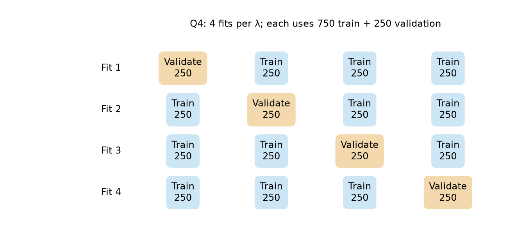

**Same counting method also appears:** Week 6 — Solve With TAs, Q4 asks for total fits in five-fold CV comparing standard linear regression, polynomial kernel regression and Gaussian kernel regression. There are 3 candidate procedures and 5 folds, so **$3\times5=15$ CV fits**. One final refit, if separately requested, makes 16. This assumes one fixed configuration per model family; extra degree/bandwidth settings count as additional candidates.

### 6.2A LOOCV: Fit an actual fold before predicting its held-out point

**Definition:** LOOCV mein one sample validation hota hai; coefficients remaining samples se fit hote hain. Har held-out sample ke liye model refit karna hota hai.

For $m$ training points and model $\hat y=w_0+w_1x$:

$$\boxed{w_1=\frac{\sum(x_i-\bar x)(y_i-\bar y)}{\sum(x_i-\bar x)^2},\qquad w_0=\bar y-w_1\bar x}.$$

Means and sums **current training fold only** se nikaalo. Denominator positive hona chahiye; all training inputs equal hon toh slope separately identifiable nahi hota.

### Q28 — Leave out sample 3, then fit slope and predict

**Source:** Week 6 — Solve With TAs, Q7.

**Question:**

Consider the dataset:

| Sample No. | $x$ | $y$ |
|---:|---:|---:|
| 1 | 3 | 8 |
| 2 | 0 | 3 |
| 3 | 5 | 12 |
| 4 | 6 | 13 |

The linear regression model is $y=w_0+w_1x$. Assume that Leave-One-Out Cross-Validation is applied.

(i) Enter the value of $w_1$ obtained when the third sample is used as the validation data point.

(ii) What is the predicted value for the left-out data point?

**Solution:**

**Step 1 — Split:** Hold out $(5,12)$. Train using $(3,8),(0,3),(6,13)$. Held-out label 12 fitting mein use nahi hoga.

**Step 2 — Training means:**

$$\bar x=(3+0+6)/3=3,\qquad \bar y=(8+3+13)/3=8.$$

**Step 3 — Fit the slope:**

$$\sum(x_i-\bar x)(y_i-\bar y)=0(0)+(-3)(-5)+3(5)=30.$$

$$\sum(x_i-\bar x)^2=0+9+9=18.$$

$$\boxed{w_1=30/18=5/3\approx1.6667}.$$

**Step 4 — Fit intercept:**

$$w_0=8-(5/3)(3)=3.$$

Training predictions $8,3,13$ targets se exactly match karte hain.

**Step 5 — Held-out prediction:**

$$\boxed{\hat y(5)=3+(5/3)(5)=34/3\approx11.33}.$$

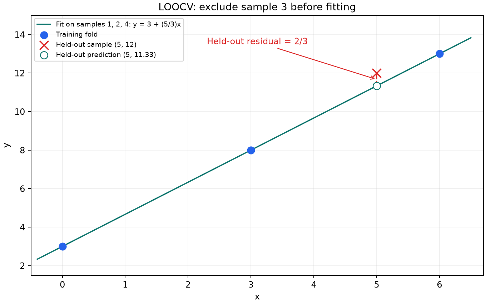

**Useful follow-through:** Held-out residual $12-34/3=2/3$, absolute error $2/3$, squared error $4/9$. Training error zero hone ke baad bhi validation error nonzero hai. Yeh **one fold's** error hai; full LOOCV MSE ke liye all four held-out squared errors average karne padenge.

### Q18 — Select learning rate and iteration setting

**Source:** 2025 Aug 03 Quiz 2, Q18.

**Question:**

You are evaluating the performance of a linear regression model using different hyperparameter settings (learning rate and number of iterations). Below are the results:

| Setting | Learning Rate | Iterations | Training Error | Validation Error |
|---|---:|---:|---:|---:|
| 1 | 0.05 | 1000 | 150 | 160 |
| 2 | 0.10 | 800 | 145 | 150 |
| 3 | 0.15 | 500 | 140 | 190 |
| 4 | 0.25 | 350 | 170 | 180 |

Which hyperparameter setting would you choose based on the training and validation errors? Why?

(a) Setting 3, because it has the lowest training error, indicating the best fit to the training data.

(b) Setting 2, because it has the lowest validation error and a relatively low training error, indicating a good generalization.

(c) Setting 1, because it has the highest number of iterations and therefore likely to be more stable.

(d) Setting 4, because it uses the highest learning rate and converges the fastest.

**Solution:**

**Step 1:** Compare validation errors: 160, 150, 190, 180.

**Step 2:** Minimum 150 occurs at setting 2: learning rate 0.10, 800 iterations.

**Step 3:** Setting 3's better training error 140 doesn't outweigh much worse validation error 190. Number of iterations/learning rate alone isn't selection criterion.

$$\boxed{\text{(b) Setting 2}}.$$

### Q22 — Select lambda from five-fold CV errors

**Source:** 2026 Apr 06 Quiz 2, Q22.

**Question:**

In Ridge Regression, the optimal weight vector is given by $\hat w=(XX^T+\lambda I)^{-1}Xy$. The regularization parameter $\lambda$ is determined using 5-fold cross-validation. The following table summarizes the average Training Error and Validation Error (Mean Squared Error) obtained for various values of $\lambda$:

| $\lambda$ Value | Avg. Training Error (MSE) | Avg. Validation Error (MSE) |
|---:|---:|---:|
| 0.001 | 1.25 | 8.40 |
| 0.1 | 2.10 | 4.20 |
| 1.0 | 3.45 | 3.15 |
| 10.0 | 5.80 | 3.20 |
| 100.0 | 12.40 | 11.90 |

Based on the cross-validation results provided, what is the most appropriate choice for $\lambda$?

(a) 0.001

(b) 0.1

(c) 1.0

(d) 10.0

(e) 100

**Solution:**

1. Choose by average validation MSE, not training MSE.
2. Minimum validation MSE is **3.15 at $\lambda=1$**.
3. $\lambda=10$ is close (3.20), but no error-bar/alternative selection rule specified; use numerical minimum.

$$\boxed{\lambda=1.0\quad\text{(c)}}.$$

Small $\lambda=0.001$ gives low training error but poor validation; very large $\lambda=100$ has high errors, suggesting excessive regularization.

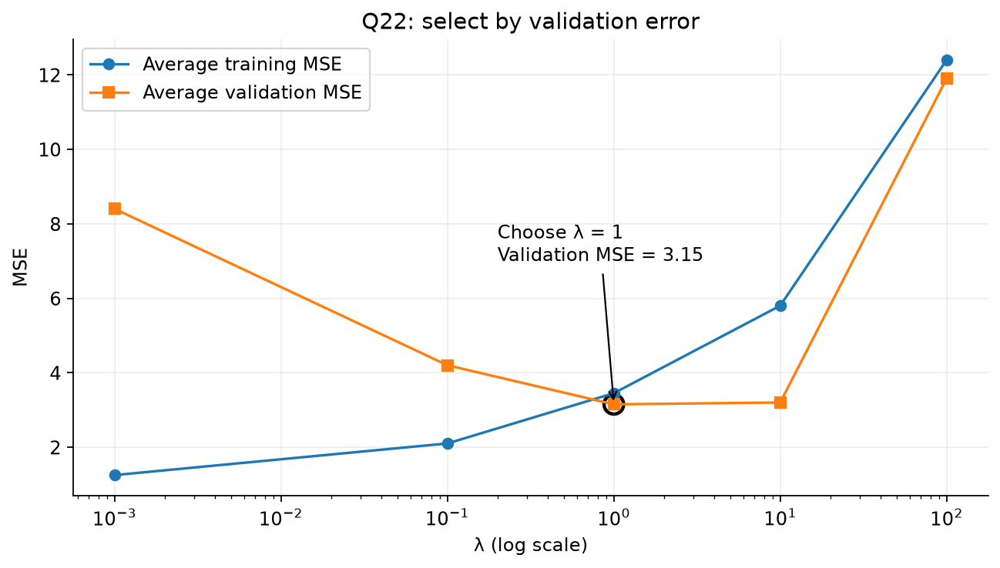

**Property:** Validation error can be below training error (here 3.15 versus 3.45). Different held-out samples can be easier; “training error must always be lower” is false.

### 6.3 Loss curves versus lambda or model flexibility

For exact ridge training optima on the same fixed dataset, increasing $\lambda$ gives:

- Fitted L2 norm non-increasing.
- Unpenalized training SSE non-decreasing.
- Optimized full objective $\min_w[\operatorname{SSE}(w)+\lambda\lVert w\rVert^2]$ also non-decreasing.

Validation/test prediction error can first improve then worsen; no universal smooth U shape required. If horizontal axis is decreasing function of $\lambda$, these directions reverse.

**Important distinction:** Full regularized objective and prediction error differ. Validation normally compares prediction SSE/MSE without adding training penalty; graph's labels and question convention read karo.

### 6.3A MAE and selecting polynomial degree from a graph

**Definition:** Mean absolute error averages prediction misses without squaring:

$$\boxed{\operatorname{MAE}=\frac1n\sum_i|y_i-\hat y_i|}.$$

**Real-life connection:** Price prediction average kitne currency units se miss hui, MAE directly target units mein batata hai. MSE squared target units mein hota hai.

- Smaller held-out MAE means better performance **under this metric**.
- MAE and MSE models ko different order mein rank kar sakte hain. Residuals A=$(0,4)$ and B=$(2.1,2.1)$: MAE A=2 < B=2.1, but MSE A=8 > B=4.41. Large miss squaring se zyada penalize hoti hai.
- Degree badhne par fit flexibility badhti hai; minimum training error alone model select karne ka criterion nahi.

### Q29 — Read the best polynomial degree from the supplied chart

**Source:** Week 6 — Solve With TAs, Q1.

**Question:**

The following chart plots MAE against degree of polynomial features for a regression task on the California housing dataset. Which is the optimal value of degree?

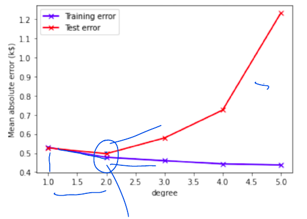

(i) 1

(ii) 2

(iii) 3

(iv) 4

**Solution:**

**Step 1 — Read axes and legend:** Horizontal axis polynomial degree hai, vertical axis MAE. Purple training error hai; red curve supplied chart mein “Test error” labelled hai.

**Step 2 — Locate the red curve's minimum:** Degree 1 se 2 tak error decreases. Degree 2 ke baad 3, 4, 5 par increases. Precise plotted MAE values estimate karne ki zaroorat nahi; minimum location sufficient hai.

**Step 3 — Select:**

$$\boxed{\text{Degree }2\quad\text{(ii)}}.$$

**Step 4 — Explain the gap:** Training MAE higher degrees par lower hoti hai, but held-out curve rises. Is graph mein added flexibility training data ko better fit karke unseen performance hurt kar rahi hai, consistent with overfitting.

**Model-selection distinction:** Question ka intended answer supplied red curve se 2 hai. Actual workflow mein degree **validation/CV** se select karte hain; untouched final test set ko tune karne ke liye use nahi karte. Agar labelled “test” set se degree choose ki, woh selection ke liye validation role play kar raha hai, unbiased final test evaluation nahi.

### Q6 — Identify the horizontal-axis function of lambda

**Source:** 2024 Sep 01 ET, Q6.

**Question:**

Consider a regression problem that has a training and test dataset. Ridge regression is applied on the problem for various values of $\lambda$. The training and test loss are plotted against some function of $\lambda$, which we call $f(\lambda)$. Note that the continuous curves are obtained by connecting the points using a smooth curve. What is the most appropriate choice of $f(\lambda)$?
Recall that the regularized loss is the sum of the SSE and the regularization term. Note that SSE is the sum of squared errors.

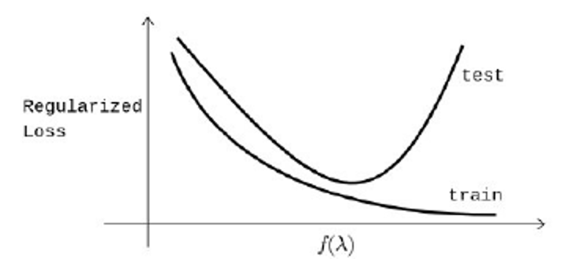

(a) $1/\lambda$

(b) $\lambda$

(c) $\lambda^2$

(d) $\log(\lambda)$

**Solution:**

**Step 1:** Graph mein training loss horizontal-axis value badhne par decrease ho rahi hai.

**Step 2:** For $\lambda>0$, larger penalty produces non-decreasing optimized training regularized loss. So displayed x-axis must increase when $\lambda$ decreases.

**Step 3:** $\lambda,\lambda^2,\log\lambda$ are increasing on positive $\lambda$; $1/\lambda$ decreasing hai.

$$\boxed{f(\lambda)=\frac1\lambda\quad\text{(a)}}.$$

Moving right means weaker regularization/more flexibility. The depicted test curve can fall then rise as underfitting gives way to overfitting, but training-curve direction alone identifies the option. A smooth line through measured points is an illustration, not a theorem that real validation curves are always smooth.

### 6.4 Training curves over time and early stopping

Training time/iterations badhne par optimizer training loss reduce karta hai. Validation may improve initially, flatten, or later rise if fitting noise starts dominating. Early stopping validation performance ke basis par iteration count select kar sakta hai.

Time axis and complexity/penalty axis different concepts hain. Increasing training time does not automatically mean increasing model architecture size.

### Q10 — Identify training and validation curves

**Source:** 2024 Dec 22 ET, Q10.

**Question:**

Consider a supervised ML problem where a model is trained using a training dataset, and its performance is evaluated on both the training and validation datasets. During training, the model’s loss is plotted over time for both the datasets. Assume that the loss L(t) is decreasing as the model learns.

The following graph shows two curves, Curve (A) and Curve (B), representing the loss for the training and validation datasets, respectively:

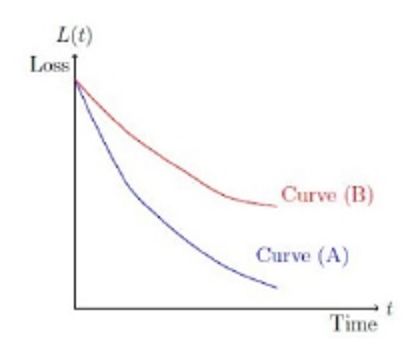

Identify the curves corresponding to the training and validation datasets. Select all correct statements. (MSQ)

(a) Curve (A) represents the training loss.

(b) Curve (B) represents the training loss.

(c) Curve (A) represents the validation loss.

(d) Curve (B) represents the validation loss.

**Solution:**

1. Curve A continues to lower loss; model is directly optimized on training data.
2. Curve B decreases but remains higher/levels off, representing held-out validation performance in this figure.
3. The wording also explicitly identifies A and B as training and validation, respectively.

$$\boxed{\text{(a), (d)}}.$$

**Limit:** Graph suggests a generalization gap, but higher curve is not universally validation in every experiment; Q22 already shows a counterexample to that absolute rule. No need to claim validation is rising here—it is flattening in the supplied graph.

---

## 7. Classification threshold: Which mistakes matter more?

### 7.1 Probability to label

**Short definition:** A threshold converts predicted positive-class probability into a binary decision:

$$\hat y=\begin{cases}1,&p(y=1\mid x)\ge t,\\0,&p(y=1\mid x)<t.\end{cases}$$

**Real life:** Spam/phishing detection mein dangerous email ko miss karna costly hai. Lower threshold more emails flag karega, including some harmless ones.

- **False negative (FN):** Actually phishing, predicted safe.
- **False positive (FP):** Actually safe, predicted phishing.
- **Recall:** $TP/(TP+FN)$, actual positives mein kitne detect hue.

Fixed scores ke saath lowering threshold positive-prediction set expand karta hai: false negatives cannot increase, but false positives may increase. Precision may change; exact value dataset par depend karegi.

**Counterexample to “threshold must always be 0.5”:** An email with phishing probability 0.4 is unflagged at t=0.5, flagged at t=0.2. Cost-sensitive policy can reasonably choose lower threshold.

### Q8 — Low threshold for phishing detection

**Source:** 2024 Dec 22 ET, Q8.

**Question:**

Consider a logistic regression model trained to detect spam emails. Emails containing harmful phishing links are labeled as spam (1), while regular emails are labeled as not spam (0).
A good spam detector should correctly identify almost all emails with phishing links. Even a single phishing email incorrectly classified as not spam could expose users to significant risks. However, the detector may classify some regular emails as spam. This trade-off is acceptable to ensure safety.

To ensure user safety, if the threshold is set to a low value to prioritize the detection of phishing emails, type 1. If the threshold is set to a high value to minimize false positives (misclassifying regular emails as spam), type 0.

**Solution:**

1. Main priority: avoid false negatives, i.e. missed phishing emails.
2. Lower threshold more emails ko class 1 assign karega, increasing/non-decreasing recall for fixed scores.
3. Some extra false positives acceptable according to question.

$$\boxed{1\text{ — choose a low threshold}}.$$

Threshold change decisions ko change karta hai; fitted logistic model coefficients automatically change nahi hote.

---

## 8. Quick revision

### 8.1 Formula sheet

| Quantity | Formula / condition |
|---|---|
| Predictions, X has samples as columns | $X^Tw$ |
| Training SSE | $\lVert X^Tw-y\rVert_2^2$ |
| Prediction MSE | SSE / n |
| Full-rank OLS/MLE | $(XX^T)^{-1}Xy$ |
| Parameter MSE decomposition | Squared bias + trace of covariance |
| Full-rank OLS parameter MSE | $\sigma^2\operatorname{tr}((XX^T)^{-1})$ |
| Ridge objective | SSE + $\lambda\lVert w\rVert_2^2$ |
| Ridge solution | $(XX^T+\lambda I)^{-1}Xy$ |
| Scalar ridge | $\sum_i x_iy_i/(\sum_i x_i^2+\lambda)$ |
| Eigen-direction shrinkage | $a_j/(a_j+\lambda)$ |
| LASSO objective | SSE + $\lambda\lVert w\rVert_1$ |
| Gaussian-prior penalty | $\lambda=\text{noise variance}/\text{prior variance}$, SSE convention |
| Independent Laplace prior scale b | L1 penalty coefficient $2\sigma_\epsilon^2/b$, SSE convention |
| K-fold training size | $n(K-1)/K$ for equal folds |
| K-fold validation size | $n/K$ |
| Fits for M hyperparameter candidates | MK, excluding final refit |
| Logistic decision | Predict 1 if probability ≥ threshold |

### 8.2 Common mistakes

| Mistake | Correction |
|---|---|
| Training SSE and estimator parameter MSE are identical | Different quantities; ridge may increase former and lower expected latter |
| Unbiased automatically means minimum MSE | Variance also contributes |
| Use $X^TX$ regardless of convention | Check whether samples are rows or columns |
| Add lambda to all matrix entries | Add lambda only on diagonal via $\lambda I$ |
| Standard rounding equals truncation | Q2/Q20 printed options are truncated; use exact values for calculations |
| Every ridge coefficient shrinks monotonically in its original coordinate | Eigen-directions shrink; individual coordinates may change sign/nonmonotonically |
| Ridge always has no exact zeros | It does not promote sparsity, but incidental zeros can occur |
| LASSO penalty is squared L1 norm | Standard LASSO uses unsquared sum of absolute values |
| Norm constraint ≤θ means squared norm ≤θ | Squared norm bound is $\theta^2$ |
| Pick feasible vector with smallest norm | Minimize error among feasible vectors |
| Prior variance and prior precision same | Precision = inverse variance |
| Ignore SSE versus MSE and factor 1/2 | Relative penalty coefficient changes with normalization |
| Choose hyperparameters by lowest training loss | Choose by validation/CV, reserve test for final assessment |
| Larger K always makes CV better | Computation, data dependence and estimate variability matter |
| More complexity always raises test error | Can first fix underfitting, then overfit |
| Low phishing threshold reduces false positives | It prioritizes fewer false negatives, possibly more false positives |

### 8.3 Solving checklist

1. Identify requested quantity: training error, test/validation error, or expected parameter MSE.
2. Matrix question mein X orientation, y shape and intercept treatment read karo.
3. Compute $XX^T$, $Xy$, then add penalty and solve. Inverse/linear-system check se answer verify karo.
4. Geometry mein circle versus diamond, contact point and SSE contour level identify karo.
5. Bayesian question mein noise variance/prior variance separately label karo; negative log-posterior coefficients compare karo.
6. CV question mein number of candidates, folds and samples per fold distinguish karo.
7. Curve question mein x-axis time, complexity, lambda or inverse lambda hai—pehle ye decide karo.
8. “Always”, “can”, “for some” ko carefully read karo; final values end mein round karo.
