# MLT Week 7: KNN and Decision Tree Notes

**Flow:** Classification aur error → nearest neighbours → choice of k → cross-validation → decision-tree questions → entropy → information gain → tree boundaries aur depth.

## Topic index

| Topic | Subtopics | Questions |
|---|---|---|
| 1. Classification foundations | Features, labels, 0–1 loss, linear classification | — |
| 2. KNN prediction | Distance, majority vote, regression average | Q7, Q15, Q20 |
| 3. Choosing k | Training error, outliers, bias–variance, prediction cost | Q1, Q9, Q24, Q23 |
| 4. KNN validation and geometry | LOOCV, distance ordering, annulus | Q13, Q18 |
| 5. Decision-tree foundations | Nodes, splits, depth, overfitting, memorization | Q4, Q17 |
| 6. Entropy | Purity, proportions, maximum impurity | Q10, Q11, Q14, Q22 |
| 7. Information gain | Weighted child entropy, split comparison, properties | Q8, Q19, Q12, Q25, Q2 |
| 8. Tree geometry | Path conditions, probability, thresholds, boxes, XOR | Q3, Q6, Q16, Q5, Q21 |
| 9. Revision | Formula sheet, common mistakes, checklist | — |

---

## 1. Classification foundations

### 1.1 Features, labels and prediction

**Short definition:** Classification mein input features se discrete category predict karte hain. Binary classification mein two possible classes hoti hain.

**Real life:** Email ke features se spam/not-spam; patient measurements se positive/negative test category.

Training data:

$$D=\{(x_i,y_i)\}_{i=1}^n,\qquad x_i\in\mathbb R^d.$$

Binary labels $y_i\in\{0,1\}$ ya $\{-1,+1\}$ ho sakte hain. Question ki encoding follow karo. Classifier:

$$h:\mathbb R^d\to\{0,1\}.$$

**Regression se difference:** Classification label category hai; regression target numerical quantity hai, jaise price. KNN aur decision trees dono tasks handle kar sakte hain.

### 1.2 Zero–one loss and training error

Single prediction wrong ho toh penalty 1, correct ho toh 0:

$$L_i=\mathbf1[h(x_i)\ne y_i].$$

$$\boxed{\text{Error rate}=\frac{\#\text{wrong predictions}}{\#\text{evaluated points}}=\frac1n\sum_{i=1}^n\mathbf1[h(x_i)\ne y_i]}.$$

Example: 8 predictions mein 2 wrong → count 2, error rate $2/8=0.25$, accuracy 0.75. **Count aur fraction interchange mat karna.**

Training error same data par measure hota hai jo model ne use kiya. Validation/test error unseen examples par performance estimate karta hai. Zero training error ka matlab zero test error nahi.

### 1.3 Linear classifier aur squared-error limitation

Linear score $f(x)=w^Tx+b$ ko threshold karke class predict kar sakte hain. Boundary $w^Tx+b=0$ 2D mein line hai. Exact minimum 0–1 training error find karna general linear-classifier setting mein computationally hard ho sakta hai.

Linear regression se class labels fit karke threshold karna possible hai, but squared error **score ka numerical distance** bhi penalize karti hai, sirf class side nahi.

**Counterexample:** True label 1 ke liye scores 1 aur 10 dono threshold 0.5 se class 1 predict karte hain. Squared errors respectively 0 aur 81 hain. Outliers fitted line/boundary ko pull kar sakte hain.

Ab do approaches dekhenge jo ek single straight boundary tak restricted nahi: local neighbour voting aur recursive feature questions.

---

## 2. K-Nearest Neighbours: Nearby examples se prediction

### 2.1 KNN ka idea

**Short definition:** Test point ke $k$ closest training points find karo; classification mein majority label, regression mein target values ka mean predict karo.

**Real life:** Naye flat ka expected rent nearby similar flats ke rents se estimate karna. “Nearby” location alone nahi; chosen feature-space distance decide karti hai.

KNN **non-parametric** aur **lazy learning** method hai: fixed coefficient vector fit karne ke bajay training examples retain karta hai. “No conventional model fitting” ka matlab “training data ki zaroorat nahi” nahi hai.

### 2.2 Distance aur scaling

Euclidean distance:

$$d(x,z)=\sqrt{\sum_{j=1}^d(x_j-z_j)^2}.$$

Nearest neighbours rank karne ke liye squared distance enough:

$$\boxed{d^2(x,z)=\sum_j(x_j-z_j)^2}.$$

Square root increasing function hai, so ordering same rehti hai. Manhattan distance $\sum_j|x_j-z_j|$ different ordering de sakti hai.

**Counterexample:** Origin se $A=(3,0)$ aur $B=(2,2)$: Euclidean mein $B$ nearer ($\sqrt8<3$), Manhattan mein $A$ nearer ($3<4$). Opposite labels hon toh 1-NN prediction change ho sakti hai.

**Scaling:** Income thousands mein aur age tens mein ho toh raw Euclidean distance income se dominate ho sakti hai. Appropriate scaling useful hai. Validation mein scaler sirf training fold par fit karo; held-out point se fitting leakage hoti hai.

### 2.3 Classification rule and ties

Nearest-neighbour index set $N_k(x)$ ke liye:

$$\boxed{\hat y=\arg\max_c\sum_{i\in N_k(x)}\mathbf1[y_i=c]}.$$

Binary class mein odd $k$ majority-vote tie avoid karta hai, **distance tie nahi**. Equal-distance candidates at the $k$th position ke liye tie rule needed ho sakta hai.

Workflow: distances → sort → first $k$ points → labels count → majority. Raw numerical feature values ka majority nahi lena.

### Q7 — 3-NN classification in three dimensions

**Source:** 2024 Dec 01 Quiz 2, Q7.

**Question:**

Consider the following feature vectors in $\mathbb R^3$:

$$x_1=[1,2,3]^T,\quad x_2=[-1,-2,0]^T,\quad x_3=[3,0,1]^T,\quad x_4=[0,1,4]^T,\quad x_5=[2,-1,-3]^T.$$

The labels of these points are $y_1=0,y_2=1,y_3=1,y_4=0,y_5=1$.
If we use a k-NN algorithm with $k=3$, what would be the predicted label for the test point $x_{\mathrm{test}}=[1,1,2]^T$?

**Solution:**

**Step 1: Squared distances calculate karo.**

| Point | Calculation of $d^2$ | $d^2$ | Label |
|---|---|---:|---:|
| $x_1$ | $(1-1)^2+(2-1)^2+(3-2)^2$ | 2 | 0 |
| $x_2$ | $(-1-1)^2+(-2-1)^2+(0-2)^2$ | 17 | 1 |
| $x_3$ | $(3-1)^2+(0-1)^2+(1-2)^2$ | 6 | 1 |
| $x_4$ | $(0-1)^2+(1-1)^2+(4-2)^2$ | 5 | 0 |
| $x_5$ | $(2-1)^2+(-1-1)^2+(-3-2)^2$ | 30 | 1 |

**Step 2:** Sorted order $x_1,x_4,x_3,x_2,x_5$. First three labels $0,0,1$.

**Step 3:** Class 0 gets two votes, class 1 one vote.

$$\boxed{\hat y=0}.$$

### 2.4 KNN regression: Vote ki jagah average

**Short definition:** Selected neighbours ke numerical targets ka average predict karo.

$$\boxed{\hat y(x)=\frac1k\sum_{i\in N_k(x)}y_i}.$$

Neighbour selection same hai, aggregation different. Example labels $2.8,4.7,5.1$ categories nahi; inka mean meaningful hai. Unless question distance weights specify kare, ordinary unweighted mean use karo.

### Q15 — 3-NN regression at (3, 2)

**Source:** 2025 Aug 03 Quiz 2, Q15.

**Question:**

Perform a 3-NN regressor for the following dataset:

| $x_1$ | $x_2$ | $y$ |
|---:|---:|---:|
| 1 | 2 | 3.5 |
| 2 | 1 | 2.8 |
| 3 | 3 | 5.1 |
| 4 | 2 | 4.7 |
| 5 | 3 | 6.2 |
| 6 | 1 | 5.9 |

where, $x=[x_1\ x_2]^T$ is a feature vector and $y$ is the label. What will be the predicted value for the test data point $[3\ 2]^T$? Enter the answer correct to one decimal place.

**Solution:**

**Step 1:** Distances from $(3,2)$:

| Point | $d^2$ | Target |
|---|---:|---:|
| $(1,2)$ | $(-2)^2+0^2=4$ | 3.5 |
| $(2,1)$ | $(-1)^2+(-1)^2=2$ | 2.8 |
| $(3,3)$ | $0^2+1^2=1$ | 5.1 |
| $(4,2)$ | $1^2+0^2=1$ | 4.7 |
| $(5,3)$ | $2^2+1^2=5$ | 6.2 |
| $(6,1)$ | $3^2+(-1)^2=10$ | 5.9 |

**Step 2:** Neighbours $(3,3),(4,2),(2,1)$; targets $5.1,4.7,2.8$. First two ki distance tie harmless hai because dono selected hain.

**Step 3:**

$$\hat y=\frac{5.1+4.7+2.8}{3}=\frac{12.6}{3}=\boxed{4.2}.$$

### Q20 — 3-NN regression at (2, 2)

**Source:** 2026 Aug 14 Quiz 2, Q20.

**Question:**

Perform a 3-NN regressor for the following dataset:

| $x_1$ | $x_2$ | $y$ |
|---:|---:|---:|
| 2 | 3 | 4.1 |
| 1 | 4 | 3.2 |
| 4 | 2 | 5.5 |
| 3 | 5 | 6.8 |
| 5 | 2 | 7.1 |
| 2 | 1 | 3.9 |

where, $x=[x_1\ x_2]^T$ is a feature vector and $y$ is the label. What will be the predicted value for the test data point $x_{\mathrm{test}}=[2\ 2]^T$? Enter the answer correct to one decimal place.

**Solution:** Q15 ka same method, but dataset different hai.

1. Listed row order mein squared distances: $1,5,4,10,9,1$.
2. First, sixth aur third rows closest hain; corresponding targets $4.1,3.9,5.5$.
3. Average:

$$\boxed{\hat y=\frac{4.1+3.9+5.5}{3}=\frac{13.5}{3}=4.5}.$$

---

## 3. Choice of k: Flexibility, training error and computation

### 3.1 Small k vs large k

**Real life:** Sirf ek neighbour ki opinion lo toh unusual opinion dominate karegi; larger group local noise average kar sakta hai. Bahut large group lo toh local differences hi ignore ho sakte hain.

| k choice | Typical behavior | Bias | Variance |
|---|---|---|---|
| Small k | Local details/noise follow karta hai | Lower | Higher |
| Large k | Smoother, less locally flexible prediction | Higher | Lower |

These are standard trends, har individual dataset par strict monotonic theorem nahi.

- $k=1$: Outliers ke around tiny decision regions ban sakte hain.
- $k=n$: All queries ko same global class majority milti hai (fixed tie rule); regression mein global target mean.
- $k$ hyperparameter hai; validation/cross-validation se choose karo, final test data se tune mat karo.

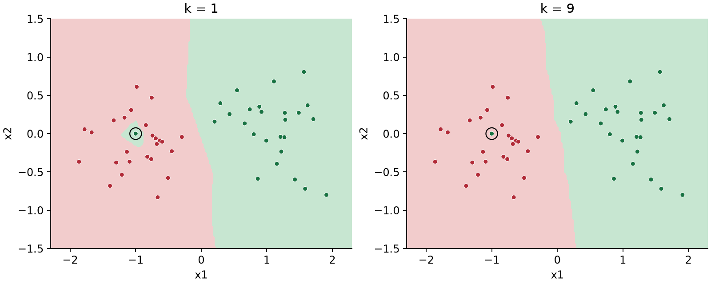

**Counterexample:** Training error minimum hone se best k choose nahi hota. Self-neighbour 1-NN data memorize kar sakta hai, but unseen noisy sample par wrong prediction still possible.

### 3.2 Self-neighbour: What is and is not guaranteed?

Training evaluation mein sample itself included ho toh distance zero hai. Distinct feature vectors ke case mein 1-NN returns its own label, giving zero training error.

For 3-NN, self vote sirf one of three hai. Two other neighbours opposite class ke hon toh training point misclassified ho sakta hai.

**Example:** Labels $0,1,1$ for self plus two closest others → prediction 1, so class-0 self wrong. However class-separated clusters mein all three same label ho sakte hain → zero training error possible.

### Q1 — Minimum errors and increasing k

**Source:** 2024 Mar 24 Quiz 2, Q1.

**Question:**

Comprehension: Consider a binary classification problem with a training dataset of 80 points, evenly distributed between two classes (40 points in each class). You decide to train a k-NN algorithm with $k=3$. Each point is considered its own neighbor during classification.
Based on the above data, answer the given subquestions.

(i) What is the minimum number of misclassifications that can occur in the training dataset when using this k-NN algorithm?

(ii) Assuming there are outliers, the decision boundary becomes smoother with increasing value of k in a k-NN algorithm (Fill in 1 for yes and 0 for no).

**Solution:**

**(i) Step 1:** Minimum possible error count zero se less nahi ho sakta.

**Step 2:** Class 0 ke 40 points ek tight cluster mein, class 1 ke 40 points far-away cluster mein imagine karo. Each point ke self plus two nearest neighbours same class ke ho sakte hain.

**Step 3:** All points correct possible, so lower bound attainable:

$$\boxed{\text{Minimum misclassifications}=0}.$$

Ye “always zero” nahi; class counts alone actual error determine nahi karte.

**(ii):** Increasing k averages more local votes, reducing isolated outlier influence and generally smoothing the boundary.

$$\boxed{1\text{ (yes)}}.$$

### Q9 — Same minimum-error idea, reversed smoothing statement

**Source:** 2024 Dec 01 Quiz 2, Q9.

**Question:**

Comprehension: Consider a binary classification problem with a training dataset of 100 points, evenly distributed between two classes (50 points in each class). You decide to train a k-NN algorithm with $k=3$. Each point is considered its own neighbor during classification.
Based on the above data, answer the given subquestions.

(i) What is the minimum number of misclassifications that can occur in the training dataset when using this k-NN algorithm?

(ii) Assuming there are outliers, the decision boundary becomes smoother with decreasing value of k in a k-NN algorithm.

(a) True

(b) False

**Solution:**

(i) Q1(i) ka same separated-cluster construction 50+50 points par work karta hai; full argument repeat karne ki need nahi. **Answer: $\boxed{0}$.**

(ii) Yahan **decreasing** k likha hai. Smaller neighbourhood local noise ko more influence deti hai; smoother boundary ka usual direction increasing k hai. **Answer: $\boxed{\text{(b) False}}$.**

### Q24 — Bias and variance versus k

**Source:** 2026 Sep 13 ET, Q24.

**Question:**

Identify the correct relationship(s) between bias, variance, and the hyperparameter k in the k-Nearest Neighbours algorithm. (MSQ)

(a) Increasing k leads to an increase in bias.

(b) Decreasing k leads to an increase in bias.

(c) Increasing k leads to an increase in variance.

(d) Decreasing k leads to an increase in variance.

**Solution:** Large k smooths over local structure → higher bias, lower variance. Small k adapts closely to sample-specific structure → lower bias, higher variance.

So (a) true, (b) false, (c) false, (d) true:

$$\boxed{\text{(a), (d)}}.$$

**Related questions:** Q1(ii), Q9(ii) ask the same underlying flexibility trend through decision-boundary smoothness.

### 3.3 Prediction cost and stored data

Brute-force KNN calculates $n$ distances per query, each involving $d$ features: distance work $O(nd)$. Full sorting adds $O(n\log n)$; top-k selection can avoid full sorting. Stored examples require roughly $O(nd)$ feature storage.

Trees/spatial indexes or approximate-neighbour methods may reduce how many distances are evaluated. Speedup depends on dimension/data; all KNN implementations need not scan all points every time.

### Q23 — Distance metric, stored data and prediction cost

**Source:** 2026 Aug 14 Quiz 2, Q23.

**Question:**

Which of the following statements about the K-Nearest Neighbours (KNN) algorithm are correct? (MSQ)

(a) The choice of distance metric can affect the predicted class.

(b) Once trained, KNN makes predictions without referring to the training data.

(c) Every prediction does not require computing distances from the test point to all training data.

(d) The computational cost of prediction generally increases with the size of the training dataset.

**Solution:**

- **(a) True:** Section 2.2 ka Euclidean/Manhattan example neighbour ordering change karta hai.
- **(b) False:** Prediction stored training examples aur unke labels par depend karti hai.
- **(c) Basic brute-force setting mein false:** Is course ke direct algorithm mein all training distances calculate hote hain.
- **(d) True:** Larger dataset generally more search work/storage require karta hai.

$$\boxed{\text{Paper's intended answer: (a), (d)}}.$$

**Wording care:** (c) universally false statement nahi hai. Indexed KNN can skip many distance evaluations; agar all implementations consider karein, “all distances are not always required” valid hai. Answer key brute-force algorithm assume karti hai.

---

## 4. Validation and geometric KNN questions

### 4.1 Leave-one-out cross-validation (LOOCV)

**Short definition:** Ek point hold out karo, remaining $n-1$ points par train/store karke held-out point predict karo. Har point ke liye repeat.

$$\boxed{\operatorname{LOOCV\ error}=\frac1n\sum_{i=1}^n\mathbf1[h_{D\setminus\{i\}}(x_i)\ne y_i]}.$$

**Real life:** Student ka answer hide karke baaki examples se predict karna. Hidden answer ko nearest neighbour bana dena unfair shortcut hoga.

**Critical distinction:** Training-error questions explicitly self include kar sakte hain; LOOCV mein held-out point **exclude** hota hai. Same dataset aur k ke liye these errors different ho sakte hain.

### Q13 — Test prediction, LOOCV and changing labels

**Source:** 2025 Mar 16 Quiz 2, Q13.

**Question:**

Comprehension: Consider the following 2D data points along with their labels:

| $x$ | $[1,1]^T$ | $[1,-1]^T$ | $[2,1]^T$ | $[2,2]^T$ | $[2,-2]^T$ | $[3,-3]^T$ | $[4,-1]^T$ |
|---|---:|---:|---:|---:|---:|---:|---:|
| $y$ | 1 | 1 | 1 | 1 | 0 | 0 | 1 |

Based on the above data, answer the given subquestions.

(i) If we use a k-NN algorithm with $k=3$, what would be the predicted label for $x_{\mathrm{test}}=[4,0]^T$?

(ii) Compute the Leave-one-out cross validation (LOOCV) error for the 3-nearest neighbour (3-NN) algorithm on this dataset. Enter the answer correct to two decimal places.

(iii) Is it possible to reduce the cross-validation error obtained in the previous question by changing the label of certain points?

(a) Yes

(b) No

(c) Cannot conclude from the given information

**Solution — (i): Test prediction**

Name the listed points $P_1,\ldots,P_7$ in that order.

| Point | Squared distance to $(4,0)$ | Label |
|---|---:|---:|
| $P_1=(1,1)$ | 10 | 1 |
| $P_2=(1,-1)$ | 10 | 1 |
| $P_3=(2,1)$ | 5 | 1 |
| $P_4=(2,2)$ | 8 | 1 |
| $P_5=(2,-2)$ | 8 | 0 |
| $P_6=(3,-3)$ | 10 | 0 |
| $P_7=(4,-1)$ | 1 | 1 |

First two neighbours $P_7,P_3$ both label 1. Third distance 8 par $P_4$ or $P_5$ tie hai. Either choice leaves at least two class-1 votes.

$$\boxed{\hat y=1}.$$

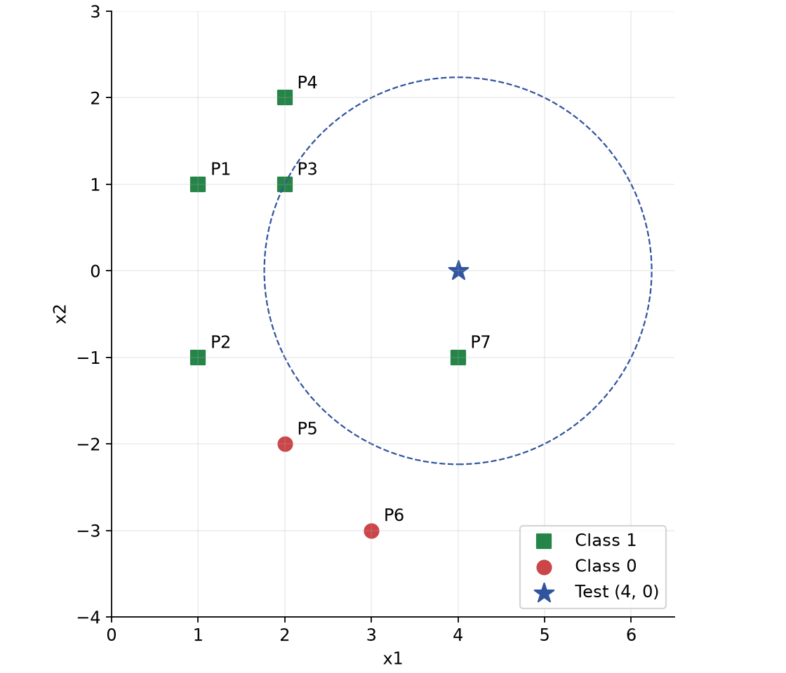

**Solution — (ii): Each held-out point ko remove karo**

Each row below mein displayed distances **squared** hain. Neighbour labels listed order mein hain.

| Held out | Three nearest remaining points | Their $d^2$ | Labels | Prediction | True | Error |
|---|---|---|---|---:|---:|---:|
| $P_1$ | $P_3,P_4,P_2$ | $1,2,4$ | $1,1,1$ | 1 | 1 | 0 |
| $P_2$ | $P_5,P_1,P_3$ | $2,4,5$ | $0,1,1$ | 1 | 1 | 0 |
| $P_3$ | $P_1,P_4,P_2$ | $1,1,5$ | $1,1,1$ | 1 | 1 | 0 |
| $P_4$ | $P_3,P_1,P_2$ | $1,2,10$ | $1,1,1$ | 1 | 1 | 0 |
| $P_5$ | $P_2,P_6,P_7$ | $2,2,5$ | $1,0,1$ | 1 | 0 | 1 |
| $P_6$ | $P_5,P_7,P_2$ | $2,5,8$ | $0,1,1$ | 1 | 0 | 1 |
| $P_7$ | $P_5,P_6,P_3$ | $5,5,8$ | $0,0,1$ | 0 | 1 | 1 |

**Ek row ko detail mein:** $P_5=(2,-2)$ hold out ho toh $P_2$ distance-square 2, $P_6$ 2, $P_7$ 5. Their labels $1,0,1$ majority 1, but true $P_5$ label 0 → error.

Total wrong folds $3$ out of $7$:

$$\boxed{\operatorname{LOOCV}=\frac37\approx0.43}.$$

**Solution — (iii): Construct one relabeling**

$P_5,P_6$ ke labels 0 se 1 change kar do. Ab all seven labels 1 hain; every held-out prediction 1 aur held-out target bhi 1. LOOCV error becomes 0, so mathematically reduction possible.

$$\boxed{\text{(a) Yes}}.$$

Ye hypothetical dataset modification ka answer hai; actual validation improve dikhane ke liye genuine labels change karna valid model-selection procedure nahi.

### 4.2 Adding a point: Distance rank matters

New point ka angle se zyada query se distance important hai. New sample top-k mein enter kare toh existing farthest selected neighbour displace hota hai. Vote count dobara evaluate karo.

### Q18 — Region where an added positive point preserves prediction

**Source:** 2026 Aug 14 Quiz 2, Q18.

**Question:**

Consider a training dataset for a classification problem with four data-points. Red circles represent data-points with label −1 and green squares represent data-points with label +1. A test-point is located at (0, 0). Dotted circles centered at (0, 0) with radii 1, 2, 3 and 4 are drawn for your convenience.

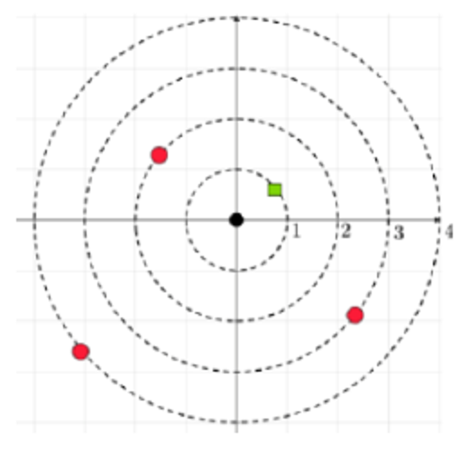

KNN with Euclidean distance and $k=3$ is the classifier. Now, a new training data-point with label +1 is added somewhere inside the outermost circle of radius 4 such that it leaves the predicted label of the test data-point unchanged. Let S be the set of all points that could be the potential location of this new training data-point. Find the area of the region corresponding to S.

Note: We use KNN with $k=3$ for both datasets.

(a) $7\pi$

(b) $5\pi$

(c) $16\pi$

(d) $9\pi$

**Solution:**

**Step 1:** Supplied graph mein increasing radii 1, 2, 3, 4 par labels $+1,-1,-1,-1$ hain. Current nearest three votes $+,-,-$ → predicted $-1$.

**Step 2:** New positive point ka radius $r<3$ ho toh nearest three mein new positive, old positive aur one negative honge. Majority flips to $+1$.

**Step 3:** $3<r<4$ ho toh pehle ke nearest three unchanged: $+,-,-$. Prediction stays $-1$.

**Step 4:** Allowed region is outer annulus:

$$\operatorname{Area}(S)=\pi(4^2)-\pi(3^2)=\pi(16-9)=\boxed{7\pi}.$$

**Answer: (a).** At $r=3$, neighbour tie rule decide karega boundary include hai ya nahi. Circle boundary ka area zero hai, so requested area unaffected.

---

## 5. Decision tree: Feature questions se partition

### 5.1 Root, internal nodes and leaves

**Short definition:** Decision tree recursively feature-based questions poochti hai aur final leaf par prediction deti hai.

**Real life:** Loan screening: “income above threshold?” phir “existing debt below threshold?” Har answer next question decide karta hai.

- **Root:** First question, all training examples start here.
- **Internal node:** Test/split, for example $x_1\le2$.
- **Branches:** Yes/no outcomes.
- **Leaf:** Final class; usually majority label of training samples reaching it.

Regression tree leaf mein often mean target predict hota hai. Classification tree mein class proportions probability estimates bhi de sakte hain.

### 5.2 Axis-aligned split and valid thresholds

Question $f_j\le\theta$ divides current node's data:

$$D_{\mathrm{yes}}=\{(x,y)\in D:x_j\le\theta\},\quad D_{\mathrm{no}}=\{(x,y)\in D:x_j>\theta\}.$$

In 2D, one-coordinate test vertical/horizontal boundary banata hai. Child split **sirf us child ke region mein** apply hota hai, entire feature space mein nahi.

**Counterexample to “both children always nonempty”:** Values $1,2,3$ par test $x\le10$ gives all yes, no empty. Useful numerical candidates often sorted distinct feature values ke consecutive midpoints se milte hain. Distinct values $1,3,8$ → thresholds 2 and 5.5 give different nonempty partitions.

Categorical questions like “city in {A,B}?” bhi possible hain; implementation suitable encoding/native categorical support require kar sakti hai.

### 5.3 Depth, complexity and stopping

$$\boxed{\text{Depth}=\text{maximum number of edges on any root-to-leaf path}}.$$

Stump has depth 1; root-only leaf depth 0. Number of internal splits across entire tree aur depth same nahi.

- Very shallow tree: Simple, often high bias/underfitting.
- Deep unrestricted tree: Flexible, can overfit, high variance.
- Max depth, minimum leaf size and pruning control complexity; validate hyperparameters.
- Pure node, no valid useful partition, depth/size limit etc. par stop kar sakte hain.

**Zero-gain caveat:** Sometimes one zero-gain split enables useful child splits, as in XOR. Algorithm “IG must be strictly positive” rule use kare toh aisi structure miss ho sakti hai.

**Advantages:** Small trees interpretable; nonlinear axis-aligned regions possible. **Limits:** Deep trees unstable; a small data perturbation can change early splits and entire structure. Trees universally weak predictors nahi—capacity chosen complexity par depend karti hai.

### Q4 — Which models can memorize the training data?

**Source:** 2024 Aug 04 Quiz 2, Q4.

**Question:**

Which of the following classifiers are certainly capable of achieving zero training error for any binary classification problem with features in $\mathbb R^2$? Note: while computing the training error for KNN, each data-point is its own neighbor. (MSQ)

(a) Decision tree

(b) KNN with $k=1$

(c) KNN with $k=5$

(d) Naive Bayes

**Solution:**

1. **Decision tree:** Sufficient depth aur distinct feature vectors hon toh successive coordinate thresholds finite training samples ko separate karke pure leaves bana sakte hain.
2. **1-NN:** Each distinct point ka closest point itself, so own label returned.
3. **5-NN:** Self one vote only. Four nearby opposite-class samples majority flip kar sakte hain.
4. **Naive Bayes:** Model assumptions arbitrary labels memorize karne ki guarantee nahi deti.

$$\boxed{\text{Intended answer: (a), (b)}}.$$

**Necessary assumption:** Same exact feature vector ke contradictory labels nahi hone chahiye. Counterexample: $(0,0)$ twice, labels 0 and 1. Deterministic feature-only classifier ek input par both labels return nahi kar sakta. Isliye “any” ko literally contradictory datasets tak extend karne par guarantee false hai. Tree ki representational capacity aur a specific greedy learner ki success bhi separate baatein hain.

### Q17 — Tree depth, feature order and instability

**Source:** 2025 Aug 31 ET, Q17.

**Question:**

Which of the following statements are true about the decision tree algorithm? (MSQ)

(a) Decision trees are prone to overfitting if the maximum depth is set too shallow.

(b) Decision trees are not affected by the order of features in the dataset.

(c) Decision trees are sensitive to small perturbations in the dataset and can result in different tree structures.

(d) Decision trees can handle both numerical and categorical features.

**Solution:**

- **(a) False:** Too shallow generally underfits; unrestricted depth promotes overfitting.
- **(b) Needs a tie-handling assumption:** A unique best split evaluated over all features is invariant to feature-column order. But equal-gain ties resolved by “first feature encountered” can change selected feature and tree structure when columns reorder.
- **(c) True:** Small changes can switch best split; downstream partitions then change.
- **(d) True:** Numerical thresholds and categorical membership tests are possible, with suitable implementation/encoding.

$$\boxed{\text{Paper answer: (c), (d)}}.$$

**Counterexample for absolute (b):** Two equally informative features tie at root. First-column tie-breaking picks whichever appears first. Order can affect that implementation; feature order is not inherently a mathematical predictor property.

---

## 6. Entropy: Node kitna mixed hai?

### 6.1 Definition and binary formula

**Short definition:** Entropy node ke class-label uncertainty/impurity ko measure karti hai.

**Real life:** Bag mein all red balls hon toh next color predictable hai; half red/half blue ho toh maximum uncertainty.

Positive-class fraction:

$$p=\frac{n_+}{n_++n_-}.$$

With base-2 logarithms:

$$\boxed{H(p)=-p\log_2p-(1-p)\log_2(1-p)}.$$

Convention $0\log_2 0=0$ use karte hain. Entropy unit bits hai. Multiple classes ke liye $H=-\sum_c p_c\log_2p_c$.

### 6.2 Properties and counterexamples

- Pure node: $p=0$ or 1 → entropy 0.
- Balanced binary node: $p=0.5$ → entropy 1, maximum.
- Symmetry: $H(p)=H(1-p)$.
- Binary entropy $0\le H\le1$; multiclass maximum $\log_2 C$ ho sakta hai.
- Absolute count nahi, proportions determine entropy. 1 positive + 1 negative aur 100 + 100 dono entropy 1.

**Counterexample to monotonic impurity:** $p:0\to0.5\to1$ gives entropy $0\to1\to0$. Increasing positive fraction always impurity increase/decrease nahi karta.

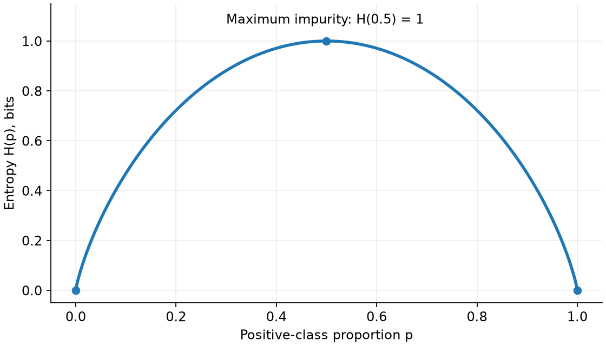

### Q10 — Entropy from 60% and 40%

**Source:** 2024 Dec 01 Quiz 2, Q10.

**Question:**

Comprehension: Consider a binary classification problem in which a decision tree is classifying data points into two classes, A and B. In a particular node of the tree, 60% of the data points belong to class A, while the remaining 40% belong to class B.
Based on the above data, answer the given subquestions.

(i) Do you have enough information to find the entropy of this node?

(a) Yes

(b) No

(ii) If the answer to the previous question is “Yes,” calculate the entropy of this node to three decimal places. If the answer to the previous question is “No,” enter −1 as your answer.

**Solution:**

(i) Yes: Class proportions known hain, total sample count required nahi. $\boxed{\text{(a)}}$.

(ii) Use $p=0.6$, $1-p=0.4$:

$$H=-0.6\log_2(0.6)-0.4\log_2(0.4).$$

$$\log_2(0.6)\approx-0.736966,\quad\log_2(0.4)\approx-1.321928.$$

$$H\approx0.442180+0.528771=0.970951.$$

$$\boxed{H=0.971\text{ bits}}.$$

### Q11 — Where is impurity maximum?

**Source:** 2025 Mar 16 Quiz 2, Q11.

**Question:**

p is the proportion of points with label 1 in some node in a decision tree. Which of the following statements are true?

(a) As the value of p increases from 0 to 1, the impurity of the node increases.

(b) As the value of p increases from 0 to 1, the impurity of the node decreases.

(c) The impurity of the node does not depend on p.

(d) $p=0.5$ correspond to the case of maximum impurity.

**Solution:** Entropy curve first rises, then falls. It depends on p and peaks at equal proportions.

$$\boxed{\text{(d)}}.$$

### Q14 — Conditions for a pure node

**Source:** 2025 Apr 13 ET, Q14.

**Question:**

Which of the following conditions must be satisfied for a decision tree to be pure at a given node? (MSQ)

(a) The entropy of the node is maximum.

(b) The information gain at the node is negative.

(c) All samples at a node belong to the same class.

(d) The entropy of the node is 0.

**Solution:** Pure means all labels same, so $p=0$ or 1 and entropy 0. Maximum entropy means maximum mixing. Negative information gain is not purity criterion.

$$\boxed{\text{(c), (d)}}.$$

### Q22 — Equal class counts

**Source:** 2026 Aug 14 Quiz 2, Q22.

**Question:**

A node in a decision tree contains an equal number of positive and negative training examples. What is the entropy of this node?

(a) 0

(b) 0.5

(c) 1

(d) It depends on the total number of training examples.

**Solution:** Equal proportions give $p=1/2$. Since $\log_2(1/2)=-1$,

$$H=-\tfrac12(-1)-\tfrac12(-1)=\boxed{1\text{ bit; option (c)}}.$$

Same maximum-impurity property as Q11; total count doesn't change it.

---

## 7. Information gain: Best next question kaise choose karein?

### 7.1 Weighted entropy reduction

**Short definition:** Information gain (IG) split se pehle ki entropy minus split ke baad weighted average child entropy hai.

**Real life:** Sorting mixed balls into boxes useful tab hai jab resulting boxes less mixed hon. Large box ka contribution small box se more weight carry karega.

$$\boxed{IG=H(D)-\left[\frac{n_L}{n}H(D_L)+\frac{n_R}{n}H(D_R)\right]}.$$

Weights sum to 1. Equal half-half weighting tabhi valid jab children same size ke hon.

**Algorithm:** Candidate splits form karo → each split ka IG compute karo → maximum IG split choose karo → child nodes par repeat. This is greedy: local maximum gain globally best whole tree ki guarantee nahi.

### 7.2 Properties worth remembering

1. Standard empirical entropy gain for a partition satisfies $0\le IG\le H(D)$.
2. Both children pure → weighted child entropy zero → $IG=H(D)$.
3. Same class proportions in both children as parent → $IG=0$.
4. **One child more impure than parent ho sakta hai.** Restriction weighted average par hai, individual child par nahi.
5. Best entropy-based split means largest IG among compared candidates at same node. Other criteria like Gini, gain ratio or validation performance use karo toh ranking necessarily same nahi.

Gini impurity optional alternative: $G=1-\sum_c p_c^2$; binary $G=2p(1-p)$. Entropy question mein Gini substitute mat karna.

### Q8 — Information gain of a decision stump

**Source:** 2024 Dec 01 Quiz 2, Q8.

**Question:**

Consider a decision stump (parent with two children). The parent node has 200 data-points out of which 50 belong to the positive class. The left child has 100 data-points out of which 50 belong to the positive class. Find the information gain. Use $\log_2$. Enter your answer correct to three decimal places.

**Solution:**

**Step 1: Counts reconstruct karo.**

| Node | Positive | Negative | Total | Positive fraction |
|---|---:|---:|---:|---:|
| Parent | 50 | 150 | 200 | 0.25 |
| Left | 50 | 50 | 100 | 0.5 |
| Right | $50-50=0$ | $150-50=100$ | 100 | 0 |

**Step 2:** Parent entropy:

$$H_P=-0.25\log_2(0.25)-0.75\log_2(0.75)=0.811278.$$

**Step 3:** Child entropies $H_L=1$, $H_R=0$.

**Step 4:** Weighted remaining entropy:

$$H_{\mathrm{after}}=\frac{100}{200}(1)+\frac{100}{200}(0)=0.5.$$

**Step 5:**

$$\boxed{IG=0.811278-0.5=0.311278\approx0.311}.$$

**Counterexample established:** Left child entropy 1 exceeds parent entropy 0.811278, but weighted average decreases. “Every child must be purer” false hai.

### Q19 — Parent entropy, right-child entropy and gain

**Source:** 2026 Aug 14 Quiz 2, Q19.

**Question:**

Comprehension: Consider a node in a decision tree that has 5 data-points. The ith data-point is represented by a feature-label pair $(x_i,y_i)$, where $y_i\in\{-1,1\}$.

| i | $x_i$ | $y_i$ |
|---:|---:|---:|
| 1 | 4 | −1 |
| 2 | 10 | 1 |
| 3 | 13 | 1 |
| 4 | 25 | 1 |
| 5 | 38 | −1 |

Consider the split $x\le7$ at the parent node resulting in left and right child nodes. The left child node has all data points for which $x\le7$ is true. Entropy is used to determine the purity of the nodes. Recall that the formula for the entropy of a node is:

$$E(p)=-p\log_2p-(1-p)\log_2(1-p)$$

where p is the fraction of positive data-points in the node. Use at least three digits after the decimal point in all intermediate calculations. Based on the above data, answer the given subquestions.

(i) Find the entropy of the parent node. Enter your answer correct to two decimal places.

(ii) Find the entropy of the right child. Enter your answer correct to two decimal places.

(iii) Find the information gain. Enter your answer correct to two decimal places.

**Solution:**

**(i):** Parent has 3 positives, 2 negatives, so $p=3/5=0.6$. Q10 ka entropy calculation reuse karo:

$$H_P=0.970951\quad\Rightarrow\quad\boxed{0.97}.$$

**(ii):** Left has only $(4,-1)$ → pure, entropy 0. Right has $(10,+1),(13,+1),(25,+1),(38,-1)$ → $p_R=3/4$:

$$H_R=-\frac34\log_2\frac34-\frac14\log_2\frac14=0.811278.$$

$$\boxed{H_R\approx0.81}.$$

**(iii):** Child weights are $1/5$ and $4/5$, not half-half:

$$IG=0.970951-\left[\frac15(0)+\frac45(0.811278)\right].$$

$$IG=0.970951-0.649022=0.321928\quad\Rightarrow\quad\boxed{0.32}.$$

### Q12 — Choose between two candidate thresholds

**Source:** 2025 Mar 16 Quiz 2, Q12.

**Question:**

Consider the following feature (x) along with its label (y):

| x | y |
|---:|---:|
| 1 | 1 |
| −1 | 1 |
| 2 | 1 |
| −2 | 0 |
| 3 | 0 |
| 4 | 1 |

If you are provided with the following two questions, which one should you choose for the first (top) node of the decision tree?

$$Q_a:x\le-2,\qquad Q_b:x\le-1.$$

Recall: Information gain $=\operatorname{Entropy}(D)-\gamma\operatorname{Entropy}(D_{\mathrm{Yes}})-(1-\gamma)\operatorname{Entropy}(D_{\mathrm{No}})$.

Use the following values if required:
$\log_2(3/4)=-0.41$, $\log_2(4/5)=-0.32$, $\log_2(1/5)=-2.32$, $\log_2(1/4)=-2$, $\log_2(1/2)=-1$.

(a) $x\le-2$

(b) $x\le-1$

(c) Insufficient information

**Solution:**

**Step 1:** Parent same for both candidates: 4 positives, 2 negatives. Instead of computing parent twice, minimize weighted child entropy.

**Step 2: Candidate $Q_a$.**

- Yes: only $(-2,0)$, so entropy 0, weight $1/6$.
- No: remaining 5 labels $1,1,1,0,1$ → 4 positives, 1 negative.

Using supplied rounded logs:

$$H_{a,\mathrm{No}}=-\frac45(-0.32)-\frac15(-2.32)=0.256+0.464=0.72.$$

$$H_{a,\mathrm{after}}=\frac16(0)+\frac56(0.72)=0.60.$$

**Step 3: Candidate $Q_b$.**

- Yes: $(-2,0),(-1,1)$ → entropy 1, weight $2/6$.
- No: $(1,1),(2,1),(3,0),(4,1)$ → 3 positives, 1 negative, weight $4/6$.

$$H_{b,\mathrm{No}}=-\frac34(-0.41)-\frac14(-2)=0.3075+0.5=0.8075.$$

$$H_{b,\mathrm{after}}=\frac26(1)+\frac46(0.8075)=0.871667.$$

**Step 4:** $0.60<0.871667$, so $Q_a$ leaves less impurity and has more gain.

$$\boxed{\text{(a) }x\le-2}.$$

With full-precision logs, gains approximately $0.316689$ and $0.044110$; ordering same. Supplied rounded logs ke results ko full precision values ke saath mix mat karo.

### Q25 — Information-gain properties

**Source:** 2026 Sep 13 ET, Q25.

**Question:**

Which of the following statements about entropy and information gain in decision-tree learning are correct? (MSQ)

(a) If a feature splits a node into perfectly pure children, its information gain at that node equals the entropy of that node.

(b) A node whose examples all belong to a single class has entropy 0 and needs no further splitting.

(c) Information gain can be negative if a split increases impurity.

(d) After a parent node is split into child nodes, no individual child node can have entropy greater than the parent node’s entropy.

**Solution:**

- **(a) True:** Both child entropies 0 → $IG=H_P$.
- **(b) True:** Pure node already has no class uncertainty; training-label separation ke liye further split needed nahi.
- **(c) False:** Standard entropy gain from a partition of the same node's samples nonnegative hai. Negative calculation often wrong weights/counts/rounding indicate karti hai.
- **(d) False:** Q8 mein parent entropy 0.811278, left child entropy 1. Weighted average 0.5 nonetheless lower hai.

$$\boxed{\text{(a), (b)}}.$$

### Q2 — Combined KNN and decision-tree statements

**Source:** 2024 Mar 24 Quiz 2, Q2.

**Question:**

Select all true statements. (MSQ)

(a) In Decision tree, if a question $Q_1$ is “better” than question $Q_2$, then information gains for $Q_1$ is greater than information gains $Q_2$ always.

(b) The training dataset is required while predicting the label of a test-point in the k-NN algorithm.

(c) A question of the form $f_k\le\theta$ always partitions the dataset into two non-empty sets.

(d) The depth of the tree is a hyperparameter and has to be chosen using cross validation.

(e) Decision trees are prone to overfit if the maximum depth is set too low.

**Solution:**

| Option | Verdict in the question's setting | Reason |
|---|---|---|
| (a) | True | “Better” here means larger entropy-based information gain at the same node |
| (b) | True | KNN compares test point with stored training samples |
| (c) | False | Threshold outside data range can leave one child empty |
| (d) | True, intended | Maximum allowed depth is a tunable hyperparameter; cross-validation is a standard selection method |
| (e) | False | Too low maximum depth generally underfits |

$$\boxed{\text{(a), (b), (d)}}.$$

**Wording care:** (a) is not a universal claim across Gini/gain ratio/test accuracy. In (d), **max depth** is the chosen limit; actual learned depth can be smaller. Cross-validation is recommended, not the only mathematically possible way to choose it.

---

## 8. Tree geometry: Paths ko regions mein translate karo

### 8.1 Root-to-leaf path means AND of conditions

**Short definition:** Ek leaf ka region us path ke saare tests ka intersection hai.

Example: First $x_1<2$ Yes, then $x_2>1$ No → region $x_1<2$ **and** $x_2\le1$. Different leaves of same class combine with OR.

**Real life:** Eligibility “age in range AND income above limit” jaisi multiple conditions meet karke decide hoti hai. Sirf last question ka answer enough nahi.

Prediction: Root se start → exact inequality evaluate → correct branch → leaf label. Strict $<$ aur $\le$ boundary par different outcomes dete hain.

### 8.2 Uniform sampling: Probability becomes area fraction

If a point is uniform over region $R$:

$$\boxed{P(\text{class 1})=\frac{\operatorname{Area}(\text{class-1 part of }R)}{\operatorname{Area}(R)}}.$$

Disjoint leaf areas add kar sakte hain. Uniform assumption important: Nonuniform density mein same area necessarily same probability nahi.

### Q3 — Probability of class 1 in the unit square

**Source:** 2024 Apr 28 ET, Q3.

**Question:**

Consider the following decision tree for a classification problem in which all the data-points are constrained to lie in the unit square in the first quadrant. That is $0\le x_1,x_2\le1$. If a point is picked uniformly at random from the unit square, what is the probability that the decision tree predicts this point as belonging to class 1?

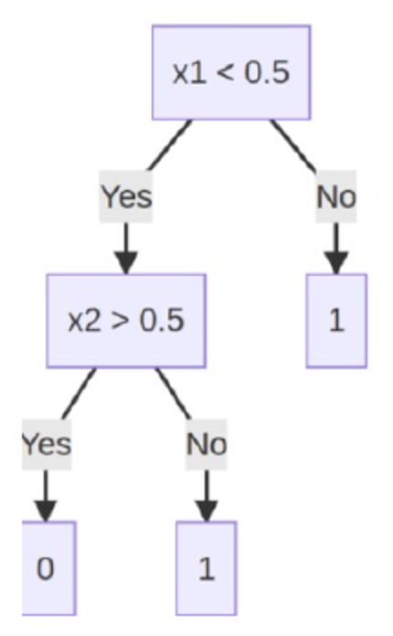

**Solution:**

**Step 1: Tree read karo.** Root question $x_1<0.5$.

- No → $x_1\ge0.5$ → class 1.
- Yes → ask $x_2>0.5$; Yes gives class 0, No gives class 1.

**Step 2: Class-1 leaves ke regions.**

$$A=\{0.5\le x_1\le1,\ 0\le x_2\le1\},$$

$$B=\{0\le x_1<0.5,\ 0\le x_2\le0.5\}.$$

**Step 3: Areas.**

$$\operatorname{Area}(A)=0.5\times1=0.5,\qquad\operatorname{Area}(B)=0.5\times0.5=0.25.$$

**Step 4:** Unit-square area 1:

$$\boxed{P(1)=\frac{0.5+0.25}{1}=0.75}.$$

**Alternative check:** Only top-left quarter class 0 hai, so $P(1)=1-0.25$. Boundary lines have area zero, so their class convention probability change nahi karti.

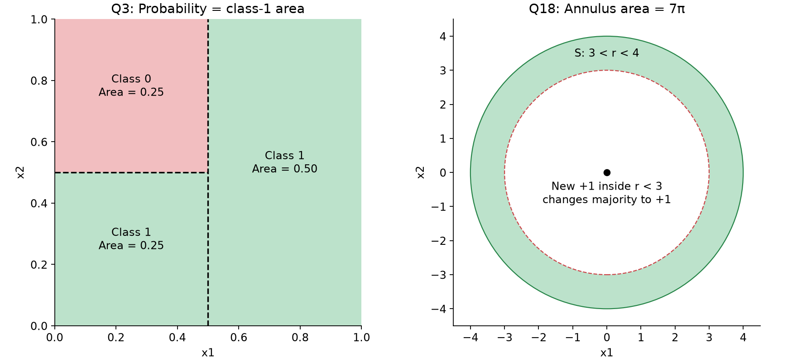

Left graph Q3 ki area decomposition dikhata hai; right graph earlier Q18 ka allowed annulus dikhata hai.

### Q6 — Integer thresholds, pure leaves and a test prediction

**Source:** 2024 Aug 04 Quiz 2, Q6.

**Question:**

Comprehension: If a and b are integers, answer the given subquestions that follow. Hint: Plotting the dataset helps.

Consider the following training dataset for a binary classification problem with the data-points in $\mathbb R^2$, the labels in the set {0, 1} and a decision tree grown from it that achieves zero training error:

$$X=\begin{bmatrix}-2&-0.9&0.9&2&-2&-0.9&0.9&2\\1&0.9&0.9&1&-1&-0.9&-0.9&-1\end{bmatrix},$$

$$y=[1\quad1\quad0\quad0\quad0\quad0\quad1\quad1]^T.$$

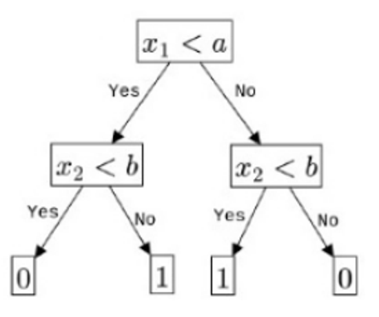

(i) What is the value of a?

(ii) What is the value of b?

(iii) Find the entropy of the root node. Use $\log_2$.

(iv) If $E_R$ is the entropy of the root and $E_L$ is the weighted entropy of all the leaves, what is $E_R-E_L$? Use $\log_2$.

(v) What is the predicted label of the test data-point $[3,-4]^T$?

**Solution — First convert columns into points**

| Region | Points | Label |
|---|---|---:|
| Top-left | $(-2,1),(-0.9,0.9)$ | 1 |
| Top-right | $(0.9,0.9),(2,1)$ | 0 |
| Bottom-left | $(-2,-1),(-0.9,-0.9)$ | 0 |
| Bottom-right | $(0.9,-0.9),(2,-1)$ | 1 |

Tree root asks $x_1<a$. Left subtree asks $x_2<b$ with Yes → 0, No → 1. Right subtree asks the same with Yes → 1, No → 0.

**(i) Find a.** Left and right feature groups separate between $-0.9$ and $0.9$. Strict $x_1<a$ requires:

$$-0.9<a\le0.9.$$

Only integer in this interval is:

$$\boxed{a=0}.$$

**(ii) Find b.** Bottom points must satisfy $x_2<b$, top points must fail it:

$$-0.9<b\le0.9\quad\Rightarrow\quad\boxed{b=0}.$$

Without integer restriction, many thresholds in these intervals work; answer uniquely 0 depends on that restriction.

**(iii) Root entropy.** Four labels 1 and four labels 0:

$$p=4/8=1/2,\qquad\boxed{E_R=1\text{ bit}}.$$

**(iv) Root-to-leaves entropy reduction.** Each final leaf contains two same-label points → entropy 0. Weighted entropy:

$$E_L=\frac28(0)+\frac28(0)+\frac28(0)+\frac28(0)=0.$$

$$\boxed{E_R-E_L=1-0=1}.$$

**Important distinction:** Root's immediate split alone has IG 0: left and right halves each contain two class-0 and two class-1 points. Final leaves after further splits are pure. Whole-tree reduction 1 aur first-split gain 0 confuse mat karo.

**(v) Test point $(3,-4)$.**

1. $3<0$? No → right subtree.
2. $-4<0$? Yes → label 1.

$$\boxed{\hat y=1}.$$

### 8.3 Reading a tree boundary locally

A vertical root split divides whole plane; next vertical/horizontal split restricted branch mein applies. Correct drawing ke liye har leaf ki condition pehle likho, then shade regions.

### Q16 — Tree boundary and prediction for (2, 2)

**Source:** 2025 Aug 03 Quiz 2, Q16.

**Question:**

Comprehension: Consider the following decision tree for a binary classification problem with two features $f_1$ and $f_2$:

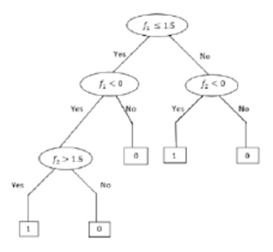

Based on the above data, answer the given subquestions.

(i) Which among the following represents the correct decision boundary for the decision tree? Note: Here + represents the label 1 and - represents the label 0.

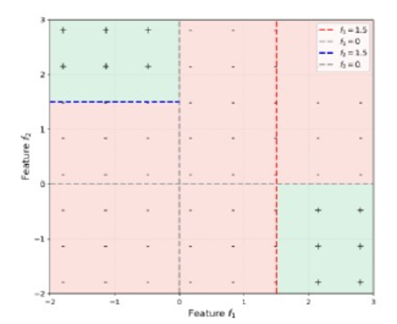

(ii) What will be the prediction for the new datapoint (2, 2)?

**Solution — (i): All class-1 paths collect karo**

Root asks $f_1\le1.5$.

**Left branch:** $f_1\le1.5$, then ask $f_1<0$.

- If No: $0\le f_1\le1.5$ → class 0.
- If Yes: $f_1<0$, then ask $f_2>1.5$.
  - Yes → class 1.
  - No → class 0.

**Right branch:** $f_1>1.5$, then ask $f_2<0$.

- Yes → class 1.
- No → class 0.

Thus class-1 region is:

$$\boxed{\{f_1<0,\ f_2>1.5\}\ \cup\ \{f_1>1.5,\ f_2<0\}}.$$

Everything else class 0. Top-left and bottom-right green regions match supplied boundary.

$$\boxed{\text{Paper's labeled answer: (b)}}.$$

**Figure availability:** Supplied compilation shows one boundary diagram and gives answer (b); other option diagrams are not present. Region calculation above independently identifies the correct geometry.

**Solution — (ii):**

1. $f_1=2\le1.5$? No → right branch.
2. $f_2=2<0$? No → leaf 0.

$$\boxed{\hat y(2,2)=0}.$$

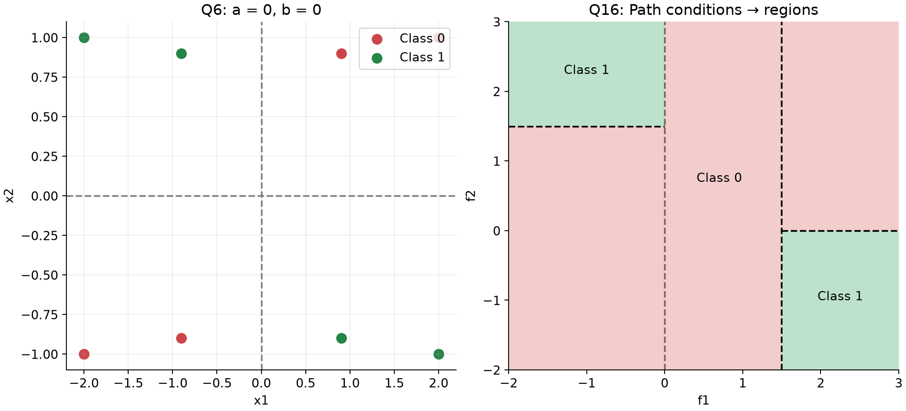

### 8.4 Box membership and depth

In $d$ dimensions, one finite axis-aligned box has lower and upper bound for each coordinate:

$$\ell_j\le x_j\le u_j,\qquad j=1,\ldots,d.$$

Interior point ko certify karne ke liye all $2d$ inequalities satisfy honi chahiye. One-feature threshold test per node se box-membership classifier construct karne par longest inside path $2d$ tests ka hota hai. Any failed test immediately outside-class leaf par exit kar sakta hai.

### Q5 — Minimum depth for a three-dimensional box

**Source:** 2024 Aug 04 Quiz 2, Q5.

**Question:**

Consider the following decision boundary obtained for a decision tree trained on a dataset in $\mathbb R^3$ for a binary classification problem. All green points (label 1) lie inside the box and the red points (label 0) are outside it. What is the minimum depth of this tree? Recall that the depth is the number of edges on the longest path from the root to a leaf.

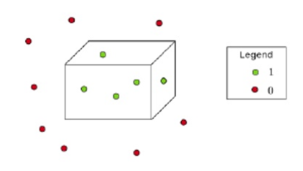

**Solution:**

**Step 1:** Box inside means:

$$\ell_1\le x_1\le u_1,\quad\ell_2\le x_2\le u_2,\quad\ell_3\le x_3\le u_3.$$

**Step 2:** Six face constraints hain: left/right, front/back, bottom/top. Ordinary axis-aligned binary node ek threshold test karta hai.

**Step 3:** Inside path can ask these six checks sequentially. Har failure class 0; all pass → class 1. So depth 6 sufficient hai.

**Step 4:** Exact finite box boundary represent karne ke liye inside leaf path ko every coordinate mein lower and upper bounds enforce karne honge; fewer than six one-coordinate tests se some direction unbounded reh jaayegi. So smaller depth cannot represent that exact box region.

$$\boxed{\text{Minimum depth}=6}.$$

**Scope:** Ye pictured **box decision region** represent karne ka answer hai. Sirf finitely many plotted samples correctly classify karne ki demand ho, exact box boundary required na ho, toh actual positions ke depending shallower tree possible ho sakti hai.

### 8.5 XOR-style quadrants: Split count versus depth

Opposite quadrants same label hone par one straight axis threshold enough nahi. Root ek coordinate ka sign separate kare, and each child doosre coordinate ka sign test kare. Four pure leaves, three internal splits, depth two.

Q6 ka checkerboard opposite-label orientation mein tha; same tree structure idea yahan bhi useful hai.

### Q21 — Four quadrants with alternating labels

**Source:** 2026 Aug 14 Quiz 2, Q21.

**Question:**

Consider a binary classification problem in $\mathbb R^2$. The feature space is partitioned into the following four regions:

$$R_1=\{(x_1,x_2)\mid x_1\ge0,x_2\ge0\},\quad R_2=\{(x_1,x_2)\mid x_1<0,x_2\ge0\},$$

$$R_3=\{(x_1,x_2)\mid x_1<0,x_2<0\},\quad R_4=\{(x_1,x_2)\mid x_1\ge0,x_2<0\}.$$

Each region contains the same number of observations. All observations in regions $R_1$ and $R_3$ belong to the positive class, while all observations in regions $R_2$ and $R_4$ belong to the negative class. A decision tree is constructed using axis-aligned binary splits of the form $x_1\le t$ or $x_2\le t$, where t is any real number. At each node, the split is chosen to maximize the information gain based on entropy. What is the minimum number of binary questions (splits) that the decision tree must ask to obtain leaf nodes with zero entropy?

(a) 3

(b) 2

(c) 4

(d) It is impossible using only axis-aligned splits.

**Solution — Intended quadrant construction:**

**Step 1:** Parent balanced hai because two equally populated quadrants positive and two negative. Entropy 1.

**Step 2:** First coordinate ke sign par split karo. Left half contains $R_2$ negative and $R_3$ positive; right half contains $R_1$ positive and $R_4$ negative. Both children balanced, entropy 1; this sign split has IG 0.

**Step 3:** Left child mein second coordinate sign test: bottom positive, top negative. Two pure leaves.

**Step 4:** Right child mein second coordinate sign test: top positive, bottom negative. Two pure leaves.

| Node | Test idea | Result |
|---|---|---|
| Root | Is $x_1$ negative? | Left/right half |
| Left child | Is $x_2$ negative? | $R_3:+$, $R_2:-$ |
| Right child | Is $x_2$ negative? | $R_4:-$, $R_1:+$ |

**Step 5:** One root split + one split in each child:

$$\boxed{\text{Total splits}=1+1+1=3\quad\text{(a)}}.$$

Each sample answers only two questions along its path, so **depth is 2**, not 3. For the full quadrant pattern, four pure quadrant regions need four leaves, and a full binary tree with four leaves has three internal nodes.

**Assumptions behind this exam answer:**

- Finite training data mein negative/nonnegative observed coordinate values ke beech threshold choose karke sign groups implement kar sakte hain; if no points on axes, threshold 0 suffices. At the continuous axes, literal $\le0$ and $<0$ differ, so equality convention must be handled separately when claiming exact regions everywhere.
- Equal quadrant counts alone don't fix within-quadrant locations. Other thresholds may have positive gain, and a greedy maximum-gain learner can choose a different root and need more splits. Therefore **3 is the intended quadrant-representation construction**, not a guarantee for every unspecified finite dataset under every greedy rule. A learner refusing zero-gain splits can also stop too early.

---

## 9. Quick revision

### 9.1 Formula sheet

| Quantity | Formula / rule |
|---|---|
| Classification error rate | Number wrong / number evaluated |
| Squared Euclidean distance | $\sum_j(x_j-z_j)^2$ |
| KNN classification | Majority label among selected k neighbours |
| KNN regression | $\frac1k\sum_{i\in N_k(x)}y_i$ |
| LOOCV | Hold out one, predict using others; total wrong / n |
| Binary entropy | $-p\log_2p-(1-p)\log_2(1-p)$ |
| Pure node | $p\in\{0,1\}$, $H=0$ |
| Maximum binary entropy | $p=0.5$, $H=1$ bit |
| Information gain | $H_P-\frac{n_L}{n}H_L-\frac{n_R}{n}H_R$ |
| Pure children | $IG=H_P$ |
| Tree depth | Longest root-to-leaf edge count |
| Full binary tree | Internal nodes = leaves − 1 |
| Uniform-region probability | Favorable area / total area |
| Annulus area | $\pi(R^2-r^2)$ |
| Exact finite d-dimensional box with axis tests | Minimum depth $2d$ |

### 9.2 Common mistakes

| Mistake | Correction |
|---|---|
| Odd k removes every possible tie | Removes binary vote ties; distance ties can remain |
| 3-NN self-neighbour guarantees zero error | Self is one vote; other two can disagree |
| Minimum possible error means actual error | Actual error needs geometry/labels; minimum is an attainable lower bound |
| Include held-out point in LOOCV | Remove it before selecting neighbours |
| KNN regression takes majority | Average numerical targets |
| Larger k always improves test accuracy | Too large k can underfit; validate |
| Tree depth equals all internal nodes | Depth counts one longest path; splits count entire tree |
| Feature threshold always makes two nonempty children | Check min/max and actual values |
| Child entropies always average half-half | Weight by child sample counts |
| Every child must have lower entropy than parent | Only weighted average is constrained; Q8 is a counterexample |
| Root IG equals total tree reduction | Q6 first split IG 0, root-to-pure-leaves reduction 1 |
| Pure means maximum entropy | Pure entropy is 0; balanced binary entropy is 1 |
| Every split line spans entire plane | Child split restricted to ancestor-defined region |
| Zero training error means good generalization | Memorization may overfit |

### 9.3 Solving checklist

1. **KNN:** Query, metric, k, self inclusion and tie rule read karo. Squared-distance table banao, neighbours choose karo, then vote/average.
2. **Validation:** Held-out samples and preprocessing fitting separate rakho. Error count ko correct denominator se divide karo.
3. **Entropy:** Positive/negative counts convert to proportions; base-2 logs use karo; pure node directly 0.
4. **IG:** Parent/child counts reconcile karo, child weights sum to 1 check karo, gain before rounding calculate karo.
5. **Tree prediction:** Root-to-leaf exact path follow karo; equality condition miss mat karo.
6. **Region questions:** Leaf conditions intersect karo; same-class leaves union karo; uniform probability ke liye disjoint areas add karo.
7. **Complexity questions:** Depth, number of splits and number of leaves clearly distinguish karo.
8. **Final answer:** Decimal places/options follow karo; ambiguous wording ke assumptions identify karo.
