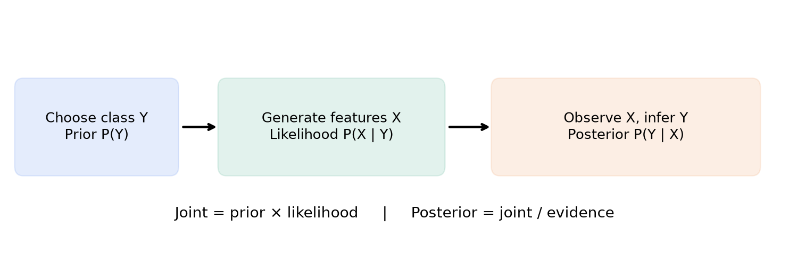
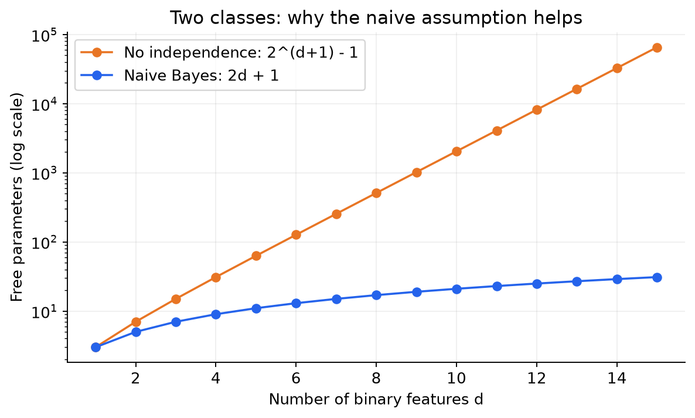
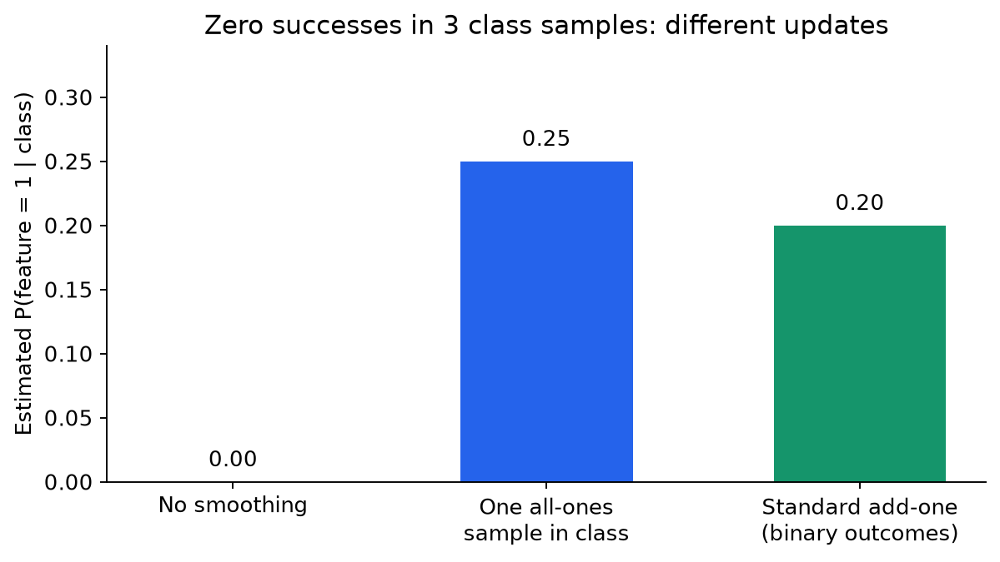
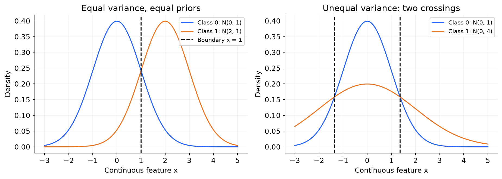
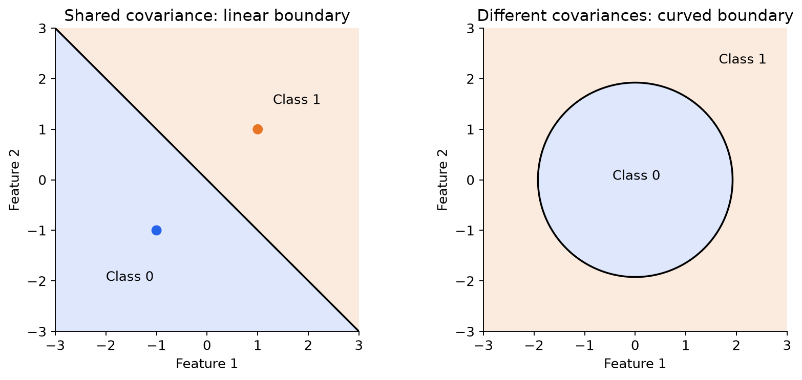

# MLT Week 8: Naive Bayes Notes

**Flow:** Model ka idea → Bayes rule → conditional independence → parameter counting → data se parameters → prediction → smoothing → decision boundary → Gaussian aur mixed features.

## Topic index

| Topic | Subtopics | Questions |
|---|---|---|
| 1. Modelling ka idea | Training/test distribution, generative vs discriminative | Q14 |
| 2. Bayes rule | Prior, likelihood, joint, evidence, posterior | Q20 |
| 3. Naive assumption | Binary representation, conditional independence, absent features | Q6, Q19 |
| 4. Parameter counting | Free vs stored, binary, categorical, no independence | Q2, Q5, Q10, Q21 |
| 5. Parameter estimation | MLE, matrix orientation, class-specific counts | Q1, Q17 |
| 6. Prediction | Complement, joint vs posterior, zero likelihood, reused dataset, categories | Q7, Q3, Q12, Q4, Q9, Q13 |
| 7. Smoothing | Zero-frequency issue, standard vs specified pseudo data | Q11, Q16, Q18 |
| 8. Bernoulli decision function | Log scores, linear boundary, limitations | Small labelled illustration |
| 9. Gaussian and mixed Naive Bayes | Density, MLE, covariance, boundaries, mixed features | Q8, Q15 |
| Added Bayes/MLE varieties | Missing priors, constant feature | Q22, Q23 |
| Added prediction varieties | Conditional likelihood, spam posterior, categorical non-memorization | Q24–Q26 |
| 10. Revision | Formula sheet, mistakes, solving checklist | — |

---

## 1. Model kya seekh raha hai?

### 1.1 Training aur test ka connection

**Definition:** Classification mein features $x$ dekhkar class label $y$ predict karte hain.

**Real life:** Email mein kaunse words hain, yeh features; email spam hai ya normal, yeh label.

Training data mein dono milte hain: $\{(x_i,y_i)\}_{i=1}^{N}$. Test time par naye $x$ ka label chahiye.

Basic modelling assumption: training aur test observations ek hi underlying distribution se aate hain, commonly independent samples maane jaate hain. Matlab test email training email ki exact copy nahi hona chahiye; unke patterns comparable hone chahiye. Agar training English emails par ho aur testing completely different language/domain par, performance guarantee nahi hai.

### 1.2 Generative model

**Short definition:** Features aur label ki **joint distribution** $P(X,Y)$ model karta hai.

Socho model email banane ki story seekhta hai:

1. Pehle class choose: spam ya non-spam, using $P(Y)$.
2. Phir us class ke hisaab se words/features generate, using $P(X\mid Y)$.

$$P(X,Y)=P(Y)P(X\mid Y).$$

Baad mein observed email se class infer karne ke liye Bayes rule lagta hai. **Naive Bayes generative hai.** Actual new emails generate karna classifier use karne ke liye zaroori nahi; joint distribution model karna defining point hai.

### 1.3 Discriminative model

**Short definition:** Directly $P(Y\mid X)$ ya decision boundary seekhta hai.

Real-life connection: “Spam email kaise banta hai?” ki jagah “Is email ko kis class mein rakhna hai?” par focus.

| Model family | Direct learning target | Examples |
|---|---|---|
| Generative | $P(Y)$ and $P(X\mid Y)$, hence $P(X,Y)$ | Naive Bayes, Gaussian discriminant models |
| Discriminative | $P(Y\mid X)$ or a decision boundary | Logistic regression; perceptron/SVM as boundary models |

**Property:** Generative classifier bhi prediction ke waqt posterior nikal sakta hai. Isse woh discriminative model nahi ban jaata; difference **kya directly model kiya** mein hai.

### 1.4 Q14 — Generative vs discriminative

**Source:** 2025 Aug 03 Quiz 2, Q14.

**Question:**

> Which among the following are true? (MSQ)
>
> (a) In generative model, we are interested in how the features are generated.
>
> (b) In discriminative model, we are interested in how the features are generated.
>
> (c) In discriminative model, we are interested in modelling $p(y\mid x)$, where $y$ is the label and $x$ is a feature.
>
> (d) In generative model, we are interested in modelling $p(y\mid x)$, where $y$ is the label and $x$ is a feature.
>
> (e) Gaussian Naive Bayes is a discriminative model.

**Step 1:** Generative model features ki class-wise generation/distribution model karta hai → **(a) true**, **(b) false**.

**Step 2:** Discriminative probability model directly $p(y\mid x)$ model kar sakta hai → **(c) true**.

**Step 3:** (d) mein intended distinction direct modelling ka hai. Generative model posterior **derive** karta hai, primary target joint distribution hai → exam interpretation mein **(d) false**.

**Step 4:** Gaussian NB bhi class-conditional distribution model karta hai → **(e) false**.

**Answer: (a), (c).** Supplied key bhi yahi hai.

**Yaad rakho:** “Posterior use karta hai” aur “posterior directly model karta hai” alag statements hain.

---

## 2. Bayes rule: Features dekhkar belief update kaise karein?

### 2.1 Five quantities, ek hi story

Email example mein:

| Quantity | Formula | Hinglish meaning |
|---|---|---|
| Prior | $P(Y=c)$ | Email dekhne se pehle class ka chance |
| Likelihood | $P(X=x\mid Y=c)$ | Class given ho toh aise features kitne likely? |
| Joint | $P(X=x,Y=c)$ | Yeh features **aur** yeh class saath mein |
| Evidence | $P(X=x)$ | Yeh features kisi bhi class se milne ka total chance |
| Posterior | $P(Y=c\mid X=x)$ | Features dekhne ke baad class ka updated chance |

$$\boxed{P(Y=c\mid X=x)=\frac{P(X=x\mid Y=c)P(Y=c)}{\sum_r P(X=x\mid Y=r)P(Y=r)}}$$

Binary classes ke liye convenient notation:

$$S_1=P(x\mid1)P(1),\qquad S_0=P(x\mid0)P(0).$$

$$P(1\mid x)=\frac{S_1}{S_0+S_1},\qquad P(0\mid x)=\frac{S_0}{S_0+S_1}.$$

### 2.2 Label vs probability: Sabse important distinction

**Sirf label poochha hai:** $S_0$ aur $S_1$ compare karo; common positive denominator cancel hota hai.

**Posterior probability poochhi hai:** Normalize zaroor karo.

**Joint probability poochhi hai:** Prior × likelihood hi answer hai; normalize nahi karna.

**Conditional feature likelihood poochhi hai:** $P(x\mid c)$ chahiye; prior multiply nahi karna.

**Counterexample:** $S_1=0.02$, $S_0=0.03$ ho toh posterior $0.02$ nahi, $0.02/0.05=0.4$ hai. Scores ka sum 1 hona zaroori nahi; posterior class probabilities ka sum 1 hona chahiye.

> Concept slides pp. 7–8 mein denominator drop karne ke baad posterior ke saath equality likhi hai. Correct relation $P(y\mid x)\propto P(x\mid y)P(y)$ hai. Equality sirf normalization ke baad.

### 2.2A Q22 — Likelihoods alone do not determine the label

**Source:** Week 8 — Solve with us, Q2.

**Question:**

A Gaussian naive Bayes model is trained on a given dataset. For an unseen data point x, the following values are calculated:

$$P(x\mid y=0)=0.4,\qquad P(x\mid y=1)=0.6.$$

What will be the predicted label for x?

(a) 0

(b) 1

(c) Insufficient information to make prediction

**Solution:**

**Step 1:** Likelihood and posterior different hain. Prediction scores $S_0=0.4\pi_0$ and $S_1=0.6\pi_1$ hain; priors given nahi hain.

**Step 2 — Counterexamples:** Equal priors par scores 0.2 and 0.3 → label 1. But $\pi_0=0.9,\pi_1=0.1$ par scores 0.36 and 0.06 → label 0. Same likelihoods, different predictions.

$$\boxed{\text{(c) Insufficient information}}.$$

**Step 3 — Exact prior threshold:** Let $q=P(y=1)$, so $P(y=0)=1-q$. Class 1 wins when

$$0.6q>0.4(1-q)\iff q>0.4.$$

At $q=0.4$ scores tie; below it class 0 wins.

**Property:** For positive likelihoods, posterior odds = likelihood ratio × prior odds:

$$\boxed{\frac{P(1\mid x)}{P(0\mid x)}=\frac{p(x\mid1)}{p(x\mid0)}\frac{P(1)}{P(0)}}.$$

Gaussian x continuous hai, so displayed likelihoods technically **density values** hain. They need not sum to 1 across classes; yahan 0.4+0.6=1 coincidence hai, posterior hone ka evidence nahi.

### 2.3 Q20 — Joint se posterior

**Source:** 2026 Aug 14 Quiz 2, Q20.

**Question:**

> A generative classifier models the joint distribution of the feature vector $X$ and the class label $Y$. For a particular email represented by the feature vector $x$, suppose $P(X=x,Y=\mathrm{Spam})=0.015$ and $P(X=x,Y=\mathrm{Not\ Spam})=0.035$. Compute the posterior probability $P(Y=\mathrm{Spam}\mid X=x)$.

**Step 1 — Given quantities identify karo.** Dono **joint** probabilities hain, priors dobara multiply nahi karne.

**Step 2 — Evidence:**

$$P(X=x)=0.015+0.035=0.050.$$

**Step 3 — Normalize:**

$$P(\mathrm{Spam}\mid x)=\frac{0.015}{0.050}=\boxed{0.3}.$$

**Check:** Non-spam posterior $0.7$; sum $1$.

**Question se property:** Class-wise joint probabilities ka sum evidence deta hai.

---

## 3. “Naive” assumption: Bade joint ko chhote products mein todna

### 3.1 Binary feature representation

**Definition:** Bernoulli feature ke sirf do values: $0$ aur $1$.

Spam example: Vocabulary `[free, meeting, prize]` ho aur email mein `free` aur `prize` present hon, toh $x=(1,0,1)$.

Yahan frequency count nahi, **presence/absence** hai. `free` ek baar aaye ya das baar, binary feature 1 hi rahega.

### 3.2 Class-conditional independence

**Short definition:** Class fix karne ke baad features ko independent assume karte hain.

$$\boxed{P(x_1,\ldots,x_d\mid Y=c)=\prod_{j=1}^{d}P(x_j\mid Y=c)}$$

Hinglish: Pehle decide karo “spam group ke andar dekh rahe hain”; phir har word ka chance separately multiply karo. **Class ko ignore karke unconditional probabilities multiply nahi karni.**

### 3.3 Conditional independence ≠ unconditional independence

**Counterexample:** Half emails spam hain. Spam mein two words independently probability $0.9$ se aate hain; non-spam mein independently $0.1$ se.

$$P(f_1=1)=P(f_2=1)=0.5.$$

Lekin:

$$P(f_1=1,f_2=1)=0.5(0.9\times0.9)+0.5(0.1\times0.1)=0.41.$$

Unconditional product $0.5\times0.5=0.25$, jo $0.41$ nahi hai. Class-wise independent hote hue bhi overall dependent ho sakte hain.

**Practical limitation:** “New” aur “York” jaise words same class ke andar bhi linked ho sakte hain. NB ka assumption imperfect ho sakta hai; phir bhi classifier useful ho sakta hai. Correct classification ka matlab posterior perfectly calibrated hai, yeh zaroori nahi.

### 3.4 Bernoulli likelihood: 0 feature ko ignore mat karna

Notation:

$$\theta_{jc}=P(f_j=1\mid Y=c),\qquad P(f_j=0\mid Y=c)=1-\theta_{jc}.$$

Single observed feature:

$$P(f_j=x_j\mid c)=\theta_{jc}^{x_j}(1-\theta_{jc})^{1-x_j}.$$

All features:

$$\boxed{P(x\mid c)=\prod_{j=1}^{d}\theta_{jc}^{x_j}(1-\theta_{jc})^{1-x_j}}.$$

**Use ka simple rule:** $x_j=1$ → $\theta_{jc}$ lo; $x_j=0$ → $1-\theta_{jc}$ lo. Har feature ka **ek matching factor**.

**Counterexample:** $x=(1,0)$ aur $\theta_{1c}=0.8,\theta_{2c}=0.9$ ho toh likelihood $0.8\times0.1=0.08$, **$0.8\times0.9$ nahi**.

### 3.5 Q6 — Assumption identify karo

**Source:** 2024 Sep 01 ET, Q6.

**Question:**

> For a dataset with features in $\mathbb R^3$, which of the following expresses the class conditional independence assumption in a Naive Bayes model? $p(\cdot)$ denotes probability.
>
> (a) $p((x_1,x_2,x_3)\mid y)=p(x_1\mid y)\cdot p(x_2\mid y)\cdot p(x_3\mid y)$
>
> (b) $p((x_1,x_2,x_3),y)=p(y)\cdot p(x_1)\cdot p(x_2)\cdot p(x_3)$
>
> (c) $p((x_1,x_2,x_3)\mid y)=\dfrac{p((x_1,x_2,x_3),y)}{p(y)}$
>
> (d) $p(y\mid(x_1,x_2,x_3))=\dfrac{p((x_1,x_2,x_3),y)}{p(x_1,x_2,x_3)}$

**Step 1:** (a) mein same class $y$ given hai aur joint likelihood feature-wise product hai → exactly required assumption.

**Step 2:** (b) class conditioning drop karta hai → NB assumption nahi.

**Step 3:** (c), (d) conditional-probability identities hain, applicable nonzero denominators ke saath. Yeh independence **assert nahi** karti.

**Answer: (a).** Continuous features ke liye isi factorization ko densities par apply karte hain.

### 3.6 Q19 — Bayes + naive assumption combine karo

**Source:** 2026 Aug 14 Quiz 2, Q19.

**Question:**

> Suppose an email is represented by a binary feature vector $X=(x_1,x_2,\ldots,x_d)\in\{0,1\}^d$. A generative classifier first chooses the class label $Y$ according to the prior distribution $P(Y)$. It then generates the feature vector $X$ conditioned on the chosen class. The classifier assumes that, given the class label, the features are conditionally independent. Which of the following expressions correctly represents $P(Y=\mathrm{Spam}\mid X=x)$?
>
> (a) $\dfrac{P(Y=\mathrm{Spam})}{P(X=x)}$
>
> (b) $\dfrac{\left(\prod_{i=1}^{d}P(x_i)\right)P(Y=\mathrm{Spam})}{P(X=x)}$
>
> (c) $\prod_{i=1}^{d}P(Y=\mathrm{Spam}\mid x_i)$
>
> (d) $\dfrac{\left(\prod_{i=1}^{d}P(x_i\mid Y=\mathrm{Spam})\right)P(Y=\mathrm{Spam})}{P(X=x)}$

**Step 1:** Posterior = likelihood × prior / evidence.

**Step 2:** Class-conditional independence se likelihood $\prod_iP(x_i\mid\mathrm{Spam})$.

**Step 3:** Substitute karne par option **(d)** milta hai.

(a) mein likelihood missing; (b) mein conditioning missing; (c) mein per-feature posteriors ka product correct Bayes expression nahi.

**Answer: (d).** Q6 jaisa assumption hai, lekin yahan complete posterior expression poochha hai; exact repeat nahi.

---

## 4. Kitne parameters seekhne hain?

### 4.1 Free parameter ka meaning

**Definition:** Jo probability independently choose karni pade, woh free parameter hai.

Coin ke liye $P(H)=p$ choose kiya toh $P(T)=1-p$ automatically mil gaya. Do probabilities store ho sakti hain, par **one free parameter**.

$C$ classes ki priors ka sum 1 hai → **$C-1$ free priors**.

### 4.2 Binary features: Naive Bayes vs full joint

$d$ binary features, $C$ classes:

| Model | Feature parameters | Prior parameters | Total free parameters |
|---|---:|---:|---:|
| Naive Bayes | $Cd$ | $C-1$ | $\boxed{Cd+C-1}$ |
| Without conditional independence | $C(2^d-1)$ | $C-1$ | $\boxed{C2^d-1}$ |

**Why these counts?** NB mein har class-feature pair ka ek Bernoulli probability chahiye. Full joint mein har class ke andar $2^d$ possible binary vectors hain; unki probabilities sum 1, so $2^d-1$ free values.

Binary class case $C=2$:

$$\text{NB: }2d+1,\qquad \text{full joint: }2^{d+1}-1.$$

**Graph ka meaning:** Orange curve combinations ke saath rapidly badhti hai. Blue curve mein har extra feature sirf do probabilities add karta hai. Yahi sample/storage savings ka main reason hai.

### 4.3 Categorical features

Feature $j$ ke $r_j$ values hon toh per class $r_j-1$ free probabilities:

$$\boxed{(C-1)+C\sum_{j=1}^{d}(r_j-1)}.$$

Sab features ke $r$ values hon toh $(C-1)+Cd(r-1)$.

**Trap:** $r$ categories ke liye $r$ free probabilities nahi; last one remaining mass hai.

### 4.4 Q2 — Five classes, three binary features

**Source:** 2024 Mar 24 Quiz 2, Q2.

**Question:**

> Suppose you have a five-class classification problem where class label $y\in\{0,1,2,3,4\}$ and each training example $x_i$ has binary features $f_1,f_2,f_3\in\{0,1\}$. How many parameters do we need to know to classify an example using Naive Bayes classifier?

**Step 1:** $C=5$, $d=3$.

**Step 2:** Feature probabilities $=5\times3=15$.

**Step 3:** Free class priors $=5-1=4$.

$$\text{Total}=15+4=\boxed{19}.$$

**Source key:** “19 to 20”. Standard **free-parameter answer 19** hai. Agar saari 5 priors explicitly store karein toh 20 entries hongi, par ek redundant hai. Numerical acceptance range ko free-parameter definition mat samajhna.

**Exact repeat:** Week 8 — Solve with us, Q1 has the same five classes and three binary features as Q2 above. Answer **19 free parameters**; same question dobara solve nahi kiya.

### 4.5 Q5 — With/without independence

**Source:** 2024 Aug 04 Quiz 2, Q5.

**Question:**

> Consider a multi-class classification problem with 3 classes and 4 features, all of which are binary. A generative model is used to model the joint distribution of the features and labels. Based on the above data, answer the given subquestions.
>
> i. Find the total number of independent (free) parameters in the model if the class conditional independence assumption is not enforced.
>
> ii. Find the total number of independent (free) parameters in the model if the class conditional independence assumption is enforced.

**Part (i), Step 1:** Four binary features → $2^4=16$ feature vectors per class.

**Step 2:** Per class 15 free likelihood probabilities; 3 classes → $45$.

**Step 3:** Add $3-1=2$ priors: $45+2=\boxed{47}$.

**Part (ii), Step 1:** Independence se har class ke liye 4 Bernoulli parameters.

**Step 2:** $3\times4=12$ likelihood parameters.

**Step 3:** $12+2=\boxed{14}$.

**Connection:** Same prediction problem, but assumption ne 47 ko 14 kar diya.

### 4.6 Q10 — General number of classes

**Source:** 2025 Mar 16 Quiz 2, Q10.

**Question:**

> Consider a $k$-class classification problem with five binary features $f_1,f_2,f_3,f_4$, and $f_5$, where $k>2$. How many parameters need to be estimated to learn a Naive Bayes classifier?
>
> (a) $5k$
>
> (b) $6k-1$
>
> (c) $(6k-1)^5$
>
> (d) $3k-3$

**Step 1:** Likelihood parameters $=5k$.

**Step 2:** Free priors $=k-1$.

**Step 3:** Total $5k+(k-1)=\boxed{6k-1}$ → **(b)**.

**Same type:** Q2, Q5(ii); numbers/symbols different hain, isliye short separate substitution diya hai.

### 4.7 Q21 — Five-valued categorical attributes

**Source:** 2026 Sep 13 ET, Q21.

**Question:**

> Given a dataset with $K$ discrete attributes, each taking exactly 5 possible values (where $K>2$), for a three-class classification task, the number of parameters to be estimated for learning a naïve Bayes classifier is:
>
> (a) $3K+2$
>
> (b) $12K+2$
>
> (c) $3\cdot2^K$
>
> (d) $K^3$

**Step 1:** Yahan $K$ **features ka count** hai, classes ka nahi. Classes $C=3$.

**Step 2:** Five values → $5-1=4$ free probabilities per class-feature pair.

**Step 3:** Feature parameters $=3\times K\times4=12K$.

**Step 4:** Priors $=3-1=2$.

**Answer: $\boxed{12K+2}$, option (b).**

---

## 5. Data se probabilities: Maximum Likelihood Estimation (MLE)

### 5.1 Counting rule

**Definition:** MLE yahan observed frequencies se probabilities estimate karta hai.

Real life: Spam group ke 100 emails mein 70 mein `free` hai → spam given ho toh `free` ki estimated probability $70/100$.

Let $N_c$ = class $c$ mein samples; $N_{jc}^{(1)}$ = us class mein feature $j$ ke ones.

$$\boxed{\hat\pi_c=\frac{N_c}{N}},\qquad \boxed{\hat\theta_{jc}=\frac{N_{jc}^{(1)}}{N_c}}.$$

Binary prior $\hat p=P(Y=1)=N_1/N$.

**Important:** Feature likelihood ka denominator **class count** hai; total dataset count nahi. $N_c=0$ ho toh unsmoothed estimate defined nahi; yahan exam datasets mein required classes present hain.

### 5.1A Q23 — A feature that is zero in every training example

**Source:** Week 8 — Solve with us, Q3.

**Question:**

A binary classification dataset contains n examples belonging to $\{0,1\}^3$ such that the first feature values for all n examples are 0. Assume no Laplacian smoothing is done. What will be the value of $\hat p_1^0$? The labels are 0 and 1.

**Solution:**

**Step 1 — Read the parameter:** $\hat p_1^0$ estimates $P(f_1=1\mid y=0)$, not $P(f_1=0\mid y=0)$.

**Step 2:** All first-feature values zero hain, so class-0 ones count bhi zero hai.

**Step 3:** Assuming class 0 has $N_0>0$ training samples:

$$\boxed{\hat p_1^0=0/N_0=0}.$$

Its complement $P(f_1=0\mid0)=1$. If class 0 absent ho, unsmoothed conditional MLE $0/0$ undefined hai; intended question assumes represented classes.

**Property:** Both classes present hon toh first-feature parameters dono 0 hain. Test feature $f_1=0$ par factor 1 in both classes, so this feature comparison ko affect nahi karta. But $f_1=1$ par both likelihoods zero ho jaati hain: posterior normalization undefined. Constant training feature ko blindly harmless samajhna wrong hai when its unseen value arrives; smoothing section explains the remedy.

### 5.2 Matrix orientation aur notation

Agar $X$ shape $(d,N)$ diya hai, **columns samples** hain aur rows features. Labels column order se match karo.

Paper ka $\hat p_j^c$ = feature $j$ equals 1, given class $c$. Is note ka $\theta_{jc}$ same quantity hai. Superscript class hai, power nahi.

### 5.3 Q1 — Columns ko samples padho

**Source:** 2024 Mar 24 Quiz 2, Q1.

**Question:**

> Consider a naive Bayes model is trained on the following data matrix $X$ of shape $(d,n)$ and corresponding label vector $y$:
>
> $$X=\begin{bmatrix}1&0&0&0\\0&1&0&1\\0&1&1&0\end{bmatrix},\qquad y=[1\ 0\ 1\ 1]^T.$$
>
> Assume that $\hat p$ and $\hat p_j^{y_i}$ are estimates for $P(y=1)$ and $P(f_j=1\mid y=y_i)$, respectively. Here, $f_i;\ i=1,2,3$ is the $i$th feature. These parameters are estimated using MLE. Based on the above data, answer the given subquestions.
>
> i. Calculate the value of $\hat p_2^1$.
>
> ii. Calculate the value of $\hat p_1^1$.

**Step 1 — Columns unfold karo:**

| Sample | $f_1$ | $f_2$ | $f_3$ | $y$ |
|---|---:|---:|---:|---:|
| 1 | 1 | 0 | 0 | 1 |
| 2 | 0 | 1 | 1 | 0 |
| 3 | 0 | 0 | 1 | 1 |
| 4 | 0 | 1 | 0 | 1 |

**Step 2:** Class 1 samples = 1, 3, 4. Denominator $N_1=3$.

**Step 3, part (i):** In samples 1, 3, 4, feature 2 values $0,0,1$ → one success:

$$\hat p_2^1=\frac13=\boxed{0.3333\ldots}.$$

**Step 4, part (ii):** Feature 1 values $1,0,0$ → one success:

$$\hat p_1^1=\frac13=\boxed{0.3333\ldots}.$$

**Question se trap:** Answer $1/4$ nahi, kyunki class 0 sample denominator mein nahi aayega.

### 5.4 Q17 — Same counting skill, new dataset

**Source:** 2025 Dec 18 ET, Q17.

**Question:**

> Consider a naive Bayes classification problem with three binary features $f_1,f_2,f_3$ for a binary classification problem. You are given the following 8 training samples:

| Sample | $f_1$ | $f_2$ | $f_3$ | $y$ |
|---|---:|---:|---:|---:|
| $x_1$ | 0 | 1 | 0 | 0 |
| $x_2$ | 1 | 1 | 0 | 0 |
| $x_3$ | 1 | 1 | 1 | 1 |
| $x_4$ | 1 | 0 | 0 | 1 |
| $x_5$ | 1 | 0 | 1 | 0 |
| $x_6$ | 0 | 1 | 1 | 1 |
| $x_7$ | 1 | 1 | 0 | 1 |
| $x_8$ | 0 | 0 | 1 | 0 |

> Compute the Naive Bayes parameter estimate $\hat p(f_2=1\mid y=1)$ (without Laplace smoothing). Enter your answer correct to two decimal places.

**Step 1:** Class 1 rows $x_3,x_4,x_6,x_7$ → 4 samples.

**Step 2:** Feature 2 values $1,0,1,1$ → 3 ones.

**Step 3:** $\hat p(f_2=1\mid y=1)=3/4=\boxed{0.75}$.

**Same type:** Q1; yahan matrix orientation ka issue nahi, direct table hai.

---

## 6. Parameters se prediction: Ab poora pipeline

### 6.1 Fixed solving recipe

1. Identify karo: **label**, **joint**, **likelihood** ya **posterior** poochha hai?
2. Class priors aur class-wise feature probabilities nikalo/read karo.
3. Test feature 0 ho toh complement lo; 1 ho toh direct parameter.
4. Har class ki likelihood multiply karo.
5. Prior multiply karke $S_c$ banao.
6. Label ke liye biggest score; posterior ke liye score/sum.

Tie ho toh question ka convention use karo. Slides mein strict `>` aur `≥` dono conventions aaye hain; universal tie label assume mat karo. Is paper ke solved predictions mein tie nahi hai.

### 6.2 Q7 — Given estimates, complement aur label

**Source:** 2024 Dec 01 Quiz 2, Q7.

**Question:**

> Based on the above data, answer the given subquestions.
> A binary classification dataset has 2000 data points belonging to $\{0,1\}^2$. A Naive Bayes algorithm was run on the same dataset, resulting in the following estimates:
>
> $\hat p$, estimate for $P(y=1)=0.4$
>
> $\hat p_1^0$, estimate for $P(f_1=1\mid y=0)=0.25$
>
> $\hat p_2^0$, estimate for $P(f_2=1\mid y=0)=0.35$
>
> $\hat p_1^1$, estimate for $P(f_1=1\mid y=1)=0.15$
>
> $\hat p_2^1$, estimate for $P(f_2=1\mid y=1)=0.05$
>
> i. What is the estimated value of $P(f_2=0\mid y=1)$? Write your answer correct to two decimal places.
>
> ii. What will be the predicted label for the data point $[1,0]$?

**Part (i):** Binary outcomes exhaustive hain:

$$P(f_2=0\mid1)=1-0.05=\boxed{0.95}.$$

**Part (ii), Step 1:** Priors $P(1)=0.4$, $P(0)=0.6$.

**Step 2:** $x=(1,0)$, so feature 1 direct, feature 2 complement:

$$S_1=0.4\times0.15\times(1-0.05)=0.057.$$

$$S_0=0.6\times0.25\times(1-0.35)=0.0975.$$

**Step 3:** $S_0>S_1$ → **predicted label $\boxed{0}$**.

**Useful check, not required by question:** $P(1\mid x)=0.057/0.1545\approx0.3689$.

**Property:** 2000 count ko dobara use karna zaroori nahi, kyunki estimates already given hain.

### 6.3 Q3 — A zero likelihood factor

**Source:** 2024 Apr 28 ET, Q3.

**Question:**

> Consider the following dataset with 6 samples along with the corresponding labels. Each sample has three binary features $f_1,f_2$ and $f_3$.

| sample | $f_1$ | $f_2$ | $f_3$ | $y$ |
|---|---:|---:|---:|---:|
| $x_1$ | 1 | 1 | 0 | 1 |
| $x_2$ | 0 | 1 | 0 | 1 |
| $x_3$ | 1 | 1 | 1 | 0 |
| $x_4$ | 0 | 1 | 1 | 0 |
| $x_5$ | 1 | 0 | 1 | 0 |
| $x_6$ | 1 | 1 | 1 | 1 |

> Assume that the features are conditionally independent given the label $y$. Suppose the test sample is $x_{\mathrm{test}}=[0,1,0]^T$. What is the estimated probability that the test point belongs to class 0 (that is, $p(y=0\mid x_{\mathrm{test}})$)?

**Step 1:** Three samples in each class → both priors $1/2$. Smoothing specified nahi, ordinary MLE use kar rahe hain, supplied key ke consistent.

**Step 2 — Class 0:** Rows 3,4,5. For test values $(0,1,0)$:

$$P(f_1=0\mid0)=\frac13,\quad P(f_2=1\mid0)=\frac23,\quad P(f_3=0\mid0)=0.$$

$$S_0=\frac12\times\frac13\times\frac23\times0=0.$$

**Step 3 — Class 1:** Rows 1,2,6:

$$P(f_1=0\mid1)=\frac13,\quad P(f_2=1\mid1)=1,\quad P(f_3=0\mid1)=\frac23.$$

$$S_1=\frac12\times\frac13\times1\times\frac23=\frac19.$$

**Step 4 — Asked posterior:**

$$P(0\mid x)=\frac{0}{0+1/9}=\boxed{0}.$$

**Property:** Ek zero factor poori class likelihood zero kar deta hai. Lekin doosri class ka positive score check karo; dono zero ho toh $0/0$ hoga, posterior 0 nahi.

**Related matrix variant:** Week 8 — Solve with us, Q4 gives

$$X=\begin{bmatrix}1&0&0&0\\0&1&0&0\\0&1&1&0\end{bmatrix},\qquad y=(1,0,1,0)^T.$$

It asks (i) $\hat p_3^0$ without smoothing, and (ii) the label of $(1,0,0)^T$. Same class-wise counting and zero-factor method as Q1/Q3 above applies:

- Class-0 columns 2,4 have feature-3 values 1,0 → $\hat p_3^0=1/2$.
- Both priors $1/2$. Class-1 feature-one parameters $(1/2,0,1/2)$; class-0 parameters $(0,1/2,1/2)$.
- At query $(1,0,0)$, $S_1=(1/2)(1/2)(1)(1/2)=1/8$ and $S_0=(1/2)(0)(1/2)(1/2)=0$ → **label 1**.
- If posterior requested, $P(1\mid x)=1$; **1/8 is the joint score**, not posterior. This dataset differs from Q1's matrix/labels, so reuse the method, not its numerical estimates.

### 6.3A Q24 — Class given: Calculate feature likelihood only

**Source:** Week 8 — Solve with us, Q5.

**Question:**

A naive Bayes model is trained on the data matrix X of shape $(d,n)$ and label vector y:

$$X=\begin{bmatrix}1&1&0\\0&1&0\end{bmatrix},\qquad y=[0,1,0]^T.$$

Let $\hat p$ and $\hat p_j^{y_i}$ estimate $P(y=1)$ and $P(f_j=1\mid y=y_i)$, respectively. Here $f_i$, $i=1,2$, is the ith feature. These parameters are estimated using MLE. If a test point has label 0, what is the probability that the point is $[0,0]^T$?

**Solution:**

**Step 1 — Identify requested conditional:** Label already given hai. Required quantity $P(x=(0,0)\mid y=0)$ hai, not $P(y=0\mid x)$.

**Step 2 — Select class-0 samples:** Columns 1 and 3: $(1,0)$ and $(0,0)$.

$$P(f_1=0\mid0)=1/2,\qquad P(f_2=0\mid0)=2/2=1.$$

**Step 3 — Multiply conditional factors:**

$$\boxed{P((0,0)\mid0)=\tfrac12\times1=0.5}.$$

**Comparison of three different questions:** Prior $P(0)=2/3$.

- Conditional feature likelihood just found: $1/2$.
- Joint $P(x=(0,0),y=0)=(1/2)(2/3)=1/3$.
- Class-1 sample $(1,1)$ gives zero likelihood for $(0,0)$, so posterior $P(0\mid(0,0))=(1/3)/(1/3+0)=1$.

Same data se answers **0.5, 1/3, 1** aa sakte hain—question mein conditioning ka direction carefully read karo.

### 6.3B Q25 — Spam posterior from two observed words

**Source:** Week 8 — Solve with us, Q6.

**Question:**

You are working on a text classification problem using a naive Bayes classifier to determine whether an email is “Spam” or “Not Spam”. You trained the model on 1000 emails: 600 Spam and 400 Not Spam. The occurrence probabilities of two words are:

| Keyword | Email class | Conditional probability |
|---|---|---:|
| Won | Spam | 0.45 |
| Won | Not Spam | 0.05 |
| Money | Spam | 0.30 |
| Money | Not Spam | 0.02 |

A new email contains both “Won” and “Money”. Use Naive Bayes to calculate the probability that the new email is classified as Spam. Assume these are the only two possible words, i.e. only two features.

**Solution:**

**Step 1 — Priors:** $P(S)=600/1000=0.6$, $P(N)=0.4$. Word-presence vector $(1,1)$ hai.

**Step 2 — Class likelihoods:** Under conditional independence:

$$P(x\mid S)=0.45(0.30)=0.135,\qquad P(x\mid N)=0.05(0.02)=0.001.$$

**Step 3 — Joint scores:**

$$S_S=0.6(0.135)=0.081,\qquad S_N=0.4(0.001)=0.0004.$$

**Step 4 — Normalize because probability is asked:**

$$\boxed{P(S\mid x)=\frac{0.081}{0.081+0.0004}=\frac{405}{407}\approx0.995086\approx99.51\%}.$$

**Step 5 — Label and check:** $P(N\mid x)=2/407\approx0.004914$, total 1. Standard maximum-posterior rule predicts **Spam**.

**Connection:** Prior odds $0.6/0.4=1.5$; likelihood ratio $0.135/0.001=135$; posterior odds $202.5$. Words ne initial preference ko strongly increase kiya. 0.081 is not the posterior. Model posterior confidence hai; deterministic classifier ka random execution probability nahi.

### 6.4 Q12 — Zero factor, different class wins

**Source:** 2025 Mar 16 Quiz 2, Q12.

**Question:**

> Consider a Naive Bayes problem with three features, $f_1,f_2$ and $f_3$ for a binary classification problem. We have a total of 6 training samples given in the table below:

| Sample | $f_1$ | $f_2$ | $f_3$ | $y$ |
|---|---:|---:|---:|---:|
| $x_1$ | 0 | 1 | 1 | 0 |
| $x_2$ | 1 | 0 | 1 | 0 |
| $x_3$ | 0 | 0 | 1 | 0 |
| $x_4$ | 0 | 0 | 0 | 1 |
| $x_5$ | 1 | 0 | 1 | 1 |
| $x_6$ | 0 | 1 | 0 | 1 |

> For $x_{\mathrm{test}}=[1\ 1\ 0]^T$, what output would Naive Bayes model predict assuming that no Laplacian smoothing has been done as part of the algorithm?

**Step 1:** Priors both $1/2$.

**Step 2 — Class 0:** $f_1=1$ count 1, $f_2=1$ count 1, $f_3=0$ count 0 among 3:

$$S_0=\frac12\times\frac13\times\frac13\times0=0.$$

**Step 3 — Class 1:** Matching counts for $(1,1,0)$ are $(1,1,2)$ among 3:

$$S_1=\frac12\times\frac13\times\frac13\times\frac23=\frac1{27}>0.$$

**Step 4:** **Predicted label $\boxed{1}$.** Same zero-factor idea as Q3, but changed dataset/question hai; exact duplicate nahi.

### 6.5 Q4 — Shared dataset ka master calculation

**Source:** 2024 Aug 04 Quiz 2, Q4. **Same dataset appears again:** 2024 Dec 22 ET, Q9; subquestions different hain.

**Question:**

> Assume that there is no smoothing. Answer the given subquestions.
> Consider the following dataset for a binary classification problem in which the features are from $\{0,1\}^3$ and the labels are from $\{0,1\}$.
>
> $$X=\begin{bmatrix}1&0&1&1&0&1&0&0\\0&1&0&1&1&0&1&1\\1&1&0&1&1&0&0&1\end{bmatrix},\qquad y=[1\ 1\ 1\ 1\ 0\ 0\ 0\ 0]^T.$$
>
> A Naive Bayes classifier is trained on this dataset. The parameters to be estimated are represented as $\hat p_i^y$, which are presented in the form of the table given below. Recall that $\hat p_i^y$ is the probability of feature $i$ taking a value 1 in class $y$:

| $i$ | $y=0$ | $y=1$ |
|---|---|---|
| 1 | $a$ | $b$ |
| 2 | $c$ | $d$ |
| 3 | $e$ | $f$ |

> i. Find the value of $c+d$.
>
> ii. Find the value of $a+c+e$.
>
> iii. Find the predicted label for the test point $[0\ 1\ 0]^T$.

**Step 1:** First four columns class 1; last four columns class 0. Both priors $1/2$.

**Step 2 — Count ones once:**

| Feature | Class 0 values (columns 5–8) | Class 1 values (columns 1–4) | Parameters |
|---|---|---|---|
| $f_1$ | $0,1,0,0$ | $1,0,1,1$ | $a=1/4,\ b=3/4$ |
| $f_2$ | $1,0,1,1$ | $0,1,0,1$ | $c=3/4,\ d=1/2$ |
| $f_3$ | $1,0,0,1$ | $1,1,0,1$ | $e=1/2,\ f=3/4$ |

**Part (i):** $c+d=3/4+1/2=\boxed{1.25}$.

**Part (ii):** $a+c+e=1/4+3/4+1/2=\boxed{1.5}$.

**Part (iii), Step 3:** $x=(0,1,0)$ means complement, direct, complement:

$$S_0=\frac12(1-a)c(1-e)=\frac12\cdot\frac34\cdot\frac34\cdot\frac12=\frac9{64}=0.140625.$$

$$S_1=\frac12(1-b)d(1-f)=\frac12\cdot\frac14\cdot\frac12\cdot\frac14=\frac1{64}=0.015625.$$

**Step 4:** $S_0>S_1$ → **label $\boxed{0}$**. As a check, posterior for class 0 $=9/10$.

### 6.6 Q9 — Same parameters reuse; changed parts solve

**Source:** 2024 Dec 22 ET, Q9.

**Question:**

> Consider the following dataset for a binary classification problem in which the features are from $\{0,1\}^3$ and the labels are from $\{0,1\}$.
>
> $$X=\begin{bmatrix}1&0&1&1&0&1&0&0\\0&1&0&1&1&0&1&1\\1&1&0&1&1&0&0&1\end{bmatrix},\qquad y=[1\ 1\ 1\ 1\ 0\ 0\ 0\ 0]^T.$$
>
> A Naive Bayes classifier is trained on this dataset. The parameters to be estimated are represented as $\hat p_i^y$, which are presented in the form of the table given below:

| $i$ | $y=0$ | $y=1$ |
|---|---|---|
| 1 | $a$ | $b$ |
| 2 | $c$ | $d$ |
| 3 | $e$ | $f$ |

> Assume that there is no smoothing. Answer the given sub-questions.
>
> i. Find the value of $a+b$.
>
> ii. Find the value of $b+d+f$.
>
> iii. Find the predicted label for the test point $[1\ 0\ 1]^T$.

**Reuse:** Section 6.5 se $(a,b,c,d,e,f)=(1/4,3/4,3/4,1/2,1/2,3/4)$. Dataset ko dobara count nahi karenge.

**Part (i):** $a+b=1/4+3/4=\boxed{1}$.

**Part (ii):** $b+d+f=3/4+1/2+3/4=\boxed{2}$.

**Part (iii), Step 1:** New test $(1,0,1)$ → direct, complement, direct:

$$S_0=\frac12a(1-c)e=\frac12\cdot\frac14\cdot\frac14\cdot\frac12=\frac1{64}.$$

$$S_1=\frac12b(1-d)f=\frac12\cdot\frac34\cdot\frac12\cdot\frac34=\frac9{64}.$$

**Step 2:** $S_1>S_0$ → **label $\boxed{1}$**.

**Counterexample/property:** Yahan $a+b=1$ aaya, par generally $P(f_1=1\mid0)+P(f_1=1\mid1)=1$ **nahi** hota. Different classes ki probabilities hain; dono $0.8$ bhi ho sakti hain. Complement rule same class ke outcomes 0/1 par lagta hai.

### 6.7 Categorical prediction: Binary se natural extension

**Definition:** Feature ke named categories ho sakte hain, jaise Outlook = Sunny/Overcast.

Formula same hai:

$$P(f_j=v\mid c)=\frac{\#\{f_j=v,Y=c\}}{N_c},\qquad S_c=\pi_c\prod_jP(f_j=x_j\mid c).$$

Har feature ki **observed category** lo. Ek categorical attribute ke saare category probabilities multiply nahi karne.

### 6.8 Q13 — Tennis posterior

**Source:** 2025 Apr 13 ET, Q13.

**Question:**

> The following dataset represents different weather conditions and the corresponding decision on whether a person chooses to play tennis:

| Day | Outlook | Temperature | Humidity | Wind | Play Tennis |
|---|---|---|---|---|---|
| 1 | Overcast | Hot | High | Weak | No |
| 2 | Sunny | Hot | High | Weak | No |
| 3 | Sunny | Hot | Low | Weak | Yes |
| 4 | Overcast | Hot | High | Weak | Yes |
| 5 | Overcast | Cool | Low | Strong | Yes |
| 6 | Sunny | Cool | High | Weak | Yes |
| 7 | Sunny | Cool | Low | Weak | No |
| 8 | Sunny | Cool | Low | Strong | No |
| 9 | Sunny | Hot | Low | Strong | Yes |
| 10 | Overcast | Hot | High | Weak | Yes |

> Using the Naïve Bayes algorithm, compute the probability that a person will play tennis (Yes) given the conditions:
>
> - Outlook = Overcast
> - Temperature = Cool
> - Humidity = High
> - Wind = Weak
>
> Enter the answer up to three decimal places.

**Step 1 — Priors:** Yes rows = 3,4,5,6,9,10 → $6/10$; No rows = 1,2,7,8 → $4/10$.

**Step 2 — Only required categories count karo:**

| Test condition | Count among Yes (6) | Count among No (4) |
|---|---:|---:|
| Overcast | 3 → $3/6$ | 1 → $1/4$ |
| Cool | 2 → $2/6$ | 2 → $2/4$ |
| High | 3 → $3/6$ | 2 → $2/4$ |
| Weak | 4 → $4/6$ | 3 → $3/4$ |

**Step 3 — Scores:**

$$S_{\mathrm{Yes}}=\frac6{10}\cdot\frac36\cdot\frac26\cdot\frac36\cdot\frac46=\frac1{30}\approx0.033333.$$

$$S_{\mathrm{No}}=\frac4{10}\cdot\frac14\cdot\frac24\cdot\frac24\cdot\frac34=\frac3{160}=0.01875.$$

**Step 4 — Probability asked, so normalize:**

$$P(\mathrm{Yes}\mid x)=\frac{1/30}{1/30+3/160}=\frac{16}{25}=\boxed{0.640}.$$

**Check:** $P(\mathrm{No}\mid x)=0.360$; predicted label Yes.

**Trap:** $0.033333$ joint score hai, final posterior nahi. Smoothing not specified, so raw class frequencies use ki hain.

---

### 6.9 Q26 — Categorical prediction can disagree with a training label

**Source:** Week 8 — Solve with us, Q7. Counting method Q13 jaisa hai; this example additionally shows that NB does not memorize training rows.

**Question:**

The following table represents 10 objects with attributes color, type and origin:

| S.No. | Color | Type | Origin | Satisfied |
|---:|---|---|---|---|
| 1 | Red | Casual | Domestic | Yes |
| 2 | Red | Casual | Domestic | No |
| 3 | Red | Formal | Domestic | Yes |
| 4 | Yellow | Casual | Domestic | No |
| 5 | Yellow | Casual | Imported | Yes |
| 6 | Yellow | Formal | Imported | No |
| 7 | Yellow | Formal | Imported | Yes |
| 8 | Yellow | Formal | Domestic | No |
| 9 | Red | Formal | Imported | No |
| 10 | Red | Casual | Imported | Yes |

Classify a new object with Color = Red, Type = Formal, Origin = Domestic using Naive Bayes.

**Solution:**

**Step 1 — Class groups:** Yes rows 1,3,5,7,10; No rows 2,4,6,8,9. Both priors $5/10=1/2$.

**Step 2 — Count the observed categories:**

| Condition | Yes count / 5 | No count / 5 |
|---|---:|---:|
| Red | 3/5 | 2/5 |
| Formal | 2/5 | 3/5 |
| Domestic | 2/5 | 3/5 |

**Step 3 — Multiply with priors:**

$$S_Y=\frac12\frac35\frac25\frac25=\frac6{125}=0.048.$$

$$S_N=\frac12\frac25\frac35\frac35=\frac9{125}=0.072.$$

**Step 4 — Compare:** $S_N>S_Y$, hence $\boxed{\text{No}}$.

Optional posterior check: $P(Y\mid x)=6/(6+9)=0.4$, $P(N\mid x)=0.6$. PDF compares likelihoods $12/125$ and $18/125$; equal priors make that valid for the label, but those are not normalized posteriors.

**New property/counterexample:** Query exactly matches row 3, whose observed label is Yes, yet NB predicts No. NB uses class-wise feature frequencies, not lookup memorization. Training error need not be zero. Rows 1/2 also have identical features but opposite labels, so no deterministic feature-only classifier can correctly label both.

**Encoding check:** Red=1, Casual=1, Domestic=1 encode karo toh query $(1,0,1)$ hai. Formal ko Casual probability ka complement use karke same result milega; category coding change karne se correctly computed model prediction change nahi hoti.

## 7. Zero-frequency problem aur smoothing

### 7.1 Problem kya hai?

**Definition:** Training class mein koi feature outcome kabhi observe nahi hua, toh MLE uski probability zero de sakta hai.

Real life: Training spam emails mein `jackpot` nahi aaya. Test spam mein aa gaya; model ek unseen word ke kaaran poora spam score zero kar sakta hai.

Q3/Q12 mein zero factor dekha. Agar **dono class scores zero** hon toh normalized posterior $0/0$ undefined hai. “Dono posterior 0” kehna galat hoga, kyunki class posteriors ka sum 1 hona chahiye.

**Present aur absent dono outcomes matter karte hain:** Agar class mein feature hamesha 1 tha, test mein 0 aane par bhi zero factor milta hai.

**Vocabulary distinction:** Known feature jiski training count zero hai, aur bilkul naya word jo feature vocabulary mein hi nahi hai, alag cases hain. Smoothing existing categories ko positive probability deta hai; new vocabulary item ke liye representation/unknown-token policy bhi chahiye.

### 7.2 Standard add-one Laplace smoothing

Binary feature ke **dono possible outcomes** mein one pseudo-count add karo:

$$\boxed{\hat\theta_{jc}=\frac{N_{jc}^{(1)}+1}{N_c+2}}.$$

$$P(f_j=0\mid c)=\frac{N_c-N_{jc}^{(1)}+1}{N_c+2}.$$

General categorical feature with $r_j$ values:

$$\boxed{P(f_j=v\mid c)=\frac{N_{jvc}+\alpha}{N_c+\alpha r_j}},\qquad\alpha=1\text{ for add-one}.$$

**Why denominator changes?** Binary feature mein total 2 pseudo-counts add hue; $r$ categories mein $r$ pseudo-counts. Class prior smoothing separate choice hai; agar specified ho toh $\hat\pi_c=(N_c+\alpha)/(N+C\alpha)$.

### 7.3 Paper ki pseudo-sample update: Isko standard formula se mix mat karna

Q16/Q18 explicitly kehte hain: **har class mein ek all-ones sample add karo**.

Tab class sample count $N_c\to N_c+1$, aur har feature ka ones count $N_{jc}^{(1)}\to N_{jc}^{(1)}+1$:

$$\boxed{\hat\theta_{jc}^{\mathrm{specified}}=\frac{N_{jc}^{(1)}+1}{N_c+1}}.$$

Yeh **standard binary add-one formula $(s+1)/(N_c+2)$ nahi** hai. Paper/slides is operation ko Laplacian/Laplace smoothing bolte hain; numerical solve mein question ka explicitly defined operation follow karo.

**Counterexample:** Three samples mein feature sab 1 hai. All-ones update $4/4=1$ deta hai; absent outcome ka chance ab bhi 0. Standard add-one $4/5$ deta hai, absent outcome $1/5$. Isliye all-ones-only update har zero-outcome problem solve nahi karta.

Graph mein smoothing se pehle ones count $0$, class size $3$ hai. Same starting data par answers $0$, $1/4$, $1/5$ hain. **Question ka operation pehle padho.**

### 7.4 Q11 — Smoothing ka purpose

**Source:** 2025 Mar 16 Quiz 2, Q11.

**Question:**

> What is the main purpose of using Laplace smoothing in Naïve Bayes?
>
> (a) To prevent numerical errors when calculating the variance of Gaussian features.
>
> (b) To ensure that unseen categorical feature values receive small but nonzero probabilities.
>
> (c) To strengthen the model’s predictions by increasing the weight of certain features.
>
> (d) To balance the likelihood values of all features before computing posterior probabilities.

**Step 1:** Problem unseen categorical outcomes ke zero counts ka hai.

**Step 2:** Pseudo-count zero ko positive estimate mein convert karta hai → **(b)**.

**Step 3:** Gaussian variance handling alag issue hai; smoothing feature importance weighting ya likelihood equalization nahi karta.

**Answer: (b).**

### 7.5 Q16 — Parameter count + specified pseudo samples

**Source:** 2025 Aug 31 ET, Q16.

**Question:**

> Consider a naive Bayes classification problem with three binary features $f_1,f_2,f_3$ for a binary classification problem. We have a total of 6 training samples given in the table below:

| Sample | $f_1$ | $f_2$ | $f_3$ | $y$ |
|---|---:|---:|---:|---:|
| $x_1$ | 1 | 1 | 0 | 0 |
| $x_2$ | 1 | 0 | 1 | 0 |
| $x_3$ | 1 | 0 | 0 | 0 |
| $x_4$ | 0 | 0 | 1 | 1 |
| $x_5$ | 0 | 0 | 0 | 1 |
| $x_6$ | 0 | 1 | 0 | 1 |

> Based on the above data, answer the given subquestions.
>
> i. How many parameters need to be estimated to make a prediction for a data point using a naive Bayes algorithm?
>
> ii. If a test point has label 1, what is the probability of $x_{\mathrm{test}}=[1\ 1\ 1]^T$? Assume that Laplacian smoothing is done, i.e., add two pseudo training examples $x_{\mathrm{pseudo}}^0=[1\ 1\ 1]^T$ for class 0 and $x_{\mathrm{pseudo}}^1=[1\ 1\ 1]^T$ for class 1. Enter the answer correct to four decimal places.

**Part (i):** Section 4 rule: $C=2,d=3$ → $(2-1)+2(3)=\boxed{7}$. One prior + six feature probabilities.

**Part (ii), Step 1 — What is asked?** Label 1 already given → $P(x=(1,1,1)\mid Y=1)$, **posterior/joint nahi**. Prior multiply nahi karna.

**Step 2 — Smoothing se pehle class 1:** Rows 4,5,6 have ones counts $(0,1,1)$, sample count 3.

**Step 3 — Add class-1 all-ones row:** Counts $(1,2,2)$, sample count 4:

$$P(f_1=1\mid1)=\frac14,\quad P(f_2=1\mid1)=\frac24,\quad P(f_3=1\mid1)=\frac24.$$

**Step 4 — Product:**

$$P((1,1,1)\mid1)=\frac14\times\frac24\times\frac24=\boxed{0.0625}.$$

**Formula trap:** Standard add-one would produce $(1/5)(2/5)(2/5)=0.032$, but **that is not the operation specified here**. Do not substitute it for this answer.

### 7.6 Q18 — Joint, augmented estimate, count

**Source:** 2026 Apr 06 Quiz 2, Q18.

**Question:**

> You are provided with a training set of 5 observations, each consisting of four binary features $X=\{X_1,X_2,X_3,X_4\}$ and a binary target label $Y\in\{0,1\}$.

| Sample ID | $X_1$ | $X_2$ | $X_3$ | $X_4$ | $Y$ |
|---|---:|---:|---:|---:|---:|
| 1 | 1 | 0 | 1 | 1 | 1 |
| 2 | 0 | 1 | 1 | 0 | 0 |
| 3 | 1 | 1 | 0 | 1 | 1 |
| 4 | 0 | 0 | 1 | 1 | 1 |
| 5 | 1 | 0 | 0 | 0 | 0 |

> Based on the above data, answer the given subquestions.
>
> i. Using the Naive Bayes assumption and the data provided, calculate the joint probability $P(X,Y=1)$ for a new test instance $X=(1,0,1,1)$. Enter your answer correct to two decimal places.
>
> ii. To address zero-probability estimates using Laplace smoothing, the dataset is augmented with two synthetic observations: one sample with all features $(X_1,X_2,X_3,X_4)=1$ and $Y=1$, and one sample with all features $(X_1,X_2,X_3,X_4)=1$ and $Y=0$. Based on the new augmented dataset of 7 samples, calculate the updated conditional probability $P(X_2=1\mid Y=1)$.
>
> iii. For the Naive Bayes model with $n$ binary features and a binary class label, how many independent parameters are required to fully specify the model?
>
> (a) 5
>
> (b) 8
>
> (c) 9
>
> (d) 10

**Part (i), Step 1 — Prior:** Class 1 rows 1,3,4 → $P(Y=1)=3/5$.

**Step 2 — Match test $(1,0,1,1)$ within these rows:**

| Required event | Matching count / class count |
|---|---:|
| $X_1=1$ | $2/3$ |
| $X_2=0$ | $2/3$ |
| $X_3=1$ | $2/3$ |
| $X_4=1$ | $3/3$ |

**Step 3 — Joint includes prior:**

$$P(X=(1,0,1,1),Y=1)=\frac35\cdot\frac23\cdot\frac23\cdot\frac23\cdot1=\frac8{45}\approx\boxed{0.18}.$$

No normalization, kyunki **joint** poochha hai. Smoothing part (ii) mein introduce hui hai; part (i) smoothing se pehle ke data se hai.

**Part (ii), Step 1:** Smoothing se pehle class 1 mein $X_2=1$ sirf row 3 → count 1.

**Step 2:** Class 1 ka all-ones synthetic row add hone par count $1+1=2$, class size $3+1=4$.

$$P(X_2=1\mid Y=1)=\frac24=\boxed{0.5}.$$

**Trap:** Denominator 7 nahi; 7 complete augmented dataset size hai, class-conditional denominator 4 hai. Agar new prior poochhte, $P(Y=1)=4/7$ hota.

**Part (iii), Step 1:** General answer for **$n$ features** is $\boxed{2n+1}$.

**Step 2:** Is comprehension mein four features diye hain, so $2(4)+1=\boxed{9}$ → **(c)**, matching supplied key.

**Source ambiguity:** Wording generic $n$ bolti hai, options numerical hain. Option (c) ko **given four-feature dataset** ke context mein select karte hain; “any $n$ ke liye 9” statement galat hai.

---

## 8. Bernoulli Naive Bayes ki decision function

### 8.1 Products ko logs mein kyun badalte hain?

**Short definition:** Log-score same class ordering ko preserve karta hai aur probability products ko sums banata hai.

Many small probabilities multiply karke computer representation mein zero ke close/underflow ho sakti hain. Log use karke stable calculation milti hai:

$$\boxed{\ell_c(x)=\log\pi_c+\sum_{j=1}^d\left[x_j\log\theta_{jc}+(1-x_j)\log(1-\theta_{jc})\right]}.$$

Biggest $\ell_c$ ka class predict karo. Positive scores ke liye log increasing hai, isliye ranking same.

**Property:** Log zero undefined/$-\infty$ issue zero-frequency se aata hai. Log transformation **smoothing ka replacement nahi**.

### 8.2 Linear decision boundary: Result, unnecessary derivation nahi

For two classes, with $0<\pi_1<1$ and $0<\theta_{jc}<1$:

$$g(x)=\log\frac{S_1(x)}{S_0(x)}=w^Tx+b.$$

$$\boxed{w_j=\log\frac{\theta_{j1}(1-\theta_{j0})}{\theta_{j0}(1-\theta_{j1})}}$$

$$\boxed{b=\log\frac{\pi_1}{\pi_0}+\sum_{j=1}^d\log\frac{1-\theta_{j1}}{1-\theta_{j0}}}.$$

$g(x)>0$ → class 1; $g(x)<0$ → class 0. Equality par tie convention chahiye. Boundary $w^Tx+b=0$ hai; generally origin se pass nahi hoti.

**Intuition:** Har feature ek vote/weight contribute karta hai; prior aur absent-feature effects intercept mein aate hain. Bernoulli NB binary points par evaluate hota hai, par score ka algebra affine-linear hai.

**Model family vs shape:** Generative model ki boundary linear ho sakti hai. “Generative” ka matlab “curved boundary” nahi.

### 8.3 Small illustration — Practice example

**Question:** “A one-feature Bernoulli Naive Bayes classifier has equal class priors, $P(f=1\mid1)=0.8$ and $P(f=1\mid0)=0.2$. Classify $f=1$ and $f=0$.”

**Step 1:** For $f=1$, $S_1=0.5(0.8)=0.4$, $S_0=0.5(0.2)=0.1$ → label 1.

**Step 2:** For $f=0$, complements use karo: $S_1=0.5(0.2)=0.1$, $S_0=0.5(0.8)=0.4$ → label 0.

**Step 3 — Linear-form check:** $w=\log16$, $b=\log(1/4)=-\log4$. Boundary $x=\log4/\log16=0.5$. Actual binary points 0 and 1 opposite sides par hain.

**Important limitation:** Agar koi estimated probability 0 ya 1 ho, finite log coefficients above valid nahi. Direct product rule still use kar sakte ho, subject to zero-score issue; smoothing finite log probabilities help karta hai.

---

## 9. Continuous features: Gaussian aur mixed Naive Bayes

### 9.1 Binary counts se continuous values tak

Ab tak word present/absent tha. Study hours = 2.7 ya height = 171.4 jaise continuous measurements ko Bernoulli formula se model nahi kar sakte.

**Definition:** Gaussian NB har feature ki **class-conditional normal density** model karta hai, with conditional independence.

$$X_j\mid Y=c\sim\mathcal N(\mu_{jc},\sigma_{jc}^2).$$

**Real life:** Pass students ke study hours ek mean ke around, fail students ke hours doosre mean ke around distributed ho sakte hain.

### 9.2 Normal density formula

$$\boxed{\phi(t;\mu,\sigma^2)=\frac1{\sqrt{2\pi\sigma^2}}\exp\left(-\frac{(t-\mu)^2}{2\sigma^2}\right)}.$$

Mean $\mu$ curve ka centre; variance $\sigma^2$ spread. $\mathcal N(\mu,\sigma^2)$ ke second argument ko yahan **variance** maana hai.

Gaussian NB likelihood:

$$P(x\mid c)\ \text{(density notation)}\ =\prod_j\phi(x_j;\mu_{jc},\sigma_{jc}^2).$$

$$S_c=\pi_c\prod_j\phi(x_j;\mu_{jc},\sigma_{jc}^2).$$

**Density vs probability:** Continuous variable ke exact point ki probability zero hoti hai; curve ki **height density** hai. Interval probability curve ke neeche area se milti hai. Density 1 se badi bhi ho sakti hai; probability nahi.

**Counterexample:** $\mathcal N(0,0.01)$ ki density at 0 approximately 3.989 hai; koi probability rule break nahi hua, total area still 1 hai.

### 9.3 Gaussian MLE: Means aur variances

Per feature, per class:

$$\hat\mu_{jc}=\frac1{N_c}\sum_{i:y_i=c}x_{ij}.$$

$$\hat\sigma_{jc}^{2}=\frac1{N_c}\sum_{i:y_i=c}(x_{ij}-\hat\mu_{jc})^2.$$

**MLE denominator $N_c$**, unbiased sample-variance denominator $N_c-1$ nahi.

Agar same feature ki variance all classes mein **shared** assume hai:

$$\hat\sigma_j^2=\frac1N\sum_i(x_{ij}-\hat\mu_{j,y_i})^2.$$

**Illustration, not PYQ:** Class 0 values $(0,2)$ and class 1 values $(2,4)$.

1. Means $\mu_0=1$, $\mu_1=3$.
2. Each class squared deviations $(1,1)$ → MLE variances both 1.
3. Shared variance $(1+1+1+1)/4=1$.

Zero estimated variance par ordinary Gaussian density divide by zero karegi; real implementation mein variance floor/regularization ya data handling needed. Isko categorical Laplace smoothing se fix nahi karte.

### 9.4 Gaussian NB vs GDA: Source terminology ko clear rakho

Concept slides “Gaussian Naive Bayes” ke under shared **full covariance** $\Sigma$ bhi introduce karti hain. Precise distinction:

| Model | Class-conditional feature structure | Covariance |
|---|---|---|
| Gaussian Naive Bayes | Independent Gaussian features given class | Diagonal covariance |
| General Gaussian discriminant analysis (GDA) | Multivariate Gaussian; features may correlate within class | May be full covariance |
| Shared-covariance Gaussian classifier | Same covariance in both classes | Linear decision boundary |
| Class-specific covariance Gaussian classifier | Different class covariances | Generally quadratic boundary |

For the shared-covariance GDA shown in slides:

$$\hat p=\frac{N_1}{N},\quad\hat\mu_c=\frac1{N_c}\sum_{i:y_i=c}x_i,$$

$$\boxed{\hat\Sigma=\frac1N\sum_{i=1}^{N}(x_i-\hat\mu_{y_i})(x_i-\hat\mu_{y_i})^T}.$$

**Important:** Deviations apni **class mean** se hain, global mean se nahi.

Full multivariate density for invertible covariance:

$$f(x;\mu_c,\Sigma_c)=\frac{\exp\left[-\frac12(x-\mu_c)^T\Sigma_c^{-1}(x-\mu_c)\right]}{(2\pi)^{d/2}|\Sigma_c|^{1/2}}.$$

Zero off-diagonal covariance in a multivariate Gaussian gives conditional independence. Full non-diagonal covariance generally naive independence satisfy nahi karti.

### 9.5 Decision boundaries: Equal vs unequal covariance

**Left graph:** $\mathcal N(0,1)$ vs $\mathcal N(2,1)$, equal priors. Density equality at $x=1$; left mein class 0, right mein class 1.

**Right graph:** $\mathcal N(0,1)$ vs $\mathcal N(0,4)$, equal priors. Narrow curve centre mein higher, broad curve tails mein higher. Crossings $x\approx\pm1.36$: unequal variances se ek threshold ke badle do thresholds aa sakte hain.

Shared invertible $\Sigma$ ke liye class-1 vs class-0 log score difference:

$$g(x)=w^Tx+b,$$

$$\boxed{w=\Sigma^{-1}(\mu_1-\mu_0)}$$

$$\boxed{b=-\frac12\mu_1^T\Sigma^{-1}\mu_1+\frac12\mu_0^T\Sigma^{-1}\mu_0+\log\frac{\pi_1}{\pi_0}}.$$

Boundary $g(x)=0$. Is formula mein $1/2$ factors aur prior ratio ki direction important hai. Supplied slide p. 14 mein Gaussian expansion ke factors/signs inconsistent hain; yahan corrected log-score formula diya hai.

For class-specific covariance, use full score:

$$\ell_c(x)=\log\pi_c-\frac12\log|\Sigma_c|-\frac12(x-\mu_c)^T\Sigma_c^{-1}(x-\mu_c).$$

Common $-d\log(2\pi)/2$ term comparison mein drop kar sakte hain. **Different covariances par determinant terms cancel nahi hote.** Quadratic terms generally remain.

**Visual setup:** Left: equal priors, means $(-1,-1)$ and $(1,1)$, both covariance $I$ → line $x_1+x_2=0$. Right: equal priors, both means $(0,0)$, class 0 covariance $I$, class 1 covariance $4I$ → circular boundary $x_1^2+x_2^2=8\log4/3$. These are conceptual illustrations, not given exam datasets.

**Counterexample to “Gaussian NB always linear”:** Right-hand case has diagonal covariances, so Gaussian NB valid hai, but variances differ → curved boundary. **Shared covariance** is the condition for the usual linear result.

### 9.6 Mixed feature types aur parameter counting

**Definition:** Same NB model mein binary feature ka Bernoulli likelihood aur continuous feature ka Gaussian density multiply kar sakte hain, conditional independence ke under.

For one binary $f_1$ and one Gaussian $f_2$:

$$\boxed{S_c=\pi_c\,\theta_{1c}^{x_1}(1-\theta_{1c})^{1-x_1}\,\phi(x_2;\mu_c,\sigma_c^2)}.$$

Binary classes, one binary + one Gaussian:

| Component | Parameters |
|---|---:|
| Class prior | 1 |
| Binary feature probabilities, one per class | 2 |
| Gaussian means, one per class | 2 |
| Variance if shared across classes | 1 |
| Total with shared variance | **6** |
| Total with separate class variances | **7** |

General Gaussian NB with $C$ classes, $d$ continuous features: class-specific means/variances → $(C-1)+2Cd$. Variances shared across classes, separately per feature → $(C-1)+Cd+d$.

### 9.7 Q8 — Mixed model count

**Source:** 2024 Dec 01 Quiz 2, Q8.

**Question:**

> Suppose you want to use a Naive Bayes classifier to predict whether a student will pass or fail an exam based on two features: the number of hours they studied and whether they attended review sessions. Assume that the features are conditionally independent given the exam outcome and that the variances of the study hours distributions are equal for both pass and fail categories.
> How many parameters are required to classify a new student using this Naive Bayes classifier?

**Modelling interpretation:** Study hours continuous Gaussian, attendance binary. Gaussian family question mein explicitly named nahi hai; supplied answer 6 Gaussian treatment ko indicate karta hai. Arbitrary continuous distributions ke liye sirf equal variance kehne se finite parameter count determine nahi hota.

**Step 1 — Prior:** $P(\mathrm{Pass})$ one; fail prior automatically $1-P(\mathrm{Pass})$.

**Step 2 — Hours:** $\mu_{\mathrm{Pass}},\mu_{\mathrm{Fail}}$ → two means; equal variance → one shared variance. Total 3.

**Step 3 — Attendance:** $P(\mathrm{Attend}=1\mid\mathrm{Pass})$ and $P(\mathrm{Attend}=1\mid\mathrm{Fail})$ → two.

**Step 4:** $1+3+2=\boxed{6}$.

**Trap:** Dono features binary maan kar $2d+1=5$ use mat karo. Feature distribution pehle identify karo.

### 9.8 Q15 — Mixed likelihood aur prediction

**Source:** 2025 Aug 03 Quiz 2, Q15.

**Question:**

> Based on the above data, answer the given subquestions.
> Consider a 2-class Naive Bayes classifier with first feature $f_1$ as binary and the second feature $f_2$ as Gaussian. Following are the information that are provided to us:
>
> Estimate of $P(Y=1)$, $\hat p=0.4$
>
> Estimate of $P(f_1=1\mid y=0)$, $\hat p_1^0=0.4$
>
> Estimate of $P(f_1=1\mid y=1)$, $\hat p_1^1=0.5$
>
> $(f_2\mid y=0)\sim\mathcal N(0,1)$
>
> $(f_2\mid y=1)\sim\mathcal N(1,1)$
>
> i. If a test point has label 0, what will be the probability that the point is $x_{\mathrm{test}}=[0\ 0]^T$? Enter the answer correct to two decimal places.
>
> ii. For $x_{\mathrm{test}}=[0\ 1.5]^T$, what output would Naive Bayes model predict?

**Part (i), Step 1 — Condition already given:** Class 0 hai, so class-conditional likelihood chahiye; prior nahi.

**Step 2 — Binary factor:**

$$P(f_1=0\mid0)=1-0.4=0.6.$$

**Step 3 — Gaussian density at 0:**

$$\phi(0;0,1)=\frac1{\sqrt{2\pi}}e^0\approx0.398942.$$

**Step 4 — Multiply:**

$$L_0(0,0)=0.6\times0.398942\approx0.239365\to\boxed{0.24}.$$

**Precision note:** Paper “probability” bolta hai; expected answer **mixed likelihood/density value** 0.24 hai. Literally continuous $f_2$ exactly zero hone ki probability 0 hoti hai. Is distinction ko ignore karke density ko interval probability mat samajhna.

**Part (ii), Step 1 — Priors:** $\pi_0=0.6$, $\pi_1=0.4$.

**Step 2 — Class 0 score:** Binary zero probability 0.6; Gaussian distance from mean $1.5-0=1.5$:

$$\phi(1.5;0,1)=\frac1{\sqrt{2\pi}}e^{-1.5^2/2}\approx0.129518.$$

$$S_0=0.6\times0.6\times0.129518\approx0.046627.$$

**Step 3 — Class 1 score:** Binary zero probability $1-0.5=0.5$; Gaussian distance $1.5-1=0.5$:

$$\phi(1.5;1,1)=\frac1{\sqrt{2\pi}}e^{-0.5^2/2}\approx0.352065.$$

$$S_1=0.4\times0.5\times0.352065\approx0.070413.$$

**Step 4:** $S_1>S_0$ → **predicted label $\boxed{1}$**.

**Optional check:** Posterior $P(1\mid x)=0.070413/(0.070413+0.046627)\approx0.6016$. Class 0 ka prior larger tha, lekin observed Gaussian value class 1 ko zyada support karta hai.

---

## 10. Revision

### 10.1 One-page formula sheet

| Task | Formula / rule |
|---|---|
| Joint | $P(x,c)=\pi_cP(x\mid c)$ |
| Posterior | $P(c\mid x)=S_c/\sum_r S_r$ |
| Label | $\arg\max_c S_c$ or $\arg\max_c\log S_c$ |
| Conditional independence | $P(x\mid c)=\prod_jP(x_j\mid c)$ |
| Bernoulli likelihood | $\prod_j\theta_{jc}^{x_j}(1-\theta_{jc})^{1-x_j}$ |
| Prior MLE | $N_c/N$ |
| Binary feature MLE | Ones in class / class size |
| Binary NB free count | $(C-1)+Cd$ |
| Full binary joint free count | $C2^d-1$ |
| Categorical NB free count | $(C-1)+C\sum_j(r_j-1)$ |
| Standard binary add-one | $(s+1)/(N_c+2)$ |
| One all-ones sample added per class | $(s+1)/(N_c+1)$ |
| General categorical smoothing | $(N_{jvc}+\alpha)/(N_c+\alpha r_j)$ |
| Gaussian density | $\exp[-(t-\mu)^2/(2\sigma^2)]/\sqrt{2\pi\sigma^2}$ |
| Gaussian mean MLE | Within-class mean |
| Gaussian variance MLE | Within-class squared deviations / $N_c$ |
| Shared variance MLE | Class-centred squared deviations summed over all data / $N$ |
| Bernoulli boundary | Affine linear, for finite log parameters |
| Gaussian shared covariance | Linear boundary |
| Gaussian different covariance | Generally quadratic boundary |

### 10.2 Exam mein common mistakes

| Galti | Sahi approach |
|---|---|
| $X$ rows ko samples maan lena | Shape $(d,N)$ ho toh columns samples |
| Conditional probability mein total $N$ denominator | Given class ka $N_c$ use karo |
| Binary test 0 ko ignore karna | $1-\theta_{jc}$ multiply karo |
| Posterior mein prior bhoolna | Likelihood × prior, then normalize |
| Joint answer ko normalize kar dena | Joint ke liye score hi answer |
| Class already given phir prior multiply karna | $P(x\mid c)$ mein prior nahi |
| $S_0=S_1=0$ ko valid posterior kehna | Evidence zero, normalization undefined |
| Har question mein $+2$ smoothing denominator | Explicit pseudo-sample instructions check karo |
| Gaussian continuous point ko probability kehna | It is a density; intervals have probability |
| MLE variance mein $N_c-1$ | MLE uses $N_c$ |
| Gaussian NB ko always linear kehna | Equal covariance/variance condition check karo |
| All generative models nonlinear maan lena | Model family aur boundary shape different ideas |
| Different class feature probabilities ko complements kehna | Complement same class ke 0/1 outcomes ka hai |
| All stored priors ko free count karna | $C$ class priors have $C-1$ degrees of freedom |

### 10.3 Last-minute solving checklist

1. **Data ka type:** Binary, categorical, continuous, ya mixed?
2. **Asked quantity:** Likelihood, joint, posterior, label, ya parameter count?
3. **Condition:** No smoothing, standard add-one, ya specified synthetic samples?
4. **Numbers:** Correct class denominator; binary zeros ke complements.
5. **Finish:** Required normalization and rounding only at the end.

**Flow yaad rakho:** Generative story se $P(Y)$ aur $P(X\mid Y)$ aate hain. Naive assumption joint likelihood ko easy product banati hai. Counts/densities se scores milte hain. Bayes rule un scores ko posterior mein convert karta hai. Smoothing unseen outcomes handle karti hai; Gaussian model continuous features handle karta hai.
