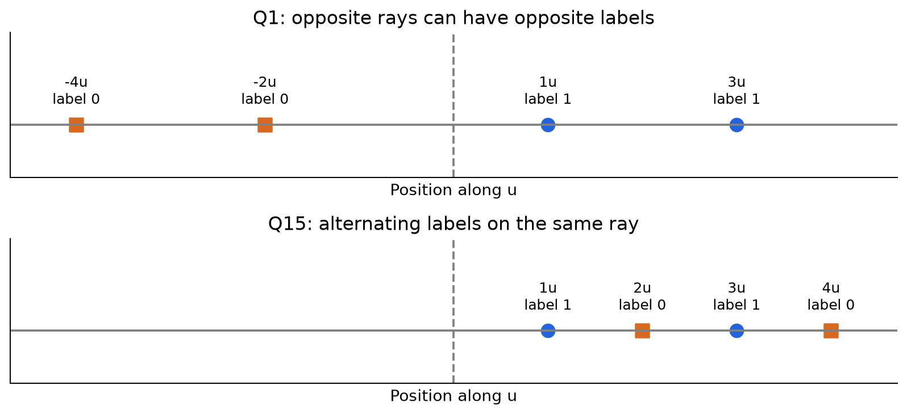
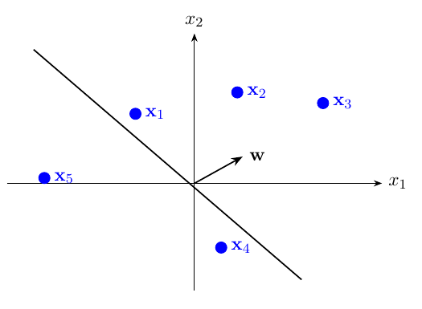
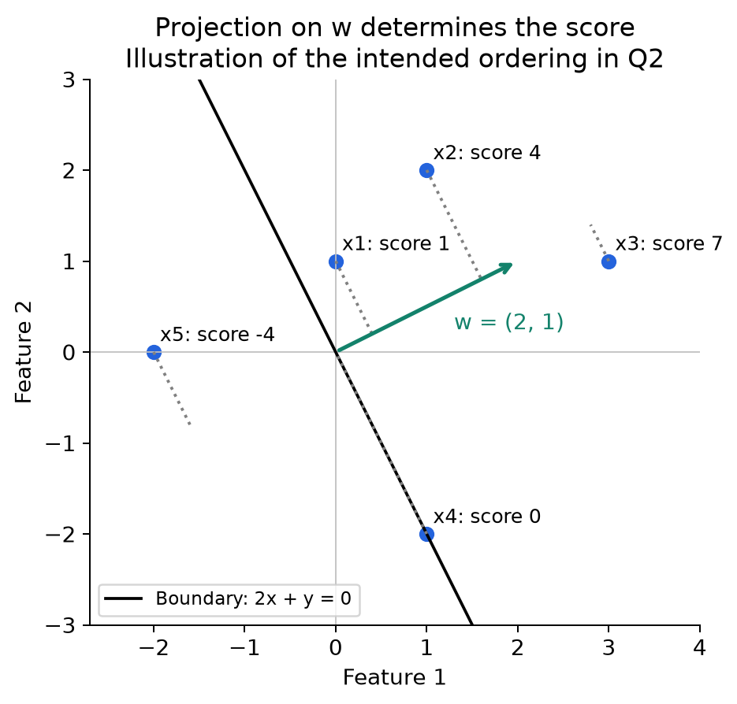
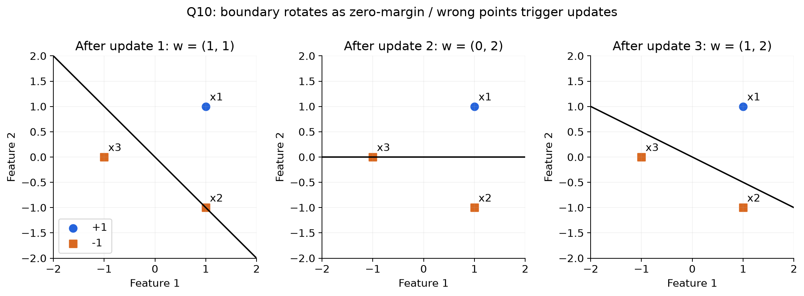
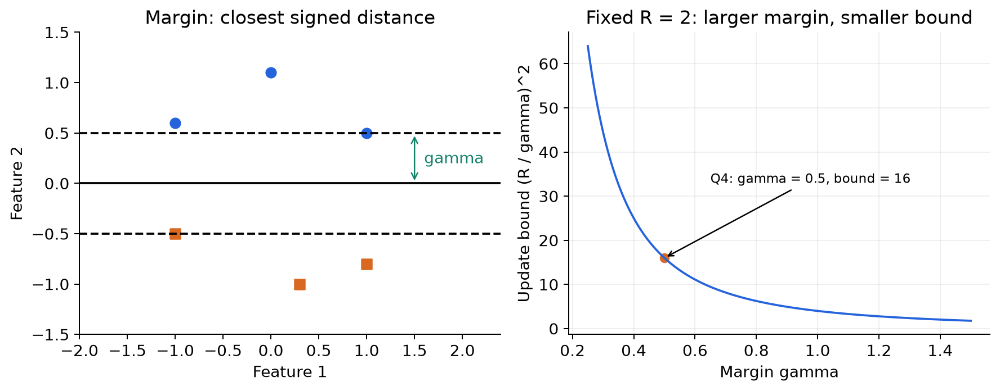
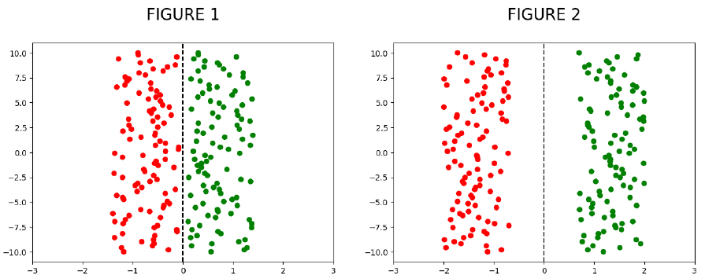
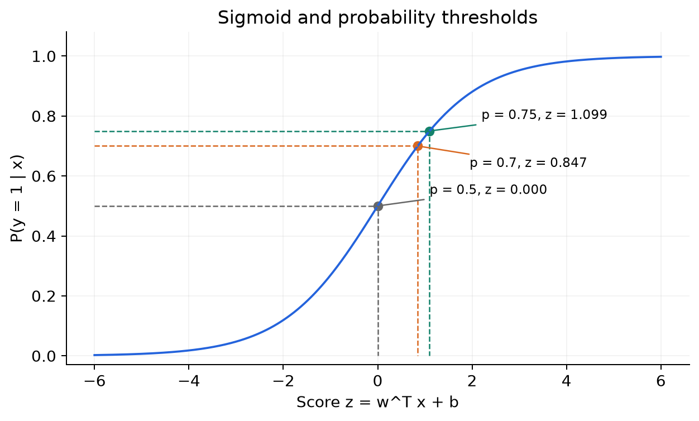
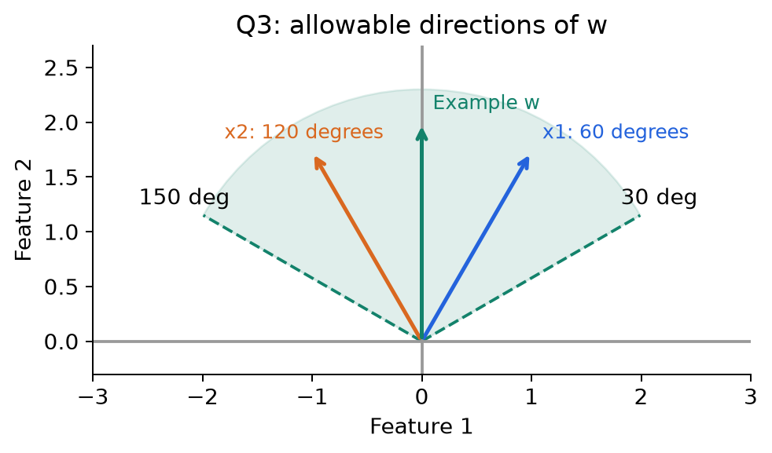
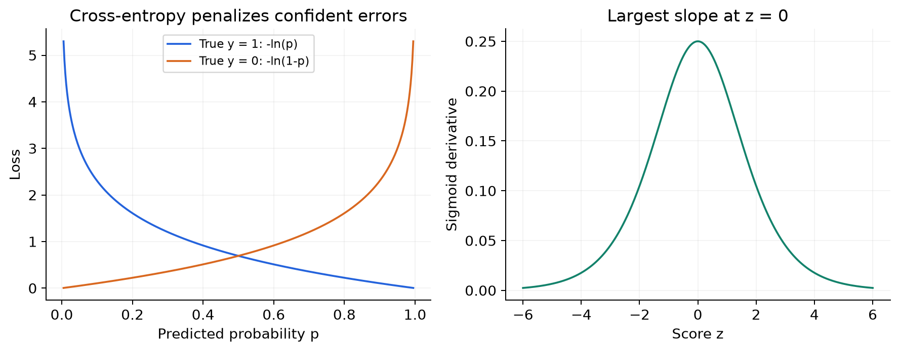

# MLT Week 9: Perceptron and Logistic Regression Notes

**Flow:** Linear score aur boundary → perceptron updates → convergence aur margin → sigmoid probability → threshold decisions → loss aur learning → regularization/kernel → classifier comparison.

## Topic index

| Topic | Subtopics | Questions |
|---|---|---|
| 1. Linear classification | Score, bias, zero-one loss, geometry, separability | Q1, Q15, Q20, Q2 |
| 2. Perceptron learning | Update rule, boundary cases, complete iterations | Q9, Q10, Q12 |
| 3. Convergence and margin | Radius, mistake bound, order, scaling | Q5, Q4, Q18, Q21, Q13, Q23 |
| 4. Logistic regression | Sigmoid, properties, score recovery, geometry | Q24, Q6, Q3 |
| 5. Threshold decisions | Recall trade-off, log-odds, inverse prediction | Q8, Q11, Q22, Q25, Q14 |
| 6. Learning logistic regression | Likelihood, cross-entropy, gradient updates | Q17, Q16 |
| 7. Regularization and kernels | L2 penalty, span representation, SVM connection | Q7 |
| 8. Classifier comparison | One-step training, linear boundaries | Q19, Q26 |
| Additional perceptron varieties | Regions, zero updates, cyclic trace, plotted margin | Q27–Q30 |
| Additional logistic/comparison varieties | Opposite-input bias caveat, ascent stopping, claim audits | Q31–Q34 |
| 9. Revision | Formula sheet, common mistakes, solving checklist | — |

---

## 1. Linear classification: Ek score se class kaise decide hoti hai?

### 1.1 Week 8 se connection

Naive Bayes mein class-wise feature distributions seekhkar posterior nikal rahe the. Ab seedha input se **decision score** ya **class probability** seekhenge.

**Short definition:** Discriminative classifier classes ke beech distinction seekhta hai, bina $P(X\mid Y)$ ko separately model kiye.

**Real life:** Email ke features ko weights do: suspicious words ka positive contribution, trusted-sender feature ka negative contribution. Total score se spam/non-spam decide karo.

Perceptron directly boundary seekhta hai. Logistic regression $P(Y=1\mid x)$ model karta hai. Dono standard form mein linear score use karte hain.

### 1.2 Linear score, weight aur bias

$$\boxed{z=w^Tx+b=\sum_{j=1}^{d}w_jx_j+b}.$$

| Symbol | Meaning |
|---|---|
| $x\in\mathbb R^d$ | Ek sample ke $d$ features |
| $w\in\mathbb R^d$ | Feature weights |
| $b$ | Bias/intercept: boundary ko shift karta hai |
| $z$ | Real-valued score; probability nahi |

**Boundary:** $w^Tx+b=0$. Two dimensions mein line, higher dimensions mein hyperplane.

- $b=0$ → boundary origin se pass karti hai.
- $b\ne0$ → boundary generally shifted hoti hai.
- $w$ boundary ke **perpendicular** hota hai, boundary ke along nahi.

**Example:** $w=(2,-1)$, $b=-3$, $x=(3,1)$ → $z=6-1-3=2$.

Bias ko dummy feature se absorb kar sakte hain: $\tilde x=(x,1)$, $\tilde w=(w,b)$, then $\tilde w^T\tilde x=w^Tx+b$.

**Exam rule:** Agar sirf $w^Tx$ diya ho aur bias mention na ho, question mein apni taraf se bias add nahi karna.

### 1.2A Q27 — One hyperplane in five dimensions

**Source:** Week 9 — Solve With Instructors, Q1.

**Question:**

The perceptron's decision boundary is a line in $\mathbb R^2$ and divides the space into two regions. If the input vector $x\in\mathbb R^5$, into how many regions will its decision boundary divide $\mathbb R^5$?

(i) 2

(ii) 3

(iii) 4

(iv) 5

**Solution:**

**Step 1:** For nonzero w, $w^Tx+b=0$ is a four-dimensional hyperplane in five-dimensional input space.

**Step 2:** Its two sides are $w^Tx+b>0$ and $w^Tx+b<0$. More features change boundary dimension, not number of sides.

$$\boxed{2\text{ regions — (i)}}.$$

**Property:** In $\mathbb R^d$, one nondegenerate hyperplane has dimension $d-1$ and two open half-spaces. Boundary points need the classifier's tie rule; they are not a third class. If $w=0$, there is no ordinary separating hyperplane: score is constant. With $b=0$ it is a linear subspace; with nonzero bias generally an affine hyperplane.

### 1.3 Labels aur score zero ka convention

Perceptron mein usually $y\in\{-1,+1\}$; logistic regression training mein usually $y\in\{0,1\}$.

Common prediction rule:

$$\hat y=\begin{cases}+1,&z\ge0,\\-1,&z<0.\end{cases}$$

For $0/1$ labels, negative side ka label 0 ho jaata hai. **Exactly $z=0$ par convention matter karta hai.** Question strict `>` de ya `≥` de, wahi follow karo.

**Positive-margin separation:** $y_i(w^Tx_i+b)>0$ for every sample. Isme koi sample boundary par nahi hota, so tie rule ki zaroorat nahi.

### 1.4 Zero-one loss

**Definition:** Correct prediction par 0 penalty, wrong prediction par 1.

$$\ell_{01}(\hat y,y)=\mathbf1(\hat y\ne y),\qquad \boxed{L_{01}=\frac1N\sum_{i=1}^{N}\mathbf1(\hat y_i\ne y_i)}.$$

**Real life:** 10 emails mein 2 wrong labels → average error $2/10=0.2$.

Zero loss ka matlab **har point correct**, sirf majority correct nahi. Sum loss aur average loss ka zero condition same hai.

### 1.5 Q1 — Opposite directions par opposite labels

**Source:** 2024 Mar 24 Quiz 2, Q1.

**Question:**

> The training dataset for a binary classification problem is as follows:
>
> $$\{(u,1),(-2u,0),(3u,1),(-4u,0)\}$$
>
> where $u\in\mathbb R^d$ is a constant, and the labels belong to 0, 1. Let $w$ be the weight vector of a linear classifier. What condition should the weight vector satisfy for the zero-one loss to be zero on this dataset?
>
> (a) $w^Tu<0$
>
> (b) $w^Tu>0$
>
> (c) $w^Tu=0$
>
> (d) We can never find a $w$ for which the zero-one loss becomes zero on this dataset.

**Step 1 — Common scalar banao:** Let $a=w^Tu$. Four vector dot products ab $a,-2a,3a,-4a$ hain.

**Step 2 — Required signs:**

| Input | True label | Score | Required side |
|---|---:|---:|---|
| $u$ | 1 | $a$ | Positive |
| $-2u$ | 0 | $-2a$ | Negative |
| $3u$ | 1 | $3a$ | Positive |
| $-4u$ | 0 | $-4a$ | Negative |

**Step 3:** $a>0$ ho toh saari conditions simultaneously satisfy hoti hain.

**Step 4:** $a=0$ par all scores same; different labels ko ek fixed tie rule se distinguish nahi kar sakte.

**Answer: (b), $\boxed{w^Tu>0}$.**

**Small edge case:** Intended question nonzero $u$ ke liye hai. Agar $u=0$, saare inputs same zero vector ho jaate hain with conflicting labels; zero loss possible nahi.

### 1.6 Q15 — Same direction, alternating labels

**Source:** 2025 Dec 18 ET, Q15. Q1 jaisa format, **lekin signs change hone se answer change** hota hai.

**Question:**

> Consider the following training dataset for a binary classification problem:
>
> $$D=\{(u,1),(2u,0),(3u,1),(4u,0)\},$$
>
> where $u\in\mathbb R^d$ is a fixed nonzero constant and labels belong to $\{0,1\}$. Let $w$ be the weight vector of a linear classifier. What condition should the weight vector satisfy for the 0-1 loss to be zero on this dataset?
>
> (a) $w^Tu<0$
>
> (b) $w^Tu>0$
>
> (c) $w^Tu=0$
>
> (d) No such weight vector $w$ exists.

**Step 1:** Again $a=w^Tu$. Scores $a,2a,3a,4a$.

**Step 2:** $a>0$ → all positive; labels 0 wale points wrong.

**Step 3:** $a<0$ → all negative; labels 1 wale points wrong.

**Step 4:** $a=0$ → all tied; fixed tie rule still conflicting labels satisfy nahi karega.

**Answer: (d).** Through-origin classifier se zero loss impossible.

**Extra intuition:** Bias add bhi karo toh line along this ray ek threshold dega. Sequence $1,0,1,0$ mein multiple class switches hain; ek threshold enough nahi.

**Graph padho:** Upper plot mein left vs right split kaam karta hai. Lower plot mein labels same direction par alternate kar rahe hain.

### 1.7 Q20 — Candidate weights ko directly test karo

**Source:** 2026 May 06 ET, Q20.

**Question:**

> (MSQ) Consider a dataset in $\mathbb R^2$ defined as:
>
> $$D=\{([1,1]^T,+1),([2,1]^T,+1),([1,-1]^T,-1),([2,-1]^T,-1)\}.$$
>
> Which of the following weight vectors $w\in\mathbb R^2$ can correctly separate the two classes using a linear decision boundary? (Select all that apply.)
>
> (a) $w=[0,1]^T$
>
> (b) $w=[1,0]^T$
>
> (c) $w=[1,5]^T$
>
> (d) $w=[-1,1]^T$

**Step 1:** First two scores positive aur last two negative chahiye; compute $w^Tx$.

| Option | $(1,1)$ | $(2,1)$ | $(1,-1)$ | $(2,-1)$ | Result |
|---|---:|---:|---:|---:|---|
| (a) $(0,1)$ | 1 | 1 | -1 | -1 | All correct |
| (b) $(1,0)$ | 1 | 2 | 1 | 2 | Negative class wrong |
| (c) $(1,5)$ | 6 | 7 | -4 | -3 | All correct |
| (d) $(-1,1)$ | 0 | -1 | -2 | -3 | $(2,1)$ definitely wrong |

**Step 2:** (a) aur (c) satisfy required signs.

**Answer: (a), (c).**

**Property:** Ek dataset ke multiple valid separators ho sakte hain. Correct separator necessarily unique ya maximum-margin separator nahi hota.

### 1.8 Dot product ki geometry

$$\boxed{w^Tx=\|w\|\|x\|\cos\phi},$$

where $\phi$ angle between $w$ and $x$ hai.

- Acute angle → positive score.
- $90^\circ$ → zero score.
- Obtuse angle → negative score.

**Projection rule:** Score compare karna ho toh points ki projection **$w$ ki direction par** compare karo. Sirf horizontal coordinate ya origin se distance enough nahi.

**Counterexample:** $w=(1,0)$, $x=(0,100)$ → score 0, despite huge distance. $x'=(1,0)$ → score 1, despite small distance.

For a nonzero $w$, signed distance to boundary $w^Tx+b=0$:

$$\boxed{\frac{w^Tx+b}{\|w\|}}.$$

### 1.9 Q2 — Figure se dot-product ordering

**Source:** 2024 Mar 24 Quiz 2, Q2.

**Question:**

> (MSQ) Consider the following data-points in a binary classification problem. $w$ is the weight vector corresponding to a linear classifier. The labels are $+1$ and $-1$.

> Which of the following statements are true?
>
> (a) $0<w^Tx_1<w^Tx_2<w^Tx_3$
>
> (b) $w^Tx_4=0$
>
> (c) $0<w^Tx_2<w^Tx_1<w^Tx_3$
>
> (d) $w^Tx_5<0$
>
> (e) $w^Tx_3<0$

**Step 1 — Intended method:** Har point ko $w$ ki direction par project karo. Positive direction mein aage jaane se score badhta hai.

**Step 2 — Intended ordering:** Key ke intended geometry mein $x_1,x_2,x_3$ positive side par increasing projection rakhte hain:

$$0<w^Tx_1<w^Tx_2<w^Tx_3.$$

So (a) true, (c) false, (e) false.

**Step 3:** Intended $x_4$ zero-score boundary par → (b) true. $x_5$ negative projection → (d) true.

**Expected answer in paper: (a), (b), (d).**

**Figure caveat:** Printed sketch mein $x_4$ drawn line par nahi dikh raha aur $w$ arrow bhi line ka exact normal nahi lagta. Exact coordinates nahi diye, isliye sketch ko scale par measure karke key establish nahi kar sakte. **$w^Tx_4=0$ tabhi true hai jab $x_4\perp w$ ho.** Key ki intended geometry neeche consistent illustration se samjho; yeh question ke numerical coordinates nahi hain.

Illustration mein $w=(2,1)$ aur scores $1,4,7,0,-4$ hain. Projection ka actual rule samajhne ke liye yeh example hai; printed figure se invented coordinates infer nahi kiye gaye.

---

## 2. Perceptron: Galti dekhkar weights update karna

### 2.1 Short definition aur intuition

**Definition:** Perceptron ek linear binary classifier hai jo wrong/zero-margin training points par weights update karta hai.

**Real life:** Teacher answer check karke sirf galti par correction de. Positive example ko negative samjha toh uski direction ka support badhao; negative example ko positive samjha toh support ghatao.

Learning rate $\eta>0$ ke saath:

$$\boxed{w_{\mathrm{new}}=w+\eta yx}.$$

Bias train ho raha ho toh:

$$b_{\mathrm{new}}=b+\eta y.$$

Is paper ke numerical perceptron questions mein default $\eta=1$, no separate bias, unless stated otherwise.

**Why use an iterative algorithm?** Arbitrary datasets par linear classifiers ka exact zero-one training loss minimize karna generally NP-hard problem hai. Perceptron har dataset ka best-error classifier solve karne ka promise nahi karta; separable case mein finite updates se zero-error separator milne ki guarantee use karta hai.

### 2.2 Update kab lagana hai? Do conventions clear rakho

**Zero-margin update convention:** $y(w^Tx)\le0$ par update. Boundary sample ko positive margin tak push karta hai.

**Prediction-error convention:** Pehle label predict karo using stated tie rule, phir only wrong label par update. Agar zero ko $+1$ predict karte ho, positive boundary point par update nahi, negative boundary point par update hota hai.

Q10/Q12 ki main working mein **$y(w^Tx)\le0$** convention use karenge. Q19 mein explicit label rule hai, uske hisaab se prediction-error update explain kiya hai. Jab intermediate trace differ ho sakti hai, wahi par bataya hai.

**Non-boundary points par dono rules agree karte hain.** Final label at zero phir bhi specified prediction convention se hi decide hota hai.

### 2.3 Algorithm ka full flow

1. $w=0$ se start karo.
2. Given order mein next $(x_i,y_i)$ lo.
3. **Current** weights se score $z_i=w^Tx_i$ nikalo.
4. Update condition true ho toh $w\leftarrow w+y_ix_i$.
5. Next sample ko updated weights se evaluate karo.
6. Dataset par passes repeat karo until ek **complete pass without required updates** mile.

**Epoch/pass:** Har sample ko ek baar visit karna. **Update:** Weight change hona. Dono same nahi.

**Stop trap:** Ek point correct hone se convergence nahi. All training points check karne hain.

### 2.4 Update direction ka meaning

For $y=+1$, $w\leftarrow w+x$ → same point ka score $\|x\|^2$ se increase hota hai.

For $y=-1$, $w\leftarrow w-x$ → score $\|x\|^2$ se decrease hota hai.

General signed-score change:

$$\boxed{y(w_{\mathrm{new}}^Tx)=y(w^Tx)+\eta\|x\|^2}.$$

**Property:** Update chosen point ko correct direction mein move karta hai, but ek update se necessarily correct nahi banata.

**Counterexample:** 1D $w=-100$, $x=1$, $y=+1$, $\eta=1$. Update ke baad $w=-99$; score improve hua, still negative. Doosre points ki classification bhi update se change ho sakti hai.

### 2.4A Q28 — Correct initialization means zero updates

**Source:** Week 9 — Solve With Instructors, Q2.

**Question:**

Consider the following data, with features $x=[x_1,x_2]^T$ and label y:

| $x_1$ | $x_2$ | y |
|---:|---:|---:|
| 0 | 0 | −1 |
| 0 | 1 | +1 |
| 1 | 0 | +1 |
| 1 | 1 | +1 |

Initialize the perceptron at $w=[1,1]^T$. Classify as +1 if $w^Tx>0$ and −1 if $w^Tx\le0$. How many times will w be updated during the entire training process? Cycle through points in the given order.

**Solution:**

**Step 1 — Evaluate the initial model:**

| Input | Score | Prediction under the stated rule | Correct? |
|---|---:|---:|---|
| $(0,0)$ | 0 | −1 | Yes |
| $(0,1)$ | 1 | +1 | Yes |
| $(1,0)$ | 1 | +1 | Yes |
| $(1,1)$ | 2 | +1 | Yes |

**Step 2:** No prediction mistake in the complete pass, so no update is needed.

$$\boxed{0\text{ updates};\quad w_{final}=(1,1)^T}.$$

**Property:** Initialization at zero is not compulsory. Already-correct initialization can terminate immediately after checking the data.

**Boundary caveat:** Origin cannot have strictly positive signed margin for a bias-free model. Here its correct label is assigned by the zero-score rule. If you instead force updates whenever $y(w^Tx)\le0$, origin repeatedly triggers a zero increment $yx=0$ and an update-based stopping test may never terminate. Do not silently replace this question's prediction-error rule.

### 2.5 Q9 — Two consecutive updates

**Source:** 2024 Dec 22 ET, Q9.

**Question:**

> While training a perceptron model, the weight vector at some iteration $t$ is $w^t$. The next two data points picked up by the perceptron algorithm in the course of its execution are $(x_1,y_1)$ and $(x_2,y_2)$, where $y$ is the true label:
>
> $$w^t=\begin{bmatrix}0\\1\\2\end{bmatrix},\quad x_1=\begin{bmatrix}1\\-1\\0\end{bmatrix},\quad y_1=1,\quad x_2=\begin{bmatrix}-1\\1\\1\end{bmatrix},\quad y_2=-1.$$
>
> What are the values of $w^{t+1}$ and $w^{t+2}$?
>
> (a) $w^{t+1}=[1,0,2]^T$, $w^{t+2}=[2,-1,1]^T$
>
> (b) $w^{t+1}=[1,0,2]^T$, $w^{t+2}=[1,0,1]^T$
>
> (c) $w^{t+1}=[0,1,2]^T$, $w^{t+2}=[1,1,3]^T$
>
> (d) $w^{t+1}=[0,1,2]^T$, $w^{t+2}=[1,1,-1]^T$

**Step 1 — First score:**

$$(w^t)^Tx_1=0(1)+1(-1)+2(0)=-1.$$

True label $+1$, so wrong.

**Step 2 — First update:**

$$w^{t+1}=(0,1,2)+(+1)(1,-1,0)=\boxed{(1,0,2)}.$$

**Step 3 — Second score with new weights:**

$$(w^{t+1})^Tx_2=1(-1)+0(1)+2(1)=1.$$

True label $-1$, so wrong again.

**Step 4 — Second update:**

$$w^{t+2}=(1,0,2)+(-1)(-1,1,1)=(1,0,2)+(1,-1,-1)=\boxed{(2,-1,1)}.$$

**Answer: (a).**

**Trap:** Negative label par $x_2$ subtract hota hai. $-1\times-1=+1$ first coordinate mein zaroor track karo.

### 2.6 Q10 — Complete cyclic run and a boundary test point

**Source:** 2025 Apr 13 ET, Q10.

**Question:**

> (MSQ) Consider the following data set with three data points:
>
> $$D=\{([1,1]^T,+1),([1,-1]^T,-1),([-1,0]^T,-1)\}.$$
>
> The perceptron algorithm is applied to the dataset with an initial weight vector $w^0=[0\ 0]^T$. While looking for mistakes, cycle through the data points from left to right. Which of the following statements are true?
>
> (a) The algorithm will converge with $w=[1\ 1]^T$.
>
> (b) The algorithm will converge with $w=[1\ 2]^T$.
>
> (c) The algorithm will converge with $w=[0\ 2]^T$.
>
> (d) The algorithm will converge with $w=[0\ 1]^T$.
>
> (e) The model will predict the label as $+1$, for the new data point $[2\ -1]^T$.
>
> (f) The model will predict the label as $-1$, for the new data point $[2\ -1]^T$.

**Step 1:** Use $y(w^Tx)\le0$ update rule; initialize $w=(0,0)$.

**Step 2 — First pass:**

| Visit | Point, label | Weight before | Score $w^Tx$ | Signed score $y w^Tx$ | Action / new weight |
|---|---|---|---:|---:|---|
| 1 | $(1,1),+1$ | $(0,0)$ | 0 | 0 | Update: $(0,0)+(1,1)=(1,1)$ |
| 2 | $(1,-1),-1$ | $(1,1)$ | 0 | 0 | Update: $(1,1)-(1,-1)=(0,2)$ |
| 3 | $(-1,0),-1$ | $(0,2)$ | 0 | 0 | Update: $(0,2)-(-1,0)=(1,2)$ |

**Step 3 — Verify full next pass:**

| Point | Score with $(1,2)$ | True label | Signed score |
|---|---:|---:|---:|
| $(1,1)$ | 3 | +1 | 3 |
| $(1,-1)$ | -1 | -1 | 1 |
| $(-1,0)$ | -1 | -1 | 1 |

All signed scores positive → no further updates. **Converged $w=(1,2)$**, so (b).

**Graph connection:** First two boundaries still have training points on the line. Third boundary puts all training points strictly on their correct sides.

**Step 4 — Test point:**

$$w^T(2,-1)=1(2)+2(-1)=0.$$

With tie rule $\hat y=+1$ for score $\ge0$, label $+1$ → (e).

**Answer: (b), (e), using the positive-at-zero prediction convention assumed by the key.** Without a zero-score prediction convention, test label is not determined by the score alone.

**If using only prediction errors during training:** Positive-at-zero convention gives update-weight sequence $(-1,1)\to(0,1)\to(1,1)\to(0,2)\to(1,2)$. Final separator remains same here, but update count changes. Isliye update rule pehle fix karna important hai.

### 2.7 Q12 — Two updates enough hain?

**Source:** 2025 Aug 31 ET, Q12.

**Question:**

> Consider the following dataset:
>
> $$D=\{([-2,1]^T,+1),([-1,1]^T,+1),([-1,-1]^T,-1),([2,1]^T,-1)\}.$$
>
> The perceptron algorithm is applied on this data set with the weight vector initialized to $[0\ 0]^T$. Will the algorithm converge after the second round of update of the weight vector? While looking for mistakes, cycle through the data points from left to right.
>
> (a) Yes
>
> (b) No

**Step 1 — First point:** At zero weights, signed score 0, so first update:

$$w^{(1)}=(0,0)+(+1)(-2,1)=(-2,1).$$

**Step 2 — Second point:**

$$(-2,1)^T(-1,1)=3>0.$$

True label $+1$; no update. **Second sample visit is not the second update.**

**Step 3 — Third point:**

$$(-2,1)^T(-1,-1)=2-1=1.$$

True label $-1$, wrong → second update:

$$w^{(2)}=(-2,1)-(-1,-1)=(-1,2).$$

**Step 4 — Fourth point at these weights:**

$$(-1,2)^T(2,1)=-2+2=0.$$

True label $-1$. Under zero-margin update rule it needs another update; under positive-at-zero prediction it is also wrong. Hence **not converged after two updates**.

**Answer: (b), No.**

**Boundary convention note:** If training updates only prediction errors with positive-at-zero ties, its first two update weights are $(1,1)$ and $(-1,0)$. The third point is then wrong, so answer still **No**.

---

### 2.8 Q29 — Reverse cyclic order and the final squared norm

**Source:** Week 9 PDF, appended question, printed pp. 3–5.

**Question:**

Consider $x_1=(1,1)^T$, $x_2=(1,-1)^T$, $x_3=(-1,-1)^T$, $x_4=(-1,1)^T$ with labels $y_1=-1,y_2=+1,y_3=+1,y_4=-1$. Use the perceptron with no bias, cycling in the order $x_4,x_3,x_2,x_1$ until a linear separator is found.

(i) What is the number of mistakes?

(ii) What is the squared length of the final weight vector?

**Solution:**

**Step 1 — State missing run conventions:** Following the supplied solution, start at $w=0$, use learning rate 1, predict +1 at score zero, and update only on wrong predictions. The question itself does not specify initialization/tie handling.

**Step 2 — First pass:**

| Point | Current w | Score | Prediction | True label | Action / new w |
|---|---|---:|---:|---:|---|
| $x_4$ | $(0,0)$ | 0 | +1 | −1 | Update: $(0,0)-(-1,1)=(1,-1)$ |
| $x_3$ | $(1,-1)$ | 0 | +1 | +1 | No update |
| $x_2$ | $(1,-1)$ | 2 | +1 | +1 | No update |
| $x_1$ | $(1,-1)$ | 0 | +1 | −1 | Update: $(1,-1)-(1,1)=(0,-2)$ |

**Step 3 — Verify a full next pass:** Scores in the same order are $-2,2,2,-2$. All four labels correct, no further updates.

**Step 4 — Report:**

$$\boxed{M=2,\qquad w=(0,-2)^T,\qquad\|w\|^2=0^2+(-2)^2=4}.$$

Boundary $x_2=0$: lower half-plane positive, upper half-plane negative. Two updates and two passes are different quantities, even though both happen to equal 2 here.

**Convention check:** With zero-margin update rule, second update occurs at $x_3$ instead of $x_1$; final weight and update count still agree in this example. That agreement is not universal.

## 3. Perceptron kab converge karega? Margin aur mistake bound

### 3.1 Linear separability

**Definition:** Aisa linear boundary exist kare jo all training points ko correct side par rakhe.

Through-origin strict separation:

$$\exists w^*:\quad y_i(w^{*T}x_i)>0\quad\forall i.$$

**Real life:** Agar ek weighted rule se pass/fail samples perfectly separate ho jaate hain, perceptron us tarah ka rule find kar sakta hai. Labels mein contradictory examples/noise ho toh perfect separation may not exist.

**Counterexample:** Same input $x$ ke saath labels $+1$ aur $-1$ dono hon, koi deterministic classifier us input par dono labels correctly predict nahi kar sakta.

**Another example:** XOR points $(0,0),(1,1)$ one class aur $(0,1),(1,0)$ other class ek straight line se separate nahi hote, even with bias. Nonlinear features/kernel se representation badalne par situation change ho sakti hai.

### 3.2 Margin $\gamma$ aur radius $R$

Normalize separator so $\|w^*\|=1$. Then:

$$\boxed{\gamma=\min_i y_i(w^{*T}x_i)>0},\qquad \boxed{R=\max_i\|x_i\|}.$$

**Margin:** Closest point bhi boundary se kitna safely correct side par hai.

**Radius:** Inputs origin se maximum kitne door hain.

Non-unit $v$ diya ho toh geometric margin:

$$\gamma=\min_i\frac{y_i(v^Tx_i)}{\|v\|}.$$

**Trap:** $v$ ko 100 se multiply karne par raw scores 100 times ho jaate hain, but boundary aur geometric distances same. Isi liye normalization important hai.

### 3.3 Convergence theorem: Use karne wala result

For finite linearly separable data, bounded radius, $w^{(0)}=0$, standard perceptron updates:

$$\boxed{M\le\left(\frac{R}{\gamma}\right)^2}.$$

$M$ update/mistake bound hai, dataset passes ki count nahi. Zero-margin update variant mein zero-margin updates bhi is count mein included hain.

- Margin larger → easier separation → smaller bound, other conditions fixed.
- Radius larger at fixed margin → bound larger.
- Bound upper limit hai, exact number of actual mistakes nahi.
- Nonseparable dataset par finite convergence guarantee nahi; algorithm cycle kar sakta hai.
- Perceptron **some separator** find karta hai, necessarily maximum-margin separator nahi.

**Bias caution:** Agar augmented features $(x,1)$ se bias train kar rahe ho, theorem apply karte waqt augmented-space radius/margin use karo. Raw $x$ ka radius directly plug karna generally valid nahi.

### 3.3A Q30 — Compare convergence from the plotted margin

**Source:** Week 9 — Solve With Instructors, Q6.

**Question:**

For which dataset is the perceptron algorithm likely to take fewer iterations to converge?

**Solution:**

**Step 1:** Figure 1 has points very close to the separating vertical line. Figure 2 has a wider empty band around it, hence larger margin for that separator.

**Step 2:** For comparable radius R, $M\le(R/\gamma)^2$ decreases as margin increases. Larger safe separation usually makes fitting easier.

$$\boxed{\text{Figure 2, as the intended qualitative answer}}.$$

**Step 3 — Bound versus measured run:** Source reports 2367 rounds for Figure 1 and 264 for Figure 2. These are reported run counts, not values calculable exactly from this plot. They depend on initialization, order and stopping convention. A larger bound does **not** force more actual updates for every run; always distinguish “likely” from “guaranteed”.

### 3.4 Q5 — Given inequalities se separator identify karo

**Source:** 2024 Sep 01 ET, Q5.

**Question:**

> (MSQ) Consider a training dataset of 100 points for a binary classification problem with the following structure:
>
> - The features are in $\mathbb R^2$ and the labels are in $\{-1,1\}$.
> - For every data-point $((x_1,x_2),y)$ in the training dataset, $x_1x_2>0$ and $x_1y>0$.
>
> Which of the following statements are true?
>
> (a) The dataset is linearly separable with a positive margin.
>
> (b) The perceptron algorithm will terminate after a finite number of iterations when trained on this dataset.
>
> (c) The dataset is linearly separable, but the margin may be zero.
>
> (d) The dataset is not linearly separable.

**Step 1:** $x_1y>0$ means label aur first coordinate ka sign same hai:

- $y=+1$ → $x_1>0$.
- $y=-1$ → $x_1<0$.

**Step 2:** Choose $w=(1,0)$, boundary $x_1=0$.

$$y(w^Tx)=yx_1>0\quad\text{for every sample}.$$

**Step 3:** Only 100 points hain. In 100 strictly positive values ka minimum strictly positive hoga:

$$\gamma=\min_i y_ix_{i1}>0.$$

Thus (a) true. $x_1x_2>0$ additionally same-sign coordinates batata hai; separator find karne ke liye $x_1y>0$ already enough tha.

**Step 4:** Finite dataset has finite radius; positive margin gives finite perceptron convergence → (b) true.

**Answer: (a), (b).** (c) false for this finite strict-separation dataset; (d) false.

**Property:** Margin very small ho sakta hai, lekin given finite data mein strictly positive values ka minimum exactly zero nahi.

### 3.5 Q4 — Numerical mistake bound

**Source:** 2024 Apr 28 ET, Q4.

**Question:**

> Consider a linearly separable binary classification dataset with 1000 data points and 100 features. Assume that there exists a $w$ such that $\|w\|=1$, $y_i(w^Tx_i)\ge0.5\ \forall i$. Also assume that $\|x\|_2\le2\ \forall i$. What is the maximum number of mistakes that the Perceptron algorithm can make on this dataset?

**Step 1:** Unit separator already specified. Margin lower bound $\gamma=0.5$; radius upper bound $R=2$.

**Step 2:**

$$M\le\frac{R^2}{\gamma^2}=\frac{2^2}{0.5^2}=\frac4{0.25}=\boxed{16}.$$

**Step 3:** Thus guaranteed upper bound 16 mistakes/updates. Actual run fewer kar sakta hai; exactly 16 hona zaroori nahi.

**Trap:** 1000 samples aur 100 features ko formula mein multiply nahi karna. Given $R,\gamma$ bound determine karte hain.

**Same numerical-bound variety:** Week 9 PDF appended question (printed pp. 1–2) has 500 points, 50 features, unit separator, $\gamma\ge0.25$ and $R\le1$. Q4's method gives $M\le1^2/(0.25)^2=\boxed{16}$. Samples/features are not extra factors, and 16 is an upper bound, not necessarily attained.

### 3.6 Q18 — More samples/features means more mistakes?

**Source:** 2025 Dec 18 ET, Q18.

**Question:**

> Consider two datasets $D^{(1)}$ and $D^{(2)}$ where:
>
> $$D^{(1)}=\{(x_1^{(1)},y_1^{(1)}),\ldots,(x_n^{(1)},y_n^{(1)})\},\quad D^{(2)}=\{(x_1^{(2)},y_1^{(2)}),\ldots,(x_m^{(2)},y_m^{(2)})\}$$
>
> such that $x_i^{(1)}\in\mathbb R^{d_1}$ and $x_i^{(2)}\in\mathbb R^{d_2}$, where $d_1>d_2$ and $n>m$. The maximum number of mistakes made by the perceptron algorithm is higher on dataset $D^{(1)}$ than on dataset $D^{(2)}$.
>
> (a) True
>
> (b) False

**Step 1:** Bound depends on $R/\gamma$, not directly dimension/sample count. Those geometric values are not given.

**Step 2 — Counterexample:** Let $D^{(2)}=\{(1,+1),(-2,-1)\}$ in 1D. Unit separator $w^*=1$ gives $R=2,\gamma=1$, bound 4.

Construct $D^{(1)}$ in 2D with three distinct points: $(1,0)$ labelled $+1$, $(-1,0)$ labelled $-1$, and $(1.5,0)$ labelled $+1$. Unit separator $(1,0)$ gives $R=1.5,\gamma=1$, bound $1.5^2=2.25$ (hence integer update count at most 2).

More observations and more features hone ke bawajood bound **smaller** hai. Counts alone claimed strict ordering establish nahi karte.

**Answer: (b), False.** Nonseparability would create another issue: then no finite standard bound is guaranteed at all.

### 3.7 Q21 — Convergence does not mean one unique answer

**Source:** 2026 May 06 ET, Q21.

**Question:**

> (MSQ) Consider a binary classification dataset in $\mathbb R^4$ that is linearly separable. Suppose there exist two distinct weight vectors $w_1$ and $w_2$ that both correctly classify all training points with a positive margin. The Perceptron algorithm is applied to this dataset. Which of the following statements are correct? (Select all that apply.)
>
> (a) The Perceptron algorithm is guaranteed to converge to $w_1$.
>
> (b) The final weight vector obtained by the Perceptron algorithm depends on the initialization and the order in which the data points are presented.
>
> (c) The Perceptron algorithm is guaranteed to converge to some separating hyperplane in a finite number of updates.
>
> (d) The Perceptron algorithm always converges to the maximum margin separator among all possible separating hyperplanes.

**Step 1:** Perceptron ka target specified vector $w_1$ nahi → (a) false.

**Step 2:** Different starts/orders can trigger different update paths → (b) true. “Depends” ka matlab change **ho sakta hai**, har possible order different result dega yeh nahi.

**Step 3:** Positive-margin separability finite convergence ensure karti hai → (c) true.

**Step 4:** Update rule mein maximum margin optimize karne ka criterion nahi → (d) false.

**Answer: (b), (c).**

### 3.8 Uniform scaling: Coordinates badle, boundary ka kya?

Every sample $x_i\to cx_i$, same positive constant $c$:

$$R'=cR,\qquad\gamma'=c\gamma,\qquad \boxed{\frac{R'^2}{\gamma'^2}=\frac{R^2}{\gamma^2}}.$$

For zero initialization, same learning rate, same point order and tie/update convention:

$$\boxed{w'_t=cw_t}.$$

Why useful? Corresponding training scores become $w_t'^T(cx_i)=c^2w_t^Tx_i$; sign/tie decisions same. Update vectors are also $c$ times. Boundaries $w^Tx=0$ and $(cw)^Tx=0$ same hain.

**Important distinction:** Same classifier/boundary does **not** mean identical numerical weight vector.

**Counterexample to overgeneralization:** Only feature 1 ko scale karna, feature 2 ko nahi, uniform scaling nahi. Radius/margin ratio and training path change ho sakte hain. Nonzero initialization/different order par above matched-run conclusion directly apply nahi karna.

### 3.9 Q13 — All points doubled

**Source:** 2025 Aug 31 ET, Q13.

**Question:**

> (MSQ) Consider a dataset $D_1=\{(x_1,y_1),(x_2,y_2),\ldots,(x_n,y_n)\}$, where $x_i\in\mathbb R^d$ and is linearly separable by a hyperplane passing through the origin. Construct another dataset $D_2=\{(2x_1,y_1),(2x_2,y_2),\ldots,(2x_n,y_n)\}$ from $D_1$. If we run the perceptron algorithm on both the dataset, and the algorithm converges for the points in $D_1$, then which of the following will hold true?
>
> (a) Perceptron algorithm will converge for $D_2$.
>
> (b) The perceptron algorithm will give the same classifier when run on $D_1$ and $D_2$.
>
> (c) The mistake bound for $D_2$ will be greater than that of $D_1$.

**Step 1:** $y_iw^{*T}(2x_i)=2y_iw^{*T}x_i>0$. Separability maintained → (a) true.

**Step 2:** Under matched runs described in 3.8, weights double, boundary same → (b) true in intended setting.

**Step 3:** $R'=2R$, $\gamma'=2\gamma$ → bound unchanged, so (c) false.

**Expected answer: (a), (b).** Question leaves initialization/order implicit; “same classifier” requires matched runs, not arbitrary independently shuffled runs. Q23 makes these conditions explicit.

### 3.10 Q23 — Same scaling concept, explicit run conditions

**Source:** 2026 Sep 13 ET, Q23. Same type as Q13; use section 3.8 results directly.

**Question:**

> (MSQ) Let $S=(x_1,y_1),\ldots,(x_n,y_n)$ be $n$ points in $\mathbb R^d$ that are linearly separable by a hyperplane through the origin. Construct $S'=(cx_1,y_1),\ldots,(cx_n,y_n)$ where $c>1$ is a constant. The perceptron algorithm (initialised at $w=0$, learning rate 1) is run on both $S$ and $S'$, using the same ordering of points in both runs. Which of the following statements are true?
>
> (a) The mistake bound of the perceptron on $S'$ is strictly larger than its mistake bound on $S$.
>
> (b) $S'$ may fail to be linearly separable.
>
> (c) The perceptron is guaranteed to converge on $S'$.
>
> (d) The perceptron produces exactly the same decision boundary on $S$ and on $S'$.

**Step 1:** Radius and margin both multiply by $c$; ratio unchanged → (a) false.

**Step 2:** Positive scaling preserves signs/separability → (b) false, (c) true.

**Step 3:** Zero start + same order gives $w'=cw$; positive multiple same boundary → (d) true.

**Answer: (c), (d).** Changed options ke answers separately evaluated; scaling calculation repeat nahi ki.

---

## 4. Logistic regression: Hard label se probability tak

### 4.1 Perceptron se next step kyun?

Perceptron score ka sign deta hai; confidence probability nahi. Scores $0.01$ aur $10$ both positive labels de sakte hain, lekin evidence strength different ho sakti hai.

**Definition:** Logistic regression linear score ko sigmoid se class probability mein map karta hai.

$$z=w^Tx+b,\qquad \boxed{p=P(Y=1\mid x)=\sigma(z)=\frac1{1+e^{-z}}}.$$

**Real life:** “Customer purchase karega” ke saath estimated probability 0.7 chahiye, taaki business threshold choose kar sake.

Naam regression hai, standard use yahan **classification** hai. Direct $P(Y\mid X)$ model karta hai, so discriminative.

### 4.2 Sigmoid ki important properties

| Property | Meaning / quick example |
|---|---|
| $0<\sigma(z)<1$ for finite $z$ | Valid probability range; finite score par exactly 0/1 nahi |
| $\sigma(0)=0.5$ | Zero score means equal model probabilities |
| $\sigma(-z)=1-\sigma(z)$ | Opposite scores have complementary probabilities |
| $\sigma'(z)=\sigma(z)(1-\sigma(z))>0$ | Strictly increasing |
| Maximum slope $1/4$ at $z=0$ | Centre ke paas score changes ka largest effect |
| $z\to+\infty$ gives $\sigma(z)\to1$ | Very positive score → class 1 likely |
| $z\to-\infty$ gives $\sigma(z)\to0$ | Very negative score → class 0 likely |

**Curvature:** Sigmoid convex on negative scores, concave on positive scores; inflection at 0. Entire real line par convex nahi.

Useful values:

| $z$ | -2 | -1 | 0 | 1 | 2 |
|---|---:|---:|---:|---:|---:|
| $\sigma(z)$ | 0.1192 | 0.2689 | 0.5 | 0.7311 | 0.8808 |

### 4.2A Q31 — Opposite input probabilities and the bias assumption

**Source:** Week 9 PDF, appended question, printed pp. 8–9.

**Question:**

Consider a logistic regression model trained for binary classification with features in $\mathbb R^2$ and labels in $\{1,0\}$. The probability that test point $(1,3)^T$ belongs to class 1 is 0.75. What is the probability that $(-1,-3)^T$ belongs to class 0?

**Solution:**

**Step 1 — No-bias interpretation:** Let $z=w^Tx$ and $\sigma(z)=0.75$. At opposite input, $w^T(-x)=-z$.

**Step 2 — Complement:**

$$P(1\mid-x)=\sigma(-z)=1-0.75=0.25.$$

**Step 3 — Asked class is 0:**

$$\boxed{P(0\mid-x)=1-0.25=0.75}.$$

**Important assumption:** This is the supplied answer under **zero bias**. For score $w^Tx+b$, opposite input score equals $2b-z$, not generally $-z$. If b unspecified and allowed, the answer is not uniquely determined.

**Counterexample:** Set $w=0,b=\log3$. Both x and −x have class-1 probability 0.75, so class-0 probability at −x is **0.25**, not 0.75. Sigmoid symmetry concerns opposite **scores**, not automatically opposite feature vectors.

### 4.3 Q24 — Sigmoid properties

**Source:** 2026 Sep 13 ET, Q24.

**Question:**

> (MSQ) Let
>
> $$g(z)=\frac1{1+e^{-z}}$$
>
> be the sigmoid (logistic) function. Select all statements below that are true for every $z\in\mathbb R$.
>
> (a) $g(-z)=1-g(z)$.
>
> (b) $g$ is a non-decreasing function but not strictly increasing.
>
> (c) $g$ is a strictly increasing function.
>
> (d) $g$ is convex on all of $\mathbb R$.

**Step 1:** Complement identity holds → (a) true.

**Step 2:** $g'(z)=g(z)(1-g(z))>0$ for every finite $z$. Therefore strictly increasing → (c) true and (b) false. Flat-looking tails exactly flat nahi hain.

**Step 3 — Counterexample to global convexity:** $g(1)\approx0.7311$, but $[g(0)+g(2)]/2\approx(0.5+0.8808)/2=0.6904$. Convex function ke liye midpoint value average se **at most** hona chahiye; yahan opposite hai.

**Answer: (a), (c).**

### 4.4 Probability se score: Log-odds

**Definition:** Odds $=p/(1-p)$; log-odds uska natural logarithm.

$$\boxed{z=\log\frac{p}{1-p}}\qquad(0<p<1).$$

**Example:** $p=0.8$ → odds 4 → score $\log4\approx1.3863$. Probability 0.8 aur score 0.8 same quantity nahi.

Unless question another base specifies, logistic formulas mein $\log$ means natural log $\ln$.

### 4.5 Q6 — Probability given, compatible weights choose karo

**Source:** 2024 Sep 01 ET, Q6.

**Question:**

> (MSQ) Consider a logistic regression model trained for a binary classification problem with features in $\mathbb R^2$ and labels in $\{1,0\}$. The probability that the test point $[1\ 1]^T$ belongs to class 1 is equal to $\dfrac1{1+e^2}$. Which of the following could be the weight vector of the logistic regression classifier? Select all possible answers.
>
> (a) $[-1\ -1]^T$
>
> (b) $[1\ -3]^T$
>
> (c) $[1\ 1]^T$
>
> (d) $[3\ -1]^T$

**Step 1:** Compare $1/(1+e^{-z})$ with $1/(1+e^2)$. We need $-z=2$, so $z=-2$.

**Step 2:** No bias given; $z=w^T(1,1)=w_1+w_2$.

| Option | $w_1+w_2$ | Matches -2? |
|---|---:|---|
| (a) | -2 | Yes |
| (b) | -2 | Yes |
| (c) | 2 | No |
| (d) | 2 | No |

**Answer: (a), (b).**

**Property:** Ek point ki probability generally weight vector uniquely determine nahi karti. Yahan all weights satisfying $w_1+w_2=-2$ same probability give karte hain at this point.

### 4.6 Q3 — Dono points class 1: Weight angle ka range

**Source:** 2024 Apr 28 ET, Q3.

**Question:**

> Consider a logistic regression model for a binary classification problem with two features $x_1$ and $x_2$. The feature vector is $[x_1\ x_2]^T$ and labels lie in $\{0,1\}$. The threshold for inference is 0.5. The dummy feature and the weight corresponding to it can be ignored for this problem. Let $x_1$ be the horizontal axis and $x_2$ be the vertical axis. You are given two feature vectors:
>
> $$\mathbf x_1=\begin{bmatrix}1\\\sqrt3\end{bmatrix},\qquad\mathbf x_2=\begin{bmatrix}-1\\\sqrt3\end{bmatrix}.$$
>
> The weight vector makes an angle of $\theta$ with the positive $x_1$ axis (horizontal). Each $\theta$ corresponds to a different classifier. For what range of values of $\theta$ are both $\mathbf x_1$ and $\mathbf x_2$ predicted to belong to class-1?
>
> Hints:
> - To draw the weight vector $w=[w_1\ w_2]^T$, plot the point $(w_1,w_2)$ and draw an arrow starting at the origin to this point.
> - $\tan(60^\circ)=\sqrt3$.
>
> (a) $30^\circ<\theta<150^\circ$
>
> (b) $0^\circ<\theta<60^\circ$
>
> (c) $60^\circ<\theta<180^\circ$
>
> (d) $0^\circ<\theta<180^\circ$
>
> (e) $0<\theta<360^\circ$

**Step 1 — Threshold ko score mein convert karo:** Strictly $p>0.5$ means $w^Tx>0$.

**Step 2 — Point directions:** $\mathbf x_1$ first quadrant, angle $60^\circ$. $\mathbf x_2$ second quadrant, angle $120^\circ$.

**Step 3 — First point positive:** Angle with $w$ acute chahiye:

$$-90^\circ<\theta-60^\circ<90^\circ\quad\Rightarrow\quad-30^\circ<\theta<150^\circ.$$

Angles modulo $360^\circ$ understood; second constraint ke saath common interval next step mein milega.

**Step 4 — Second point positive:**

$$-90^\circ<\theta-120^\circ<90^\circ\quad\Rightarrow\quad30^\circ<\theta<210^\circ.$$

**Step 5 — Intersection:**

$$\boxed{30^\circ<\theta<150^\circ}.$$

**Answer: (a).**

**Endpoint note:** At $30^\circ$ or $150^\circ$, one point gets score 0 and probability 0.5. If inference explicitly used $p\ge0.5$, endpoints would be included. Open intervals in options/key use strict positive-side interpretation.

---

## 5. Probability threshold: Same model, different decisions

### 5.1 Threshold $\tau$ kya karta hai?

**Definition:** Predicted probability ko label mein convert karne ka cutoff.

$$\hat y=\begin{cases}1,&p\ge\tau,\\0,&p<\tau.\end{cases}$$

**Real life:** Fraud detector mein suspicious cases miss nahi karne, toh cutoff lower rakh sakte hain. High-confidence positive decisions only chahiye, toh cutoff raise kar sakte hain.

For $0<\tau<1$:

$$\boxed{p\ge\tau\iff w^Tx+b\ge\log\frac\tau{1-\tau}}.$$

**Connection:** Probability cutoff ko log-odds se score cutoff mein convert karo. At $\tau=0.5$, score cutoff 0. At higher $\tau$, positive score required.

### 5.2 Threshold change ki properties

Fixed model and fixed test set par:

- Threshold decrease → positive predictions same or more; false negatives cannot increase, false positives may increase.
- Threshold increase → positive predictions same or fewer; false positives cannot increase, false negatives may increase.
- Lower threshold generally recall ko favour karta hai, but accuracy improve hone ki guarantee nahi.
- Threshold change **weights retrain nahi** karta; decision cutoff change karta hai.

Definitions: **False negative (FN)** = actual positive ko negative bolna. **False positive (FP)** = actual negative ko positive bolna. Recall $=TP/(TP+FN)$, when denominator positive.

**Counterexample:** Real negative point ki predicted positive probability 0.4 hai. Threshold 0.5 par correct negative; threshold 0.3 par false positive. Lower threshold har point ko better classify nahi karta.

### 5.3 Q8 — Phishing emails miss nahi karne

**Source:** 2024 Dec 22 ET, Q8.

**Question:**

> Consider a logistic regression model trained to detect spam emails. Emails containing harmful phishing links are labeled as spam (1), while regular emails are labeled as not spam (0).
>
> A good spam detector should correctly identify almost all emails with phishing links. Even a single phishing email incorrectly classified as not spam could expose users to significant risks. However, the detector may classify some regular emails as spam. This trade-off is acceptable to ensure safety.
>
> To ensure user safety, if the threshold is set to a low value to prioritize the detection of phishing emails, type 1. If the threshold is set to a high value to minimize false positives (misclassifying regular emails as spam), type 0.

**Step 1:** Actual phishing positive hai. Usko normal bolna **false negative** hai, aur question usse avoid karna chahta hai.

**Step 2:** Lower threshold par more emails spam flag honge; low-confidence phishing candidates bhi catch ho sakte hain.

**Step 3:** Extra regular emails flag hona acceptable given hai.

**Answer: $\boxed{1}$ — lower threshold.** Yeh “har phishing email definitely catch hoga” ki guarantee nahi; stated trade-off ka direction hai.

**Same threshold-cost question:** Week 9 — Solve With Instructors, Q4 replaces phishing emails with objectionable videos. Missing a positive is costly and extra false positives are acceptable. Answer **(A) low threshold**, by the same reasoning as Q8. (B) high threshold prioritizes fewer false positives; (C) threshold-independent performance is false.

### 5.4 Q11 — Dot product then threshold

**Source:** 2025 Apr 13 ET, Q11.

**Question:**

> Consider a logistic regression model that has been trained for a binary classification problem on a dataset in $\mathbb R^2$. Given a test data-point as input to the model, it returns 1 as the predicted label if the probability output by the model is greater than 0.55 and 0 otherwise. What will be the predicted label for the test data-point $[1\ 2]^T$? Assume the weight vector is $[7\ 4]^T$.

**Step 1 — Score:**

$$z=7(1)+4(2)=15.$$

**Step 2 — Probability:**

$$p=\sigma(15)=\frac1{1+e^{-15}}\approx0.999999694.$$

**Step 3:** $p>0.55$ → **label $\boxed{1}$**.

**Quick check:** Score cutoff $\log(0.55/0.45)\approx0.2007$. Since $15>0.2007$, same answer without evaluating sigmoid precisely.

**Related numeric variant:** Week 9 PDF appended question (printed pp. 6–7) uses $w=(1/2,2/3)^T$, test point $(1,0)^T$, and predicts 1 only if probability is **greater than 0.60**. Score $=1/2$; sigmoid $\approx0.622459>0.60$ → **label 1**. Same dot-product → sigmoid → cutoff method as Q11; equality would receive 0 under this strict rule.

### 5.5 Q22 — Count positives at threshold 0.7

**Source:** 2026 May 06 ET, Q22.

**Question:**

> Consider a binary classification problem using logistic regression. The model predicts the probability of class $+1$ as:
>
> $$P(y=+1\mid x)=\frac1{1+e^{-w^Tx}}.$$
>
> A threshold of 0.7 is used for classification. The predicted class label is given by:
>
> $$P(y\mid x)=\begin{cases}+1,&\text{if }P(y=+1\mid x)\ge0.7,\\-1,&\text{otherwise.}\end{cases}$$
>
> The values of $w^Tx$ for the following datapoints are: $x_1:-1.2$, $x_2:0.0$, $x_3:2.5$, $x_4:0.4$, $x_5:0.8$. How many datapoints will be classified as class $+1$?

**Notation:** Question ka piecewise expression label rule hai; usko $\hat y$ read karo, probability value nahi.

**Step 1:** Score cutoff:

$$\theta=\log\frac{0.7}{0.3}=\log\frac73\approx0.847298.$$

**Step 2:** Har score ko $0.847298$ se compare karo:

| Point | Score | Approx. probability | Predicted label |
|---|---:|---:|---:|
| $x_1$ | -1.2 | 0.2315 | -1 |
| $x_2$ | 0 | 0.5000 | -1 |
| $x_3$ | 2.5 | 0.9241 | +1 |
| $x_4$ | 0.4 | 0.5987 | -1 |
| $x_5$ | 0.8 | 0.6900 | -1 |

**Step 3:** Only $x_3$ crosses threshold → **count $\boxed{1}$**.

**Trap:** Positive score ka matlab $p>0.5$, **$p\ge0.7$ nahi**. $x_5$ ka score 0.8 positive hai but probability only 0.6900.

### 5.6 Q25 — Score threshold for probability 0.75

**Source:** 2026 Sep 13 ET, Q25. Same conversion as Q22, changed threshold.

**Question:**

> In logistic regression, a point is classified positive only if $P(y=1\mid x)=\sigma(w^Tx)\ge0.75$. What score threshold $\theta$ (with $w^Tx=\theta$ at the boundary of this rule) does this correspond to? (Round to 2 decimal places.)

**Step 1:** Use $\theta=\log[\tau/(1-\tau)]$.

**Step 2:**

$$\theta=\log\frac{0.75}{0.25}=\log3\approx1.098612.$$

**Step 3:** Two decimals → $\boxed{1.10}$.

**Property:** Decision boundary here is $w^Tx=\log3$, not $w^Tx=0$. Even if model has no intercept, a non-0.5 threshold shifts the classification boundary.

### 5.7 Q14 — Required feature value from target probability

**Source:** 2025 Aug 31 ET, Q14.

**Question:**

> Consider a logistic regression model trained to predict whether a customer will buy a product ($Y=1$) or not ($Y=0$) based on two features: $X_1$: number of website visits per week and $X_2$: time spent on product pages per visit (minutes). The fitted model is:
>
> $$\hat p=P(y=1\mid x_1,x_2)=\frac1{1+e^{-(0.4x_1+0.1x_2)}}.$$
>
> For a customer who spends 4 minutes per visit, find how many weekly visits are required to make the predicted probability of purchase equal to 0.7. Enter the answer correct to 2 decimal places.

**Step 1 — Target score:** $p=0.7$ means $z=\log(0.7/0.3)\approx0.847298$.

**Step 2 — Known feature substitute:** $x_2=4$:

$$0.4x_1+0.1(4)=0.847298.$$

**Step 3 — Solve:**

$$0.4x_1=0.447298,\qquad x_1=\frac{0.447298}{0.4}=1.118245.$$

**Answer: $\boxed{1.12}$.**

**Interpretation:** Question two-decimal continuous model value maang raha hai. Literal whole visits ke liye exactly 0.7 achieve nahi hota; **at least** 0.7 chahiye toh minimum integer 2 visits. Asked answer 1.12 ko 2 se replace nahi karna.

---

## 6. Logistic regression training: Likelihood, loss aur gradient

### 6.1 Model good hai ya bad, measure kaise karein?

**Definition:** Likelihood observed training labels ko model jitna probability assign karta hai, uska product hai.

For $y_i\in\{0,1\}$ and $p_i=\sigma(w^Tx_i+b)$:

$$\boxed{\mathcal L(w,b)=\prod_{i=1}^{N}p_i^{y_i}(1-p_i)^{1-y_i}}.$$

**Real life:** Actual customer ne purchase kiya ($y=1$), toh model ka high purchase probability useful hai. Actual purchase nahi hua ($y=0$), toh high non-purchase probability useful hai.

- $y=1$ → observed-label factor $p$.
- $y=0$ → observed-label factor $1-p$.

**Log-likelihood:** Product ko sum banata hai:

$$\ell(w,b)=\log\mathcal L=\sum_i[y_i\log p_i+(1-y_i)\log(1-p_i)].$$

**MLE:** Maximize log-likelihood. Equivalent: minimize its negative, binary cross-entropy.

### 6.2 Binary cross-entropy / logistic loss

Single sample:

$$\boxed{L_i=-[y_i\log p_i+(1-y_i)\log(1-p_i)]}.$$

| True label | Loss | Loss small kab? |
|---|---|---|
| $y=1$ | $-\log p$ | $p$ close to 1 |
| $y=0$ | $-\log(1-p)$ | $p$ close to 0 |

Natural-log equivalent score form:

$$\boxed{L_i=\log(1+e^{z_i})-y_iz_i}.$$

Agar labels $s_i\in\{-1,+1\}$ use kar rahe ho, equivalent logistic loss:

$$L_i=\log(1+e^{-s_iz_i}).$$

**Labels mix mat karo:** $0/1$ cross-entropy aur $\pm1$ margin form equivalent encodings hain, but same formula mein wrong labels plug nahi karne.

**Counterexample to zero-one loss intuition:** True $y=1$, probabilities 0.51 aur 0.99 both threshold 0.5 par correct. Zero-one loss both 0. Cross-entropy approximately 0.673 and 0.010; second is much better probabilistically.

**Graph:** Confident wrong prediction par loss rapidly grows. Sigmoid ka slope centre mein maximum hai; tails mein small.

### 6.3 Log base matters for numerical loss

Usually log-loss natural log use karta hai. Agar question explicitly $\log_{10}$ de:

$$\boxed{L_{10}=\frac{L_{\ln}}{\ln10}}.$$

Changing log base positive constant scaling hai; unregularized minimizer same, numerical loss/gradient scale different. Question ke requested base ko follow karo.

### 6.4 Q17 — Cross-entropy using base 10

**Source:** 2025 Dec 18 ET, Q17.

**Question:**

> Consider a binary logistic regression model with the sigmoid function
>
> $$\sigma(z)=\frac1{1+e^{-z}}.$$
>
> Given a single training sample $(x,y)$ where $x=[1.5\ -0.8]^T$, $y=1$, and current weight vector $w=[0.4\ 0.6]^T$, compute the cross-entropy loss for this sample given by
>
> $$L(w)=-[y\log_{10}(\hat y)+(1-y)\log_{10}(1-\hat y)],\quad\text{where }\hat y=\sigma(w^Tx).$$
>
> Write your answer correct to three decimal places.

**Step 1 — Dot product:**

$$z=0.4(1.5)+0.6(-0.8)=0.6-0.48=0.12.$$

**Step 2 — Probability:**

$$\hat y=\frac1{1+e^{-0.12}}\approx0.529964.$$

**Step 3 — True label 1:** $(1-y)=0$, so second term disappears:

$$L=-\log_{10}(0.529964)\approx0.275754.$$

**Step 4 — Three decimals:** $\boxed{0.276}$.

**Check:** Natural-log loss is about 0.634946, which is **not** the requested answer. Sigmoid still uses exponential base $e$; only outer log base is 10.

### 6.5 Gradient update: Error signal times features

For **summed natural-log likelihood**:

$$\boxed{\nabla_w\ell=\sum_i x_i(y_i-p_i)}.$$

Gradient ascent to maximize likelihood:

$$\boxed{w^{t+1}=w^t+\eta\sum_i x_i(y_i-p_i)}.$$

Equivalent gradient descent on summed cross-entropy:

$$\nabla_w L=\sum_i x_i(p_i-y_i),\qquad w^{t+1}=w^t-\eta\nabla_wL.$$

**Same update, two viewpoints.** Ascent plus sign and descent minus sign ko mix karke wrong direction mein mat chale jaana.

Bias gradient: $\partial\ell/\partial b=\sum_i(y_i-p_i)$.

**Mean loss** use ho toh gradient mein $1/N$ factor. **Single-sample/SGD** update ho toh sirf selected sample ka term. Full-batch gradient mein all $p_i$ same current $w^t$ par evaluate karte hain, beech mein sequentially weights change nahi karte.

### 6.6 What does $y-p$ tell us?

| True label | Prediction | $y-p$ | Effect |
|---|---|---:|---|
| 1 | $p\approx1$ | Near 0 | Little correction |
| 1 | $p\approx0$ | Near +1 | Add support along $x$ |
| 0 | $p\approx1$ | Near -1 | Remove support along $x$ |
| 0 | $p\approx0$ | Near 0 | Little correction |

**Perceptron connection:** Perceptron uses discrete $yx$ updates on selected wrong/boundary cases. Logistic regression uses smooth residual $(y-p)x$; even correctly classified samples can contribute.

**Counterexample:** True $y=1$, $p=0.6$ is correct at threshold 0.5, but residual $0.4$ is not zero. Logistic regression can still improve confidence.

Magnitude also depends on $\|x\|$: $\|x(y-p)\|=|y-p|\|x\|$. Small residual means small coefficient; arbitrary huge features can still produce substantial vector updates.

### 6.7 Q16 — Which points contribute little?

**Source:** 2025 Dec 18 ET, Q16.

**Question:**

> (MSQ) Given a training set $\{(x_i,y_i)\}_{i=1}^{n}$, where $x_i\in\mathbb R^d$ and $y_i\in\{0,1\}$, we want to estimate the parameter $w$ for the logistic regression model. Following is the update rule for estimating $w$:
>
> $$w^{t+1}=w^t+\eta\left[\sum_{i=1}^{n}x_i\left(y_i-\frac1{1+e^{-(w^t)^Tx_i}}\right)\right].$$
>
> Select the correct options from the following:
>
> (a) If $y_i=1$, and $\dfrac1{1+e^{-(w^t)^Tx_i}}$ is close to 1, then such points will not contribute much to the update of $w$.
>
> (b) If $y_i=1$, and $\dfrac1{1+e^{-(w^t)^Tx_i}}$ is close to 0, then such points will not contribute much to the update of $w$.
>
> (c) If $y_i=0$, and $\dfrac1{1+e^{-(w^t)^Tx_i}}$ is close to 1, then such points will not contribute much to the update of $w$.
>
> (d) If $y_i=0$, and $\dfrac1{1+e^{-(w^t)^Tx_i}}$ is close to 0, then such points will not contribute much to the update of $w$.

**Step 1:** Write $p_i=\sigma((w^t)^Tx_i)$; contribution $x_i(y_i-p_i)$.

**Step 2:** (a) residual $1-1\approx0$ → small contribution for fixed feature vector.

**Step 3:** (b) residual $1-0\approx1$ → not small. (c) residual $0-1\approx-1$ → not small.

**Step 4:** (d) residual $0-0\approx0$ → small contribution.

**Answer: (a), (d).** Feature scale ka qualification section 6.6 mein diya hai; intended comparison residual coefficients ka hai.

### 6.7A Q32 — Gradient ascent reaches the maximum before a repeated-iterate check

**Source:** Week 9 — Solve With Instructors, Q5.

**Question:**

Use gradient ascent to find $(x,y)$ maximizing $f(x,y)=3+x+y-x^2-y^2$. Starting at $(2,2)$ with learning rate 0.5, after how many iterations will the algorithm stop?

**Solution:**

**Step 1 — Ascent uses plus:** $\nabla f=(1-2x,1-2y)$ and $u_{t+1}=u_t+0.5\nabla f(u_t)$.

**Step 2 — First update:**

$$u_1=(2,2)+0.5(-3,-3)=(0.5,0.5).$$

**Step 3 — Second update:** Gradient there is $(0,0)$, so $u_2=(0.5,0.5)=u_1$.

**Step 4 — Stopping convention:** Source detects equality of consecutive iterates after the second update and answers **2 iterations**. The maximum is actually reached in **1 update**; checking zero gradient before the next update would stop without a second update.

**Check:** $f=3.5-(x-0.5)^2-(y-0.5)^2$, so $(0.5,0.5)$ is the global maximum with value 3.5. This also confirms ascent's sign; using descent would move away from the maximum.

### 6.8 Practice — One gradient step by hand

**Question:** “For one sample $x=(2,-1)$, $y=1$, start at $w=(0,0)$. Use gradient ascent on the natural-log likelihood with learning rate $\eta=0.1$. Find the updated weight.”

**Step 1:** $z=0$, so $p=0.5$.

**Step 2:** Residual $y-p=0.5$.

**Step 3:** Gradient $x(y-p)=(2,-1)(0.5)=(1,-0.5)$.

**Step 4:** $w_{\mathrm{new}}=(0,0)+0.1(1,-0.5)=\boxed{(0.1,-0.05)}$.

**Step 5 — Direction check:** New score $0.1(2)+(-0.05)(-1)=0.25$, probability about 0.5622. True class 1 ka probability increase hua.

---

## 7. Regularization aur kernel connection

### 7.1 Logistic regression ke training properties

**Convex objective:** Fixed features ke saath standard logistic negative log-likelihood convex hai. Convex ka matlab arbitrary learning rate se gradient descent always converge karega, yeh nahi; step size still matters.

**Nonseparable data:** Logistic regression probability fitting kar sakta hai even when a perfect linear separator does not exist. Zero training classification error required nahi.

**Separable data warning:** Unregularized logistic regression strictly separable data par finite MLE attain nahi kar sakta: separator ko scale karte jao, correct-label probabilities 1 ke closer jaati hain, loss approaches 0, weights grow kar sakte hain.

**Simple counterexample:** One sample $x=1,y=1$, loss $\log(1+e^{-w})$. Larger $w$ always lower loss; minimum finite $w$ par nahi aata. Perceptron ka finite-update convergence aur logistic parameter convergence same claim nahi hain.

### 7.2 L2 regularization

**Definition:** Large weight magnitudes ko penalty dena.

**Real life:** Model ko training examples ke liye extremely strong weights assign karne se discourage karna, especially noisy/limited data mein.

Summed objective:

$$\boxed{J(w)=\sum_i[\log(1+e^{w^Tx_i})-y_iw^Tx_i]+\frac\lambda2\|w\|^2},\quad\lambda\ge0.$$

Equivalent data-loss expression from slides:

$$\log(1+e^{-z_i})+(1-y_i)z_i.$$

Gradient descent:

$$\boxed{w_{\mathrm{new}}=w+\eta\sum_i x_i(y_i-p_i)-\eta\lambda w}.$$

The $-\eta\lambda w$ term weights ko shrink karne ka pressure deta hai.

**Properties:** Stronger $\lambda$ generally more regularization, but too strong can underfit. If all weight coordinates penalized and $\lambda>0$, objective strongly convex and a unique finite minimizer exists. Separate unpenalized intercept ho toh qualification needed; intercept ko automatically penalty mein include mat assume karo.

**Counterexample to “more regularization always better”:** Data ko distinguish karne ke liye nonzero weights needed hon; extremely large penalty weights near zero laakar probabilities near 0.5 kar sakti hai, losing useful signal.

### 7.3 Weights as a combination of training points

Starting at $w=0$, perceptron repeatedly adds $y_ix_i$. Therefore:

$$\boxed{w=\sum_i m_i y_i x_i},$$

where $m_i$ = number of updates involving sample $i$, a nonnegative integer for unit learning rate. Coefficients $m_i y_i$ are signed integers.

**Qualification:** Learning rate $0.1$ ho toh coefficients $0.1m_iy_i$; integer claim automatically valid nahi. Nonzero initial weight adds an extra $w^{(0)}$ term.

Logistic gradient steps from zero also stay in training-point span:

$$w=\sum_i\alpha_i x_i,$$

but coefficients generally real-valued, because residuals $y_i-p_i$ real hain. L2 shrinkage also preserves that span.

### 7.4 Kernel version: Inner products replace karo

**Definition:** Kernel $K(x_i,x)=\phi(x_i)^T\phi(x)$ transformed-feature similarity compute karta hai.

With span representation:

$$\boxed{z(x)=\sum_i\alpha_iK(x_i,x)+b}.$$

- Kernel perceptron predicts score sign and updates coefficients on mistakes.
- Kernel logistic regression applies sigmoid to this score and learns real coefficients.

**Connection to Week 2:** Feature mapping $\phi$ explicitly huge vector banaye bina inner products compute kar sakte hain. Model transformed space mein linear, input space mein nonlinear boundary bana sakta hai.

**Property:** “Logistic regression always linear boundary” statement **raw-feature standard model** ke liye hai. Nonlinear features/kernel add karo toh input-space boundary nonlinear ho sakti hai.

### 7.5 Q7 — Perceptron coefficients and SVM statements

**Source:** 2024 Sep 01 ET, Q7.

**Question:**

> Consider a linearly separable dataset with a positive margin. The symbol $\alpha_i^*$ in the context of SVMs has its usual meaning. Are the following statements true or false?
>
> i. The weight vector output by the perceptron algorithm on this dataset can be expressed as a linear combination of the data-points where the coefficients of the linear combination are integers.
>
> ii. In the case of a hard-margin SVM, if $\alpha_i^*>0$, the point $x_i$ is a support vector.
>
> iii. If a soft-margin SVM is trained on this dataset, the optimal weight vector it returns will be the same as the one returned by a hard-margin SVM, irrespective of the value of the hyperparameter $C$.

**Part (i), Step 1:** Standard zero start and unit learning rate use karo. Every update $yx$ adds coefficient $+1$ or $-1$ to some training vector.

**Step 2:** Final $w=\sum_i m_i y_i x_i$, with integer coefficients → **True**. Conditions from 7.3 apply.

**Part (ii), Step 1 — Needed SVM concept:** Hard-margin SVM maximizes margin with no training violations; $\alpha_i^*$ is the dual multiplier for sample $i$.

**Step 2:** Positive multiplier means sample actively supports the optimum. Complementary slackness gives:

$$\alpha_i^*>0\quad\Rightarrow\quad y_i(w^{*T}x_i+b^*)=1.$$

So it is a support vector → **True**. Condition is **$>0$**, not merely $\ge0$.

**Part (iii), Step 1:** Soft-margin SVM trades weight norm against violations:

$$\frac12\|w\|^2+C\sum_i\xi_i.$$

Small $C$ can prefer a smaller-norm model with margin violations even if data is separable. Thus “irrespective of $C$” is false.

**Step 2 — Concrete counterexample:** Two 1D samples $(1,+1),(-1,-1)$, no bias. Hard-margin requires $w\ge1$, optimum $w=1$.

Soft objective for $0\le w\le1$ is $\frac12w^2+2C(1-w)$. At $C=0.1$, its minimum is $w=0.2$, not 1. Objective at 0.2 is $0.02+0.16=0.18$; at 1 it is 0.5. So hard-margin weight cannot be the soft optimum here.

**Answers: (i) True, (ii) True, (iii) False.**

---

## 8. Perceptron, logistic regression aur SVM: Same boundary kab mil sakti hai?

### 8.1 Short comparison

| Property | Perceptron | Logistic regression | Hard-margin SVM |
|---|---|---|---|
| Main target | Find a separator through updates | Fit conditional probabilities | Find maximum-margin separator |
| Output before threshold | Linear score | Sigmoid probability | Linear score |
| Standard labels during training | $-1,+1$ | $0,1$ | $-1,+1$ |
| Perfect separability needed? | For finite convergence guarantee | Not required to fit model | For feasible hard-margin training |
| Guaranteed maximum margin? | No | Not by an arbitrary finite training run | Yes, under its optimization setup |
| Probability estimates built in? | No | Yes | No |

**Important:** “Not guaranteed same” ka matlab “kabhi same nahi” nahi. Symmetric/simple datasets par all three same boundary produce kar sakte hain, as Q19 shows.

### 8.2 Q19 — Exactly one iteration on two points

**Source:** 2026 May 06 ET, Q19.

**Question:**

> Consider a dataset with two data-points for a binary classification problem with features in $\mathbb R^2$. $(1,0)$ is a data-point from the positive class while $(-1,0)$ is from the negative class. We now consider three linear classifiers: perceptron, logistic regression and SVM.
>
> Use gradient ascent to train the logistic regression model with $\eta=1$. For both perceptron and logistic regression, run exactly one iteration of their respective algorithms starting with $w^{(0)}=(0,0)$ in each case. That is, you should stop after you get $w^{(1)}$. Train the SVM in the usual way.
>
> Use 0 as the negative class label for logistic regression and $-1$ for SVM and perceptron. Use the following rule for determining the predicted labels for the three classifiers:
>
> If $w^*\in\mathbb R^2$ is the weight vector with the largest margin, which of the following is true?
>
> SVM and Perceptron:
> $$\hat y=\begin{cases}1,&w^Tx\ge0,\\-1,&w^Tx<0.\end{cases}$$
>
> Logistic Regression:
> $$\hat y=\begin{cases}1,&w^Tx\ge0,\\0,&w^Tx<0.\end{cases}$$
>
> (a) All three classifiers output $w^*$
>
> (b) Only SVM outputs $w^*$
>
> (c) Only SVM and perceptron output $w^*$
>
> (d) Only perceptron and logistic regression output $w^*$

**Step 1 — Perceptron:** At $w=(0,0)$ both scores zero, and given rule predicts +1. Positive point correct; negative point wrong. First **weight update** on $x=(-1,0),y=-1$:

$$w^{(1)}=(0,0)+(-1)(-1,0)=\boxed{(1,0)}.$$

**Step 2 — Logistic regression:** Use full-batch **summed** log-likelihood gradient, consistent with course update rule. At zero weights both probabilities $1/2$.

Positive point contribution:

$$(1,0)(1-0.5)=(0.5,0).$$

Negative point uses label 0:

$$(-1,0)(0-0.5)=(0.5,0).$$

Total gradient $(1,0)$; $\eta=1$:

$$w^{(1)}=(0,0)+(1,0)=\boxed{(1,0)}.$$

**Step 3 — SVM:** Canonical hard-margin constraints give $w_1\ge1$ from both points. Minimize $\frac12(w_1^2+w_2^2)$ → $\boxed{w^*=(1,0)}$.

**Step 4 — Geometric check:** Boundary $x_1=0$ lies between symmetric points; each point distance 1, margin maximal. Any tilt reduces that distance.

**Answer: (a).**

**Iteration qualification:** Here “one iteration” means first perceptron **update**, not stopping after visiting only the already-correct positive point. Logistic step uses summed batch gradient; mean gradient would give $(0.5,0)$, same boundary but not identical vector. Also geometric maximum-margin vectors are not unique up to positive scaling; canonical SVM normalization fixes $(1,0)$.

**Question se lesson:** Is example ka equality result generalize mat karo. Perceptron or one logistic step is not generally a maximum-margin algorithm.

### 8.3 Q26 — Linear boundary chahiye, probabilities optional

**Source:** 2026 Sep 13 ET, Q26.

**Question:**

> Consider a binary classification dataset in which the two classes are perfectly linearly separable. You are considering a Perceptron, Logistic Regression, and a Decision Tree. If the objective is to learn a linear decision boundary and no probability estimates are required, which of the following classifiers are appropriate choices?
>
> (a) Perceptron only
>
> (b) Logistic Regression only
>
> (c) Both Perceptron and Logistic Regression
>
> (d) Decision Tree only

**Step 1:** Perceptron directly linear separator learns; separability ensures suitable convergence setting.

**Step 2:** Logistic regression also gives linear score; fixed threshold gives linear boundary. Probabilities available hona usko unsuitable nahi banata just because required nahi hain.

**Step 3:** Standard decision tree recursive axis-aligned splits banata hai; arbitrary single linear separator learn karne ka natural model yeh nahi. A special axis-aligned boundary ek stump se possible ho sakti hai, but “Decision Tree only” still correct choice nahi.

**Answer: (c).** On separable data, logistic training ko finite iterations/regularization ke saath use karna practical hai; this does not change the model-choice answer.

---

### 8.4 Q33 — Audit perceptron and logistic-regression claims

**Source:** Week 9 — Solve With Instructors, Q3.

**Question:**

Which options are correct with respect to perceptron and logistic regression?

(A) Perceptron is robust to outliers because it only updates for misclassified points.

(B) Logistic regression assumes perfectly linearly separable data for effective training.

(C) For linearly separable data, perceptron always makes $R^2/\gamma^2$ mistakes.

(D) Depending on the order of cycling through points, perceptron may return a different weight vector.

(E) In perceptron, as the margin decreases, the number of updates increases.

(F) Logistic regression uses cross-entropy loss.

(G) Perceptron guarantees that learned weights will be optimal for linearly separable data.

(H) The logistic-loss gradient with respect to w is proportional to the difference between predicted probabilities and actual labels.

(I) As $w^Tx\to\infty$, logistic-regression probability tends to 0.

**Solution — Evaluate each claim:**

| Option | Evaluation and reason |
|---|---|
| A | False. Mistake update has size $\eta\|x\|$; a large-norm misclassified outlier can cause a large change. |
| B | False. Logistic loss can train on nonseparable data. Strictly separable unregularized data can instead have no finite loss-minimizing weight. |
| C | False. This is an upper bound under theorem assumptions, not an exact count. |
| D | True. Order changes intermediate weights and subsequent mistakes. |
| E | Source intends true as a bound trend; **not guaranteed for actual updates**. At fixed R, smaller gamma enlarges the upper bound only. |
| F | True. Standard binary logistic training uses cross-entropy/negative log-likelihood. |
| G | False if “optimal” means a unique or maximum-margin separator. Perceptron finds some separating solution, not an optimal-margin one. |
| H | True with the feature factor: $\nabla_w L=\sum_i(p_i-y_i)x_i$ for summed natural-log cross-entropy. Residuals alone are not the weight-gradient vector. |
| I | False. Sigmoid tends to 1 at positive infinity. |

**Source intended answers: D, E, F, H. Strict guaranteed statements: D, F, H**, with E interpreted as a statement about the bound rather than actual update count.

**Counterexample for E:** One positive 1D training point x=a, zero start, boundary-update convention. Every a>0 needs exactly one update. Reducing a reduces its geometric margin but does not increase actual updates (radius scales too). More generally, an upper bound increasing never proves that each observed run must take longer.

### 8.5 Q34 — Initialization, uniqueness and shifted hyperplanes

**Source:** Week 9 — Solve With Instructors, Q7.

**Question:**

Choose the correct options:

(A) Initializing at 0 is compulsory to implement perceptron.

(B) Irrespective of initialization, perceptron converges to a unique w.

(C) Logistic regression assumes a linear decision boundary.

(D) No adjustment can apply perceptron to a dataset separable with gamma margin by a hyperplane that does not pass through the origin.

**Solution:**

**Step 1 — (A):** False; Q28 starts with $(1,1)$ and needs no updates. Zero start is a common theorem/algorithm convention, not an implementation requirement.

**Step 2 — (B):** False. On data $(x,y)=(1,+1),(-1,-1)$, both initial weights w=1 and w=2 correctly classify all points and remain unchanged. Unique final w is not guaranteed.

**Step 3 — (C):** True for standard logistic regression in the chosen feature space. Fixed threshold gives $w^Tx+b=\log(\tau/(1-\tau))$, an affine hyperplane for nonzero w. Nonlinear feature maps can give nonlinear boundaries in original coordinates.

**Step 4 — (D):** False. Introduce bias via $\tilde x=(x,1)$, $\tilde w=(w,b)$; then $\tilde w^T\tilde x=w^Tx+b$. Update b along with w. A shifted original-space separator becomes through-origin in augmented feature space.

$$\boxed{\text{(C) only}}.$$

## 9. Revision

### 9.1 Formula sheet

| Task | Formula / rule |
|---|---|
| Linear score | $z=w^Tx+b$ |
| Decision boundary at score 0 | $w^Tx+b=0$ |
| Positive-margin correct classification | $y_i(w^Tx_i+b)>0$ for $\pm1$ labels |
| Dot-product geometry | $w^Tx=\|w\|\|x\|\cos\phi$ |
| Signed distance | $(w^Tx+b)/\|w\|$ |
| Zero-one average loss | Number of wrong labels / $N$ |
| Perceptron update | $w\leftarrow w+\eta yx$ when update condition holds |
| Bias update | $b\leftarrow b+\eta y$ |
| Standard mistake/update bound | $M\le R^2/\gamma^2$ with unit separator and zero initialization |
| Uniform input scaling | $R'=cR$, $\gamma'=c\gamma$; bound unchanged |
| Matched perceptron runs under scaling | $w'_t=cw_t$; same boundary |
| Sigmoid | $\sigma(z)=1/(1+e^{-z})$ |
| Sigmoid complement | $\sigma(-z)=1-\sigma(z)$ |
| Sigmoid slope | $\sigma'(z)=\sigma(z)(1-\sigma(z))$ |
| Probability-to-score conversion | $z=\ln[p/(1-p)]$ |
| Threshold $\tau$ | Score threshold $\ln[\tau/(1-\tau)]$ |
| One-sample cross-entropy | $-[y\ln p+(1-y)\ln(1-p)]$ |
| Equivalent natural-log loss | $\ln(1+e^z)-yz$ |
| Sum log-likelihood gradient | $\sum_i x_i(y_i-p_i)$ |
| Gradient ascent update | $w\leftarrow w+\eta\sum_i x_i(y_i-p_i)$ |
| L2-regularized descent update | $w\leftarrow w+\eta\sum_i x_i(y_i-p_i)-\eta\lambda w$ |
| Kernel score | $\sum_i\alpha_iK(x_i,x)+b$ |

### 9.2 Common mistakes aur quick counterexamples

| Mistake | Correction |
|---|---|
| Weight vector ko boundary ke parallel samajhna | It is perpendicular to the boundary |
| Score 0 ka label assume kar lena | Strict/inclusive tie rule check karo |
| One sample visit = one update | Correct sample par weight change nahi hota |
| Perceptron update mein $0/1$ labels directly use karna | Standard $yx$ rule uses $\pm1$ labels |
| Second update old weights se calculate karna | Sequential perceptron uses latest weights |
| Perceptron bound ko actual mistakes count kehna | It is an upper bound |
| More features means larger mistake bound | $R/\gamma$ compare karo; counts enough nahi |
| Scaling $R$ but not $\gamma$ | Uniform input scaling changes both |
| Same separator means same weight numbers | $w$ and $cw$ have same boundary for $c>0$ |
| Positive logistic score means positive at every threshold | Only guarantees $p>0.5$ |
| Lower threshold always improves accuracy | Recall can rise while false positives also rise |
| Sigmoid ko globally convex kehna | Negative side convex, positive side concave |
| Sigmoid regression is linear probability | Score is linear; probability is sigmoid of score |
| Correct label means logistic gradient zero | $p=0.6,y=1$ still residual 0.4 |
| Q17 mein natural log use karna | Explicit $\log_{10}$ gives 0.276 |
| Batch sum and mean mix karna | Mean introduces $1/N$ and changes numerical step |
| Ascent and descent sign mix karna | Maximize log-likelihood OR minimize its negative |
| One correct pass partially check karna | Convergence requires entire pass with no required updates |
| Perceptron always maximum margin | Some separator only; Q19 is a special case |
| Logistic weights always settle at finite values | Strictly separable unregularized data may have no finite MLE |

### 9.3 Last-minute solving checklist

1. **Labels:** $0/1$ hain ya $-1/+1$?
2. **Boundary:** Bias hai? Zero score ka rule kya hai?
3. **Perceptron:** Current score → update condition → new weights → next point → full convergence check.
4. **Bound:** Unit separator? Correct $R$ and $\gamma$? Bound vs actual count?
5. **Logistic:** Score → sigmoid or log-odds cutoff → requested label/probability.
6. **Loss/update:** Log base, learning rate, batch vs sample, sum vs mean.
7. **Numerics:** Final step par rounding; intermediate precision preserve karo.
